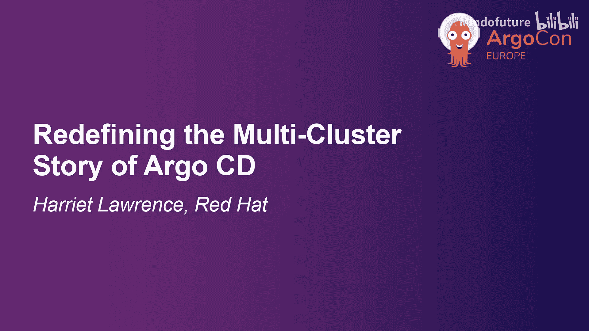
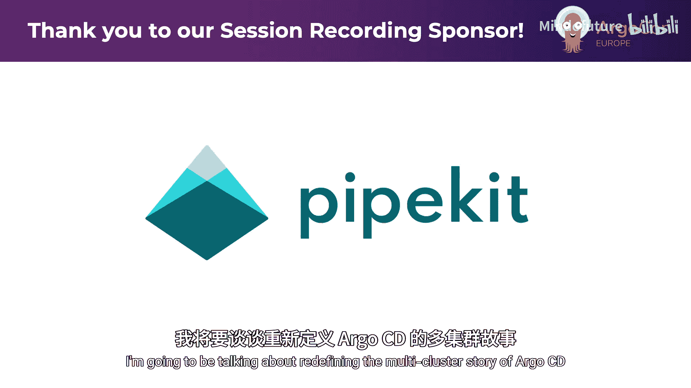
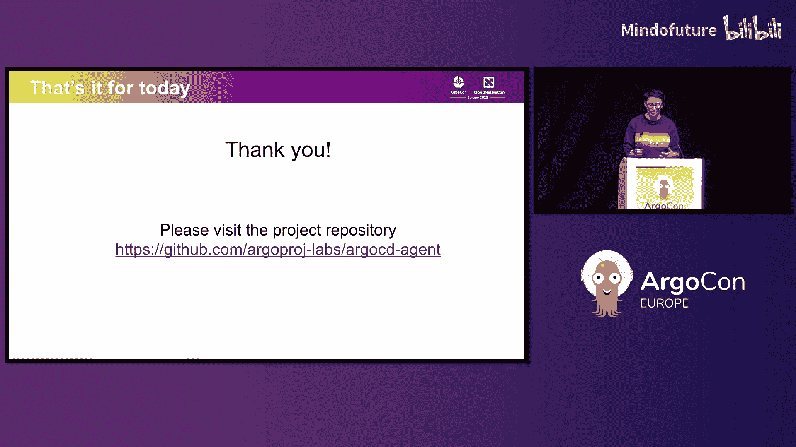
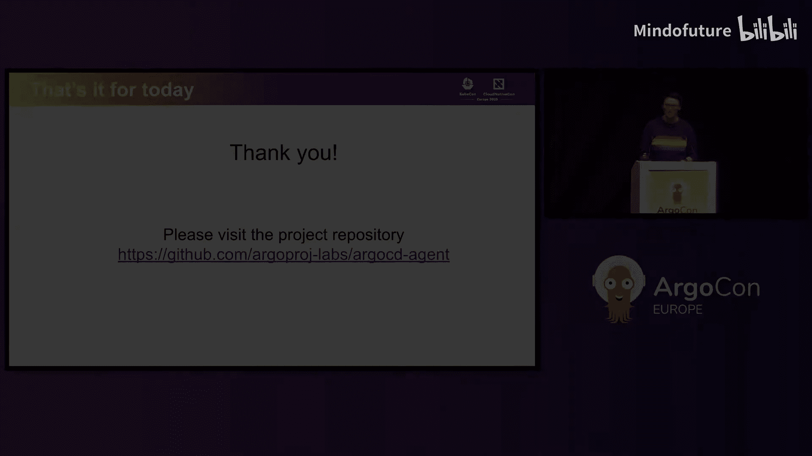

# ArgoCon-2025-Europe-大会-｜-云原生-｜-CICD-｜-架构-｜-k8s-｜-docker-｜-devops-｜-kubernetes-p06-P06-Redefining-the-Multi-Cluster-Story-of-Argo-CD---Harriet-Lawrence,-Red-Hat--BV1Xr5vzGEyK_p6-

Hello and welcome everybody。 My name is Harriet。 I'm going to be talking about redefining the multi clusterlu story of Agar CDd。

😊。

So you all were expecting Jan Fisher to be giving this talk today but he wasn't able to make it right at the last minute。

 so I am here in hisstead。All right， so what can you expect today in today's talk。

 I am going to make a quick excursion into the history of ArgoCD and its multicluster architecture。

 how it's evolved so far， and about some of the challenges that people face when they are setting up and running a multicluster ArgoC。

😊，After that， we're going to introduce a new architectural pattern and some emerging projects that we think may solve most of these problems and will hopefully take ArgoC's multicster capabilities to the next level。

😊，SoI've left this one in about Jann because he is the originator of the project。

 He is our senior principal software engineer at Red Hat for Openshift Giups。

And he's based out of Ontario， Canada。He's been an Ago CD user and contributor since the early days in 2019。

 which was prior to Ago CDD's GA release。He' really loved the Agartiti community and the product so much so that he kept contributing to it in his free time。

 And eventually that led to him becoming one of the maintainers in 2020。😊。

And he is thrilled to say that his hobby managed to make it into making a living for him。

 and he was hired by Red Hat in 2021 to work on Ago City full time。So a little bit about me。

 I work with Yn on a day to day basis， I'm the PM for Openshift GiOs at Red Hat。

 so I work with the Red Hat engineers and the upstream Argo community to help figure out what we should build next。

Al right， so for those of you who've been around the Argo community for a little bit of a longer time。

 might remember that in the beginning， there was just a single application controller pod。

So you had this one lone single pod that you could configure with appropriate credentials to reach out to remote clusters and reconcile manifests there。

This is a nice， simple mechanism。Especially if you only had a handful of clusters。

There's no need for any configuration on the remote Cs except for providing a service count and appropriate automatic。

But this mechanism came with its own set of problems as well。1。

 connecting a cluster to Ago CD is a very expensive operation in terms of compute and in terms of network。

AgoCD will establish long lived connections to the remote clusters， watches。

So that it is able to react to any change that is happening within the clusters。

And depending on how big these clusters are。In terms of the amount of resources that they have and how busy they are in terms of changes。

You can really quickly hit the vertical scaling limit of the application controller itself。

So in order to help with scaling out to more than a handful of clusters。

 the project came up with a mechanism called cluster sharding。

So shing basically allows you to scale the application control horizontally。

 and each replica will have a group or a shard of clusters。

This approach definitely helped the scalability， but it didn't address any of the kind of original challenges on how the remote clusters were accessed。

You still needed stable and low latency connections。

 and you have to still maintain those highly privileged credentials。

 and you still see all the same amount of traffic as before。

And Sching also created its own set of challenges。So how does it look like when you get lots of clusters more than just a handful And when you start treating your clusters as cattles rather than pets。

 you also have to consider scaling out your control plane cluster。

So that you can host all of the application server replicas required to manage all of these resources on your clusters。

And we still haven't solved any of the kind of core issues like the vertical scaling requirements of the application controller。

 how you go about mapping your clusters to shards， network requirements， and all that。

And one of the biggest challenges that we have found that customers and users of Ago face is that when you have to scale up。

 you have to tune it so that it is appropriate for the biggest and busiest of your clusters。

 and you can't do them individually。And if you have a non homogenous array of clusters。

 you will likely end up with a lot of wasted resources。 so to work around some of those issues。

 some people try and further petition their groups of clusters and then shard their control planes。

But this only kind of postpones the problems to a later point in time。

 and plus then you need to go and decide which IgoCD control plane to use for which cluster。

And again， the core issues still haven't been solved。

Then as some people go and install an agoCD on each cluster， which is not an entirely bad idea。

 generally speaking， solves a lot of the problems mentioned previously because each ArgoCD instance only talks to the cluster that it's installed in。

But it also effectively distributes your configuration across all of your clusters。

And doesn't provide any means for central observability。

It also prevents you from implementing those more intelligent advanced promotion patterns。And。Sorry。

Through means such as application sets。And when you end up with something like this。

 you're going to need a very long set of bookmarks for all the URLs， for all your UIs。

So what if we could augment this approach， keep all of the perks that come with it。

 but also have a central control plane that handles your observability and your management。

 but removes all of these burdens that we've talked about？Sounds pretty good。

And if we flip these hours around。And have them。Point back into the control plane。

We can manage and observe them from one place。And this exists。

This is an open source project started by YM， and it's got the working title of the AGCD agent。

So this is a very simplified diagram。 The blue boxes here represent existing RCD components。

And as you can see， there's an application controller on each of the managed clusters。

And the AgoCD API server， which hosts UI， gets installed just once on the control Plan cluster。

Components like the reos server application sets and Redis have been intentionally left out of this diagram because where you put those on your clusters heavily depends on your your teams and your orgs setup and your other requirements。

So the green boxes， which say agent， these are the components added by AgoCD agent。

So we've got a single principal component on the control plan and one agent on each of the managed clusters。

The main purpose of these components is to exchange information about AgoCd configuration。

Primarily the application resources。But also other configuration like app projects and repo configuration。

By default， the agents and the principal will talk to each other using DRPC over a connection that's secured by TLS。

In a nutshell， the principal will let the agent know about changes to the application spec while the agents will let the principal know about changes to an application' status。

In reality， there's a bit more to it than that， because the sync protocol allows for different things like triggering AugustgoCD operations and refreshes。

And the agents can run in alternate modes， like an autonomous mode。

Where the sink protocol act bit differently， but that's getting a little bit into the weeds。

 So coming up to a bit of a high level。Let's talk about the architecture of Ago City agent and the design principles that have guided its development so far。

First and most importantly， the initiating component is always the agent。So in terms of topology。

 the agents need to know how to reach the principle。

 but the principal doesn't need to know any details about the location of the agents。

And your agents and the workload clusters that they're on are not required to be externally reachable as long as they have a way to communicate back to the control plane。

Secondly， the workload clusters are autonomous in their operations。

That means that the control plan is not and won't become a single point of failure for your topology。

Yes， when the control plane cluster or the principle is down。

 you might not be able to configure a new application or modify or delete existing ones or get your centralized observability。

 but if you make changes to your application manifests and Gi。

 the application controller on the workload cluster is still functioning normally。

 it can still pick it up and reconcile your commit。Thirdly。

 there are no external dependencies by default。So the core idea behind this is to make it simple to set up and get started。

Out of the box， there are no requirements for persistent storage for any third party authentication systems。

 need database systems or message reps。Users， developers should be able to get started using vanilla Kubernetes clusters。

But we do acknowledge that this might not be enough， especially when it comes to large scale setups。

This is why we've added in extension points at strategic parts of the architecture so that you can integrate with those third party systems if need by。

And finally， it works with vanilla ArgoCD， so you won't need any special magic version of ArgoCD that is particular to the agent。

😊，Neither on the agent systems or on the control plan cluster。

And we design the agent features around Igo City。 So if we think that there needs to be a change made in Igo City Cor。

 we'll advocate for this change we need there rather than just implementing it in the。

So what can you expect from the agent today？Right now， it's very early stages of development。

 but we have released the first ever publicly available version just before this conference。

The core functionality that the project already provides built on like the diagram before。

 the principal and the agent component， these components talk to each other， GBC and cloud events。

But we also provide plug authentication mechanism with MTLS and simple username password。

Then what's already possible， you can do CR operations for application resources。

 you can create and manipulate applications on the principal。

 and the principal will know to which agent it should submit those changes。Likewise。

 the agent will submit status changes back to the principal。

All of the status of an application including its syncC status。

 will be available on the principle in near real time。

We also support things like sync and refresh from the principle。

 which will get propagated out to the correct agent。

The project also supports basic synchronization of app projects。 say basic， because right now。

 all app projects that are managed on the principle will be synchronized to all of the agents rather than a particular one。

And we're aware that this is not optimal， but we have plans to change it。

Just wanted to let you all know that's how it is today。

Another problem that we've solved is the live resource view。

 so you will be able to view live resources from the agent systems on the principal。

 all in one place。Just like you would today for a regular vanilla Agar CD setup。AndFinally。

 we provide users with a CLI that they can use to manage certain aspects of configuration on the principle。

 like agent credentials。Right now it is just a little bit more than a proof of concept。

 but we have pretty big plans for the near future。Alright。

 so this is the kind of stuff that we're looking for the rest of this year。

 So a short to medium term roadmap。The highest priority for us is to close the gap that still exists between this and the AugustgoCD experience。

Things like viewing desired manifests in the UI。Having the UI calculate and show the difference between desired and live states。

 as well as the resource tree that provides so much insight into your applications。

We already have plans for how to make this all work。

 and we're going to begin writing code for that shortly， say we very loosely。

Yan will begin writing code for that very shortly。So this is something that you can expect in an upcoming minor release。

Also， we found that people really love to use resource actions。

 things like rerolling out deployments， deleting atray resource。

 any custom resource action that you've implemented， and that's definitely coming soon as well。

After that， we'll be focusing on the multi tenant experience and bringing that to the agent as well。

As we mentioned earlier， right now， we thank all the app projects to all of the agents。

And since we've found that app projects are usually used for governance purposes。

 this is not optimal for most use cases。So one thing that we're going to work on is finding a way to selectively sync the app projects just where they're needed。

And the same thing goes for private repossitories。 They're not supported as of now。

 but we really want to support that in the future。Finally。

 when we're talking about really large scale scenarios。

 we need to think about more efficient ways of doing authentication between the agents and the principal than we've got today。

And automating the registration of agents with the principal。

So we are eyeing an integration with Spy， which is a protocol for Ze Trust workload authentication and is under the umbrella of the CMCF if you're not familiar with。

Right， and last but not least， we need the help of your community。

Although it is mostly Red Hat folks who are working on the project today。

 this is definitely not a Red Hat only project。Yn started this project in his free time。

 and while Red Hat obviously does have a use for this project。

 and we are heavily invested into supporting it。We intentionally chose to develop and nurture Argo CD agent in the space that it belongs。

 which is the most excellent open source community， the Argo community。

So how does one contribute and participate， we would really appreciate anyone who takes time to test this project。

If you want to validate our ideas， give us feedback， if you have new ideas。

 if you've got really specific requirements of how you'd like to use the agent。

We would love to hear all of it。And。Anyone who wants to just even contribute a little bit of documentation。

 we would love to have you。We would love to get this better aligned with the Ago City community right now。

 it lives in Agoprodge Labs， and we want to make sure that it is perfect for all of you。

 and we would love for your feedback。 Can reiterate that enough。😊。

The possibilities for this project are right at the start and theyre endless。

 and we will be grateful for every contribution from the community that we receive。

So that's all we've got for today thank you so much for coming Jann really wishes that he could have been here。

😊，And if you've got any follow up questions， there is a Agra CDD agent channel in the CNCF Slack。

 and he is around in there and you're welcome to Pingham。

And if anyone is thinking about installing the agent already and you're wondering about the complexity of managing that and maintaining it。

 there is another talk later today by one of our wonderful colleagues Josh Packer and that will show you how to integrate the AGCD agent model with open cluster management and that takes a little bit of the complexity out of lifecycl and configuration。

Thank you。😊。

