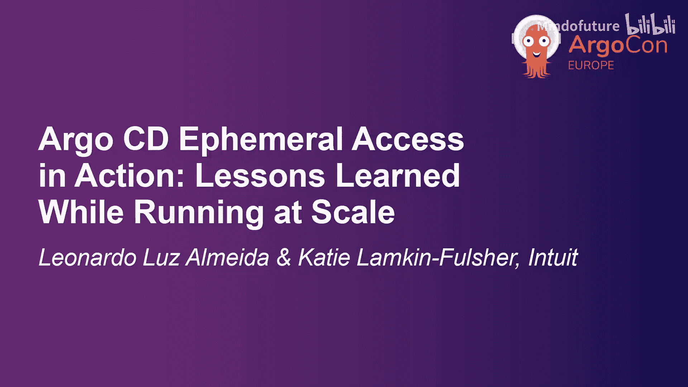
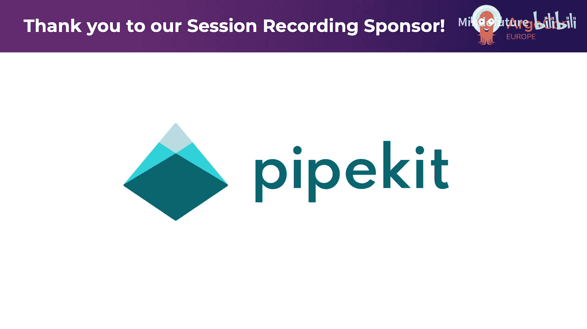
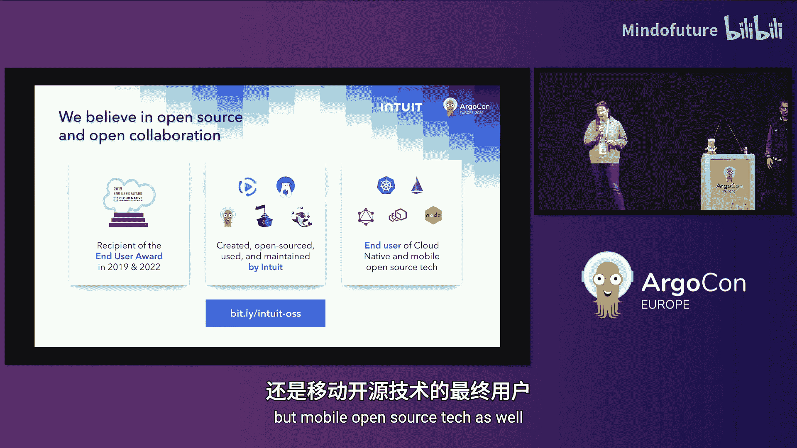
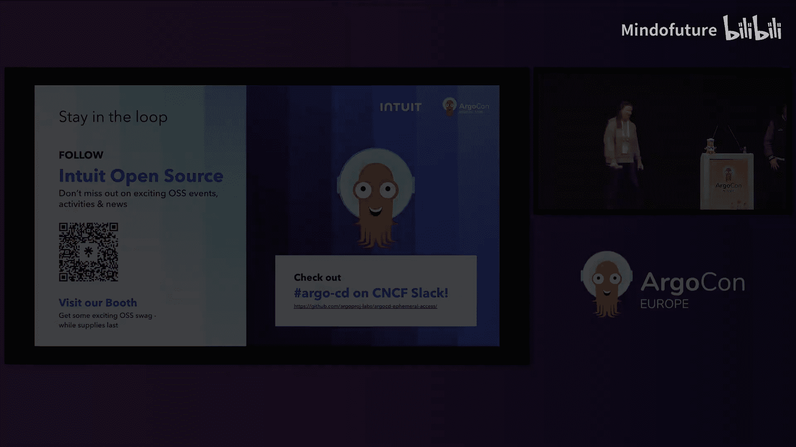

# ArgoCon-2025-Europe-大会-｜-云原生-｜-CICD-｜-架构-｜-k8s-｜-docker-｜-devops-｜-kubernetes-p07-P07-Argo-CD-Ephemeral-Access-in-Action---Lessons-Learned-While-Runnin...-L.L.-Al--BV1Xr5vzGEyK_p7-

All right。Hello， everybody。 Can you hear me in the back。

W， I'm gonna take the waving。 Is it time for a copy break right after this， not during this。

 right after this。 Awesome， Well， we're super excited to be here。 We're now to my talk。

 which is gonna be the best talk of the day。 I'm sure my name is Kitty Lampkin。

 And I am a staff product manager， a platform and open source set Intuit。😊，Hello， hello。

That seem to be working。Hello。Hello， everyone。 My name is Leonardo。

 I'm stop software developer at Intuit and an Argo maintainer。😊。

And today we are going to be talking about Argo CD ephemeral Access and action。

 so this is one of the Argo Labs projects that Dan talked about in the project update that allows you to use this extension to solve some of the problems that you guys may be experiencing within Argo CDD。

😡，So let's review the agenda， I'm going to tell you guys a little bit about tech it into it and dive into some of the problems that we were experiencing within our developer platform。

 some of the enhancements that we made to the ephemeral access extension， the outcomes。

 and then what's next。So technology had into it。Intuit is a financial technology company that provides financial solutions for things like taxpayers in the United States via TurotTax and also within Canada。

 and we also provide financial software for small businesses。

As you can see by some of these very big numbers on the screen， we operate at a very。

 very large scale for our external customers， and it's just as important as we're operating at scale。

 again， for our external customers， that we make sure that we can operate at scale internally for our internal developers as well。

So let's talk about Intu its ArgoCD platform。We operated it with speed and precision。

As you can see from our scale with our 50 plus ArgoCD instances and our 345 plus Kubernetes clusters。

 we have a very large workflow footprint and at 2。4000 PRs per day。

 we need to make sure that the scale at which we operate getups and facilitates deployments。

 is able to keep up with again that speed and precision that we want to deliver for our developer platform so that we can deliver those end user experiences for our customers on the financial side of things。

Now， as we operate at scale。 and again， we're in the financial business。

 So we have some areas of compliance that we need to make sure that we are very， we are very。

That we facilitate those requirements and we experienced a few challenges。

 Leo gave a talk at the previous Argocon that kind of dove into the ephemeral access extension and kind of why we doved into that solution。

 and just to give you guys kind of catch you guys up as we look into the rest of the content for this talk。

 some of the problems that we experienced were lack of fine grain permissions， security risks。

 deployment freezes not being enforced and unrecorded changes。

So if for unrecorded changes just to get people a little bit of context。

 we are required for all changes that made into production。

 have a change request filed for those changes that includes regular deployments going out the door。

 but that also includes if a user goes into， for example。

 the ArgoCDUI and facilitates an action via that UI。

 we need to make sure that we record those changes as well。So let's look at at Intuit， for example。

 let's look at in production the type of UI actions that happen on a weekly basis。Now。

 as you can see by that big blue piece of this donut chart。

 delete resources is the top action that is done via the ArgoCDUY。 Now。

 what does delete resources mean Delete resources can be referred to as I'm going go in and I'm going to delete a pod My pod is stuck in progressing。

 My pod is unhealthy， I need to restart it。 I'm going to go in， deletete that pod。

 it's going restart and a new healthy pod is going to spin up。

That's an example of deleting resources。Deleting resources can also be。

 I'm going to delete my live replica set。 I'm going to delete my live deployment。

I'm going to delete my live rollout object。These types of actions are things that we need to make sure that one we have traceability over。

 and two， we need to make sure that the right people who know what they're doing are performing these actions。

 Not every application developer will have an understanding of what deleting a live deployment means。

 right and they may not even need to actually have that permission in the first place。

 There's a very small subset of people that we want to have those permission that we want to have these fine grain policies And there's a larger subset of people where it makes sense to have them have delete access to pots。

So we introduce the Ephemeral Access extension， and as you can see up on the screen with this beautiful screenshot。

 the extension adds a button at the top that says， hey， request your permissions by default。

 you start with Read only permissions。When I request access， you'll enter in your role。

 you can have the option of having multiple roles， it will then facilitate the process via requesting that access。

 either receiving access or your access being denied。

 and then you can facilitate those right actions within the UI itself。😡，So when we launched this。

 we got a bunch of really awesome feedback internally for our customers that werere using it。

 a lot of really good things， but obviously things that we can improve upon as well right we're in software。

 we want to iterate， we want to continue making things better we're not afraid of this feedback so the four themes that this presentation focuses on today is one users have multiple roles right as I mentioned with fine great access policies。

 different developers are going have different permissions。

 but developers can have multiple roles assigned to them themselves。

 which is a good thing right we want to facilitate the least privileged policy。

The system needs to be able to be dynamic to be able to retrieve these roles as well。 right。

 Argo CD can't be opinionated about these roles。 It needs to be able to reach out to whatever system is facilitating these roles and act upon those。

Again， those change requests， we need to make sure that they're filed。

And then we also need to make sure that our UI has a proper user experience for supporting these dynamic roles。

Now to talk to you about how we solve these problems， I'm going to hand it over to Leo。Thank you。

 Katie。All right， let Argocon， we introduced the FM X extension and now I'm going to be presenting the enhancements we did since then。

 as Katie mentioned add into it， we have the concept of multiple roles。

 so we have a dev portal add into it and user can have roles like developer， Dev bos at mean。

That allows them to execute different actions。 And we wanted to。Bring that experience。

That is like the big experience in Argo City。And the way we did it。

 we added this section here in the Eemal Access extension that allows the user to select the role that has the minimum level of access required to execute the actions they want in that particular application that enables the least privileged principle。

 as Katie mentioned， and and yeah moving on。But how can we enable those roles and how can we make those rows dynamic depending on the user。

 right？ So this is enabled by two resources that ships with the ephemeral axis extension。

 Those are two CRDs。 The first one is called row template。

 The row template is what I'm showing you here。 It's basically a description and name in a list of policies that allows ArgoC at means to define their policies that are going to be elevated for that particular role。

But how a user can be associated with those roles is driven by the access binding resource。

 the access binding will basically bind a role template， the same resource that I mentioned before。

With a group's claim， so the list of subjects here is related to the group's claim that is associated with the token when the user logs in in Argo City。

 so here I have just an example， group one in a quick demo that I'm going to be presenting to you in a few moments。

 this is the group that is going to be associated with my user。And that's why in my user。

 I'm going to be able to be elevated to specific roles， okay？All right。

 so the next enhancement I'd like to highlight is the concept of plugs right and but why we came up with this plugging concept in the first place。

So the plugin was a requirement for us basically because of the feature that we need to make available。

That。Intuits demands that changes in production。Will require a change request to be approved。

In order to allow that user to get their access elevated， right？

But the problem is that API is a proprietary API， and we wanted to make this open source friendly since day one。

And that's the main reason， the main driver， why we implemented this split mechanism， okay？Okay。

 so how the pin？Collaborates with the whole process of getting the user with elevated access。

 so let's start from the top number one there the user goes and log in in ArgoCD right so this is a normal process there's nothing nothing new is's a normal ArgoCD login mechanism okay once the user logs in。

 they get a token and the token will have the group claims associated with it。

The user goes ahead and has the plugin enabled， sorry the feax extension enabled。

They click the the permission button and they select the the option。To get their ex elevated。

At that point in time， there is a new resource that gets created called access Re。

And the access request triggers the ephemeral access controller reconciliation loop。Okay。

So the reconciliation loop will， if there is a pluginin configured in the ephemerax controller。

 it will invoke this operation called Gr axis in the pluginin。

The grant access operation can return three different status pending， granted or denied。

If it returns spending here that you see on number four。

 that will conclude that reconciliation and will reschedule it for a later time okay this is configurable so you can say something like every 15 seconds every one minute you want to restart。

And call the plugin again and see if that's already available。 Okay。

 then the plugin can return granted or denied。And whenever itD returns one of these two。

 it will move forward with the next step in the flow。So let's say the plugin returns granted。

 if it returns granted， then the ephemeral access controller。Move on in。Grant the user with access。

 And what it means granting the user with the access。

 it means updating the ArgoCd app project resource associating my user。

In the role associated in that project， so that is what increase my access level and associate my user with that role that was defined。

Okay， so a plugin what is a plugin behind the scenes。

 So a pluginin is an implementation of this interface that I'm showing you here。

It's a go interface a pouge needs to be implemented in Go length。

EWhere there are three operations where the the two on the top are are not mandatory。

 those are optional。So in it can be used to initialize some clients you can use to inject some dependencies in your game。

 this call only once once the FMRX controller is initialized。

Revoke operations a nonmon operation that can be used to clean up some resources if that makes sense for your use case。

 and grant access is the only one that is really required that is going to drive the whole process that I'd mentioned to you okay？

What I'm showing you here is a link with。AP game implementation that I created for the sake of this presentation。

It can be used as a reference implementation， so in your company。

 you want to create a plugin to implement some specific use case that is really particular to your company。

You can take a look at this pluginin as a reference。

 so it's really a matter of implementing this interfa in Golan。

 making this binary available in a Docker file in a Docker container and it is all documented as part of the process I'm going to go into more details in a second why I called sleep pluginin is basically because。

By the time I invoked， I called the Gr Access operation。

 I'm going to sleep for 15 seconds and after 15 seconds I will either return granted or denied。

 so with this I can test all the state transitions and yeah。

 it's good to test the plug interoperability with the controller。Okay。

 so the last enhancement I'd like to highlight here is the conditional extension。

 so this is an Argo City concept， so ArgoC UY has this concept of extensions。

But for intotu it because we had the necessity to only。Enable the ephemeral axis。 this action of。

Requesting to have your aes elevated。To be available only for production applications。

 we needed a mechanism to。Guide the extension。To decide if that extension should be enabled or not so this is driven by this particular configuration here and what I was showing here what you're seeing here is is the patch that can be applied in the ArgoCD API server to install the ephemer axis extension and here at the bottom is the piece that enables the conditional extension which is mainly telling the ephemRX extension that it should look for a label with this value and with this key and this value。

In order to make that extension， in order to make the ephemeral axis extension available or not。

 okay。All right， demo time。What I have here， I have everything running locally。

 I have two Argo City applications， and in this one you see the new permission button and the widget with the current permission and this other application。

The button is not there。Right and this is what the conditional extension was all about and the reason why you see the button here is because the label I configured is called Argo called demo if it needs to be true in order to have the epherral axis enabled so I'm clicking the permission button and I'm looking at the current roles that I can be elevated to。

But before I move on on elevating my access， let's take a look at the project associated with this Argo City application and you see here that theres only one role currently configured here called admin。

And this role was there since the beginning and let's take a look at the user info for my user when I logged in ArgoCD。

 you can see here that I have two group claims associated with my user which is group1 and group2 okay so this is what makes the access binding allow me to get elevated to specific roles when I get access elevated okay let's go back to the application list and let's。

Try to execute something。 So by default， my access is read only。 So let's try to restart deployment。

 and I get permission tonight。Because my access is read。

 so let's select the role with minimum access so I can restart a deployment。

 which is a developer role。So requesting the I click the request button and as you can see。

 the status of the access request is requested。 this is the status here。嗯。

So this is driven by the plugin now， the plugin is sleeping for 15 seconds and after 15 seconds。

 it will return granted。So。That's what I'm showing here， so after some time he returns it granted。

 he updates the widget， I go ahead and click Re， and now I can go ahead and restart deployments。

But what if I go and try to edit the spec of the。Deployment resource。

 I will get permission tonight because。Deing this spec is not granted by the developer role。

So let's go and try to get my access elevated to the role that allows me to edit the deployment spec。

 which is a Devops role。So I'm hitting the permission requesting the access to have DevOs role。

 and I am granted the Dev DevOs role。And I'm going to try again and edit the number of replicas for my deployment from two to three。

And I click safe。 And now I have the ability to do so because I got elevated to that axis， the last。

The last action I want to present to demo you is deleting a replica set which is not allowed for DevOs。

 but allowed for admin。I'm Gr。 I'm。Requesting access to admin， when I get admin access granted。

 I can go ahead and delete the replica set。So let's go back to the project and see how the roles are looking like now。

Different than before， I see three new roles that are that were created dynamically。

 So those roles are managed by the ephemeral access controller。 And if we look at the admin role。

 because I'm still。Associated with this role， that's why you see my username there。🤧。

But if you go back and look at the other roles that my access has got expired already。

 my user is not there anymore。So it was- and this is all managed by the ephemeral access controller the amount of time my user is associated with a particular role is all configurable and driven by the controller。

Okay and that's it for the demo just concluding what it takes to install。

 I mean I won't have time to go into all small details。

 but it's all documented in the ephemeral axis extension Github repo。

 you can take a look there there is an X samples folder besides of the sleep pluginin that serves as a reference implementation in the X samples folder there is another。

Pluin documentation there where I documented every every line by line on everything that needs to be done if you want to implement your own plugin for your company。

 And with that， I hand back to you， Eddiety。Awesome。How about a round of applause for that demo。

 That was pretty powerful， huh。Allright， let's talk about the key results， right。

 We implemented this really cool thing。 The demo looked beautiful。 Leo was flawless as always。 Now。

 what is this bias， right， What are the outcomes， What are we， What did we accomplish here。

 So 100% of our changes made to production with Argo C D U I now of a change request filed with them。

 That's huge from a compliance standpoint， right？ We， We met that requirement。 check。😊。

Security best practices， as you can see by looking at what access each individual role has。

 developers have the ability to select the principle of lease privilege， pick their access。

 pick their role that they know is necessary for the operation that they need to perform using the Argo D Ui boom。

 we made the security team happy。 That's pretty incredible。 It was a user friendly experience。

 I don't know if you guys saw but at the top where we listed out know requesting your permissions。

 it also is able to provide the developer with insights of their current role we're able to show them。

 hey， you have the developer permission you have the Devops permission。

 you have the admin permission and those roles are specific to into it。

 you can have your roles that are specific to your organization。

 and those will be configured to be displayed within the plugin as well。 So very user friendly。

 It allows developer to again， perform their daily function and improve their productivity without compromising control or compromising requirements of compliance and security and。

One of the most important things for my heart， right is that this solution is 100% open source compatible right Intu it is really big on open source。

 and we want to make sure that， hey， if we're experiencing a problem。

 there's a really good chance that the rest of the community is experiencing the same problem。

 And so we want to make sure that when we're solving these problems。

 we're not only solving it in a way that' is going to help for us。

 but we want to make sure that we contribute back to the community as well。

And speaking of which into it again is very involved in the community， we not only contribute。

 maintain and have created the Argo project， but we do it to a number of open source projects as well。

 we have won the end user award twice and are an end user of not only cloud native Techologies but mobile open source tech as well go ahead and check out our Bitlylink。

And finally， I am confident that this talk has changed your life for the better and we'd love to hear your feedback about it。

 so please check out our link tree there you'll find access to the resources necessary within this talk。

 go rate us on CNCF。 My name is Katie if you liked our talk and this is Leo if you didn't like our talk。

 My name is Michael Crenshaw。And we'd love to hear your feedback。 Thank you so much。

