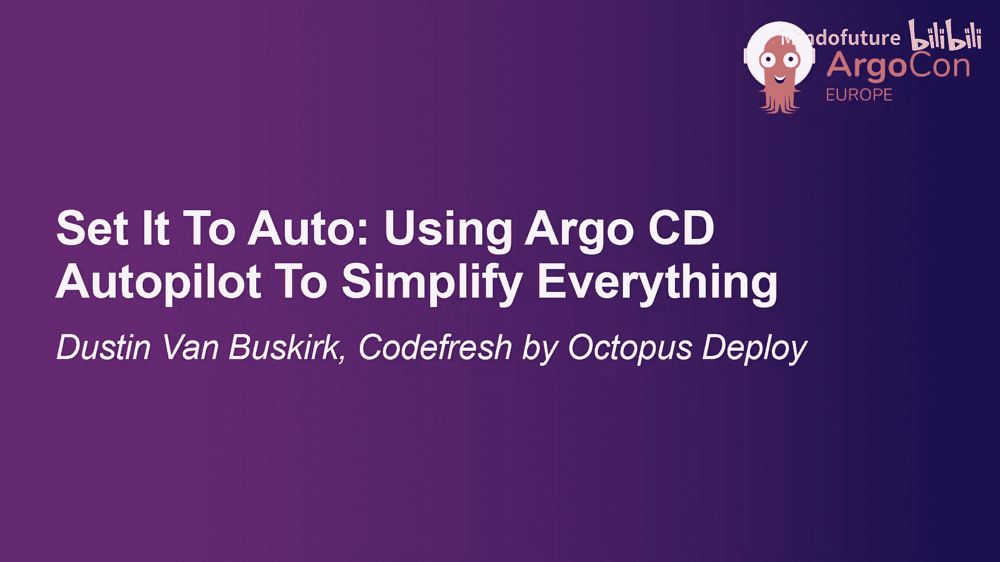
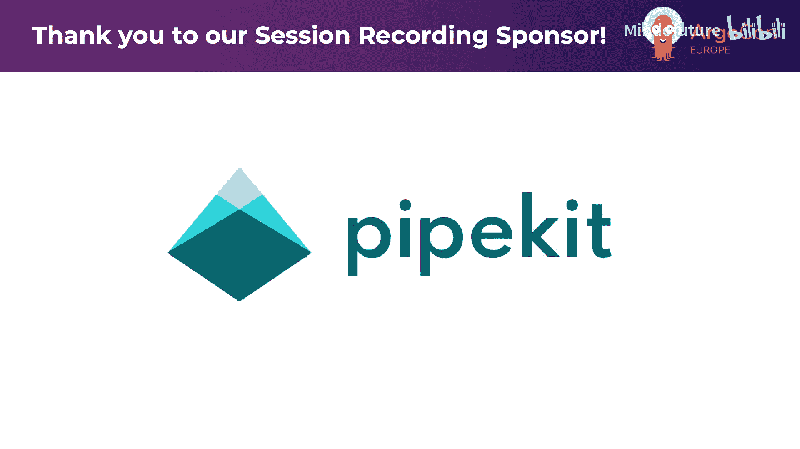
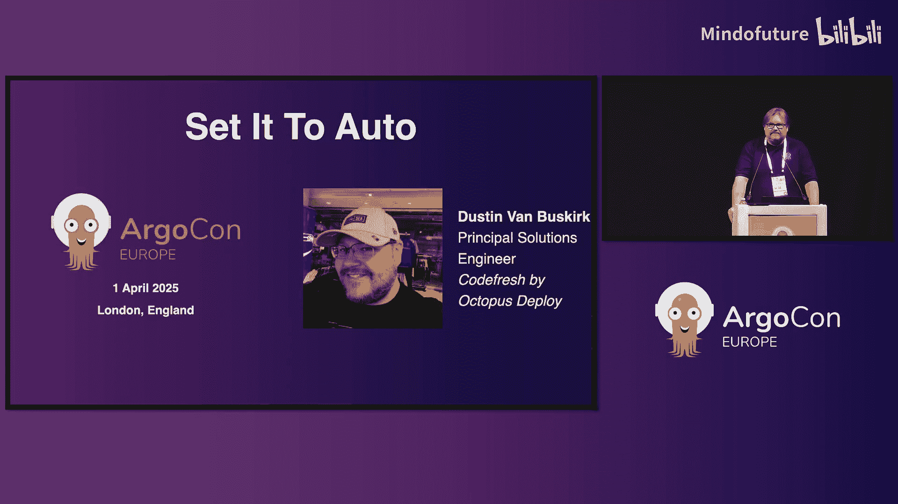

# ArgoCon-2025-Europe-大会-｜-云原生-｜-CICD-｜-架构-｜-k8s-｜-docker-｜-devops-｜-kubernetes-p09-P09-Set-It-To-Auto---Using-Argo-CD-Autopilot-To-Simplify-Everything---Dustin-Van--BV1Xr5vzGEyK_p9-

Hi， everyone。

How's everyone doing this afternoon， everyone okay？Getting tired。

Probably getting good tired。Good news is I got a demo and it might break and it might make things very exciting today。

So just quick show hands， I can't really see too well。

 but how many folks have used the autopilot project before？Oh， that's not very many。So yeah。

 I can kind of tell it's not a very active project when it comes to contributors。

 we'll talk about that at the end today I'm going to throw a few use cases at you though use cases I had for myself where I actually jump back into it。

So I'll get started here with this first slide， this is me。

I'm Dustin Van Busker actually been at Codefresh for over seven and a half years so when the Argo Autopilot project started I was part of that project in the kind of initial phase of that and kind of moved away from it currently working at octopus if you can't tell where the logo so one of my projects recently have me jump back into autopilot I was looking for a way to install Argo wanted to manage it through GitOs which is something that we've done as a common practice from day one at Codefresh is to do everything the GiOs way and that means all the configuration exists in the Virgin control and so we're doing everything correctly for the GiOs policies so basically I'm going to give a quick lightning talk hoping I will come up with most of the time we'll see how the demo goes。

So basically Argo Autopilot， the project has a few common use cases。

 so you know I've basically applied every single one of these use cases to my talk today number one is basically to help me facilitate the ArgoC installation and put it under GiOs that means that this Argo Autopilot project is going to in the version control。

 help me update the required paths， put the required configurations and put them under version control so that ArgoC is managing itself through GiOs operations。

So like as I mentioned， you know the project started about four years ago at the time Codefresh was trying to find a good way to install ArgoC with our users a lot of folks were brandy ArgoC the helm charts weren't quite there yet and you'll see some of that resonate a little bit and there arego autopilot project in the way that we use customize in the way that's programmed for customized today doesn't mean you can't use helm with it but it's not a firstclass citizen by any means it requires you to enable helm in order to deploy things via customize overhellm has some advantages but yeah there's some shortfalls as well。

The second item was to basically use that same getoff structure that I've put up in place for the Argo installation itself with my applications。

 so ideally， you know we want all the configuration。

In the version control in a similar structure so that when we're looking at different environments。

 we don't see that the configurations organized differently between the environments。

 This gives us a solid construct going forward when we're trying to do things like promote between environments。

 So I'm not going to cover too much about the promotion between environments。

 but I definitely wanted to be able to do that because I was sitting my own work over the top of that and it required that structure be in place。

The third thing is that it's kind of a nice to have here for me and I was able to get everything working is that since everything is backed up in my configurations code。

 I'm able to actually use Argo autopilot to be able to bring back up。

 basically do recovery of my entire Argo cluster components plus my own ArgoCD applications behind the scene。

So kind of jumping into autopilot and how it works right so autopilot is a Argo project that is a binary that sits between you。

 your Kuberized API and your version control system so it helps tile those things together from your local machine so basically when you're on your local machine you can bootstrap a cluster。

 install Argo CDd configure it from there you can also add additional applications。

 it'll help you put the structure in place for your Gitthub or I think it works with Gitlab bucket a few other different version control systems GitT but basically working with that version control system。

 it's also going to put the structure of the applications in place for you using app install and then finally you can recover everything by specifying that bootstrap command to install Argo and then from that point you can point it to the configuration repository the directory and reinstall everything back into a new cluster so that's what I'll demonstrate today actually is's using that bootsottrap function。

 pointing it to the version control system and telling it now to put everything onto a new cluster。

For me，So it works really great as a recovery process as well。

So my use case is basically I was given a new project recently where I had to install ArgoCD to multiple different clusters。

 normally not part of my role because actually my company we have some automation around that already but know we're looking at the Argo open source now from a different perspective there so I had to find a new way to install this so I want ahead and pick up autopilot and I want ahead and start a deployment now this was kind of unique to my deployment is that I wanted to not use hubub andsp so in a lot of cases a lot of folks are using Hu and spoke there's nothing wrong with Huub and spoke。

 but I like to use a ArgoCd per cluster that manages that cluster so it makes it a lot easier for me there's some benefits to it and I'll go over those benefits of running an ArgoCD per cluster but what I realized right away is that I'm going to get into a maintenance nightmare here unless I have a way to predictably install predictably install ArgoCd to these clusters and manage it so that's why I went ahead with the Argo Autopilot project。

Also on top of that， I needed to put the applications in place so that I could manage those applications through my project and basically those had to be deployed with that construct in place because I was mapping the configuration files that had to be in a specific directory structure from environment to environment so they all had to match they all had to be deployed predictly Lastly。

 you know as a developer， sometimes my clusters just magically vanish I blow them away on my own by mistake all the time。

Luckily I'm a salesperson so it's okay I can do that and I can recover from there。

So here's kind of the deployment model I'm not sure you know a lot of folks I know do are hububen spoke。

 you know there's a lot of great advantages to that and we have a great blog post that covers all the advantages and disadvantages to each kind of Argo deployment model I went with the standalone model for my exercise and basically what I wanted to do is just have the ArgoC service that cluster it belongs on that way I have better isolation I can also have more reliability by having my ArgoC in that cluster。

 I'm not dependent on kind of a single point of failure to deploy all my Argo apps across different environments。

And then of course isolation of concerns， better security。

 so you know I can get into this ArgoCD if it's for dev， it's for staging if it's for production。

 you know you can put special R back in place， give permissions to specific teams。

 you don't have to worry about that kind of multitenancy that comes with that hub and spoke model so you can basically separate these different environments also you don't have to have networking between the environments anymore you don't have to worry about can this ArgoCD attach to this cluster's API it will be able to attach because it's going to attach internally to the in cluster API。

Of course this comes with its complexity right so there's certain cons here where I thought Argo Autopilot would be a great fit to help me solve for these you know some of those is going to be just management and updates like how do I reliably update my Argo CD installation。

 how do I manage it and how do I recover it right so those type of things are kind of what I'm going to cover at least as far as my use cases and how ArgoC fit for me and really that's how I'm trying to simplify ArgoC myself is by using autopilot to do these things？

So number one， basically managing the Argo CD management I wanted an easy way to install and configure everything and I wanted it all into version control I was going to put it all into a single repository using a mono repo so that I have all my configuration files in one place so I can see it manage them from one place of course that's not a requirement with Argo with Argo autopilot you can point you know different clusters to different reos have them managed separately that's up to you but basically what this did is it helped me simplify edge deployments to these clusters you know I knew I need to have multiple installations。

I wanted it all backed up。 How could I do this Well。

 I just went ahead and Argo CDd autopilot bootstpped every single one of my clusters configured them。

 put them in the Vige control system repository， all the configuration that went with that and eventually I got on to the point of my applications So here's kind of what that repository layout looks like。

 So there's development stage and production there's different ways to organize this again。

 we could do different repositories but we can also inject our own folder structure。

 whatever requirements are here。 then we could use an owner's file to basically set up permissions around those different folders So right here we can see the applications that are currently under management from this cluster the bootstap is going contain all the ArgoC configuration files I require The customization yam is going to sit over the top of the ArgoC installer that's gonna allow me to put in information overlay information overrides to specify and make that ArgoCD installation you know have the required config plug ins and other。

That I require。 And of course， this is all connecting into internal clusters。

 So I don't have a bunch of cluster resources I have to manage。 Instead。

 I just have an in cluster resource that I'm working with。

And now I have my application deployments I have to worry about。

 So basically I kind of you know I've already covered this using the GiOs principles。

 having the correct repository structure， that's going to help me get these applications deployed in a predictable manner that I can then go ahead and update now the update being an automation we want it to be predictable So in a lot of cases you can go from values file。

 the values file set up your path mapping to where you have like environment name as part of that path。

 then eventually get to your values Yamble for your application and that way you just can know deploy from system system just by changing the pathing So that gives us a really easy way to promote the configuration changes know the values file changes which by the way。

 helpl works with this or the customized overlay any of that can kind of be brought into this then as far as。

Well， I guess this is all covered， creates a simple pattern so those are just all kind of the different ways it's impacting it。

 but you've heard them all before， so I'll skip onto what that looks like from the version control system So here you can see the demo application here that I deployed I have a base。

 my customization Yaml that's pointing to my other customization files that brings in basically customization pointer and then I have an overlay and in this specific case I only have one so if this was a multi kind of cluster approach you might see one for development。

 one for staging one for production but here I just have this Argo manages this one overlay which is involved with the development project So projects another thing you can easily create as well。

 the project construct is supported from the ArgoCD autopilot so you can create that sort your applications under that project like I've done here so just basically having this consistent is what's really important as we begin promotion around these processes。

Okay。And then another thing， just like I said， I can blow away my clusters at any given time just because。

 well I get a knock on the door from the folks from IT saying oh your cost is up really high。

 what can you do well I can just go ahead and let those clusters go I don't have to worry about those repercussions now I have a way to easily install ArgoCd and all those applications that are under that ArgoCD installation from the Vi control system so I can keep all that configuration of the Vi control system so any reason I lose a cluster like I said it could be me fat fingerering something it could be me going through the process of just cleaning up resources and accidentally cleaning up the wrong resource but with this command here I can just point from my local machine set the context correctly to the Kubernetes context I want to recover to and then I'm going to be able to specify the repository and be able to pass that information in so that I can go ahead and just hit the button。

 recover everything from the that I stored in the Virgin control system。

So here's where things get dicey。Demo time。 So I'm going to go ahead and try to shift screens。

Bring up my。Terminal， hopefully you can see that。 All right， Ter， everyone can read that。

I'm just going to assume yes。I，Okay， so just let me make sure I'm connected to Wifi here。

I'll start with making sure my Kubernetes cluster is online here， give me a second， it's down there。

 so I got to kind of focus on it and try to get to see it here。Sorry。

 they don't need to watch on there。Just trying to make sure this is the correct cluster it should be。

Absent of anything related to ArgoCD currently。All right， yeah。

 so it's just got the cube system metric server on there。So what I'm going to attempt to do。

Is I'm going to attempt to ArgoCD autopilot bootstrap this。Let's see if I can actually see it， okay。

嗯。a second here。Go back over here。I'm stealing my command from my slide deck because for some reason I don't have it anymore。

 which makes me worry that that means my token's not set up on。This particular。Window here。

 where we're going to hope it is。Because for some reason。

 my terminal doesn't have any history for me to recover to。Maybe I just typed it wrong。 And I did。

 I didn' put。 I dash， didn't put a dash in there。 So basically， we have my repo， okay。

 everything cool。Let's go ahead and clear that out。And。So this is the binary here。

We have the autopilot recover。 All right， this is what we want to do。 So basically what we'll see。

I I'll go ahead and run this here and it's going to begin the recovery process from the version control system if it has an internet connection。

And we'll hope it does。 I believe it does from the Kubernetes。

Okay so the whole person of this is binary is that from my local machine。

 I want to be able to put together the version control system with the Kubernetes cluster I'm talking to。

 so that Kubernetes context， so it's going to realize it has to create everything。

 nothing's currently available， it's then going to restore ArgoC and I have some applications it's going to restore as well so what we should be able to do。

 see if I can drag that up a little bit。So we can see the very bottom here。

We should be able to watch everything get recreated and then hopefully I went ahead and deployed the Sock app for the Sock store。

 and hopefully that all recovers OK， and basically this is what I'm going to use for going forward as a path just to install my entire demo site to my ArgoC clusters。

 which I'm going to have a dev staging and production eventually。So I time this out。

 it's about five minutes in total to recover everything。

 but I promise I'll show the ArgoCD user interface in just a second and then everyone can clap and we'll get excited about it。

So this does eventually quit out when Argo CDD comes into a ready state and then Argo CDD starts picking up the work so basically ArgoC is redirected to the configuration files。

 it grabs all the applications that we' currently underneath there begins the deployment of all those applications。

 which includes a bunch of demo apps that I have Sockstore。

 I believe I have a guestbook in there and I might have one other demo app in there that's part of that。

So yeah， as soon as this is done， I will open up and watch the pods for just a moment。

 make sure they're online once they're online， it's actually going to split out too。

 I believe a command for me at the end where I can do a port For proxy into the ArgoCD user interface and then if you already noticed I have a browser open behind this will navigate to that interface and watch everything else come online。

All right。So there's autopilot， it's done what it needs to do， and it's covered everything。

So we'll go ahead and take this and the temporary user thing password here。Okay。

M good and fresh this window here。And of course， you don't have a shirt in front of it。

Because I'm a salesperson。I don't believe in certificates。All right。And。Let's get signed in here。

So yeah， you'll see you know ArgoCs here， but also you know everything's being synchronized that was in that application repository。

 so you know the one you'll probably focus on the most and probably can't read it very well is the Sox project here。

So we could see our sock shop that's coming up from the Vige control system you know so this has its own overlay。

 I'm doing some extra things to basically specify this for my environment like changing the load balancer。

 but yeah， this is all going to come up and come online so it's going to restore everything in about five minutes for me obviously this depends on how much resources are available to your cluster。

 how many apps you have to restore but yeah just gives you a viable way to restore and connect everything from the Ver control out to the Kubernetized cluster。

So I don't think I'm going to wait for this unless anybody wants to see it know go into healthy state。

 you can only least see it synchronized， things are coming online。

 I think we can go down here and kind of see that we are going to have some pods that are still working their way up。

But I'm going to go ahead and continue with the slide deck because I want to get to one of the important things。

Which I consider maybe the most important thing。And that is my call to action so I noticed there is some contributors still on staff at Codefresh still working on this project。

 but you know all open source projects to move them forward we need additional contributors so I ask everyone to if youre interested in kind of moving this forward maybe seeing helm support or seeing an additional support as far as recovery or other things please you know at the end of this deck you can go download the deck online through schedule you know I'm gonna have additional resources you can come participate in the CNCF Slack channel you could help out on Gitthub we have issues there know if you're gonna to use it and you want to file some issues you know feel free to we're still trying to know help out and be the lead contributors on this I was supposed to have one of my colleagues joining me his names Nome and Nome's here today if you want to talk to him a little bit about Argo Autopilot and we kind of the road maps taking us the road maps also included as part of the Gitthub repository so some of the things we'd like to see and others have mentioned as far as improvements to help us move。

This project forward those materials are available there so you know if you want to come see and pick Noome's brain about it you can also you know I'm up to talk about my experience with it you know I've been away from it for a few years now but I was using it on a daily basis you know about4 three。

 four years ago I was using on a daily basis to help everyone install Argo and I know a lot of folks have moved on past that and they have their own Arrgo installation process maybe it's be a bootstra as part ofterraform but at least for like know clusters we have to bring up and down and we want to recover especially from a developer's perspective this might be very valuable tool for you it is for me。

So yeah again，' there's the resources， you can pick those up later。

 basically that's the Slack channel， if you want to come participate with me and know them。

 bounce any questions off of us， you know become a contributor， please reach out。

