# ArgoCon-2025-Europe-大会-｜-云原生-｜-CICD-｜-架构-｜-k8s-｜-docker-｜-devops-｜-kubernetes-p10-P10-Scaling-Argo-CD---From-Symptoms-To-Solution---Alexandre-Gaudreault,-Intuit--BV1Xr5vzGEyK_p10-

Wele welcomecome everyone， welcome to scalinging Hargo CDD from Symps to solutionution。

 My name is Alexon Gerro， I'm from Quebec， Canada， I'm a software engineer at Intuit and also an ArgoCD maintainer。

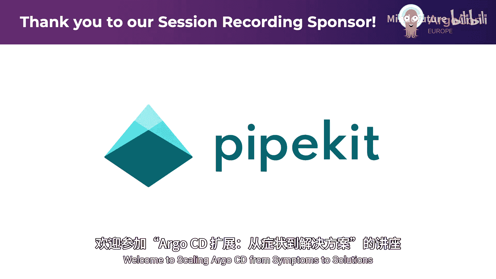

So let's talk a bit about Intuit， Intuit is one of the reasons I'm here today。

 and Intuit is also the company that took the bold decision a few years ago to open source ArgoCD and it also open source a couple of different projects。

 so go check them out。So today the agenda is quite simple but it is an advanced talk so you need to be familiar with ArgoC you need probably to have deployed it and if you have not don't worry about it it's also going to provide you good tips to investigate scaling issues that you might have in the future so we're going to go over a list of different scaling problem that we've experienced or community that I've experienced a community have experienced and we're going to look at the symptoms we're going to look at the graph and see what happens in Argo normally people will just mitigate the symptoms and be done with it。

 but today we're going to dig deeper we're going to try to diagnose them。

 find a root cause and fix it for good。So let's talk a bit about the Intuit platform for a second at Intuit we have multiple instances and or instances have different footprints so we have instances configure with five and 10 clusters。

 we have other instances configured with 300 clusters。

 we have instances using monoreos and application set。

 other instances are using applications like straight applications and have a lot of them so these variety of instances allow us to experience different scaling issues。

 and make sure our go scale in general。The most common scaling issue that you've probably experienced before is this one。

So you're on call and you get a CPUU alert。You go look at your CPU request in your chart in your graph and you get something like this。

 so you have two choice right you can bump the CPU request which I'm sure you've done a couple of times before or you can decide to investigate it I see a lot of people laughing so I'm not the only one。

Or you can investigate why is the CPU that high is Argo supposed to be like this so yeah。

 sorry about the light but。😊，Let's try to understand where the CPU is consumed in the application controller there are three main components。

 the first one is the Giubs engine， the role of the Giubs engine is to watch all the resource updates in your Connected clusters the Giubs engine will then evaluate if that resource belongs to an application or not if it doesn't belong to an application it will discard it if it does belong to an app。

 it's going to cause the reconcile loop。So the role of the reconcile is to figure out if your app is out of sync or not for that。

 the reconcile is going to reach to the repo server。

 most of the time it's going to be in the GitRepo is going to be in the cache so the connection to the repo server is going to be quite。

Fast and it's going to compare that with your Kubernetities manifest also in the cache。

 it's going to compute ignore differences so there's a lot of CPU time spent in the reconciliation and if your app is out of sync。

 well whether you have auto synconable or you manually trigger a sync，The S loop is going to kick in。

 the S loop， it doesn't happen quite often obviously。

 and the S loop is mostly IO bound because it's going to call the Kubernetes API to apply the resource。

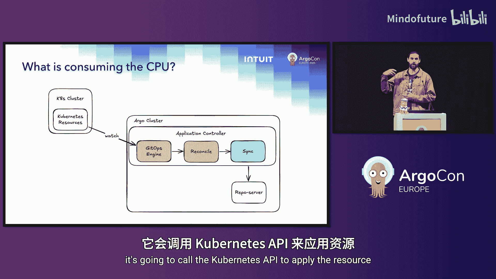

If you don't trust me， you can profile your application with PProf and get exactly which method are consuming the CPU。

 so you use PProf， you get a flame graph like this and you can investigate deeper。

 but today we're not going to go too much into PProf， you'll have to trust me。So it's on Sunday。

 we get the ICPU alert， we go look at the reconciliation activity。

 and we see that we have a constant rate of 32，000 reconciliations。

Not as weird right it's Sunday no one's supposed to be working it's exceptos we're on call so we know that people are not deploying we know that people are not thinking they're not changing Gi why is Argo doing that much work well we've seen that the Giups engine Gen watch everything and then it cause reconcile so let's try to improve that filters so we have less reconcile events so there's two ways you can we can do that the first one is to exclude the resource if Argo is watching resource that we never see in the Argo UI we never deploy in our applications we can exclude that Argo doesn't need to watch them if it does needs to watch these resource then we can ignore parts of it so we can configure ignore resource updates but the art part is to try to figure out which resource are actually causing the reconciliation for that。

It's all documented in the ArgoDcs， I'm not going to go over the steps in detail。

 but we need to enable the bug logs， the reason why we don't want a constant rate of 32。

000 logs to say which resource is triggering updates， the log or the splunk team。

 they're not going to like that。嗯。So we unable the backlogs for maybe 30 minutes。

 we get n enough data to know which resource are causing or weconcile and we figure out that into it。

 it was actually the HPA， the horizontal parttocalalar that's causing。

A big chunk of the reconcile why is that so if we think about the HA we know that the HA is going to constantly reach out to our metrics or monitoring system to get some value and then try to compute if it should increase the number or lower the number of pos and it's going to persist that in the HPA status so whenever it persists that in the status it cause a Kubernetes change that the Githubs engine receive that change will evaluate as this resource part of my application yes trigger reconcile now we know that any change to the status shouldn't cause our application to be out of sync right because we don't commit or status part of our desired manifest so we try to configure ignore resource update to ignore all the status and let's not just do that for the HA let's do that for all resource。

So we do it for all resource we deploy that and we now get our reconciliation activity almost dropping to zero we can see little bumps but we know that these bombs are caused by or reconciliation timeout because they fit with the reconciliation timeout so every three minutes we have a little spike of reconciliation but that's a good improvement right？

So we deploy that。And now our CPU looks like this， what was a constant rate of six and7 CPUU。

6 and seven core is now just spiking a lot， and spikes aren't that bad but we know that spikes will cause stress in our system at a specific moment our system needs to do a lot of work and in a distributed system like Argo well that can affect other components one of this component is the repo server。

 so I've said earlier that during a reconcile it was going to reach to the repo server。

 but most of the time it going to be in catch so it's blazing fast。But the cache expires。

 if the cache expire and you try to reconcile everything in your Arrgo instance， well。

 you're going to have a spike of activity that is transferred to the repo server。

 and the queue of the repo server is going to fill up because it's not in cache。

 the operation take some time， it needs to run helm， customized and this may take a minute。嗯。

And you might have。A auto scalar configure。 So if the Q of the repo server gets filled up， well。

 you just scale more pauses。 The problem with a spike。

You do all the operation at the same time and the autoscalear is going to come after so the reos server is going to accept all the request that it puts them in queue maybe they're going to process these requests in 45 minutes so you don't want that and then the new pods that are scaled up by the autoscalealar they're just going to have a small amount of the request because by default。

 how does it work when you route request in Kubernetes it's round Robin so the was there at the beginning that the queue is full。

 there's like1 thousand items in the queue still receive request because it's just doing round Robbin。

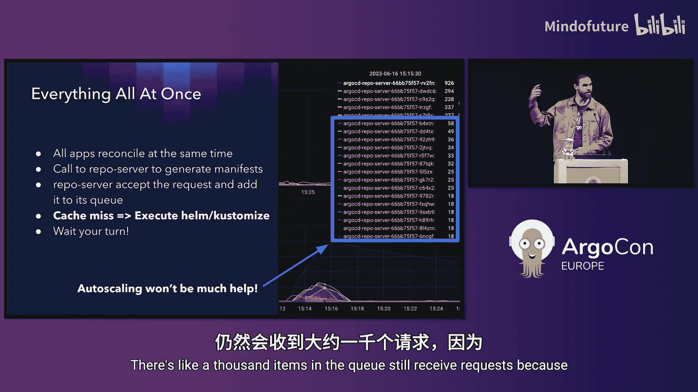

So spikes are bad。 It puts pressure in different components in your system。

 You want something that's steady and predictable。 Theres are some mitigation option to to reduce。

Desp。 so you can configure the reconciliation time out to be an hour or two。 Now。

 it's not going to fix the issue。 It's just going to delay it。If you do that。

 you also need to configure the Gitweb bug because you don't want your application to be out of sing an hour after you've committed。

 you want the Gitthub event as soon as the commit is made。And。

You must configure the manifest generate path now this is mostly used for monorepo。

 but you should also configure it for a single application if you have a Jenkins file。

 if you have a CI or readMe， you don't want to readme update to cause a reconcile in Argo。

 that's unnecessary and if you use monorepo you absolutely want to configure this annotation because if you have100 app that syncs the same repo URL whenever there's one commit its going to cause a spike because there's 1000 app that are going to be reconciled at the same time。

But we said we're not mitigating issues today。 We're fixing them。

 So fixing it is actually quite easy。 Youll just configure a jitter。 Now， what's a jitter。

At the end of the reconciliation timeout it's going to add an amount of time that's a buffer。

 so you have your let's say your reconciliation timeout is an hour and you configure the jitter to be 30 minutes。

 you now have the guarantee that your app is going to be refreshed between an hour and an hour。

 30 minutes， so instead of having a spike at an hour exactly these requests will be spread over 30 minutes。

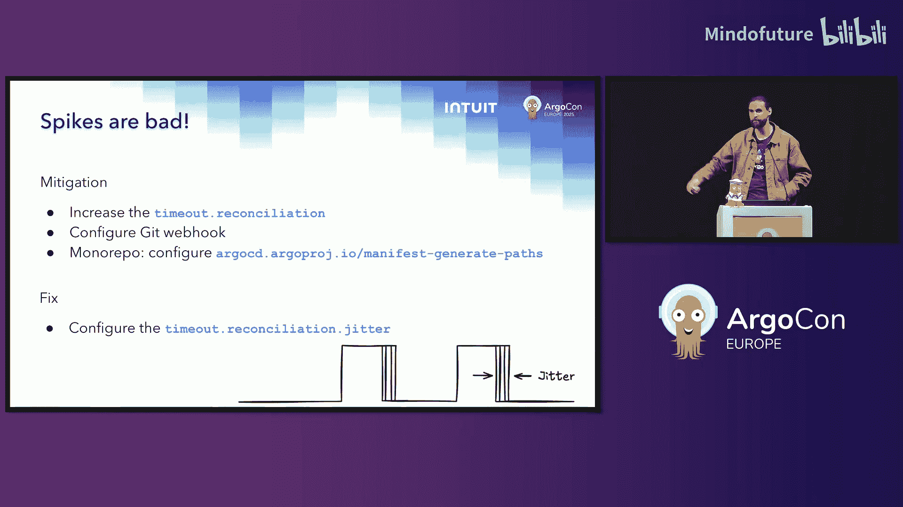

So what if reconciliation is still high， you have different things that can cause eye reconciliation。

 but I'm already behind schedule， so let me see， raise your hand if you use orphan resource monitoring。

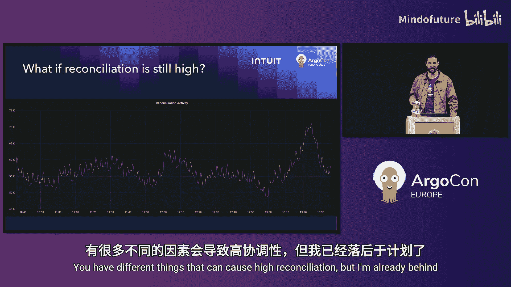

Okay some of you， so I'll go quickly but I'll be at the Argo boot after for your questions but basically orphan resource monitoring is going to cause an update whenever there's a resource in the namespace that changes at the beginning I said the resource needs to be part of your application well with orphan resource monitoring it's not true it just needs to be in the same namespace so if you have random resource in your namespace that you don't know about them and these resource change then。

The reconciliations are going to go up。 So if you for the ones that use orphan resource monitoring。

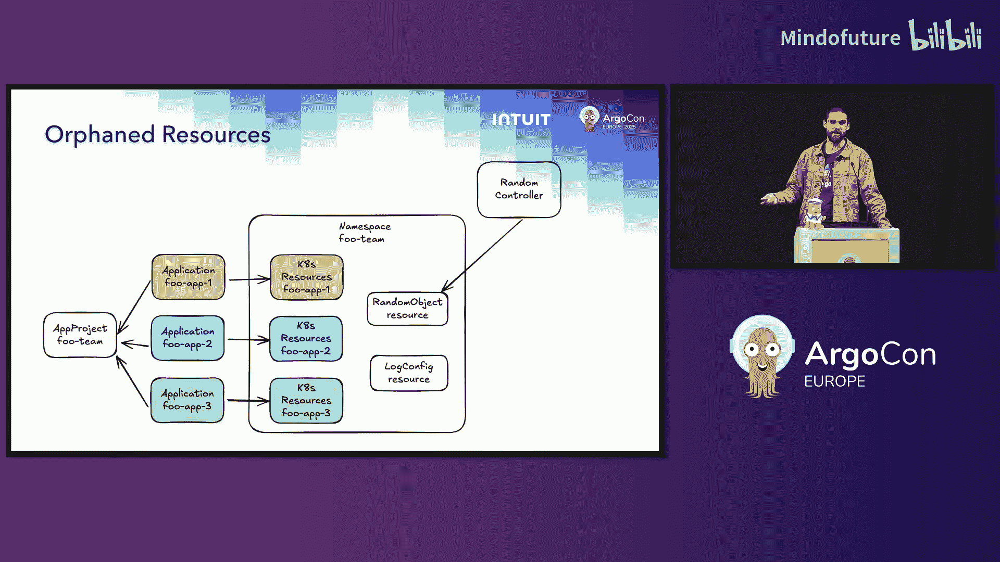

Try to turn it off and see what happens someone in the community tried that and they posted their graph on a GiHub issue。

 and that's their reconciliation activity after disabling it。

That's their CPU activity after disabling it。 so we can see that the CPU and the reconciliation activity are almost the same。

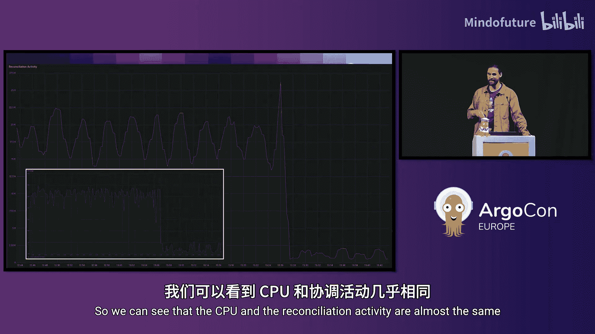

So there are some limitation， we don't have time to talk about them。

Let's do a little recap of what we've learned so far。

So we've learned that there's a stronger correlation between CPU usage edge and reconciliation activities。

 so if you want less CPU， you want less reconciliation to have less reconciliation。

 you can ignore the updates you don't want we've seen that spikes cause problems so you want a smooth CPU you don't want spikes so you can configure jitter to smooth that out and we haven't seen that orphan resource can be very costly。

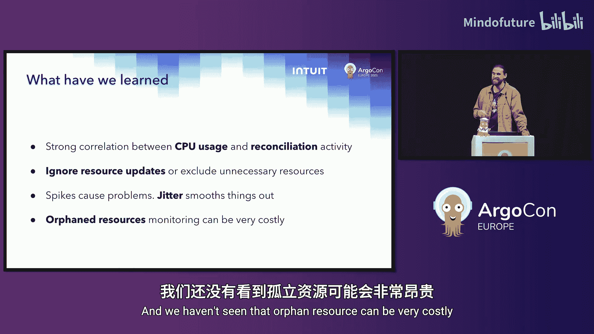

So we fixed the CPU。 What's the next alert。High memory alert。

We go look at our memory usage and it looks like this for the people in the back， it looks like this。

So we've reached about 100 gigabyte in our application controller。

Why is that can we're not going to bump the request at this point because orpon may not even be scheduled on a node。

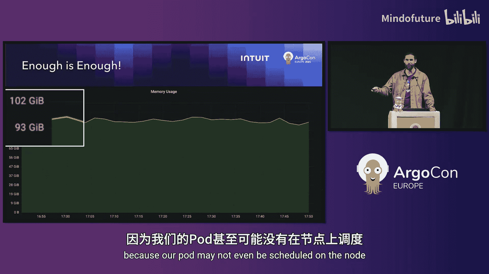

So what's consuming the memory， well， we've talked about Github Xgenhen。

 and we know it watches all the cluster。Well， when it was a resource， it keeps that resource in cash。

 so as you add cluster in your Argo instance。The cash is going to grow。

 and the memory is going to grow with it。 So how can we reduce the memory while we can watch less object Again。

 we can exclude what we don't need to watch。😊。

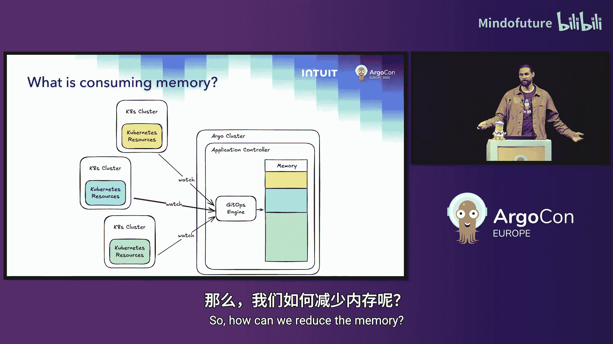

There's another setting that we often don't think about。 and is the cluster namespace filter。 Now。

 if you have a cluster that has 100 namespace in it and you only deploy in five namespace in that cluster。

 Well， don't watch all the namespace in the cluster， you can configure it to only。

Watch five namespace and you'll get a 95% memory improvement。

Another way to configure that is by using Re Ar back。

 so instead of configuring in Argo which resource to watch。

 you configure your role and role bindings and Argo is not going to watch the resource that it doesn't have permission on。

And realistically， if we configure all that， how much memory do we have now。

 maybe we have 80 gigabytes， that's still a lot so our last resort at this point is sharding。

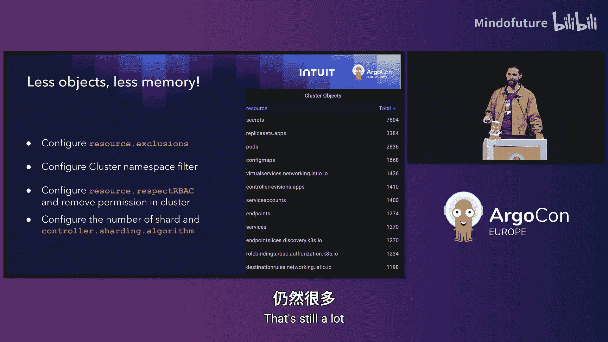

How does sharding work， it's simple， you split the application controller in two shards。

 and either with round rubbin or a uniform distribution。

 your cluster are going to get assigned to a specific shard。So right now it may look like this but。

It may also look like this because we're doing a uniform distribution， we're doing round robins。

 we're not sharding based on the cluster memory footprint。And or cluster are not all equal。

 we have prediction clusters， these prediction cluster will have a lot of resources if we have test cluster。

 test cluster， maybe they won't have as much resource， but for Argo they are two cluster。

 they're the same。So what can we do about it， we can manually assign cluster to specific shards so we can recalibrate or memory usage in our shards。

 there's another project that's pretty cool it's called the Argo City agent I don't know if you've seen the talks about it today but it's also going to be a way to fix this issue in the future but right now we have manual assignment。

 we manually assign our cluster to shards and we spin up multiple application controller and we get something like this now。

15 GB is not that bad。 It's much easier to schedule。 We're proud of ourselves。

 We can go to our Sunday brunch。😊，And then we go to the office on Monday。

Because some people need to go to the office。And someone tells us，y， our goal is slow。

 you've heard that before。Realistically， of course。It's a tough one to investigate why is Argo slow。

 there are many things that can go wrong， but today we're interested if all our applications are slow。

 is it only one specific app or is it all the applications There are a few questions we can ask we can check if our work cues are actually filling up or if or items are being processed we can look at or external dependencies so we have two big one in Argo we have Gi。

And we have Kubernetes API server。

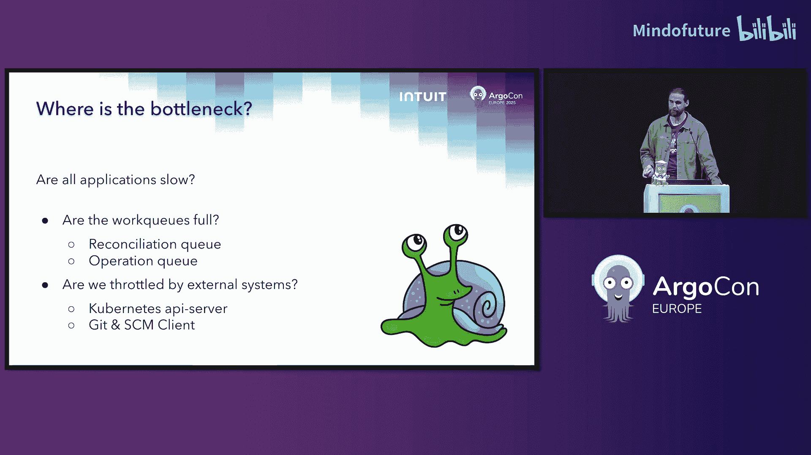

So let's look at our cues， if our cues looks like this， that's bad， Qes shall almost be zero。😊，So。

There's one thing that may cause Argo to be slow globally， it's still related to CPU。

 I don't have time to talk about it， but go watch this talk is about CPU limits and trutling it's super interesting。

 but there's dozens of talk on CPU limits， but basically if the CPU gets throttle your operation takes more time。

 so what you want to do is increase the CPU limits or you may want to consider removing it totally。

So let's assume low reconciliation or CPU is fine， we can configure increasing the number of parallelism in Argo。

 so we have the status processor for the reconciliation and we have the operation processor for the sink now I'll say it one last time if your CPU is high。

Don't increase that。 If Argo is there and you try to increase the parallelism。

 it's not going to go well。So another thing is I said we have to monitor external dependency。

 so one way to do that for the interaction with Kubernetes is to configure is to look at the audit logs so Kubernetes will produce an audit log for each calls to its API you can use the user agent ArgoCD application controller grouped out those requests and you can see if any kind is using a lot of the API calls that happens because。

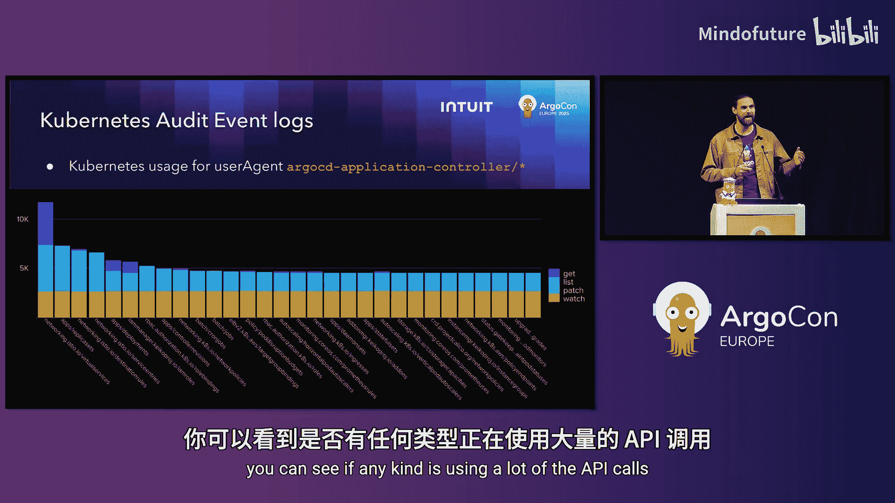

When we interact with Kubernetes we have a client side rate limit。

 so if one kind is using the API call because there is a problem。

 we're going to get client side rate limited and everything is going to be slower so in Argo3。

0 we added the client sign metrics so now it's easier to monitor if we're being rate limited or if we have latency when interacting with the API server。

If we do you can configure any of those metrics now I' try I'll try to explain why we added a client sign metrics is do you remember earlier when I said to optimize memory you can configure the cluster namespace filter Well that's what we did before we were watching auto cluster so let's say there's 100 kind in your cluster we were making100 API calls now we've configure six namespace in that cluster so now we're making 100 API call per namespace and we're not making 600 API call you can see that the maxidal connections is 500 so by just。

Changing our memory and how we use the memory we've now reached。Well。

 we are now over the limits of the default 500 and this created another bottleneck when we were interacting with the API server temporary deadlock until or connection expire。

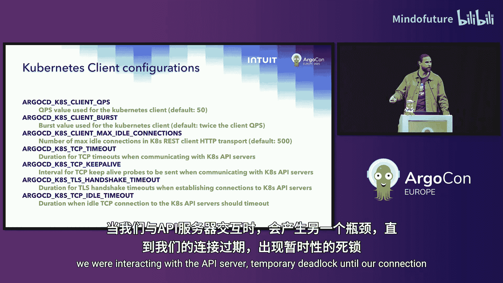

All right， so that was a lot for today I'm running out of time but this isn't even half of the scaling issues you can encounter there are a lot of different possibilities where Argo will won't scale because whenever you fix or configure Argo。

Whenever you configure some Arrgo settings and you fix the bottleneck somewhere。

 the pressure point goes at other places。You always have bottlenecks in your system。

 and you need to address them。

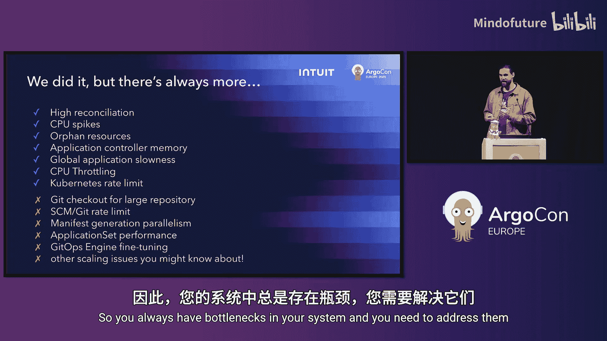

Now。I'm sure some of you have learned about new settings here that you're not using。

 and you're excited to configure them。Configuring the scalability in ArgoCd iss like trying to pour the perfect espresso shot。

 Now I drink a lot of espresso。 you never change all the setting at the same time。

 you change one setting， you pour a shot， you taste it。And then you iterate on that。

 if you try to change all the setting at the same time， you won't like the taste。

 and even if it tastes good， you won't know why。So。If you've experience one last thing。

 if you've experienced scaling issues and you fixed them。

 we're interested to know so you can reach out to seek scalability or you can reach out to me specifically and if you have questions I'll be available after this talk at Enward boot so thank you everyone。

 thank for listening and I hope you'll。Improve all your performance。Yeah all reference。

