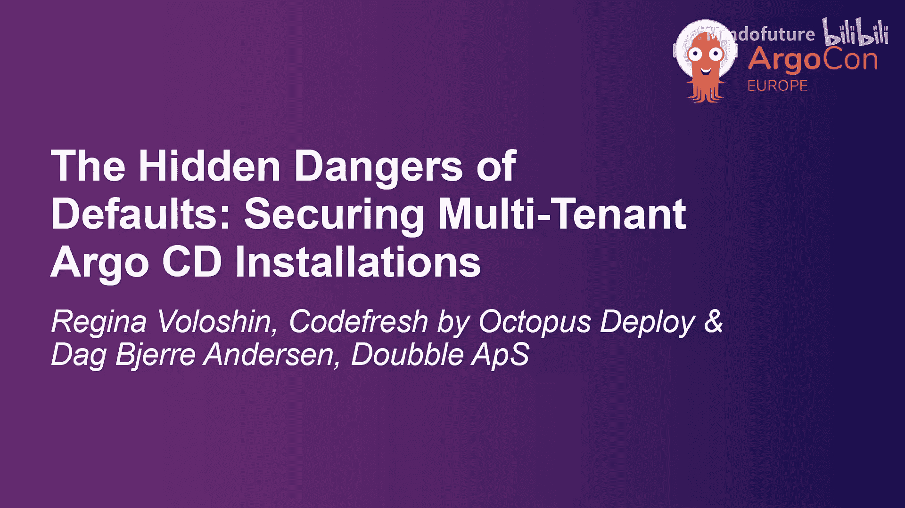
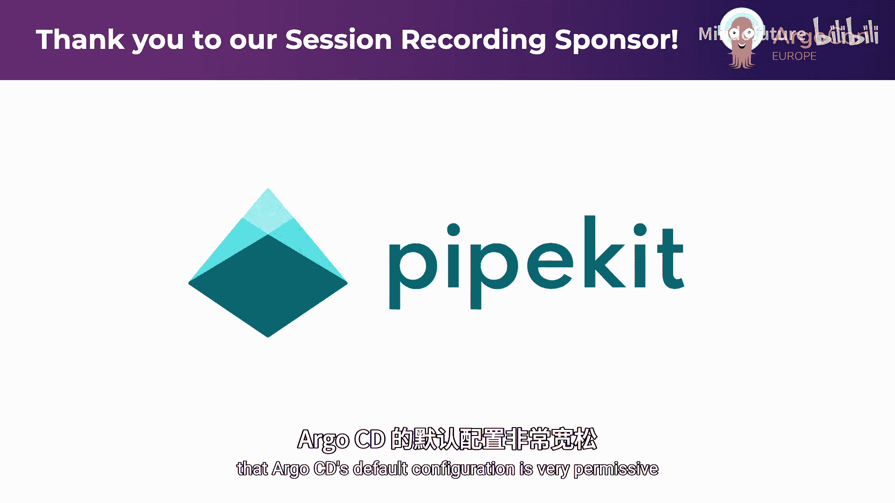
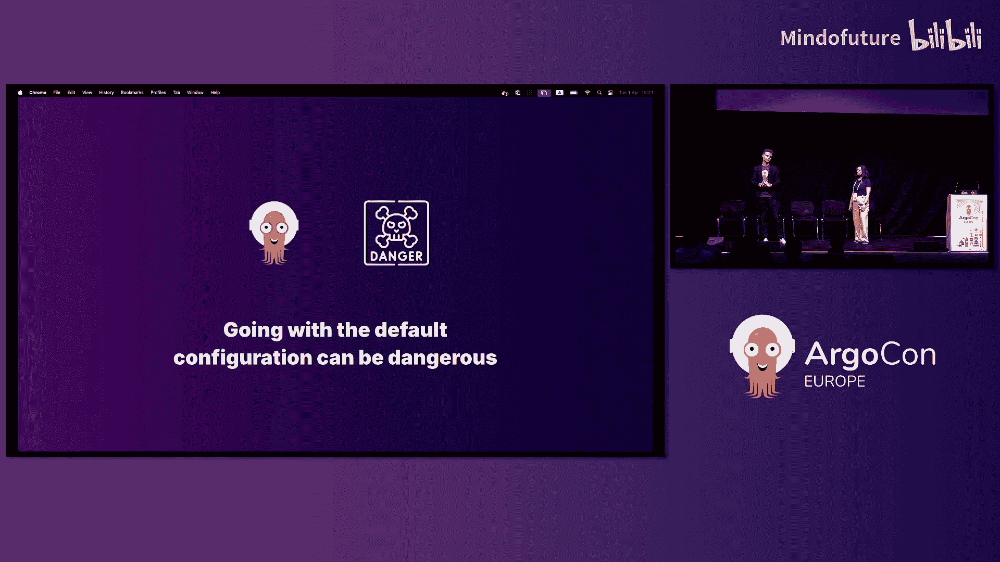
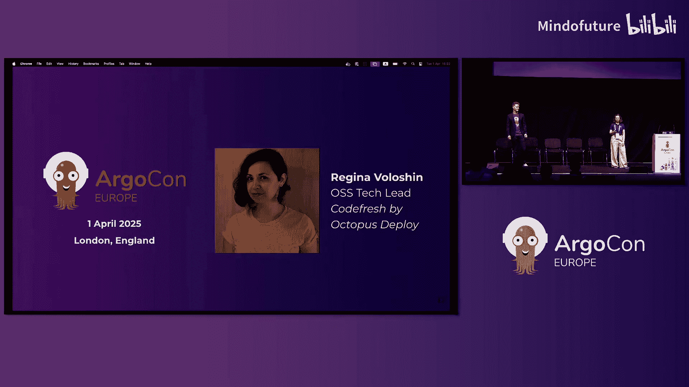
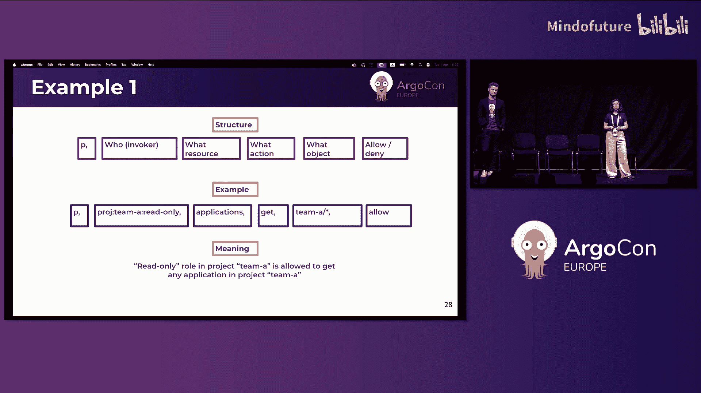
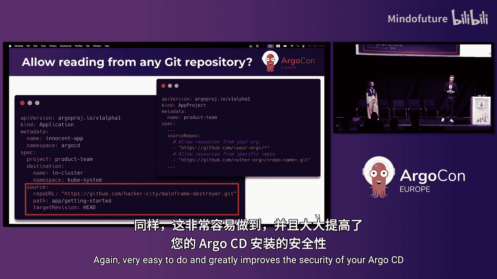
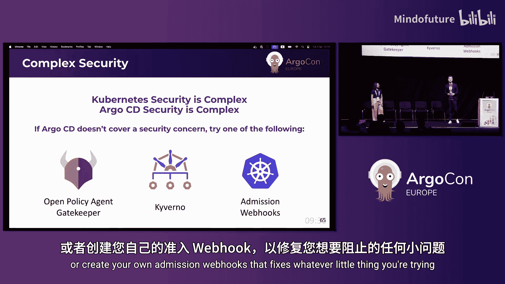
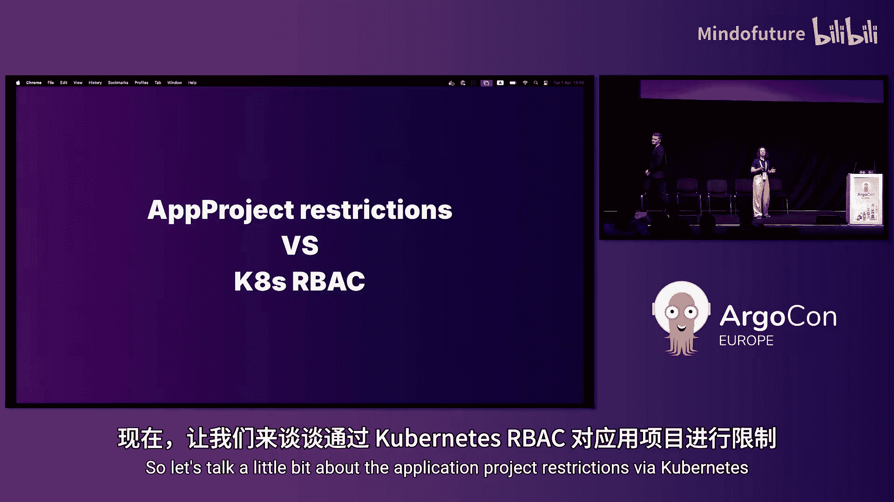
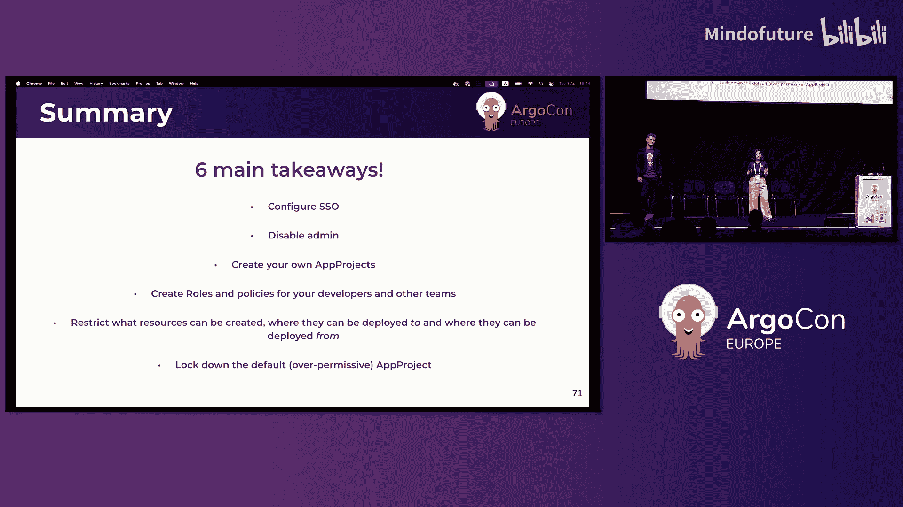
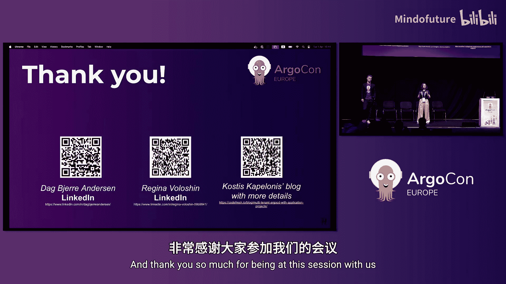

# ArgoCon-2025-Europe-大会-｜-云原生-｜-CICD-｜-架构-｜-k8s-｜-docker-｜-devops-｜-kubernetes-p11-P11-The-Hidden-Dangers-of-Defaults---Securing-Multi-Tenant-Argo-CD-Install...-R.--BV1Xr5vzGEyK_p11-

So the main problem we will be addressing today is that Argo Cd's default configuration is very permissive。

 Pre much all features are enabled by default。 And that's because ArgoCD is meant to be very easy to set up and very easy to get started with。

 And then the security aspect is something that has to come at a later point。

I will use myself as an example for this talk， because I think you may be like me。

My name is Doc， and I worked with Argo Cityd in one way or another for the last four years。

 And even though that I read the documentation on how to do proper R back and I read the good practice articles on splitting things up into different app projects。

 what and then I go to these conferences hearing about the new ways to secure Argo Cd。

 What usually happens is that I gain all this knowledge。

 and then I go home and then I don't do anything with it。 I don't know。

 maybe you can relate to this But that's because going with the default， as we know， is the easiest。

 Every time we go beyond the default， were essentially just creating more work for ourselves。

 And then we also have more code to maintain over time and all this kind of stuff。

 So what I usually end up doing is what I consider the bare minimum。 And that is that I set up SO。

 I disable the admin user， and then I create some basic R back rules。😊，At that point。

 I feel fairly safe， but I'm also betting hard on the fact that our developers does not intentionally try to break stuff because if they want to。

 they can。You will see doing this talk that going with the default can be quite dangerous。

 and we will show you some simple steps you can make in order to greatly improve the security of your agoity installation。

 because the goal of today is that today that for once， you actually go home and do something about。

 Okay， challenge yourself to actually do what you learn today and then just don't go home and forget about it。

 And with that said， handing it over to Reggie。

Thank you， Doug。So my name is Reggie， I'm an open source software tech lead at Scott Freer by Octopus Dloy。

 I'm also a CNCF ambassador and an Argo City maintainer。😊。

And so Argo City is a very popular open source project in this project we are 42 maintainers out of which we are only four women。

 and so maybe some of the next contributors and maintainers can be some of the ladies in this audience。

A couple words about my company， Otopus Deloy。 So with Codfishsh Giths by Otopus deployloy。

 we offer Argo control plane and promotions， along with Argo Enterprise support and TM。

We also offered hardened security distro for Argo and the number one GithHs training and certifications with over 23。

000 of students。And back to our topic。So let's talk about。

How ArgoCD installation looks in day one when you have just installed it and on day 2。

 where you're starting to use it at scale。So typically it is like this when you start to use AgoCD。

 then you have a single developer working with a single AgoCD instance。

 having a single AC application which deploys Kubernetes resources to a single namespace in a single Kubernetes cluster。

 and so we have a single tenant environment both on the left side and on the right side。

And then as you start to scale the usage of AgoCD。You have multiple teams that are accessing the same Argo City instance。

 and now this Argo City instance has multiple applications。

 and those applications are installing cur resources。

To different namespaces in different communities clusters。

And so the single tenant environment from day1 becomes a multi tenant environment。On day two。

 on both on the left side and on the right side。And then as you scale your usage of ACD， then。

Different security requirements start to come into play requirements such as having distinct controls over team access to obligations。

And so typically， you have a platform team。That can access any business application and also infrastructure application。

 And then you have developer teams who usually can access their own applications。

 but cannot access applications of other teams and usually cannot access the infrastructure applications。

And another requirement that you might have came across with。

Is having distinct controls of actions that are performed by different personas in the organization。

So for example， here we have Devaf team A， and this team can view and update their applications while Dev team B can just sync and view their applications。

 and we have platform team that can perform any action on any application。

And then another popular requirement would be restricting the actions that are performed on Kubernetes resources from ArgoCD。

And this should be able to restrict who can update and view the resources of application A and who。

 for example， can delete。Pods of applicationplication B。But luckily。

 ArgoCD has a very flexible security mechanism and it supports a wide range of requirements and needs。

But first， you would need to go and configure a single sign on so that each developer can log in to the UI or the CLI with their distinct user。

And it's a good practice to ensure that your identity provider， that your IDP is working with groups。

And then you can consider disabling the defaultmin user。 It is not recommended to use。

Local a users for human logins。So when we're talking about the Argo City security overview。

 we're talking about two aspects that are independent from each other。

We have the restrictions to access to ArgoCD Re who can sync or view or delete an application。

And then we have the restrictions on access to Kubernetes resources。

 which Kubernetes resources can be deployed to which name spaces， to which clusters， etc。

And so the up project resource actually combines those two aspects together。

The application project resource groups application。It also controls the trusted ge and he ribbonbs。

It controls deployments， clusters and namespaces。ItAlso controls the deployed kinds of Kubernetes resources。

 and last but not least， it controls user access to applications with ArgoCD ArrbC。

And so now let's take a deeper dive into the left side， which is。

Controlling the access to Argo City resources。And in order to understand this part。

 we need to first understand how ArgoCD Aic model works。

So let's take a look at the building blocks of ArgoC security policy。

We have the resources and we have the actions。And the resources are applications， applications sets。

 projects， logs， and Eec， and it's important to understand that applicationplication project is also a resource by itself。

And when we're talking about logs and exec， then we're talking about the ability to interact with pods using either the AgoCDUI or CLI。

And when we're talking about the actions， then we have to get， create， update， delete， and sync。

And I want you to know that there are more resources and more actions。

 but I will focus on the most commonly used ones。And so when were talking about those actions。

 all of them are relevant for agoity applications， but for example。

 the sync action is not relevant for application sets or projects。

And when we're talking about the ability to view the logs of a container in a pod。

Then in its essence， this is a read only action， so this is semantically treated as a get action and when we're talking about exec into a running container。

 then this action can potentially change something in the running containers environment。

And so semantically， this is treated。As it creates action。

And the update and delete actions can actually operate on two different levels。

 Each of those actions can operate on the level of the ArgoC application， or。

On the level of the resources that this application manages。

Let's take a look at how the policy is structured and its actual syntax。

 So we have the reserved word B， which stands for policy。 and then we have the invor。

The invoker is answering the question， who is's actually the subject。

And the invor can be either a role， a user or a group。 And I recommend you to use roles for this。

Resources and actions are actually what we have discussed on the previous slide。

And the object can be either an application in the project。Or the project itself。

And then we have the effect which is either allow or deny。Now。

 let's take a look at a couple of examples。So the first example would be a policy。

That is meaning the following thing in a human language。

 The read only role in project team A is allowed to get any application in project team A。

 And so you can note the use of the wildcard here， which stands for any application in the team A project。

And so when we look at the application project manifestif， I hope you can see it well。

You can actually see that in the application project。Application projects can have multiple roles。

 and each role can actually have multiple policies。

Another example would be of how we can specify that we want to deny some sort of an access。

And so in this example， the read only role in Project Team B is not allowed to get logs。

In application up one in Project team B。Let's take a look at an example which is dealing with a more fine-grained ArrbC。

 so in this example we have the delete pods role in project team B and this role is allowed to delete pods in application up1 in project Team B so you can see at the action syntax that this is a bit different from what you saw earlier and this is the way to specify more fine-grained Arrb for specifying the control over what resources of the application we can manage the access to。

And so the complete application project manifests for those two previous examples can look like this。

 And you can see that here we have two separate roles in each role having separate points。

So the last example is slightly different。Because this example is talking about a global wide scope configuration。

That is also a very popular requirement， or very popular need。

When we're talking about the platform atmins， then those teams usually have more white privileges。

In this example。Means that the platform admit role is allowed to perform any action。

On any application in any project。And you also can see that the invor。Is just specifying the role。

 And this role is not scoped to any project。And so if this role is not scoped to any project。

 then where would I go and specify this And actually。

 the correct place for such global white scope configuration would be the Argo CityD Arac CM Config map。

And you can also note that the policy syntax remains the same。

 but it just goes into the config map because we're talking about something that is cross project and it is not scoped to a certain project。

So when we're talking about how to model those application projects to the different teams。

 it is a very popular scenario。To have an application project per team。

 but it's important to note that there is no one size fits all and you should always analyze your organization structure and the different security requirements for access that you have and after analyzing this you should model the application project according to your specific needs。

So till now we were discussing the ArgoC resources and how we can restrict the access to that。

 and now Doug will get into details about restricting the access to Kubernetes resources。Okay。

Thank you。 So now let's talk about why you would bother restricting which resources can be created through our app projects。

 And let's start off by reminding ourselves that all applications in Argo CityD needs to be associated with some kind of app project。

 And by default with Argo City， the default app project that ships with Argo CityD looks like this。

 There is no restrictions when it comes to which repository you can read manifest from。

 There is no no restrictions when it comes to which cluster and namespace you can deploy to。

 And there is no restrictions on which resources you can deploy to these destinations。

And I don't know about you， but that seems a bit insecure to me on its own。

 and that's also why it's not recommended that you actually use this default app project。

 what is instead considered good practice is that you lock down the default app project and then you start creating new ones that matches your needs。

And the reason I say lock down the default app project is because you can actually not disable it or delete it。

 But what you can do is modify it。 And the way you do that is that you simply create an app project called default。

 And then you remove all its permissions。 And then you apply it to the cluster。 And you're done。

 That was the first step。 You have now made the default app project completely useless。

 So let's create a new app project。 And let's set the scene first year。

 Let's imagine that we want to create an app project for one of our development teams。

 one of our product teams。 And they need to create their config maps， deployment， service resources。

 all the usual stuff。 And they mainly interact with Argo Cityd through Git by committing these files into some folder Argo City syncs and so on。

 And maybe once in a while， They go into the Ui and click sync and refresh and so on。

 That's the setting。😊，And now， let's run through five examples of things that can go wrong if you want with a default configuration versus how we fix them with our new app project。

 And hopefully， some of them will scare you a little bit。Let's take the first one here。

 So in your organization， think about this。 If you went with a default configuration。

 that also means that everyone can create our back resources。

So if one of your developers decides to create a cluster roll and a cluster roll binding next to their deployment and con map and so on。

 they can essentially give themselves or one of their containers access to the entire cluster。

That means they can run whatever cubes the cell command they want from inside the cluster。

 without any restrictions。That seems a bit scary。 And hopefully。

 not of your developers actually want to do this， but if they want to， they can。 And luckily。

 this is fairly easy to prevent。 And that is simply that as part of our new app project。

 we create a field called clusterster Resource Blacklist。

 where we start blacklisting these resources。 because if they don't need these resources。

 you can you should consider taking them away。As you can see， this is very easy to do。

 and it greatly improves the security of your ArgoC installation。Let's take another example。

 by default， all applications can read from any Git repository。

 so that means whoever is updating these applications can point this repository all to any repository out there。

 So if someone decides to point this towards some evil organization's malicious repository that has some dangerous code in it and then click sync well。

 maybe this code goes directly into your production cluster and you're going to have a very sad time。

And if you combine that with the previous point where maybe you have not prevented the creation of cluster rolls or cluster roll bindings。

 Well， in this case， now this malicious code had taken over your entire cluster without you knowing。

Pretty scary。 So one way of preventing this is as part of our app project。

 we can specify a source of rep host field where we can whitelist certain repositories that we want to allow developers to read manifest from。

 or it can either be individual repositories or a full organizations。 Again。

 very easy to do and greatly improve the security of your asity installation。😊。

Third example is by default， everyone can deploy into any namespace in any cluster。

Let's remind ourselves， when Argo City reads some manifest and wants to apply it to a cluster。

 it's basically the same as if you' from your local machine would run cubetel apply with that resource。

 because if that resource exists already in the cluster， it basically just overrdes it。

 So you can see Argo Cityd as an engine for overriding pretty much any resource in the cluster。

And when you put it like that， then it sounds very dangerous。

 And one example is that if one of your developers decides as part of their other manifest to create a config map called ArgoCd Arback config and tag it as the ArgoCd namespace。

 And now they click sync on their application。 Well suddenly they have now overwrittendden the configuration of ArgoCd itself。

 hopefully again， none of your developers wants to do this。 but if they know what they're doing。

 they can do it。 So Michael did a talk about this a few years ago at another Argocon。

 the talk is still relevant today。 So check it out if you find it interesting。 And remember。

 this doesn't apply only to config map。 but literally any resource inside the cluster。 So yeah。

The one of the ways you can prevent this is as part of our new app project is that you can declare that you can whitelist and blacklist certain resource。

 certain， sorry， namespaces and clusters that you allow developers to deploy into。 So， for example。

 in our example， we could blacklist the creation of resources inside the cube system namespace and the aity namespace and other namespaces that we may want to prevent the deployment into。

This is just one way of doing it。 Again， very easy to do and greatly improve the security of your agoity installation。

The fourth example is that by default in your organization， if you want with a default。

 then everyone can also create applications。 And when I say applications， I mean。

 like the Argo City application manifest itself。And I discussed this with Reggie so many times。

 Rather than not， we should include this because this one is a bit more complicated。 but let me。

Keep it brief here and say， if your developers does not need to create this resource。

 do yourself a favor and just blacklist it because then you're saving yourself a lot of time and security headaches。

 However， if you do want your developers to create your own applications because you care about like selfservice and developers taking more ownership of their entire configuration。

 all this kind of good stuff， which I fully support， then you need to be very careful。

 because as we know， when you specifying an application。

 you also need to specify some kind of app project。

 and the app project can be any app project in the system， so。

Let's say your infrastructure team has designed an app project for themselves with pretty much no restrictions。

 Well， anyone can just point to that one。 and then they also have no restrictions。

 And the same applies to if you did not lock down a default app project。

 which I mentioned five minutes ago。 Well， in that case， they can also just use that one。 again。

 no restrictions。 So main point here is be very careful when you allow other people to create these applications。

And now the fifth one， which is the last one， and。Maybe you hopefully you have paid attention now to guess what I'm gonna say here。

 But if the developers can create their own app projects。

 they can always just create one without any restrictions and use that one。

 And then you can take everything I talked about so far and throw out the window because it does matter。

 So do yourself a favor。 and just blacklist this resource also， the developers should not。

 in my opinion， at least create the these app project resources。

 You should probably manage that from somewhere else。😊，And remember， as we know。

 Kubernetes security is complex， and thus aity security is also very complex。

And if aac City does not support whatever use case you have or security concern you have。

 you have to check out some other projects。 For example， OPA A gatekeeper。

 Kierno or create your own admission web hooks that fixes whatever little thing you're trying to prevent。

And with that said， handing over to Reg。Thank you， De。

So let's talk a little bit about the application project restrictions via S Kubernetes Arbac。

Now， some of you are maybe looking at this application manifest。

 especially at the namemespace resourcesource blacklist and are maybe asking themselves。

But why do I need a separate security mechanism for that。

 Because I am essentially talking about limiting access to Kubernetes resources。

 Why can't I just use native Kubernetes Arab for that。And actually， since Argo Cityd 2，13， you can。

With this new alpha feature impersonation sync。You can configure a new service account。

 per application destination。And this service account will be used。When Argo CD performs a sink。

And this feature heavily relies on Kubernetes impersonation。

 so Kubernetes impersonation is when one user is acting as another user。

 and in our case it is when the built in ArgoCity Control B service account is going to act。

Like the new service account that you have just configured。And obviously。

 this new service account that you configure for the purpose of synchronization is going to be much less privileged than the Argos City control plane one。

And so here we are actually achieving the goal of making Argo C D more secure。And on the other hand。

The application project， Kuberes resource access control。Can become native Kubernetes aic。

 And this can simplify the needed configuration for Argo City advanceds。

Let's see how we can configure this and make it work。So first of all。

 you would need to go to the ArgoCD Config map and enable this feature because as an alpha feature it is disabled by default。

 and then you will go and you will create this service account。Along with the needed roles， clusters。

 roll bindings and cluster bindings。And then you would go to the application project manifest and just specify the service account name。

For any namespace and server or in other words， for any application destination that is relevant。

And you can see this new section， destination service account。

I hope you can actually also see it on the back。And this is an alpha feature。

 and I encourage you to play with it， to test it， to adopt it。

 and also to stay involved by providing us feedback about future directions that this feature can actually take。

So to rev it up。We have six main takeaways for you for this session。 Please configure single sign on。

 Disable the default admin user。Create your own application projects。

And then create roles and policies for your developer teams and for other teams。Also。

 please restrict what resources can be created， where they can be created from。

And where they can be created， too。And last but not least。

 please lock down the default over permissive application project。

You can contact Doug and me。On LinkedIn or on the CNCF Slack channel。

 And we also encourage you to read Costis Caoni's great blog。

 which has additional details on this topic。 Yes， Costis。😊，And of course， also。

 please read the official Argos documentation about Argo Cityity Arrbic。

 and thank you so much for being at the session with us。😊。

