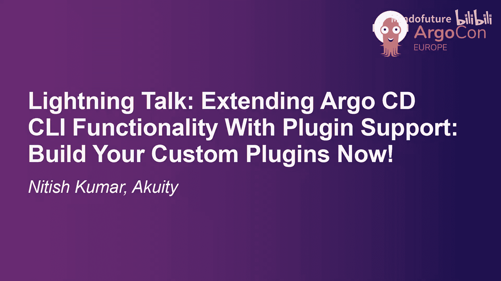
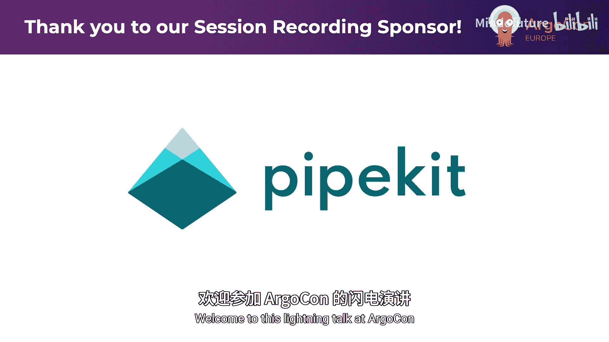
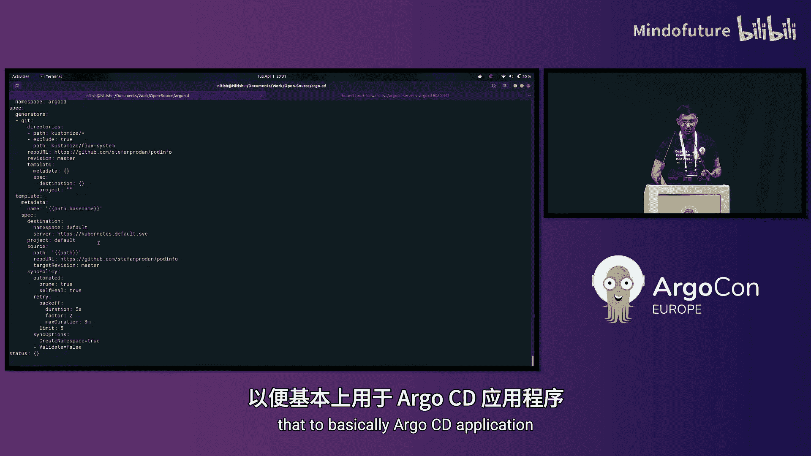

# ArgoCon-2025-Europe-大会-｜-云原生-｜-CICD-｜-架构-｜-k8s-｜-docker-｜-devops-｜-kubernetes-p12-P12-Lightning-Talk---Extending-Argo-CD-CLI-Functionality-With-Plugin-Support---B--BV1Xr5vzGEyK_p12-

All right， hi everyone， welcomele to the lightinging talk at Agocon。

 I hope your agocon is going good so far。 So let's get started in this talk we're going to basically introduce a new feature that will be added to a inversion 3 do1 which is basically the which is basically a plug support to a So about me really quick my name is Ne I work as a software engineer at a Q I'm also an agoC maintainer ambassador and I did my Kubernetes project couple of years ago you can find me at this handle maybe on Twitter。

 linkednkedin， whatever you want to Let's get started。

 So this was generally the proposal that was raised by Christian Hernandez from aity regarding adding the C plug support to the a I'm not sure if Christian is here but let's go ahead you can obviously scan this proposal if you would want to just to see what was the motivation behind introducing the plug support for the C but coming。

😊。

The question， what do you mean by the plugin support。

 So let's get started and see that So what is an agoCD in simple termss an agoCd plugin is a standalone executable file who's actually name is going to begin with aC hyphen as a prefix and you're going to store that aC hyp in your system absolute path So what is going to happen。

 whatever the boundary that you put it in your absolute path that is basically going to become like a subcomman of agoCd without you going into the agoCd code base making your own changes raising a pull request and do some sort of thing that's basically what an agoCD plugin looks like it's similar to how cubebeCl has a plugin system for it how many of you are aware of cubeCl plugin here just raise your hands Allright for all of who are not aware of cubel plugins I think a system works the same way So let's get started what are the conditions for the plugin like how should a plugin be executed at the first place so。

😊，When the first condition is that the binary， the executable binary should always start with ArgoCD hyp as a prefix name。

 The reason for this convention is because there are a lot of bin that could be placed on your systems absolute path。

 So we just need to find a way to differentiate some sort of behavior to find which bin are associated with Argo CD or not。

 Second， the binary should have the executable permission。

 otherwise it's going to get ignored by your system， basically it's going to get ignored by agoCD。

 the third thing is that the binary should reside in your system's absolute path。 So for example。

 if you reside put your binary in your systems relative path like agoCD hyphen demo hyphen plugin。

 that's not going to get exe。 if you put it in relative path。 But if you put this in you know。

 your system's absolute path， it's going to get executed。😊，Alright， this is very important。

 Like how you're going to name your plugin。 So as I mentioned earlier。

 the naming convention is pretty similar。 All you need to do is build a binary that should start with an ago Cd hyphen prefix and you're just going to put that in your systems absolute path。

 for example， use s local s bin。 if it doesn't make sense right now。

 we're just going to have a demo real quick。 So that will make things more clear to you all So for example。

 if you see that you have a plugin named ago Cd hyp demo hyphen plugin is on your systems absolute path。

 This is actually going to get executed as ago Cd。 then everything after the ago Cd hyp is going to become a subcom of ago C。

 for example， here this will become like ago Cd then demo plugin is going to become a subcom。

 then this ago Cdhen demo plugin might have its own flags argument those are going to get executed here。

😊，What are the limitations of this feature。 So currently it's basically not possible to create plugins that override the existing agoCd normal commands。

 What I mean to say is that for example， you already are aware of the fact that agoCd has its like normal subcoms such as agod version right that displays the version What if you create your own binary called as agoCd hyphen version and put in your absolute path。

 the thing is it's not going to get executed because ago it will be executed as agoCd version if you look carefully because everything after agoCd hyp is going to get executed So it's going to get executed as agoCd version but it won't get executed but it won't execute your binary because agoCd version is a normal subcom orgo Cd so agoCD is going to respect its own normal subcommans but if you want to execute your own binaryaries you should always name your plugins that are not matching the agod's normal commands basically normal command that example。

 So that's what I have mentioned in the slides as well。😊，To also this limitation。

 It is also not possible to use the plugins to add new sub commands to existing cargo City commands。

 What I mean to say is that。If you like you already aware of the fact that you have agoCD cluster list command。

 but if you would want to you know have a certain command such as agoCd cluster upgrade then the binary that you're going to create is aCd cluster and then maybe you are adding a subcom called as upgrade to aC cluster ahen cluster binary but thats that will get executed as agoCD cluster upgrade but it's not going to get executed because agoCd cluster is actually a normal subcomd that is going to get executed。

 So agoC is see agoCd cluster exist if it does exist。

 it's not going to invoke your binary even if you put it in absolute Allright so as a part of this demonstration we're going to take a look at what is m So this is actually this is one of the plug that we a Qd created its in pre stage were going to show a demo how this looks like So it generally lets you convert your flux components to a compatible resources you can scan the Q there and then take a look at this。

😊，All right， it's the demo time。 Let's get started then。Okay。

 let's the first thing that I want to do here is I just want to tell you about the bind that are in my system absolute path right now。

 So if you see I have like a couple of bind here， which is ago cluster list agogo helper lovely plug ago Ago version right the ago M A is the one that we are mainly concerned about。

 But let's get started。 And if you see right now， I'm just trying to build it from my own plug branch because it has not got merged yet。

 it will be introduced in version 3 dot1 due to certain discussions with the community so far。

 So if I try to execute the plug called Argo。 And you see that this plug agoC cluster list is only going to get executed like ago and then cluster hyphen list is going to become a subcom of it。

 So if I just to like this。😊，嗯，没有。Let me。All right， you see， that's actually executing the binary。

 So even if I tell you about right now， so。嗯。Here you go。

 So this was a binary that got eventually executed。

 and cluster hyphen list was a normal subcom that eventually become for your agoC。

 Let's try to execute another binary， which is ago hyphen。 That's pretty simple。

 All it does is like ago and how is it going to execute It like ago。 So I mean。

 everything after ago hyp is going to become like a subn subcom。

 Let's come to another one which is like ago helper， that's going to get execute the same way。

 if you come to this one， which is ago lovely plug。

 this is actually going to execute like ago lovely and this plug。 This is going to execute like this。

 This is actually a normal， like I think really famous plugin。

 And if you see it's taking a little bit time。 But it's actually getting executed。

 So you see that's actually the plug that got executed。 It was built by the itself。 Allright。

 the last one， I would just want to talk about before moving to M A is that ago version。

 So this is a binary。 And if I just do something like this。😊，Let's see。

 So you see it should print hello world if I try to execute it。 I mean， but it won't print because。

Yeah， it one printed why because， you know， because ago CityD version is a normal subcom。

 it's not going to get executed。 Alright， let's move to the M now。

 So M is basically a CI tool that eventually lets you convert your flux components to ago compatible。

 So if I go to Argo CD M T A。 And if I see this is generally the you know。

 you can convert your customization orries to your basically your what I can say。

 basically to your agos。 So I have this manifest first manifest， which is like。😊，Manifest dot Yammal。

 that's a pretty simple manifest。 All it does is like create a customization resource and I get repository。

 If I run the command in I go C D M T scan certain。😊，Let me just see。Ye。😔，Alright。

 so you can see right now that I have actually empty has actually scanned all the you know hem release and customization resources。

 As you can see， there were like couple of he release resources and customization resources that that were present in the default name space。

 So if I just try to convert one of these he release to your you know any any of thisCC。

 it will work right now。 So if I say。😊，And yeah hem release。

 So if I just try to convert this like a pod info， which is present a default namespace。

 You can see that it actually got executed。 It gave me an application of how this is going to look like If you want to take a look at this。

 how hem release was look like。 I think this is the this was a manifest that we generally used for pod info 1。

 Yeah， that's the one we used for the pod info And the last one that we're basically going to take a look at is like。

 if you want to。😊，Do it for your customization。Let me。Alright。

 so if you try to see it also get converted basically the customization resource to your agoCd application here actually sorry to your agoCd application set。

 So basically going to convert it to your ago application set and for that to basically agoC application。

 Yeah I mean that's it。 we are like short of time。 but do come to our as booth we are also having a giveaway you can obviously download this book tomorrow at the booth you can meet me booth number S31 you can obviously download this book from here that is like Argo up and running by question Hernandez and entry block Allright having said that any question so far with this plug in support I know we have less time but if you have any question so far please let me know after this session ends and yeah thank you this was like a quote really talk but I would really appreciate if you all can give your feedback on this session so far。

 Thank you。😊。

