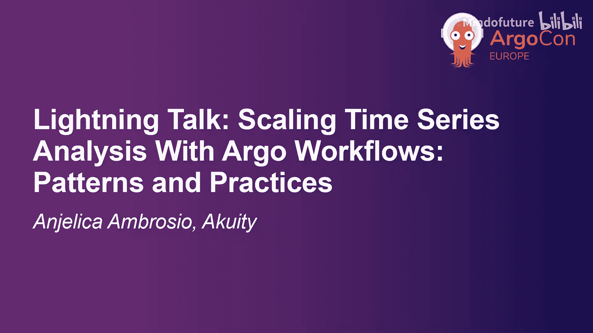
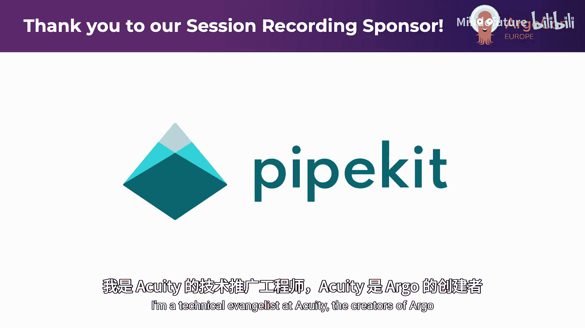
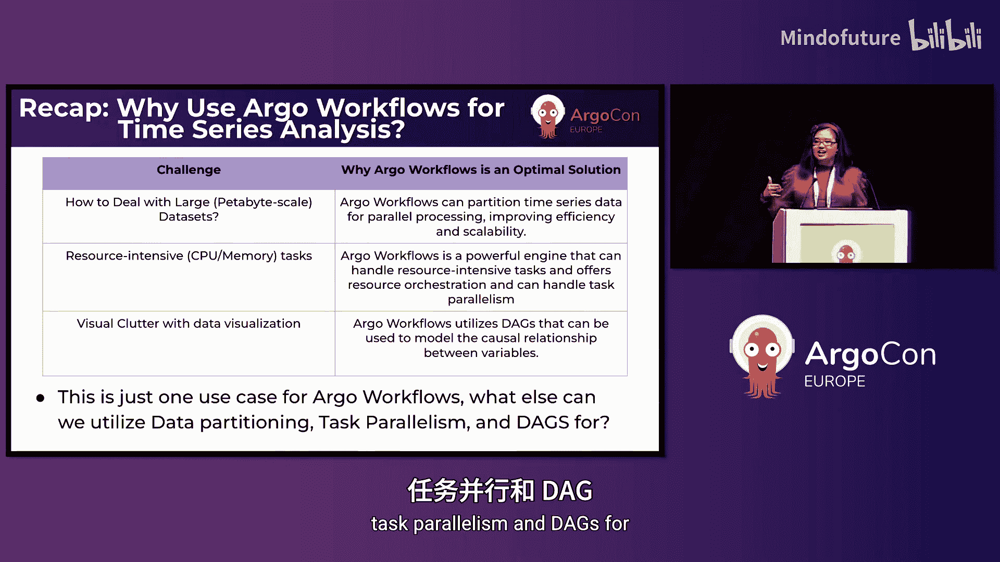
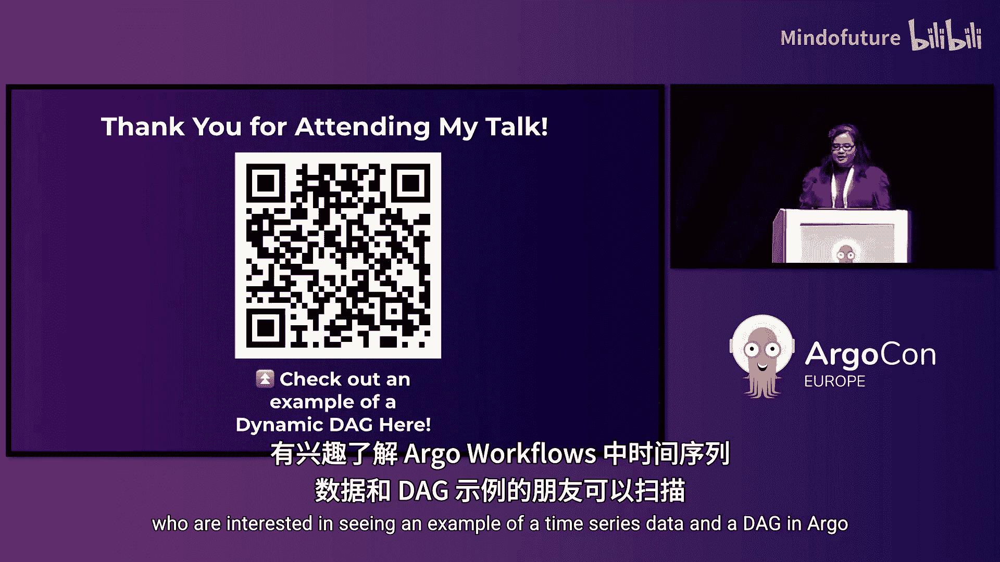

# ArgoCon-2025-Europe-大会-｜-云原生-｜-CICD-｜-架构-｜-k8s-｜-docker-｜-devops-｜-kubernetes-p13-P13-Lightning-Talk---Scaling-Time-Series-Analysis-With-Argo-Workflows---Patterns--BV1Xr5vzGEyK_p13-

My name is Angelica Ambrosio。 I'm a technical evangelist at Acuity， the creators of Argo。

Quick intro about me。 I create educational content on Giups， Argo and cargo for acuity。

 If you want to level up with Argo Cv， feel free to scan in that QR code on screen to check out our book with O'reilly Since this is a lightning talk I'm a bit short on time。

 So in lieu of a demo I prepared a Github repo with a code example。 So if you're interested。

 the QR code for that will be available later in this talk。😊，Speaking of time。

 do you ever feel like time is your greatest enemy， there's so much more we want to get done。

 but there's always something else that comes up。We don't know for sure what the future holds。

 There's no crystal ball we can gaze into that will give us the correct answers。

 We do what we can to be prepared or for whatever comes our way。 For example。

 how many of you check the weather report。How many of you check the traffic report on your way to work。

If we didn't have a weather report or a traffic report readily available to us。

 how can we make sound decisions， wouldn't you feel more confident making such decisions or plans if they were backed up with strong data weather forecast traffic reports they're all outcomes of time series analysis time series data is a specific type of data that tracks trends over a specific time interval rather than just recording the data points at random these intervals can range from milliseconds days。

 months， even years these data points are collected to analyze trends patterns and are used to make forecasts such as the weather for today or how long traffic is going to last let's take a look at more examples of time series data。

Each data point on a time series data chart represents observations of behaviors and measurements taken over time intervals by isolating these data points in a specific timeframe。

 we can easily determine patterns， trends and changes these data points could be stock prices。

 market trends， application performance and even energy usage you can also use time series analysis to save yourself money on your electric bill you may see a graph that looks like this。

Energy usage is documented and observed and we can determine from this graph that the peak energy hours are 3 pm to 8 pm with this information I can make decisions that can help me lower my electric bill which means to use the AAC sparingly during peak energy hours you see time series analysis is everywhere the weather report traffic report even your electric bill。

 even something as mundane as planning a trip to the DMV or the post office why would I want to prepare for that。

That's why。Nowadays， when you Google a business， you may see a graph of popular times。

 a business owner can use this data to schedule more staff to meet the demand if we have multiple staff。

 we can handle multiple customers in parallel， a customer can take advantage of this data and make an educated decision on how to beat the lines。

 so what are the main benefits of time series analysis for organizations。

Organizations can use time series analysis to predict future trends， detect patterns and anomalies。

 spot the potential risks， formulate their business strategies and overall gain a competitive edge by staying ahead of trends responding to changes and making data drivenn decisions as you can see time series analysis provides a huge benefit for organizations and even us as individuals but conducting time series analysis is easier said than done to perform a time series analysis oh you just need to collect data process data。

 create visualizations， develop charts， build models but who has the time for that doing this by hand is extremely time consuming but that's why we have technology tools in libraries such as pandas。

 Mattplotlib， Jupiter notebooks。But。Even these tools have their limitations and with these limitations。

 time becomes our greatest enemy once more。 Imagine having to collect and process massive data sets。

 building the model for it and then extracting insights within a short timeframe and right at that crucial moment you run into an error How can organizations conduct time series analysis with massive data sets how can we overcome these challenges Meet Argo workflows Argo workflows is an open source container native workflow engine for orchestrating parallel jobs on Kubernetes Argo workflows was designed to runattarized applications that are optimal for resource intensive tasks such as data processing and machine learning workflows Let's take a quick look at an important concept of Argo workflows and why it will come in handy for time series analysis。

😊，Let's do a quick lesson on DAGs so with Argo workflows you can define a workflow as a directed acyclical graph or DAG that is more versatile and allows tasks to start running as soon as specific dependency has been completed you can create dynamic daAgs with templates and Arrgo workflows these are useful for developing resilient data pipelines and can enhance efficiency and calculation speed DAG can be simpler to maintain for complex workflows and allow for maximum parallelism when running tasks put a pin in this because this is going to be essential for solving the three technical challenges I presented earlier。

The first issue is memory usage data is everywhere in 2024 approximately 149 zabytes of data were created online that's a lot of selfies and cute animal videos organizations collect a lot of data and especially if you're collecting data during a longtime interval as a result organizations can be dealing a massive data sets which can take quite the gigabyte out of your computer's memory some tools and libraries such as pandas load entire data sets into memory which can lead to performance bottlenecks the last thing you need is a popup like this one telling you you're out of memory at the most crucial moment so how can Argo workflows tackle this issue。

When dealing with gigabyte， terabyte or even petabyte scale data sets。

 Argo workflows can make this data scalable by dividing a data or data into smaller partitions aKA data partitioning。

 data partitioning can be used to orchestrate data processing by defining steps as containers and leveraging artifacts in shared volumes to handle large data sets and dependencies Argo workflows can then process each partition of data independently to enhance efficiency and calculation speed。

 which will lead me to our next issue。Performance limitations back to our old enemy time most tools and libraries typically used for time series analysis like pandas have a single threaded nature that can severely limit parallel processing when you're dealing with a lot of data one task at a time is simply not an option think back to the example Ive presented with the line at the DMV time consuming computations can slow down the process and make it difficult to iterate quickly and as with trends you want to stay on top we need a process and analyze that data quickly so how can we tackle this with Argo workflows Argo workflows just so happens to be designed to orchestrate parallel jobs on Kubernetes other than data processing time series analysis involves other resource intensive tasks such as model training。

 forecasting and feature extraction Argo workflows offers mechanisms for task parallelism completion tracking and automatic retries This is ideal for time series analysis since we can handle these resource intensive task such as data processing。

Or data analytics task in a distributed manner If you look to the example on screen in this workflow I can search for two keywords in available data hello and world at once instead of carrying out the tasks one at a time Lastly。

 let's talk about data visualization visualization is a big part of time series analysis how can you make an in-depth analysis without a proper model or visualization the problem is with bigger data sets there's going to be multiple data points and with line graphs this can get pretty messy pretty quickly so how can we use DAgs for time series data DAgs can be used as visual representations of the causal relationships between data points see the example on screen these arrows can be used to model causal influences DAgs can help identify the underlying causal structure of a time series revealing which variables are influencing others and what direction these influences are taking on the left I have a line graph and on the right I have a D Which one looks easier to understand or read。

If you believe A is easier to read than B， you're either a wizard or you may have forgotten your glasses at home。

Speaking of visualizations， Argo workflows also offers artifact visualization。

 This can be handy for instances where we need visuals using HTML， text or JSON files。😡。

Here is the QR code to a Gitthub repo where I demonstrate a dynamic dag using time series data。

 I'll give a minute to anyone who would like to scan the QR code。

 and it will also be available at the end。All right。

 let's recap time series analysis provides many benefits and can help organizations gain that competitive edge they need。

 however conducting a time series analysis with common tools such as pandas or Jupipyter notebooks can be very resource intensive and time consuming Argo workflows is the optimal solution as it is built for parallel processing for efficiency and higher calculation speeds。

 it also enhances the scalability by partitioning the data and can be used to create models or visualizations for time series data but this is just one use case for Argo workflows imagine what else we can utilize Argo workflows powerful features like data partitioning test parallelism and dags for。

Thank you for taking the time to attend my presentation Once again。

 here is the QR code for those who are interested in seeing an example of time series data and a DG in Argo workflows and lastly。

 if you have any further questions or just like to chat more about Argo workflows you can find me at the booths we're also giving a masterclass in ArgoC so the QR code is available on screen and it will be held April 24 Thank you so much。

