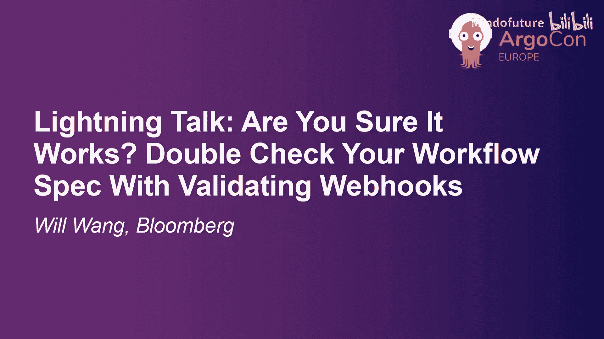
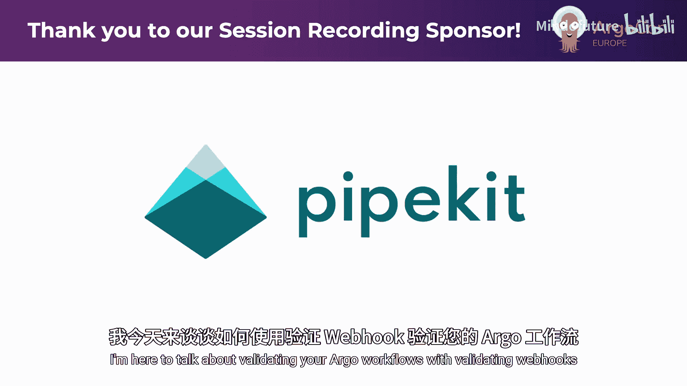
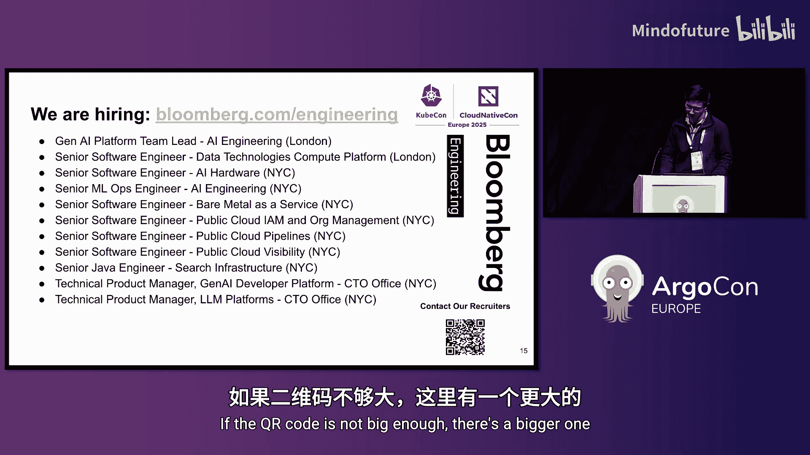

# ArgoCon-2025-Europe-大会-｜-云原生-｜-CICD-｜-架构-｜-k8s-｜-docker-｜-devops-｜-kubernetes-p14-P14-Lightning-Talk---Are-You-Sure-It-Works-Double-Check-Your-Workflow-Spec-With--BV1Xr5vzGEyK_p14-

Hello， everybody。 I'm Will Weang。 I'm here to talk about validating your Rgo workflows with validating my books。

I think I've used the wrong slide template and I don't have the purple and argue on it。

 so we're off to a great start。But just a brief introduction， I'm Will Wayne from Bloomberg。

 the Workflow ation team， we offer a managed Argo workflow solution。We are a multi cluster。

 multi data center platform， meaning that we give our tenants a bunch of clusters across multiple data centers。

So the problem statement here is that workflows。Okay， workflows submitted via the Q And X A S server。

 They don't get validated by default。So usually there is this field in the CRD called open API schema or open API。

 I cant forget I can't remember the exact name of the field。

 but it does the regular schema validation for your custom resources。

 but in Argo the installation used a minimized CRD which basically you just put in some like。No very。

 not very useful schema in the CRD。 That's because there's a limitation with CP server about the size of CD。

 So as a result of that limitation， what my， what will happen is that。

If you create a workflow with some bogus definition。

 So see the spec in template places like full bar and if you create a workflow like that to the API server directly。

 you actually get accepted and create it。 So get like 200 back。

 But then when you actually get the workflow in your cluster。

 youll see that the workflow never actually execute it。 it just gives you an error message saying。

 oh I I failed and there's because there's an invited spec in the definition。 ideally。

 we want to have this kind of invalid workflow cacheed before it actually makes it into the API server or into ID。

 we want to actually be able to reject it right away when we execute Cugoto create。So。

We just show that invalid workflows will get accepted by the API server。

And might make adding a soft injury， even if the workflow itself is a valid definition。

 So it checks out all the schema definitions。It might be referencing a workflow template that doesn't exist in the cluster。

This will also not fail immediately when you create the workflow。

 but it will fail at a later stage when the workflow is executing。

So both calls kind of a very annoying user experience when， when user create a workflow。

 theyll get a 200 back。 But then later when they going open up the Argo server UI and click into the workflow。

 they will just see， okay， just no node executed。 just a big fat error message。

 I don't know what you do。So。Now backtrack a little bit。 You might wondering。

 why are you using the API server， There's Argo server， There's Argo C I。

 Both have this wonderful linked feature。 Why not just use those。Well。

 because we're a multi cluster platform， we want to have a unified entry point to our clusters。

 We manage conflictfig maps and secrets in addition to workflows。

 we don't want to have to manage this mapping of okay， you have a workflow， go to Argo serverver。

 but you have a confi map， you need to use Cueca instead， for example。

 like for things like artifact Ref or you know access keys for S3 and that kind of stuff。

And using cube A or as unified entrypoint also makes integration with other systems such as K and open cluster management easier because they use I think。

 work manifest。And they don't speak Argo at all。So。That was the Pro statement。

 and this is into the how we solved it part， but obviously we solved it with Vi webpos。

 it was in the title。In case you are not familiar， validating web hooks are a part of the Kubnetes API server admission control。

 So when you create something via the API server， it goes through a list of steps。

 So Ill C mutating web hooks， and then you will do this schema validation against the field that I mentioned at the start in the CRD which is where the minimize installation of Argo is lacking。

And when， and then we basically do the validation at the stage right after schemeche of validation in this raating and vision control。

 Basically， A will call to our validating web hook and our validating web hook will basically validate if the workflow is legit or the definition is legit。

 and then we will reject or accept it。Depend on the variation result。So more specifically。

 we use cube builder to bootsrap by validating admission webbook service。And under the hood。

 we actually just use the Argo validate function。 So if， if you're not familiar。

 there's a file called validate dot go in Argo codeb。 This is actually what powers Argo linked。

And our go server for validating a webpo， validating a workflowll。

And there's a lot of support for checking the。Workflow spec very thoroughly so for example。

 you won't just check whether schema definition whether the workflow spec matches the schema definition。

 you will also go into each individual parameters for template invocation。

 it will check if all the required parameters are provided and then you also verify if the template reference in in the Argo workflow actually exists and many other things。

And。By calling this valid function instead of the Argo server。

 we actually drop a dependency on the Argo server deployment in the cluster。So basically。

 we don't have to have an egogo server in the classroom。

 We can always just invoke the function and do the same， same logic。So。

Having this validate emission webpo basically allows us to validate all Argo resources submitted through all mediums。

 like it could be from Argo server， Argo U I。 It could be from Argo Q Argo C I or from Q Q。

 And then what this also does is that it makes this validation check implicit。

So you wouldn't have to make a separate call to say Argo Li or aC create dash Drive run or something like that。

You will always kick in。Every single submission will be validated。

 and if this in value always get rejected。So， as a result。为。

Do not have any more invalid workflows accepted into our system。

 So all malform workflow So that full bar example I showed earlier。

 They just get rejected right away。And invalid workflow template references will also not be accepted because the validate function will check in and say。

 okay， this template does not exist。 This workflow is not valid。 You'll get rejected， and then。

We will not have any random workflows that's that。Fail。

In a later step that you don't get to see until you do a cube cut or get。Every fail。

 every failure will be returned right away。That that relates to an invalid workflow definition。Well。

 obviously， there are some costs or caveats。So because vi web hook is a very critical step in the API server admission control and it a deployment。

 it may go offline for whatever reason。 And if it does。

 it could basically either take your workflow submission offline。 For example。

 it couldn't validate any workflow submissions or depend on how configure your web configuration。

 it could potentially take your whole cluster offline。 So how to mitigate it Well。

 it's like with any other critical deployment， you make it highly available。

 have more than one replicas you set up telemeries add a proper retract handling at the top level API and so on and so forth。

 So of that can help alleviate these kind of concern。

And another problem we actually experienced was that these kind of validateator functions can be very slow。

 So if you have a very big workflow definition。It could take a while for it to actually get validated。

 We give it， we give our webs a very generous 3 second timeout。

 We haven't seen anything that's really slower than 20 seconds。 I think。 So， you know， you。

 you manage， you manage when you very。 But， you know。

 this is something you can increase the time out。 if you are expecting really large workflows。

And lastly， if you are installing this validating webpo into existing cluster that already has workflow templates in it。

 you might want to make sure that all your workflow templates in the cluster is valid before you turn on the validating webbook because thego link function or the valid function will actually go look for all the template referenced in the workflow。

 And if you found the invalid template， you might have trouble with decoding and have your validating functions fail in unexpected ways。

So that it for a run of our。Solution to solving， validating。Workflow。And。Or hiring。

 So if're interested do。 If the carac code is not big enough， there's a bigger one。 So thank you。

