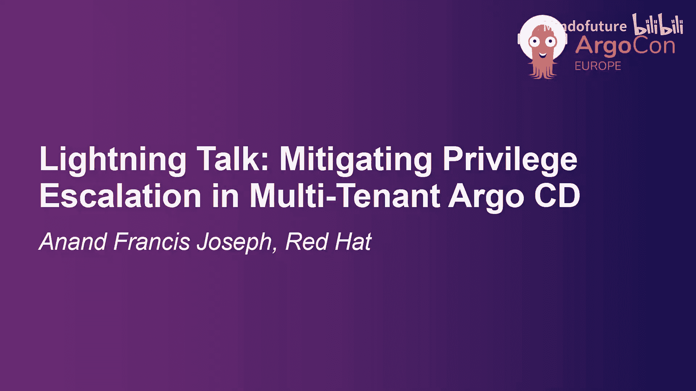
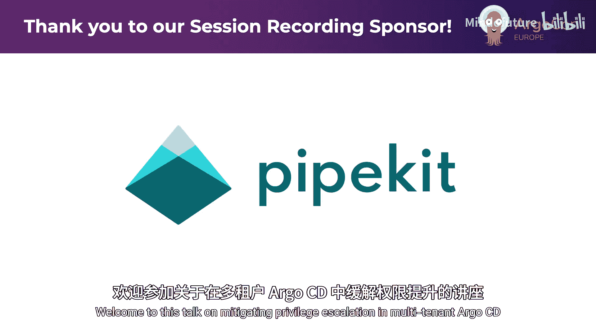
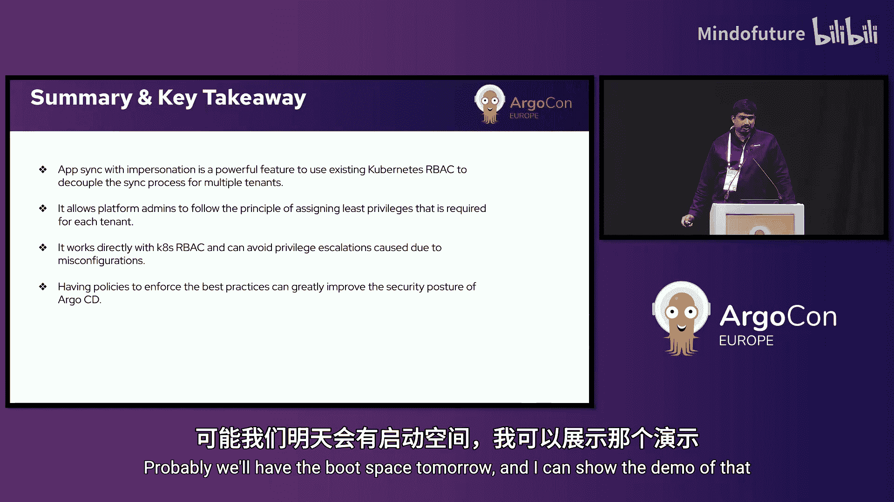

# ArgoCon-2025-Europe-大会-｜-云原生-｜-CICD-｜-架构-｜-k8s-｜-docker-｜-devops-｜-kubernetes-p15-P15-Lightning-Talk---Mitigating-Privilege-Escalation-in-Multi-Tenant-Argo-CD---A--BV1Xr5vzGEyK_p15-

Hello， everyone。

Welcome to this talk on mitigating privilege escalation in Multitenant ArgoCD。

Myself， I'm Anna Francis， I'm a principal software engineer at RedDt。

 and I also a member at the Argo Project working on ArgoCD and Argo rollloads along with the RedD owned projects like ArgoCD Operator and Gits Operator。

So I'm excited and honored to be here， this is my first Argo K to be giving a presentation。

So let's see what we have today。So first thing is， let's understand what a privilege escalation is。

Then we'll have a look at what we mean by privilege escalation in ArgoCD。

Then we look at various multi tenantant security controls that we have in Argo City and how we can tweak them to achieve to mitigate the privilege escalation issue。

Then we look at the mitigation approaches， we have two approaches here。

 the first one is using kerno policies to mitigate the issues。

 privilege escalation issues that arise out of misconfigurations and app projects so this is a classic feature。

 I mean like you can try it even on the latest or the older versions of ArgoCD。

And then we want to introduce a new feature， which is app syncync with impersonation。

This is a feature that we developed at Redat and it's in an alpha state。

 so this is the feature that we are I mean this is the approach that we are recommending for the privilege escalation issue。

Last， we' look at the summary and the key takeaways。

So let's understand what a privilege escalation is， the definition is adversaries having access。

 trying to get a higher level permissions on any system or network。

So these adversaries they have access， but they have less privileged access and they try to elevate to a higher axis。

 so that's how it' is different from other cybersecurity attacks。

 so these are like authentic users who have less privilege but they try to increase their privilege。

So the common approaches that is being taken is they take advantage of the system weaknesses。

 misconfigurations in the system and any security vulnerabilities that can enable them to happen。

A common example is like the pseudo access， for example。

 a user without a pseudo access tries somehow out to get a pseudo access and becomes a root user。

So I was trying to find an analogy like how we can explain this privilege escalation so in the game of chess there is a move called pawn promotion wherein a pawn if it moves towards the last row in a chess square you have the option to promote it to any other any other piece so you can eventually make it into a queen which is the most powerful piece in the chess board so the least。

The least privileged pondn can become a most privileged queen piece。

 so this is something that I found that it could be an analogy for this privileged escalation。

So next we can see what are the types so there is a vertical privilege escalation that is what we discuss now like there is a user with a low level axis less privileged axis and it becomes a highly privileged axis the example is the upon promotion next we have the horizontal privileged escalation whereas whereas in a multitenant scenario there could be a tenant admin for one tenant and he tries to become the tenant admin of the another tenant。

So this is like you have a house， but you have some secret door and you move on to the next house。

So this is the most common thing that we have in ArgoCd and a multi tenantant use case。

Okay now let' us look at what are some of the multi tenantant security controls that we have in ArgoCD the first one is the R back so ArgoCd has two kinds of R back one is the ArgoC's own R back and then we have the underlying Kubernetes role based axis as well。

Next we have projects， so in Ago City app projects the are the admin resources that kind of ensure like what a particular application can deploy where it can deploy etc。

 so projects are a critical piece in the multi tenantant security。

And then next we have the scope of the cluster。 so ArgoCD supports two kind of installations。

 one is the cluster scoped installation wherein the ArgoCD has full control on the entire cluster and then there is a namespace scope installation wherein it can deploy resources only to a particular namespace。

So let' us understand how the privilege escalation problem in AgoCD so first we have in the first layer we have different Kubernetes servers and then we have Kubernetes are back on top of that。

Next we have the ArgoCD application controller service account。

 which has like highly privileged access across all these clusters， all the destination clusters。

And on top of it， we have the Argo C D R back。And the users。

 these are ArgoCD end users that we have and the access privilege is controlled by the ArgoCDR back as the first layer and then it is going to the ArgoCD application controller service account which has a highly privileged access。

So when we have multiple tenants。Accessing the same cluster。

it's a single service account that is used for the sync operation。

So different tenants might need different permission levels。

 so if one tenant needs highly privileged access like it needs additional resources to be deployed。

 then the same privilege is given to all the tenants。

And this is like one of the drawback like it doesn't support using different service accounts to the same cluster。

So a long story is short so there is only service account that the ArgoCD application controller uses must have privileges that satisfies all the tenants。

So one common way of preventing this privilege escalation is to have a properly configured ArgoCD project so let's see what an ArgoCD project is so it contains all the get repositories that it can that it has access to it has destination clusters and what resources it can deploy additionally it could have roles also like each project can define its own roles so a properly configured app project prevent will define the well defined boundaries for each tenant so if you configured the app project。

Properly。You can avoid this privilege escalation。嗯。

another thing to note is we have a concept of global app project so that that can actually contain like some of the resources that can be blacklisted and a common configuration。

So this is a use case that we are planning to demo like let's say that Im developing an internal developer platform。

Wherein like there are multiple Github users and I want to use the same cluster to be able to deploy to the multiple name spaces。

So the first approach is the policy enforced app projects so here we have Kawano policies and like there are some of policy examples like these are the best practices。

 one is to avoid the default project app project。And enforce all app projects to have a global app project。

 which contains all the blacklisting。And all tenants get an project with access only to its tenants namespace。

So， this is like a。The architecture， like I have two namespaces。 I'm using apps in any name space。

 and I'm using Caerno policies to enforce them。So coming back to the approach to which is the new feature that we have added。

 so in this feature we allow impersonation to use different service accounts so that each tenant uses a different service account and uses the Kubernetes R back to sync the resources。

So how to use this feature this is this feature is in Al state and disabled by default so you have to enable it using the ArgoCCM and optionally you have to enable the applications in any namespace so that each tenant will have its own namespace for creating the applications and then the last section is the important one which is a new section that we have added in the app project wherein we have different service I mean different destination targets and the service account that is being used so whatever permissions are back permissions that is given for that service account will be used by the tenant。

So this is how the approach to looks like you can see the additional service account that is being added roll bindings and the service account for each tenant。

 so whenever the sync operation happens， the respective tenants service account will be used for the S operation and that way you can avoid like the privilege escalation like one service account being used for the other tenant。

So I have a demo here， I don't know if I have time。Okay。So we don't have time for the demo。

 So let's come to the。What are the benefits that it can this feature can bring in so it can prevent privilege escalation and there is a possibility of having multiple destination clusters with the same URL so this has been a limitation in agoC with this feature that can be avoided and there is a use case that is requiring to prevent accidental deletion of resources so we plan to use this feature to implement that this is still work in progress。

So the feature documentation is available here and the demo materials are available in this Git link。

So key takeaways， so this is a powerful future synchronization using impersonation。

 so this will help you to decouple the sync process between multiple tenants。

It allows platform amins to follow the principle of lease privileges so that each tenant will be given the privilege that exactly required for that tenant。

It works directly with Kubernetes R back， so you don't have to sync the app projects for each tenant that matches with the required Kubernetes R back。

And last， having Caerno policies or OPA policy agents to enforce best practices that can greatly improve the security posture of Argo City。

 whether they are taking approach one or approach two。Sorry， I couldn't go with the demo。

 Probably will have the boot space tomorrow， and I can show the demo。

Thank you。