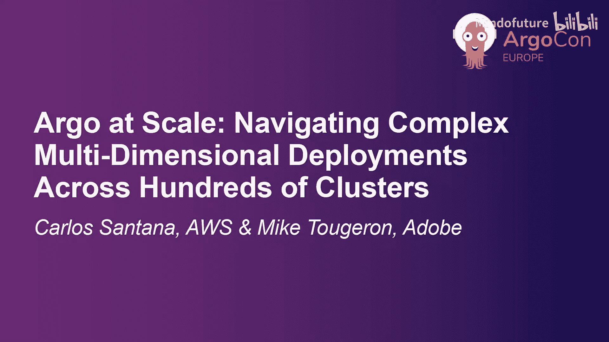
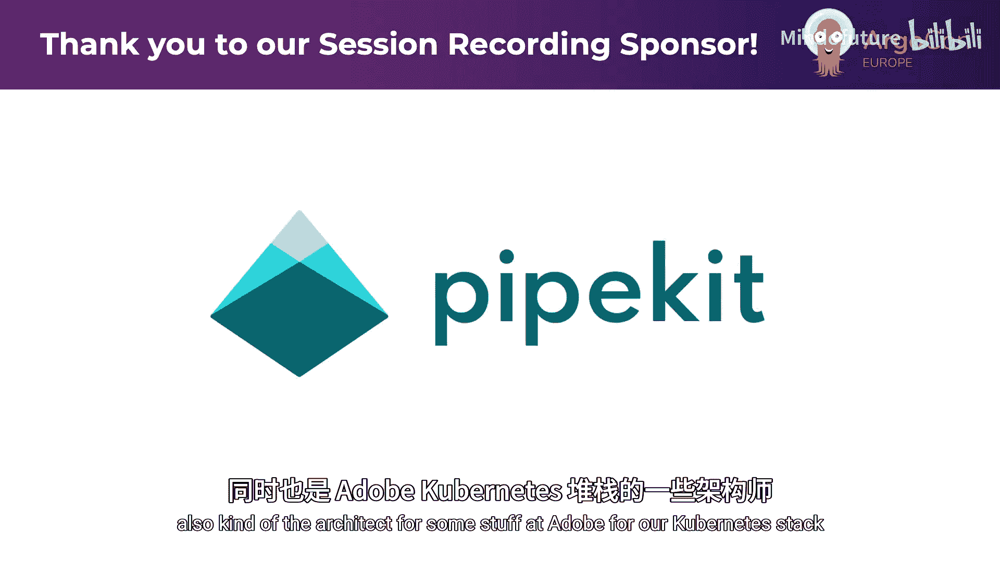
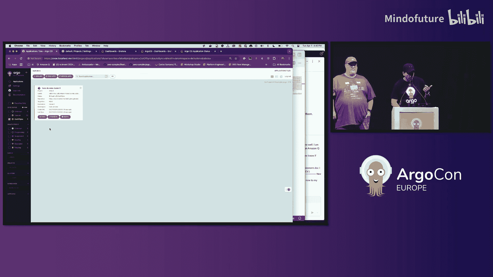
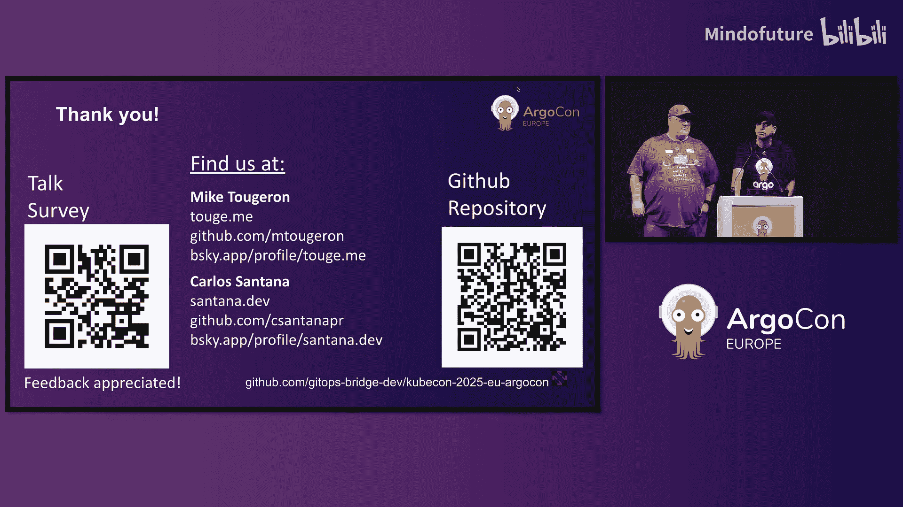

# ArgoCon-2025-Europe-大会-｜-云原生-｜-CICD-｜-架构-｜-k8s-｜-docker-｜-devops-｜-kubernetes-p16-P16-Argo-at-Scale---Navigating-Complex-Multi-Dimensional-Deployments-Across-H...--BV1Xr5vzGEyK_p16-

Hi， I'm Mike Tujaron， I'm a lead cloud engineer， also kind of the architect for some at Adobe for our Kubernetes stack with me。

Moving around， freaking me out， Caros Santaana， he's with AWS， he's a senior EKS solutions architect。

So real quick here， here's some Adobe by the numbers。

 we run a very mixed environment as you can see here， we got some flat car and abutu。

 we got multiple cloud providers we're across the world。

 we have 430 clusters and growing last time I gave this talk I said we were close to 400 and that was in December。

 I want to say it was。We have over 240 helm charts that could potentially be deployed to these clusters。

 so that's a combination of those， not all of them， but some of them。

 and most importantly as it's relevant to this talk。

 we have 90 people on the infrastructure engineering team of just developers in seven countries around the world。

 so there's a lot of variety in all of these numbers and all of these variations that affect the way in which we deploy our applications to these clusters using ArgoCD。

So what's really our problem our problem is how do we keep the lights on so in February of this year alone we had 554 deployments of our cluster add ons to our fleet。

So think about that number for a minute， 554， that's like 20 deployments a day。Across this fleet。

 So with Argo Cd， I assume you all are familiar with it and there have looked at the metrics。

What kind of metrics you get out of the box for that kind of variation， think about it。

 554 times 200 and something。We have 50，000 applications that are deployed out to our fleet。

 how do you look at that so the gaps from ourgoCD metrics aren't out there so we have to fill it in with Prometheus metrics。

ArgoCD notifications， but the volume of change and the matrix of possibilities of application versions with the attributes of those fleet。

Creates a visibility problem for us， so we kind of show this little you know chart here on the side that's just with some fictitious data but it starts to represent the complexity of this problem。

 different cluster versions， different applications， different versions of each of those。

 and we have to bring it all together in a way to show this in a nice easily visible manner。

So Carlos here is going to talk a little bit about how some of this comes together。

Yeah so what we see here are using groups， so in Adobe they have this approach of like giving clusters an attribute。

 this could be labels and annotations when you create a cluster secret in ArgoCD and what this provides you is ability to group clusters based on maintenance。

 so in case of Adobe they use a single application set per atom and then that application set will be in charge of deploying that specific atom from their 240 atoms。

 possible home chart that they have to the individual clusters。

 so the idea is to have that single application set doesn't matter which ArgoCD instance because in Adobe they have multiple ArgoCD instances each one handling around 200500 ArgoCD apps and we're just talking about atoms so it's a way that they can do promotions based on application set grouping。

In this case， we'll be looking into how to do the groupings of for example。

 production so production is an environment that they have these atoms on different clusters are in production。

 but you have to have a second layer of grouping in either way in any case clusters we call them cluster set in Adobe they call them maintenance group but you can generally say it's a group within the production fleet that you want to upgrade an atom or patch an atom and then go to the next group and that group could have the same number of clusters or they can have more clusters in it as a best practice you want to have more clusters because you don't want to take a linear approach of rolling out an atom。

 you want to have an accelerated way of as you promote the atoms you feel more confidence for the next set of grouping to be bigger so that way you can promote your clusters around different regions or dependence how you do the grouping so the idea you can see here in the screening is you have two。

Group A for production has two clusters， group B for production has group Group B has four clusters。

So how this looks like in an application set so what you see here and you're not going to get wave without seeing more Yao today this is an application set section。

 is' not the whole application set because then people cannot see it but the idea is to have a flat cluster generators or you can use the merge generator to have a merge cluster generators and the first one will be your default version of the addom and then you use selectors based on those attributes so the cluster is dictating which addom and which version it will get so for example the top you have the C or D is they're getting the 117 the next one is staging and a sta has two groups group A and group B so they have different versions and then the next set is production where in Adobe this is Adobe showing how they do things is they have canary so that maybe have one cluster and the next group。

A is group A that has， for example I was talking before， two clusters and then three clusters。

 but it could have n number of clusters the idea is that you want to minimize the blast radius when you do in an environment the other thing is that in Adobe they use a lot of automation and CI tooling to be able to upgrade these atoms at any time like Mike said they do 554 at patch updates and they do it with pool requests and they use ProO as a way of managing those pull requests and start merging them as they do the testing they want to move to use progressive sync as progressive S gets more stable right now is in Al there's a few features missing like handling sink waves is one of them that they would need to have in there but the idea is to have applications be the one that controls all those atoms everywhere。

Mike。So as things get deployed out， you kind of have to expect the unexpected。

 but some of these things that you see on here。Are expected。You know， when you start the sync。

 something can go wrong， you know you're missing your get access so your sync is going to fail or you have a deny sync window for some reason on the application or on the cluster。

All right， fine， well you get to your dry run， well perhaps a CRD isn't on the cluster yet because while things are eventually consistent。

 you're trying to deploy a Prometheus rule， Prometheus operator hasn't been deployed yet。

You get to admission controller problems okay you have an OPA gatekeeper preventing things or you have we have precincts that do checks if there's some sort of outage on the cluster or there's some sort of customer incident on the cluster。

 we can prevent sinks from happening so that as the SreE team operation teams or application teams are troubleshooting these major incidents。

 changes don't happen on the cluster while they're trying to troubleshoot what's happening。

 you know nothing worse than having change change something you're trying to fix at the same time。

Then you get into the whole sync issues where things are actively sinking。

 well maybe you push a bad image tag well that's a horrible sort of thing or you have an application that's failing to start because you have a config map that hasn't been created yet。

And then you get into just a whole bunch of other possibilities that are out there of just what's not working with your deployment。

 I'm sure you've run into a lot of others than what I've listed here。You know， one of my favorite is。

 you know， testing that just doesn't always work。So our solution to this is to create some new metrics。

 so you may not be aware of this， but CubeSa metrics has this really cool feature where you can capture fields from the CRs that were created from CRDs and emit that as metrics。

So what that means is is you are going to see the application CR。You can grab something from there。

 such as the operation state started at time and finished that time or any other of those attributes that are on there。

 such as your source revision。So you know what version is deployed or any number of other things。

 we also pull things from the app project so that we can find out the sync window information for an application or for a cluster and things like that。

And then we jump into Prometheus rewrite rules， this is where it gets kind of complicated we have a repo that we'll talk about in a few minutes。

 but if when you look at that， we're looking at 350 lines of YaAmL here that do all of this configuration so it's not a quick simple thing。

 but it's actually quite simple once it's running we process all of this data combined together with the ArgoCD app info metric that's already emitted and we create this detailed metric。

We pulled together with these other metrics that we've created from CubeSa metrics and we're able to create these ones。

 a sync window metric to know which applications or clusters have deny or allow sync windows we know which applications are long running for their syncs and we know which applications are out of sync for some reason and what's really cool is we can combine those metrics with the sync window ones so if something's out of sync and has a deny window or vice versa。

And I don't know what's especially important with the long running sink。

 I don't know if any of you are running to those never ending sink。With a deployment。

 we run into those quite often because of our scale， this helps us identify those。

So this leads us into the don't distract me problem Argo CDD has some great ways of doing notifications you know it has that notification plug in when something is out of sync。

 not healthy， degraded， progressing and so on， you can send out those notifications well when something's out of sync but has a deny sync window as a developer do you actually care？

Probably not because you have a deny window on there for a reason。

If you have an allow window and the application is progressing， do you want to be notified of that。

 probably not because you may have just done a deployment？

But if that progressing has been going on for two hours。

 you probably want to know about it because most。You know Kubernetes deployments don't take two hours to happen。

 but you do want things to alert if they're in a degraded state or if they're not healthy or out of sync or things like that and so the built in Argo CDD one as you can kind of see here in this slide there's a lot of ways to get false positives and what these metrics do is they help us。

Bilter things down to only get the failing deployments。

So what I mean by that is we start by gathering those unhealthy applications。

 those are fairly easy right it's the ones that are not healthy， those that are degraded。

 those are out of sync and so on， but then we get those that are started at 90 minutes ago and don't have a finished at time so those are still running for some reason maybe they're stuck in a presnc or posts hook maybe for whatever reason they just haven't come up with the deployment maybe they're in a retry loop because you have things going on with that。

 who knows there's lots of reasons as we showed in the previous slide that that can happen。

Then we have the sync windows， well， like I said， you don't want to have the Den syncnc windows alerting because you don't you know it may not actually matter。

 so you start filtering all of these things out and finally you have your out of syncync applications and you can put it together in a nice dashboard and send alerts based upon that。

And that way there， when the alert hits the developer that made the change or hits the operation team。

 whoever's responsible for the deployment of this application， they get something that's actionable。

 and relevant and so they can take the action that needs to be taken to make sure that the application is healthy。

So with that， Carlos is going to show us something really cool。

Okay so what we're going to show here is a demo that is composed of a few things here as you can see in the screen at the bottom we have a utility called the IDP builder Ci say binary CI that you run in your terminal from the canoe project It's a project that I work for building internal developer platforms and actually say a tool that told Mike let's build the demo using this tool because we can go back and forth and we actually collaborated on this like was able to delete the environment and run one command and get it up and running and we change things and we modify things and then I might delete it and create it again so we were able to have one command to just bootstrap everything so this CLI would give you a kind cluster it would give you ArgoCd NJn X and gitt which is a server in your laptop that way it would take all the Yama files and create ripples if you modify the Yama files you can have a watch mode and it would automatically copy the files like。

do a Git a Git commit Git push automatically for you and then from that point on is ArgoCD 1 on1 so in this case we're using V cluster to simulate a large amount of clusters with the attributes that we want to deploy and we deploy a couple of fake apps that has some problems that we describe like the longrunning one。

 the auto scene the degraded and then the V clusters are register using external secrets and then we use the cube Promeus stack helm chart that would give us Promeus Grfaana and then cubebe state metric which is the one that we're going to collect information from apps and projects。

So to show that， let's exit here。And move on to the demo so in the demo what we have here is the one liner command that you run you get clone this report。

 you run this one command and the only thing that you have to have in your computer is Docker。

 for example。After that， as you can see here in the first one this is you will see one of those examples of setting the merge generator for the addoms in this case we have search manager and the fake ones we have in here a portion of the Cube state metric configuration which will grab the information from the Argo apps for the sync time start sync time end and create that custom metric then we take information from the app projects to have the sync windows extracted and then do a join using Promeus rules which we have here and then we have Promeus here doing the rules to create the new metrics that I care about and take into account the sync windows on the projects and the start and the end time so with that let's move on to ArgoCD so in ArgoCD we have here a bunch of apps basically the ones are easy to identify are the ones that are degraded。

So in this case， you may get alerts that there's something wrong with ArgoCD。

But in our case like Mike describe， I don't want to be distracted because there might be a sync window。

 a deny sync window saying no sync should be happening on these apps and I should not get an alert another one that is easy to identify is at a sync but I don't want to get notify if there's a window apply to it and the way that Adobe does it is that you said as a gate so if somebody gets page and is working on a problem they basically put a sync window on that app to say stop from alerting me because I'm working on it and then once the sync window is removed then is normal operation so if there's the metric will show up then alert me and the last one is who in here and the healthy ones is there's one app in here that is long running one of those apps that is healthy but it' like you're asking yourself is running or is a stuck so it's like taking 30 minutes for。

MutesSo in the example that you saw about Promeus rule。

 Mike wrote a rule saying make a metric a custom metric show up if the app is taking longer thanbe they use one hour in the demo we just put30 minutes in there but it's very difficult to detect that there's a problem that there's an ArgoCd app being stuck so if we go to graphfaum and this is again out of the box it would come up with a dashboard and then you would use your typical ArgoCd graphana dashboard for utilization like CPU metrics operation of those type of things so then you want to create your own graphfaana dashboard or whatever observability that you have to create your custom metrics so as you can see here there's a couple of clusters and applications that have the sync window so this is simulating that the team is working on those problematic applications so if we go back to。

Don working with those apps， I can go into the sync window and detect and delete the ones that have the problem。

 So， for example。In here， I can detect the one， this one。

Let me remove the window for adjust your size， I think if that screwed up。Eric might。

He's not showing it for some reason。Just to the whole。I it the whole window。

And then the idea is that yes。The idea is that when the sync windows are gone。

 the applications we show up at the bottom so as you can see here there's a couple of sync windows are always apply and there' are sync windows that are schedule so as you can see I remove the pra apps and they show at the bottom so at the bottom you can see that there's apps that are degraded apps that are at a sync and then in this left side。

Right side， Mike your left side。You can see the long running ones。

 so this is at the time that I want to get alerted， for example。

 Aled through Slack or your application and Mike would say would show how they're doing it in Adobe on how to show those pra things so this is the idea of a quick demo that you can use to start like emulating a multicluster setup in your laptop and start like creating those metrics one thing that we forgot to mention is this work of。

example of Q state metrics， for rules， we're planning to put them in upstream in ArgoCD to have these type of resources available for folks to create their custom metrics and as a community have more operational assets available in ArgoCD。

Let's go back to。The lights。Thanks cha yeah so that's great so we got a lot of stuff we filtered it down we know what we're looking at but sometimes that's not great who are you going to tell this problem to so with that information you could send it to a generic slacklack channel but what if that person as I said is not awake anymore we're in seven countries around the world 90 different people so sometimes you need to enrich that with additional information so in our case we have an agent that runs that then looks up the ArgoCD resource looks up the commit information goes back to get looks at the commit history finds out who made the change either to the app。

to the helm chart， to the values repo， to wherever it came from。

 andes the alert with that information， then sends the Slack message not just to a general channel so that everybody knows if there's a problem。

 but also directly to that person saying， hey， look， you got a problem with your deployment。

You need to do something about it and the great thing with this is is for those longrun ones。

 they don't have to remember to come back in an hour and check that it worked or check that it didn't work it's an active system and you know what's going on you can kind of see a screenshot of what it looks like it gives you know that additional information beyond what's available。

This is another thing right now it's something I was playing around with two weeks ago。

 we released it last week internally， someday I would like to clean this up so it's not Adobe specific in the general community can use this as well。

 like Carlos mentioned， all those Prometheus rules， CubeSa metrics are in a repo。

Here's the QR code to it。We do want to get this into the Argo Labs or Argo CD Repo itself。

 but we're still working out as to which one of those two it belongs in。

 please rate our survey or take the survey， rate our talk， not rate the survey。

 we do want your feedback here's how you can get a hold of us。

 I am on CNCF Slack and Kubernetes Slack， I believe you're the same。

U thank you very much and if you have any questions， we do have a minute or two。

 if not we'll be outside Carl y， thank you so much。

