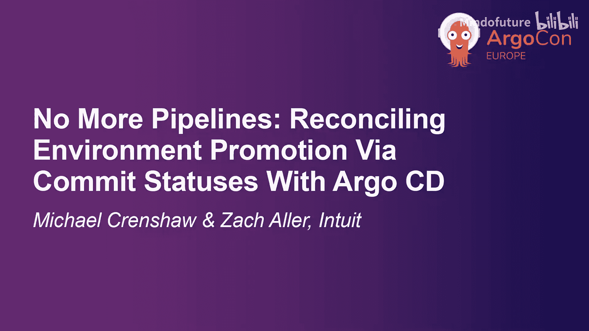
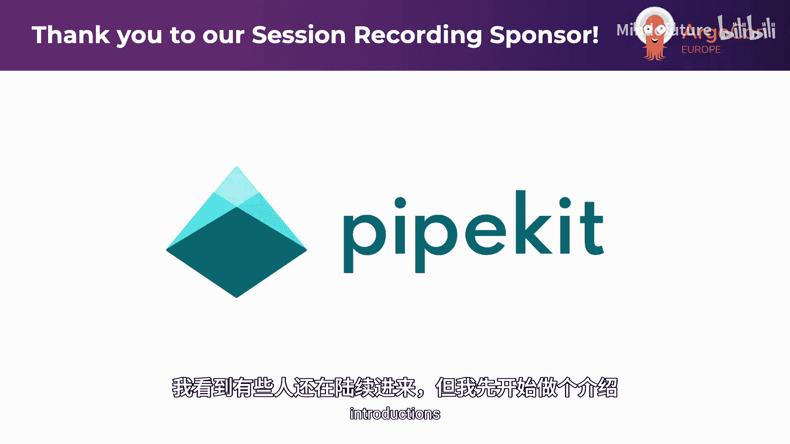
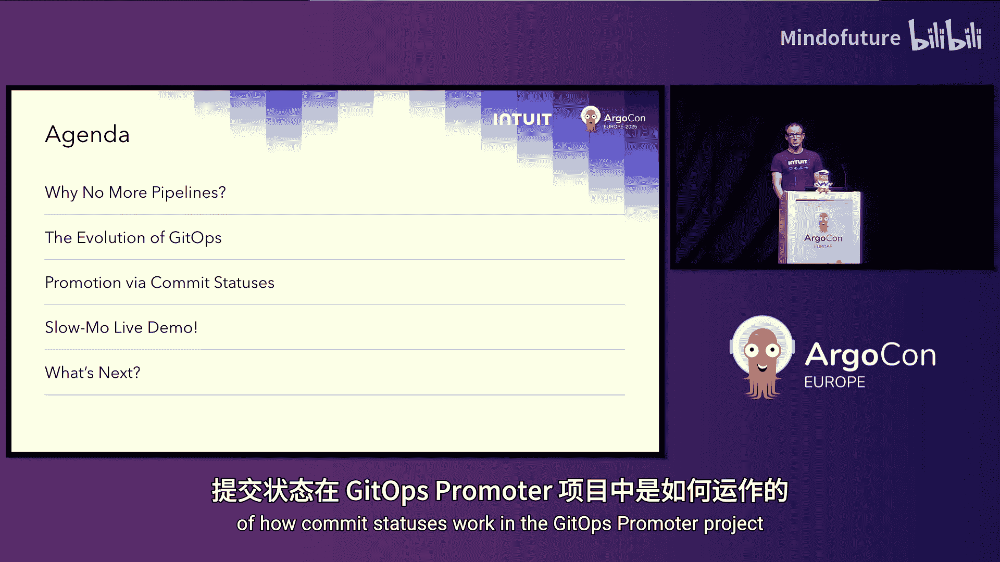
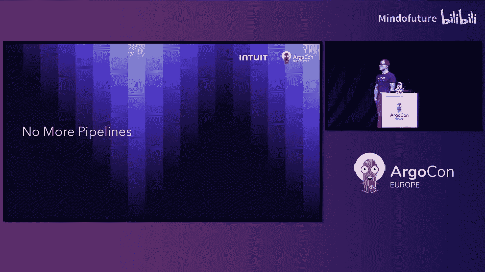
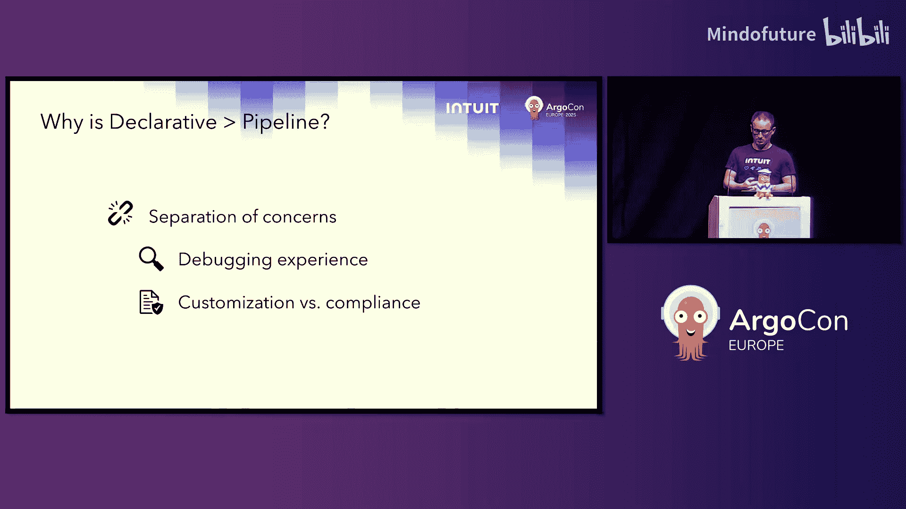
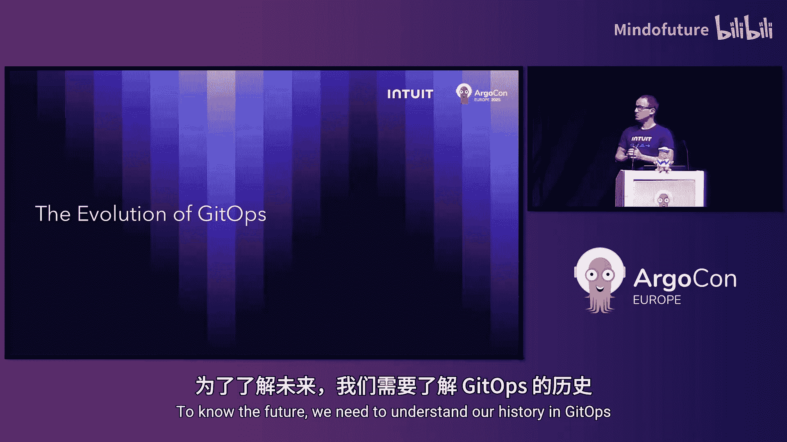
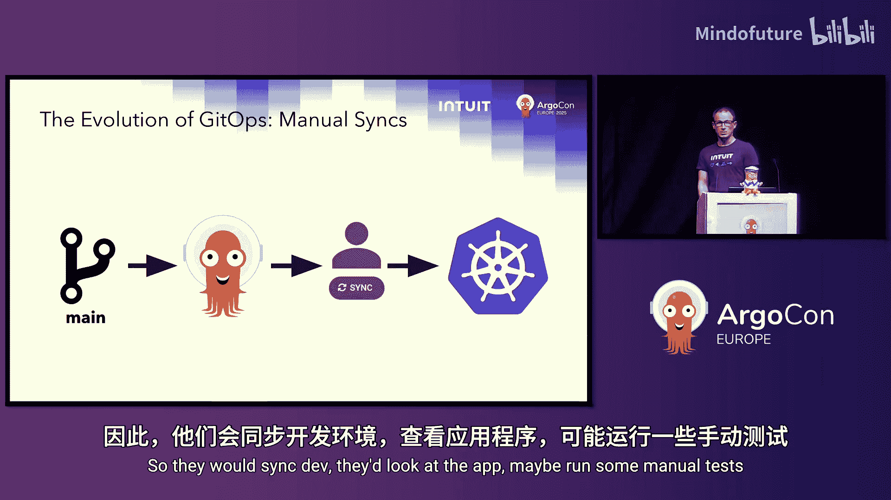
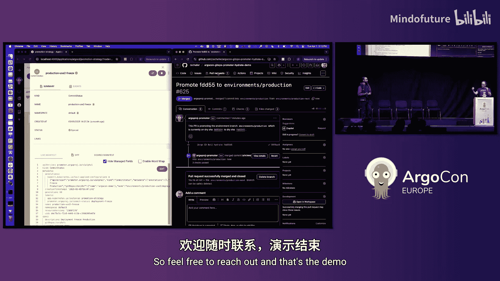
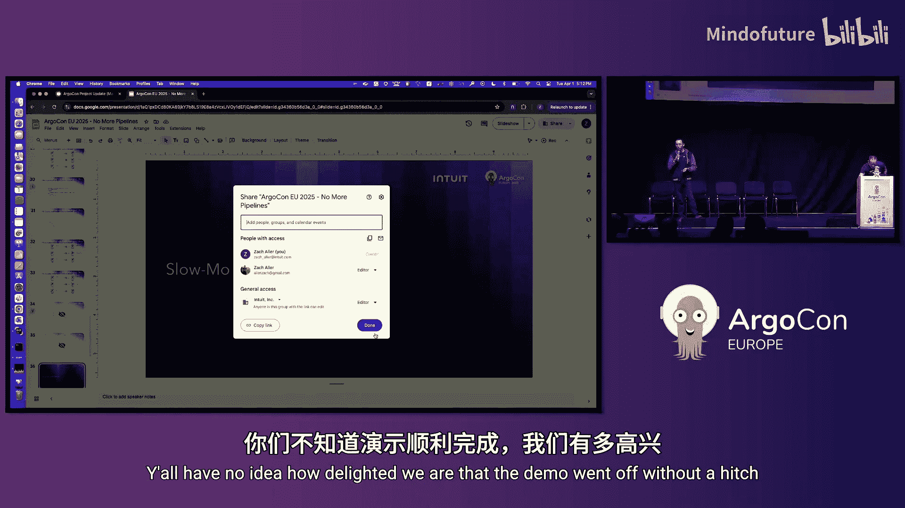
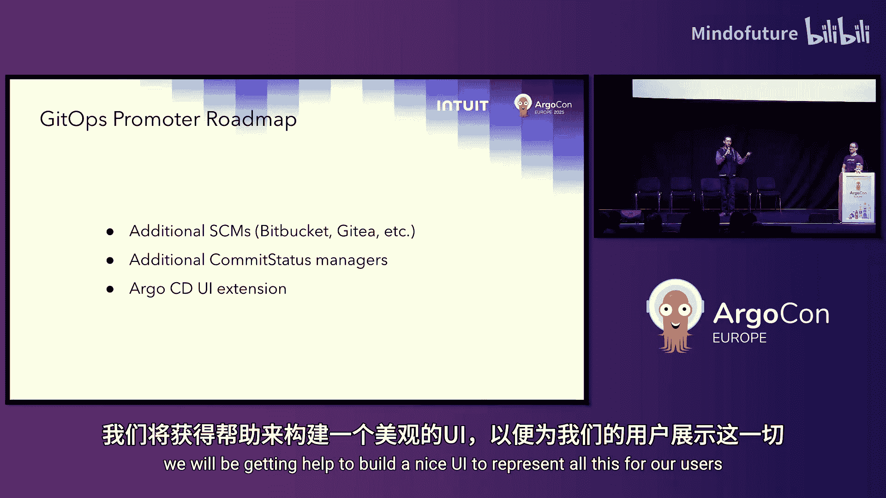

# ArgoCon-2025-Europe-大会-｜-云原生-｜-CICD-｜-架构-｜-k8s-｜-docker-｜-devops-｜-kubernetes-p18-P18-No-More-Pipelines---Reconciling-Environment-Promotion-Via-Commit-Statuses-W.--BV1Xr5vzGEyK_p18-

Hello， everybody。 I see some folks are still shuffling in。

 but I'll go ahead and get started with introductions。

 and the rest will get just the nice meaty content。 So I'm Michael Crenshaw。

 I'm a staff software engineer at Intuit。 on our ArgoCD and rollouts team。

 I'm also a lead maintainer for Argo CD。 And this is Zach Uler， also on our ArgoCD Roouts team。

 and he is a lead maintainer for Argo rollouts。😊。

A little bit about Intuit， we are a financial software company。

 We do things like accounting software， T software， and we have an absolutely massive user base。

 which means absolutely massive scaling challenges and ArgoCD and all the Argo projects are a big part of how we meet those challenges。

Intoit is also a huge believer in open source。 We have received the CNCF end user Award two different years。

 We have created and open sourced a number of projects， including Argo itself。 and personally。

 I owe a huge thanks to Intuit for allowing me to maintain open source software as part of my job。

Quick agenda so our talk is called No More Pis。 We need to know why we don't like pipelines and what we might replace them with。

 We're going to go through the evolution of GiOs kind of a history lesson and explain where we think it will evolve in the future We're going to talk about how part of that evolution we think will be environment promotion using commit statuses。

 Zachs going to give us a slow motion demo of how commit statuses work in the GitOs promoter project and then we'll talk about what is next in the ecosystem。

So no more pipelines first let's talk about what a pipeline is and what the replacement might be Pis are Argo workflows。

 Gis Gis or GitHub actions as well as Jenkins files and Declarative APIs are things like the Kubernetes pod spec。

 stateful set and the ArgoCD applications spec Declarative APIs are more about explaining what you want and letting the system figure it out for you Pipes are more about explaining how to do things in very explicit steps。

Deeclarative APIs have some advantages。 The main one that we'll talk about is separation of concerns。

 So in a Declarative API， I can say， here's the spec that the users are interested in。 For example。

 the steps in environment promotion。 and on the back end。

 the platform can have a separate spec that describes the things that they care about。In a pipeline。

 those things tend to get mixed up into kind of spaghetti dependencies。

 And your developers end up having to look at platform code and your platform has to look at developer code。

 This comes out in the debugging experience a lot。 And this is something my team ends up with a lot of support requests for it into it。

 A developer has a failed deployment。 and they have thousands of lines of jen and logs。

 Most of which mean nothing to them because it's code that was written by platform teams。

 So a decorlarative API that focuses just on their concerns allows us to expose error messages and context。

 just to the things that they need。 separation of concerns also gets you a good balance between customization and compliance。

 Pilines， like I say， tend to be things very tied together。 And into it。 we vi out a Jenkins file。

 That's our promotion pipeline。 and users can change that however they want。

 And they often change it in ways we as the platform really don't like if we can。

Give them a decative API that gives them just the knobs they're allowed to turn。

 things work out much much better for both the users and the platform。

So how do we get towards Declarative APIs to know the future we need to understand our history and Giops。

 And the prehistoric era was very， very simple。 You had a main branch with your dry manifests。

 So helm values customize overlays， Argo CD hydrated it on the fly and then auto synced that to the cluster。

That quickly broke down。 We turned off auto syncnc。

 and we had users manually hit sync buttons for two reasons。 One。

 we wanted our users to see the hydrated manifest diff before they actually deployed it that way they understand what they're deploying。

 Second reason is they were doing manual environment promotion gating。 So they would sync dev。

 They'd look at the app， maybe run some manual tests。 They'd sync the stage environment， etc cetera。

 et cetera。

I somehow killed the screen so that didn't last very long。 It was very tedious。

 We replaced those user interactions with promotion pipelines。

 so we would have ArgoCd app sync run in a pipeline somewhere， ArgoCD app weight。

 maybe some tests and then we'd go to the next environment。

 So we're towards pipelines were towards automation。

 but that took the user out of the hydrated manifest experience， they were no longer reviewing that。

 So we got back into a state where we were rendering manifests。

 and this was the rendered manifest pattern in a pipeline so that we at least had a full history of the rendered manifest。

 even if the user wasn't initially looking at it before merging。 As you can see。

 lots of pipelines here。 and this is where into it lives today。

 Jenkins pipelines for manifest rendering and for promotion。

So now we can start talking about replacing some of these well defined problems and solutions with declarative APIs to simplify things。

The first step is replacing the hydration pipeline。 There's a new feature in ArgoCD2。

14 called source hydrdator， and it's a Declarative API。

 It's just a field in the application spec called source hydrrator。

 and it just says here's the branch that has the dry manifests。 I'll hydrate them for you。

 I'll push them to get so that you have that full audit history。

One cool feature of the source hydrator is that you can push not just to one hydrated branch。

 but to one per environment， but really， however you want to break it down。

 So you could have some apps that are all related to the dev environment。

 They push their manifest to a dev branch stage and prod。 They all get their own hydrated manifests。

This is the inflection point where we go from history to what we think will be the future of environment promotion in gi ups。

 And we just need one more tweak to this picture before we get there。 But I want to pause to note。

This is not branch based environments in the way that you've heard about them。 folks。

 we've had people come out to us quite a few times today， actually， and say， wait。

 we aren't supposed to put our environments in branches。 correctect。

 Don't tell your users to represent their environments in different branches。

 It should all go in the main branch。These branches are on the back end。 They're automated。

 They don't have the problems that branch based environments have。 So this is a different thing。

 I just want to clarify that before we get into the promotion part of it。

So this is the tweak that gives us environment promotion。

 Instead of just hydrating to a per per environment branch。

 we have a pair of branches per environment。 That gives you a place to hold proposed changes before they go live。

 So hydrator pushes， rendered manifest to dev next stage next Pro next。

 We call these the proposed hydrated branches。 We automatically open pull requests for each of those into what we call the active hydrated branches。

 And then I put the little user icon there。 We can go back in history and have the user look at the PR merge it。

 do tests on their app and then merge the next ones。 That's manual promotion。

This is the point in history where we typically would have replaced this manual step with a pipeline。

 but we think that environment promotion and this system is well defined enough that we can jump straight to a declarative API。

And that's what this is。 The merging decisions and the automation of that can be represented in this spec。

 So it's called promotion strategy。 and it's a real CRD with a real controller that lives in the GitOs promoter repository in Aproj labs。

I'll take you through three different parts of it。 First the environments。

 This is just a list of the branches that ArgoCia is auto syncing from for each environment。

 and the order of this list determines the order in which you promote things。

 but you still need to gate between those environments。So we have two different types of gate。

 one is proposed commit statuses， and these are the things that you know before you merge the pull requests。

 so things like linting the Yaml or checking if there's a deployment freeze。

 you don't have to look at live state in order to determine those things。

And then there are active commit statuses that represent the things that you learn after the PRs emerged。

 So did my Argo CD app become healthy after I merged and you can do different checks for different environments if you want。

 in this case， we'll run a performance test for just the staging environment。

So that is the user's view of the Giops promotion experience。

 And we've talked about this in previous talks in the Spaceage Gitop series before。

 We want to take you all behind the scenes and understand how we as platform maintainers can enable this experience for our devs。

 So let's start simplifying the picture and take it to just the stuff we care about。

 Let's take it for granted that the hydrator works and runs。

 And I know that's a lot to take for granted since it's in alpha state。

 but it'll get better willll fix bugs。 So take that for granted。 ignore the left side of the picture。

 Right side of the picture。 Argoti is extremely good at auto syncync。

 We'll take for granted that it deploys successfully to Kubernetes。 The middle part is our job。

So we have six branches that we need to concern ourselves with。

 And our job is to have an opinion about each of these branches and the head commits on them。

 That's all we need to do in order to enable Giops promoter。 We just have to have an opinion。

And these are the opinions that we have。 So on the proposed side， we link the Yal。

 we check for deployment freeze， and on the active side。

 we look at ArgoC the app health and we check the performance test。

We need to associate these opinions with something that the promotion strategy can use， though。

 So the way we do that is we look at the dry commit that the user has made。

 So I say bumped an image tag and the new commit is 5 A to C2D。

The hydrator adds a metadata file to the hydrated manifest commit that it pushes to the proposed branches。

 and it contains that dry sha。 And of course， when the PRs get merged。

 that ends up in the in active branches。 But we need a way to differentiate these different branches when we express our opinions to the promotion strategy controller。

 And we do that by taking advantage of just how Git works when there's a commit。

 it gets a unique Shaw。 So each of these places has a unique shaw that we can associate our opinion with。

And we do that with another CRD。 So this is the simplified state。

 This is all we have to care about as platform administrators in order to give our users declarative environment promotion。

This is the CRD commit status。 Again， it's in Giops promoter。 It works today。

 and the parts that we care about are these。 The key， the name of the check。

 So that's ArgoD Health in this case， the Shaw 4 F6A1， which if you remember from the previous slide。

 that's gonna be the top right。 That's the active dev branch。 So we merged。

 we synced that app became healthy。 and now we state that the phase is successful for that application。

 and that enables the next stage to go through。One thing you'll note if you're really an SCM nerd。

 if you're a Github nerd， is that you can only block PRs in Gitthub by having a commit status on the proposed commit that you're going to merge into the next branch so。

We have to create a synthetic commit status on the proposed branches to represent the previous environment state。

 So， for example， we want to prevent stage next from merging until after the dev branch commit becomes healthy。

 We create the synthetic commit。The promotion strategy controller does that for you。 again。

 what I said earlier still holds all you have to care about is having opinions about these commits。

 Once you state that opinion， the promotion strategy controller will copy it for you。

 You don't have to worry about it。 But it's good to know what's going on behind the scenes。

So with that， in order to have these opinions， you're probably gonna want to write automation to manage those commit statuses for you。

 Zach is going to show you in slow motion by hand how you manage the commit statuses。

 and that'll show you how you can automate it。So I want to start off by just saying this demo is more of a。

What you would do as if you were to write a controller to automate these steps。

 So it's basically the task that a controller would have to perform to basically make these opinions on these branches。

I'll start off with we basically on GitHub over here we have a customized layout we're going to start out the hydration layer so we have a customized layout here with our base directory and our dev prod and staging environments。

 I'm going to make a change to the base which is going to affect every environment。In the list。

 so we will commit this change。And like Michael said， we have these branch pairs。

 so the hydrator is now going to run and commit the rendered output of all of the different environments to their respective dash next branches。

And we should be able to see that in ourgoCD as a list of pull requests starting to show up。

 and those pull requests should also show up in G。嗯。Yeah。2。

so we have our three poll requests for each of our environments now now we have a handful of commit statuses here such as Argo City Health。

 Linting， etc cetera， and as a Liing commit status manager。

 I need to make an opinion on the development next branch， which is my proposed change。

So I will easily be able to go in and basically get the development next Shaw。

And if we go back and look at the PR here and bring up the lint， this is the commit status spec。嗯。嗯。

We have beat the demo gods at every turn。 and it's really time that they caught up to us。

 So honestly， fair play。Okay so。We have our spec here and I'm going to say that I need to make an opinion on this particular sha。

 this is the proposed dev next branch。Wwhichch immediately in GitHub now will see that the check is there and it is currently pending。

 so I as the Lint manager will come in and say I havent looked at the Yaml， everything looks good。

 I'm going to go ahead and report that that is a successful li。Which will make that check go green。

 And now the promoter has the go ahead to merge A K promote this PR to the。Actively running state。嗯。

Everything is good， so now we need to move on to the neck because there's no previous environment for this branch。

 we don't really care about any of the active commit statuses that will come into effect when we start trying to promote staging。

嗯。So now that that's merged。I'm still in the context of the Argo City Health commit status manager now where I need to go make an opinion about the currently running development branch。

 so I'll grab the commit off for the development branch。诶。

And I'm going to report this my opinion in this development ArgoCD Health。

And this is where the little bit of the magic copy that Michaelah was talking about comes into play。

If we look at staging， so we have these commit statuses over here that are managed by the promotion strategy controller。

 and we can see that the ArgoCD Health， which is an active check on the development environment is still currently pending。

As the commit status， as the ArgoC commit status health controller I've gone in， I've looked。

 ArgoC is healthy， Everything synced so I can go ahead and report that the active development environment is now successful。

 and we should over in staging。See that we get a green check here， however。

 linting still hasn't been reported and this is just an artifact of me being really slow and not as good as an automated system。

 so let's go ahead and grab the staging next sha。😡，And report our status for the staging next branch。

We'll grab that shot， we'll see that we have integration and staging Lint， we'll bring that up。

And as soon as I add the。Shaw here。 We'll keep it at pending。 We'll see that our。

State is still not okay to merge because we need the lending to pass on the proposed。Branch。

We'll go ahead and say that we linked this and everything looks good。

 we will update the commit status， CR to success。Everything's green。

 the promotion strategy controller now has to go ahead to merge this PR。

 which means we've now just promoted staging。2。If we go back and look at our last and final branch。

 we have production。Production has a few more checks on it。

 so let's go ahead and just report all of our statuses we can go grab our production next Shaw。

Which is our proposed。Oh， yeah， hook here。Gard。Yeah。

 grab our production next Sha and this so we're going to report this on any of our proposed checks so we have a deployment freeze set on production in。

 which we will update。B right here。And we also have our standard lint。But you will also update。

And we still need to go make our opinion on staging。

 so we will go grab the actively running staging commit Sha， which is environment staging。Wow。

 struggling today。Has anyone ever used that dictionary feature， No in real life。So on staging。

 we have an integration test and our traditional ArgoC chat。I'll update those two statuses。

A make an opinion on those two commit statuses。And now on production， we should have our list of。

Commit statuses that are needed to basically be green before we can merge pro。So once again。

 we're continuously watching these as these controllers and I'm going to go ahead and say that our performance test has passed on staging。

And now if I go look at our managed or automatically managed commit status so that's basically translating active commit status from the previous environment to proposed on the current。

 we see that we have one of our two configured checks passed on this synthetic commit status。

So we'll go ahead and change the ArgoCD health status。 now， we say our performance has passed。

 ArgoCD is now synced and running， everything looks good there， so we'll set that to a success。

And now over in GitHub， we should see that our previous environment environment staging is now synced and healthy。

 all we have left to do is Lint， which we will go and say that we've looked at all the Yaml and things look good there。

And last but not least， as our deployment freeze commit status manager will go query or change management system and looks like we are not currently in a deployment freeze and so we can report that it is okay to merge or that it's okay to put the green check there。

The promoter will now kick in， merge that PR， and now you've basically just done environment promotion through those all three of those stages。

Today we currently have just the Argo CDD commit status manager written it's part of the GiOs promoter。

 basically if after you install the GitOs promoter you'll get that previous is Argo CDs is my previous ArgoCD app synced and healthyy today and we're looking forward to more contributions for those extracommit status controllers so feel free to reach out and that's the demo。

有。Yeah， I have no idea how delighted we are that the demo went off without a hitch。

 Also that everyone is like locked in。 This is the last session of the day。

 and like everyone just seems very very locked in and paying attention。

 So thank you for that So as Zack said， that's in Slomo how things work you can automate all of that And again。

 this is all the platform side stuff。 This is the behind the curtain。

 your users don't have to worry about this。 We do this work so that our users get a beautiful automated promotion experience without thinking about it。

 So what's next in the Gets promotion world first a little bit about what's happened in the Gets promoter Repo recently like Zach said。

 he wrote the ArgoC commit status controller。 So you get Argo Cd health out of the box as a promotion gate。

 we've also recently had a couple PRs from folks in the community Robin Lee added Gilab support and they're here today。

 So I got to meet them and someone added custom PR title and body template support so you can customize。

😊。

Those automated PRs to your organization's needs。In the future， we want to add additional SCs。

 We've chatted with people in the hall who really， really want Azure Devopps support。

 So we look forward to those PRs and we want to add additional commit status managers besides just Argo CD so that we have a nice suite of gates that come out of the box。

 Finally， we want a nice Argo C UI The CRD is very nice。

 It's got excellent information in the status field。

 Zach and I are not UI developers so we will will be getting help to build a nice UI to represent all this for our users。

😊。

And with that into it open source， hit that QR code to check out our LinkedIn and keep up with that's what's happening in that world。

 And the QR code on the right has links to the CNCF Slack channel about GitOs promoter or Github Repoos。

 etc。 etc ce。 Also just come talk to us。 We'll be at the Argo Pradge booth a lot at Cuecon for the rest of the week。

