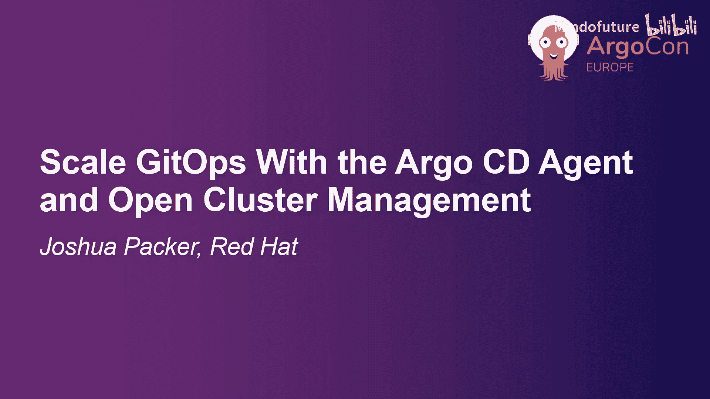
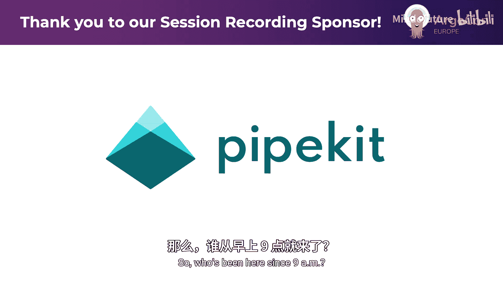
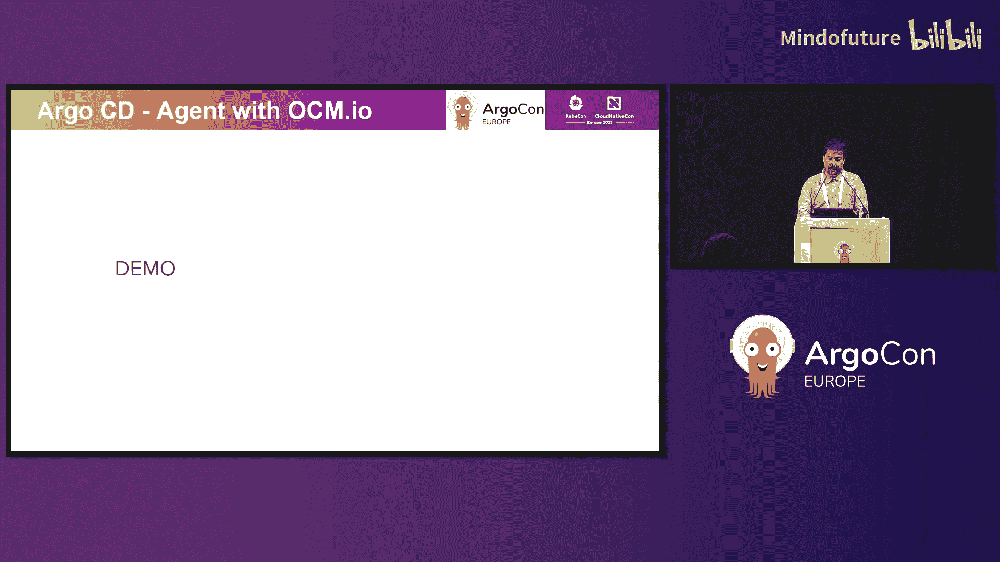
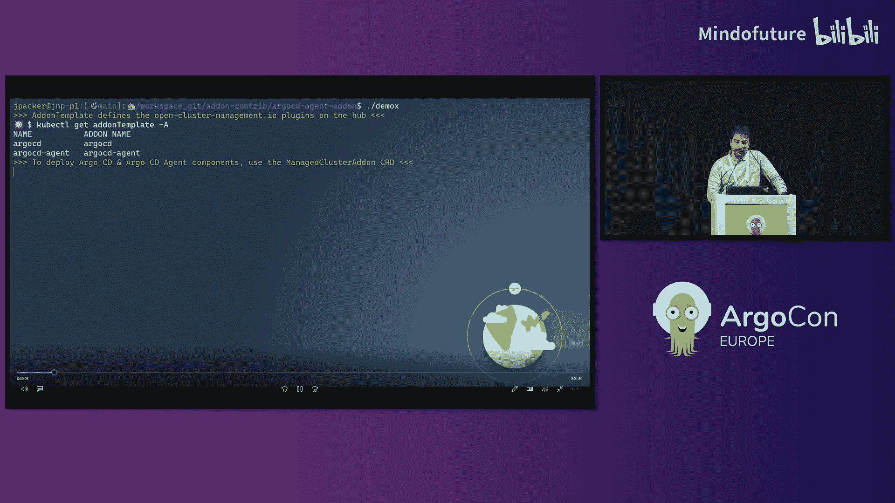
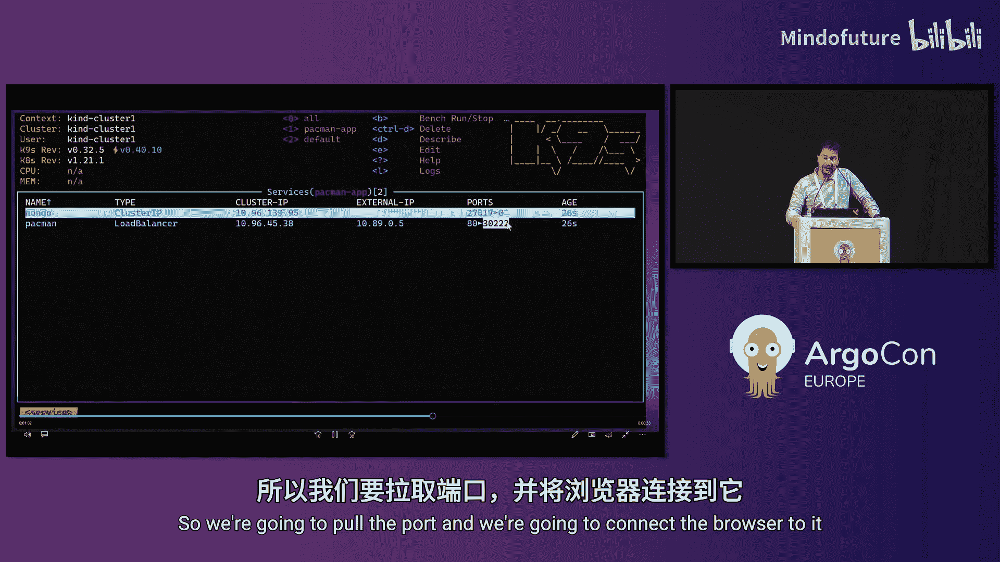
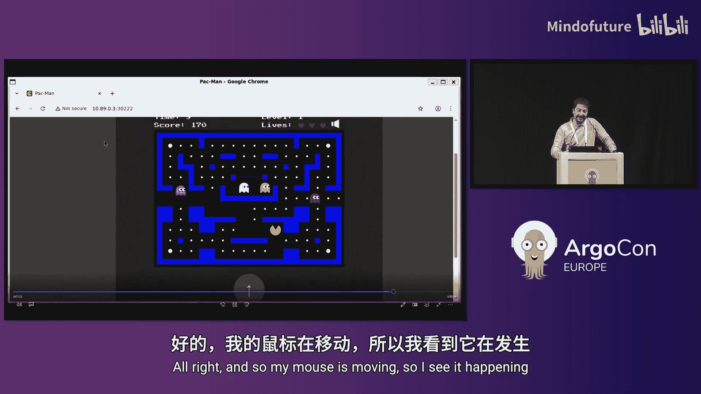
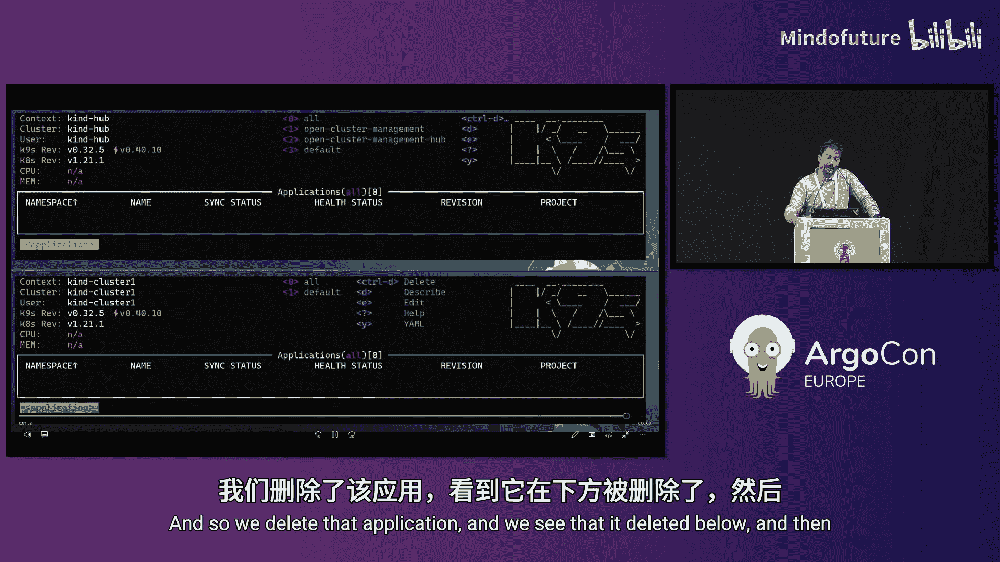
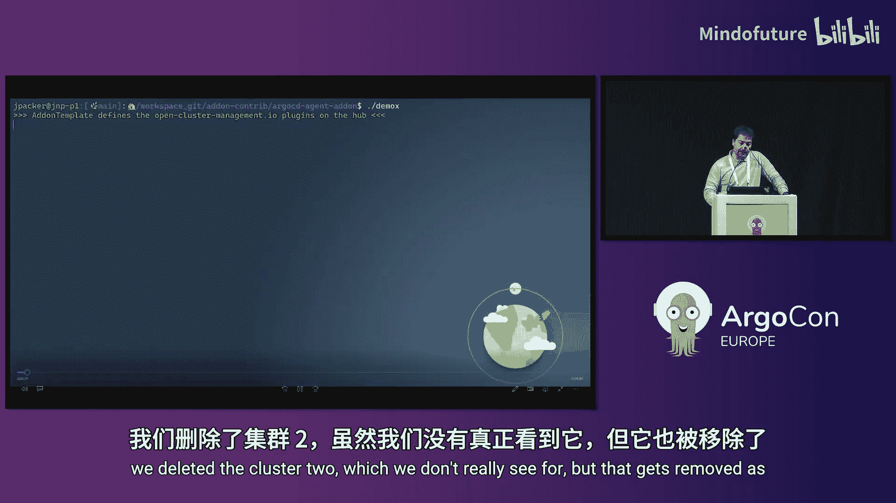
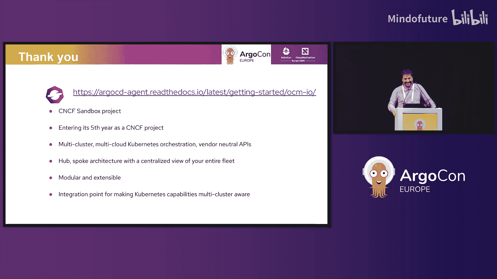

# ArgoCon-2025-Europe-大会-｜-云原生-｜-CICD-｜-架构-｜-k8s-｜-docker-｜-devops-｜-kubernetes-p19-P19-Scale-GitOps-With-the-Argo-CD-Agent-and-Open-Cluster-Management---Joshua-Pac--BV1Xr5vzGEyK_p19-

So。

First off， let me start with we are at the end of the day。 So who's been here since 9 AM。

 can I see some hands。 Oh， we have a lot， So this is it， It's only 20 minutes。

 then they're going to do a wrap up and we can all go to the happy hour that happens after My second question is based on the title here who is familiar with open cluster management。

Anybody hands， I see a few hands， okay， how about Argo agent？Now that's still just a few hands。 Well。

 that means this is gonna go one of two ways。 We're going to get to the end of this and you're gonna be like what the heck was that Josh Gu talking about and hopefully you'll forget my name is Josh or you're going to get to the end and say what the heck was that Josh Gu talking about I need to learn more about this。

 And so what we're here today to talk about is bringing together to CNCf projects in a collaboration and for the what it's for the Argo agent we want to get to highly scalable Argo deployments we want a composable deployment of Argo so we don't have to put the full app there every single time all across our environment and I'll talk about a little bit more about that over time we want a spoke to hub connection flow。

 So today standard Argo， it's a push from your hub towards。

Towards your clusters we want to make it a pull for security reasons we also want the workload clusters to be autonomous What do I mean by that that if the hub goes down where today if that's your core Argo is running none of your environment is going to get changes we want you to be able to survive a centralized outage as well as individual outages where the clusters will still continue to function we also are looking to eliminate the high speed link that you need when you have that Argo running in that hub architecture at the top and so we want to be able to put it into environments where we get disconnect I'm going try not holding this and see if that stops stops the feedback so we're going to so you can put in environments like E on things like ships and trains and trucks where you may not have connections all the time but you still want your work to be being done。

You want Argo to be continuously reconciling and then the last one is we're looking to be more secure by design and we'll get a little more into that so remember this slide we're going to bring it up a couple of different times as we talk about the different Argo integrations that open cluster management has there and the why is one we want to get to higher scale to as enterprises go the number of Kubernetes clusters that are being adopted grows again coming back to the scale Edge that takes us to a whole new order of scale we also have AI workload management so we had some talks in the lightning round about how you can use open cluster management to push AI workload there and now you can do that with Argo and Argo agent as well and we touched on the resiliency and the autonomy pieces so being able to survive certain types of failures and to be able to keep processing on those workload clusters。

And so that brings us to open cluster management， Open cluster management is a CNCF sandbox project。

 it's entering its fifth year， it's about multicluster， multicloud Kubernetes。

 it's a vendor neutral API we actually use the KB API as our data source for storing the information so if you know how to use KubB and KubB CTL in the APIs you'll feel right at home in open clusterster management and its modular and an integration point for applications and so if you want to bring multicluster topology to an app or service or you want to bring your app or service to multicluster Open cluster manager is the way to do that also it's involved in the SIG Multicluster and when you go to those pages they actually point back to Open cluster management as well as as a few others。

And so what are some of the integrations we already have I've mentioned that already so we have Argo integrations with application sets with configuring ArgoCd server configurations。

 a new MTlS authentic off andflow as part of the agent technology as well as I just mentioned we're in the SIG multicster there are a number of others but I wanted to keep it semi Argocentric just because we did do talks in the lightning on AI I'll mention there's multiq and federated learning integrations。

 but these are the ones we're going to go through today。

 which is these collaborations on open cluster management with Argo to do push so a hub towards Sp also multicster open cluster management sorry with pull model so running Argo on of your spokes and being able to pull that information in and towards you and then last but not least the agent technology which is a full hub and spoke implementation so open cluster management hub and spoke topology。

which is why you can see it will blend so well when we talk about agent in a minute。

 it gives you a centralized inventory as well as somewhere to define your workload and it's built on top of CoUB。

And so how does it work， how do we get there Well， you bring your clusters and you register those clusters to the hub that puts an agent on that cluster and that agent can have add ons and well hold a pin there because we're going to talk about that a number of times throughout this presentation it also brings to you the concept of being able to deploy workload now this is simplistic workload so it's not expected to do an app like you would in Argo CD it's more like if I needed to move an application an Argo project application resource from my hub to a thousand different clusters。

 it's able to do those types of distributions and we'll see how that plays in in some of the earlier integrations and then we have the concept of addons which is for very basic deployments although we've used it in the agent technology to ease pushing it out into your infrastructure but some add- ons we have are things for policy today for applications a reverse proxy that allows you API access from the hub so there are a lot。

O and opportunities to extend your application， like I mentioned before。

 bringing multicluster to your app or your app to the multi clusterster concept。

And last but not least this is the special sauce in open cluster management there is placement placement is a way to filter and group your clusters in both orchestrated and strategic ways for working with workloads or the add ons and in this case it's with Argo and Gioffs and I swear this is the last slide before we start talking purely Argo stuff but I needed to give this background just to be able to talk about the different integrations that we're going to have and so to dive again into placement a little deeper similar to what an application set has today you can do label filtering。

 but the interesting things that placement also brings is a concept of a cluster claim。

 this is a custom CRD that you can create on your managed cluster with a label and that is dynamically transmitted back to the hub and used for those filtering conversations so it can be something like an automatic discovery 。

e of a cluster。claim for a type of Nvidia GPU and so depending on where the agent is deployed its going to it's going to have a label of an r 100 or an r150 etc cetera and placement is going to decide do I use that or do I not and pass that on to Argo it can also be used for。

Values that you may want to change dynamically over the lifetime could be something like a specialized availability or the number of nodes that you want to make available The other one that comes with that or on top of that and builds is our placement score and that allows you to create resource utilization scoring and so that can be something like how much CPU how much memory is free on the cluster and what happens is the placement which is a list of clusters will get ranked based on those outcomes and the reason we have that is because that's what we did is our first integration and so some of you will send me fan mail。

 some of you may send me hate mail I don't know which but three years ago this was something I proposed for application sets and then did the first set of pull requests on and it's been integrated ever since and so that's the the custom decision resource in app and what that allows you to do is generally define a type of reason。

that the application set is going to read to get a list of clusters and the one we had in mind for this。

 obviously me coming from the open cluster management side of the house was to be able to read the placement algorithm and so that got integrated with the Argo CDd that everybody knows today the one that we deploy on the hub and you can put one or more so you can target local or you can put one or more servers for the fleet in place there and so that integration was our first4ay and yes was about three maybe three and a half years ago and so this was the slide we saw at the first and this is by no means me saying any shade towards an Argo hub installation it is really just to illustrate the point of what the Argo agent technology is going to bring to us We heard in the it wasn't in the previous one and the previous before that presentations everybody was talking about the scale and so it's not to say that you can't scale it highly it's just。

More work to scale it highly with the architecture that we have today。

 the same thing with lightweight， it's always the agent or it's always the full application that gets deployed with the when you push Argo out。

 although that can be pared down and that's part of what we're doing in the agent technology that we'll talk about in a little bit。

 The other one is that the agent always emit。Always initiates communication so we talked about that push versus pull for the Argo installations and so in our Argo that everybody knows if you have six servers。

 you're going to be pushing data down to those servers but also pulling and doing watches on the Kbe API for the status of resources that are associated with those applications and that's actually where we run into a lot of our scale problems that we have there and then we have the workload or the workload clusters being autonomous which again goes back to there's one instance of Argo so you have a failure of that instance and the system is not reconciling anymore at that point we have the latency we talked about before and the secure by design obviously when you're using the single instance of Argo we all know that there are co configs that are kept for each of the target clusters those all need to be stored in the hub with agent we get to start to get away from that which helps remove the number of access point。

We have into our fleet。The other piece that we integrated when we did this first round with ArgoCD was the GitOs cluster and what this allows you to do is take that fleet that you've got in open cluster management and push it in using a placement rule。

 so again being able to filter left and right， different different types of clusters。

 different groups of clusters， but being able to push that into ArgoCD instances。

 could be if you add just one ArgoC instance on that hub。

 or if you add multiple on different instances， you can create multiple copies of the resource and our controller will help push push the end or the spoke clusters into that deployment。

And so this is the diagram everybody should have seen or has seen， you know the standard。

 we have the application controller in the middle， and it's doing that push operation that we talked about。

So next we're going to talk about the other Argo CD integration that maybe some of you know about and I won't ask you to put your hands up and so this is what we in the open cluster management world call the pull model and so you can see that we've started to remove some of the lines there so it's highly scalable or more scalable and we'll get to the diagram in a second but that's again because you have Argo running on each of the spokes or the workload clusters it's still not lightweight because we do a full Argo deployment in that and it is technically an agent initiated communication but we're using the OCM agent to do that and there's a drawback in doing that today at least in that the entire status of the object you send using our workload technology does not get returned and so you don't get enough to fully populate or what I would consider to be fully populate the Argo UI so it's not quite where we。

Need it to be。 We do， though， get the workload cluster autonomy。 If one of those goes down。

 it doesn't matter if the hub goes down， those individual spokes have their application instructions so they will keep executing on them。

We remove the need for the highspe connection between the hub and the endpoints because each endpoint does its own processing。

 though one might argue we've introduced a new latency requirement that our end cluster spokes need to be able to pull the data as well and agent actually helps overcome some of that as well because you can deploy it in different topologies where the individual spokes may pull or we push the details over and then secure by design there is no longer any coop configs that need to be stored on the hub side because the OCM agent technology which uses MTtlS certificates and keys to secure the connection is what's moving the Argo application objects back and forth and so from the previous slide to this slide maybe I'll push these up a little see if it stops with me breathing on it so you'll see the main change is the part down the center and that's where we have that manifest work that I talked about on the second or third slide。

In essence， what we're doing is the Argo application controller is creating the Argo application object。

 we introduced into the engine a specific， I think it was an annotation。

 but it might be a label that will cause the engine not to evaluate it and then the open cluster management controller picks up that application encapsulates it in a manifest work。

 which then delivers it to the righthand side of the slide into the workload cluster where the local Argo is able to process it。

And so what agent is so the Argo agent， this is the one hopefully everybody is going to want to get to know and I know we had only a few hands and maybe people were holding back but this is。

 in essence， everything I described and pull model and more which is why we love it and it doesn't we're talking about it in a context of a collaboration with OCM but it absolutely does not require OCM to be there we just help make that transition as well as management easier and so what you see up here。

 this is already released into the ArgoCD documentation。

 there is a section on the OCM IO integrations and how to do it and I will show a quick demo of it but so we're back to this slide again and now we've in essence are checked all of the boxes removed all of the lines it is highly scalable it's a hub and spoke mentality it it's lightweight。

 we only deploy the parts we need especially on the spoke clusters。

It's always agent initiated communication， although this time instead of using that manifest work that I said。

 we're using the actual Argo agent technology， there's a controller that runs that we'll see in one second we've got the concept of the workload clusters are autonomous so if the hub goes down we're still able to communicate as well as we don't have the requirement for the highspeed network and we're secure by design because we're still not trading coop configs all around so hopefully if you've seen the Argo agent before you've seen this diagram。

 the key points or what's new is the green so you've got the agents across the top of the slide and those are communicating with the principle and in essence what they're doing is syncing the application objects that are defined on the hub for the clusters that you want the application deployed on and it's pushing those down to well actually the agents are pulling those down to the workload clusters and then the local Argo application isgo application controller sorry is process。

Those it has a repo present and we'll see that in a second with the demo and so what OCM or the open cluster management brings on top of that is one we help with distributing those Argo CD controllers that we need so the application controller。

 the repo controller， the S controllers， etc it also distributes the Argo agent technology so all you do is import your next cluster into open cluster management and it automatically gets all of the Argo bits deployed and it's ready to start processing。

We also help do the configuration obviously， and then last but not least this isn't specifically to OCM or the open cluster management。

 but we contributed some code to Argo agent for the MTLS security to improve it and we'll talk a little bit about that at the very end and so you get the new diagram where you can see the open cluster management icons sitting next to the Argo agent icons and we get a very different looking diagram although because I've been talking for 19 minutes I'm not going to spend that much time on it。

 but the key parts are on the top， you've got the OCM controllers。

 you've got the Argo controllers that you need and the definitions of these adds that represent the agent that need to be deployed and then on the bottom box you've got the cluster lit which is the open cluster management agent and it's taking that addon information from the bottom right of the hub box on the top and setting up the Argo implementations there。

So now we're going to try the demo， which will only run a minute， hopefully。

I am not tempting the demo gods， and so I'm using a recording， but this can run on your laptop。

 And so I suggest everybody give it a try。 And so first off， we have。

 this is a definition of the add on template on the hub。

 This is the install that we're going to use for both the Argo。

Controller technology as well as the agents。

And so then it gets deployed out using these instances called the multi cluster or sorry。

 the management cluster add on， and so each of those represents an instance to be deployed of the add on template at the top and then the two calls at the bottom are just showing you on each of those clusters the actual。

Controllers that are running， and so you can see we have the application， the Redis， the repo。

 but also the agent， which is the new piece of technology in there。

And so this is just showing us on the hub。 You've got that new controller as well called the principle。

 This was just deployed with a standard hum chart because there's usually only one or two of these running in the environment at the hub of our spoke layout。

 And so now we're going to do the application。 So here we can see we're looking for Argo applications in the top box on the hub in the bottom box on the cluster  one couldn't fit cluster 2。

And in a size that would be viewable for all of you so we'll just leave it at that as well we're gonna to look on cluster1 at the namespaces。

 we can see there is no namespace called PAacman and that'll be the hint so this is on the hub we apply the two applications you see those in the top on cluster1 and cluster2 and you can see the one on the bottom which is cluster1 and so they're going into progressing and then they become healthy and you can see how they sync back and forth and so that's the agent using an MTtlS connection to bring those two pieces together and so we see now we have the PACman namespace and so it wouldn't be a PAman demo if I didn't show PACman so we're going to pull the port and we're going to connect the browser to it and then we're going to do as our last step to show that we delete on the hub and that it's going to take care of the Argo applications on the other side and I needed more filler to go with my PACman playing although it doesn't go very long and we'll flip back over。

All right， and so my mouse is moving so I see it happening。

 so we're going to go back to this view and we're going to delete the application and this is happening on the hub side and so we delete that application and we see that it deleted below and then we deleted the cluster2 which we don't really see for but that gets removed as well。

All right。So to finish up because there's two minutes on the timer I've got running here left is I'm going to talk about the last piece。

 which was what we contributed back into Argo agent And so by default。

 Argo agent is username and password which we don't love because it's kind of like the co config in the sense that you've got to store the username and the password for each of the managed clusters that you are going to have。

 So instead we beefed up the MTtls integration and so part of open cluster management that I didn't get into is it manages the certs and it rotates all the certs on an hourly basis and so by using the Cert and the Ct keys as the authentication we gain two things One we don't need a username and password two we can revoke it from the hub and three if we leaked one of these certificates and they're different for each of the managed clusters then it's only good for 60 minutes at which point it gets rolled over and you've stopped whatever your nefarious leak is。

In that space and so there's three ways it makes it better so the contribution was really to be able to pull the name of the cluster out of the subject name after we authenticate it and then use that for the queue that runs on the principle that's giving the application information and so with that we're done we're back to this slide which is these are all the great things that we get in Argo agent we don't you know with the open cluster management we help make it easier but we get all of this by default out of the box in this space and so hopefully as the project progresses we'll get to see more and more of it and you guys are here more and more about it and so with that I am done its this back to our slide but I put where you can find the demonstration I did which is in the ArgoC agent documentation Thank you very much Hope you enjoyed your Argocon。

