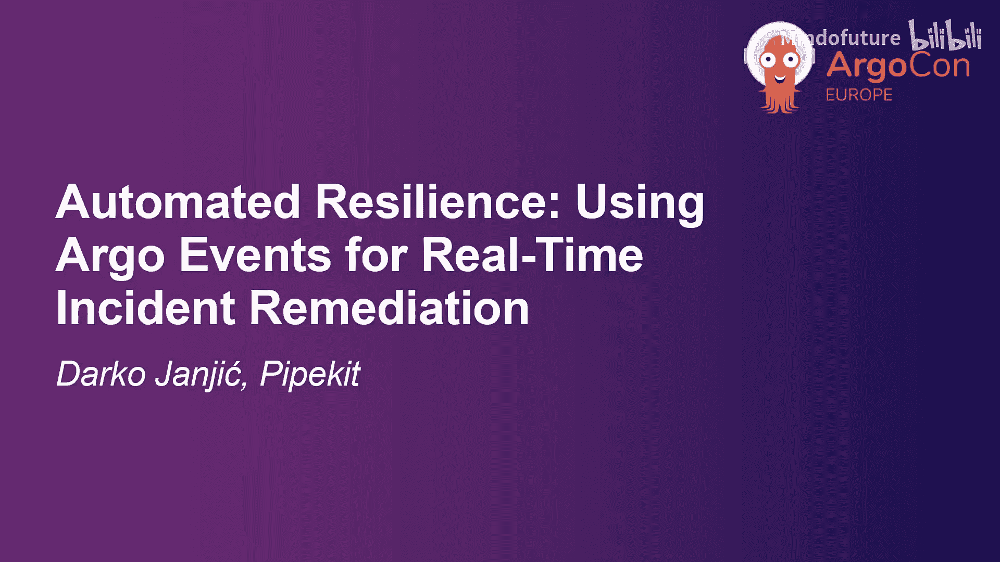
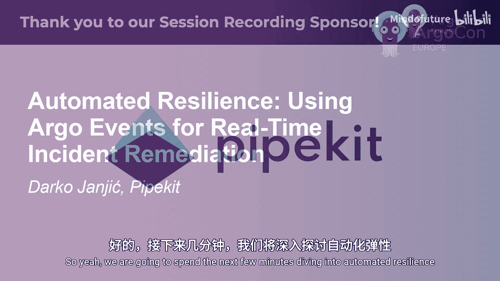
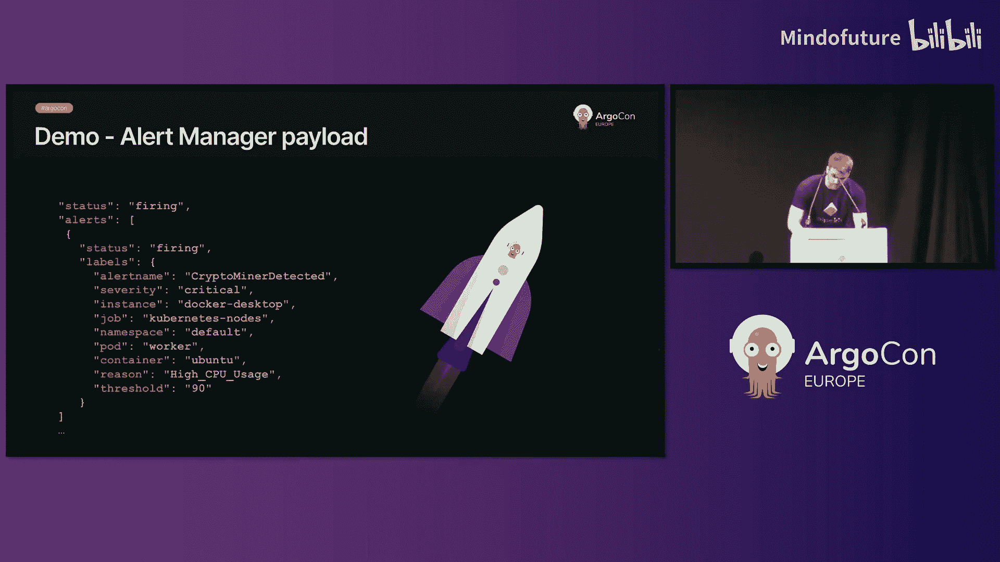
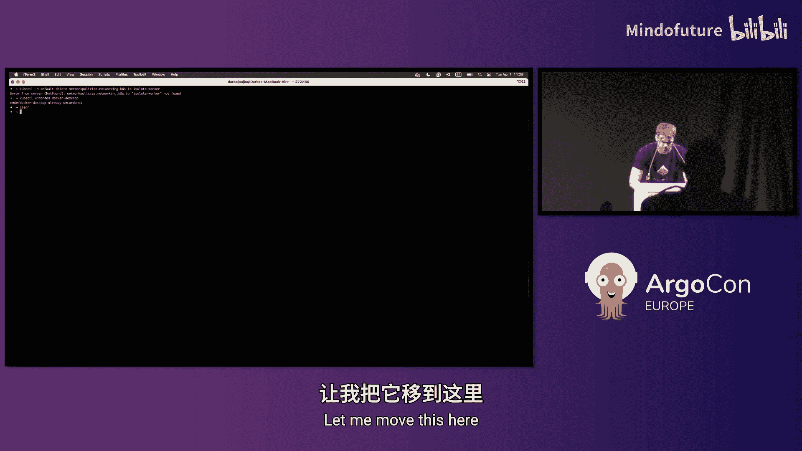
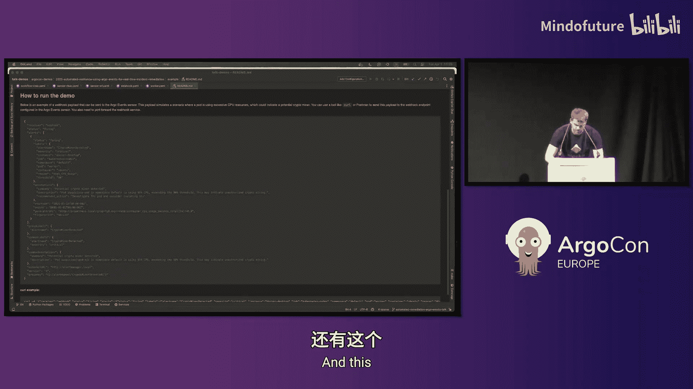
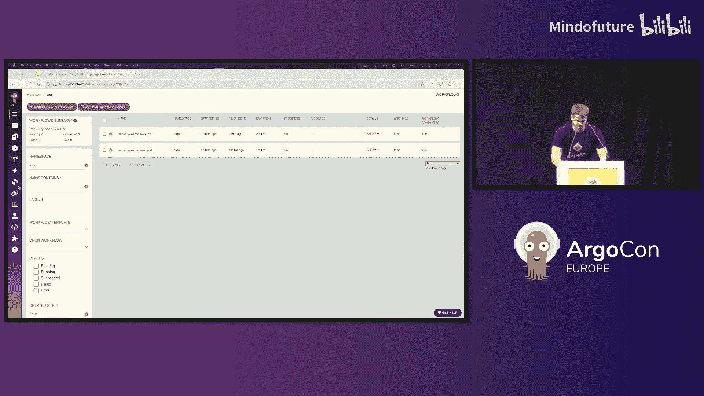
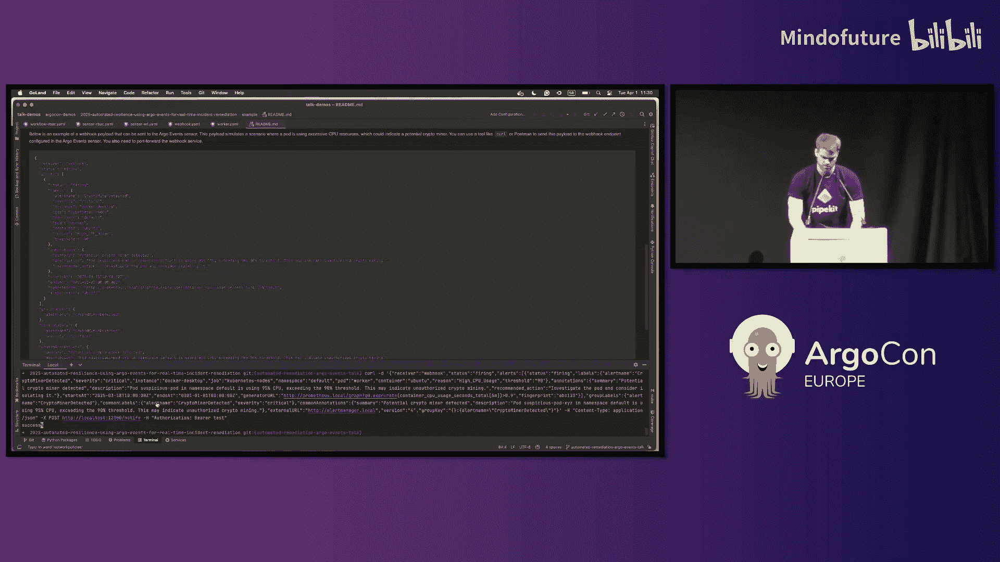
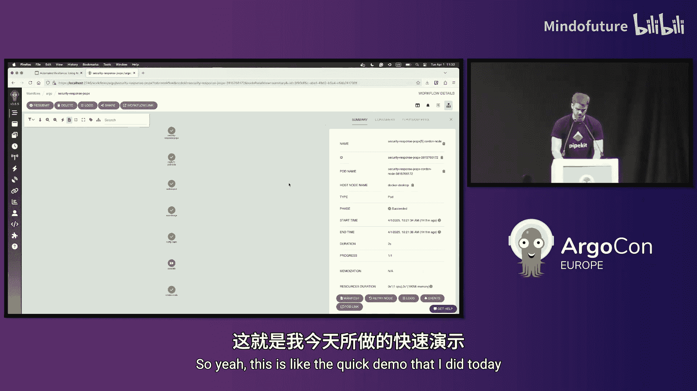
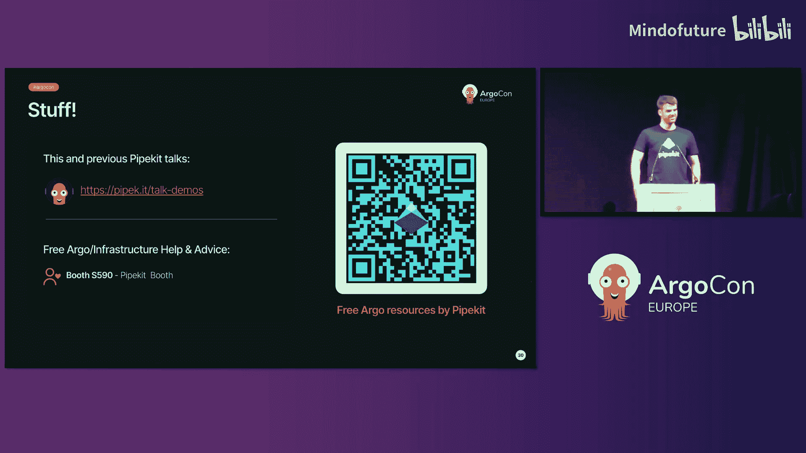

# ArgoCon-2025-Europe-大会-｜-云原生-｜-CICD-｜-架构-｜-k8s-｜-docker-｜-devops-｜-kubernetes-p20-P20-Automated-Resilience---Using-Argo-Events-for-Real-Time-Incident-Remediation--BV1Xr5vzGEyK_p20-

So yeah， thank you。 So， yeah， we are going to spend the next few minutes diving into automated resilience and how to use ourV eventss for real time incident remediation。

 I'm Dco， and I'm a software engineer at Pikeki。😊。

So yeah， just a brief introduction to Pipeki， we are a group of Argo Mainers and experts who regularly contribute to Argo workflows as well as other Argo and open source projects。

If you are in need of an SLA on your open source a installation or you want deeper support from active a maintainers。

 we are happy to help。Also， we provide an enterprise control plane for Ago workflows which makes your airb life easier。

 enables the triggering of runss through Gi events with minimal configuration and allows you to view and run your workflows across multiple clusters。

So， yeah， let's say a little bit about out remediation。

 So out remediation is the process of detecting and resolving system failures automatically。

Basically， your optimal remediation system would detect an issue and try to resolve it。

This enables self healing of applications and infrastructure。

You can integrate it with your current development tools or your pipelines to provide realtime miigation of the issue for example。

 you're using some app that works well 99% of the time but from time to time something happens and your functionality is not working properly usually simple restart helps but help check is green。

In this case， out remediation can mitigate the issue by checking the logs and restarting the service。

 Later， your team can add the proper fix。This can save money， time and decrease manual work。

So yeah how out remediation works。 There are three phases here， first one is detection。

 so you need a tool that would monitor your system and act if something is wrong。

Then the second step is decision this component should decide if detected the issue serious and if it can be remediated。

 the last step is action Action is actually your remediation action and this is where you fix or mitigate the problem。

So yeah， detection is a monitoring tool that continuously track your system。

 usually it checks all the logs， metrics and actions inside your system。

And when something is detected， these components will alert。So for example。

 you have Promeus and Promeus alert manager and you have a rule that would alert if CPUU usage is over 90% for some time。

Or you use Grfaal Loki and you get notified if something suspicious is in your logs。So yeah。

 let's say a little bit about decision components， this component gets the notification from the detection component。

 validates it and act upon that information， so for example you receive a notification that your system is returning 500 error on some endpoint。

So your user is seeing a failure and can't use your system。

This notification will be validated and depending on severity or some other predefining rules and action will be triggered。

And yeah， third phase here is action and action is actually theremediaation action it receives a command from the detection engine and based on the command starts appropriate starts the appropriate action this action can be a workflow or serverless function or simply a command to revert change in your system。

So from the previous example， your system is returning 500 error on some endpoints。

 remediation action here is to restart affected service or roll back to the previous version if that service is outdated recently。

So yeah a little recap about outmediation so out remediation detects and resolves system failures automatically it reduces downtime by instantly detecting and resolving issues and ensuring business continuity it boosts operational efficiencies by freeing engineers from repetitive tasks。

 cutting costs and reducing alert fatigue。Ultimately。

 it leads to better customer experience by ensuring high availability and rapid issue resolution。

So yeah， let's mention with bit are events， so A events lets you define powerful event driven workflows so your system can react to events like failures。

 security breaches or business triggers without human intervention。Let's break down what arcqua is。

 its core components， and how you can use it to build automated self healing systems。So yeah。

 Agu events is a Kubernetes native event- drivenven workflow automation framework。

 It enables users to define and manage event- based automation using event sources and sensors to actions。

 So yeah， for example， Agu eventsts can receive your webbook event and capacity to the appropriate sensor This sensor will after trigger the appropriate action and in this case。

 this action is a workflow。So yeah， some of the A events use cases so you can use A eventss as part of your CICD pipeline。

 so for example， user commits a change in Git and then Git will notify A eventss about this change and then A eventss will start your pipeline。

Other use cases are， for example， event based data processing， you upload the file。

 your file start provider notifies Argo events about this and your processing application starts processing the file。

Argu events can also be used for any automation and event processing。

So yeah let's yeah talk a little bit about A events components。

 I'm not going to go deep into this if you want to get more info about A eventss you can check deep diveive A event Doc from the previous Argocon。

 you can use theQR to check the code。The talk also you can find other other talks and resources at the end of the presentation So yeah our events consists of four components。

 sensor， event source， controller， manager and event bus。

Event source defines the configuration for consuming events from the external sources。

Can transform the event， and。Dispatches that event to the event bus。

 So if you want to consume a webc， you should create a webc event source config。

 If you want to consume an S QS event， you should create an S QS event source config。

Then yeah event bus is a transport layer and it's responsible for connecting event source to the sensor some of the components used for this are Kafka。

 nets jetstream。And B sensor receives this event and triggers the action。

 sensor listens for events from the event bus and does the appropriate action here。

 and BM at the end， controller manager is a regular Kubernetes operator and it's responsible for managing previously mentioned components。

嗯。So yeah now I'm going to do a little demo with AG events as decision component and workflow as an action。

 so entire example is available at the end of the presentation and yeah just to set the scene here so yeah a bad actor has got into your environment one night and is running a cryptominr in your cluster without autoer remediation you might have some alerting to tell you that there's an increase in CPUU or GPU or vote but this will likely go ignore until the morning so you need a way to act on this scenario faster in this demo I'm going to use permititive alert manager to notify AG events that the cryptominr is running in the cluster AG events is going to receive this event。

 filter it， process it and trigger the high severity ones。Workflow is then executed。

 this workflow is going to capture metadata of the affected pods and after that is going to isolate the pod using natural policy。

 according on to noded， scan container， image using3V and alert using Slack or Pagero U。And yeah。

 some of the actions will be simulated due to time constraintstraint and possible network issues here。

So， again， this is the event source that I'm using。

 So alert manager is not defining our events using webhook。 So our。

Event sources creating a vacuum hook。We specify ports。End point， and they're using past methods。嗯。

Yeah， we also use a bear talking for authentication。A events is also filtering all the requests。

 so we are acting when staus is firing， severity is critical。

 and the name of the alert is cryptominor detected。

So beyond then event sources using the default event bus to pass the event to the sensor。

 this event is then transformed into more friendly structure， we extract po name， namespace。

 instance and affected container from the event。After this sensor starts a workflow。

This workflow will then use the transform values as workflow parameters。So yeah。

 this is how my workflow looks like， so we have multiple remediation and data collection steps intent here is to quickly capture all the data and limit pod until on call person is here to inspect。

So yeah， first step is to collect the data， I use QBCTL to get all the po logs， both metadata。

 affected container image and I'm saving all the data to S3 for further analysis。

The second step is used to isolate this po， so I'm using the network policy and after applying this change both ingress and ingress traffic is blocked so our crypto miner cannot communicate with the outside world。

Then yeah I'm using trivi to scan the container image for some possible security issues。

 maybe something slipped there。And then I'm notifying users about， yeah， this。Possible cryptominr。

 So this user will get all the data that we previously saved on S3。And yeah， at the end。

 I am cordoning the nodes。 So just in case something is happening on the node and something。

 if something is wrong there。And yeah last but not least so this is the example of the Promeus alert manager payload that I'm going to use so you can notice status field。

 alert name， pod name， container name and instance， so yeah。

 these fields are important for the demo and I previously mentioned them。

So， yeah， let me。Yeah。Let me move。Yes。Here。😔。

So these。

Please。m。う。Yeah。

Okay， so yeah， this is the payload that I previously showed， so this is the entire version。And yeah。

 before I run my demo， I'm just going to quickly show you the。Ro that I'm using for this。

 So since we are creating a network policy， my workflow needs to be able to create a network policy。

 Also， I'm getting put metadata。 So my workload needs to be able to fetch that。 And in the end。

 my workflow needs to be able to patch nodes。So yeah， let me just， yeah， quickly execute this。

And yeah， as you can see， my workflow started， but before that， I'm going to go here。And。Sorry。😔。

Yeah so here's my reout mediation pipeline so this is my webcook and this is sensor that I'm using and at the end this is the workflow that gets triggered so yeah let me go back to my workflow I need to change namespace here so yeah my workflow is still running I guess because the yeah network is yeah slow here so I ran a couple of them previously just to show you how everything looks here。

So yeah， this is the first step here I'm capturing all the port metadata。And yeah。

 this is the message that I'm printing there。 And the important thing here is the outputs。 So。

 for example。This is the pod description that I'm saving to S3。

 so you can see everything things there。Then yeah， I'm isolating the po using networkrop policy。

 so yeah you can see here that my networkrop policy is created using ago workflows。嗯。

Container image scanning。 So， yeah， this is scanned。And yeah， at the end， I'm， yeah， simulating。

 simulating the， yeah notification of the user on Slack。And yeah。

 the last step is cordonening the nod。So yeah， my note is now yeah， unschedulable and yeah。

 other applications cannot use it。So yeah， this is like the quick。Demo that I did today。

So， yeah， let me just go back to。My presentation。嗯。So yeah。

 we saw cryptominr alert simulation Pro use alert manager event was used to figure out events。

And our we filtered this event based on severity and alert type。

 then the remediation workflow started， this workflow captured dePo metadata and saved this information to S3 and after that we isolated the dePo network pods using network policy。

 called on the node and yes can container image using3V and alert it on call person on Slack。So yeah。

 I already mentioned our events， so Rabbit MQ is valid， yeah。Choice for， yeah， using。

As a yeah decision maker， so yeah， why would you use our RabbitamQ so yeah。

 one of the issues with Rabbit1Q is that it's not a native Kubernetes app。So边。

You cannot easily deploy that to Kubernetes also yeah Rabbit tempQ is a basic message rocker you would need to create a producer that needs to receive this event。

 you need to validate this event and need to pass it to the rabbitamQ so after that you would need a custom consumer that would get。

That event and trigger the action。 So if you need to add multiple event sources。

 you would need to add additional code for each。And yeah， at the end。

 Rabbit temp Q is not busy to scale， and it's not lightweight。Mm。Also。

 yeah for example you can create a custom app as events handler。

 decision maker and this is what some people do when they have one event source Yeah people might write a custom app with good intentions。

 this app does one job well， but then you need to add a new feature and you have to keep manually growing and growing it in this case you need time to develop and support this application you need to implement every new event source。

 no monitoring out of the box， no built infold tolerance。Extra work to secure everything。

 So a lot more time and money needed to maintain and develop the application。

So yeah why A events so you are as we saw here Agu eventss is great for event handling。

 it supports many sources and destinations， it's open source and container native it's basically plug in play system it's not hard to scale it and add different sources and it's really easy to maintain it it supports basic filtering and discarding of events and if you need something more complex you can easily add a workflow that will do that for you you can also combine multiple sources and trigger only when you get the same issue from multiple sources so yeah for my demo you could use alert manager and for example AWS Guard duty to detect crypto Minr and only if you get a notification from both of them you can be sure that something is happening and this is really easy to do with AG events。

So yeah， what are the best practices for out remediation so you should validate the event and filter it。

 you don't want to trigger your out remediation action every time something happens just when it's needed。

You should also add a required policy and DLQ in case something fails during the processing。

 make operation it important or do event the duplication。So yeah。

 you don't want to trigger the same action multiple times。

You should also add alerting and monitoring to your system。

 and at the end you should really test your outer remediation pipeline。

 so simulate and observe what is happening inside your system。So yeah， why would you use this。

 I already mentioned our events benefits and why it's great。

 I also mentioned that by automating your on call playbook you can minimize the errors。

Automation can act faster than the uncle person。Imagine something happens at night。

 Un call person is walking at 3 AM and needs to fix the issue。 Of course， something can go bad。

This will also improve your infrastructure and reduce operational cost and manual work by automating responses to recurring events。

 engineering engineers don't have to manually troublehoot the same problems over and over again This eliminates alert fatigue and let them focus on innovation rather than firefighting you can also detect security anomalies。

 trigger immediate mitigations like revoking compromise credentials and ensure compliance by enforcing policy drivenrive remediationations。

So yeah， let's do a quick recap of what we saw today。

 We saw a little bit about our events and what our goal remediation is。

We saw cryptominor trade simulation how to use a events and workflows。To remedy it。 And at the end。

 we saw some best practices and benefits。So yeah thank you for coming on the link you can find other PiK stuff and use this Q code to get free Argo free Argo resources finally if you have any Argo Kubernetes questions do come and find us at BoS590 throughout Qcon we will happy to help and chat。

Zbian， thank you。

