# ArgoCon-2025-Europe-大会-｜-云原生-｜-CICD-｜-架构-｜-k8s-｜-docker-｜-devops-｜-kubernetes-p21-P21-Panel---Native-OCI-Integration---Leveraging-Argo-CD-Source-Content-in-a-Bran--BV1Xr5vzGEyK_p21-

Welcome to the panel discussion for OCR。 My name is Shita Squera。

 and I am a senior software engineer at Redhat and I'll be the MC today。

 I'll just pass the mic to the folks here。😊。

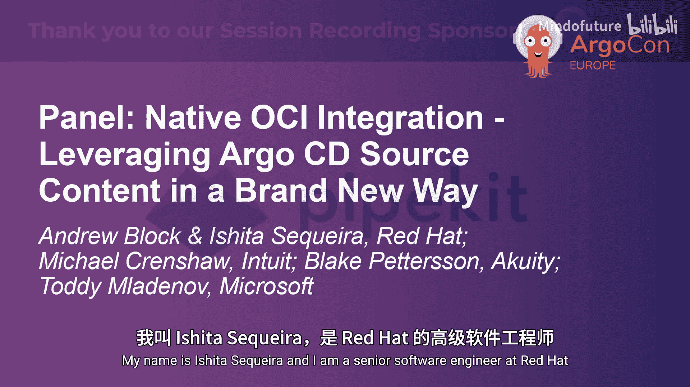

Hi， I'm Blake Patterson。 I work at CY has a。

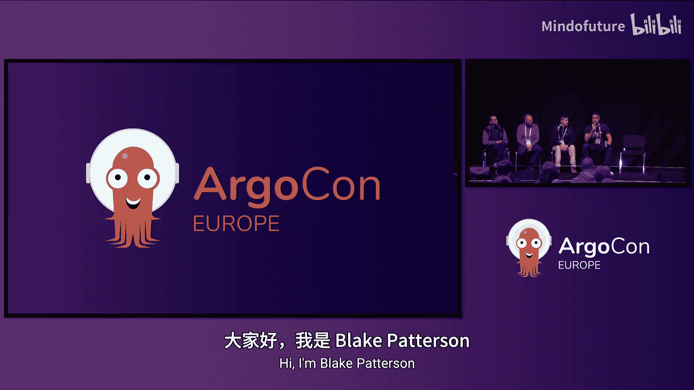

Senior solution architectect。Basically， in the concept of OCI。

 I've been the main developer working on this。Everyone everyone， my name is Andy Bnc。

 I'm a distinguish architect at Red Hat， I've been working in various areas of ArgoCD over the course of the last few years。

 recently've been putting a lot of work around OCI integration and helping bridge the communities between Argo CDD and AA。

 which I'll talk about in a little bit。Hey， folks， I'm To Moroff。

 I'm a principal program manager at Microsoft。 I've been working a lot with Andrew on the Auras。

 and also， I cooperated with the O C I community around。

Making it viable to store other artifacts in the registries。And Hail， I'm Michael Krenshaw。

 I work as a staff software engineered intoit and I'm a lead on the ArgoCD project。

 my role has been providing some expertise in ArgoCD's Repo server component which is a huge part of how OCI functions and just working a little bit on the design side。

Thanks for the introduction， so let's move on。Seeing how the OC content management。Yeah， okay。

 straight into it。 So how the repo server works。 This is getting a little bit into the weeds right off the bat。

 but it's good to know how things function on the backend in order to understand how ArgoCv is able to bring OciI support。

 So if you're not super familiar with ArgoCDs component structure。 We have several components。

 the application controller application set controller。

 a lot of them use the repo server on the backend as its access point to Git or to helm and now to OciI。

 So that's why it's the component that's most relevant for Oci the repo server maintains a few different caches。

 it has an inmemory cache for revisions。 So with a Git repository。

 you would have all the commit hass， all of the tags， all the branch names。

 those would be revisions with an OciI repo， obviously it would be repository tags。

 So OciI has to have its own implementation of that cache。

 it keeps an on disc cache of all the files that are extracted from Gi。OCI images， etc。

 and it maintains a cache of the rendered manifests in Redis so those are the integration points for OCI and delightfully OCI works similarly enough to get into helm the things just kind of fall into place so within the repo server in order to implement these caches and these functions OCI has to resolve revisions。

 retrieve artifacts and extract the contents of artifacts。

So and it resolves a revision that is where it goes to the OCI repository and it asks， okay。

 the user has said I want， say the simr range of OCI OCI tags pulls down all the tags finds the ones that match and it finds the most recent one and then it cachees that list of revisions then it retrieves the actual artifacts and OCI manifest artifacts are just one layer and it contains basically all the files that are used for inflating the manifests and then finally it extracts those files to disk where it then makes it available to the rendering logic all the rendering logic is identical between helm git and OCI so that makes it very reliable but those first three stages have to be implemented by the OCI layer。

The best part about this， as Michael just mentioned。You don't to do anything different。

 You can go ahead and do the exact same patterns you've been doing with Argo。With gett with helm。

It's the same thing。 You just package it in a new way and push it to an OCI registry instead of a Git repository。

 And that's one of the benefits that I see here is that you're able to leverage OCI artifacts in new ways and overcome a lot of challenges that you might face or may not face when working with Git repositories。

 I work in many organizations where Git actually is not allowed。

 I cannot use Git in my production environment。 It is not allowed at the development resource in many organizations。

I can now go ahead and say。I can just use an OCI artifact registry。

 you know that if you're using Kubernetes that has to be available。

 otherwise you had no Kubernetes at that point。😡，I can go ahead and use OCI store my manifest there and then use it I also have teams that just create demos。

 guess what I don't have to go ahead and spin up a Git lab or whatever or punch a hole on my firewall。

 I can just use the content directly。anyone wants to add？

So hang on let's go back to us the artifacts。A couple of things that I wanted to add here is not only that actually you can have the artifacts there。

 you can add additional security to that。 So what we worked on the OciI communities to have the ability to store all kind of additional metadata and security artifacts together with the main artifact that you want to deploy。

 take， for example， when you have the tar with old artifacts that ArgoCD needs。

 you can also provide some signatures on top of that。 or you can add additional metadata。

 So in the future， you can provide let's say， search or filtering on the types of artifacts that you want to pull。

 So that's kind of additional benefit in addition to what Andrew mentioned。

 we have a lot of customers that are saying like I don't want to have access to anything else that registry。

 So having everything in the registry is really helpful for such security conscious customers。

So how many of that could you use OCR artifacts in the past， raise your hand。How many of you。

 what have you use them for， Just throw something out there， What have you used it for？Helm charts。

Signatures， have you signed any container images using those CI artifacts？Using a Sig store。Okay。

You can do the best part about that is that you can leverage those same exact tools。For now。

 your get offs content so I can store my customized manifest。 my home charge， youre actually。

Render your manifest for helm in another way。 So in theory。

 you can actually use helm like four different ways。 You can do it as a flat gi repository。

 You can use it as OciI helm。 You can use it as a helm repository。

 And now you can go ahead and store it as OCI artifact。 So you really， as a helm maintainer。😊。

That's kind of crazy。 When you think about it， I can actually go ahead and leverage home in several different ways。

Customized you can do pi3， Yeah so you now have many options that especially as you're working through different architectures that you're working in。

 it provides options。 that's the best part about that is that you can then work in more environments to make ArgoCD available in more organizations。

How many of you have struggled to actually implement ArgoCD because of certain restrictions？

Maybe government， maybe you， just regulatory industry。

 I know those are something that like my customers have faced in the past。Thanks， Andy。

 thank you everyone。So OCI support was like a dream。Took a lot of。

Folks to come here together and work on this particular feature。 So it was a great collaboration。😊。

Yeah， so we had like a vision then the organizations support from few companies which helped us to grow towards this feature and a lot of communication that we try to have for this particular feature we have a particular channel too。

 which I could share later on。There was a proposal that was shared by Andy last two years back and you could find that on our ArgoC docs too and I mean that was actually the best part about that was just for me the first time actually working through what a proposal was know were working with Todddy and the guys in Auras community I really felt that OCI had a place in the Argo community how many of you in the past use flux as an example flux has a similar feature around OCI support being from Red Ha I have customers who use being the Argo but I'll be honest they do use other and getOs tools I really I can't say that it's good or bad it community we all do good things。

But the idea is that I knew that I wanted to see similar support in Argo。

 So I went together and I chatted with Michael and Dan and Christian。

 what does it take to actually create an enhancement proposal in the Argo community working through that was eye opening because every community has different rules。

 different different different things you have to work through So by working with the community here。

 working with the different members learning from their experience。

 put together a proposal and went through painful in many ways， revisions here and there。

 we got it finally merge in And then from that。The hard work actually ended up starting because okay。

 great。 I we have an ambition。 How can we go ahead and implement a new feature Okay。

 now we have the idea it's been improved by the community what do we do now Do we just start coding。

 Do we need to actually get folks like Blake， folks like Toddy from other communities from Michael getting everyone together and we what we ended up doing ended up getting a slackck channel upgrade created。

 That was our first real big difference because I had no idea who might be interested and Blake note was one who jumped in a lot of development efforts I can speak to that。

In the end， the proposal started from Red Hat started from Andrew。

 And the meantime at acuity work this guy right there。 he was pushing because he is speech Ry。

 and he was like， yeah， we need to get O we want support。 Yeah you need。 And from our side。

 We have a lot of customers asking especially gap environments。 It's like we need to we need R ins。

 We cannot use it。 And it's like we don't have a solution for that。 Its like it's like， okay。

 well you can hack plugs or something。 And it's like lot of like O O here's like， look。

We we've got this red hat community thing going on。 we we should jump on it。

 and I'm we in terms of discussion。 Chris and I were like。

 okay let's see how far we can go let's try a C。 And then after a while， it's kind of like。

 I don't think we're gonna cuts it。 We'd need something more native into red into Oregon City itself。

 so。We were working on this internally in the Kin。 And it's like， okay， but we have something we can。

 we got， we got this thing。 But like， let's work with the community。 Let's bring this back。

 And then this is also like， you know， we lobby， we will lobby internally。 And it's like， what。

Let's go。 Let's go。's， let's work with the community。 Let's work with that。

 And that's basically where it comes into。round April 2024， when well we started this。

It took some time to polish it enough to be able to get this out in a publicly reable state。

 and in June we finally got the first initial proof of this work POC。

There's still a lot of effort to do be done。 this is where the aas guys comes in and helps I mean。

 we got a lot of help from you got help from especially from Meheve and from Silvia Le they were super helpful because I'm not OCI I didn't frankly before this。

 I didn't know anything about OCI like okay well。But with with this was like the pre of having this effort on this was a process ongoing for the better part of last year and here we are。

 I mean the best part about this was in second was being able to bridge the communities and I wanted to back over to Ta to talk about this how ourgo community work with Os communities Yeah it's been amazing cooperation actually and I'm speaking here for Shiwei who couldn't make it and Sivi of course but all the feedback that I got from them is like it is amazing to be able to work with with Argo community and your contributions to A us have been actually tremendous over the last year all the advice all the business cases which kind of expands also our use cases on the Aura side So great cooperation and we're looking forward to actually do more of that with other communities that。

Need access to O C I Rs。 and we'll be happy to cooperate with them。 I mean， I mean。

 this is really a global effort。 You know， we have folks like Blake who's been out of the Maya region。

 I myself and Taddy are I myself I and Taddy are and Michael out of North America。

 Showay got out of the ApEC region。 So really， this whole effort's global。

 So it's really cool seeing the community coming together。😊，And look at the journey。 I mean。

 it's scary when you think about it。 know， it's been 2023 and 2025 now。

 a lot of time this guy would be ever ending pull requests out there。

I up ending up continuing to build off and on as I see him pushing at random parts of the night over North America。

It's great team that come together。it's been a long effort。 I mean， it's been。

 obviously there's been some like， I mean， you know， his first like。

The initial proof of concert took a weekend but then its like's last 10 percent。

Last 10%s 9% and then there's been a bit of reworking in terms opal。One understanding O CI in itself。

 And then we were debating like。Do we do multi layers， do we do single layers， how do we do X。

 how do we do Y， how do we integrate this that it works。

 the way that users expect in RGRC and this is also part like where Michael is being good at mentoring in terms of how to and how to integrate this properly into the repo server how do we integrate this as a source as any other into RRCD itself？

In the end， the end， it's like this has been a long， it's been a slog and sadly， we're missed the 3。

0 released I there's been for reasons， but we expect this to come into 3。1。

 so sadly it's not this upcoming run， but it's after summer then expect to see this use in production。

I think like the community could just help in reviewing。

 I think a lot of it comes down to we did our best efforts for getting something out there。

 we tested different permutations。We know it's not perfect。

 Nothing ever is perfect the first time you go around。

 so that's one of the things that we're going to add in the takeaway is give it a try， play with it。

 see what works， what doesn't work， let us know your feedback， how you see this evolving。

 we see this being a big thing So what did we miss and what can we improve on together。

Thanks everyone yeah so for this particular feature as the folks mentioned we communicated with a lot of folks around the Auras and a lot of people from CNCA and He so yeah there's a lot of engagement done during this particular feature。

😊，Ammentation and getting the idea ahead。I would also like to thank the four main organizations which helped in getting this feature worked。

 A QD Redhaart Intuit and Microsoft。Without， I think cooperation from the organization it wouldn't have been possible to work on this particular feature。

 so thanks everyone for that and I'm going to emphasize this explicitly。For open source。

 you need to have organizational supports。 It's the only way that you're at。

 you're going to get work done。I've been we've all been in the community for quite some time now and we can。

 I'm sure all appreciate the time that if you can get organizational buy- in on features。

 just allowing them to enable you to work on some feature for some amount of time during the week。

10%。5%， anytime just。Is gold。 And I know that if we didn't have Blake and acuities。

 contribution and support， this would not happen。Whatsoever。

 and you know from the Microsoft team getting the folks helping on the Aura side and then Red had to you and myself being able to review it。

 provide guidance and suggestions， this would never have happened。

 which meant that you all would not be able to reap the benefits that are going to come out of it。

I'm going to emphasize that again， open source needs organizational support。

 even if it's financial great， but just time is the minimum that we all ask。Yeah。

 I have to be especially in the time part because this was obviously something was which we got organizational buying from internally in order for us to be able to work on this I mean this would I mean。

 fact is like normally I am swamped with all kinds of crazy requests every other week and the fact that I could say like you could get scene match okay you work on this you know you do your thing you spend the time it takes to get it that's invaluable and this is。

I mean， I don't get me wrong， people from the community is also extremely valuable。

 but when it comes to big features like this， you need to spend a big amount of time to be able to work in this and this is the time which if you do not have organization buy in。

 it becomes extremely hard， if not near impossible。

One more thing I want to add is like what or us as a community really benefited from that is really expanding the additional functionalities and the use cases that people see for that because at some point of time we were like okay is that this project kind of getting leveled and do we have any more development activities can we keep for example the developers that we are funding to do open source development at Microsoft busy or should we redirect them somewhere else and then like Andrew came and say okay we need to implement that one。

 can you guys help us so which is actually great again to really learn more new use cases that we can help with and Microsoft spends a lot of money on open source but we need to learn what people need from the open source in order to continue this development？

The first commit I ever made to an Argo project was to Argo workflows and probably many of you are familiar with the process of doing something like that you send an email to legal and then you wait and you wait and youre paying your manager and you wait some more and then you finally hear okay you're good to contribute or sometimes you're not that was fantastic you know it wasn't ideal to have to wait for legal but the fact that my first employer let me make a commit to Argo workflows is the only reason I'm able to work for into it now and work on it you know most of every day and you need you need both you need folks who are able to contribute quick bug fixes and you need people who are able to work day after day and get really deep knowledge of a project so that they can enable those other contributions by being able to review them and decide directions for design things like that so yeah I think。

Pating very much the same thing， but it bears emphasizing organizations really have to support open source for it to be successful。

Yeah， when I would like to add like my first PR for open source was through Red Hat and getting an opportunity to work in such a great community is really great and I really love doing that。

😊，去打过来是 that。lake， what do you like。从这边。So in the end of it。

I think this is going to be disabled into the demo。 So in the end like。What we've done to ArgoCD。

 which is in the upcoming 3。1 is that now there's a new OCI clients。

Which basically means that it's a new source so obviously there's existing there there's helm。

 there's git， but now there's an OCI type， which means there's a new repository credential type。

 basically means that that，You you prefix your your there's an OCI mode。

 which basically means like if if you prefix your your repo year with OCI as a protocol。

 it's going to go into OCR mode and this is what I'm going to show。I think this is。

 can we go to next slide？So basically what's out of box is that any any OCI artifact that is built with。

which has a single layer which is built with those two OCI image types。

 those are spotted out of the box you can add other kind of custom media types to the given layer through server environment variable this also has support of he like OCI helm charts I mean there is already preexisting support but this is also a native native support for OCI helm which I will show shortly so not we can I was OCI content。

So， yeah。So as I was mentioning， our City expects a single day of content。

It be rendered helm manifests， it could be helm chart。

 it can be rendered manifests which are prerendered。

 it can be customized so from the perspective of your source。

 it's the same thing as you can either have it fully rendered or you could have or you can delegate this to reosserv to do postranum from a usability perspective。

 it's pretty much the same which you would expect with the difference that if you need to run this in an OCR repository。

And I'll show you a bit about how to publish OCR in the end there's multiple ways to do this。

 I mean obviously since we got the ORS people here it ORS is been my go to and by default I found it by far by mild the easiest client to use to actually build OCR artifacts so。

So with Aura， it's basically the same flow as Dr。 P， I mean you have a repository， you push it。

 you push it to a given registry。then。Use it in the way which you would expect you would leverage this you can add OCI metadata such as author's description there's a lot more but pretty much all the standard OCI annotations can be added which is something which RCD itself can then render。

 which you can see the authors in the description and so on and so forth。嗯。And in the end， it's。

This is what I was talking about，As as an application， you have， you know。

You prefix it with OCR protocol。 It's going to automatically assume that it's an OCR repository。

 target revision is what you expect。 It's a tag in the remote repository The path which which is which is like depending how you build this。

 this would be a directory。 I mean， this is this is just the way which you would expect with it。

 So there's a directory path you use that direct path。诶。You probably in most cases。

 you probably just need the the dots， the current directory。

 I would just want to add that for helm OCI charts， there there there is special functionality。

 So it's treated in a special way。 So basically for helm OCI， it's always going to be。

The current past。But。Otherwise， when you build an OCI artifact， depending how you build it。

 either you would use the。Whatever directory you're deemed appropriate for it。Otherwise， OCI。

Reos credentials works the same way you expect you'd have you。

You can either set it to be HTPS or HTTP， so one caveat is that with if you work to use simple HTP。

 which you shouldn't， but it's there it's there， but you shouldn't， but if you want it。

 then you would have to specify it。Orposed to our credential。

 but like with how most it works the way I expect， if you have custom artifacts。

 if you have some of custom render， it works the expect。All you want to see it right。

 this is you here。Yeah，等， okay。故。し that。All right， so。あの、あの。前 is。Hello。呃这です吧。Let's try out so。

I have a couple。不在。Li louder， okay。Is this good？バフます。こばけ。All right。

Let me show a couple scenarios here。

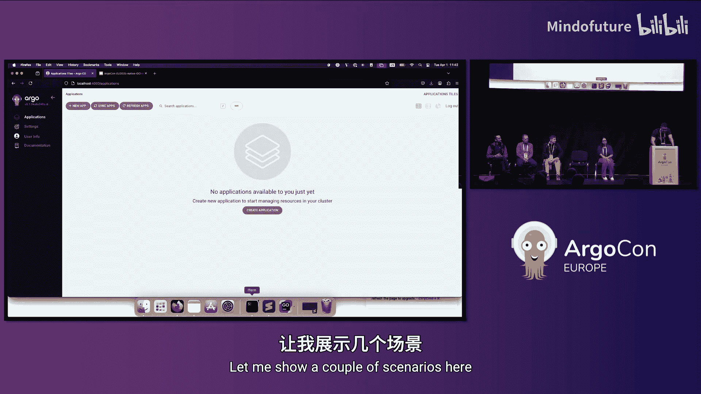

So。小さ。Yeah not师。be的 be。When to show you。

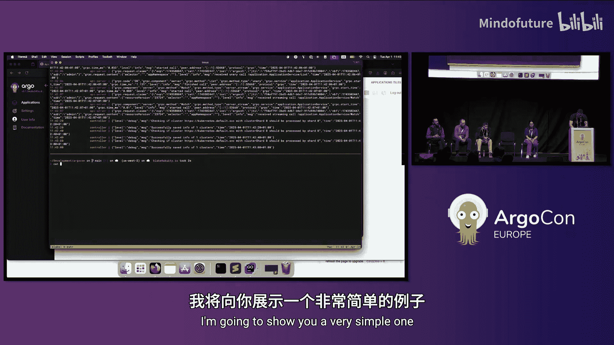

A very simple one。This is justed， these are just rendered manifests。I will show you the actual。

I will show you the actual。

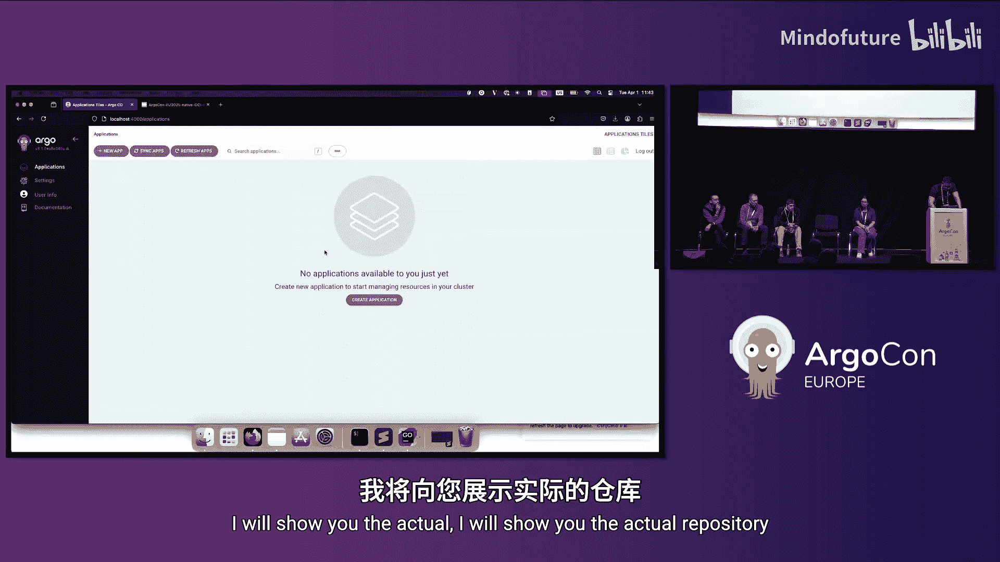

I was a to， let me just。

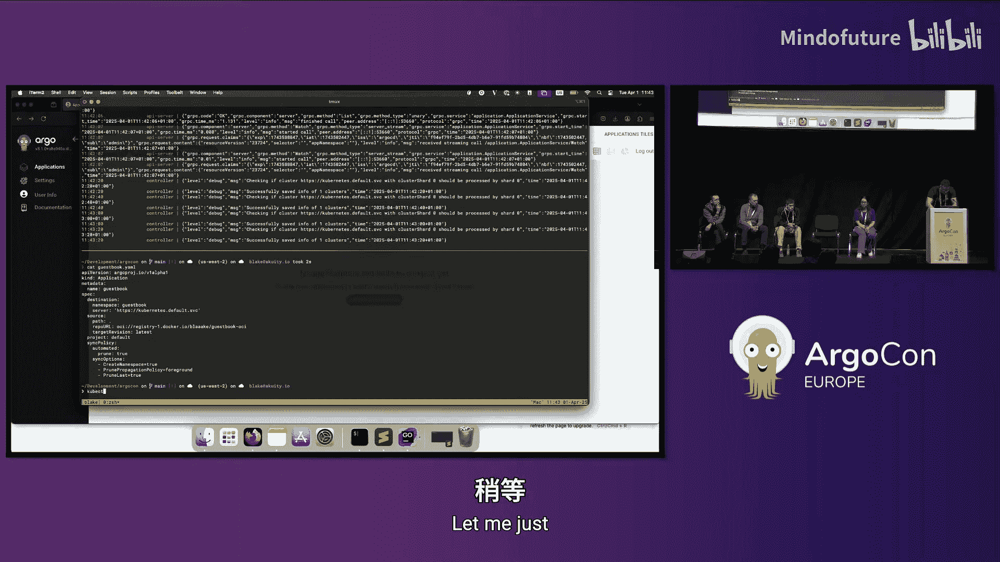

So。So some of的。This this is thecker this is using my Docker registry if it doesn't work。

 it's blame Docker ink。Ps a bit slow。All right。But you can see here， this will just used up。

But you're all here。しちゃいけ。就是不。Oh。Ha some live demo， of course， this is。What's going on。谁了。Yeah。

 the Wifi is。Of， not damage。暑。So if we can product。Yes our that。And actually， its。

I should be on this on the local host， actually。Try some。Asoners。I had local cashs。

Don't you just love when demos don't go the way you want them to go？This is。嗯。

Not coming to Wiifi for this demo's。嗯。Show you that。好了。不す。While Blake's still working on that。

 any questions we can take in the meantime， do you have， what are you interested in， What。

 what questions do you maybe have around this。And there's a mic back there if you have any questions。

 we're happy to answer anything that you have。

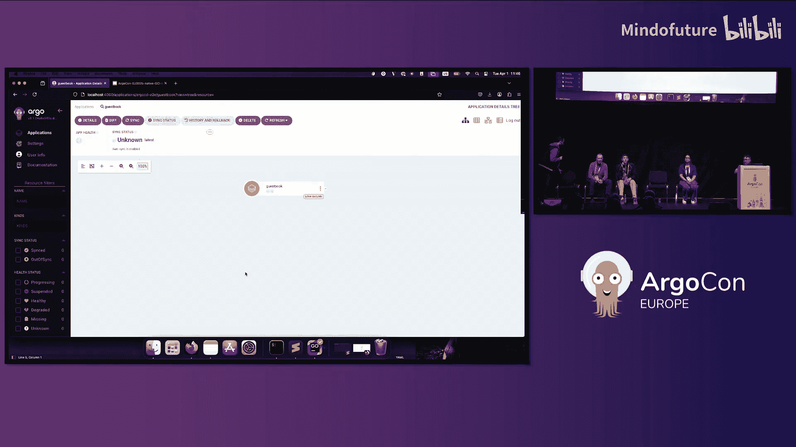

Yes。I'm going to be that guy's in a runaround。So the logo was a get your postory。

 Are you going to change that before releasing。The O CI repository logo， It was a Gi reposory。

On the demo。For a credential。

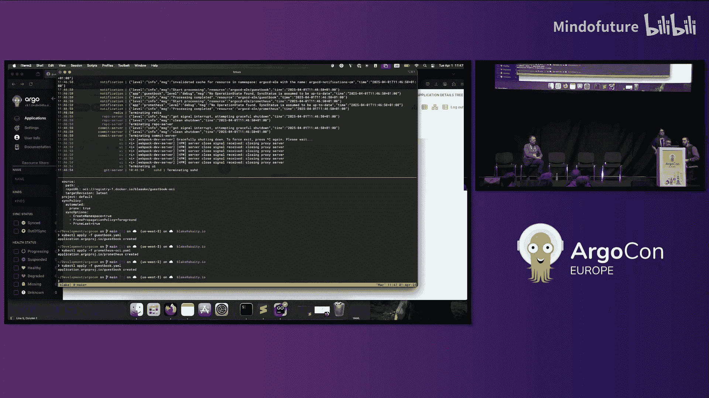

It might have been a cash bug， so it should be a nice OCI artifact image。

 it must have been a bug in the UI here。It part of the local demo。

 I'm going to blame the Wi Fi because， you know， the Wi Fi and conferences no， not the best。

 Any other questions。Oh， geez。 How do I。 Oh now， yes。

So what about application sets and cluster met data， How you going to integrate that with LC C I。

 What's the best practice。

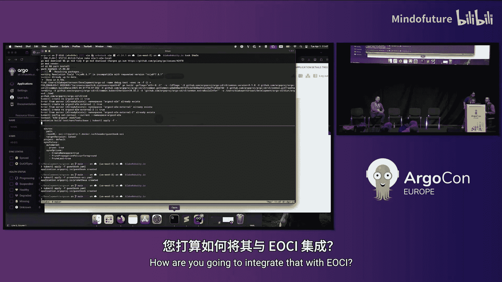

I don't know if application sets are yet supported。 I know we support applications。

 but that's a good one， Rob。 So that's definitely one that we're gonna be looking into is application set support。

 Now， as Blake mentioned earlier， we do expose metadata that is part of the application so you can add O C I metadata Author。

 revisions， URLs。 And those are now exposed in the U I。 And we want to be able to expand those。

 Do we have new new use cases that we haven't thought of。 We want to get that feedback in。

 so we can actually go ahead and extend the features。Do you have support for signed。I saw images yet。

So， yeah， like like6 door ones eventually。 So in terms of。

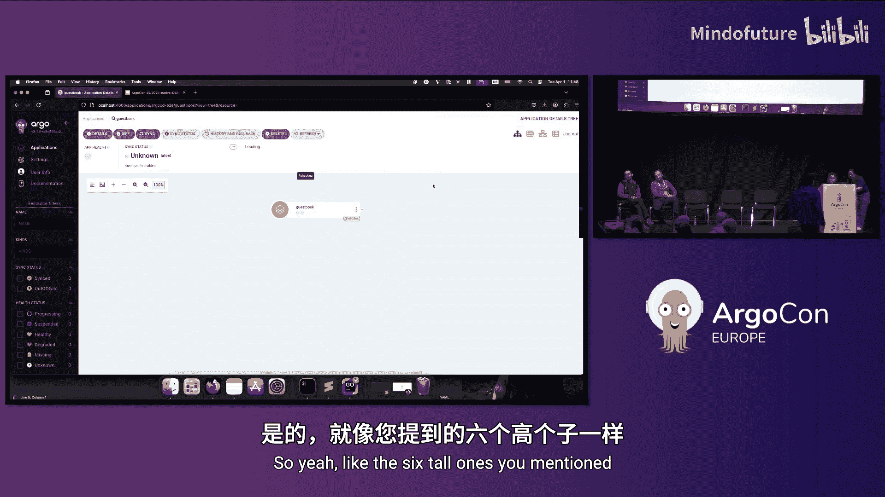

Actually validating that so we didn't so there's no support right now for validating it because you'd have to add an additional features for some kind of validation policy engine so that's the big thing because everything from you have you know six0hertz its own policy controller you have chierno。

 that would be a layer outside of our go potentially。

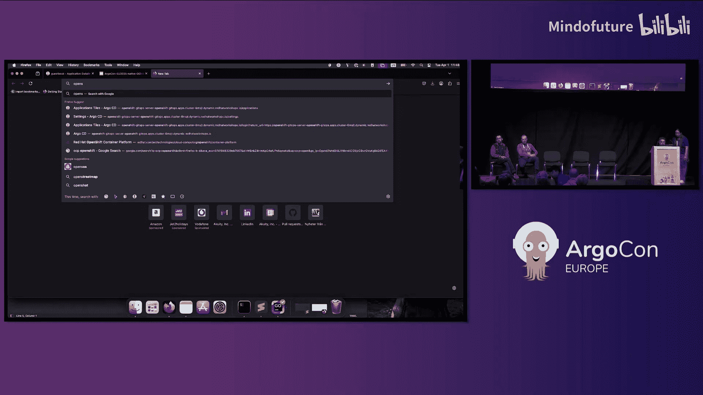

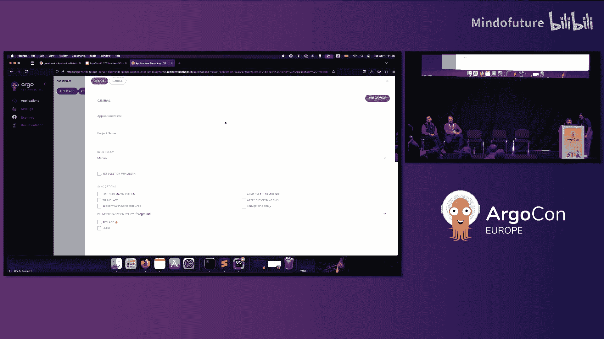

So there are several different ways you might be able to。

 But if we want to add in those layout libraries， let's talk about it。Any other questions， yes？

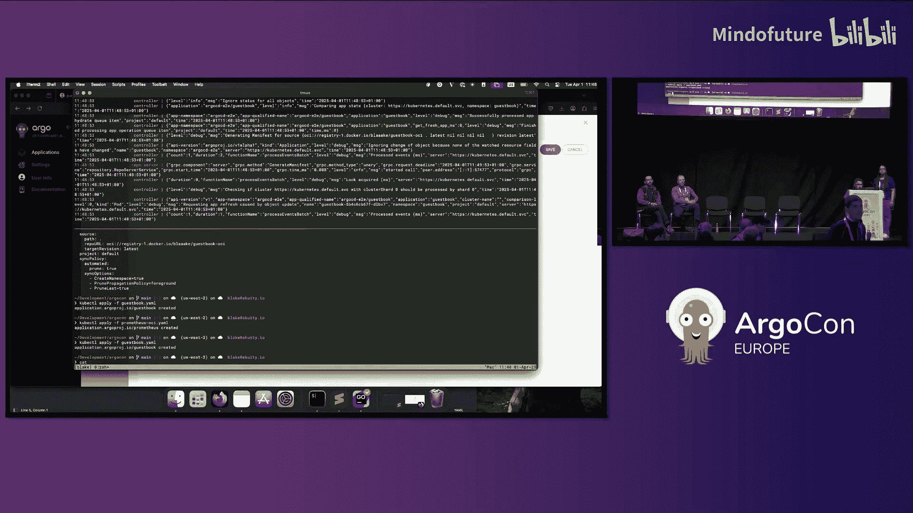

Hello， I have two question。 actually， the first one is， since you are adding O C I super。

 should we maybe rename the Gid ops to O C I ops， maybe because the Gi gi is getting away with this。

That's quite a question we shouldn't be able to answer。

 That's one that the community should come up with because Gioffs makes sense。 But no， I mean。

 in the end， the manifests you sell themselves can be versioned in Git。

 And then using a CI pipeline be then translated into O C I artifacts。

 So in a typical in the typical fashion Michael mentioned this earlier on the rendered manifest pattern where you can actually go ahead and through get through a git process。

 actually render your manifests。 So instead of running helm or customized as part of O C I。

 They're just a flat rendered manifest。 They just had to be stored in O C artifacts。

 So just using Git。😊，Any other questions？有。Oh， do we actually have had progress？

Should not use my local host crap， Okay， sorrys。But。And any case。

 this is just a simple guestbook app。Can say that。 this would。This syncs to the latest。

 and this has the show of the remote repository。 So this is actually using my， my docker。

 my Docker repo。 So this is any O C I compli repo。 It's fine I。

In the end of whether it's whether it's ER， whether it's G CR， I mean， they're OR compliant。

 So in the end in the end of the day， this works pretty much what I expect。app pauses。啊，好，OK。

order deposit failing。 but that's actually why just can't pull it because the Wi Fi。 Wifi。

 But anyways， it was able to at least render the manifest using ourgo。So。

And we can do something like。Ex with us。对。说那是客薄。不是。はい、大丈夫。呃。I didn't go as expected。

 but there's a bunch of scenarios which so if you go into the OCI repo。

 there's a bunch of scenarios which we have which you can guys can feel free to try out。

 there's also a preview of the OCI support in Harvard that you can trial as well。And slide yeah。

 the slides yeah。Go back one。There's a whole section， a whole slew of examples here。

 If you want to try this out in your own， talks about different patterns， different examples。

 and then being able to actually use it。And then， finally， yeah。I I could get involved。

Just please try the featured and let us know any help from the community would be great and just to know any updates regarding this feature。

 please join the channel regarding OCI， the link here and yeah please come for the contributor's call regarding any updates for this too。

😊，And there is an forward。 there's a feature after that。 that's regarding the U I。

 which is also in progress。 So yeah。

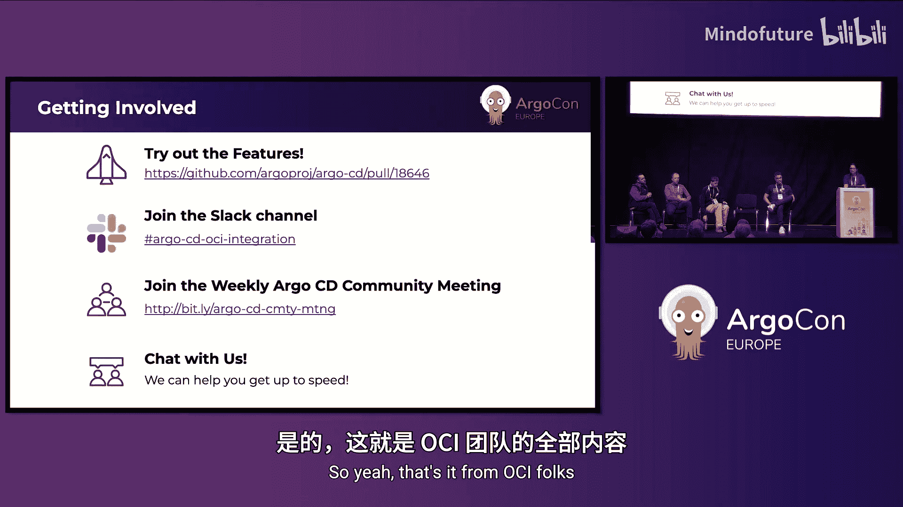

That's it from O C I folks。