# ArgoCon-2025-Europe-大会-｜-云原生-｜-CICD-｜-架构-｜-k8s-｜-docker-｜-devops-｜-kubernetes-p23-P23-Autoscaling-and-Progressive-Delivery---A-Match-Made-in-Heaven---Anastasiia-G--BV1Xr5vzGEyK_p23-

Yeah。

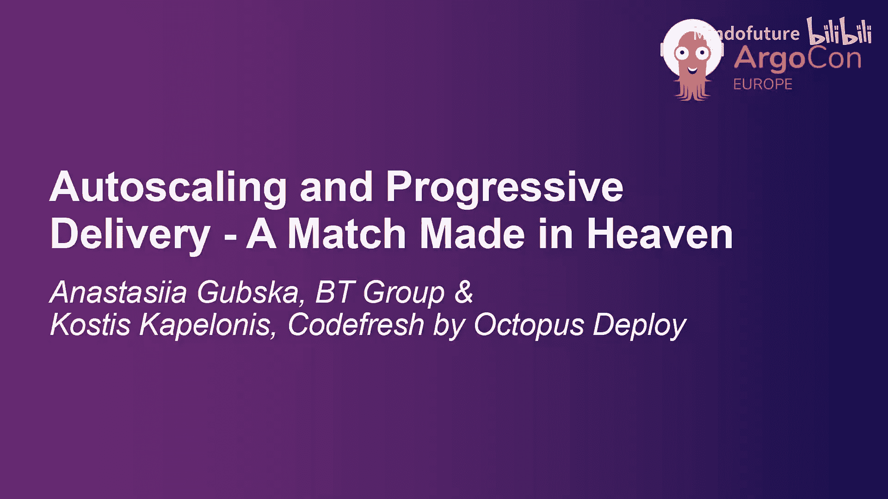

And welcome to another presentation this time about Al Las and HBA。My name is Cospis。

 I'm working for Otopus deploy as aDevelop advocateate。

 I'm also a member of the A team focusing mainly on Argo Las and ArgoCB and today today to me I have Anastasia。

Thank you， Costes。 Hi there。 My name is Astasio Gbska。I'm an SRA Devopps。

Working for BT which is telecom so I've been pushing arguing the case for Argo robots I'm also a CCF ambassador。

So you know some things about us now we need to know some things about you， let's do up with。

Of course is using not allow today。喂。Who is using it to think for that？你南咩事。Who knows what this does？

哦。能不能说 business。No我我 cant play。What is the difference between these two for isn't the same。

You are in the correct presentation。Is actually， is it anybody actually using HPAA with our allow？

Okay， yes， you add in the correct presentation too。So in this presentation。

 we'll be exploring Argo rollouts and H in terms of the cost challenges for using progressive delivery as a strategy。

So let's start with the basics。Argo rollout is a tool or solution for progressive delivery。

In this presentation we'll be talking about progressive delivery and when we say that we've been bluegr environments。

 bluegreen deployment and Canary release in bluegr we would have two environments running one with a stable version of the app。

And the green environment with a preview or new version of an application。

When we release a deployment into the green environment。

 we wait until it's good to go and then divert traffic over to that environment。 In Canary。

 we also use two environments， but we incrementally move traffic over to a new version of an application。

 And that gives us the opportunity to make sure the app' running well before we promote the amount of traffic running over there。

 or we can roll back to solve any problems。 So that's a benefit for using progressive delivery as a strategy。

😊，Argo rollllouts has created for Kubernetes。 It's the Kubernetes native。

It doesn't have to work with Argo C，D。 Both of those things work independently of one another。

 So often people get confused about that， but they don't rely on one another。

Argo rollouts uses progressive delivery as a strategy for blue greeneen in deployment to allow A B testing。

 canary releases， etca。And that means you can release new versions of your app without any downtime。

 It also means we can auto automate a full rollback to resolve any issues throughout deployment。

When you install Argo rollouts， you can access a new resource， and that's called rollouts。

 And that means you can use Argo rollouts in two ways。So you can have an existing deployment。

And you can add progressive delivery strategy to that deployments。

 So you have the original version of the app with its original settings。

Or you can use an existing deployment and create a new。 sorry。

 create a new deployment and adds rollouts as a strategy to that。

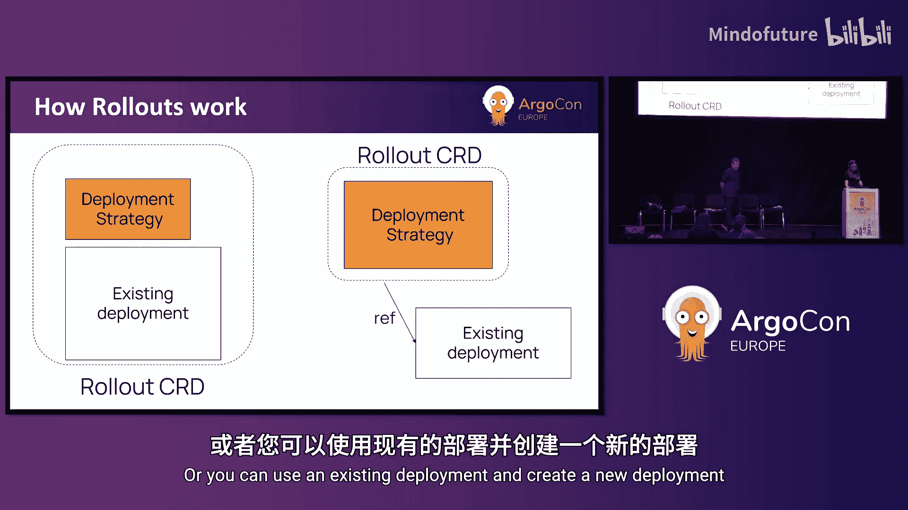

Up here on the screen， you can see the original fields at the top that you would use。

 And at the bottom， you can see we have the strategy。 In this case， it's canary。

 So you can see that you've started with 10% of the traffic and then pausing after an hour to promote the traffic to 20%。

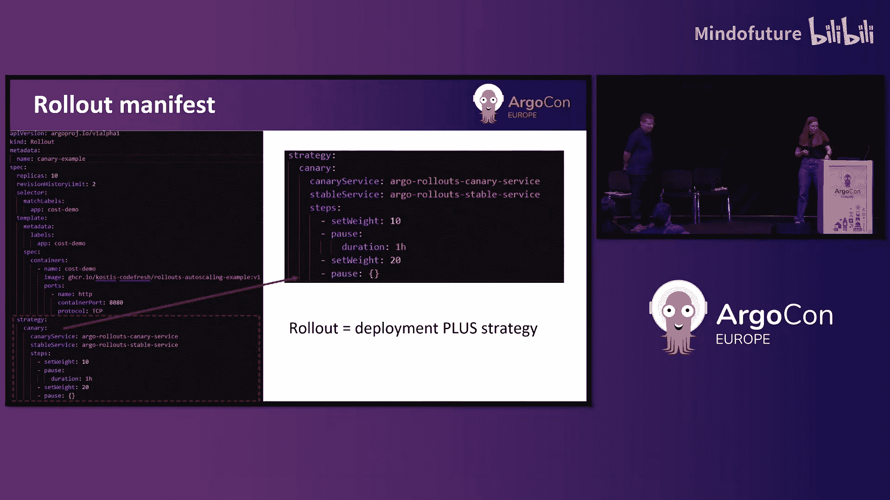

This is the Argo rollouts dashboard that allows you to see in real time your， your deployment。

 you can see at the bottom。 you have the stable original version of your application。

 And just above that， you have the preview version of your application showing how many pods you're using and where the traffic is going。

A great feature of Argo rollouts is that you can create a new application， deploy it。

 and completely forget about it。😊，Argo rollouts will check and monitor。An app's。

 performance and health。 And if it spots any issues。

 it will automatically roll back and market deployment has failed。Otherwise。

 if everything runs smoothly and the deployments successful。

 it will complete the deployment and market as a success。

And that means that everything throughout your deployment can happen without human intervention。

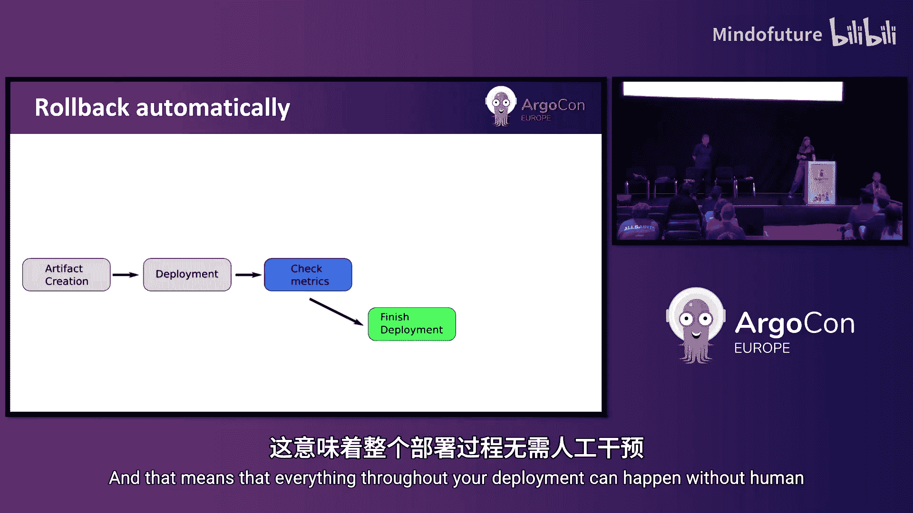

I'm sure you can imagine a great benefit of that is that your team can release a deployment at 5 o'clock on a Friday evening。

 and everyone can get off straight to the pub。😊，Argo rollouts will do your job for you。

So let's talk a little bit about auto scaling。

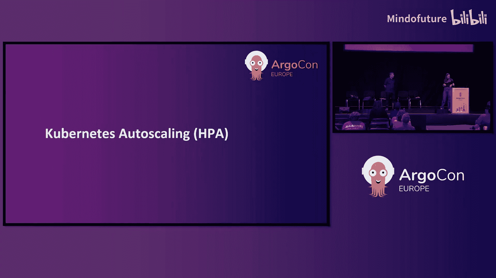

There are different types of autoscalealrs that you can use in this talk。

 We're talking about horizontal pods autoscalealar。 So that adds and removes pods as necessary。

There are other scalers， for example， vertical， cluster， custom metrics。

And Kubernetes event driven auto scalr。If you want to know more about which type of autoscalers are available and which would work best for you。

 please have a look at the official documentation。So， H。Monitorors CPU and increases the load。

 for example， during times of peak traffic in a large retail event， for example。

 a Black Friday sale or an international football game where lots of people are。

 are creating traffic。You can use replicas。And determine the threshold of them to determine where your traffic is going。

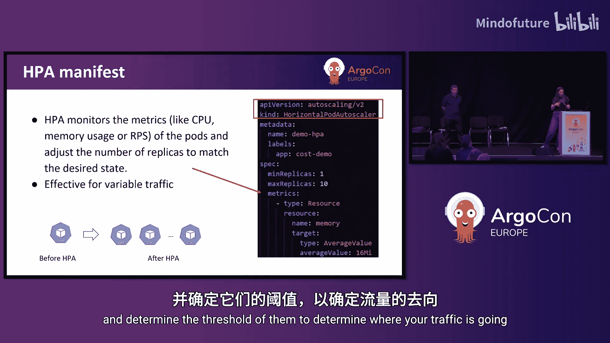

When you use cloud solutions。And you employ progressive delivery as a strategy。

 It can be a really expensive way of doing things。 So we're gonna have a little bit of a look at how we can reduce the cost implications for you。

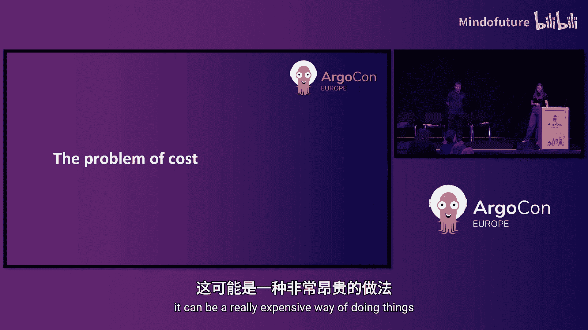

In this example of blue green deployments， you have two environments。

 and you can see there are 10 pods in each environment。

 So that is potentially gonna double the cost of your deployment。Similarly， in a canary。

When you promote your traffic to the full amount of pods in the live version of the app。

 you're again doubling the cost of your deployment。

So some people like to run tests for days or potentially weeks at a time。

 And we would say that's not the most effective way to use Argo rollouts。

 Argo rollouts is a solution or at all for quick deployments。

 but we do understand that people do like to run test for multiple days， for whatever reason。

So before you would go ahead to use Argo rollouts as a solution。

 we'll have a look at some of the other options that you can choose。

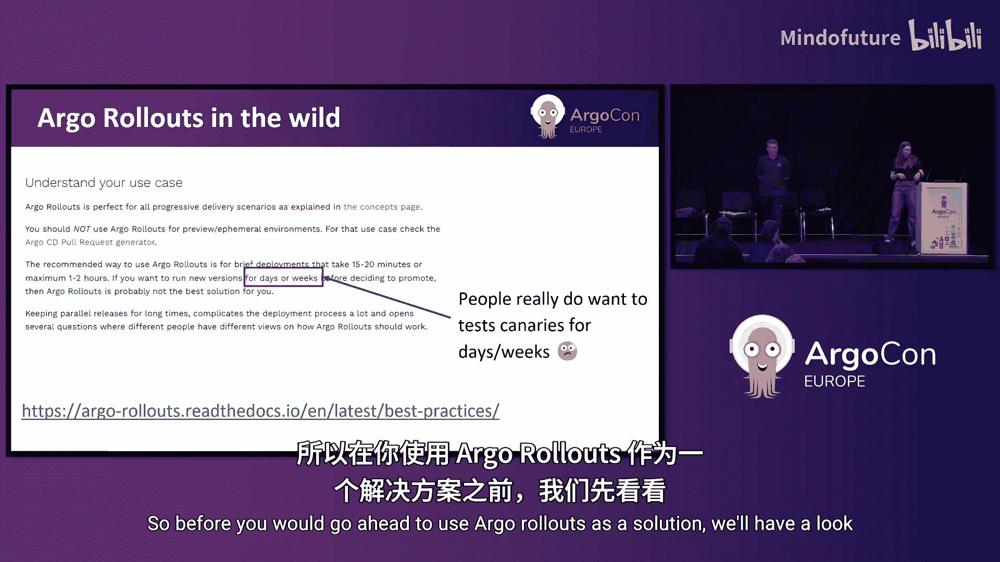

Over to you。

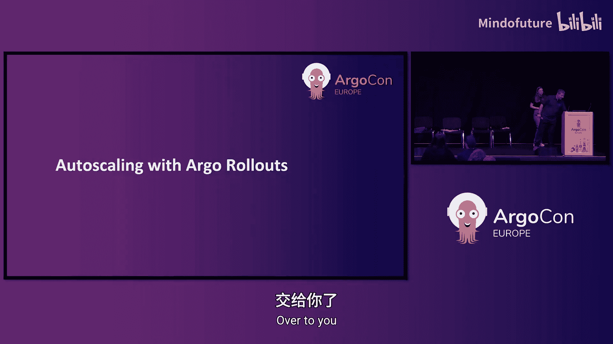

So we see that course is a really big issue and people want to solve it。

 This is actually a selection of screenshot from the CNNCF Slas channel and people are asking the exact same question。

 how do I use HPA with Argoolos， So it's not a theoretical problem。

 It's a real problem that people have right now。So just to make things easier for you。

 we tried not one， not two， not three， but actually 10 examples。

To see all the possible cases and several options。😊，The source code is fully available on that URL。

 and we're going to see some of those examples so you can go on and try yourself for all and see what happens。

For each example， we also saw the dashboard， a screenshot so you can see exactly what is happening with the pods。

 who is controlling the pods， what is happening with the stable pos and the preview pos。Now。

 if you're wondering what is happening when Al allowed says something and HPA says something else。

 just to spoil the answer， Al allowed wins， okay， it will take over。

 it will take effect and HPA will not take effect。

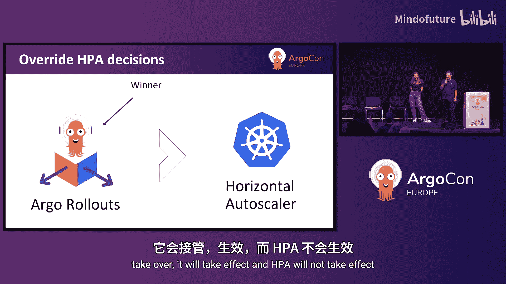

But before using HA， let's see some other options where you can control cost without it。

So let's have a look at how we can control the cost without using H。

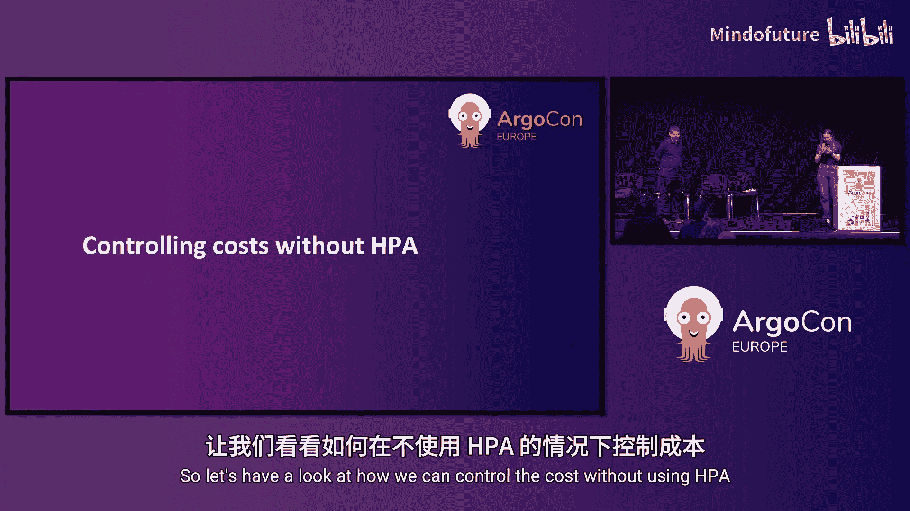

So some people do like to use H straight away。But we can。

Control the cost of your deployment before you jump to that as a solution。

 So in your rollout settings， the properties that highlighted here in red can help you to manage your cost and fix a number of pods that you're going to be using throughout your deployment。

So we do recommend that you have a look at these options and understand them before you go ahead to try to use H as a strategy。

So in a blue green deployment， you could set a fixed number of pods through adding this field。

Preview re replica account。 So we've got the preview replic account set is 5 here。

And that means there will only be five pods in the preview version so that will automatically cut the cost of your deployment by 50%。

And in Canary， you can see the doubled cost of deployment here because we have 20 pods working simultaneously。

And with just adding this one property here。Dynamic， stable scale。That means if we set that to true。

 that means we can determine how many pods are used for each thing。So， for example。

 as you promote the traffic through your canary and increase the amount of pods you're using。

That property will automatically decrease the amount of pods that are being used in the stable version。

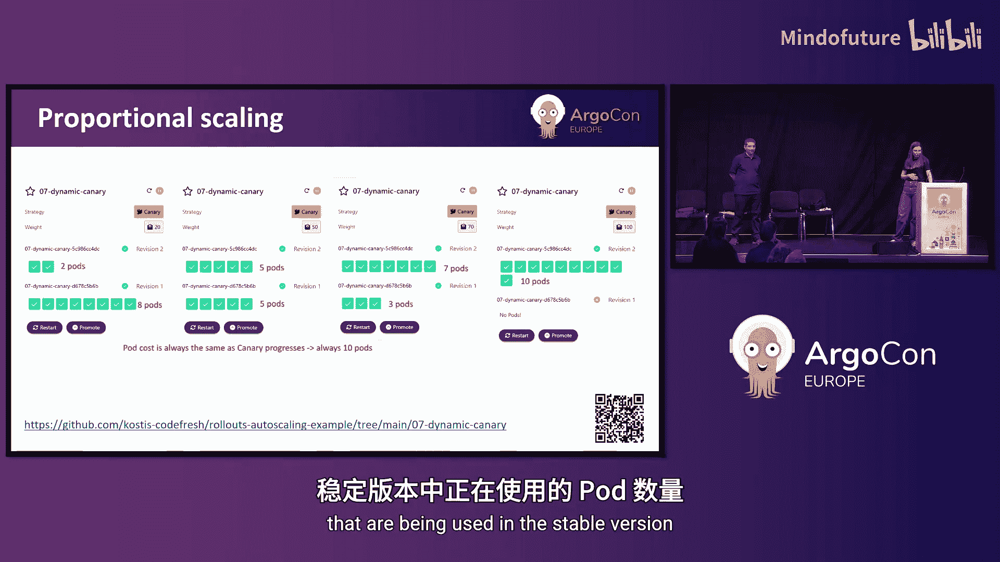

And we have another solution that we can talk about。

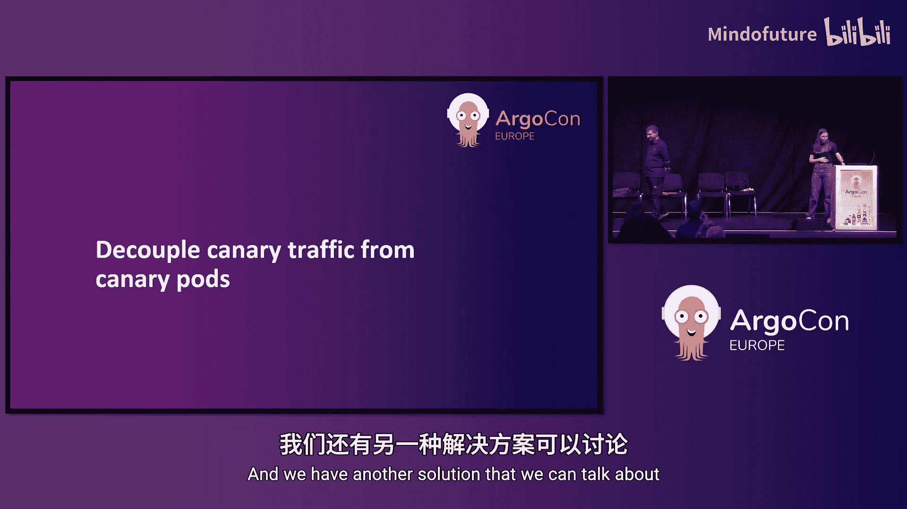

So having a fix in canary， having a fixed number of pods set to a fixed amount of traffic。

We can use a traffic controller or traffic management to determine how much traffic is sent to each pod。

So here on the left， what we have up here， two examples on the left。

 one without a traffic controller。So we can see the amount of traffic is fixed to each pods。

 We have one pod here with 10% of the traffic。And then on the right， with traffic management。

 you can send 80% of the traffic to one pod。In this example。We've used Lier D as the traffic manager。

But there are many other types of versions of traffic management systems that you could use。

 So please do have a look into which you prefer。So now we can have a look at。How we set this。

 you can see the properties here。 We've added these two lines。So we've added the minimum。

To send 20% of the traffic to one pod。 And then we've changed how much traffic is going to each pod throughout the delivery。

Here we can see the pods is fixed at 5 with 50% of the traffic。And。In the default settings。

 it would be different so we can decide how much traffic we want to send into the new version。

 and that will help manage your costs by removing pods in the stable version。

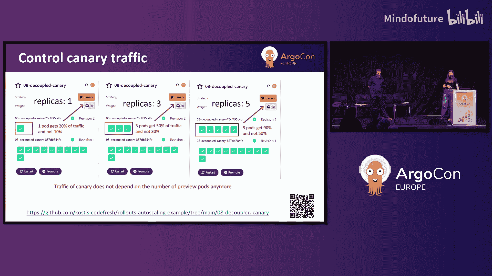

Okay so let's say you don't want to use any of the options that Anaastasia mentioned and you want to use HPA for some reason now the first question is does HPA work with agoal layouts and the answer is yes。

 maybe you have used already HPPA with plain deployments。

 but essentially essentially it works with anything that implements this endpoint called scale so agoal layouts implements this endpoint and this is why how you can use them together。

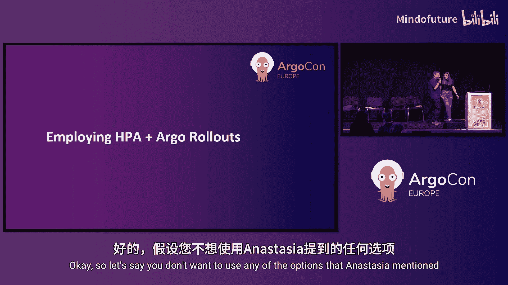

The endpoint has three properties， how many replicas you have right now。

 what is the required the desired number and what is the status？😊。

So because this is already in place in our goouts I can create a horizontal po auto to scale it and point it to our rollout。

 not a deployment and it just works， so in our example we have created an HPA configuration with a minimum of1 pod and maximum of 10 pos and in this example it what is memory usage。

And in the same repo， we also have an example application that consumes memory every time you call it it reserves one more megabyte so you can apply it with H and see how HP works in practice This is also available in the same repo as the other examples。

So what happens if you use both of them together here is the fault I'm using bluegr and I have HPA enabled and on the left you can see I have light memory usage so HPPA has decided that only three pods are needed and it's applying the exact same number to both preview pods and stable pods on the right I have heavy memory usage so HPPA says okay we need more pods and again it controls both the preview pods and the stable pos so in the case of bluegr HPA affects everything。

Same thing with canari so here I'm in the middle of a canari where I'm sending 50% of traffic to the new pods so normally Argo allowed says preview pods should be half of stable pods and again they both work together HPA on the left says that you need four preview and8 for a stable then I increase my memory load so HPPA says you need five for preview and 10 for stable so this is how it works out of a box。

Now I know you what you're thinking， you are saying， okay。

 what if I use H plus the options that Anaastasia mentioned。

 what will happen there because we will have a conflict？And I spoiled this already， Argolo winds。

 okay， it will take over。So here I have an example where even though I'm using HPA。

 I've also set a pre option preview repa down to3 and you can see our go layouts will take over and preview pos will always be three regardless of what HP says so in this scenario HPA only controls the stable pos and nothing else。

Same thing for Canari here I have decuped my traffic and I say I will send 50% of my traffic to three pos and this is what will happen again it will override HPPA so HPPAA will only affect the stable pos。

 preview pods are completely controlled by Argoro layouts。

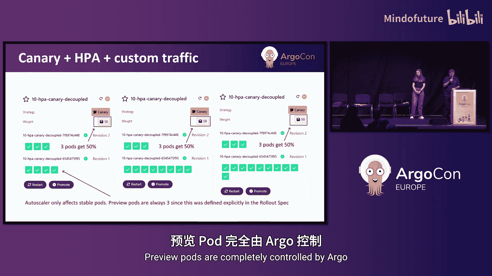

So， some。The conclusion in some results。

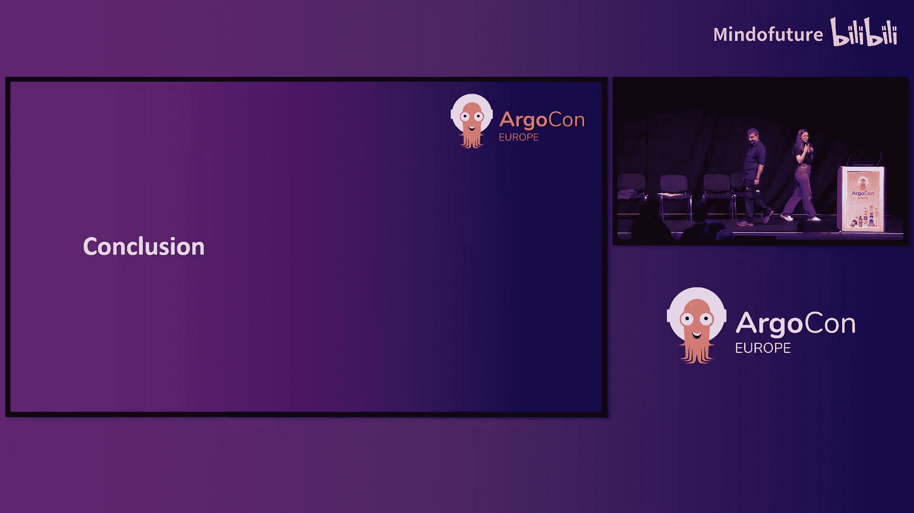

Thank you， Costas， so。Let's wrap things up。So Argo rollouts makes your deployments easy and safe。

As we've shown before you jump to using H A， it's important to understand other options that are available and a couple of properties that can help your rollout。

And it's really important to evaluate the cost saving。

 the business needs and the flexibility of your rollout。

So the options we showed you before should allow you to use Aga rollouts without HPA to simplify things。

And also， as Costius has said。At times of conflict， Argo rollouts will always override HPA。

So I encourage you to have a look at the official documentation。

 we'll share some links with you in a short while。First of all。

 we just wanted to share this one slide to show you the cases that we've talked about today。

 the cells that are highlighted in orange are examples that people often confuse themselves over。

 so it's worth having a look at these cases and experimenting with them and see which suits your business case best。

 Please do take a photo of this slide if you'd like to。

Or you can click the link using the QR code at the bottom of the slide。

And have a look at which user case best suits your business needs。

Just give you a chance to take a picture if you'd like to。

I also wanted to add that I'm part of a deaf and hard of hearing working group for CNCF。

 I have some of my colleagues and allies over here at the front。😊。

If you're excited to know more about us， please come and see us at our kiosk in the Project Pavilion。

 say hi and find out how you can support us in the work we do。😊，And also。

 we in the deaf and hard of hearing group have provided a couple of things for you。

 So if you're interested in becoming a mentor for underrepresented groups in tech。

 take a photo of this slide here， there are a list of different groups that you can get involved with。

And it doesn't have to be necessarily in really complicated technical spaces。

 We can look at soft skills and how you can support people working in tech generally。

Just give you a chance to take a picture of that slide。

 The other thing the Deaf and Hard of Hu and Group have prepared for you at Cubiccon this week is a sign languagenage course。

 So if you're interested in learning a little bit of sign languagenguage around Kubernetes and some general greeting signs Of course you'll notice I'm up here using British sign Language my colleagues at the front here are American Sign Language ASL users so there'll be a mix of both sign Langus that will be happening on Thursday at 5 o'clock in the DEI community H So come along and say hello。

😊，I hope to see you all there。And last slides， before we tie it up， we've got some links up here。

The first two links are documentation about how Argo rollouts works and the abilities it has。

The third link is some examples that we've prepared for you to have a play with。And also。

 if you're wondering how you can make your spaces or organizationss accessible for deaf people。

 For example， if you'd like to interview a deaf person for a job role or perhaps you're running a local event。

 that link there will give you some tips and some guidance about how you can increase accessibility。

 If you've got any questions， get in touch with us on Slack。

 and also please do feedback to us about today's presentation。

 if there's stuff that you've enjoyed hearing or there's things that you think you'd like to hear more about in the future。

 just let us know。😊。

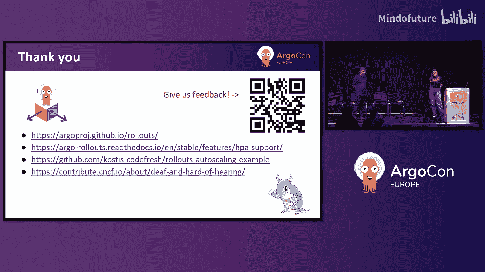