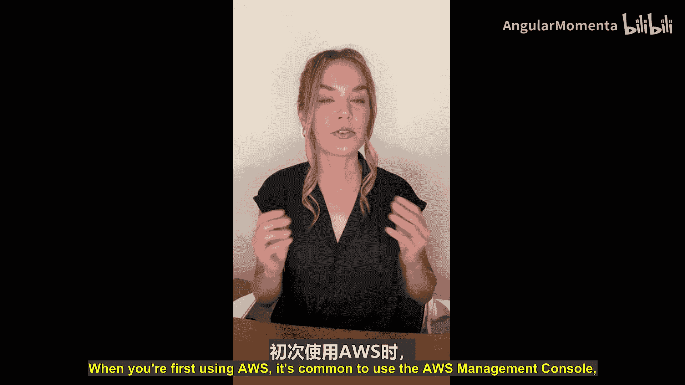
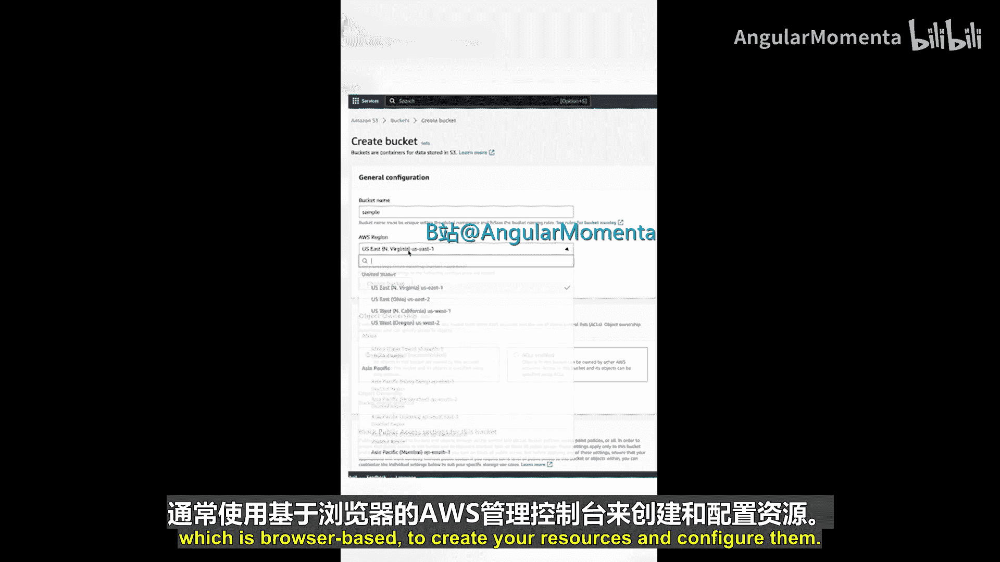
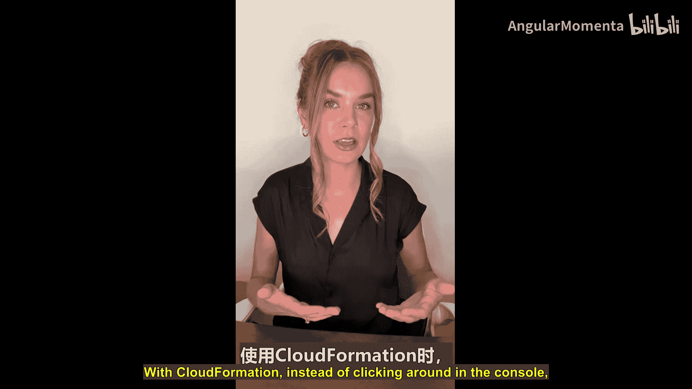
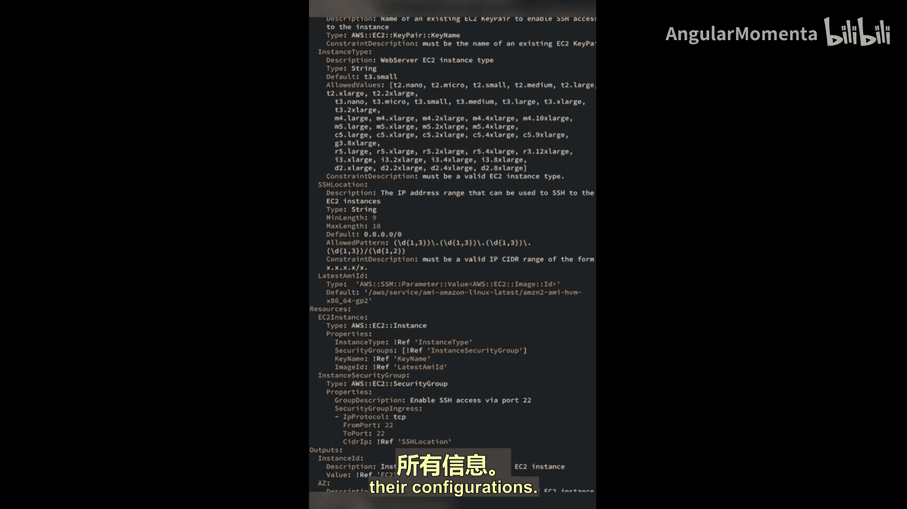
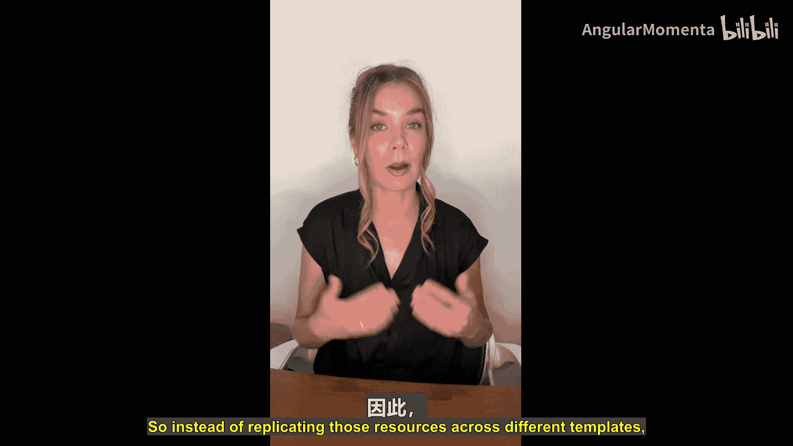
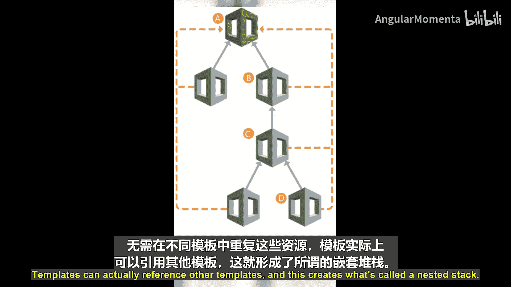
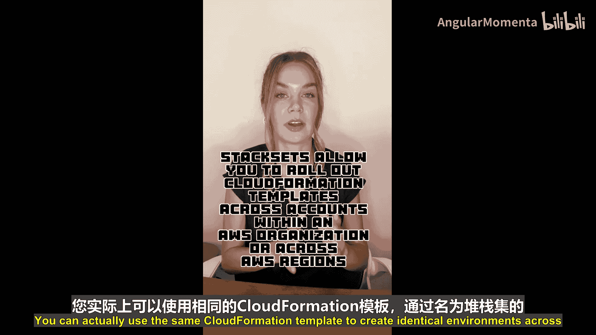
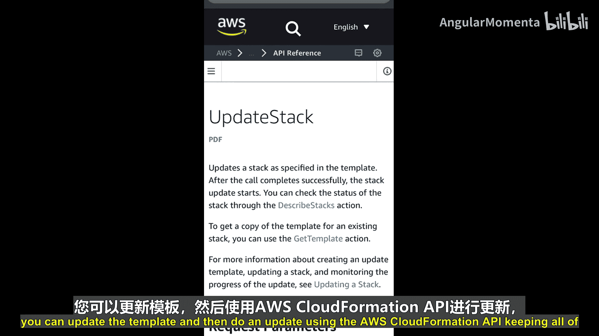
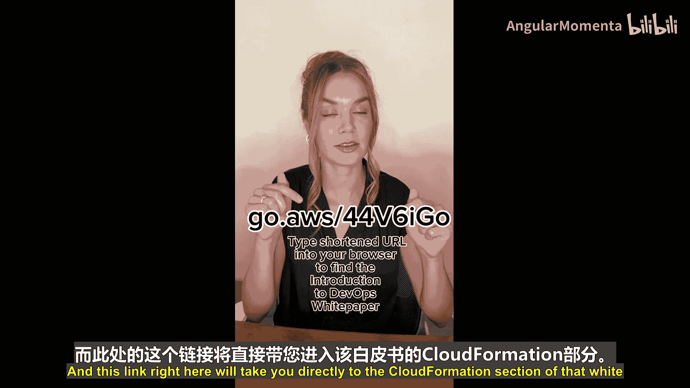

# 【Amazon Web Services】AWS云基础 ｜ The ABCs of AWS： Learn the Basics of the AWS Cloud p03 01_01_06_c-is-for-aws-cloudformation -BV1MnrHBCEmT_p3-

Welcome to AWS ABcs where we cover a different AWS service for every letter of the alphabet Today's letter is C and service is AWS Cloudformation When you're first using AWS it's common to use the AWS management console which is browserbased to create your resources and configure them but what if you had an AWS account that you wanted to replicate all of the infrastructure in that account into a different AWS account using the AWS management console could be cumbersome for this task and also prone to error so using the AWS management console is great for learning but we really should be provisioning our resources in an automated and repeatable manner so moving away from manual provisioning of resources and introducing AWS cloudform and infrastructure as code tool that can help you automate your provisioning of resources in a repeatable and reliable way with cloudform instead of clicking around in the console you create these documents that are either JSson or Yamlbased。

And they contain all of the information about the resources that you're trying to create and their configurations and this document is called a template Cloudformation takes this template and will provision your resources on your behalf it can handle things like dependencies between resources parameterized input as well as automatic rollback of the resources if any errors were incurred during the provisioning process Cloudformation ensures that your resources are built in the right order with the configurations that you provided saving you time and reducing the risk of errors when you compare it to manually provisioning resources Now all of the resources that you create in one template that create something called a stack you'll likely have multiple cloudform templates organized by application or by team maybe different layers of your stack it's really up to you on how you want to organize your code but we do treat this as code so you would want to check your templates into a source control repository and treat it just like any other code artifact。

It's common that the same resources could be used across stacks。

 so instead of replicating those resources across different templates。

 templates can actually have referenced other templates and this creates what's called a nested stack。

Also consider a scenario where you have multiple AWS accounts hosting your beta QA and production environments。

 you can actually use the same Cloudformation template to create identical environments across these AWS accounts using the feature calledSt sets as changes to your resources are needed you can update the template and then do an update using the AWS Cloudformation API keeping all of these different environments in line in an automated way Cloudformation is a huge topic and this video is a very very small introduction so if you want to learn more I would recommend checking out the AWS documentation and also reading the introduction to DevOps White paperper and this link right here will take you directly to the Cloudformation section of that White paperper。

