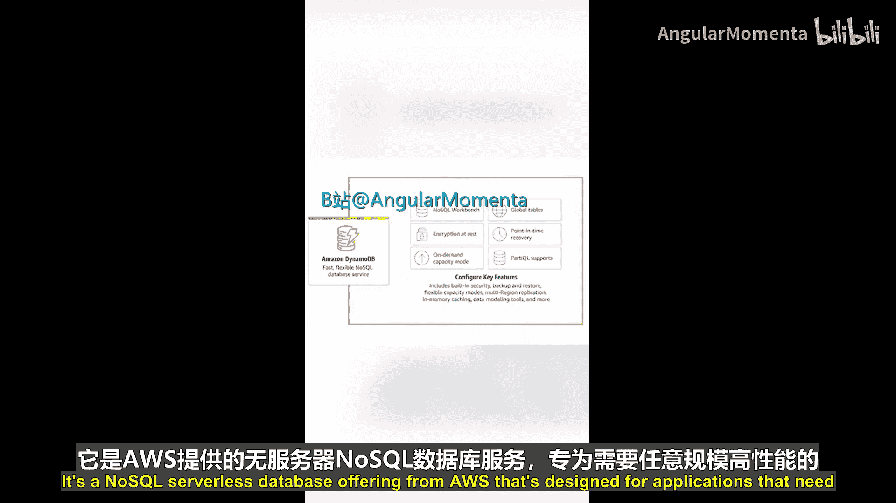
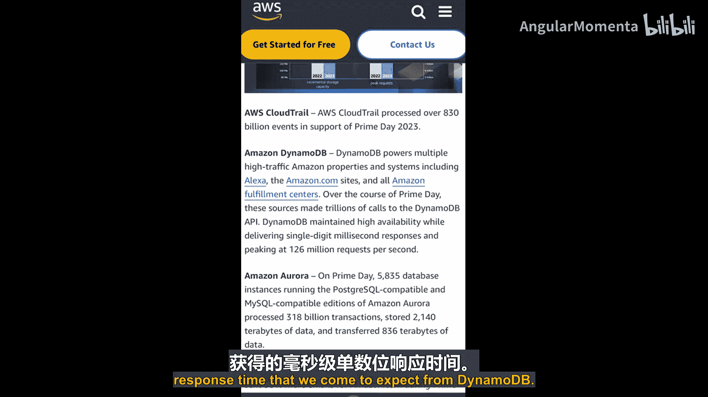
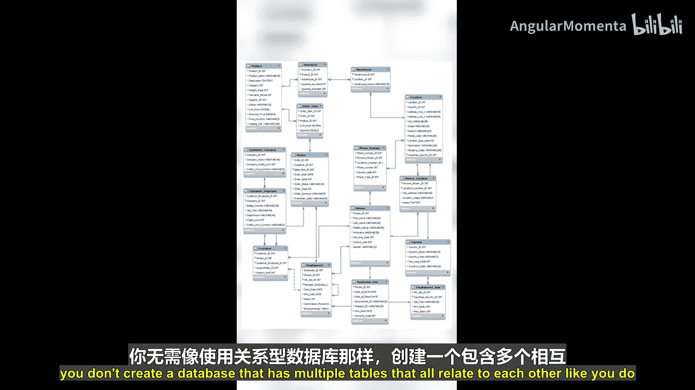
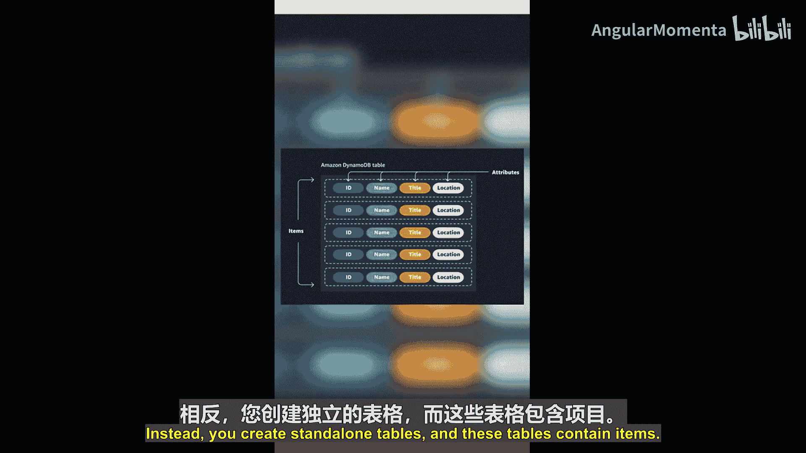
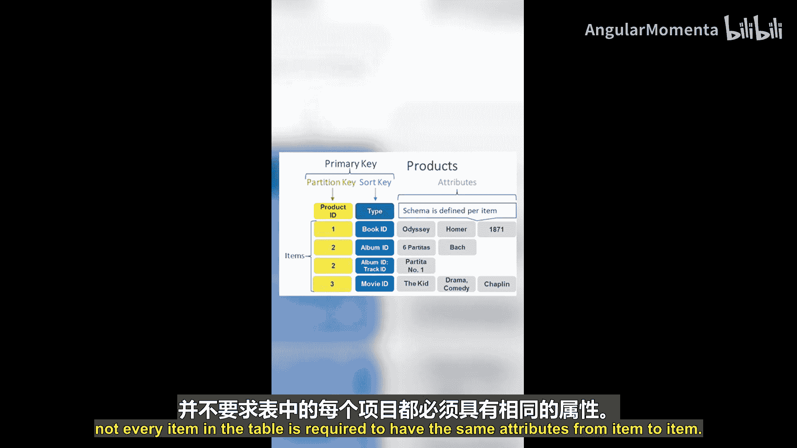

# 【Amazon Web Services】AWS云基础 ｜ The ABCs of AWS： Learn the Basics of the AWS Cloud p04 01_01_08_d-is-for-amazon-dynamodb -BV1MnrHBCEmT_p4-

This is AWS ABcs where we talk about a different AWS service for every letter of the alphabet Today's letter is D and today's service is Amazon Dynamo DB。

 It used to be true that relational databases were kind of the default choice for most applications but these days we have options and nosQL databases are great for when you need a flexible schema or massive scalability or maybe you need single digit millisecond response times so Amazon Dynamo DB it's a nosQL serverless database offering from AWS that's designed for applications that need high performance at any scale For example。

 just recently for Amazon Prime day the dynamo Db API received trillions of requests and it actually peaked around 126 million requests per second and it maintained its high availability and that single digit millisecond response time that we come to expect from dynamo Db so this service is truly built for。

sive scalability Let's cover some basic concepts for dynamo Db With dynamo Db。

 you don't create a database that has multiple tables that all relate to each other like you do for a relational database instead you create standalone tables and these tables contain items every entry into a dynamo Db table is called an item and items have attributes which are sort of like columns from the relational database world Now the difference here though。

 is that with a flexible schema like dynamo Db offers not every item in the table is required to have the same attributes from item to item That being said though every item in the table does have a partition key which is the unique identifier for your items and you can optionally define a sort key which can be used whenever the partition key alone is not enough to make an item unique or you can use sort keys for various different use cases I bring this up because partition and sort keys are the only queryable attributes for a table if you don't define any secondary。

Now this doesn't mean that you can't query on other attributes that aren't the partition sort key It's just that you would have to use the scan API。

 which is less efficient than using the query API it's important to know the difference between a query and a scan and also knowing how your table design or what partition and sort keys you define how they impact performance for your table and the way you interact with that table if you want more options for attributes that you can query on you can create secondary indexes。

 which contain a subset of attributes from your table as well as an alternate key to support query operations other features of dynamo Db include auto scaling to handle changes in demand as well as backup so that your data is safe and recoverable when it comes to dynamob there is a ton to learn and we're barely scratching the surface here with this little video so I would recommend checking out the ADS developer guide which you can access by following this link and there you can learn a lot more about。

And stay tuned for more AWS ABCs。