# 【Amazon Web Services】AWS云基础 ｜ The ABCs of AWS： Learn the Basics of the AWS Cloud p05 01_01_10_e-is-for-amazon-ec2 -BV1MnrHBCEmT_p5-

This is AWS ABcs where we cover a different AWS service for every letter of the alphabet Today's letter is E and we could have chosen many different services for today but we're going to stick with the basics and talk about Amazon elastic compute cloud or Amazon EC2 applications need compute to run on and when you're working with AWS you can create virtual machines with Amazon EC2 Each virtual machine that you create is called an Amazon EC2 instance EC2 follows a pay as you go pricing model which means that you only pay for what you use so let's say you have a workload on EC2 and you have an influx of demand for this workload using Amazon EC2 auto scaling you can scale out to meet those peaks of demand and then you can scale back in when that demand is no longer there and whenever you scale back in you can stop or terminate those EC2 instances that you no longer need and then you'll also stop paying for this instances EC2 is incredibly flexible because youre。

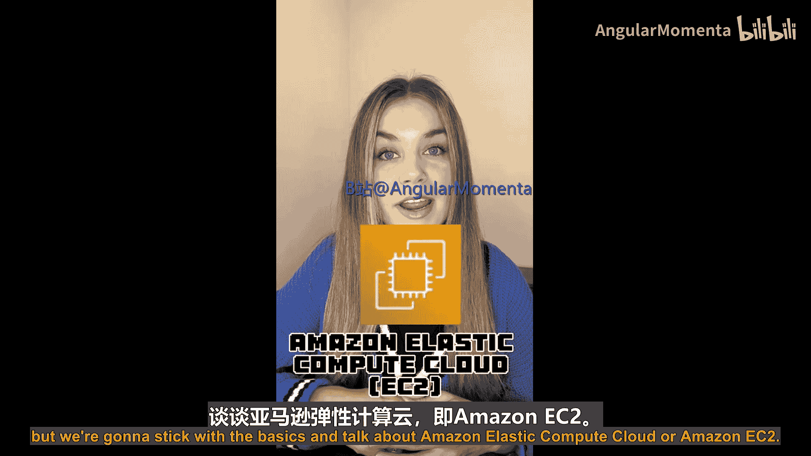

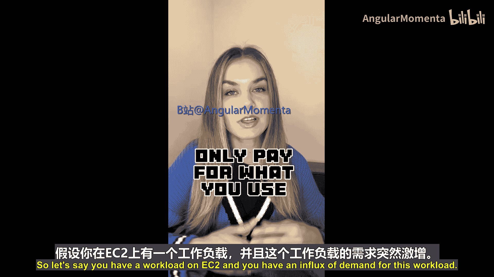

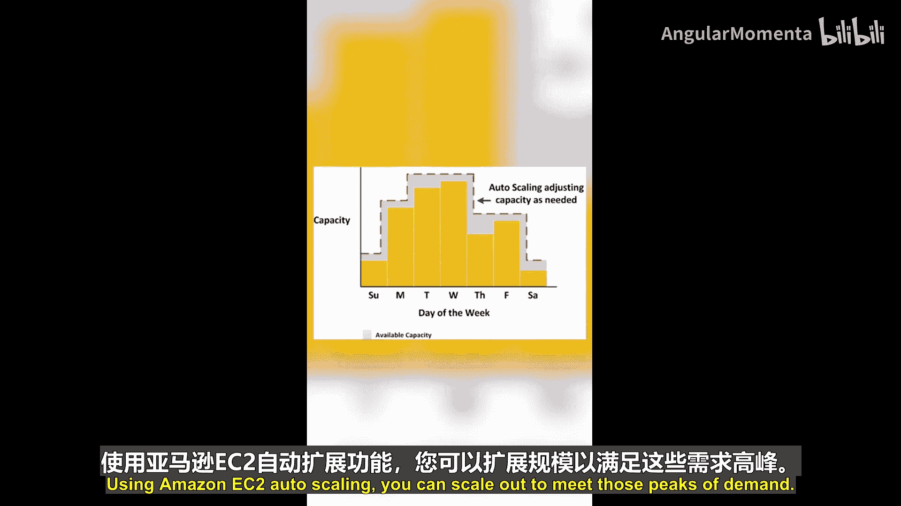

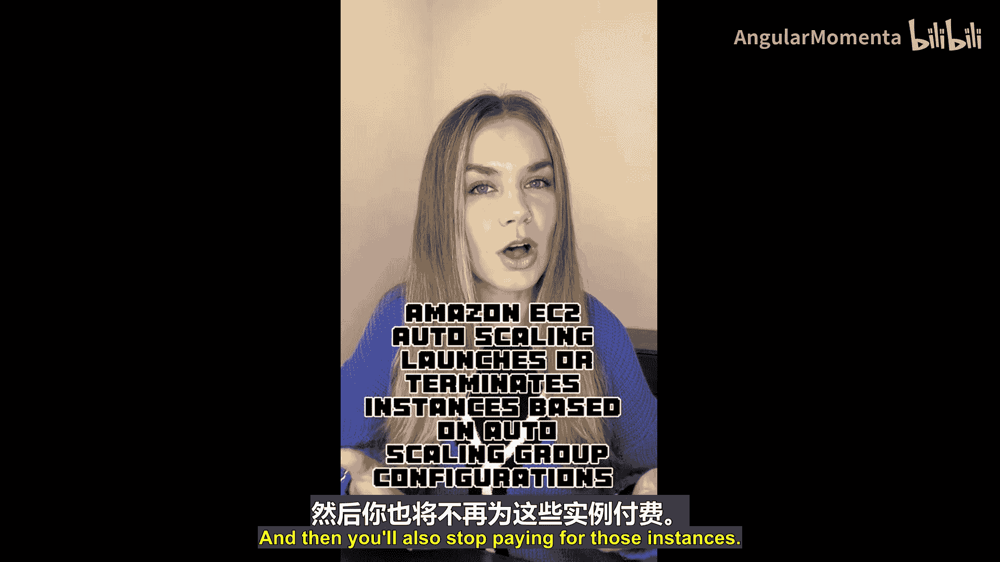

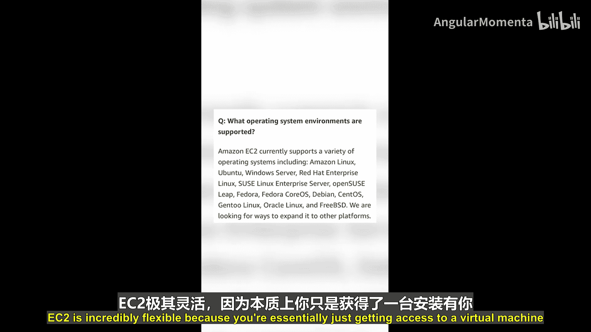

Essentially just getting access to a virtual machine with an operating system of your choice installed on it。

 you can run web applications， batch jobs， high performanceform computing clusters， databases。

 or just about any other type of software that you want to run on a virtual machine on Amazon instances are placed inside of a virtual network called Amazon virtual private cloud or VPC and you can control what types of traffic make it to your EC2 instances using things like security groups or network ACLs or other services like AWS web application firewall if you're using something like an application load balancer to load balance across your instances in your fleet you can attach persistent memory volumes to2 instances using Amazon Elastic blockstore orS and you can think of EBS volumes sort of like an external hard drive that you would attach to your laptop instances are created using Amazon machine images ors。

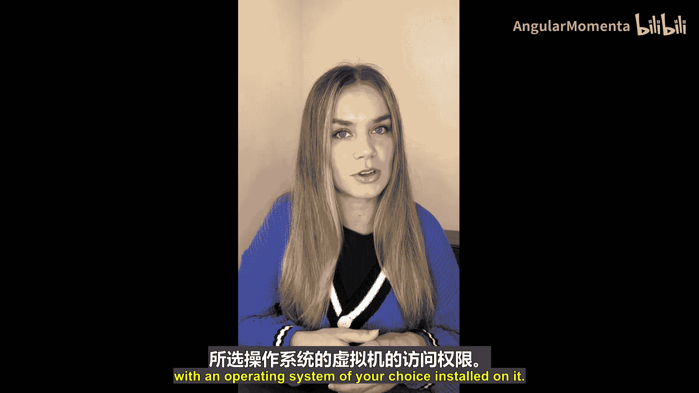

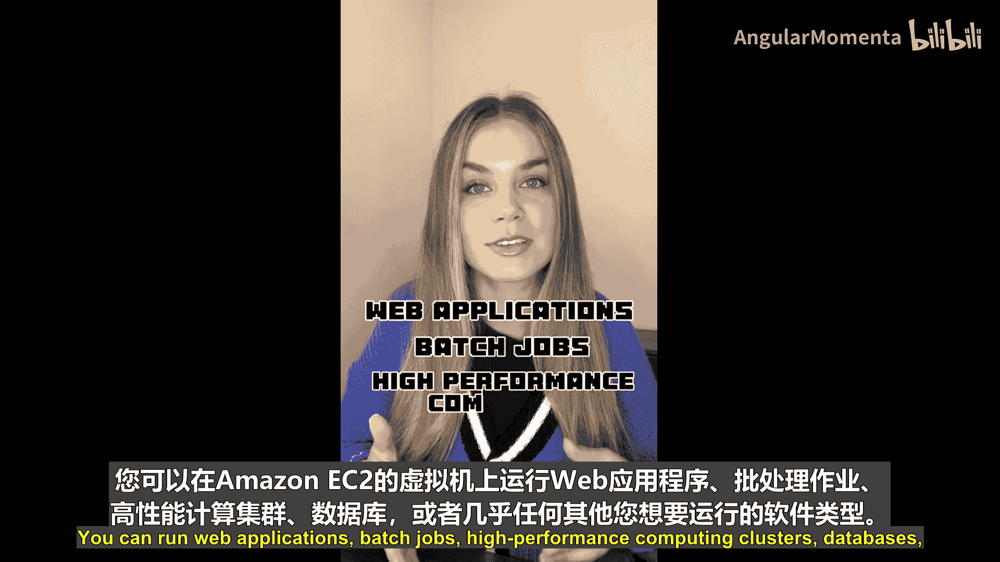

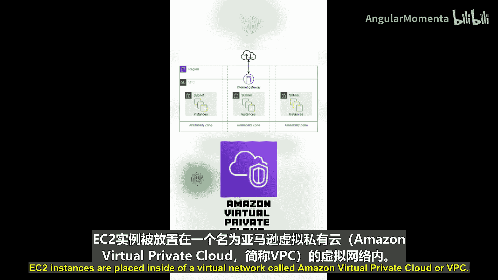

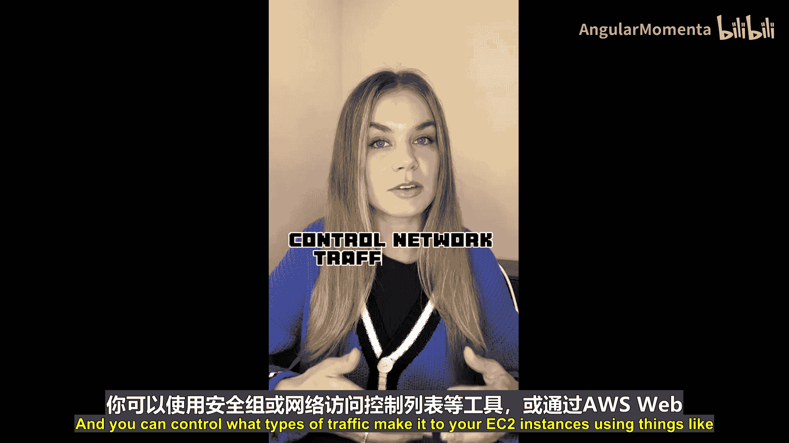

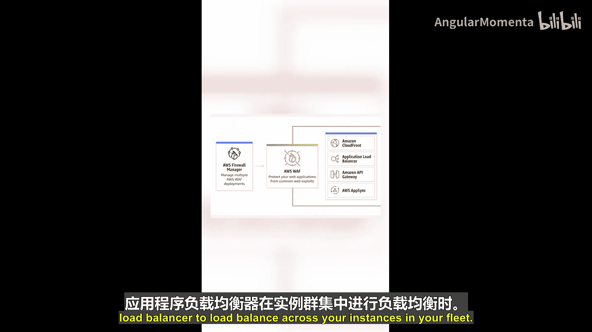

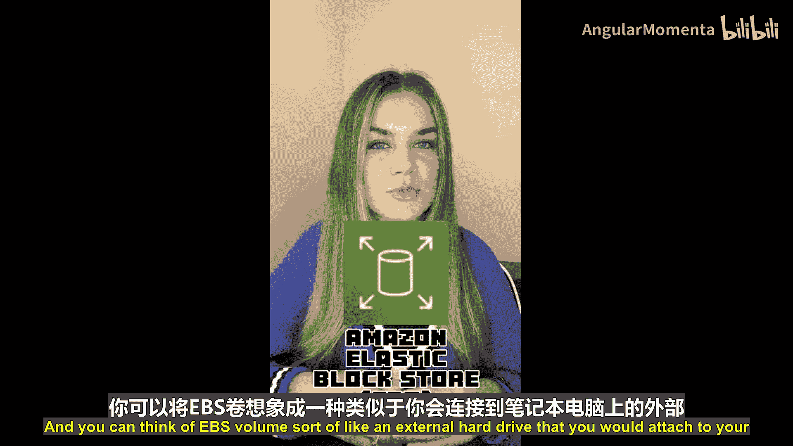

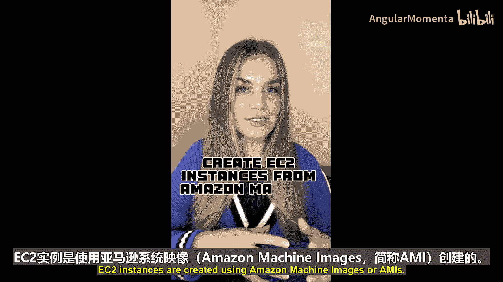

They're like a snapshot of an EC2 instance AMI is contained the operating system and pre-installed software and other types of things that you would need to launch an EC2 instance you can launch many identical instances from a single AMI and that makes it really easy to scale out to meet demand and also to recover from failures when you go to launch an Amazon E2 instance you need to select what size and type you want for that instance and this is one of the benefits of the cloud is that there are tons of different EC2 instance types right at your fingertips and these EC2 instance types they offer you a different blend of CPU memory and networking capabilities each optimized for different use cases like compute optimized memory optimized or general purpose instances It's a best practice with EC2 to replicate your workloads across at least two availability zones and then use a service like application load balancing to load balance across those instances。

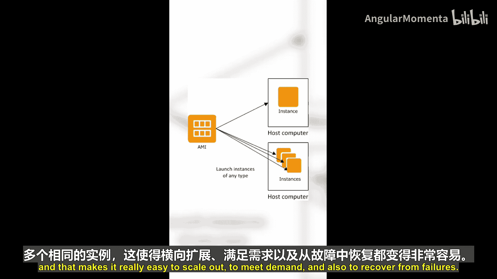

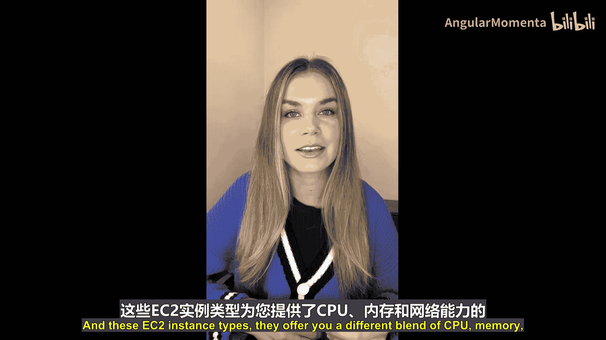

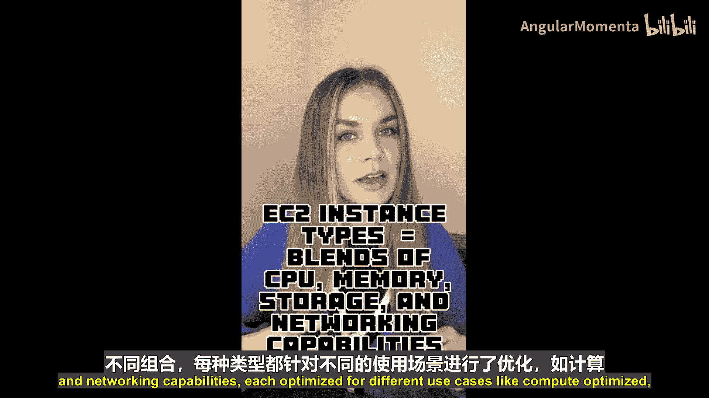

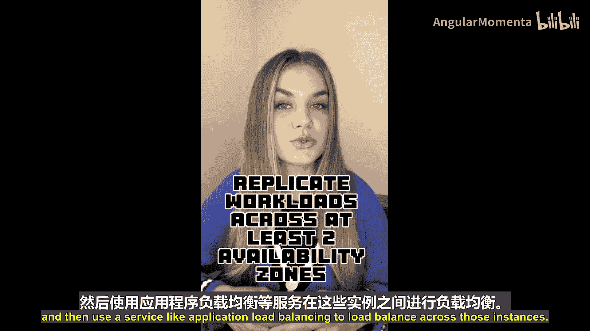

That's our quick rundown on Amazon EC2 again we're really just scratching the surface here there's so much more to learn。

 but if you're interested in learning more I'd recommend checking out the AWS documentation and follow along for more AWS ABCs。

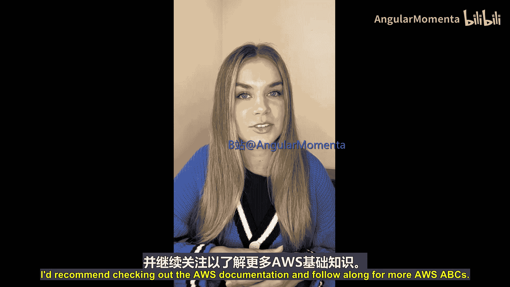