# 【Amazon Web Services】AWS云基础 ｜ The ABCs of AWS： Learn the Basics of the AWS Cloud p06 01_01_12_f-is-for-aws-fargate -BV1MnrHBCEmT_p6-

It's time for AWS ABcs where we cover a different AWS service for every letter of the alphabet。

 Today's letter is F and today's service is AWS Fargate。

 AWS Fargate is a serverless compute engine for running containers on AWS So just like with any application containers need compute to run on and before Fargate you would likely create a cluster of Amazon E2 instances to run your containers on this means that you would need to provision configure and scale this cluster of E2 instances with AWS Fargate。

 you can create a serverless cluster for container hosting So this means that the provisioning configurefiguring and scaling of the underlying infrastructure that host your cluster is handled by AWS That being said you need more than just the compute to host your containers on to run containers successfully at scale there's more to the story here when hosting containers on AWS you first need to choose a container orchestration service like Amazon El container。

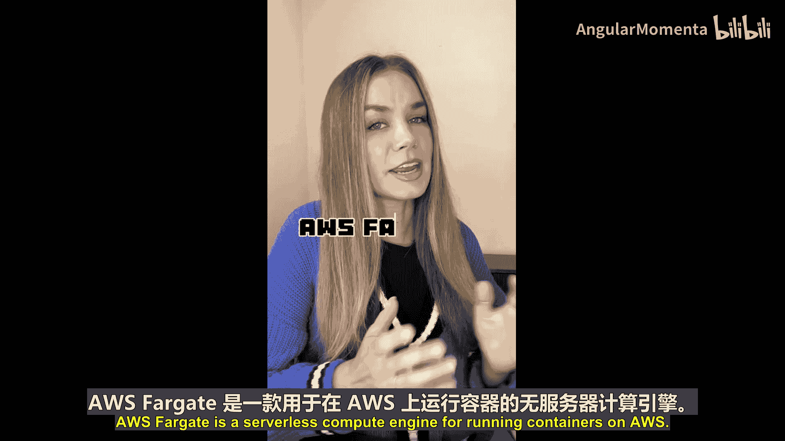

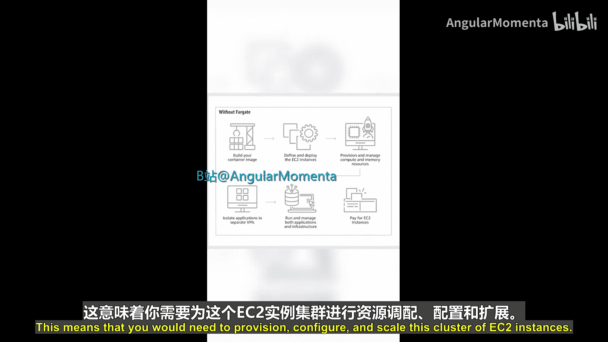

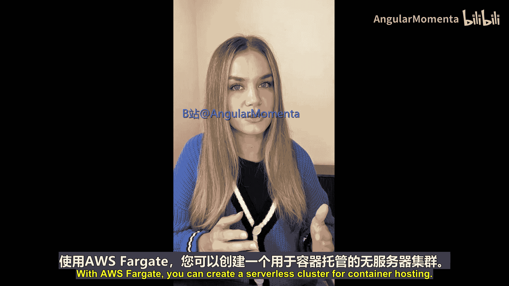

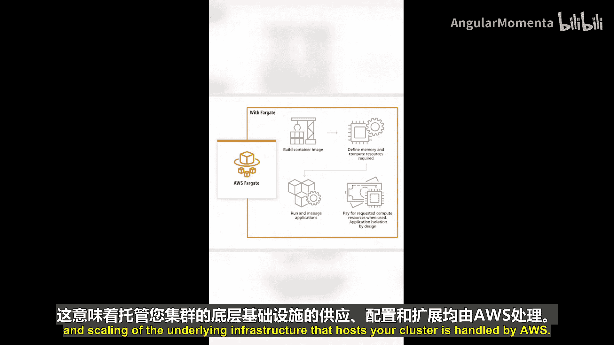

or ECS or Amazon El Kubernetes service or EKS Con orchestration is the automated management of containers like deploying scaling or managing your containers across a cluster of servers once you've chosen your container orchestration service。

 you then need to choose what compute option you want to use This will be either a cluster of Amazon E2 instances or an AWS Fargate cluster。

 which is serverless Fargate is compatible with both ECS and ES if you have compliance or security requirements that dictate that you need access to the underlying operating system or you need complete control of the actual host running the containers then Amazon E2 will be the best option for you but if you don't have any of those requirements。

 then you can take advantage of the serverless nature of AWS Fargate thinking about scaling with containers on Fargate。

 the actual scaling of the containers themselves is handled by the container。

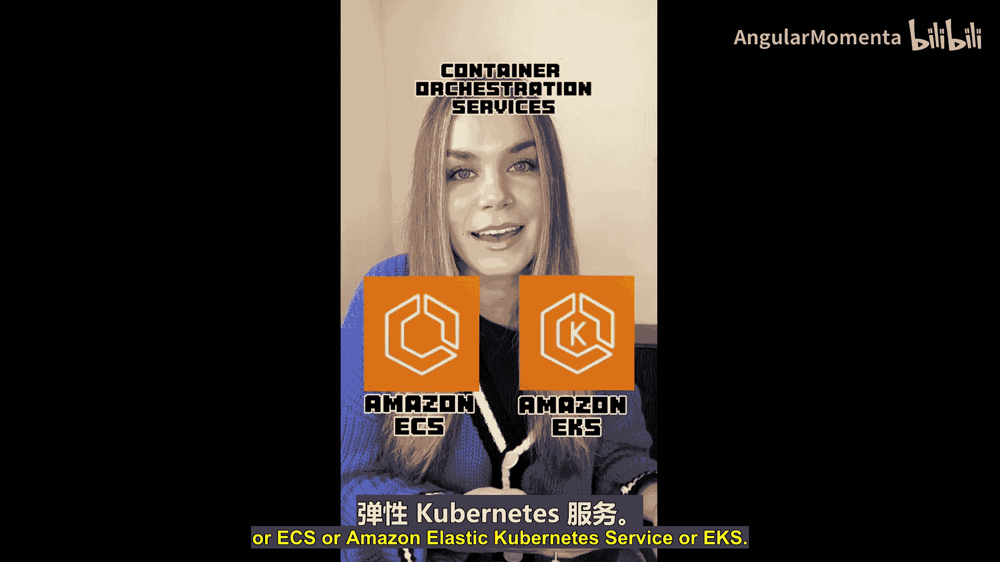

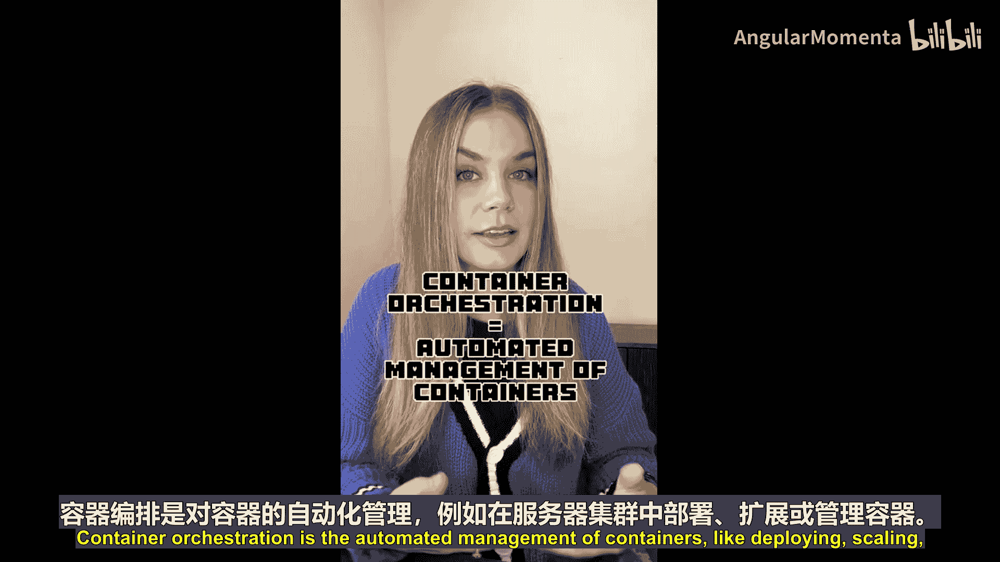

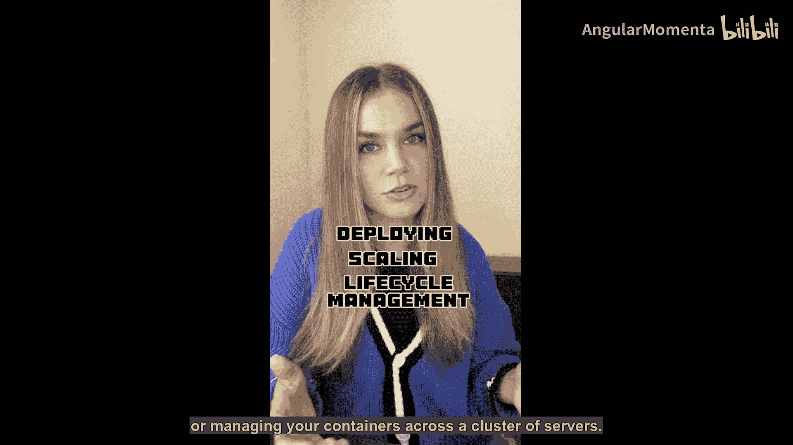

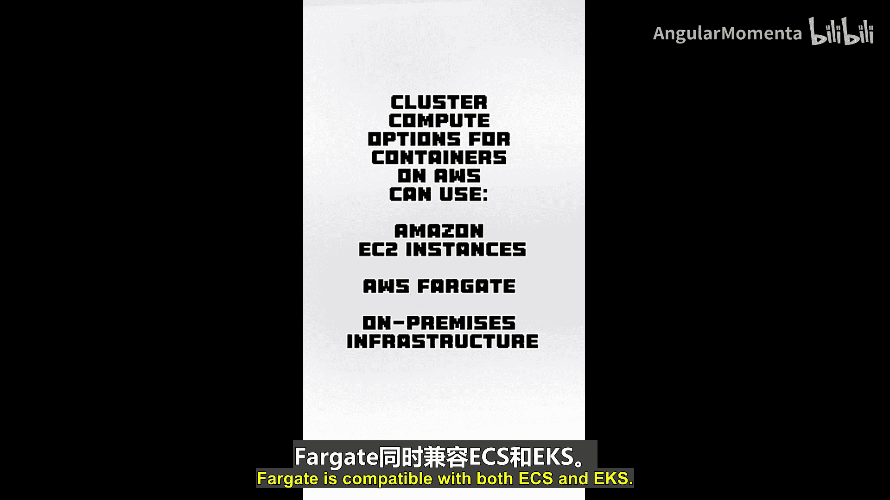

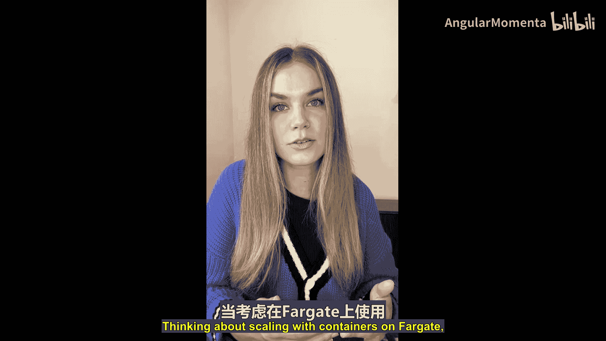

Orchestion service so if you're using ECS， for example。

 you could use service auto scaling to control how many containers you want running at any given time and with AWS Fargate。

 the underlying compute infrastructure will scale in and out as needed for that workload to boost your cost effective with AWS Fargate there is Fargate spot which operates very similarly to Amazon E2 spot instances Fargate spot gives you access to a reduced price point for running containers and the way that this works is AWS has extra capacity at times and that extra capacity can be made available to you through Fargate spot and again this gives you access to a reduced price point so it's a very cost effective option however when AWS needs that capacity back it will send the containers running on Fargate spot a twomin notification warning and that gives your containers time to finish up whatever tasks they're working on before AWS reclaims that capacity That's it for AWS。

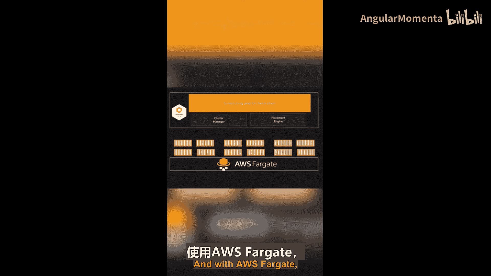

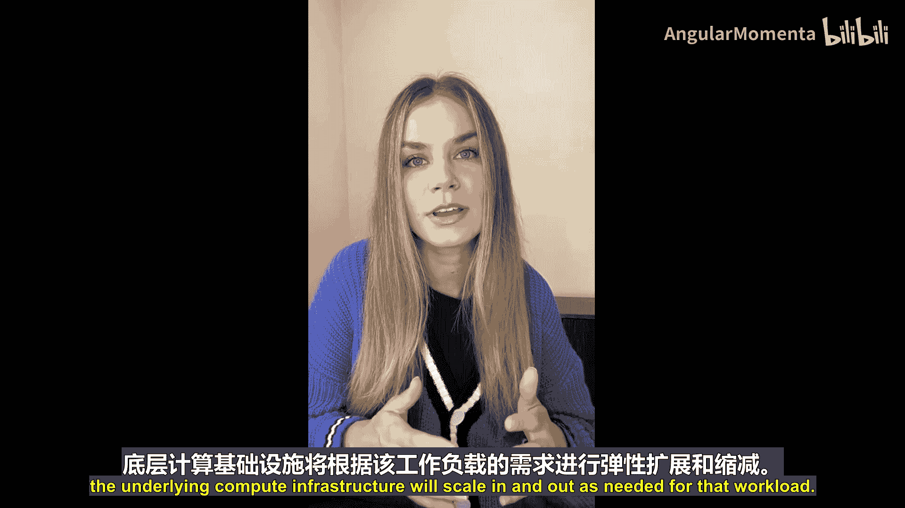

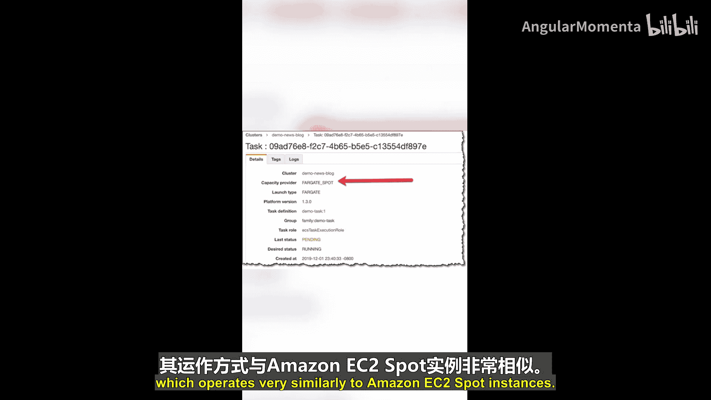

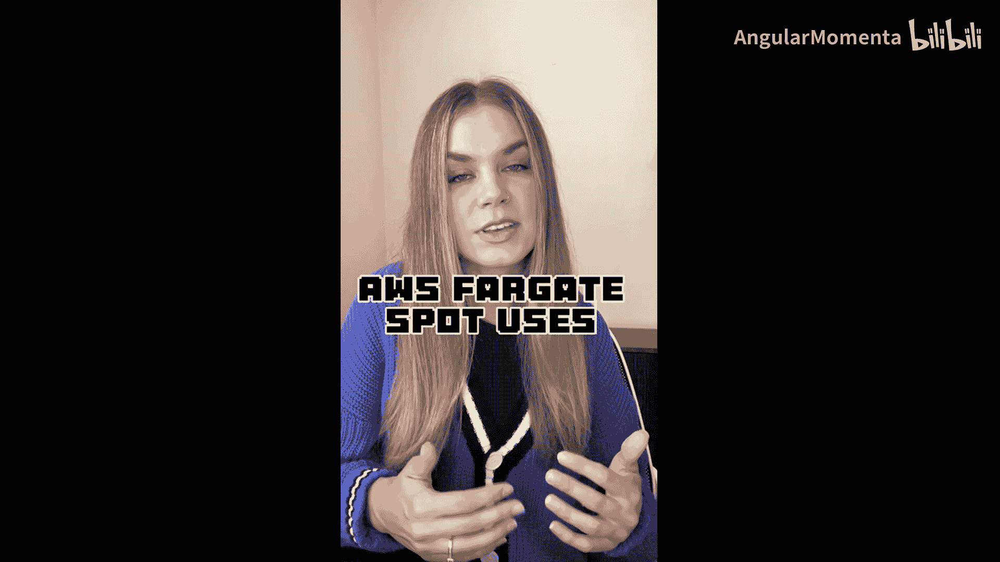

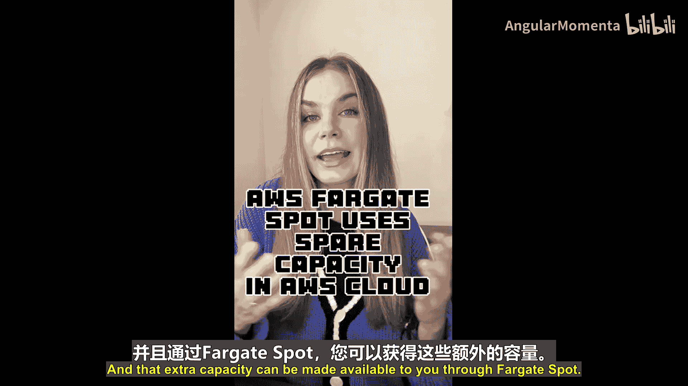

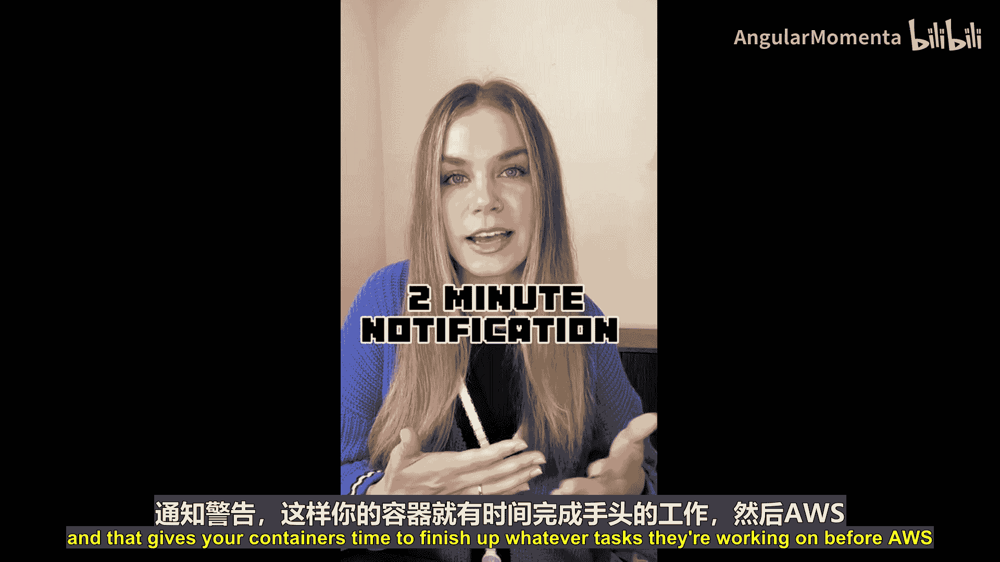

Fargate to sum it up Fargate is a serverless compute engine for containers on AWS that allows you to focus more on the applications you are building and less on managing servers it's compatible with both Amazon ECS and EKS for container orchestration If you want to learn more as always check out the AWS documentation and stay tuned for more AWS ABCs。

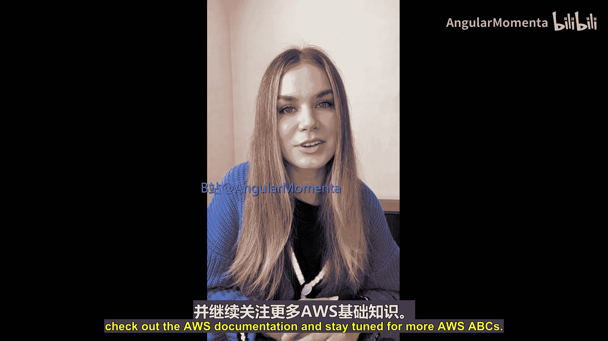