# 【Amazon Web Services】AWS云基础 ｜ The ABCs of AWS： Learn the Basics of the AWS Cloud p09 02_01_05_i-is-for-aws-iam -BV1MnrHBCEmT_p9-

This is AWS ABcs where we cover a different AWS service for every letter of the alphabet。

 Today's letter is I and the service is AWS identity and access management or IA IAM is the service for managing access to AWS and IA determines who has access to your AWS resources and what they can do with those resources Before we get into IM concepts let's first cover what the difference between authentication and authorization Aation means proving that you are who you say you are this could be done by verifying your identity with systems using things like username and passwords or biometrics Aation is all about confirming your identity Now just because you are who you say you are it doesn't mean that you can just do whatever you want That's where authorization comes in authorization is about what you are allowed to do once you've been authenticated in the context of AWS。

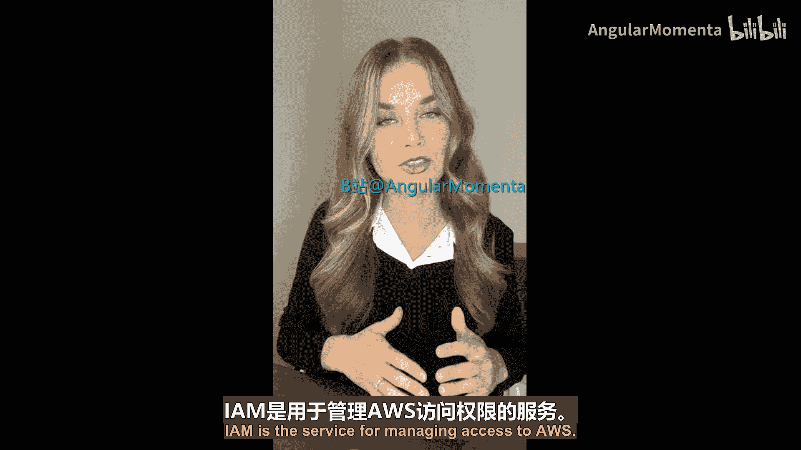

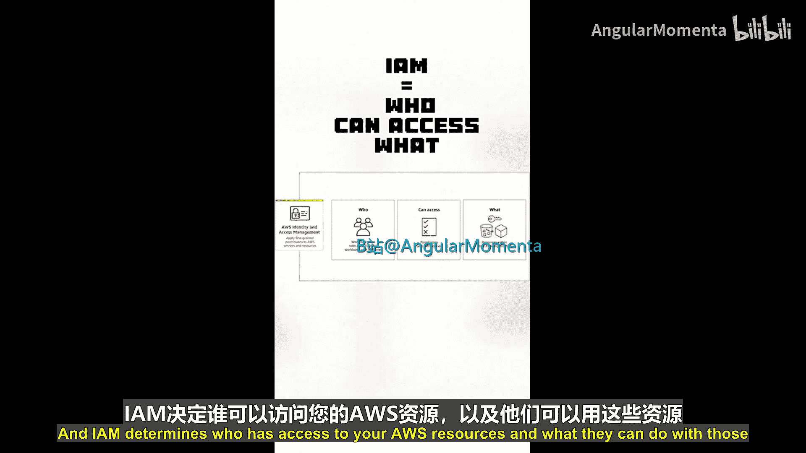

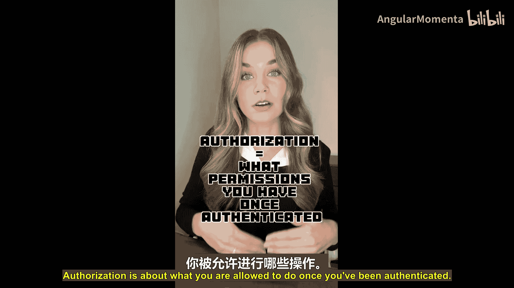

controls which AWS API calls or AWS requests you're allowed to make against different AWS resources within an AWS account IAM handles both authorization and authentication So let's get into some IM concepts so that you can better understand how exactly we set these things up First up are users Use provide you with one of the few ways that you can gain access to an AWS account Use have static credentials like username and passwords that you can use to log into the AWS management console and these are identities that are intended to be used by a single person They can also have associated AWS credentials which are used for programmatic access when you're using things like the AWS software development kit or the AWS command line interface By default users have zero permissions you have to explicitly allow the different AWS API calls that you want a user to be able to make Next up our user group。

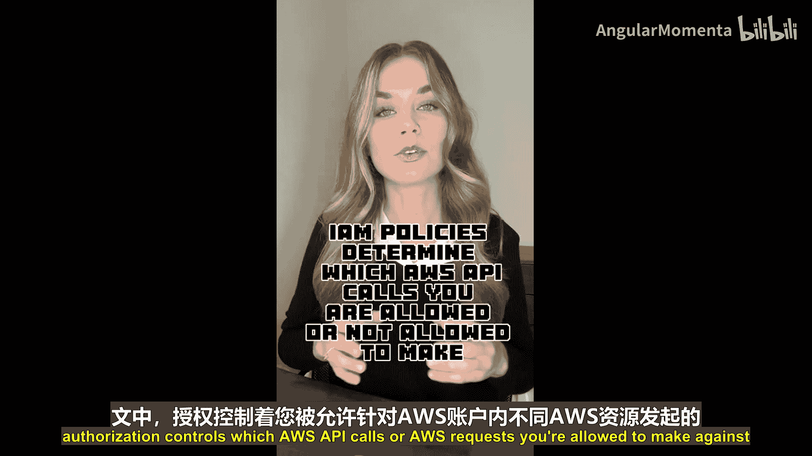

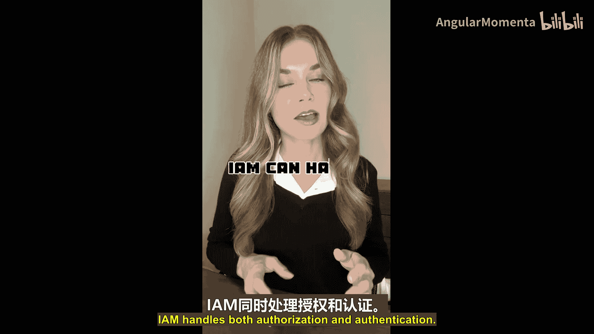

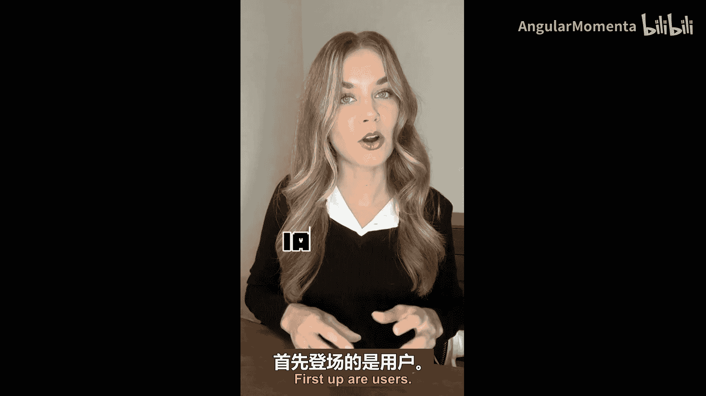

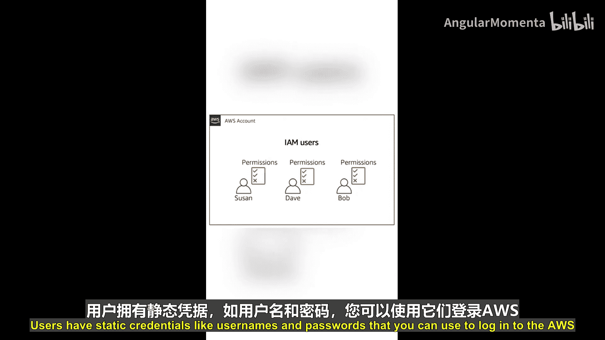

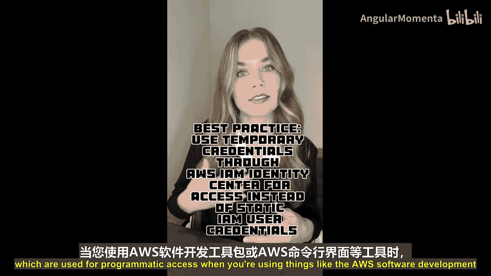

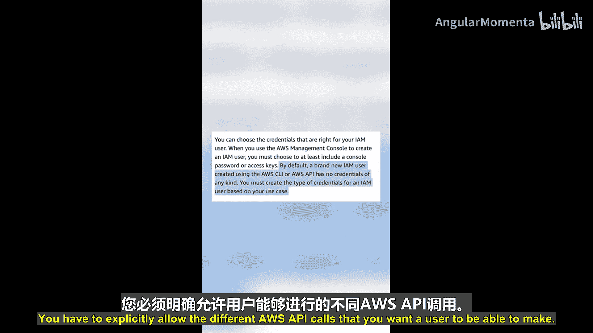

These are collections of users these make it easier to manage permissions for similar roles or teams then there are permissions and policies these control the authorization game permissions dictate which AWS actions you can or can't perform on AWS resources you define these permissions in policy objects policies are then associated with users。

 groups roles or AWS resources these policies can be extremely granular in nature which can allow you to follow the principle of least privilege where you give AWS identities exactly permissions for the AWS actions that they need and nothing more then there are roles which are similar to users but do have important differences roles don't have static credentials like users do like usernames and passwords Instead you assume a role using the assume role API call roles provide temporary credentials that expire and rotate。

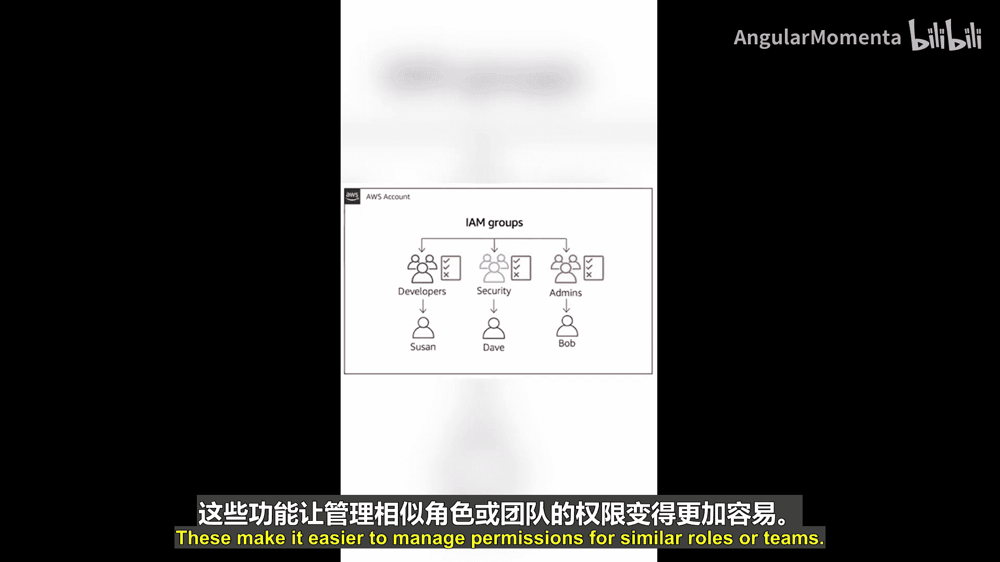

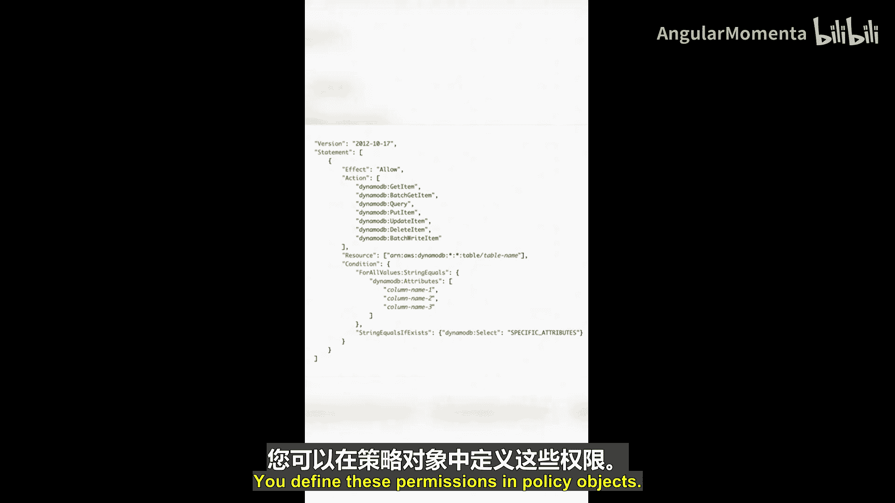

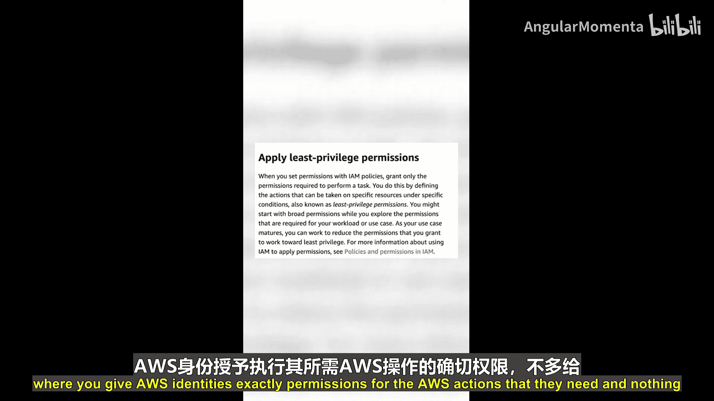

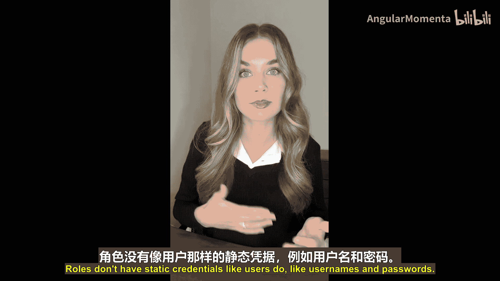

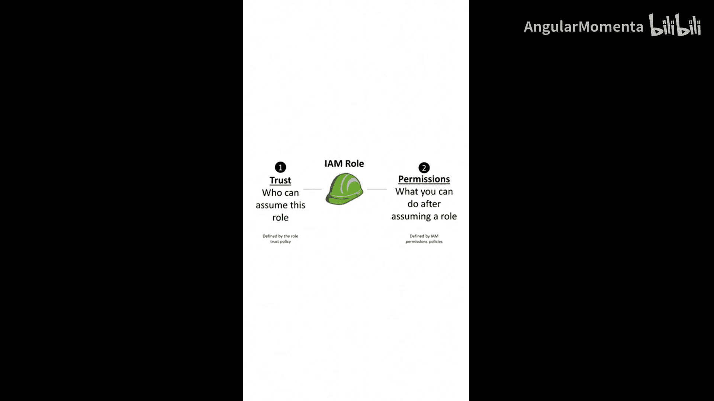

This is great for situations like having an application running on Amazon EC2 that needs access to an Amazon Dynamo DB table you can associate an IEM role with the EC2 instance profile and then the application can access to those temporary credentials set up by the role and then we'll have access to dynamo DB that's it for IEM up next we have J go ahead and make a guess on what you think we're going to cover next and as always stay tuned for more AWS ABCs。

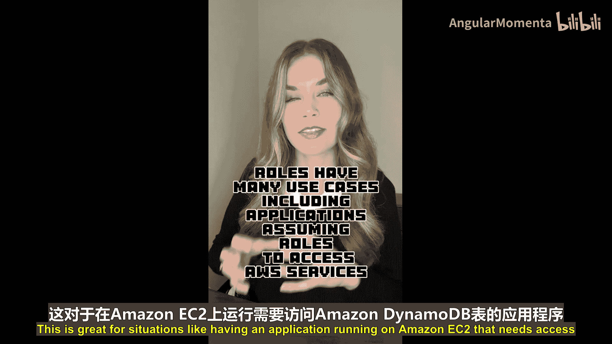

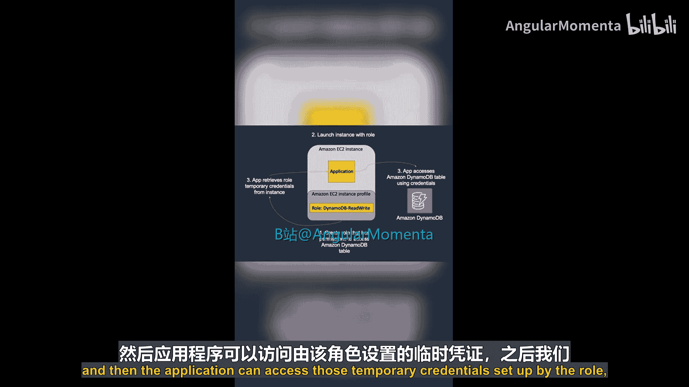

