# 【Amazon Web Services】AWS云基础 ｜ The ABCs of AWS： Learn the Basics of the AWS Cloud p10 02_01_07_j-is-for-aws-jam -BV1MnrHBCEmT_p10-

Welcome back to AWS ABcs， where we cover a different AWS service for every letter of the alphabet。

 Today's letter is Jay。 and we are't going to be covering an AWS service today。

 but we are going to cover an AWS training and certification product called AWS jam AWS jam is a platform where you can go to participate in handson AWS challenges。

 You compete with others by earning points whenever challenges are completed。

 All of the AWS jams are completed in a hosted AWs environment。

 So there's no need to have your own AWS account AWS jam combines both learning and playing while still validating your AWS skills。

 The way it works is there are AWS jam events that you can participate in。

 and these events can be either public or private you can work independently to solve a series of timebound challenges or if you have a team that you're looking to upscale on AWS。

 You can host an AWS jam for your team and work together in groups。

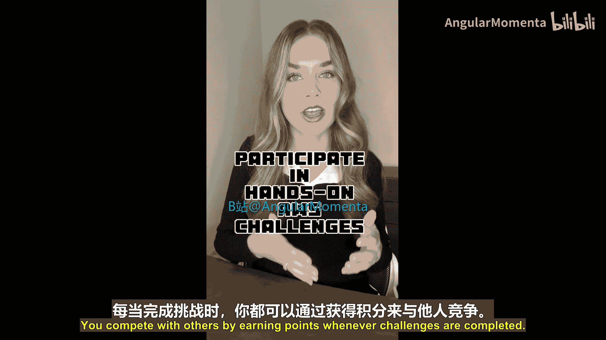

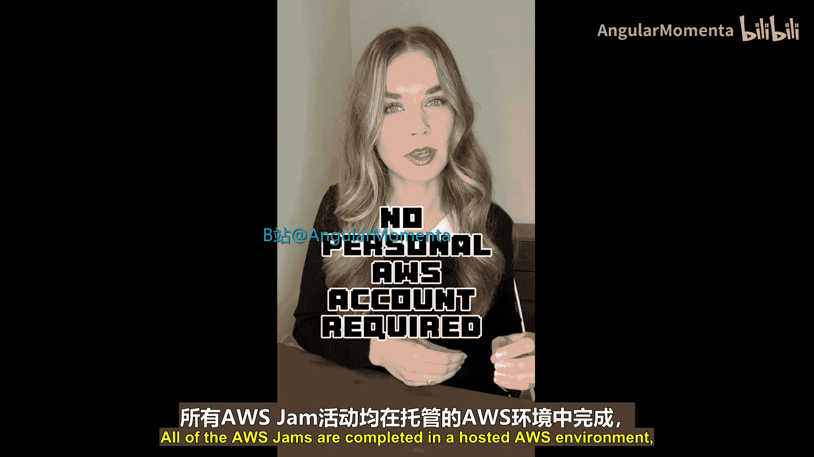

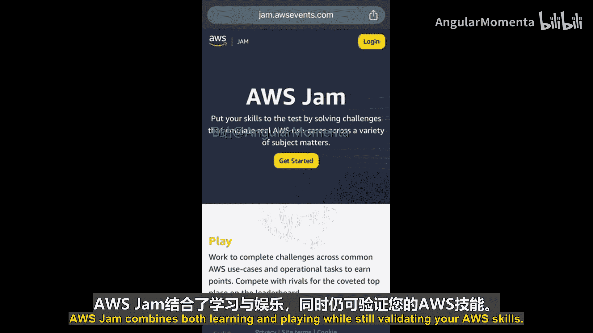

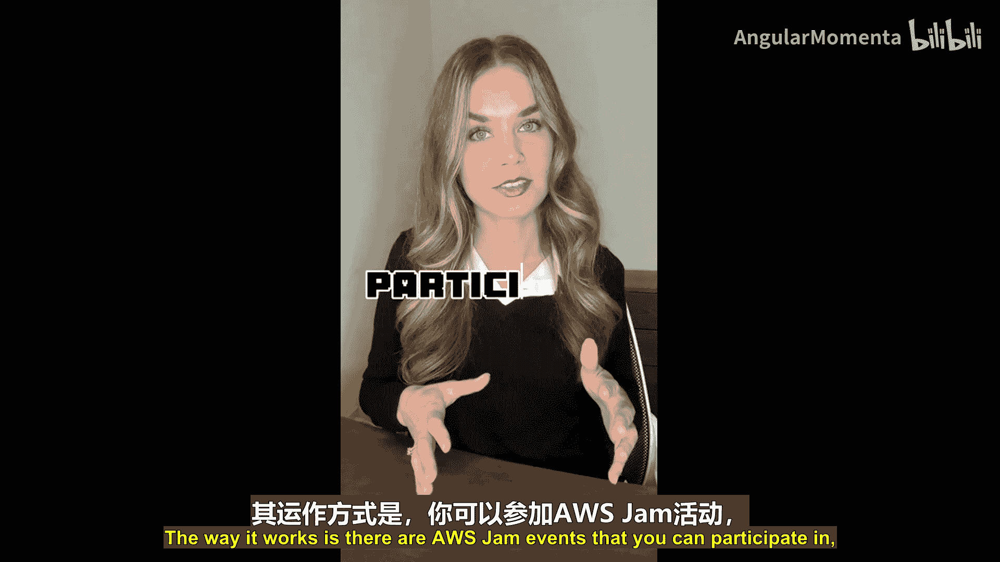

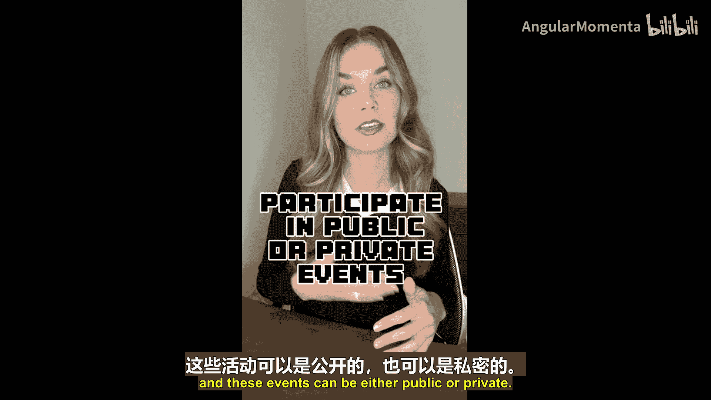

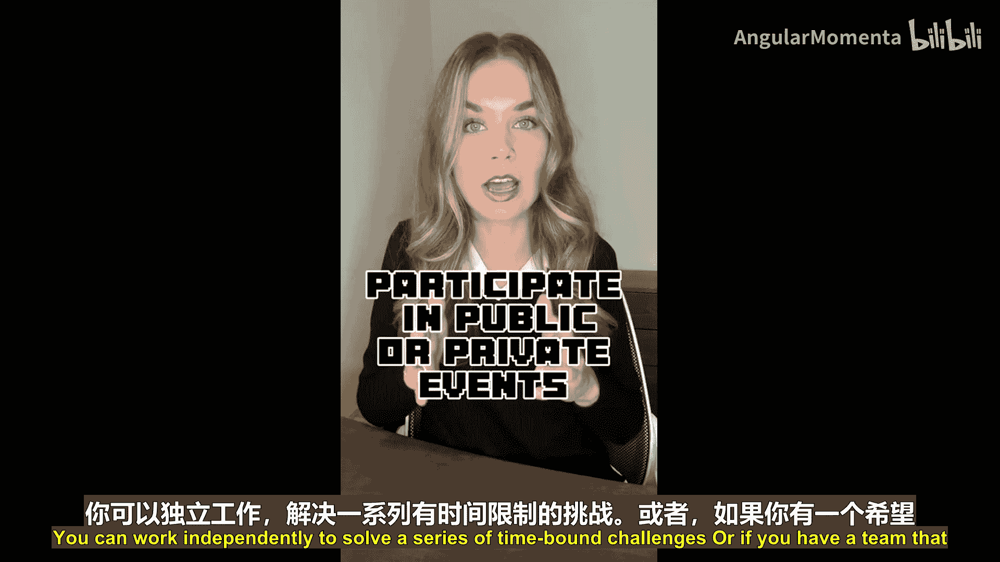

Compete with each other while solving challenges all while learning and exploring AWS along the way。

 These challenges are designed to teach you AWS best practices related to topics like security Devops migrations AIMl and more the AWS jam product has logic built in that will verify the work that you're doing along the way and it will award you or your team points while you compete for the top spot on the leaderboard。

 one thing that's really cool about jam that's unlike other handson labs is that it doesn't give you stepbystep directions instead it gives you a challenge and then it's up to you to figure out how exactly you're going to solve the problem This makes it so you're really testing your AW knowledge and figuring out where any gaps are while also reinforcing any of the ideas and concepts that you already know both AWS jam and other types of guided labs like AWS builder labs on AWS skill builder are great ways to get handson with AWS services jam is designed to。

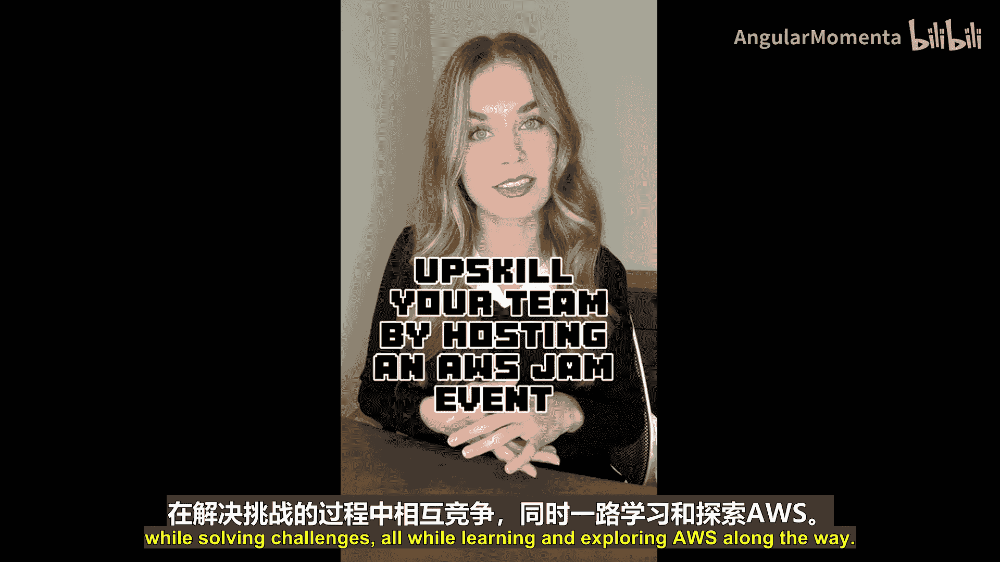

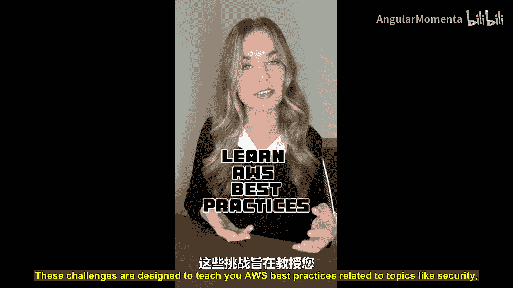

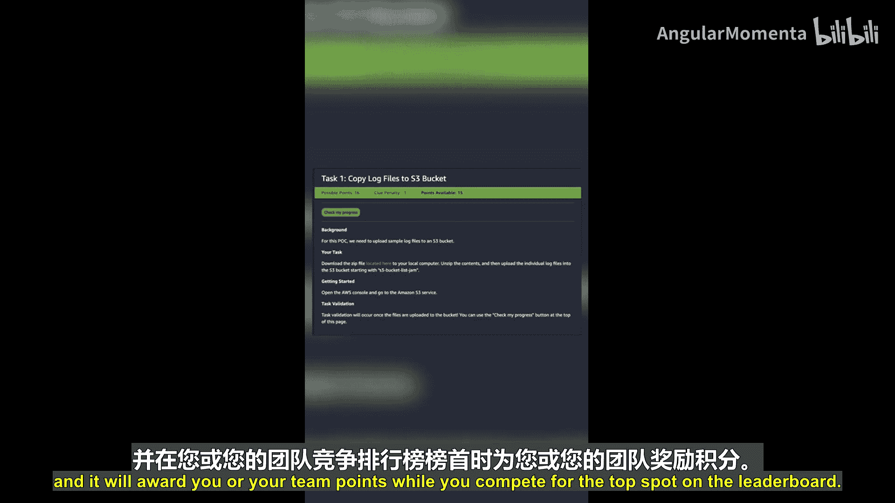

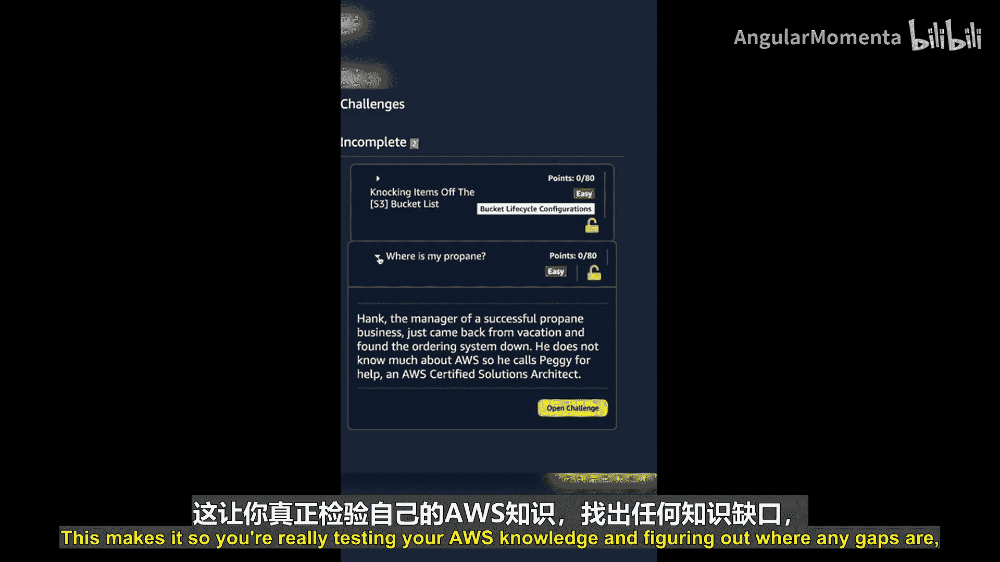

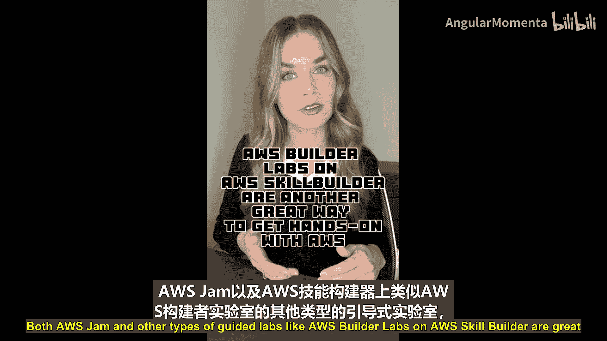

individualss across all technical skill levels。 So don't worry if you're an AWS newbie。

 you can still participate in a jam。 There are clues built in that can help you navigate the challenges if you need them。

 and they are also Aw experts on hand to help facilitate the events。

 But these events are really all about promoting self paced discovery and learning。

 if you're a current Aw customer and you're interested in hosting an Aw jam event for your team。

 then please reach out to your AW account representative。

 If you're an individual looking to participate in the next public Aw jam event then you're going to need an Aw skill builder subscription。

 And with this subscription you'll also get access to all sorts of other helpful study materials。

 So visit skill builder Aws to learn more about that That's it for Aw jam up next we have。

 what do you think we're gonna cover for that one。 let me know in the comments and stay tuned for more AWS ABcs。

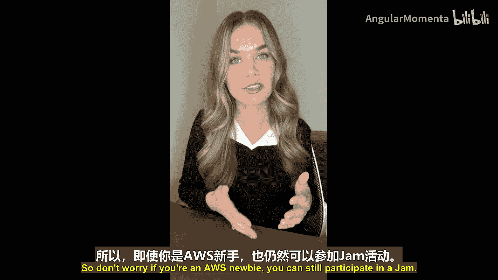

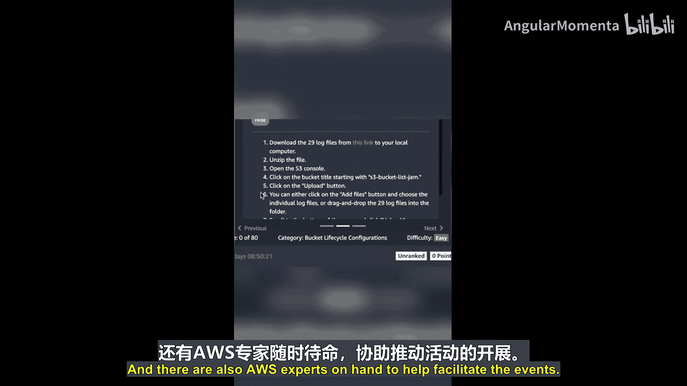

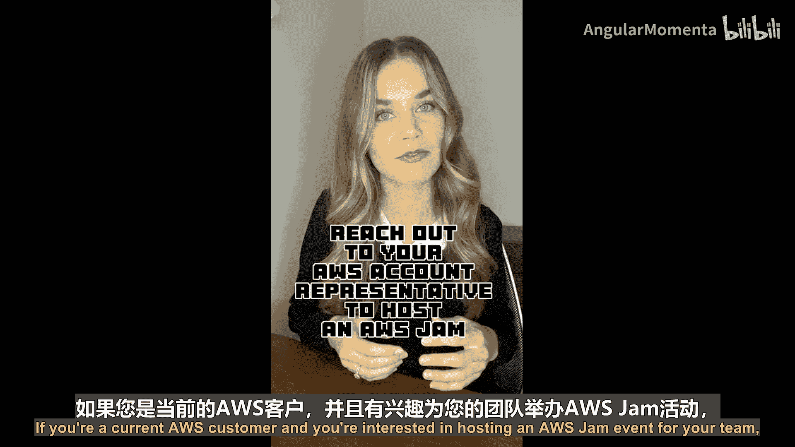

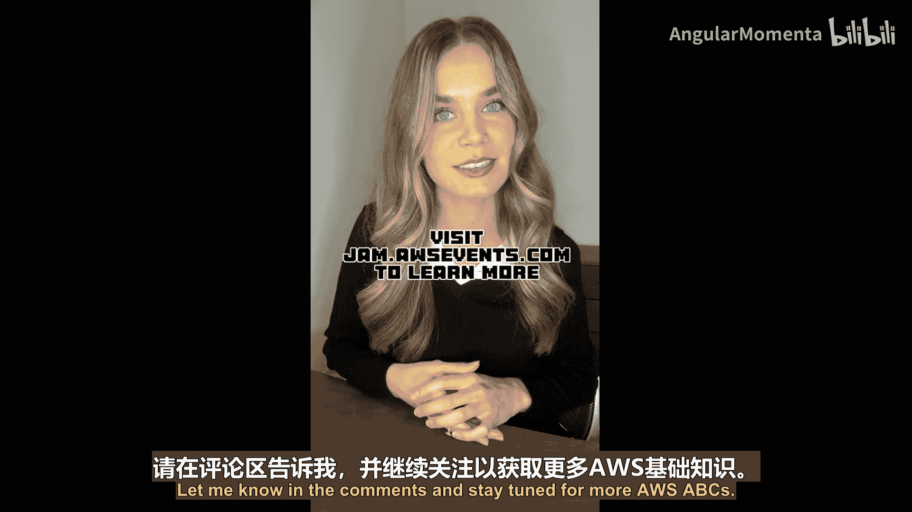