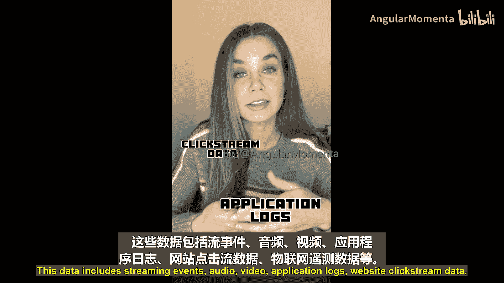
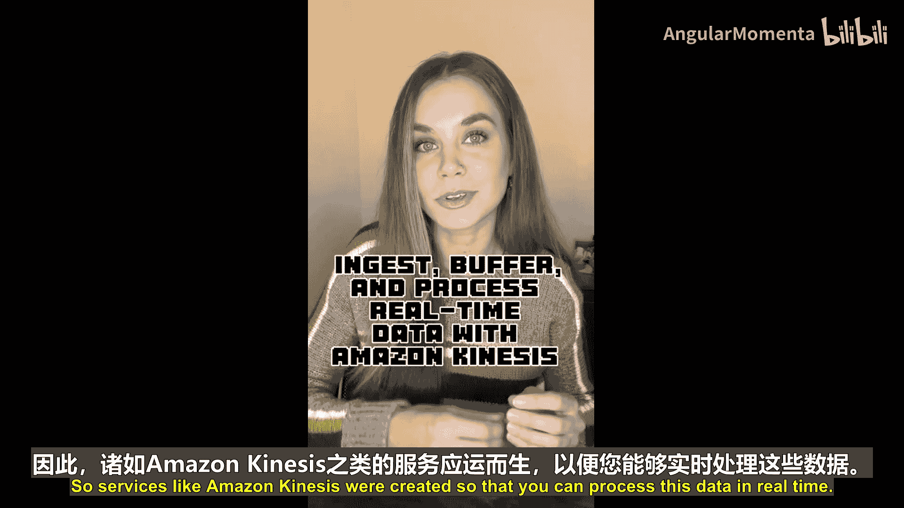
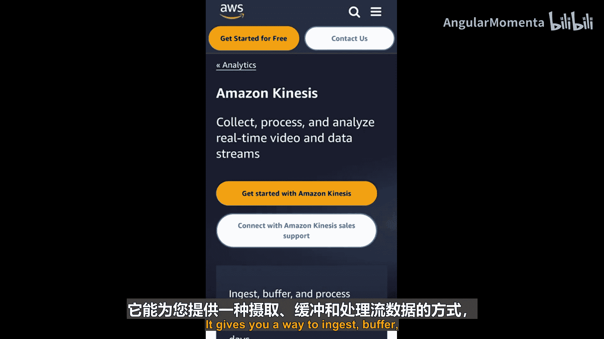
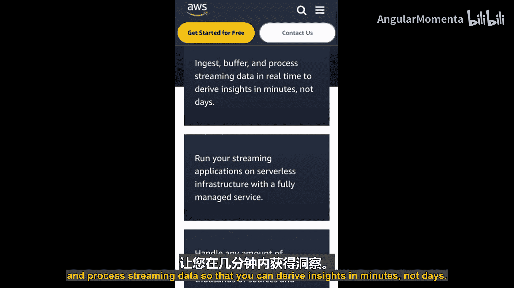
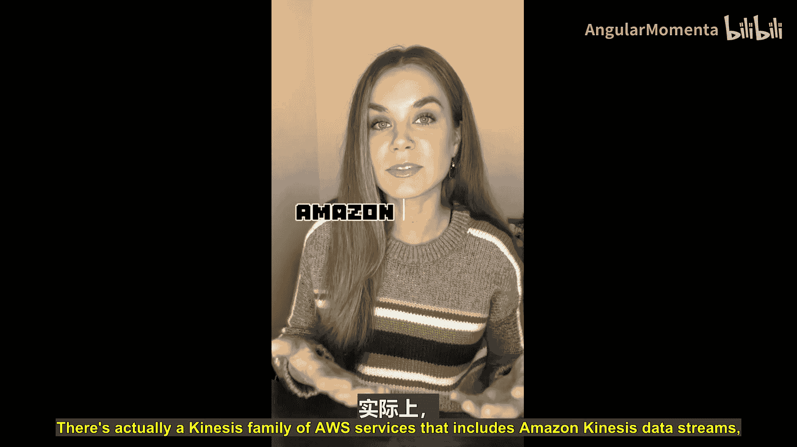
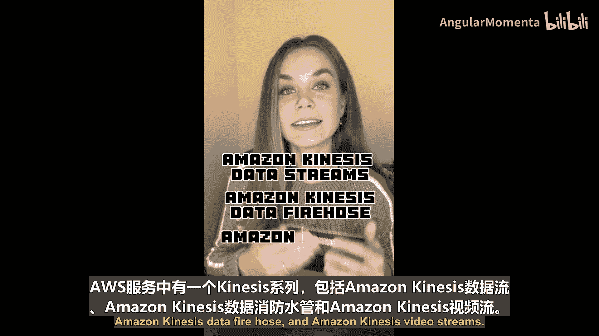
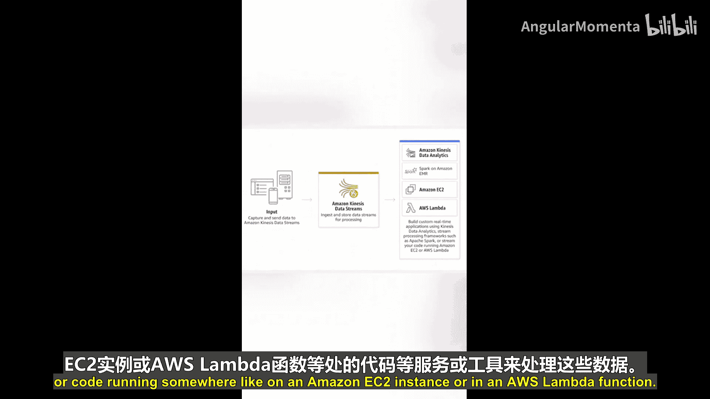
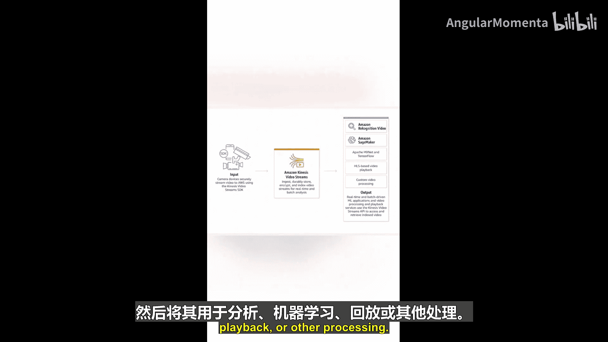
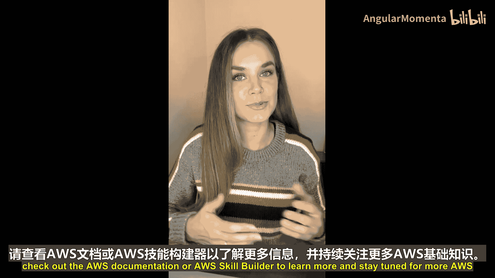

# 【Amazon Web Services】AWS云基础 ｜ The ABCs of AWS： Learn the Basics of the AWS Cloud p11 02_01_09_k-is-for-amazon-kinesis -BV1MnrHBCEmT_p11-

This is AWS ABCs Today's letter is K and the service we'll be covering is Amazon kinesis In today's digital age organizations deal with vast amounts of data that's generated in real time This data includes streaming events。

 audio， video application logs， website clickstream data。

 IoT telemetry data and more data is basically coming from everywhere these days Sting data is data that is generated continuously potentially by thousands of data sources These data sources send in records simultaneously and in small sizes Think kilobys theres a growing need to process this data as it's being generated in real time so it can be used for things like gaining actionable insights。

 detecting anomalies， making realtime decisions， or using it for things like data analytics and machine learning traditional batch processing solutions are generally inadequate for this type of data。

So servicess like Amazon kesis were created so that you can process this data in real time。

 So that's really what Amazon kinesis is all about。

 It gives you a way to ingest buffer and process streaming data so that you can derive insights in minutes not days Amazon kesis isn't just one service there's actually a kesis family of AWS services that includes Amazon kesis data streams Amazon kesis data fire hose and Amazon kesis video streams。

 Amazon kesis data streams makes it easier to ingest and capture streaming data so that you can process it using services or tools like Apache Spar manage service for Apache Flink or code running somewhere like on an Amazon Ec2 instance or in an AWS Lambda function More data is added to the stream continuously as data is generated so as your code is processing and churning through that data more data is coming in This is what。

It real time then there's Amazon Kisesiss data Firehose This is also a data ingestion service。

 but instead of processing the data as it comes in。

 the streaming data is ingested and then continuously delivered to places for storage and analysis like data lakes data stores and data analytics tools then there's Amazon kisesis video streams you can use this service to more easily and securely stream video data coming from camera devices that are using the kinesis video streams SDK you can stream that data to AWS and then use it for things like analytics。

 machine learning playback or other processing processing can then be done in real time or it can be done in batches All right that's it for Amazon kesis as always check out the AWS documentation or AWS Ski buildder to learn more and stay tuned for more AWS ABcs。

