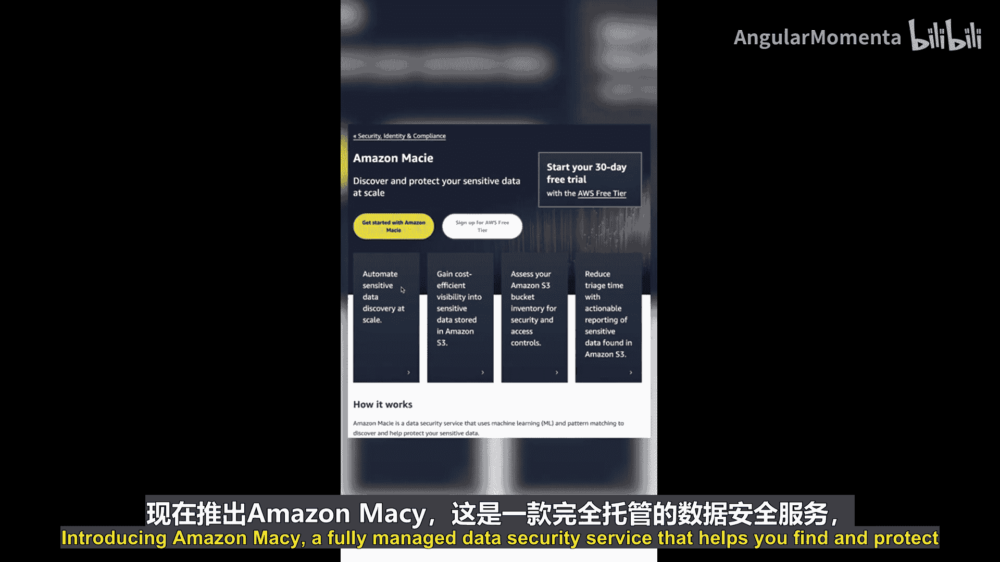
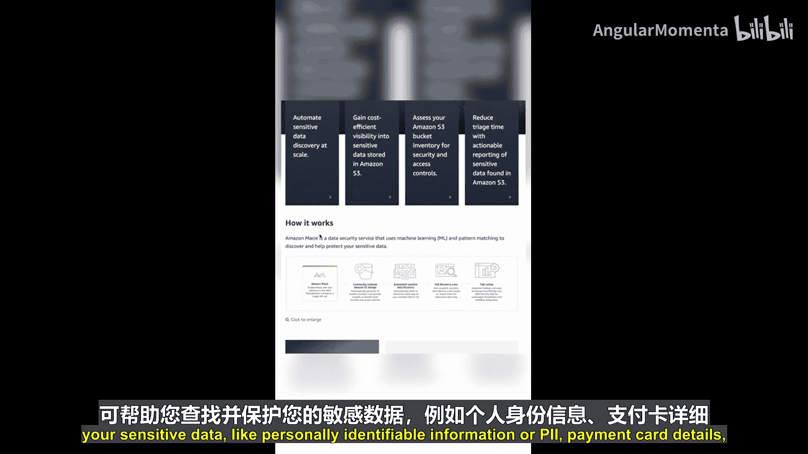
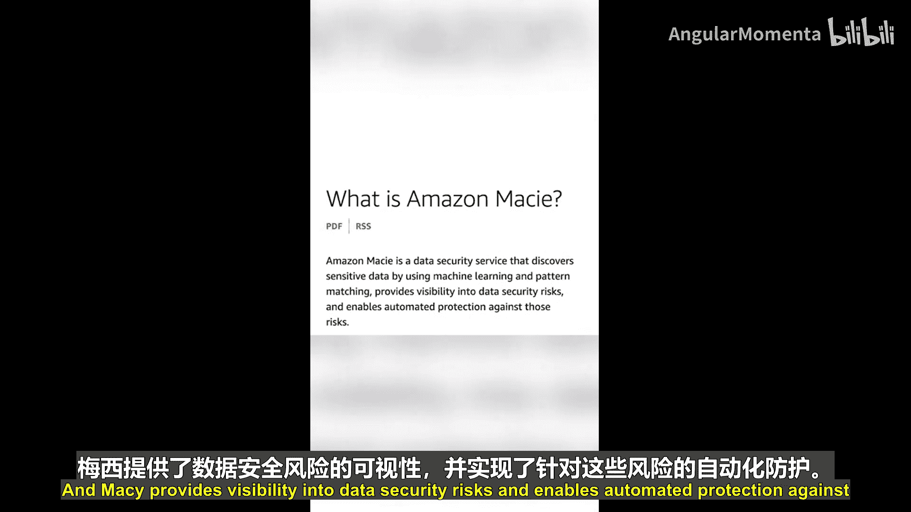
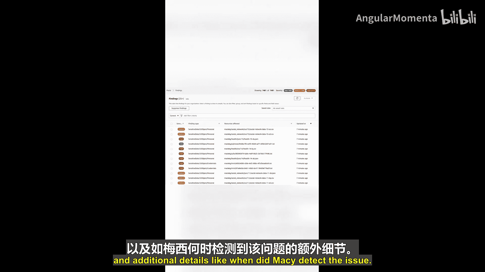
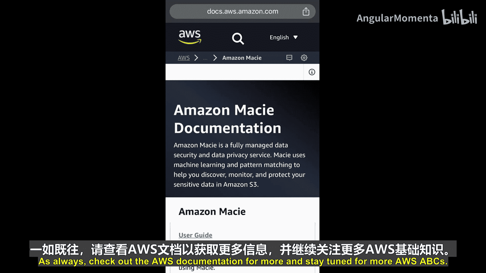

# 【Amazon Web Services】AWS云基础 ｜ The ABCs of AWS： Learn the Basics of the AWS Cloud p13 03_01_03_m-is-for-amazon-macie -BV1MnrHBCEmT_p13-

This is AWS ABCs， where we cover a different AWS service for every letter of the alphabet。

 Today's letter is M。 and the service is Amazon Macy。

 organizations have unimaginable amounts of data that they are managing in today's world。

 And when you're using AWS it's common to store data in Amazon S3 Some of this data may be sensitive in nature and some of the data may not be sensitive in nature。

 The different types of data that you store may have different security and compliance rules that need to be followed。

 So if you have a huge amount of data being stored across potentially thousands of Amazon S3 buckets and across accounts within an AWS organization。

 how do you know which S3 buckets have objects that contain sensitive data and which ones don't or how do you know which Amazon S3 buckets are secured and which ones aren't introducing Amazon Macy a fully manage data security service that helps you find and。

ect your sensitive data like personally identifiable information or PI payment card details or AWS credentials。

 Macy uses machine learning and pattern matching to discover sensitive data。

 and Macy provides visibility into data security risks and enables automated protection against those risks when you enable Macy。

 it begins to automatically discover sensitive data in your buckets。

 It also provides you with an inventory of Amazon S3 buckets and it will monitor and evaluate these buckets for security and access control to detect sensitive data you can use the built in criteria and mechanisms that Macy provides or you can create your own custom criteria using rex or you can use a combination of the two If Macy detects a potential issue with the security or privacy of your data like let's say an Amazon S3 bucket becomes publicly access Macy will create a finding for you to review and。

mediate as you see fit there are many different types of findings that Macy creates a finding provides a severity rating。

 information about the affected resources and additional details like when did Macy detect the issue findings are published to the Macy console AWB Security hub and Amazon event bridge This is useful so that you can create automated systems to remediate or report these findings or you can integrate them with existing security and compliance applications or services。

That's it for Amazon Macy， as always check out the AWS documentation for more and stay tuned for more AWS ABCs。

