# 【Amazon Web Services】AWS云基础 ｜ The ABCs of AWS： Learn the Basics of the AWS Cloud p15 03_01_07_o-is-for-aws-organizations -BV1MnrHBCEmT_p15-

This is AWS ABCs。 Today's letter is O， and the service we'll be covering is AWS organizations When using AWs at scale。

 it's unlikely that you're going to host everything in a single AWs account。

 It's more likely and a best practice that you're going to host your workloads across many different AWs accounts。

 You may have different accounts for different projects。

 different teams or maybe different environments like dev QA and production。

 There are many different types of patterns that you can follow for account strategies。

 but the main point that I'm trying to make here is that you'll have multiple AWs accounts that support a single business。

 So with all of these accounts， how can you do things like centrally manage billing in an efficient way。

 knowing that each individual account will have its own AWS bill。

 or how can you do things like manage access to the different AWS service APIpis across all of the accounts that support your workloads instead of potentially。

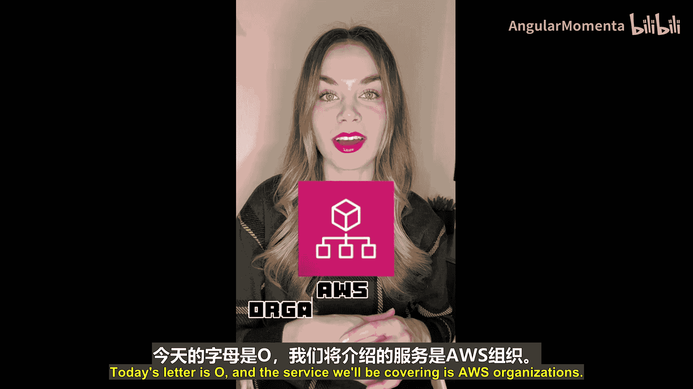

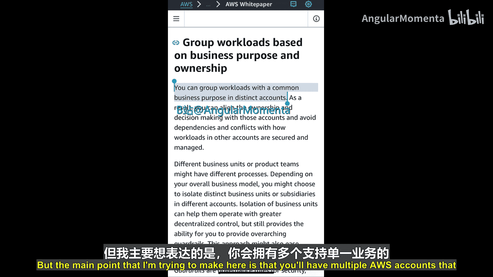

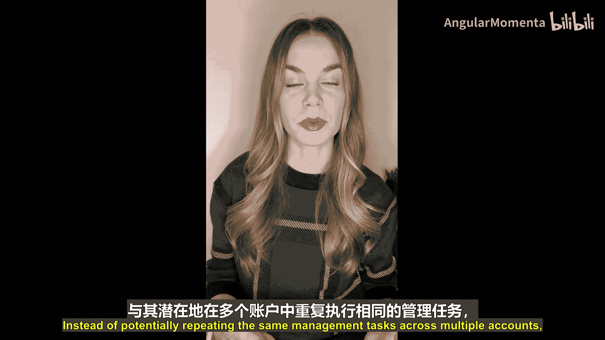

the same management tasks across multiple accounts。

 looking into using AWS organizations AWS organizations is an account management service that allows you to consolidate many AWS accounts into an organization that you create and then centrally manage with AWS organization you create a hierarchy of AWS accounts with one account being the management account or organization route Under the route。

 you then create organizational units or OUs which contain member AWS accounts or other nested organizational units one very common use case is to set up permissions to control access to the AWS service APIs through the use of something called service control policies or SCps SCPs allow you to control the maximum available permissions for the accounts that belong to your organization Now SCPs alone are not enough to grant access SCs are used as guardrails to define the。

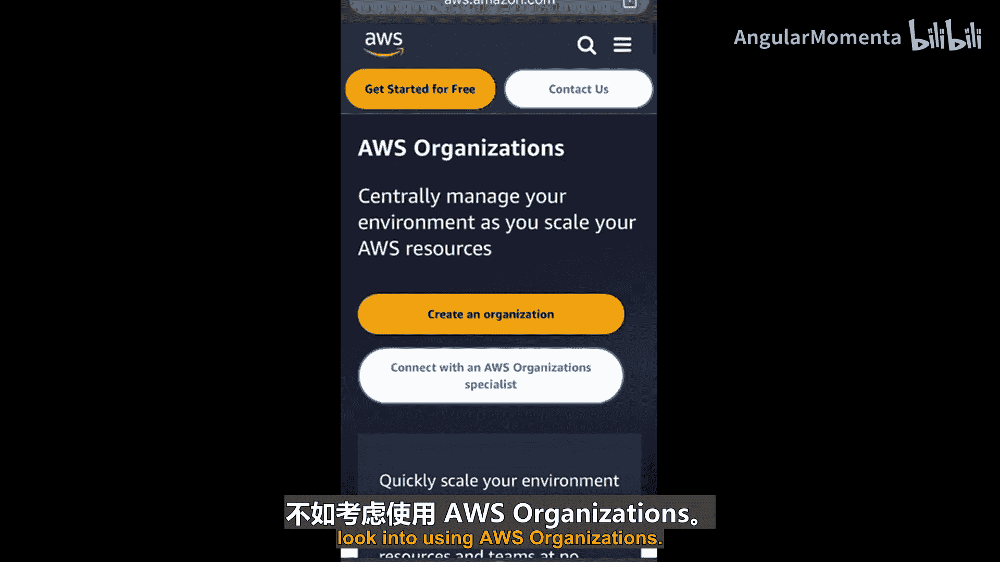

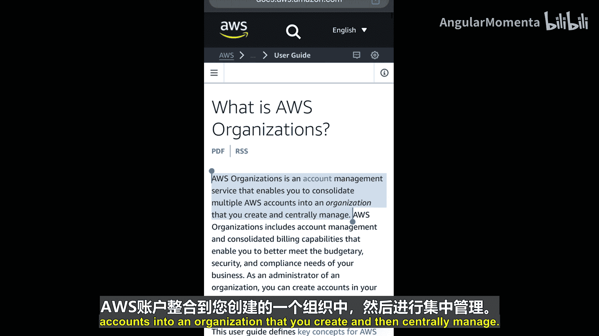

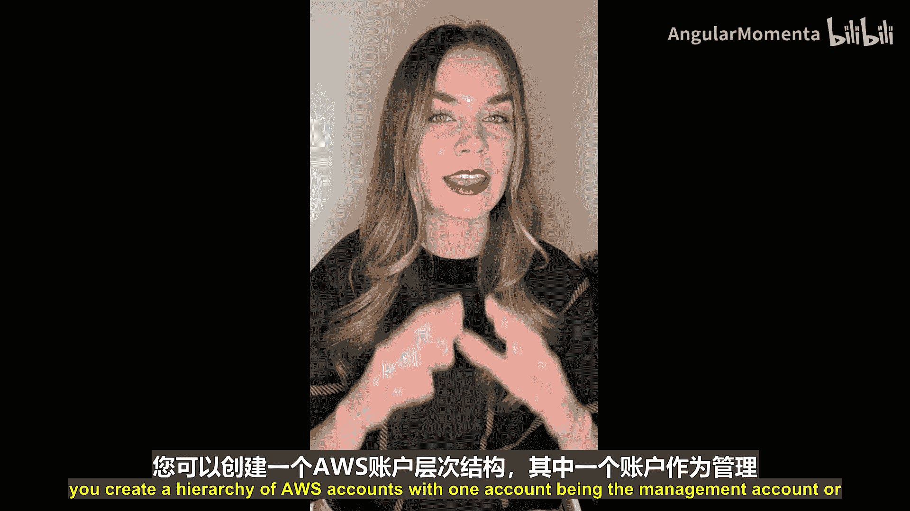

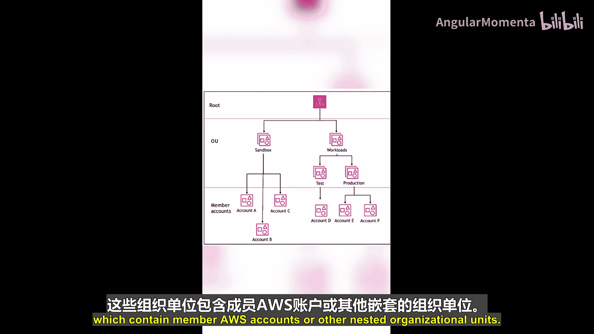

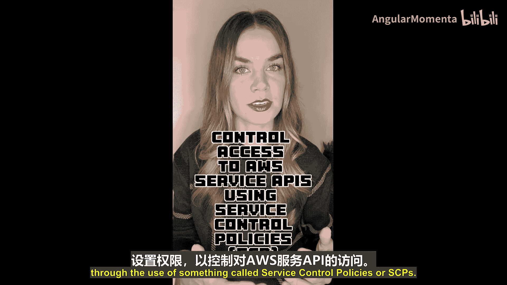

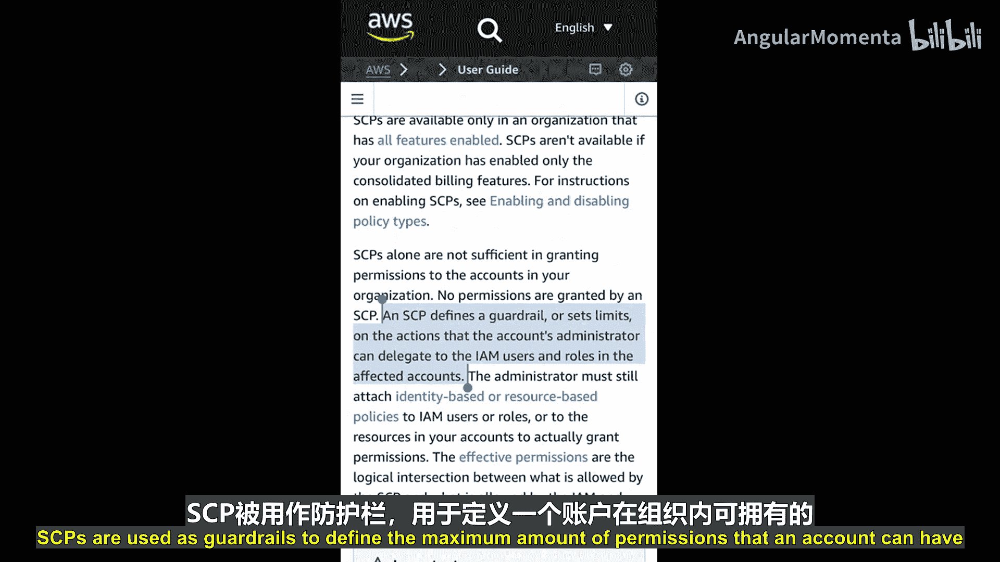

Maximum amount of permissions that an account can have within an organization so you can attach an SP to an OU and then any member account under that organizational unit would be affected by the restrictions that you set up in that SP For example。

 let's say you have member accounts that should only be able to access a certain subset of AwS services due to regulatory requirements you can take all those member accounts and put them under one OU。

 Then you can create a service control policy and attach it to that OU and all those member accounts will be affected by that policy you would then also use Iam policies within each individual member account to grant access to AwS service APIs。

 Another major benefit of AbsS organizations is consolidated billing。

 you can use the management account to consolidate and pay for all member accounts instead of paying for each bill individually management accounts can access billing information accountcount activity and account information。

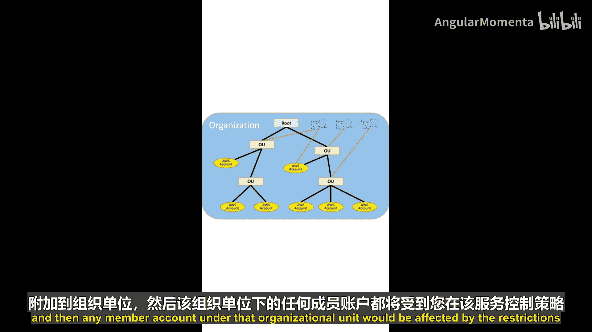

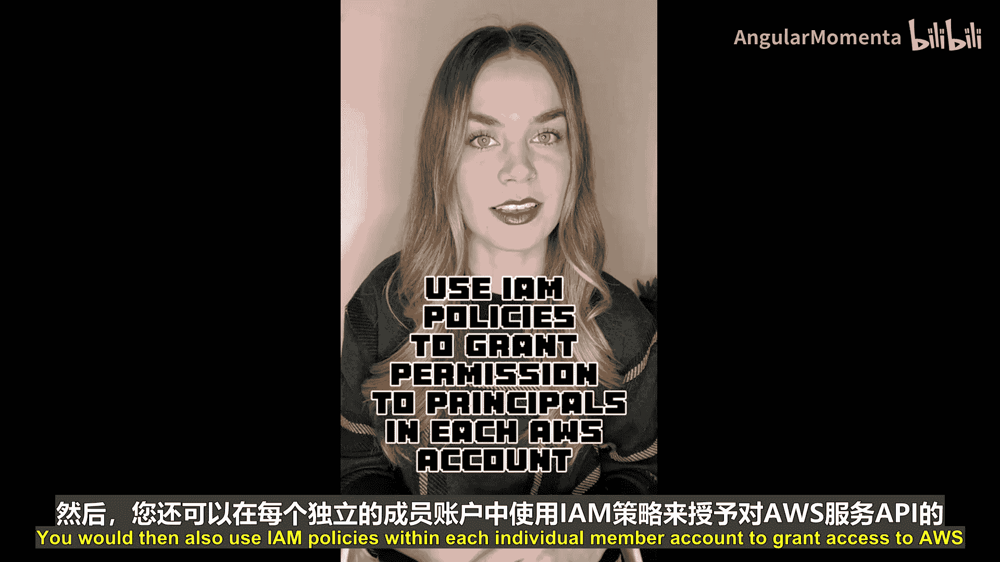

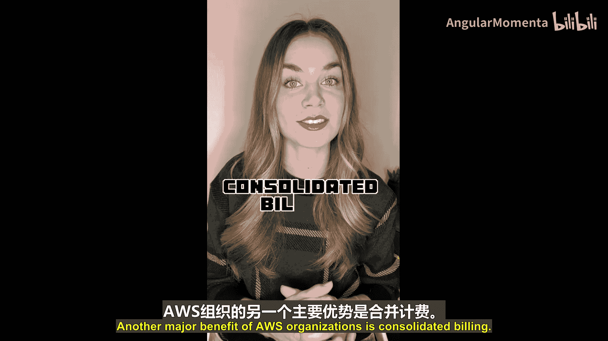

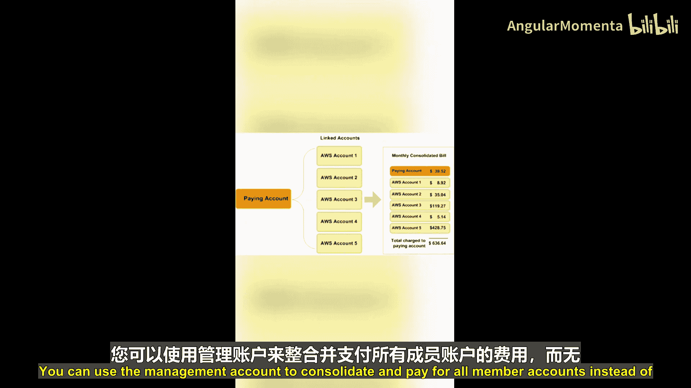

All member accounts within their organization Another common management task that AWS organizations makes easier is tag standardization you can use tag policies to maintain consistent tags across AWS accounts including preferred case treatment for tag keys and tag values and my favorite part about it all is that AWS organizations is free to use that's it for this short rundown on AWS organizations up next we have P let me know what you think it's going to be in the comments and stay tuned for more AWS ABCs。

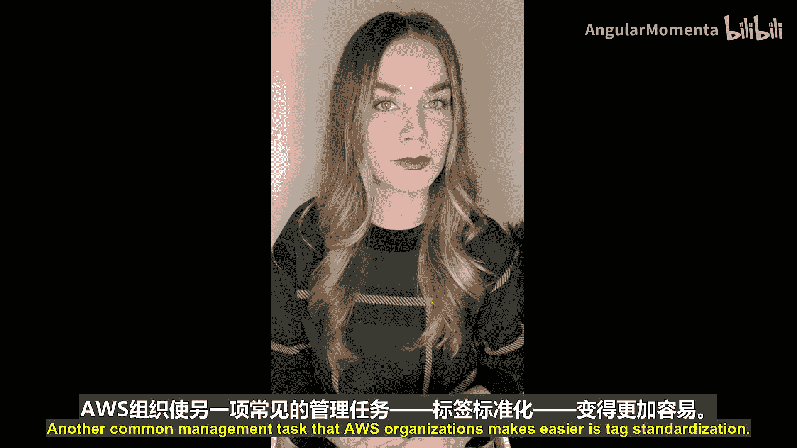

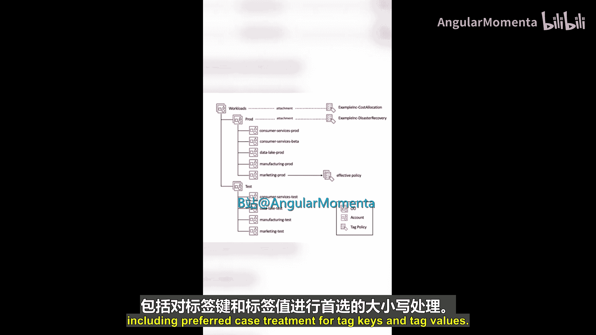

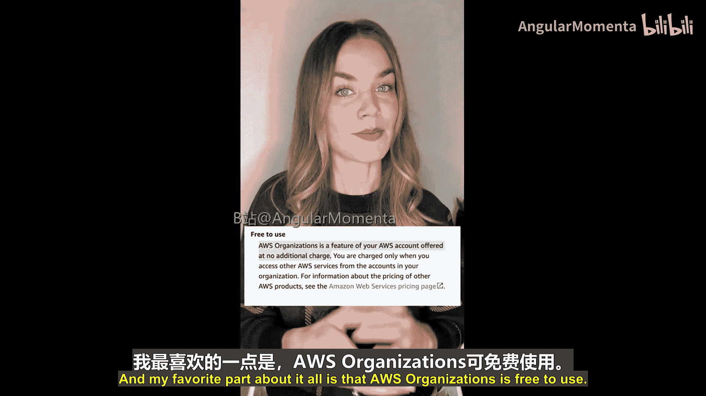

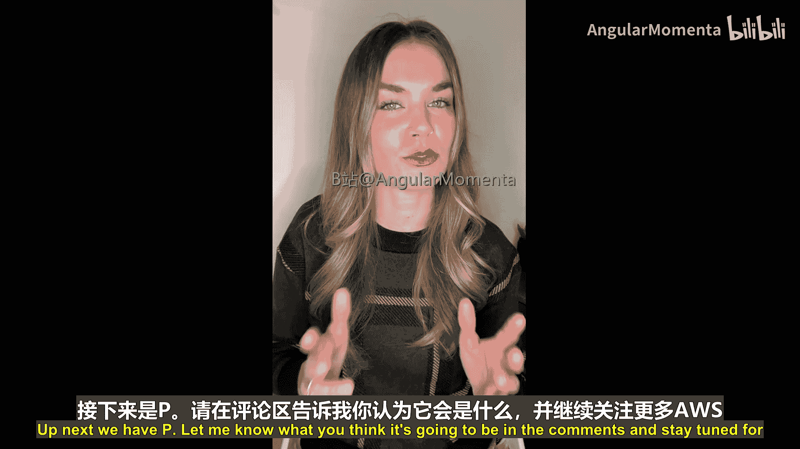