# 【Amazon Web Services】AWS云基础 ｜ The ABCs of AWS： Learn the Basics of the AWS Cloud p17 04_01_01_q-is-for-amazon-q -BV1MnrHBCEmT_p17-

Welcome back to AWS ABcs where we cover a different AWS service for every letter of the alphabet。

 Today's letter is Q and we're going to be covering Amazon Q the general knowledge and capabilities that come from Gen AI chat applications are awesome but if the application doesn't know your company。

 your data your customers or your business that there is a limit on how much these applications can help you that is why AWS created Amazon Q This is a generative AI powered assistant that is specifically for work and can be tailored to your business Amazon Q is trained on 17 years worth of AWS knowledge and experience and it can help you do all sorts of different things like troubleshooting and diagnosing issues walking you through common AWS architectures and best practices it can help you compare and contrast AWS services for specific use cases and it can give you quick and relevant answers to your AWS questions when you need it。

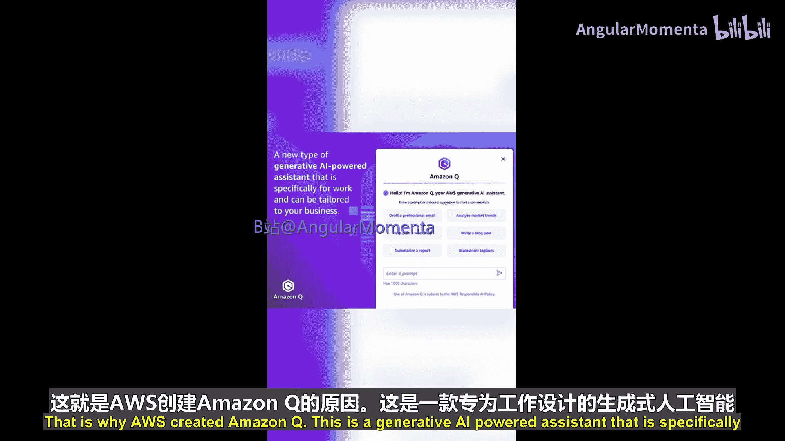

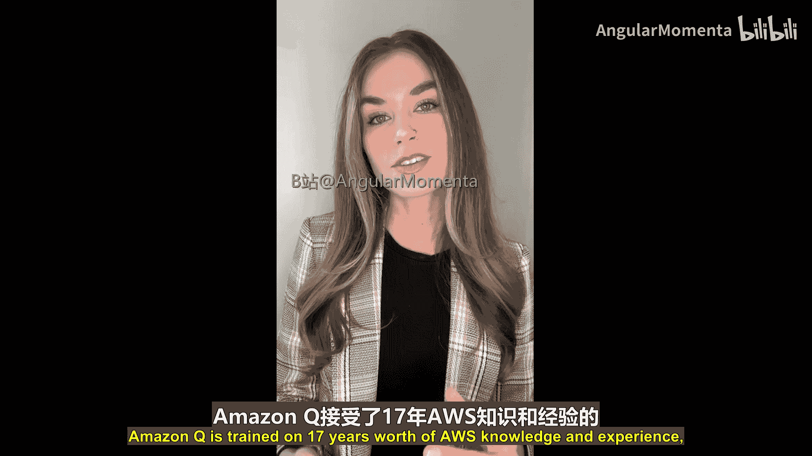

AmazonQ interface can be found in the AWS management console。

 the AWS documentation in your IDE through Amazon code Wser and through other chat apps like Slack if you encounter issues when using the AWS management console like EC2 permissions errors or S3 configuration errors you can press the troubleshoot with Amazon Q button and Q will give you some suggestions for a fix Another example of how you can use Q is you can ask it a question like how can I build web apps on AWS and then Q will come back with some suggestions and common ways of building and hosting web applications on AWS that you can explore and Q also will provide links at the bottom to documentation and resources where you can further your reading Now as somebody with a developer background I think Amazon Q in the IDE is a really cool feature so let's take some time to talk about that feature specifically when you're using Amazon Q in your IDE you can actually have a conversation about your code with Q。

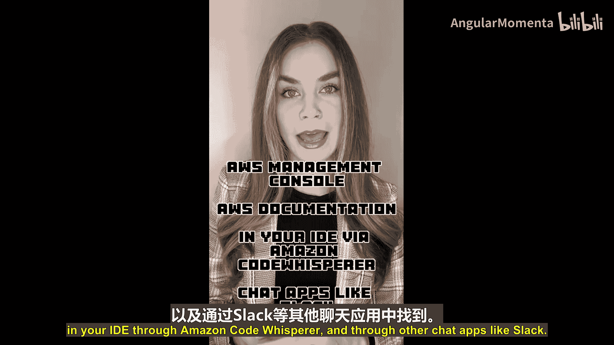

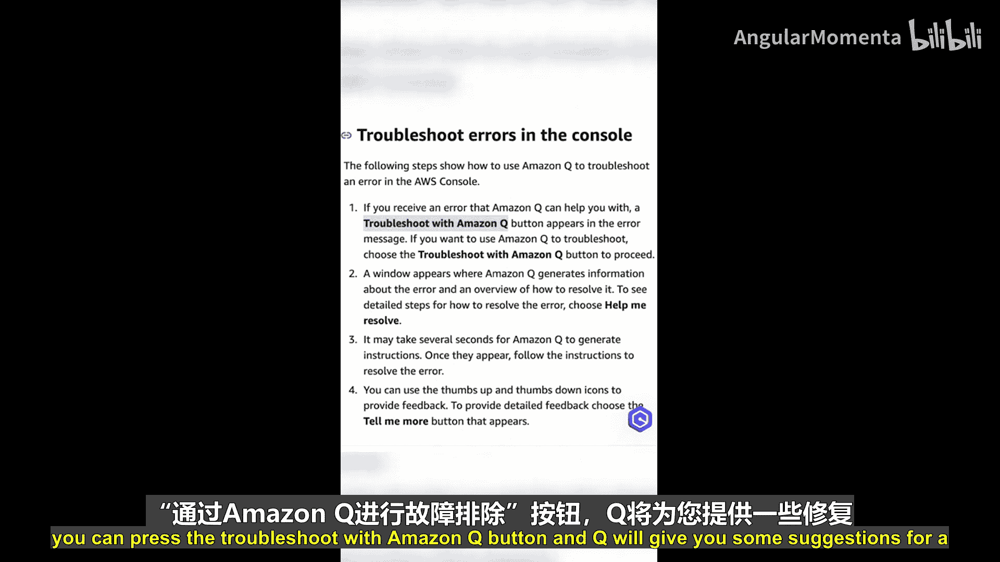

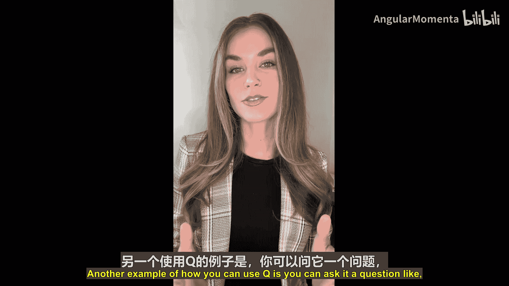

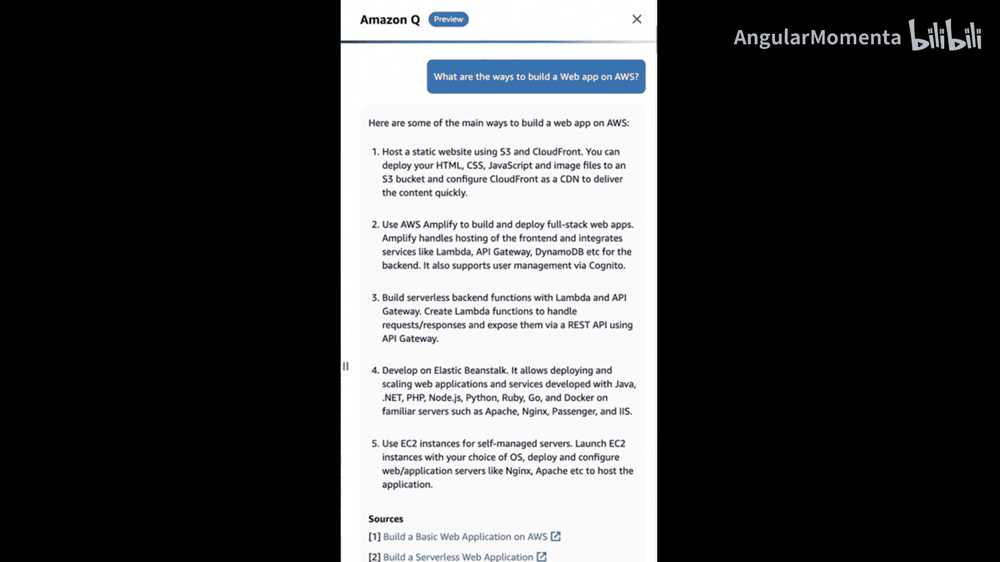

You can ask it for things like coding suggestions or improvements。

 you can have Q help you solve problems directly in your IDE or you can use Q for assistance with things like debugging。

 testing and optimizing something that I love about Q in the IDE is you can actually select code and then ask Q to explain what is happening with that code This is so useful for developers whether experienced or new you can also ask Q to generate code for you based on the conversation you're having and then you can insert the code into your codebase I can tell you that I'm definitely going to be using Amazon Q and Amazon code whisperhier for my future coding projects it can help you improve your code it can help you be more productive and it can help you learn more and have a clearer understanding of what exactly your code is doing so to wrap it up here Amazon Q can help you get fast relevant answers to your questions it can help you solve problems generate content and take actions using the data and expertise found in your company's information repositories。

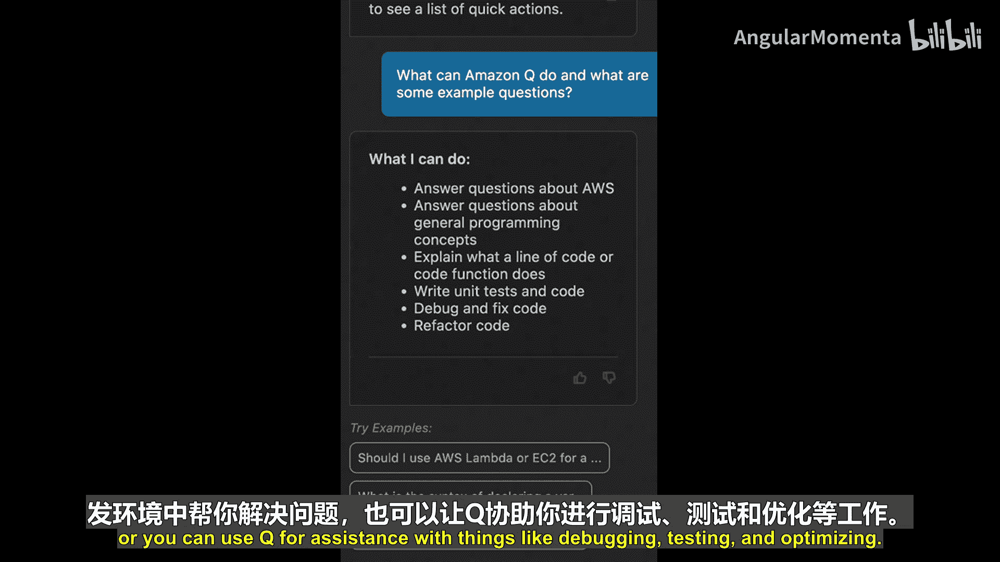

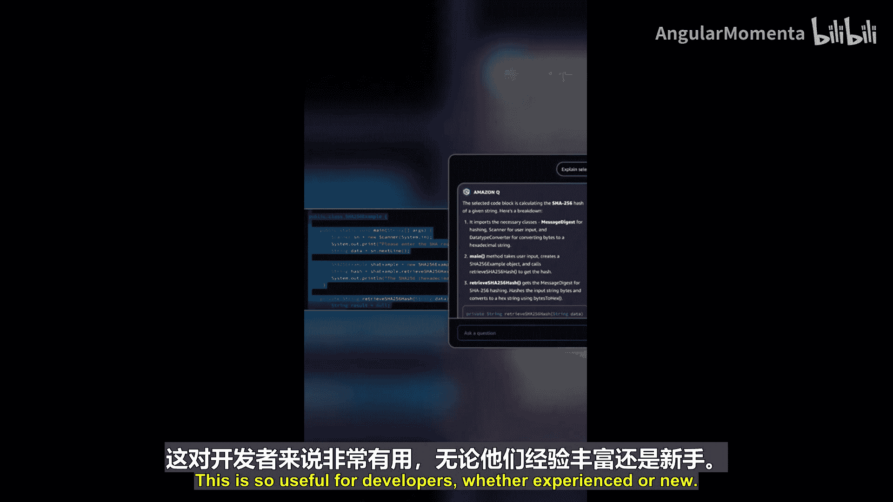

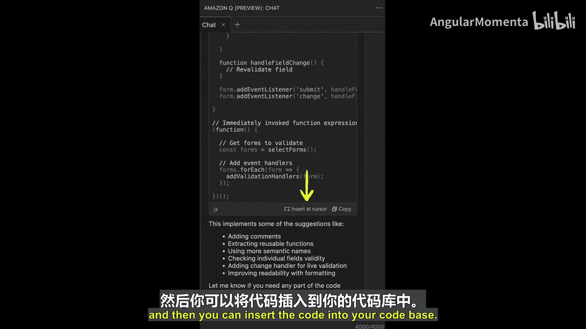

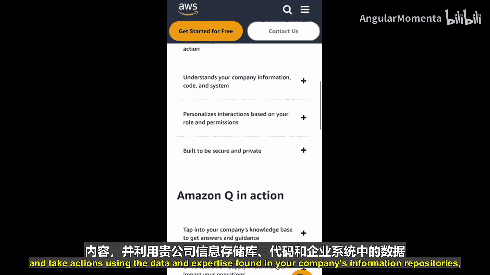

codeode and enterprise systems All right， so that wasn't even a full rundown on everything that Amazon Q can do so make sure you check out the AWS documentation to learn more Amazon Q is currently in preview so keep up with the latest AWS news to see what's coming out next and as always stay tuned for more AWS ABcs。

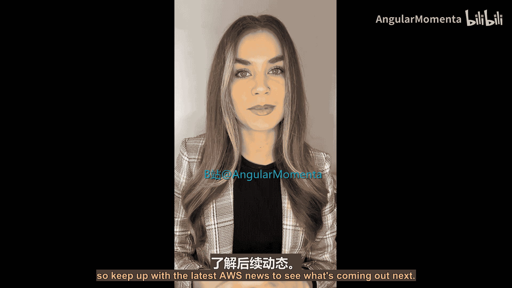