# 【Amazon Web Services】AWS云基础 ｜ The ABCs of AWS： Learn the Basics of the AWS Cloud p18 04_01_03_r-is-for-amazon-rds -BV1MnrHBCEmT_p18-

This is AWS ABcs。 Today's letter is R and we'll be covering Amazon relationlational Data service or RDS。

 RDS is a managed relational database service that makes it easier to create and run relational databases on AWS to create an RDS database you have to provide the desired configurations for your database instance。

 This includes things like the database engine type you want to use the database instance type。

 the networking configurations you want to be using as well as other things like backups， patching。

 maintenance windows and more RDS will take all of this configuration information and it will go create the underlying infrastructure for you creating a database instance with the engine of your choice installed on it This frees you up from having to create and manage infrastructure so you can spend more of your time focusing on optimizing the way you use your database Once your database has been created you can then connect。

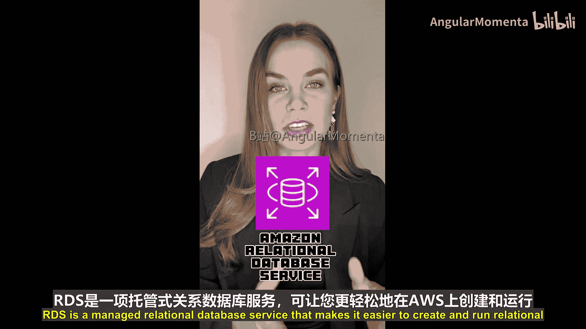

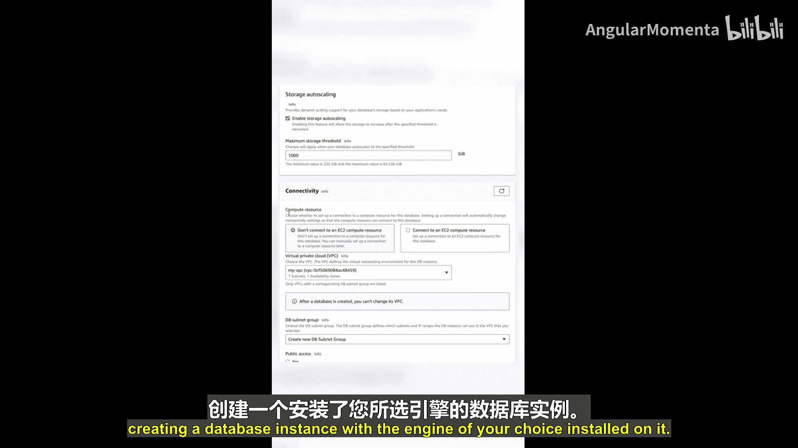

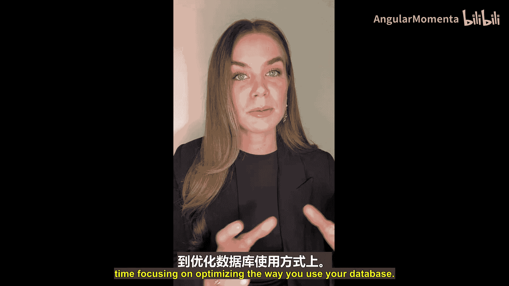

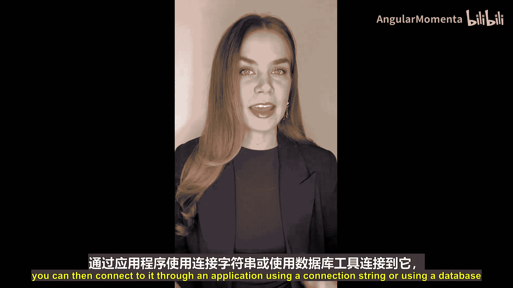

To it through an application using a connection string or using a database tool where you can then start to load your schema。

 load your data and running your queries。 Amazon RDs supports database engines like MysqL。

 Maria Db PostgressqL Db2 oracle and Microsoft SQL server， then there's Amazon Aurora。

 which has full MysqL and PostgressqL compatibility and it's designed to give you the availability and performance of a commercial database at one-1th the cost Amazon RDs lowers the administrative burden of running a relational database on AWS as it can take care of some undifferentiated management tasks like provisioning the underlying infrastructure。

 scheduled maintenance jobs， backups and patching though you can have some optional control over these tasks if you need it if you're looking to migrate to Amazon RDs you can make the process a little bit easier by using features and services like。

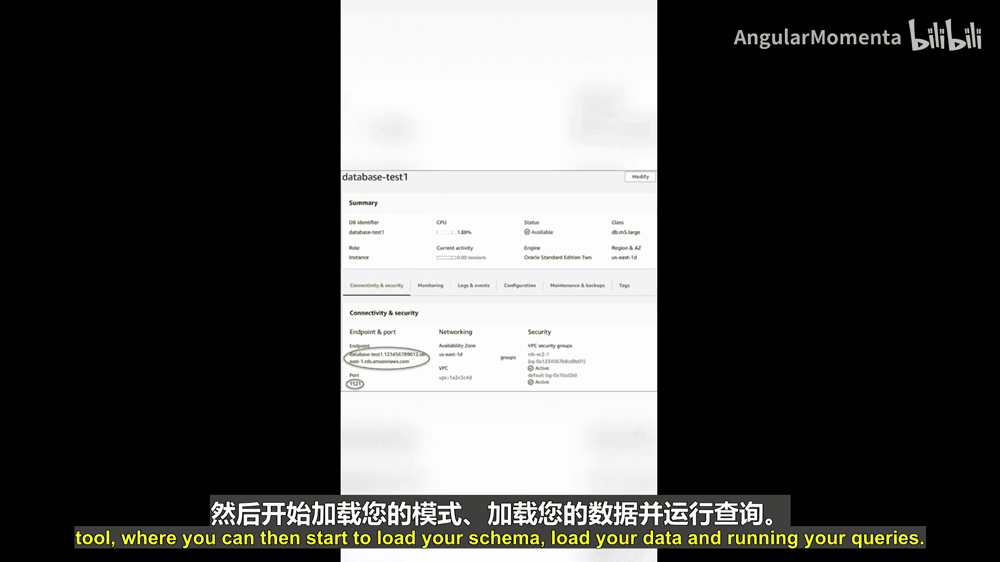

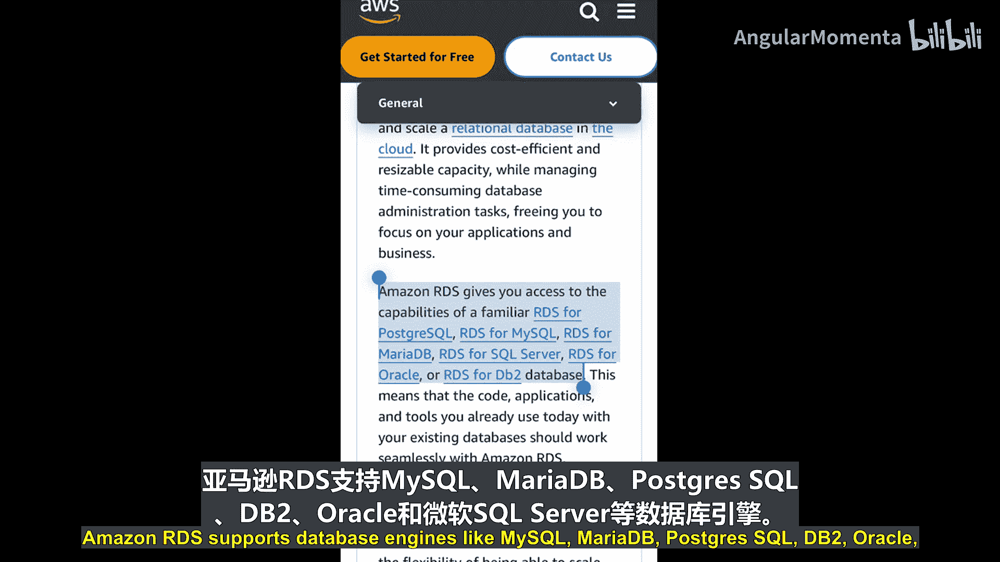

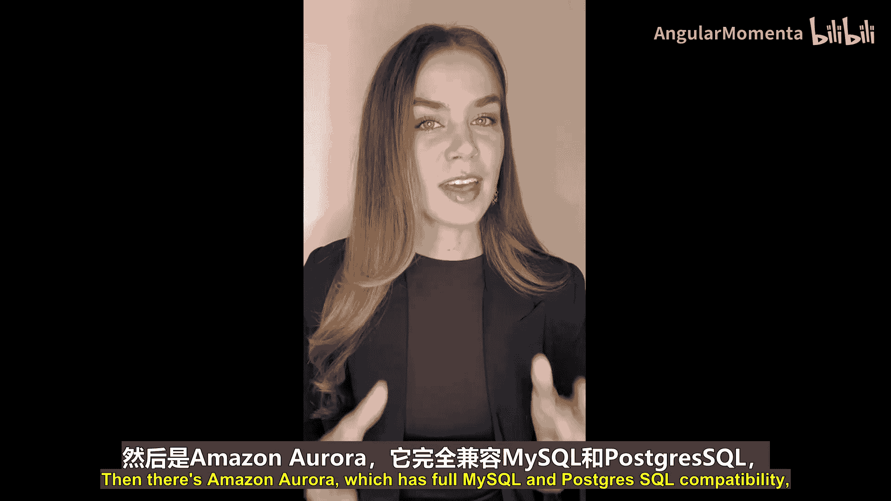

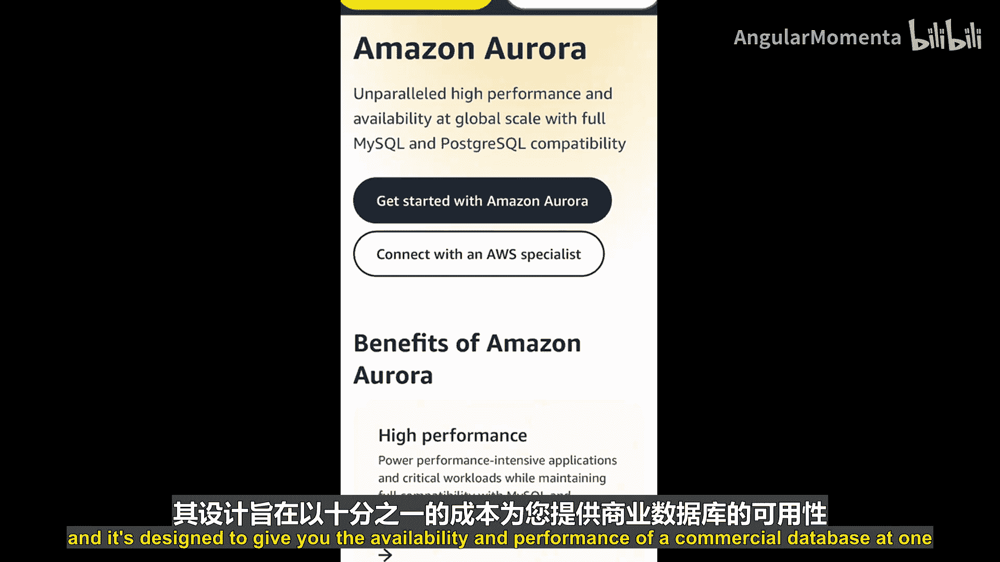

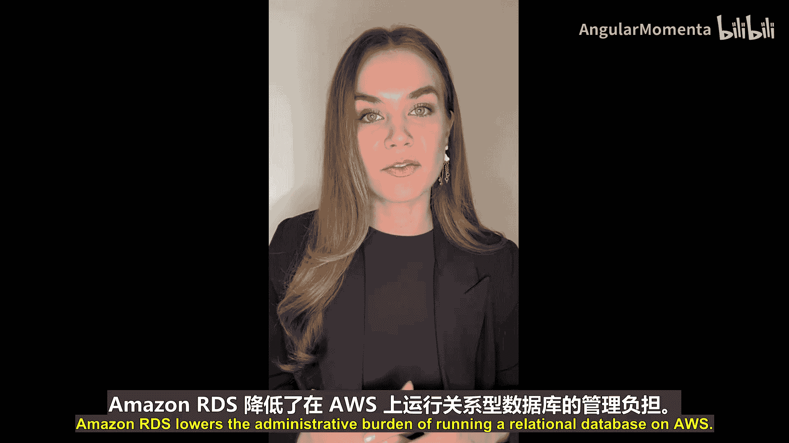

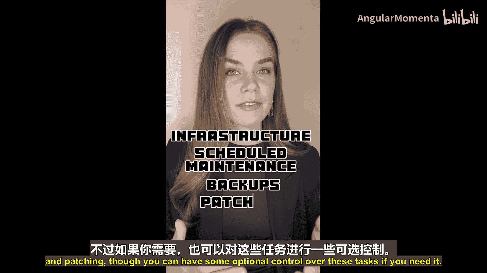

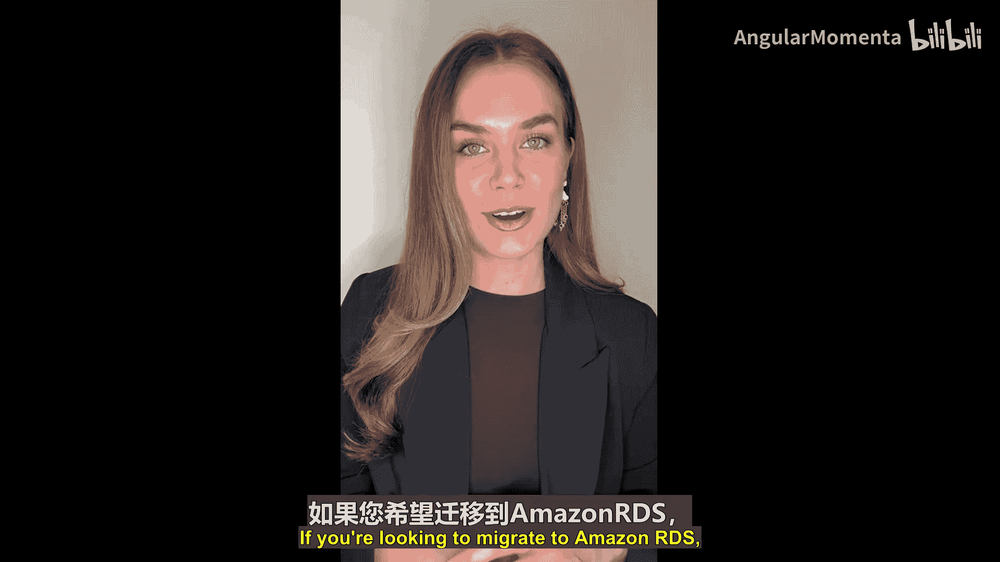

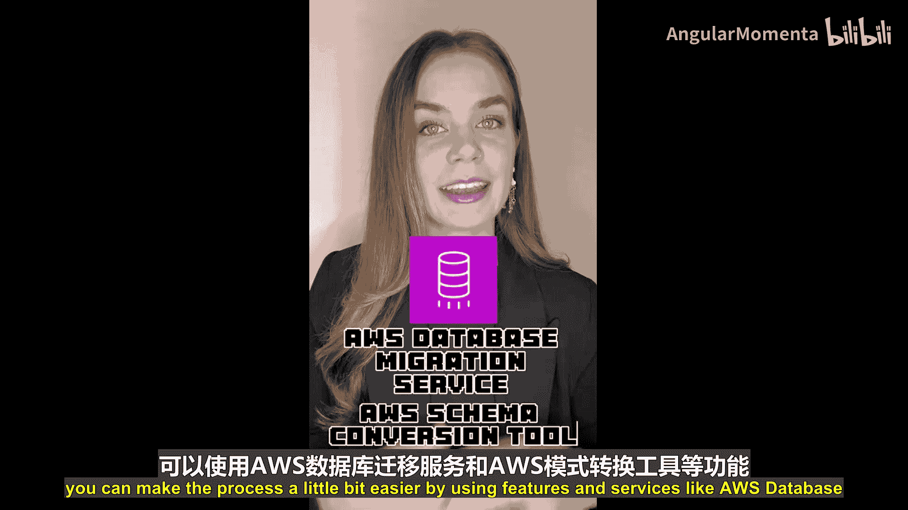

AWS database Mi service and AWS Schema conversion tool with AWS database migration service or DMS you can migrate and replicate your database and analytic workloads to AWS with minimal downtime and zero data loss whenever you create a database instance you have to select what network you want to place it in this would be which VpC or virtual private cloud you want to use and what subnet you want to place your database instance into then you can use things like security groups and network ACLs to control what network traffic can make it to your instance one database instance belongs in one subnet in one availability zone so to make this more resilient to potential failures you should look into a multiAZ deployment with RDS with an RDS multiAZ deployment you have your primary instance which is in one AZ and then there would be a secondary instance in a different AZ。

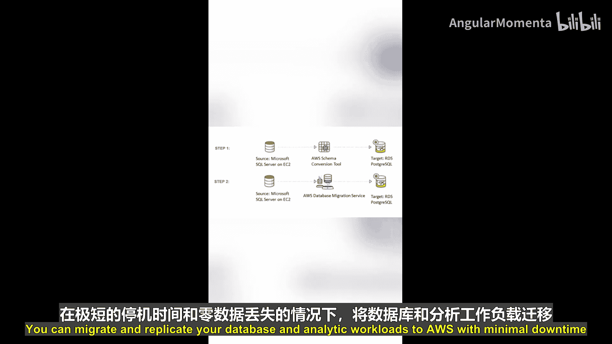

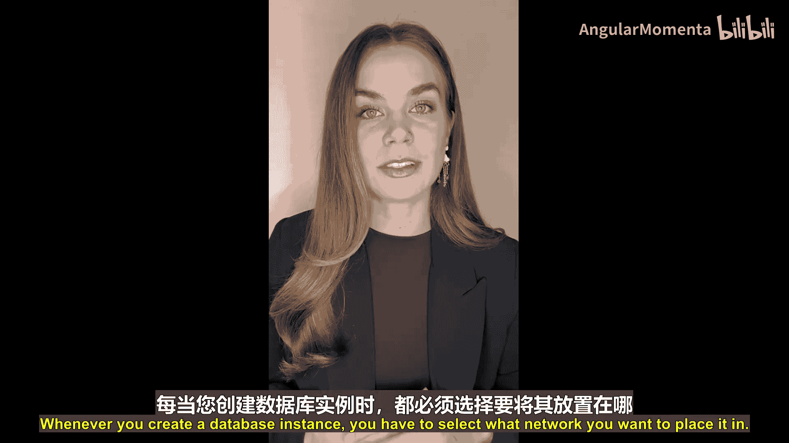

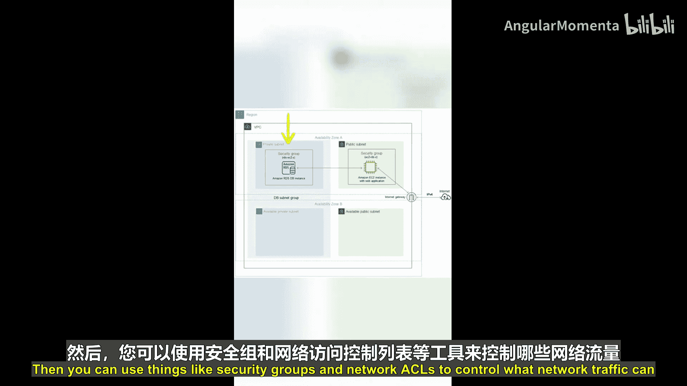

Replication of the data between these two instances is managed by RDS。

 Your applications would connect to this database through a single DNS endpoint。

 Then if a failure is detected， RDS will automatically fail over behind the scenes to the secondary instance and your applications can still use the same DNS endpoint to connect。

 you can also do a multiese deployment where you have up to two readable standby instances。 Allright。

 that's it for RDS up next we have S and I'm going be sticking with the classics here。

 So let me know what you think we're going be covering for the next video and as always。

 stay tuned for more AWS ABcs。

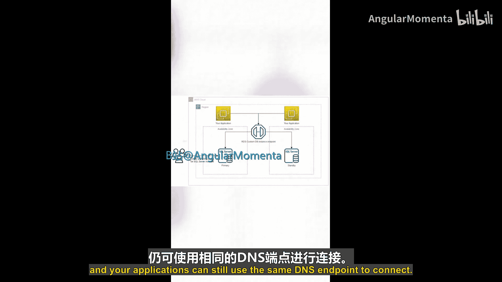

