# 【Amazon Web Services】AWS云基础 ｜ The ABCs of AWS： Learn the Basics of the AWS Cloud p19 04_01_05_s-is-for-amazon-s3 -BV1MnrHBCEmT_p19-

Welcome back to AWS ABCs。 Today's letter is S and we'll be talking about Amazon S3。

 Amazon S3 is a massively scalable object storage service that has a ton of different use cases。

 S3 is great for data lakes and data storage for analytics for storing media like photo and video。

 You can store text files in there， log files， application data。

 You can store any type of file in Amazon S3。 This means I can use S3 to store things like binary files from code builds。

 I can host a static website out of S3 using these static website hosting feature。

 I can upload files for analytics and then use other tools to read the data from S3 for analysis。

 or I can use S3 for media hosting to host video， photo or music for uploads and downloads。

 You can store an unlimited amount of data in S3， but each individual object has to be smaller than5 terabytes inside。

😊。

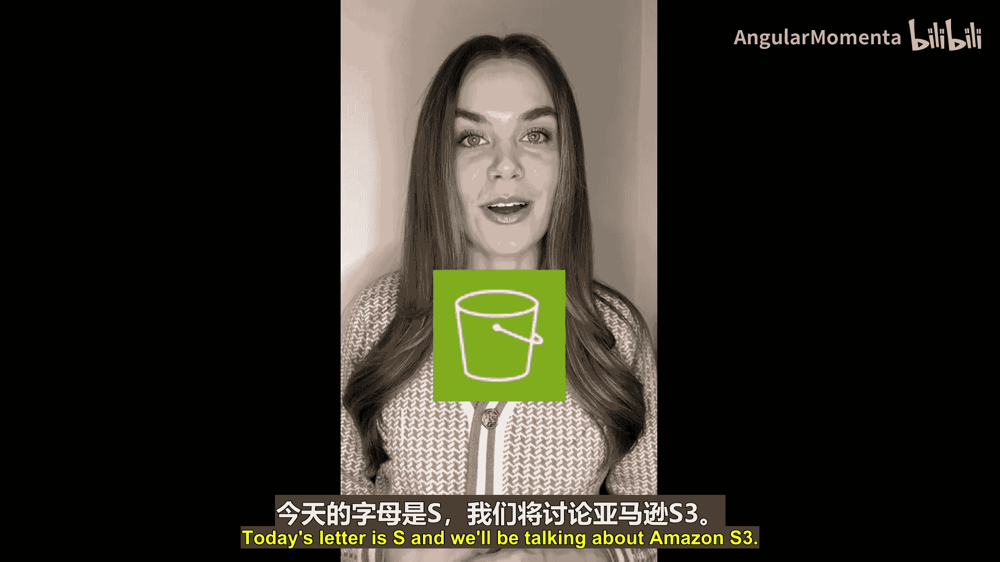

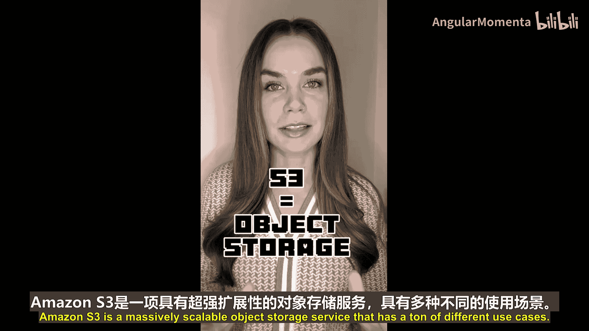

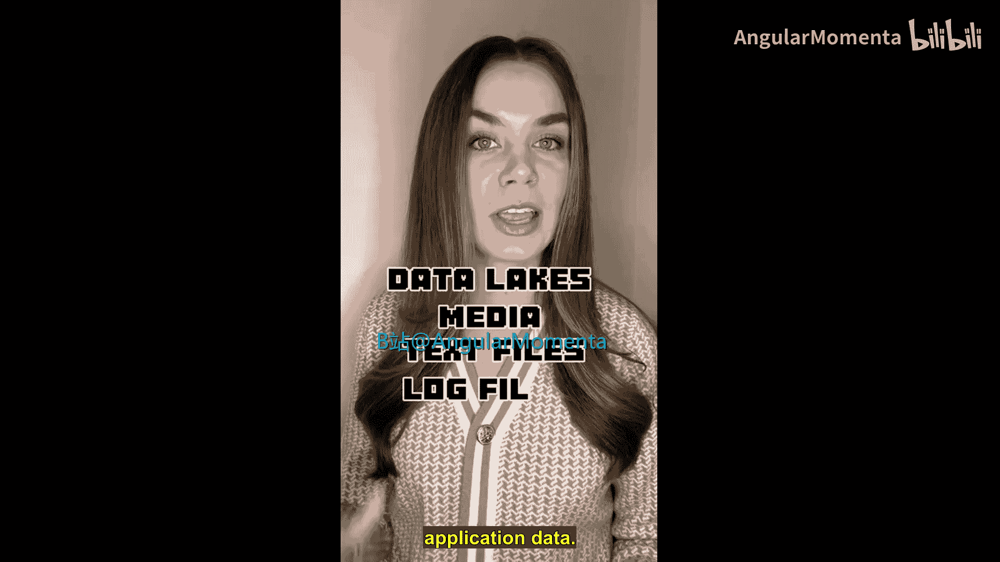

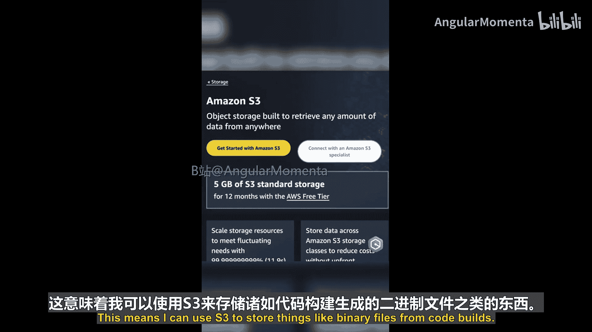

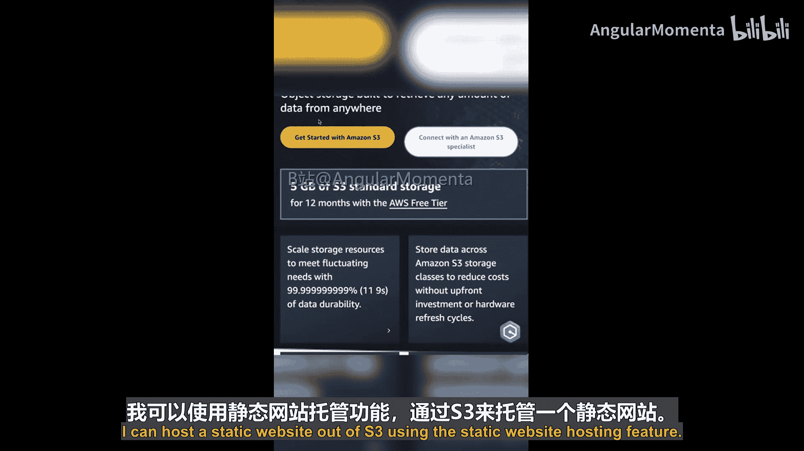

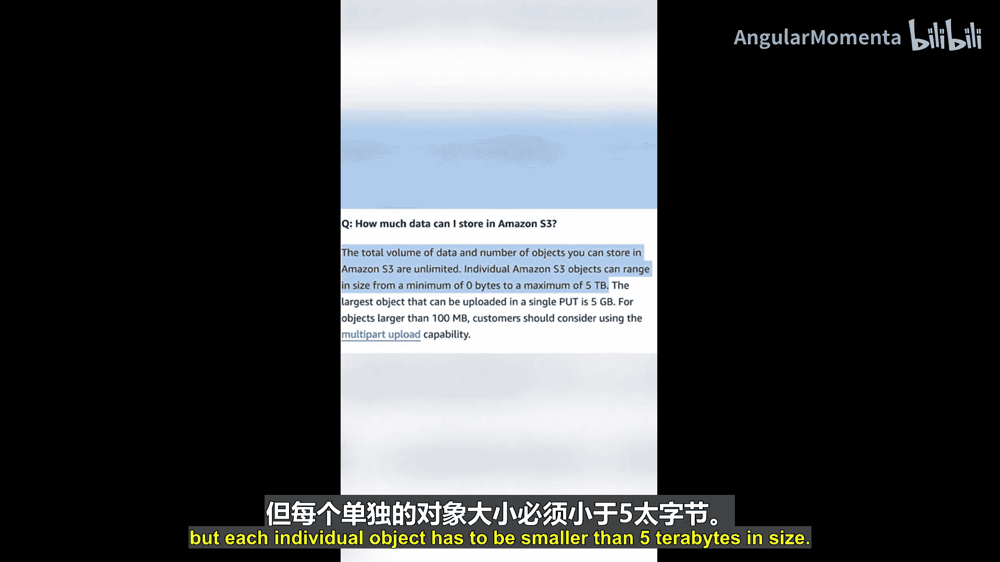

Whenever you upload an object to S3， you upload it to a bucket A bucket is a container for objects in S3 and you can have as many objects as you want inside of a single bucket bucket names have to be globally unique so keep that in mind whenever you're creating your buckets However。

 buckets do reside in one single AWS region Any objects that's uploaded to S3 is automatically replicated across a minimum of three availability zones within that region However。

 if you also have requirements that state for disaster recovery or compliance reasons that you need to replicate your objects across AWS regions you can do that using the cross region replication feature by default buckets and objects are private though you can make them public if you need to you can control access to your objects and buckets through bucket policies and access controlless or both Most use cases do require private buckets and objects。

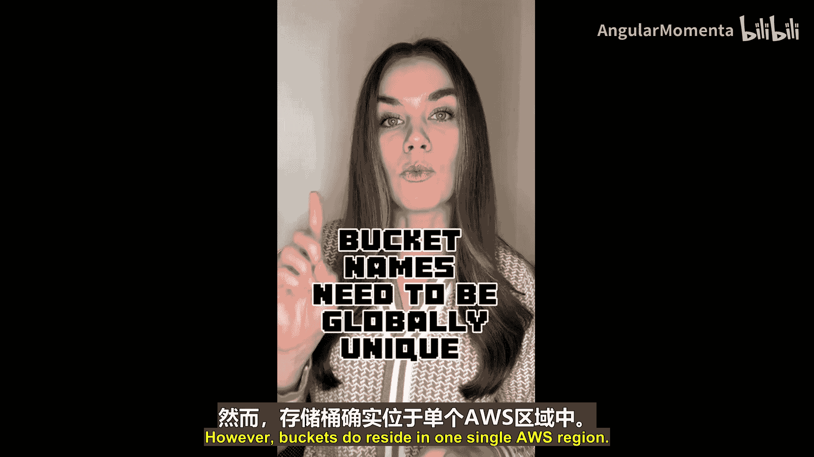

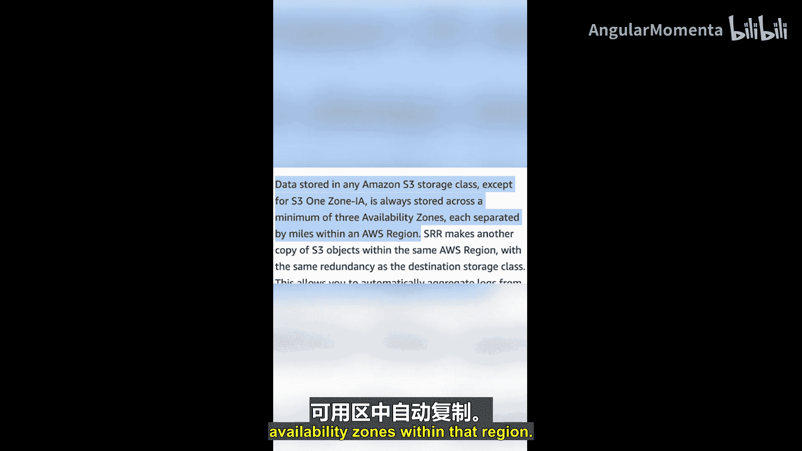

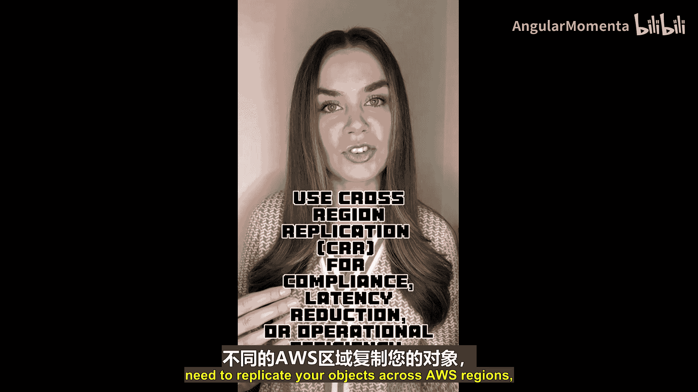

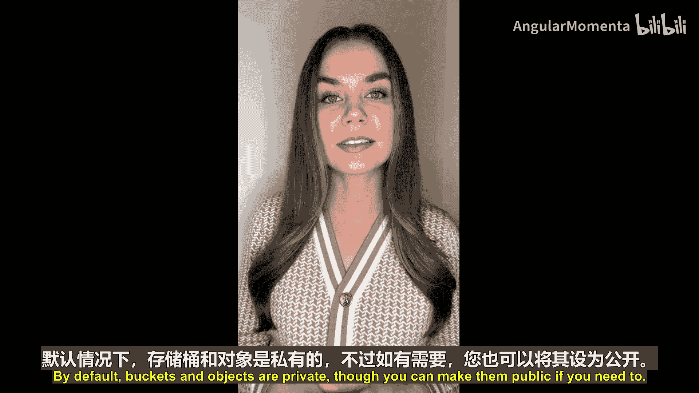

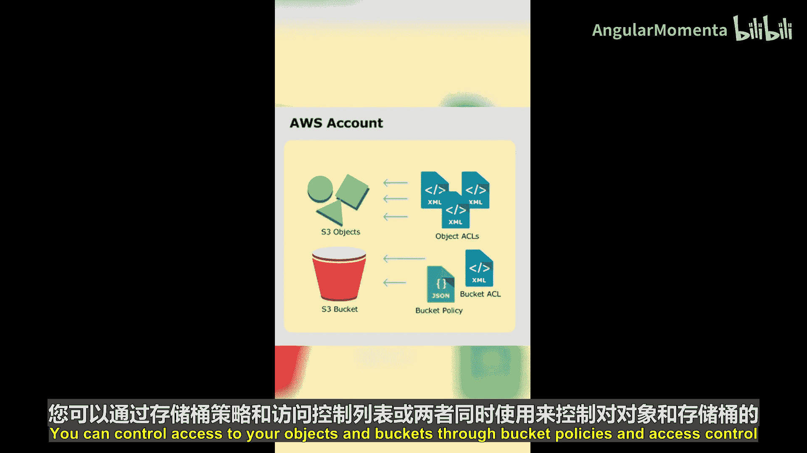

And there's a feature called block public access， which will override ACLs or bucket policies。

 which allows you to enforce limits on public access to your resources S3 provides tiered storage through S3 storage classes S3 storage classes are built to provide the lowest cost storage for different data access patterns the different S3 storage classes include S3 standard S3 standard and frequent access S3 Glacier instant retrieval S3 Glaer flexible retrieval S3 Glacier Deep archive S31zone Express and more you can also use intelligent tiing。

 which automatically moves data to the most cost effectiveff storage tier based on data access patterns for security S3 automatically encrypts data by default and it supports serverside encryption with four key management options you can also use other AWS services like Amazon Macy which we covered for letter M of this。

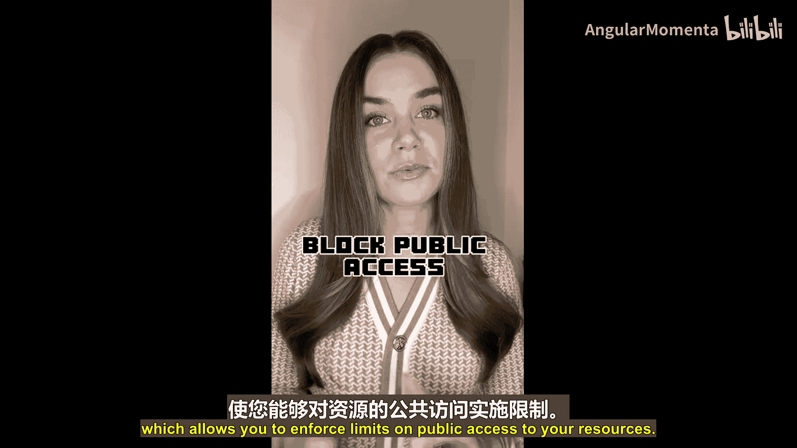

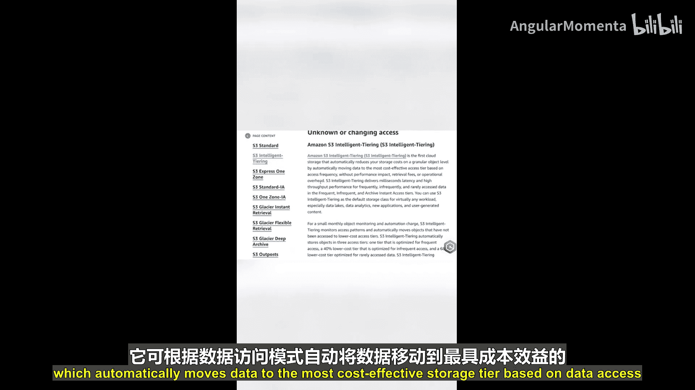

Video series， which will help you discover and protect sensitive data stored in Amazon S3。

 Then there are features like S3 storage lens， which gives you organizationwide visibility into your object storage usage including activity trends and it makes recommendations to improve cost efficiency and applied data protection best practices。

 All right， that's it for Amazon S3 as usual this was just a small sliver of what Amazon S3 can do so make sure that you check out the documentation to learn more and as always stay tuned for more AWS ABcs。

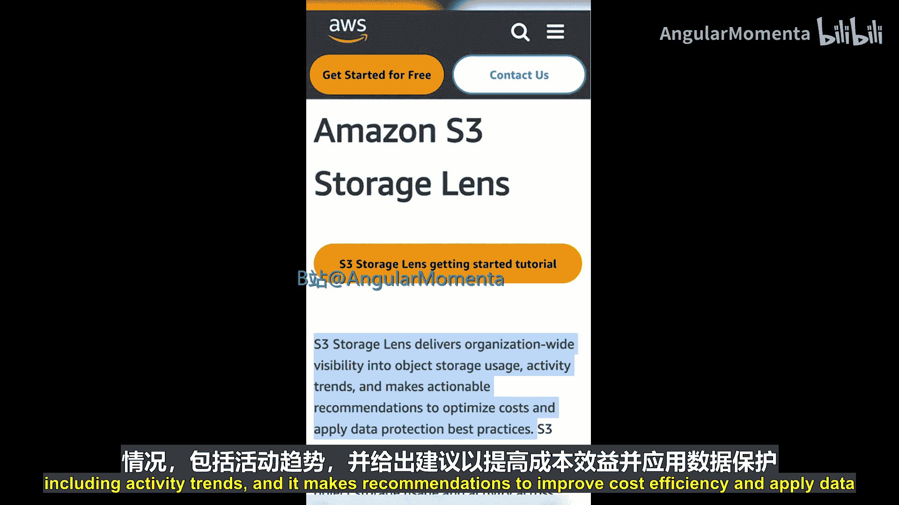

