# 【Amazon Web Services】AWS云基础 ｜ The ABCs of AWS： Learn the Basics of the AWS Cloud p20 04_01_07_t-is-for-aws-trusted-advisor -BV1MnrHBCEmT_p20-

Welcome back to AWS ABCs Today's letter is T。 and we're going to be talking about AWS trusted advisorvisor AWS trusted advisoror is a service that inspects your AWS environment and makes recommendations to you on how to save money。

 improve performance， security and fault tolerance。

 understand your service limits and more AWS trusted advisor can give you meaningful recommendations because it's designed from insights and lessons learned from helping hundreds of thousands of AWS customers and it incorporates AWS best practices into its recommendations。

 trusted advisor runs checks for AWS best practices across different categories including cost optimization。

 performance， security， fault tolerance， service limits and operational excellence。

 Let's go over a couple short examples of the types of checks。

 the trusted advisor runs for cost optimization， One example of a check is looking for。

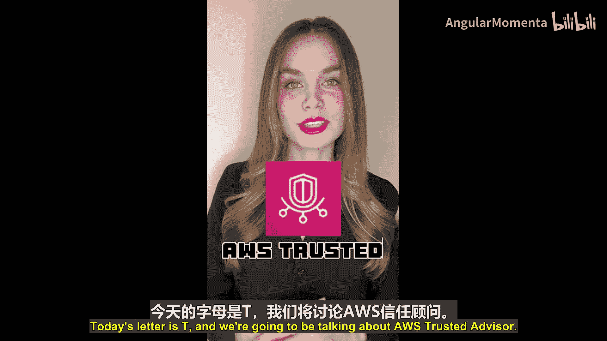

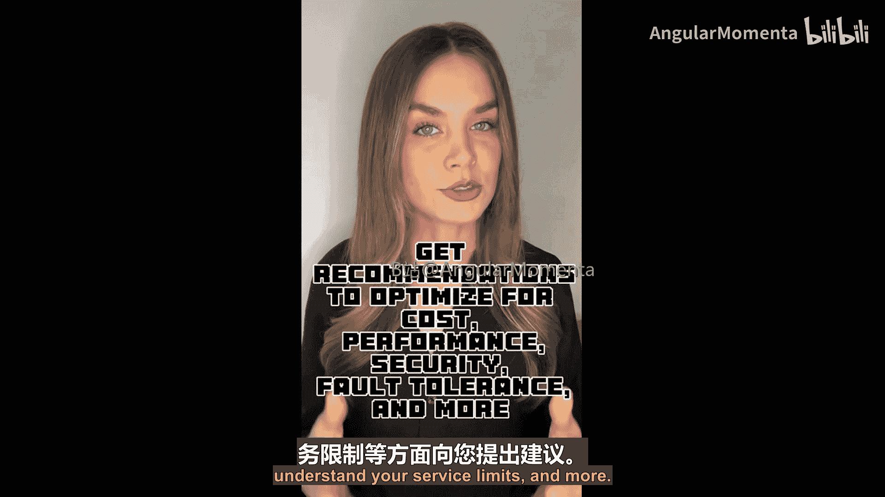

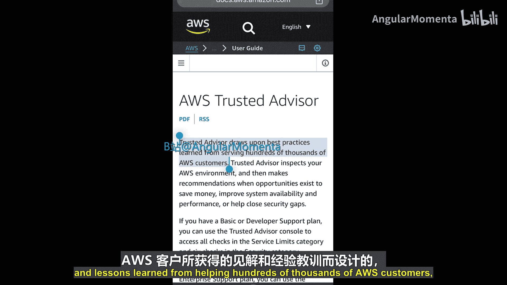

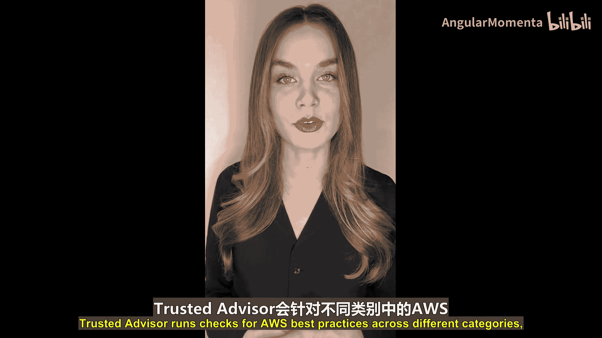

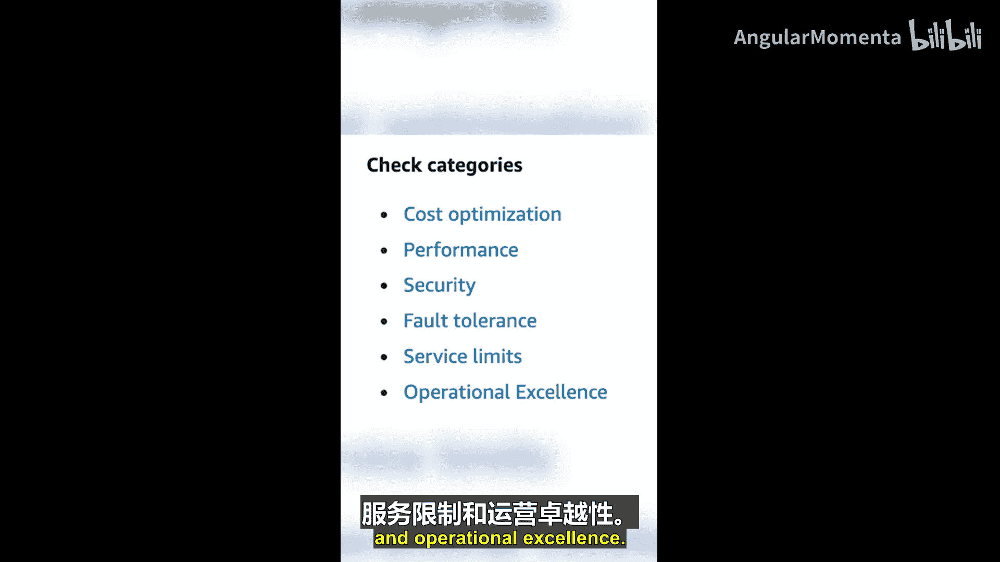

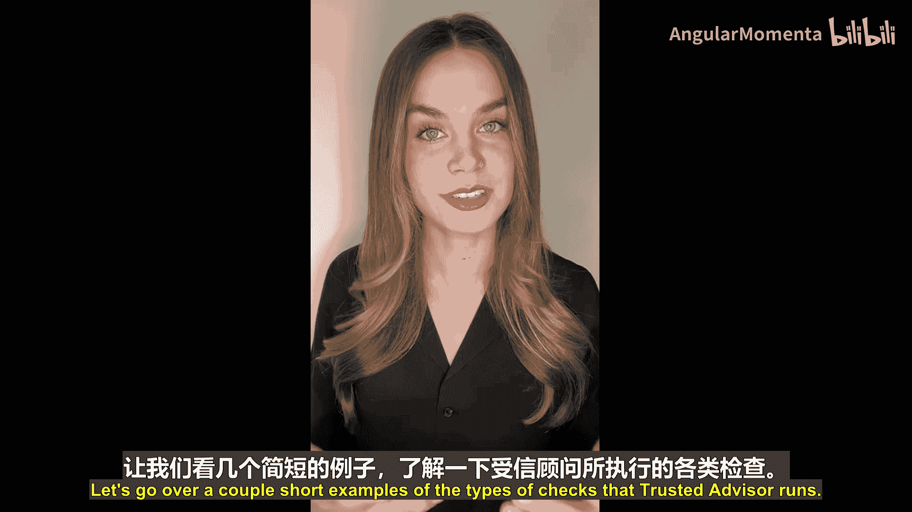

Iling load balancers， which could indicate load balancers that aren't being used effectively and could be deleted。

 In this example， there is a load balancer in this account with no active backend instances。

 So this load balancer could potentially be deleted and is something to follow up on Now for performance。

 One example of a check is Amazon E2 to EB throughput optimization。

 This check is looking for Amazon EB volumes whose performance may be by the max throughput capacity of the E2 instance it's attached to The recommended action for this one is to use an E C2 instance that can support a higher throughput to EB。

 An example for security checks is looking for lambda functions that are using deprecated runtime。

 deprecated runtime aren't eligible for security updates。

 So this is something that should be addressed from a security perspective。

 The recommended action here is to migrate to a supported runtime。 There are many checks that AWS。

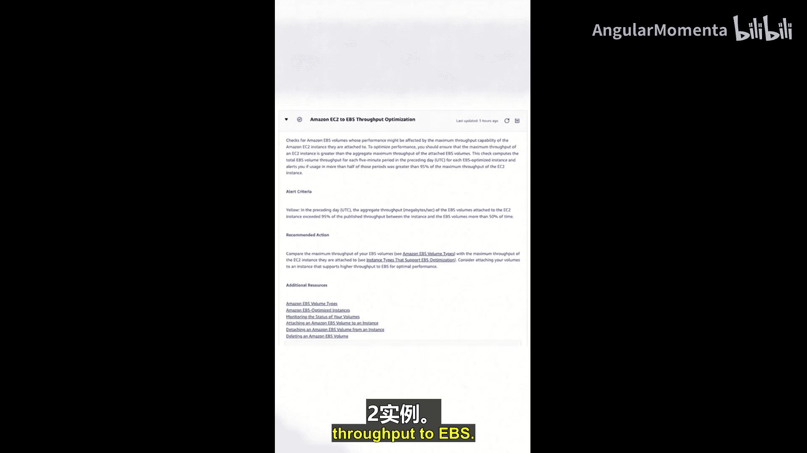

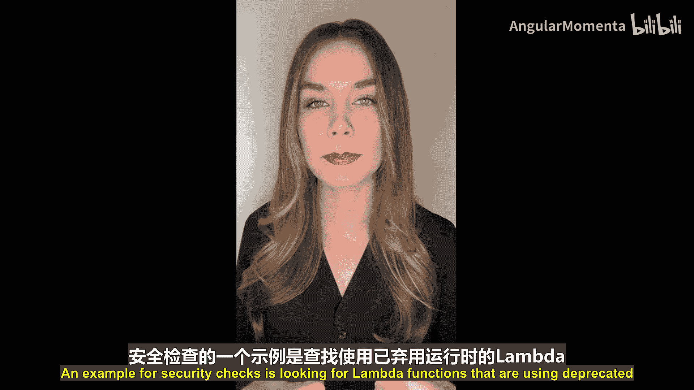

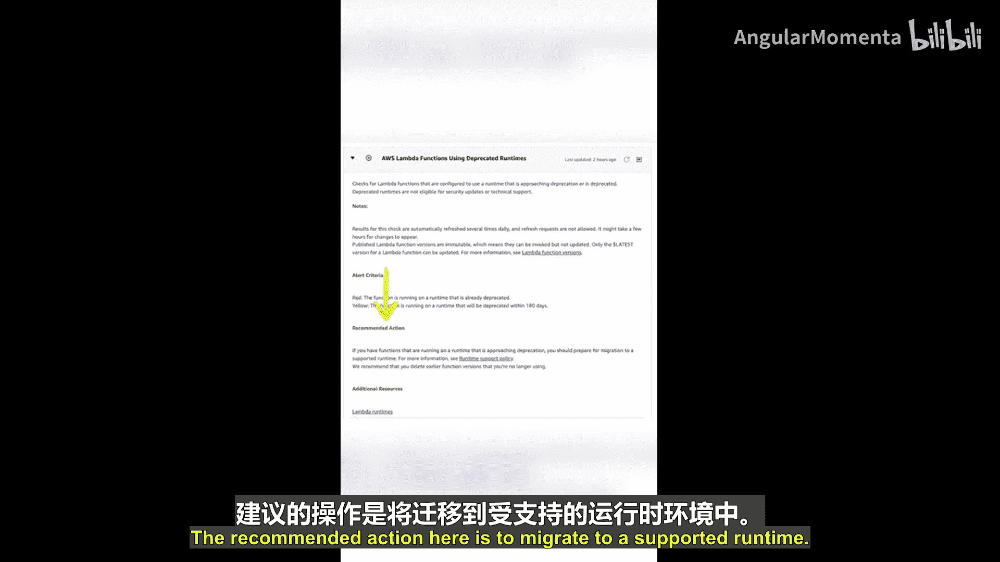

or can run these are just a couple of simple examples so that you can wrap your mind around what this service does Depend on the outcome of a check。

 it will have a status of no problems detected investigation recommended or action recommended you can monitor the results of AWS trusted advisor by using other AWS services like Amazon eventbri if a check status changes it will post an event to Amazon eventbri which can then optionally invoke other AWS services like maybe you have a lambda function that sends a message to a slackla channel to notify a team or you can send out an email notification using Amazon simple notification service the results to trusted advisor creates shows results across all regions within an AWS account Now that being said if you're using AWs at scale it's likely that you're going to be operating across multiple AWs accounts for multiaccount environments you can enable trusted access with AWS。

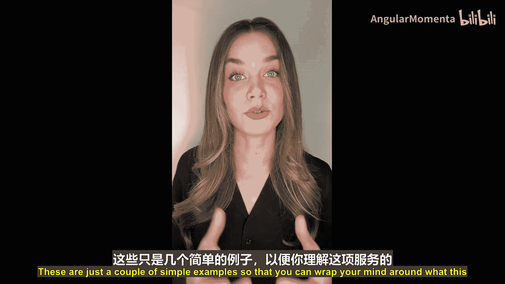

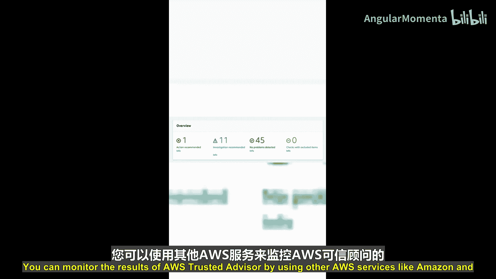

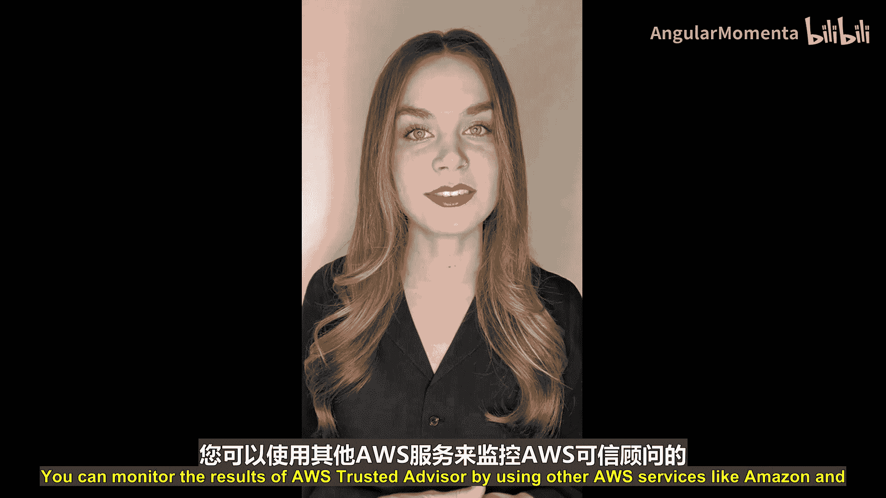

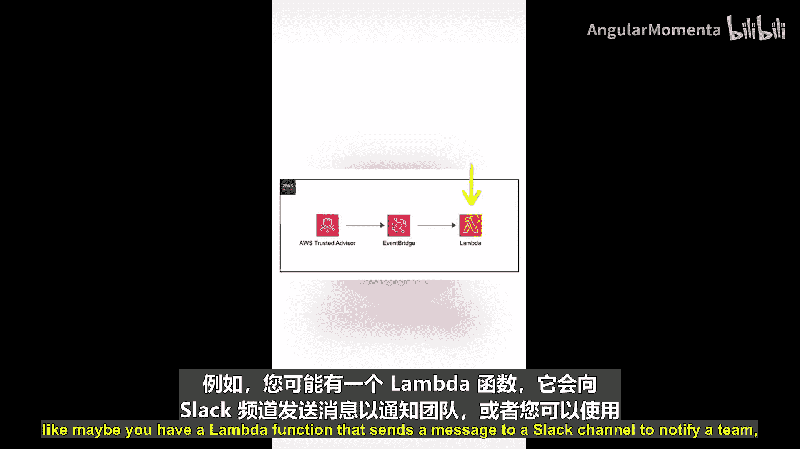

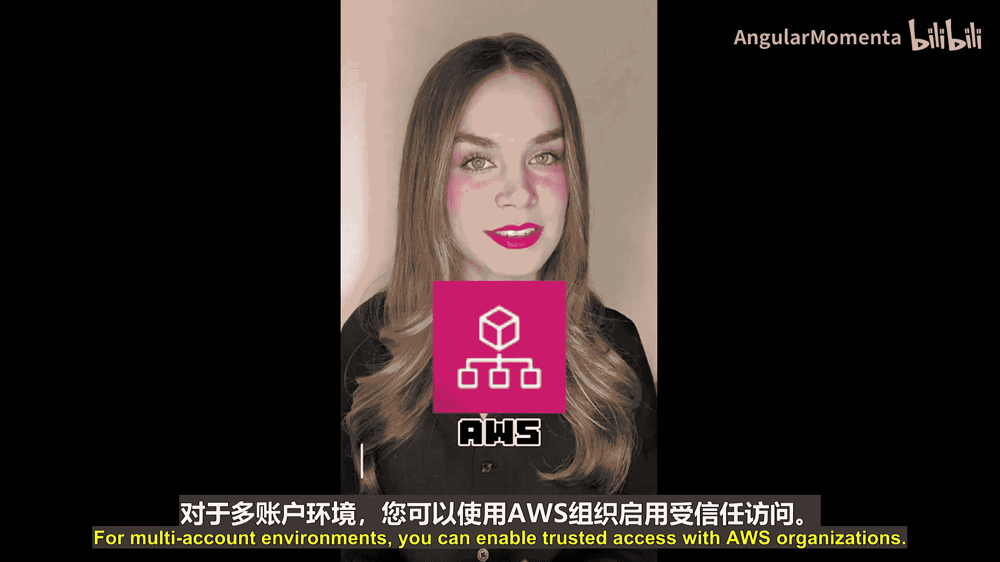

Whi is a service that we covered for letter O of this video series The organizational view will allow you to see all findings across all accounts across all regions within your organization in one place one more thing here is that AWS trusted advisor is a feature of AWS support so the checks that are available to you differ depending on your AWS support plan All right。

 that's it for AWS trusted advisor As always check out the AWS documentation to learn more about this service and stay tuned for more AWS ABCs。

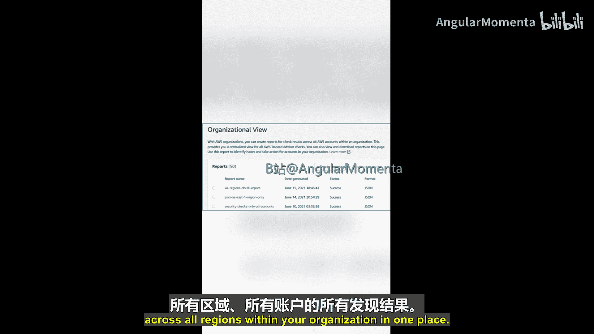

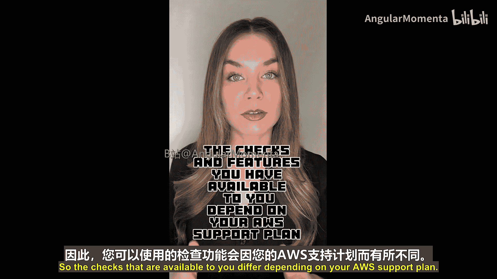

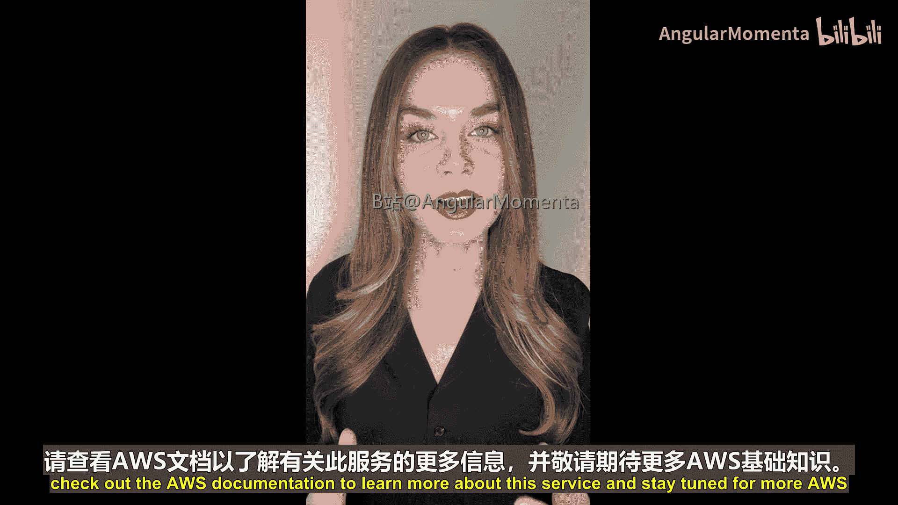