# 【Amazon Web Services】AWS云基础 ｜ The ABCs of AWS： Learn the Basics of the AWS Cloud p21 04_01_09_u-is-for-aws-user-groups -BV1MnrHBCEmT_p21-

Welcome back to AWS ABCs。 Today's letter is you and though we don't have an AWS service to talk about。

 I do want to talk about something that has to do more with the AWS community and that is AWS user groups AWS user groups are organically organized peerto peer communities that meet up on a regular basis to share AWS knowledge through things like presentations webinars。

 workshops or other learning and networking opportunities being able to ask questions in real time develop relationships and connections with peers in the cloud space and share insights with each other can be a huge help when navigating a cloud career the creation of these user groups and the events they put on are community driven So this means that these groups are not put together by or directly affiliated with AWS instead these are groups of local people who are forming communities that focus on AWS technology and sharing。

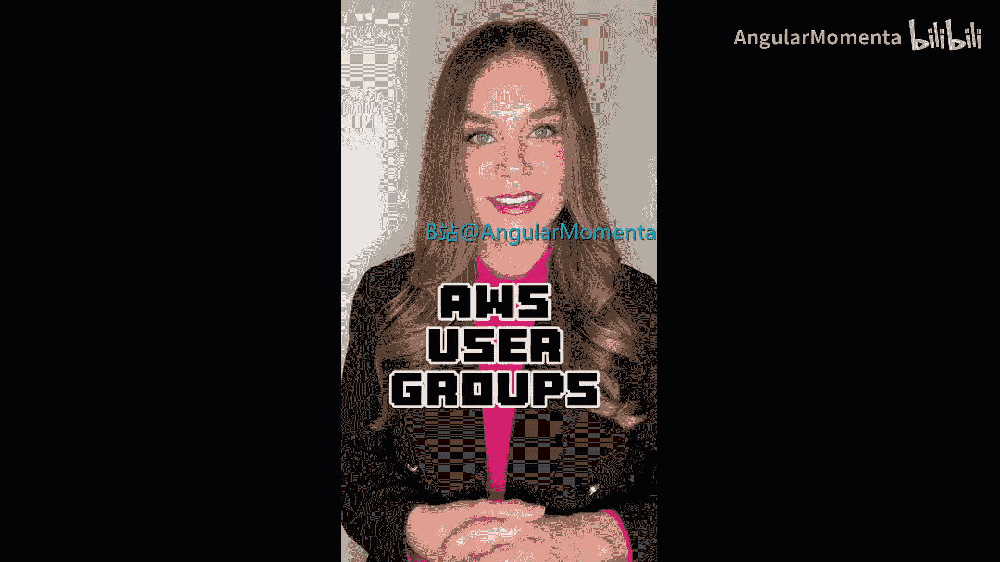

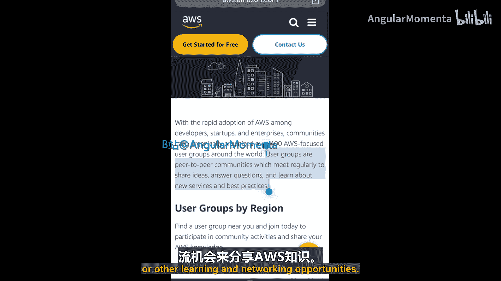

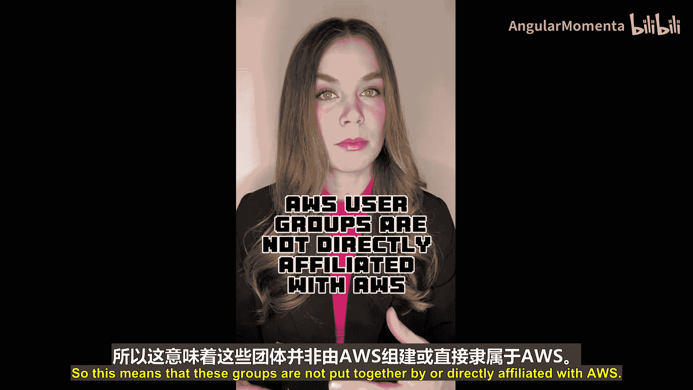

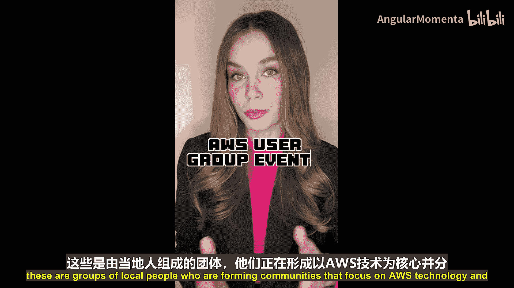

Ination on how to solve problems with AWS you can learn a lot through the experience of others so attending an AWS user group is a great way to hear stories from local professionals and gain insights into how to successfully operate on AWS As of the filming of this video there are over 500 user groups worldwide you could join to see what AWS user groups are meeting near you you can visit the find and AWS user group page and you can type in a city near you to see if a local user group already exists。

 A lot of user groups are doing hybrid events these days too so you could potentially attend a user group meeting online or you could find one that meets in person whether you are a complete cloud newbie just looking to learn more or you're an experienced professional who's looking for like-minded people to share ideas with or maybe you're an AWS expert and you're looking to give a presentation to share your AWS knowledge with your community you can find your local AW。

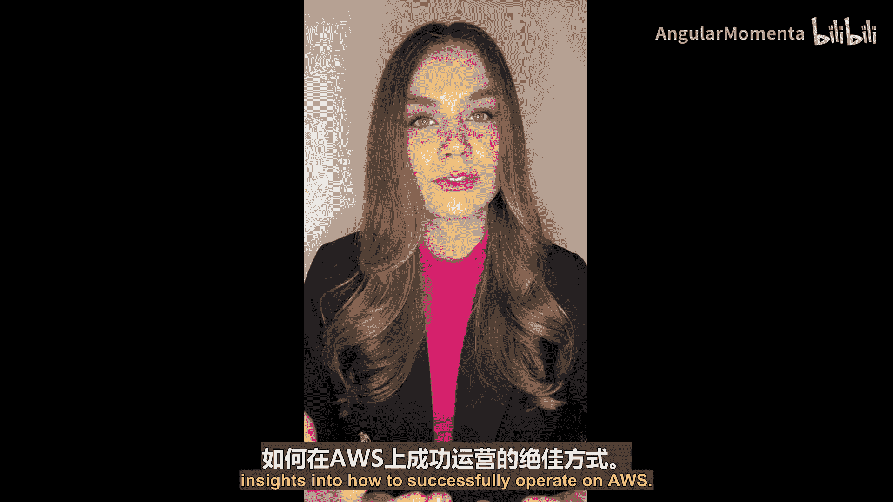

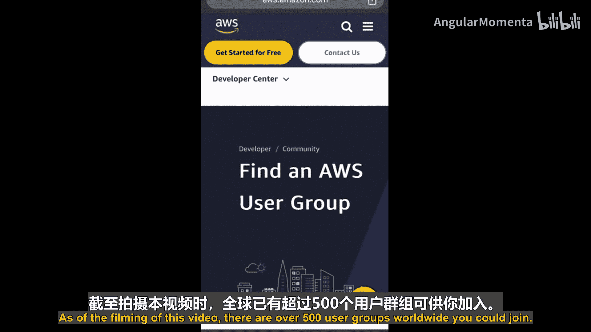

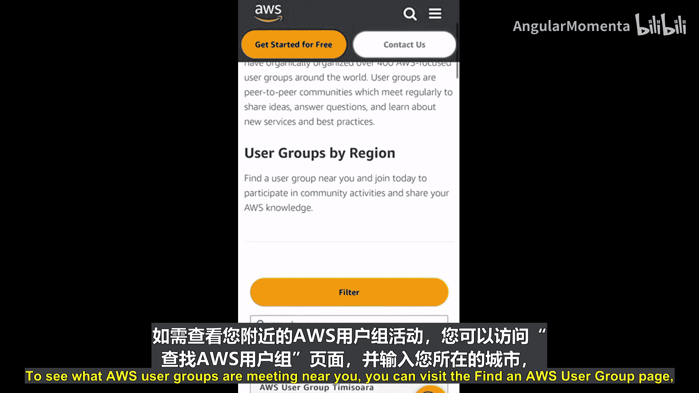

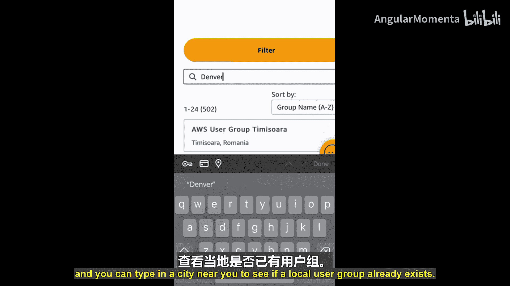

User group and contact the group to figure out how you can get involved If there are no AWS user groups in your local area。

 then you might be looking to start one if you scroll down to the bottom of the find and AWS user group page you can see a frequently asked questions section for people who are interested in starting a new user group and you can learn more about that here Allright that's it for AWS user groups Each group is different and well have a different schedule of events so to find an AWS user group near you you can visit the find and AWS user group link which you can follow this shortened URL here to get there and as always stay tuned for more AWS ABcs。

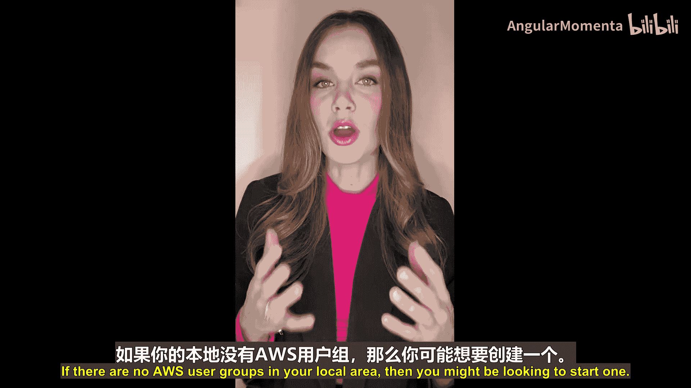

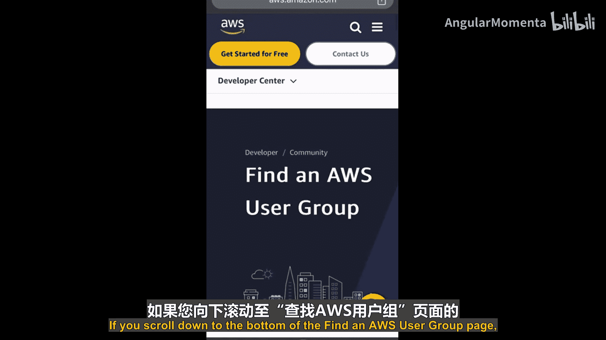

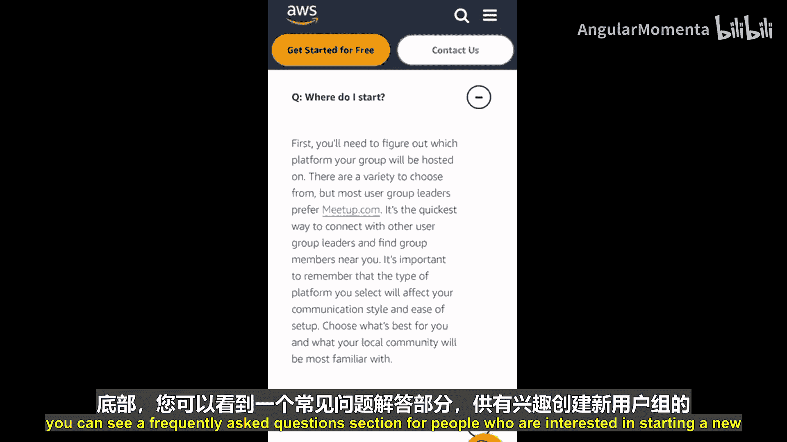

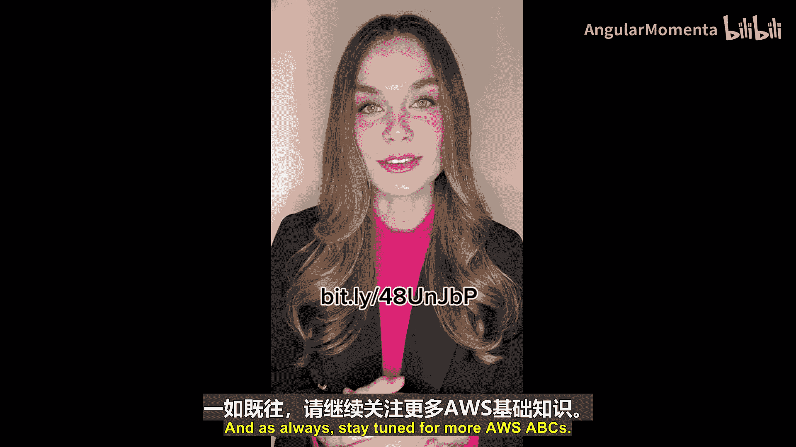