# 【Amazon Web Services】AWS云基础 ｜ The ABCs of AWS： Learn the Basics of the AWS Cloud p22 05_01_01_v-is-for-amazon-vpc -BV1MnrHBCEmT_p22-

Welcome back to AWS ABCs Today's letter is V and we're going to be talking about Amazon virtualrt private cloud。

 otherwise known as VPC A VPC is a logically isolated virtual network that's dedicated to your AWS account or you can place AWS resources like Amazon EC2 instances or RDS databases and more you can think of a VPC as similar to a traditional network that you would find in an on-prems data center There are three main things that you need to configure when you create aVPC。

 First is giving your VPC a name then you need to select an AWS region for your VPC to live in and you need to configure a cider range which will determine the size of the IP space for your network。

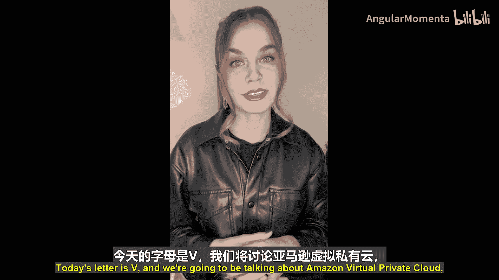

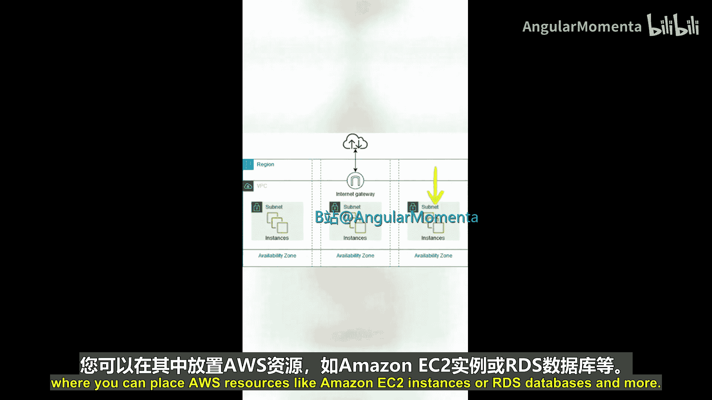

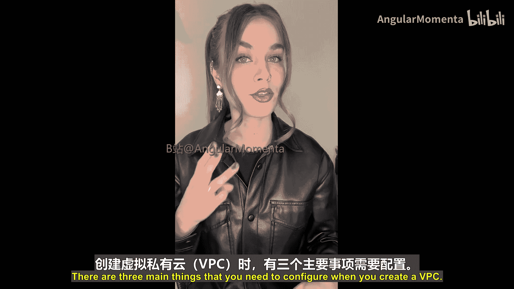

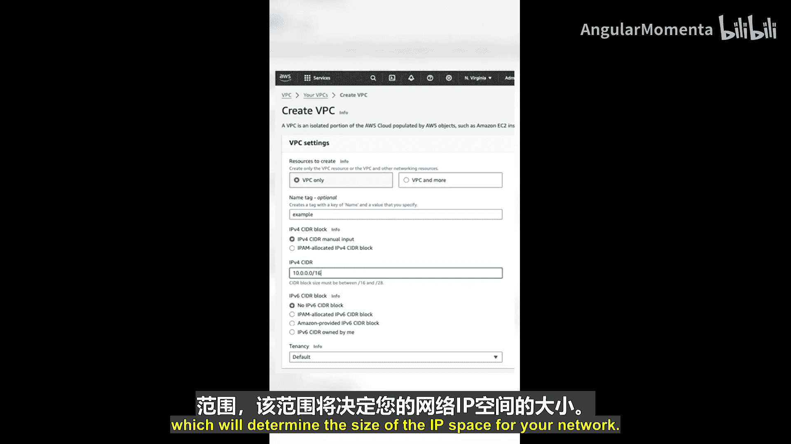

A VPC will span all of the availability zones within the region that you choose but note that VPCs do not span AWS regions So once you have your VpC in place。

 you still need to create subnets before you can place resources like EC2 instances into your network Subnets are like a network inside of a network and for VpC you can use subnets to slice up your VpC network space whenever you create subnets you need a couple of different configurations you need to determine what VpC you want your subnet to live in what availability zone your subnet lives in and what ci or range you want for your subnet which needs to be a subset of the cider block for the VpC that you're placing a subnet in you'll need to create subnets in each of the availability zones that you plan to use for your AWS solutions and for redundancy and following AWS best practices you want to make sure that you are deploying your AWS architectures across at least two。

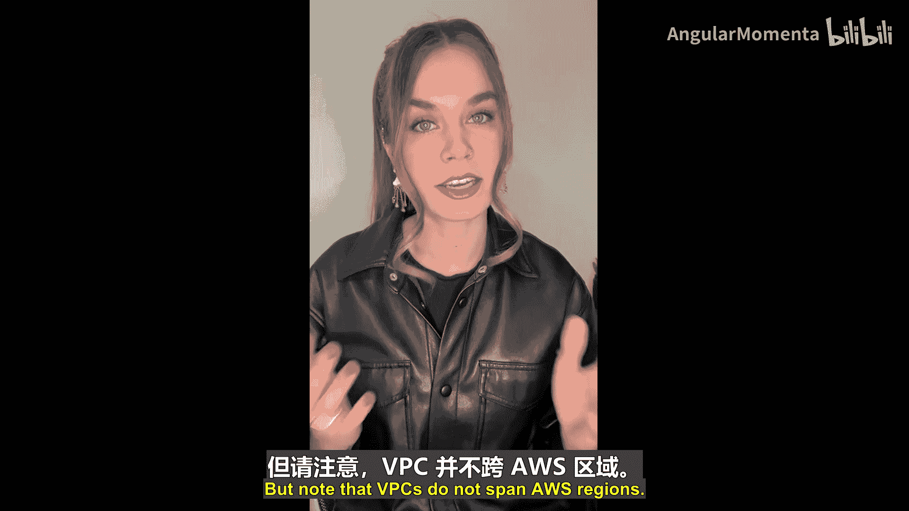

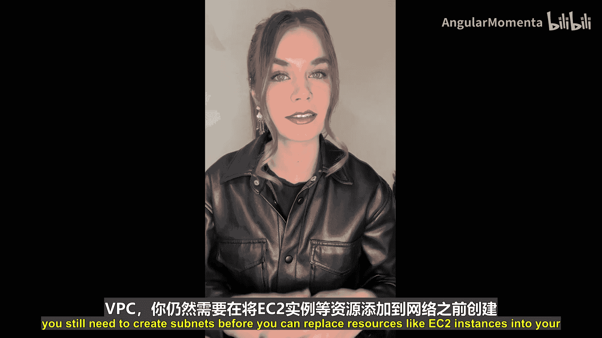

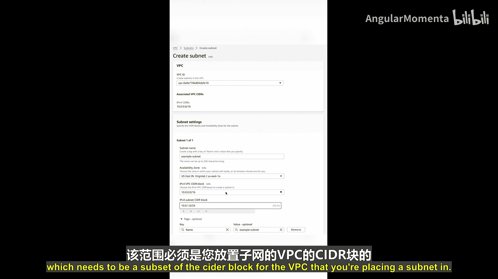

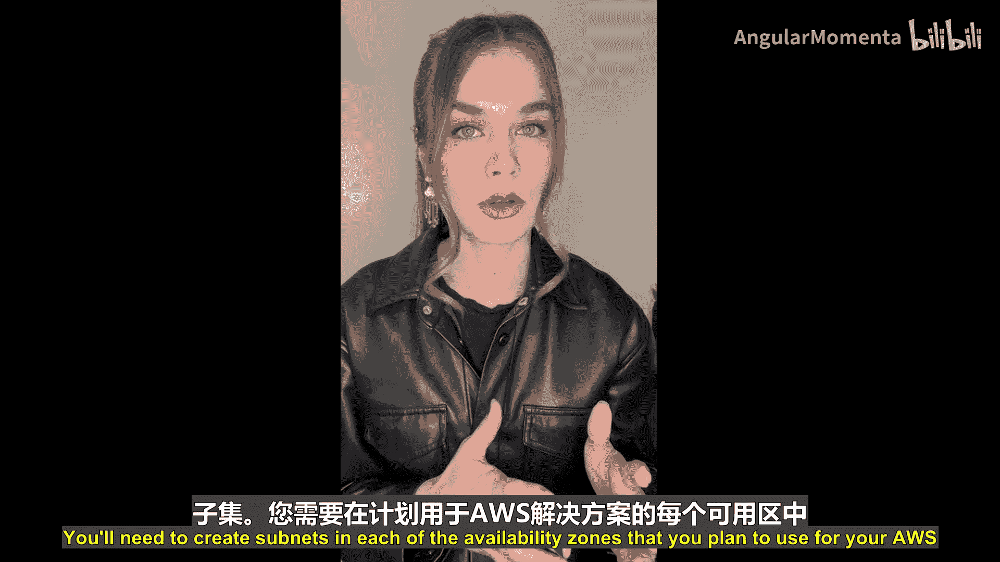

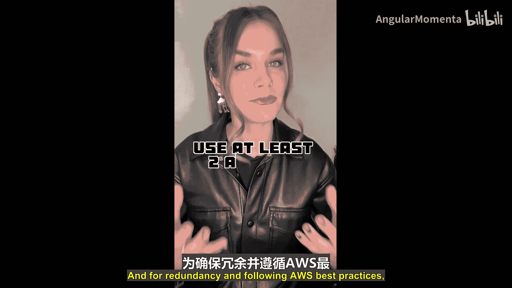

sSo keep that in mind as you're designing your VpC and your subnets you should be aware of the common pattern of creating at least one public and one private subnet per availability zone where the public subnets contain resources that are allowed to have connectivity with the internet and the private subnets contain resources that do not have internet connectivity That being said it's not like if you name a subnet public or private it auto magicalagly has the corrects instead it's actually the associated route table with that subnet that determines whether the subnet has internet connectivity or not there are also other network security rules that you can put in place to control network traffic like network access control lists and security groups Now a VpC by itself does not have connectivity to the internet on premisems data centers or other Vpcs for internet connectivity you would need to create an internet gateway and attach it to your V。

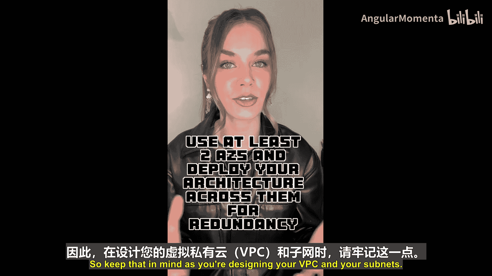

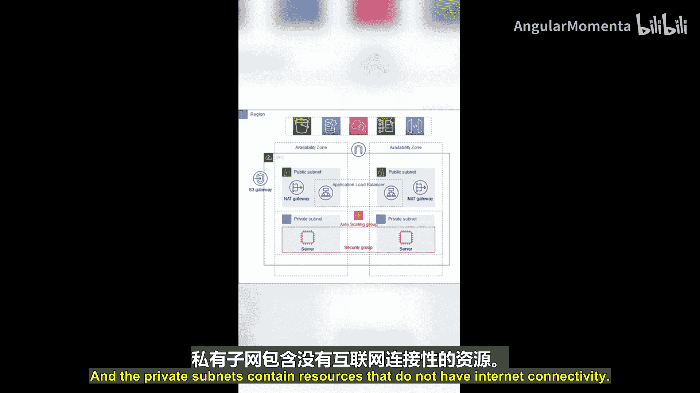

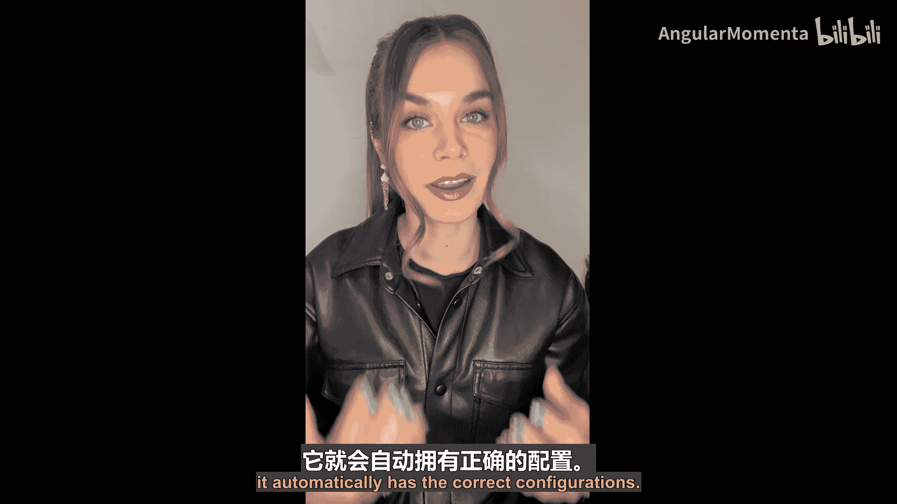

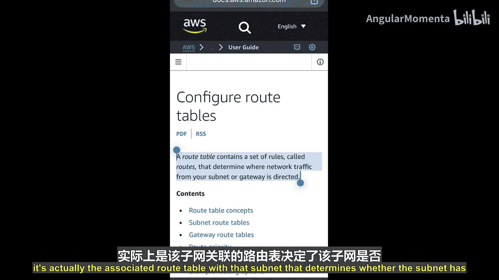

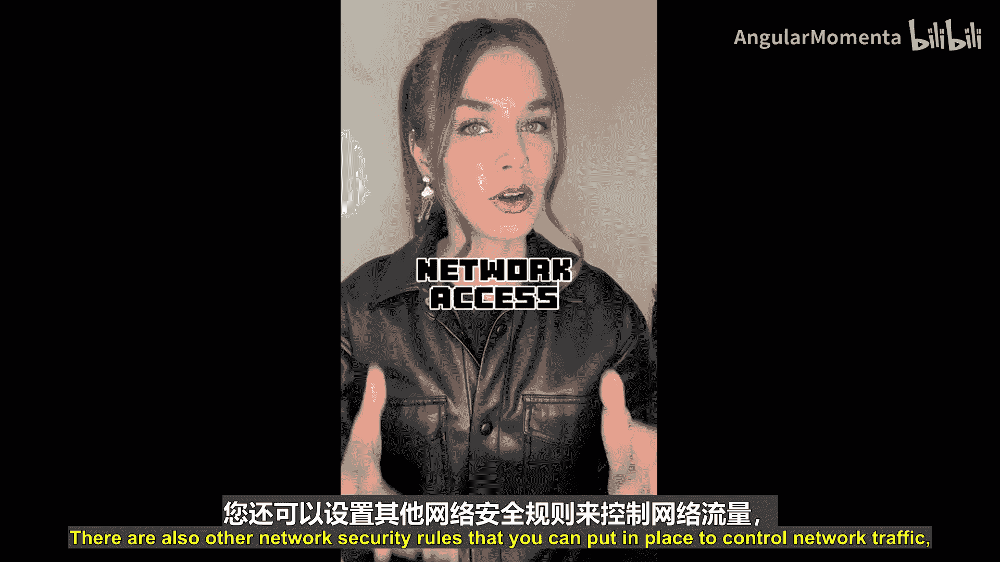

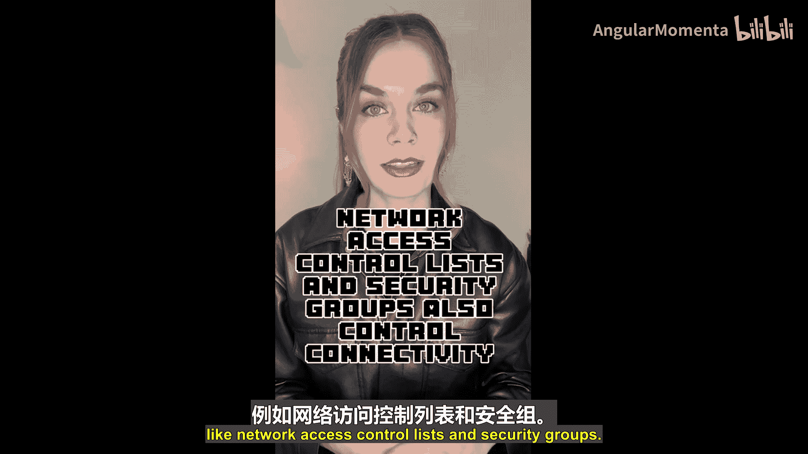

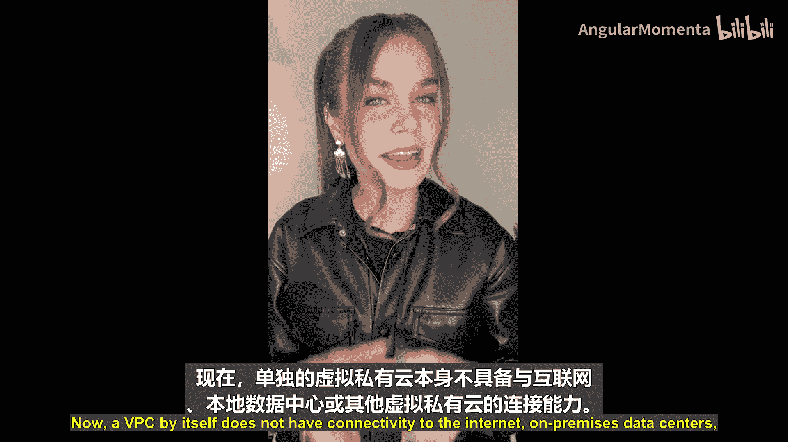

And then the public subnets route tables would reference this internet gateway for connecting VPCs to each other。

 you can use a VPC peering connection or you can use AWS transitit gateway which can also be used to route traffic for VPN connections to onprems data centers There are other types of gateways and connectivity options with VPC as well that we don't have enough time to get into right now so I would highly recommend that you check out the AWS documentation to learn more on that All right that's all we have time for for VPC up next we have W so let me know what you think we're going to be covering in the comments and as always stay tuned for more AWS ABCs。

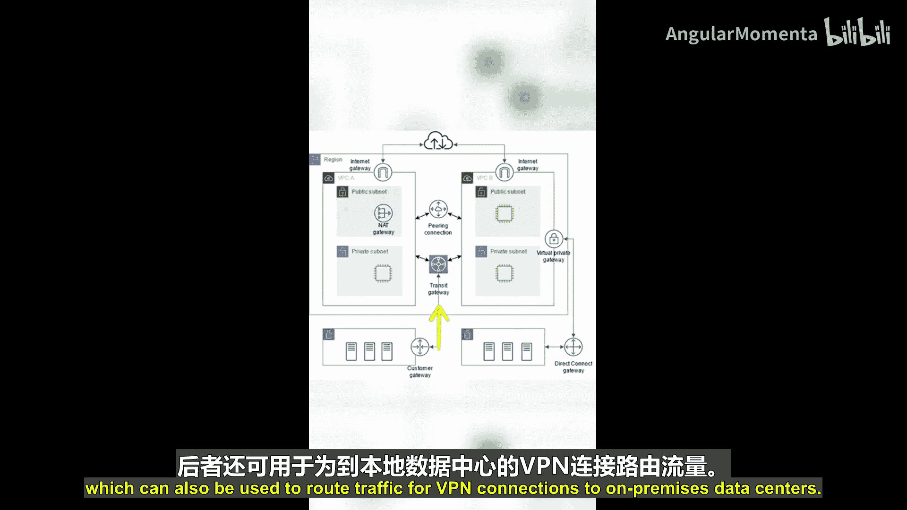

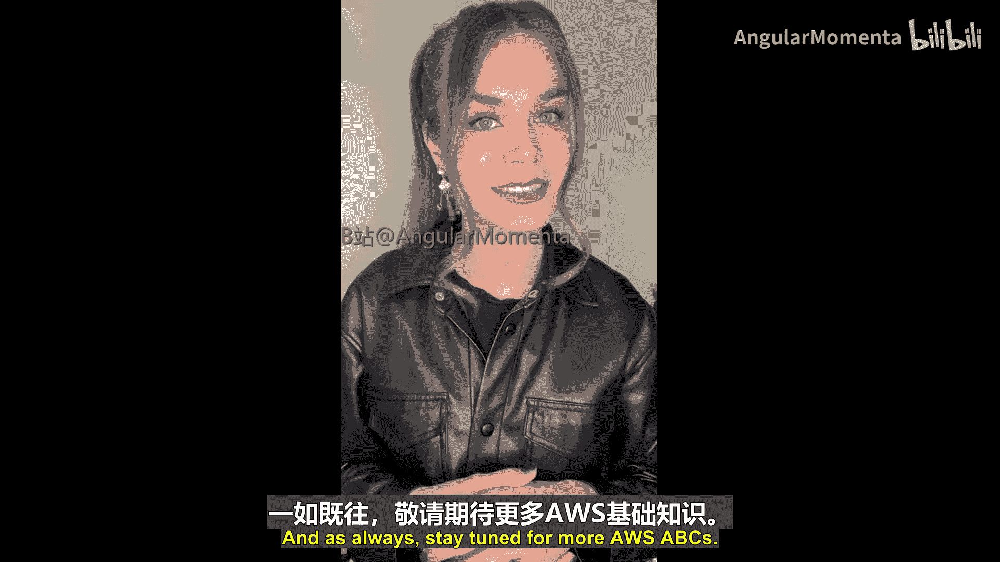