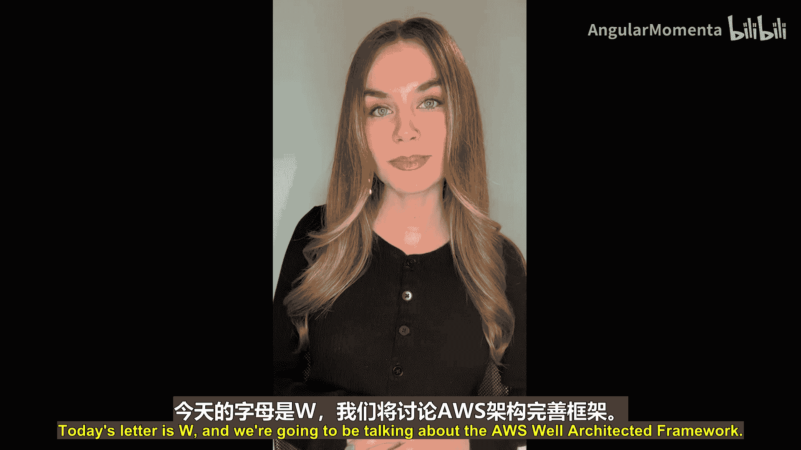
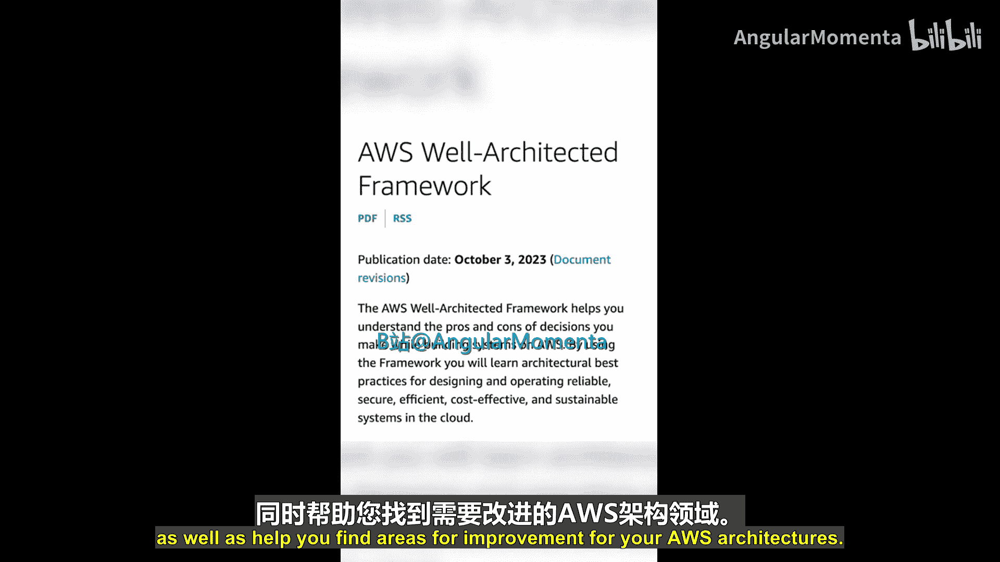
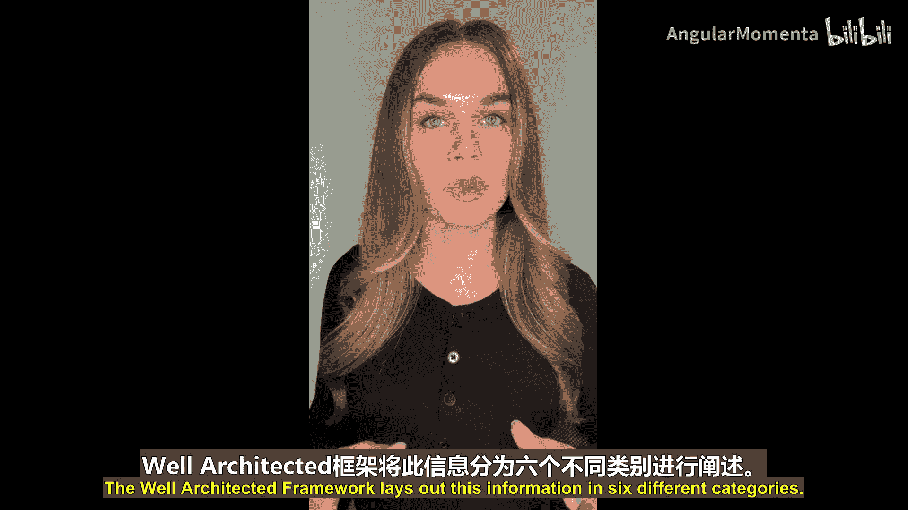
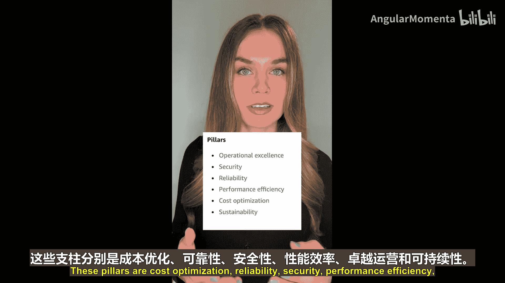
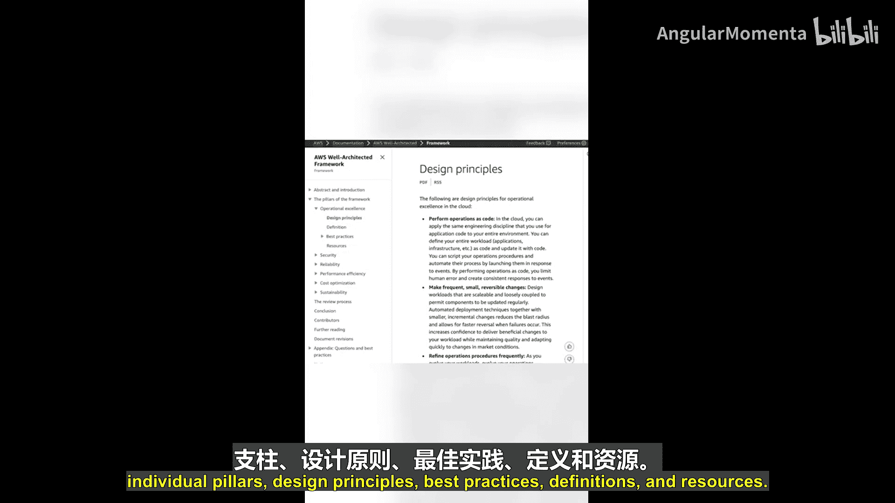
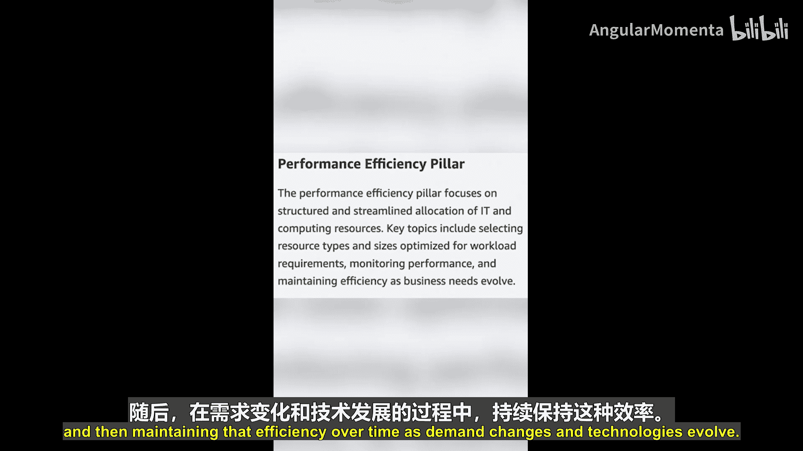
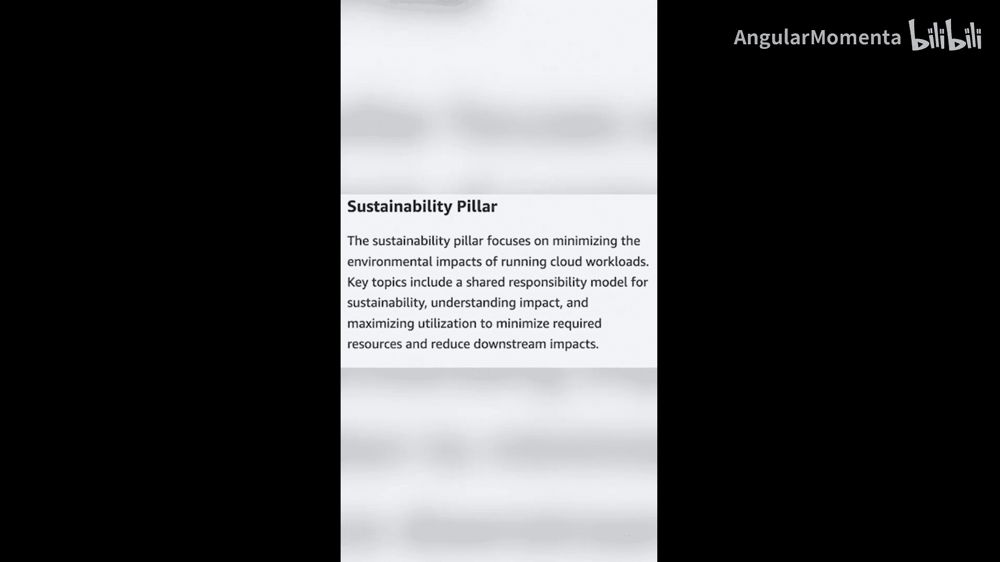
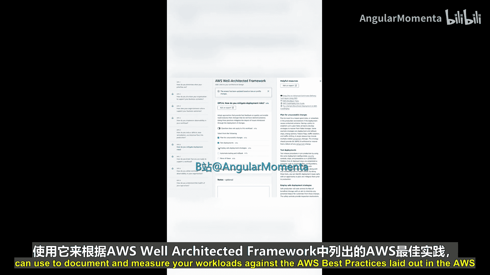
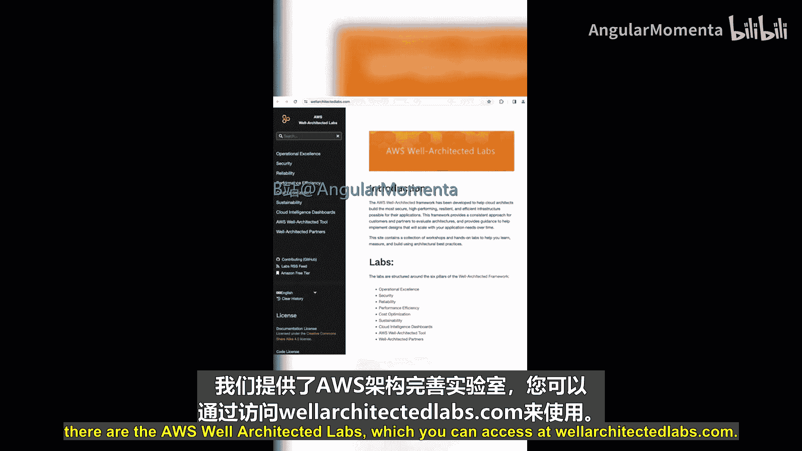

# 【Amazon Web Services】AWS云基础 ｜ The ABCs of AWS： Learn the Basics of the AWS Cloud p23 05_01_03_w-is-for-aws-well-architected-framework -BV1MnrHBCEmT_p23-

This is AWS ABCs Today's letter is W and we're going to be talking about the AWS Well Archected framework The AWS Well architectected framework helps you evaluate your AWS workloads against cloud best practices and it can help you guide constructive conversations around the design and operations of your workloads as well as help you find areas for improvement for your AWS architectures AWS solutions architects have years of experience helping customers evaluate their AWS workloads looking for ways to improve for cost or security operational excellence or other types of improvements that can be made The AWS well architected framework draws on this experience and has put together a collection of resources that includes things like evaluation questions and documentation that you work through as a team so you can have constructive conversations about your AWS architectures the well architected framework lays out this information。

In six different categories， which are the six pillars of the well architected framework。

 These pillars are cost optimization， reliability， security， performance efficiency。

 operational excellence and sustainability。 starting with operational excellence。

 This pillar is all about the ability to effectively support development run workloads。

 gain visibility and insights into operations and to improve processes。

 Every pillar has design principles。 and a few of the design principles for operations excellence are to perform operations as code make small frequent and reversible changes and to anticipate failure。

 You should check out the AWs well architectected frameworks documentation to learn about each individual pillars design principles。

 best practices， definitions and resources。 But for now。

 let's continue to define each individual pillar。 So for security。

 this pillars about protecting data systems and。

Assets as well as using AWS services to improve your security posture。

 The next pillar is reliability。 This pillar will help you evaluate your workload's ability to essentially work when you need it to work。

 Is your system reliable up next is cost optimization。

 which is going to help you evaluate your workloads to see if it is providing the needed functionality at the lowest possible price point。

 then there is performance efficiency， which is about using resources efficiently to meet requirements。

 and then maintaining that efficiency over time as demand changes and technologies evolve。

 Last but not least there sustainability， which helps you take a closer look at the environmental impacts of your workloads。

 including energy consumption and overall efficiency。

 there are associated questions with each pillar that you can use to review your architectures with your team and these reviews are supposed to be conversations that encourage your team to dive deep。

But are not audits of your architecture。 There's also a tool in the AWs management console called the AWs Well Archected tool that you can use to document and measure your workloads against the Aws best practices laid out in the AWs well architectected framework。

 Additionally， to help you get some handson practice supply those AWs best practices。

 There are the Aws well architectected labs。 which you can access at well architectected labs dot com。

 Allright， that's all we have time for for the Aws well architectected framework。

 I recommend for anybody trying to learn AWs to read through the well architectected framework documentation。

 So you can follow this link to learn more about that。 And up next， we have the letter X。

 So what do you think we're gonna be covering for that one。 And as always。

 stay tuned for more AWS ABcs。

