# 【Amazon Web Services】AWS云基础 ｜ The ABCs of AWS： Learn the Basics of the AWS Cloud p24 05_01_05_x-is-for-aws-x-ray -BV1MnrHBCEmT_p24-

Welcome back to AWS ABcs。 Today's letter is X and we'll be talking about AWS Xray。

 Imagine a scenario where you are hosting an ecommerce-commerce application on AWS and customers are providing feedback through the support channels that they are experiencing disruptions and slow downs when trying to check out and purchase products behind the scenes。

 this ecommerce-commer application is hosted in a distributed manner where there are multiple services that make up the checkout or purchase functionality somewherewhere along the line in the back end one of these services is having a performance issue or maybe there's a bug in the code or maybe there's a misconfiguration somewhere that's causing these problems。

 The thing is how do you know where the problem is coming from How can you narrow it down quickly so you can pinpoint which service is causing the issues for your end users This is a common issue for distributed applications and it would be a great idea to implement。

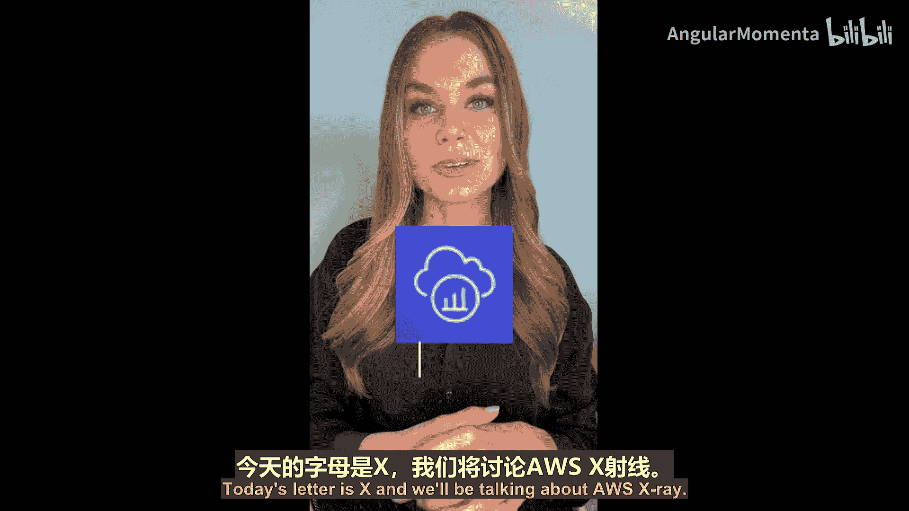

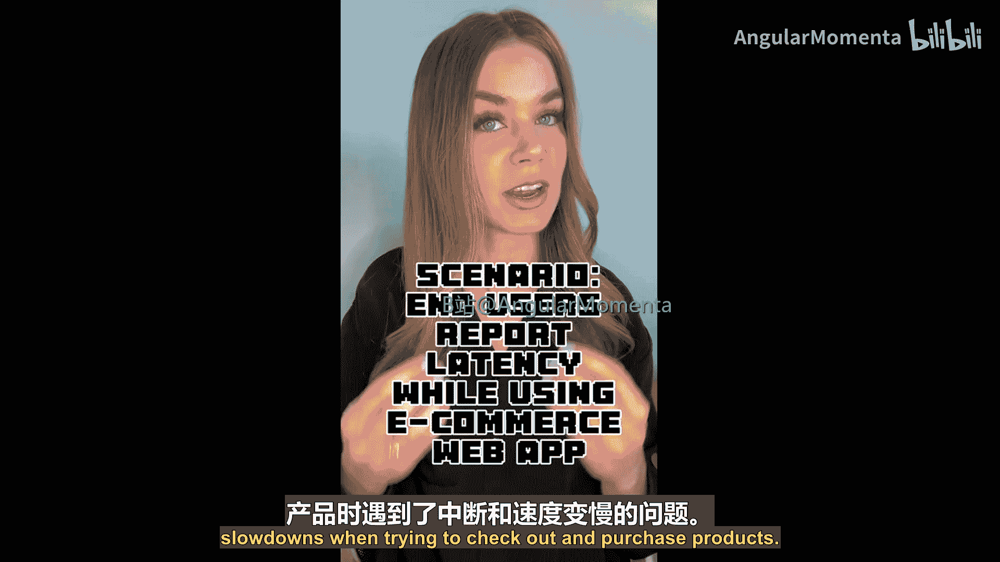

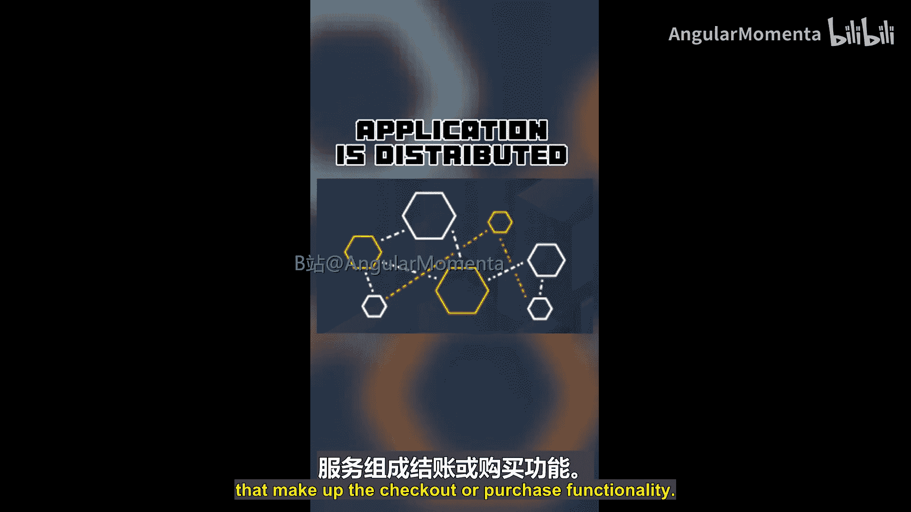

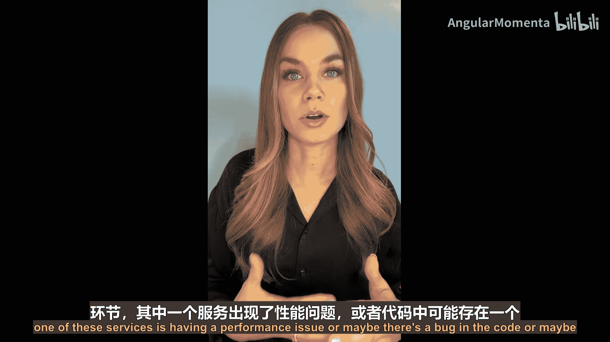

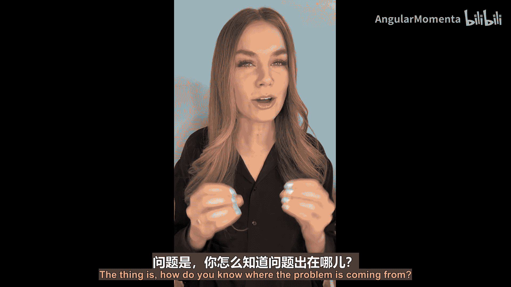

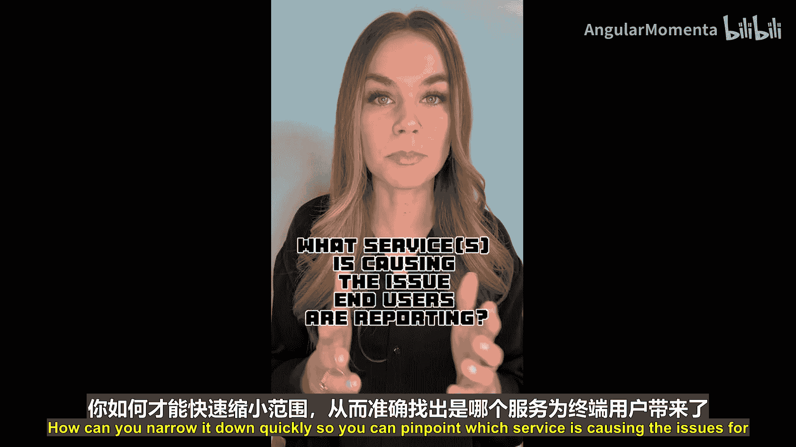

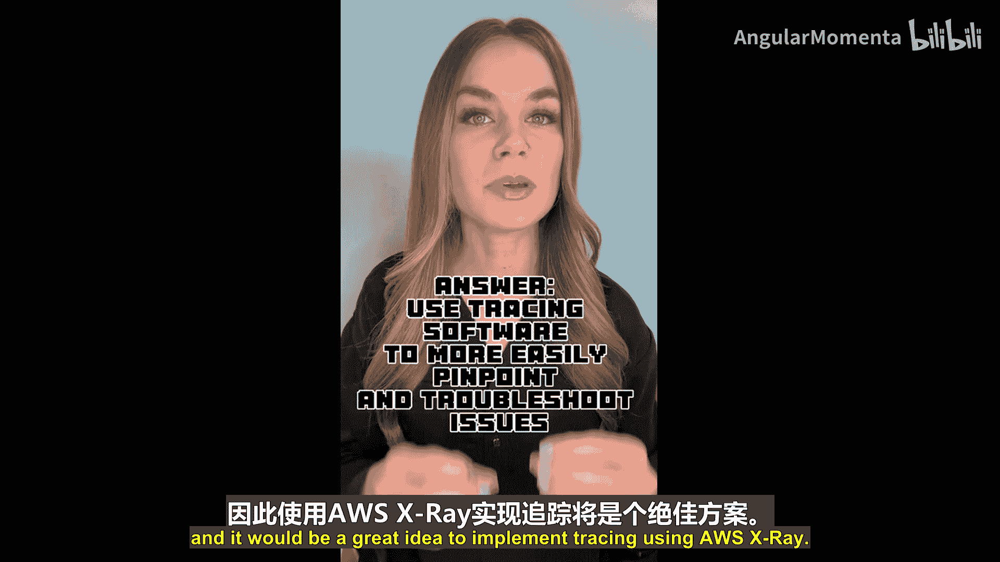

Traccing using AWS Xray AWS Xray is a fully managed service that gathers information about the requests your application handles across services that make up distributed applications and brings that information together so you can pinpoint issues or bottlenecks faster and discover opportunities to optimize your applications。

 It offers tools like dashboards and apis that you can use to view。

 filter and extract insights from your tracing data Getting this sort of granular timing information can be extremely helpful when looking into issues and using the Xray console。

 you can visually see which service is causing the slowdown using the service map。

 And from there you can then dive further into troubleshooting by looking into logs or associated metrics。

 Now let's cover some basic concepts that you're going to need to know when working with Xray First we have segments。

 The host that your application is running on will collect segments and。

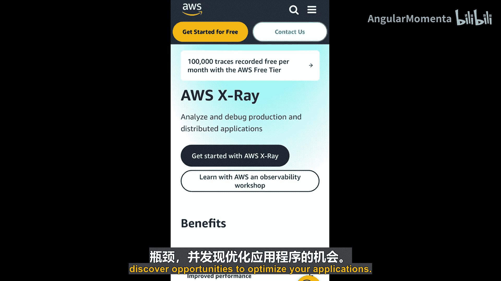

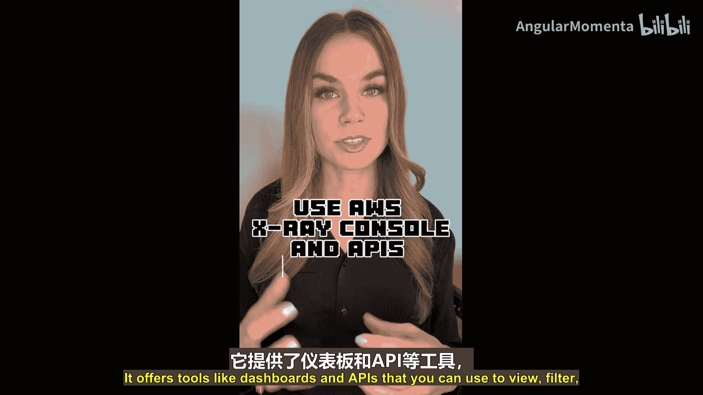

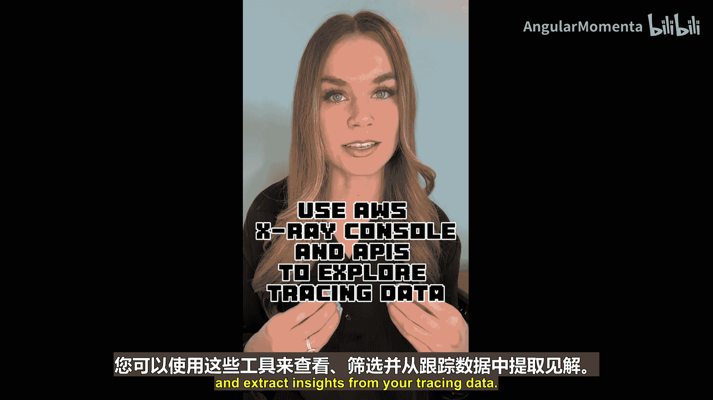

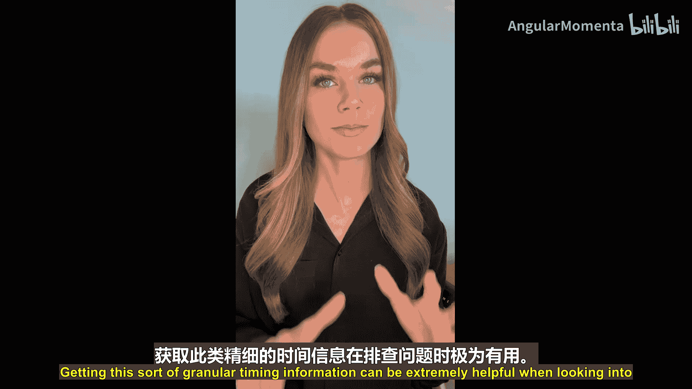

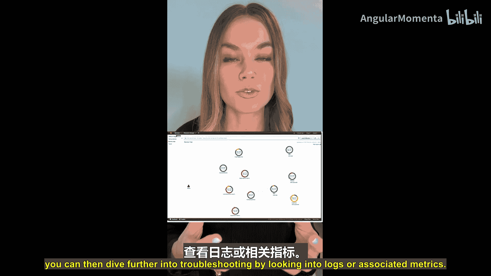

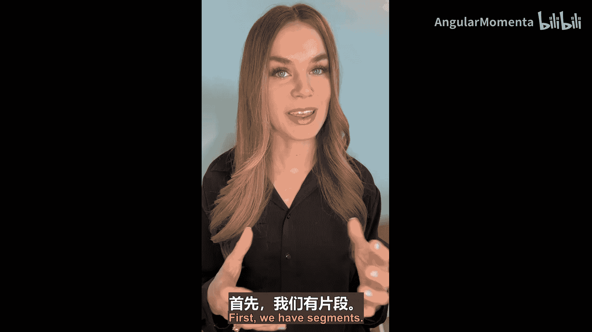

Send them to X-ray， which contain information about the request that the application is handling。

 Then there are subsegments， which provide more granular timing information and can provide more detail about any downstream calls that your application has made to things like external APIpis AWS Apis or even calls to databases up next is these service map which is generated by X-ray and gives you a full visualization of your services and the relationships to each other。

 Then finally we have traces。 a trace collects all the segments generated by a single request which you can view in the Xray console and drill down to view more details about individual segments or subsegments to gain insights depending on the compute service that you're using implementing tracing can be as simple as just turning it on via configuration like if you're using AWS Lambda。

 for example， as long as the correct permissions are in place。

 you can also instrument your application。

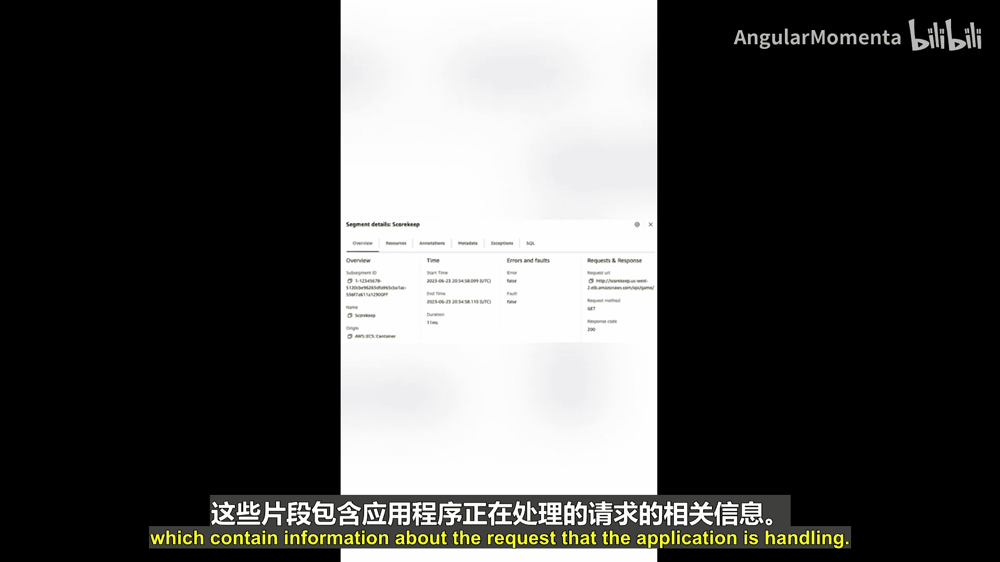

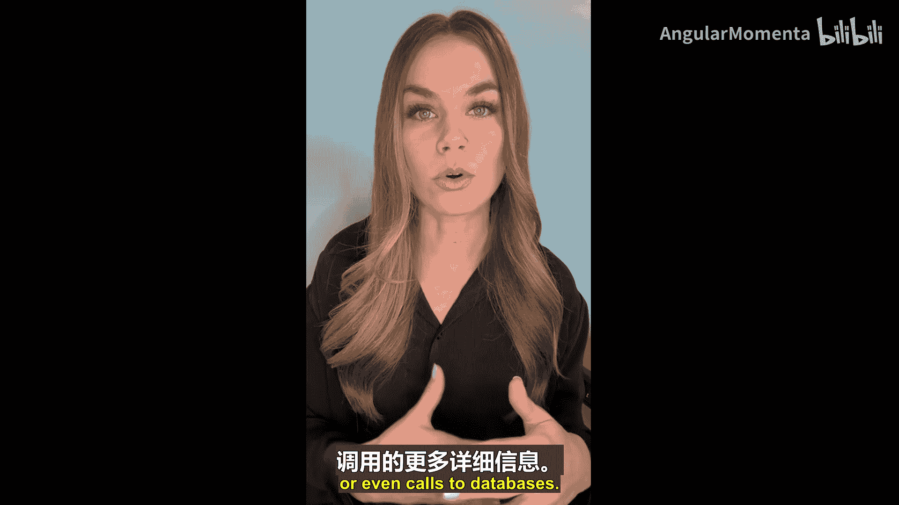

So that you can see more data about the requests that are being made from your application。

 So if you have an application that is making four different API calls per request。

 you can instrument your application so that you can see more granular timing information about each individual API call that's being made。

 You can do this type of instrumenting using the AWs distro for open telemetry。

 which is an AWs distribution based on the cloud nativeative computing foundation or CNncCf Open telemetry project。

 All right that's all we have time for for AWs X ray up next， we have the letter Y。

 and we're gonna have to get a little creative with that one。

 So let me know in the comments what you think we're going to be covering next。 And as always。

 stay tuned for more AWS ABcs。

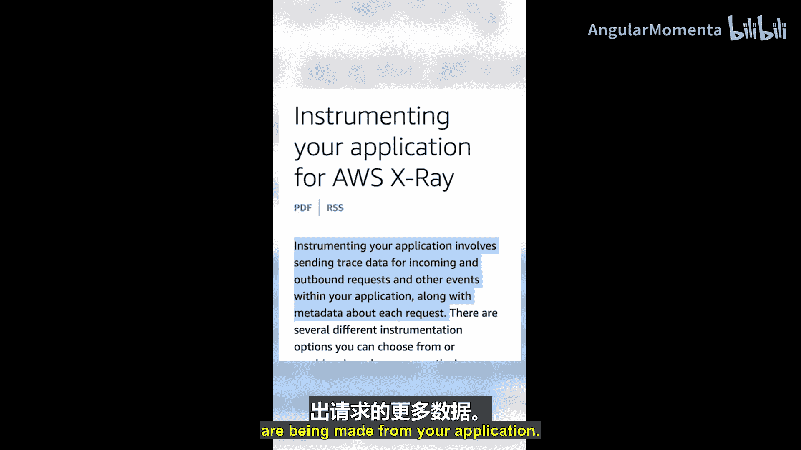

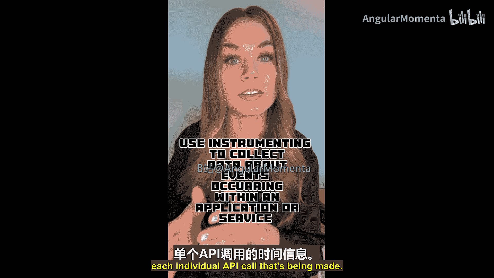

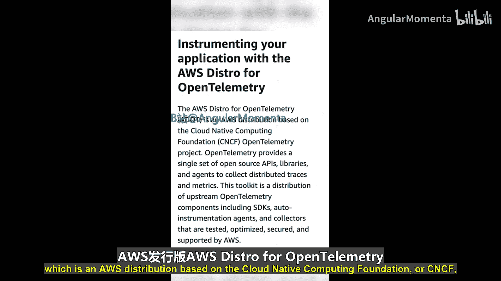

