# 【Amazon Web Services】AWS云基础 ｜ The ABCs of AWS： Learn the Basics of the AWS Cloud p26 05_01_09_z-is-for-aws-local-zones -BV1MnrHBCEmT_p26-

Welcome back to AWS ABCs Today's letter is Z and we'll be covering AWS local zones Before we hop right into local zones。

 let's quickly cover some concepts related to the AWS global infrastructure AWS services are hosted around the world in different locations using AWS regions availability zones and AWS local zones regions are geographic areas where these resources are located So taking a look at the region map。

 there are currently 33 launched regions around the world and each region is named after its geographic area like Northern Virginia or Milan or Mumbai for disaster recovery。

 it's common to use a couple of different AWS regions using disaster recovery options like backup and restore multisite active active or other options AWS regions are composed of availability zones or AZs AZs are isolated locations。

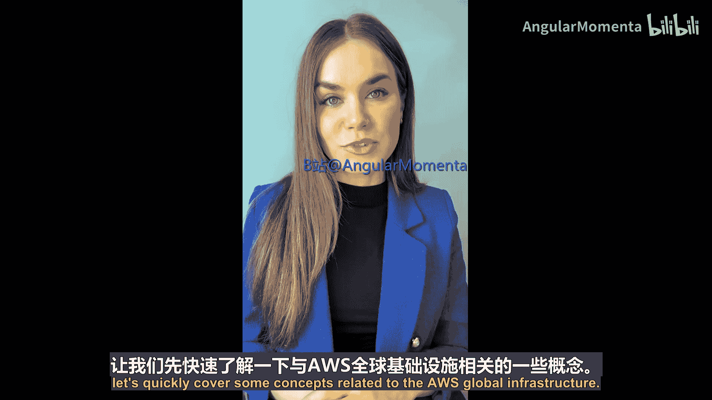

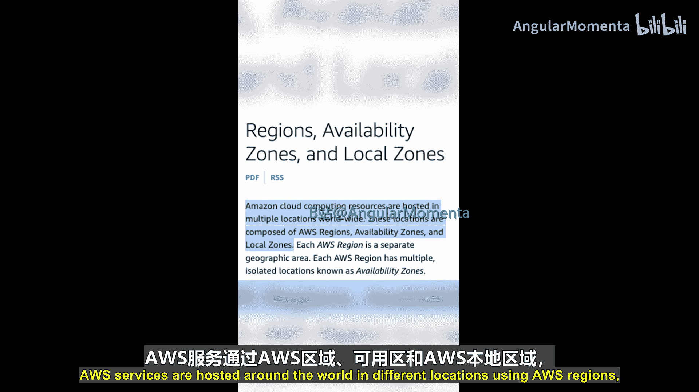

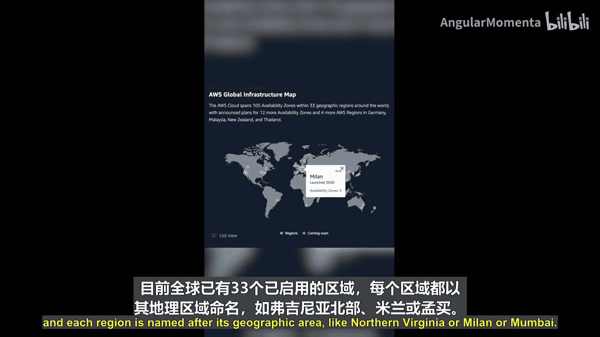

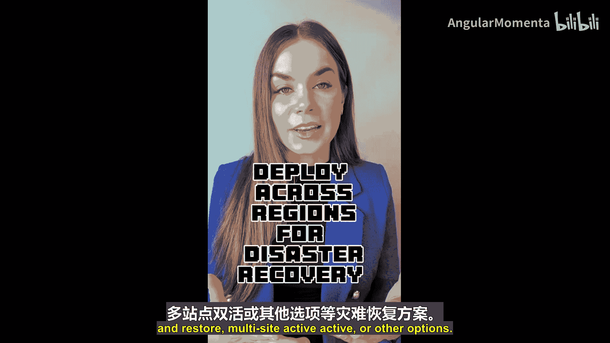

In a region and AZs are made up of one or more data centers it's a best practice that within an AWS region。

 you deploy your architectures across multiple availability zones When you create resources in AWS some are bound to one AZ while others are bound to a single region and other services are global you'd have to look at each individuals service to figure out where each one falls Amazon E2 instances or Amazon RDS database instances are bound to a single subnet and subnets are bound to a single availability zone So you would select which availability zone and subnet you want to place that resource into when you create All right so now let's talk about local zones local zones bring AWS infrastructure like compute storage databases and other AWS services closer to end users and businesses and provide support for workloads that need single digit millisecond access to specific AWS。

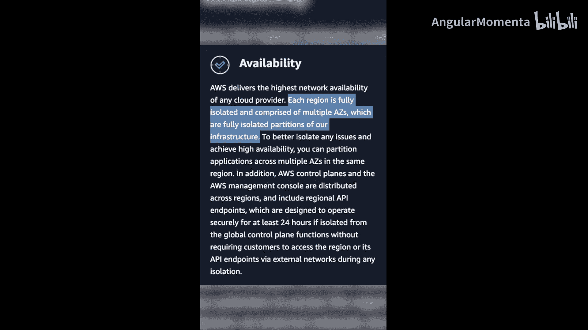

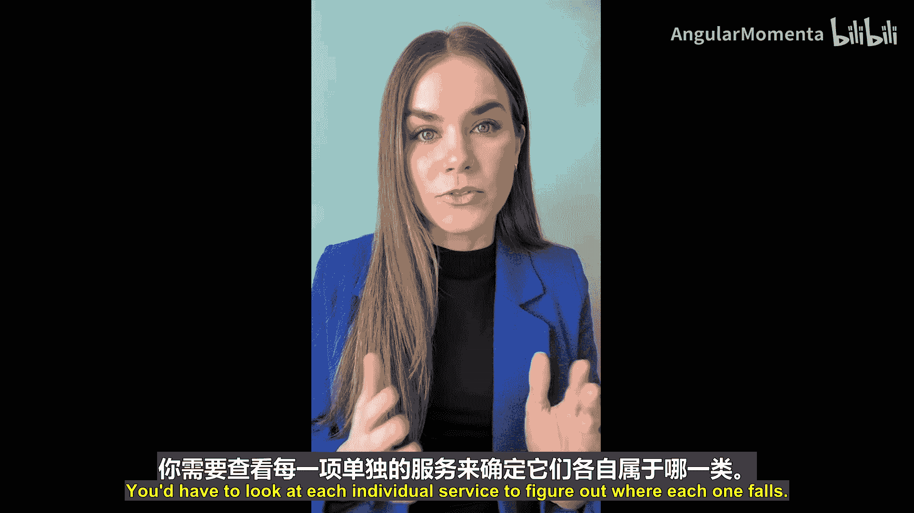

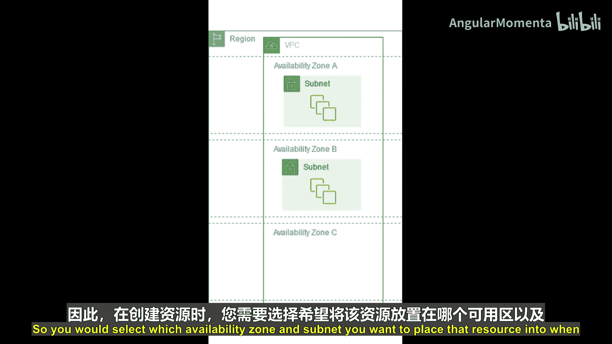

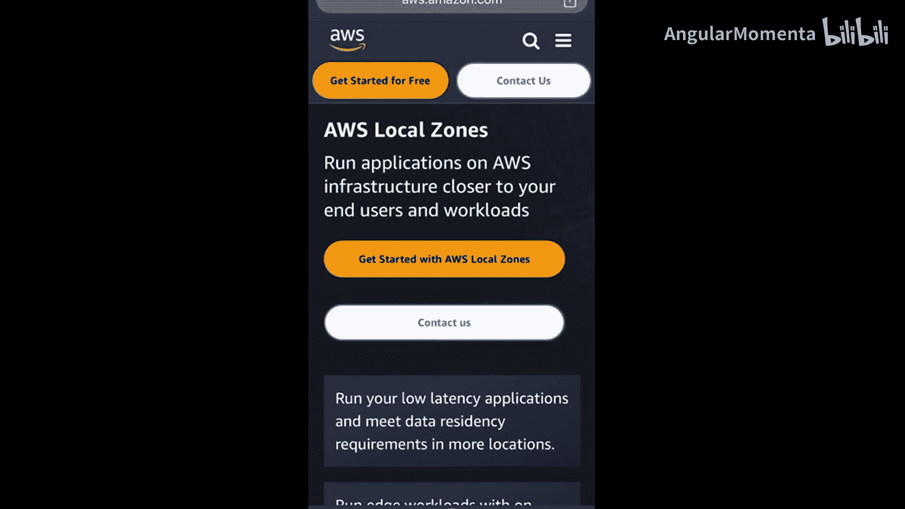

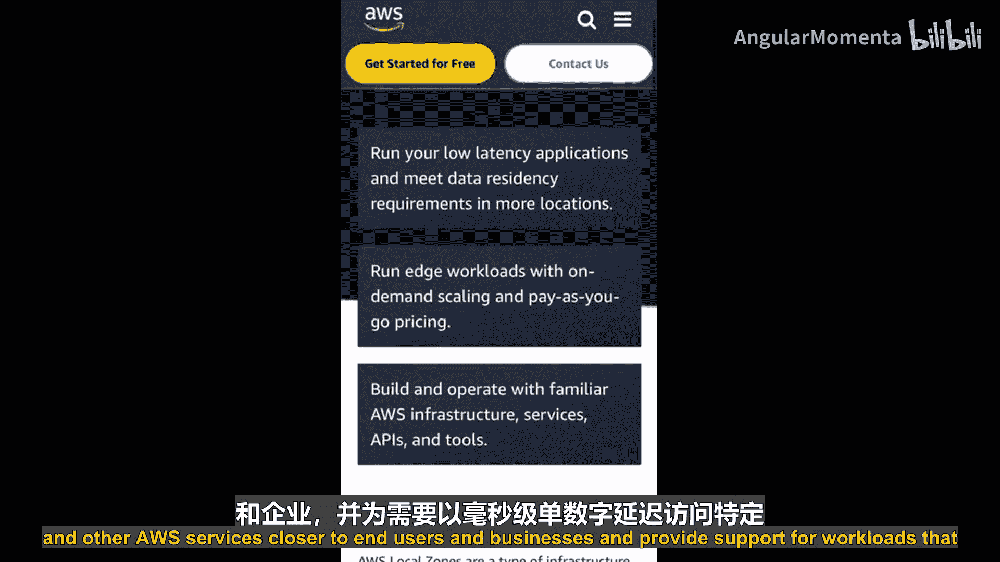

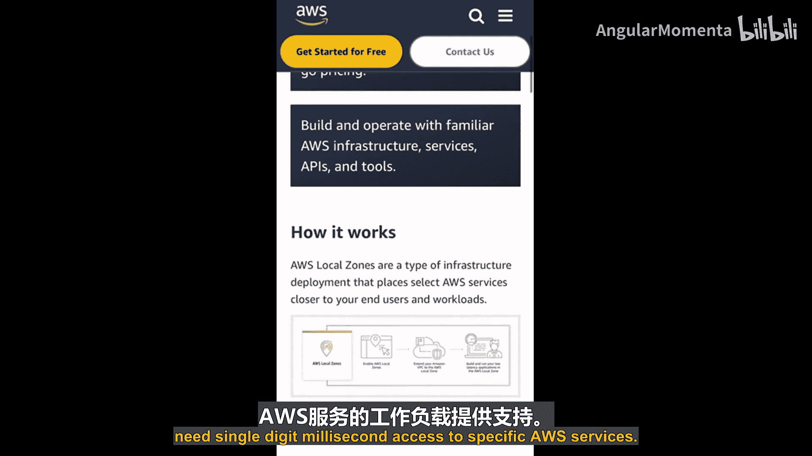

Local zones can help you run latency sensitive applications， like realtime gaming or streaming。

 for example， because these local zones can be physically closer to your end users。

 which reduces latency other use cases for local zones include things like data processing。

 hybrid cloud migrations， workloads with state and local data residency requirements AVR workloads。

 media streaming workloads and more to use AWs local zones。

 you first have to enable them in your AWS account。

 Then you can extend any VPC from the parent region into the local zone。

 you can create a subnet in the local zone and deploy resources there。

 Then there's also AWs dedicated local zones。 AWs dedicated local zones are local zones that are built for and used by a specific customer or community and are intended to give customers enhanced security and governance。

 Allright， that's it for AWS local zones。 and that's also it for the AWS ABcs because we've reached the end。

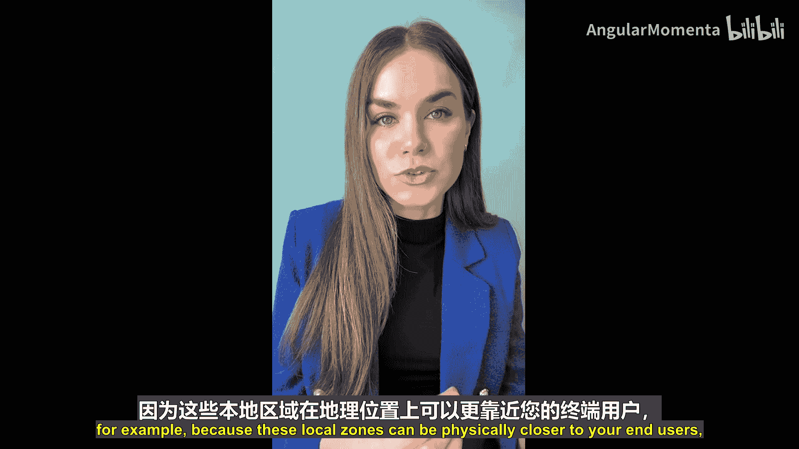

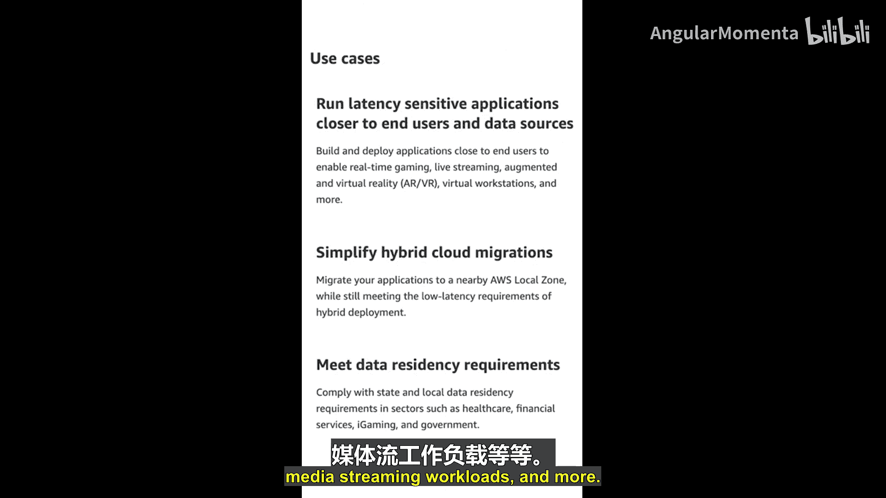

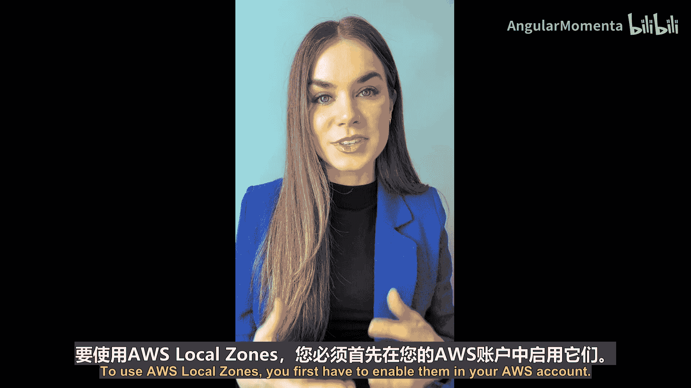

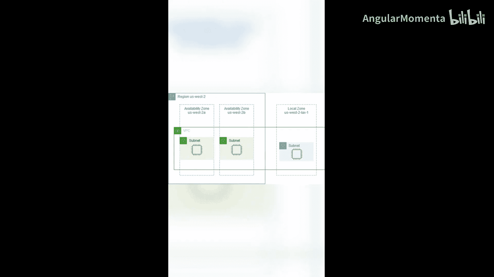

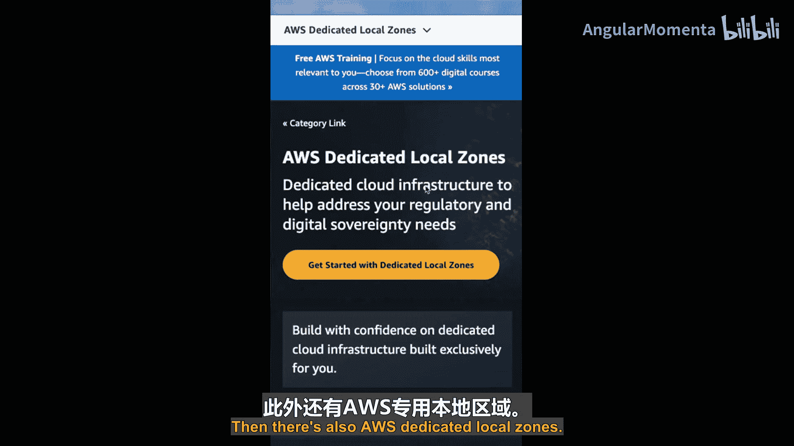

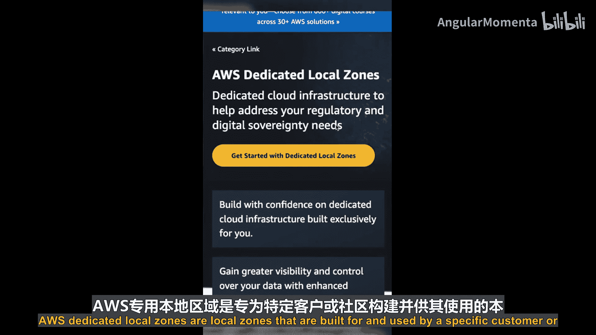

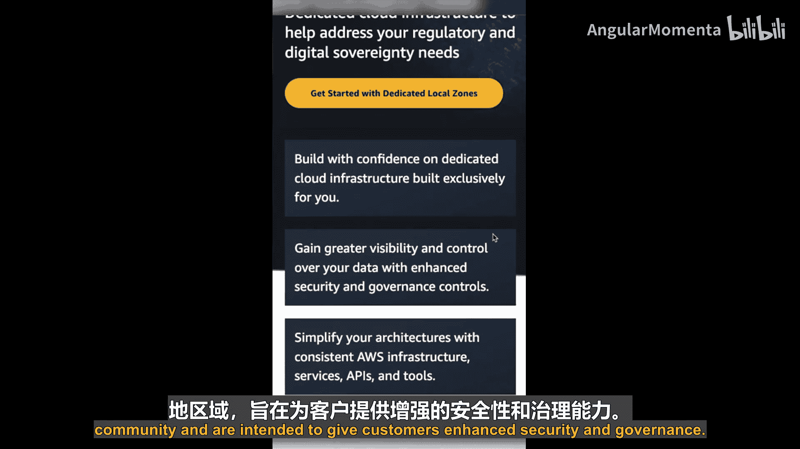

The last letter。 So thank you for watching along。 And if you want to learn more。

 I'd recommend you check out the courses on AWS SkiBuildder。

 and you can also find some of our courses on Coursera。 Thanks and see you next time。

