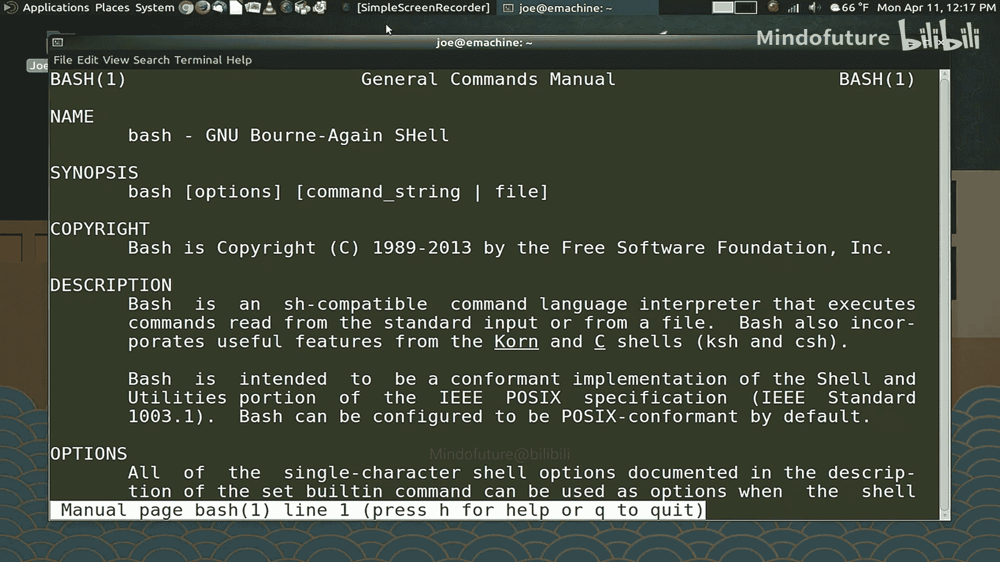
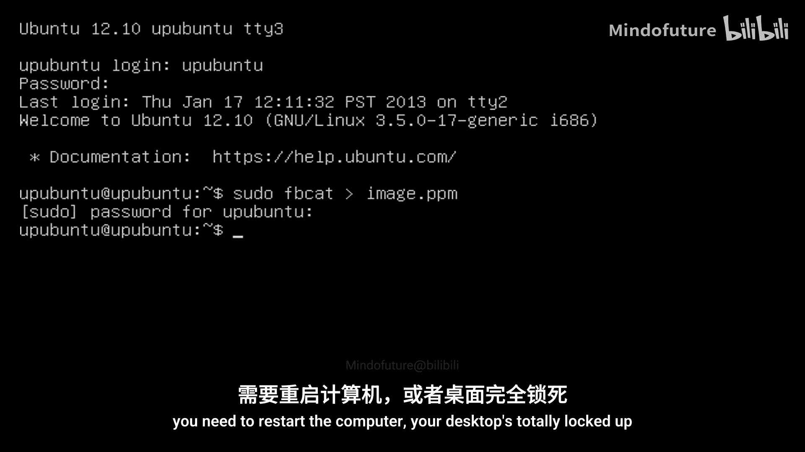
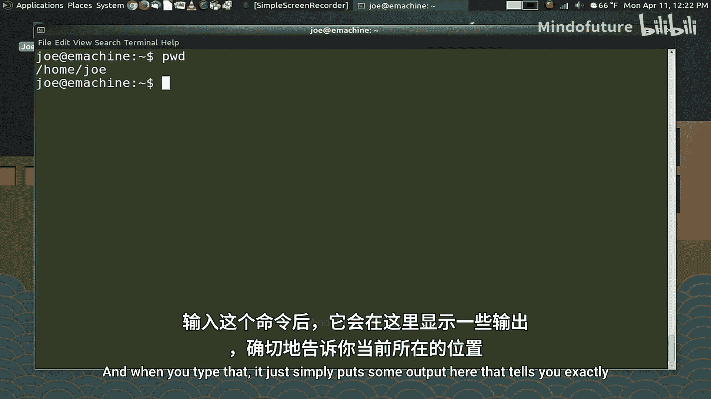
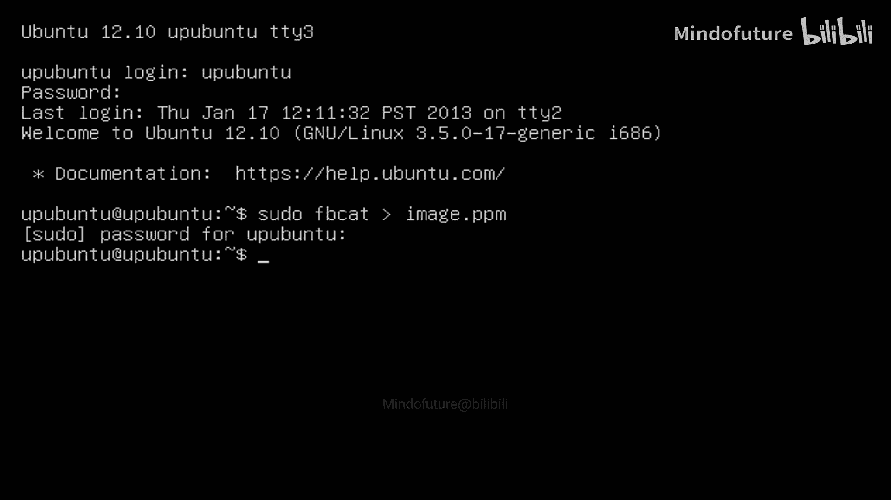
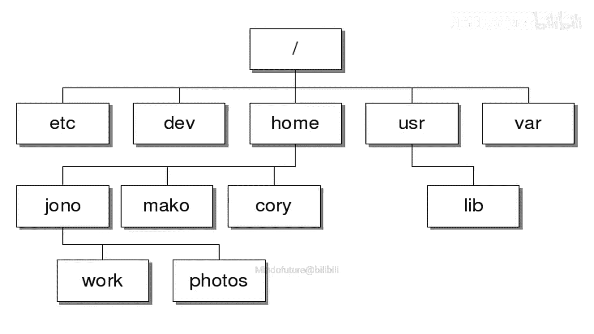
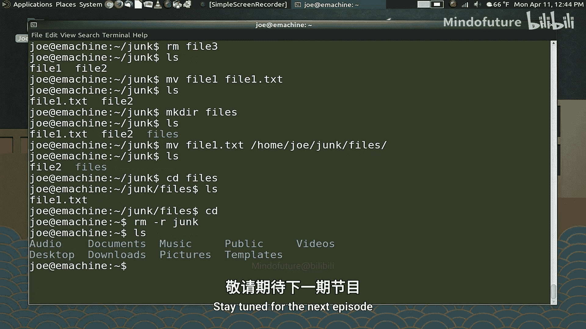

# Bash基础-｜-Bash-Basics-p01-P01_Bash_基础_第1部分_共8部分-访问与导航--BV1Tj6VBnEz3_p1-

Greetings and salutations。 And thank you for clicking on this video。

 This is the first video in a series that we're going to do。

 and we're going to talk about using bash in a terminal。

 And this series of videos is intended to take you from the very basics to some more advanced things as we roll along。

 I plan on doing this in several parts。 so that you won't get overwhelmed with one big， long video。

 and you can watch the videos at your own pace。 You can watch one go off and play with it for a while and then move on to the next video for more advanced concepts。

😊，What is bash。It is a shell。 Basically， It stands for the Bn Again She。

 A shell is a command line interpreter， which means that it provides a way for you to type in humanly readable commands that get the computer to do something。

In Linux， pretty much the default shell these days is bash。

 It's on every Linux distribution that I have ever used。

 It is not the only command line interpreter available for Linux。 You can have corn。

 You can have C shellll。 You could use S。 H。 You could use。Many different shells。

 A really cool one to look at if you're very much into it is fish。But today。

 we're going to talk about bash because it's universal。 It's everywhere。 It's not just on Linux。

 It's on Uni。 It's on Mac。 And you can even have bash on your window system。

 So bash is becoming a universal language that you can use to run just about any computer in the world。

In this day and age， when we have all of these graphic user interfaces。

 why would you want to actually have to type commands into a terminal， It does seem a bit archaic。

But it is very efficient。 You can do things at a terminal much quicker than you can using goies where you have to point。

 click， wait for it to load， find the box to click that sort of thing in bash。

 you can just type in two or three different commands。

 And the system goes off and does what you wanted to close it up and you're done。

So the first thing we're going to talk about is how you access bash。 And in Linux。

 the most obvious way to do it is to open a terminal emulator。

 which is what is open here on the desktop。 We are using a boon2。Mate 1604 in our example here。

 But a lot of what I'm going to tell you is completely universal。 And if I do issue a command。

 which I think is unique to a bontu， Then I will let you know。

 But whatever distribution of Linux you happen to be working on。 you can open up a terminal。

 Each desktop environment has its own version of a terminal emulator。

 So if you use anme based desktop like cinnamon or unity ornme proper。

 then you are going to have anme terminal。 If you're using X F C E。

 It will probably be the X F E 4 terminal。 You can have as many different terminal emulators as you like。

 a botu matete comes with a nifty1 preinstalled called Tilda。 and Tilda runs all the time。

 it boots up when you log in your account， and it logs you in。

 and all you have to do to access it is press F 12。

 Tilda is a nice thing to have around because at any time during your session， if you want。

Jump into a terminal and check something out。 Just press F 12， type in your command。

 Let's say I want to know what date it is， even though it's listed up here in the upper right hand corner。

 I can get bash to tell me by issuing a command， so it's very useful to have round indeed。

There are other ways to get to a terminal on your system instead of using a terminal emulator you can get to an actual terminal。

 also known as a TTY。

Back in the early days of computers， when you had large computers that filled up whole rooms。

 you would access that computer by using a teletype machine。 That's why they're called T T Ys。

 And the Linux system automatically spins up 8 T T Ys at boot。

 and it usually puts the desktop environment on T T Y 7。

 So if you were to issue the command to get to another T T Y while you were watching this video。

 your desktop environment would continue running on T T Y 7。

 you would just switch away and your screen would have something up on it that looks like this。

 and then you could switch back。 You can be logged into all of the T T Ys at once if you want to。

 and each T T Y could be doing a different operation。😊，So to get to a screen that looks like this。

 alternate to control and any of the function keys， F1 through F8 will take you to a different T T Y。

 And this example， the fellowa who took this image。

 he is using a boone 21210 and he is currently on T T Y 3 and at log in。

 you put in your password and or rather your username and then your password and then you are logged into the system。

 and this is what you are going to be looking at to get out of a TTY， you can switch away from it。

 or you can just make sure that you log out， of course。

 because you don't want to be sitting here logged in if the machine is going to continue to run and you do that by typing in log out and then it will put you back at the prompt for the next person to log in。

Then use alternate control and F 7 or F 8， depending on where your distribution put the actual desktop。

 which T T Y it uses to get back to where you came from。 Why would you want to use a T T Y。

 What happens if your gooey interface stops working。

Or maybe somebody else is logged into the computer。

 and you just want to sneak in there real quick and execute a couple of commands and get out。

 You don't actually have to log into the desktop。 It can be sitting at the login screen at the desktop manager window。

 and you can still gain access using a T T Y。 So if the desktop breaks and you need to troubleshoot it。

 or you need to restart the computer。 your desktop's totally locked up。

 you can always do it from a T T Y。 So that's why knowing how to get to a T T Y is very useful。

 And in my case， I use T T Ys all the time to run updates on the machine and things like that。

Okay。So let's go ahead and get out of。Bash。Manual page there。 And now we look at our screen。

 And you'll see that the only thing I'm presented with at this point is a prompt。

 I'm going to clear that。 You can also clear your screen by using control and L。

 If your terminal supports it， some do， some don't。

 Most of the terminal terminal emulators certainly do。But clear will also clear your screen。

 All you got is this blinking prompt。 There's nothing else here。 How useful is this。

 It doesn't tell me what to do。 Obviously， to use bash。

 you need to do a little research first and learn some commands and learn some navigation tools。

So what does this prompt tell us， It tells me that I'm logged in as Joe。 That's my account。

 and that I am running on a machine called E machine。 That is the local machine that we're on。

 But if you use a program like S， S H， the secure shell to log into another system。

 this prompt might tell you that you're on another computer across town or halfway way around the world。

Then you will see here that we have。This little tilda right there。

 And that tells us that we are in our own home directory。

 that we are in our little space here on the Linux system。

 And the dollar sign tells us that we are running with normal user privileges。

 We are not running as an administrator， and we cannot。Issue administrative commands。

 We'll talk about permissions and privileges a little bit later on in this series right now。

 Just just know that the dollar sign is telling you that you're running as a normal user。

So one of the basic concepts that you need to understand when you first start working with bash is that。

Bash expects you to be somewhere in the file system of the computer， at all times。

Which means that you are always somewhere。And your prompt will tell you where you are。

 But if for some reason， it doesn't and you get confused and you just really can't figure out what you're doing here。

 then you can use the first command I'm going to show you， which is P W D。

 which stands for present working directory or print working directory。 I've heard it both ways。

 And when you type that， it just simply puts some output here that tells you exactly where you are in the file system。

Let's take a moment and talk about the Linux file system so that you get a concept。

 a basic concept of how this works。

So we have here an image。Of the file system tree。And it is important to note note up front that there is another。

Use for the term file system besides what I'm talking about here。

 a file system can be one of two things。 It can be how the system organizes files and directories。

 or it can be the system that is used to write data to a hard drive。

 so you'll hear file system used both ways， okay。And the other thing that is used in two different ways is the concept of root。

 You will hear about the root user on a Linux system。

 and you will also hear about the root of the file system。

 The root of the file system is represented by a slash。 That means the beginning of the file system。

 Everything else sits in the root folder。 and a file system on Linux can include many different。

Storage devices， it can also include network shares that hook it up to computers all over the world。

 so a file system on a Linux machine is very much different than what you're used to。

 let's say on a Windows machine where you have drives in their A。

 BC and D and each drive has its own file system and you're worried about what drive you're on in Linux we don't care what drive you're on at any given time。

 and this allows it to be very scalable。 you can have a very small system like we're using here a small desktop machine or you can have a huge system with many different computers and lots of different users and everybody accesses the file system in exactly the same way。

Some basic directories that you will find in the file system and by the way。

 the word directory and folder is interchangeable in computer science class years ago。

 they taught us that a directory was a file that held a bunch of other files sort of like a folder in a file cabinet that you could put individual pieces of paper in and you could even put more file folders inside a file folder。

 So those terms are interchangeable depending on how you're using it。

 usually if you are working in a GuI environment and you are looking at a folder in your file manager。

 we call it a folder and if you are working at a command line， then you call it a directory。

 but it's exactly the same thing。 So directories are folders that are very important in the Linux system and this particular graphic is simplified。

 there's actually a lot more in here and I'll show you that in just a few minutes。

 but these are the ones that you really as a user need to know about and know they're there。

 So we have the。Up top and in the root， we have the first one listed is ETC or Etsy。

 And in the Etsy folder， that is where configuration files for the system itself are held。

 So if you're going to change some sort of parameter about the entire system using。

Administrator privileges， you may find yourself editing a file in the Etsy folder。

The dev folder stands for devices， and that is every device on your computer。

 Everything that is hooked up to that computer is represented by a file in the dev folder。

 your hard drive， your mouse， your keyboard， everything in the Uniix and Linux world。

 everything is represented by a file， regardless of what it is Even running processes on your computer are represented by files。

 So they have to have someplace to be。 So it's the dev folder。

The home folder is where all of the user information is kept when your account was created。

 your folder was created within the home folder。 So in this example。

 we have a folder for Cory there and Mako and Jonno。

 And then it shows that all of your photos and documents and everything are in that individual folder。

 That folder is yours。 You have permission to look at， change， modify， delete。

 add to everything in that folder， because it is automatically yours。

 and that is where everything that has to do with you lives on the system。

You can have one user on a Linux system， or you can have hundreds of users on a Linux system。

 it all works the same way。The next folder to talk about is universal system resources or user USR。

 and here is where files and folders are kept that affect the entire system。 For instance。

 your desktop may store all of its themes in there。

 So when you're switching themes those themes actually live in the universal system resource folders。

 some programs that you install on Linux the binary executable file goes there so that's an important folder to know about and also within that folder is another folder called LibB。

 which is short for libraries and that's where important files that applications use to gain different functionalities are stored and so every now and then somebody will say。

 well if you want it to do that you're going to have to install this lib file that's where they go。

Or at least most of the time。And the last one here to talk about is the Var directory Var is where all of the logs and temporary data for your system goes。

 and sometimes if you're trying to troubleshoot a problem。

 you may need to go look around in the Var directory and look at a particular log to see what the system is doing。

 So that is a basic rundown of the Linux file system。

So we're going to go back to our terminal here and go ahead and clear the screen once again。

 And we're going to start learning how to work your way around the system。 Now， in this video。

 we're going to look at the very basic commands。 And before we move on to more。You know。

 advanced concepts。 we're going to take a break。 So almost at the end here， Ki。

 just a few commands to talk about here so you can start poking around your system and seeing what's in there and。

The very first one， that is。You're going to use a lot is LS。Which is short for list storage。

And this shows you what is actually in whatever folder you're in。 Remember。

 I showed you present working directory that shows you exactly where you're at in the file system。

 Here's how you see what's in whatever directory you are in。 So if I type L。 S and then I。

Issue a slash。 That means I'm going to now look in the root folder。

 And it's going to show me what's in the system。 So we get， as you can see。

 we have a lot of the different directories that we just talked about。 And there is more to it。

 to get back to your home folder。 All you have to do is type C D。

 You do not have to give that folder。 or rather we haven't covered that yet。

 But we'll cover that in a second。 We're still in our home folder。Now。

 let's talk about moving from folder to folder。 So let's say we want to move to the root folder。

 The command is C， D。Got a little head of myself there。 If we want to get back to our home folder。

All we have to do is type C。It takes us right back。 Also。

 you can use CD and then you can hit the Tilde。And it will take you to your home folder。C， D。

 with no argument， will automatically take you to your home folder。 Now。

 let's talk about changing folders here。 Let's L S once again。

 And let's say that we want to look and see what's in the music folder。 So change directory music。

 And keep in mind that when you're typing commands in a terminal， it is case sensitive。

 So if I type music， it takes me to the music folder。Alright， so let's list the storage。

 And now we see we have one called pop。 However， if I do C D。And then I type in P。

That it's not capitalized。It's not going to let me in there because it's not the same thing。

 Those of you who have fond memories of working with Doss may be kind of befuddled by that because in the Windows world。

 the case doesn't matter and makes no difference。 You can type in P O P in 14 different ways。

 and it will always take you to pop or。Rather， you know。

 whatever combination of capitals and lower cases you can put together， I don't know if there's 14。

 but anyway。So。Let's get back into our home folder。 This is how you would look around in the system。

Let's date dive a little bit more into the LS command。

 because it does more than just shows you the files that are in a folder。If I type in Ls and then A。

It'll show me if there's any hidden files in that folder。And there are。

 and in Linux and Uni to hide a file， you name the file by placing a dot in front of it。

 and that's how you make it so it doesn't automatically show up。In a Gui， let's go ahead and do this。

 and I'll show you how this works。 I'm going to open my home folder here。In the file manager。

And you'll see that I'm seeing all of those folders。 if I want to see。The hidden files control H。

 Now I have can see all the hidden。Fileles and folders in that directory。

 So we're doing the same thing here by just issuing。And a at the end of the L S command。

 But there's more。 If you want to not only see what's in the folder。

 but you want all the details about it。Then we can do L S and give it the option a and。

Well also give it an option， L。And when I do that， now I'm going to get this big long list of things。

 and it shows me all kinds of stuff about the different files and folders that are in this current directory。

Over here on the left， all this gobbledygook。 it shows you the permissions that are attached to the folder or the file。

 We'll talk about that more later on in the series。 It shows you who owns the file。 In this case。

 it is me， Joe， this file is owned by root， which is the root user of the system or the super user And what group does it belong to。

 Well， it belongs to Joe。 So anybody in a group called Joe can have access to this file。

 Then there's the creation date， the size here， the creation date and the actual name of the file or folder。

 Very useful to learn what L S can do。So let's go ahead and clear the screen， controlr L。

And we're going to start to learn how to manipulate files。 We will create them， okay。

So let's first make a directory so we have some place to play。

We're going to call this directory a junk。 So the command to do that is make D I R， make directory。

 and we'll call it junk， and we'll leave it all lowercase just so I remember not to。

 you know that I make sure that I can get to it。 because I'll forget。 Let's see if it showed up。

 Well， yes， there it is。 So let's jump into our directory and call that junk。Now。

 even though it's showing us， let's get the full path to where we are。Not Pw。PWD。

And now you see that I'm in slash home， slash Joe， slash junk。 And at this point。

 before we do anything else， let me explain the difference between an absolute and a relative path。

So if I wanted to get to this directory or another directory like it。

Let's go ahead and switch to the route directory， very quickly。Okay。And I am in root now。

And you'll see that there's the home folder。 if I want to。

Go back to the junk folder that I just created。Then at this point。

 I would have to type in what is called an absolute path。

 I have to tell them system exactly where it is。So we're going to go home， Joe。And then， junk。

So now I've given it the entire path from the root of the file system。And now I'm back in junk。

 However， now that I'm already here， I don't have to type all that in。So I can just tell the system。

If there's another directory in here， let's just go up one directory。

 You notice now that I'm not having to put the entire thing in there。

 So if I want to jump over to music once again。It just takes me straight to it because it is a directory within the directory I'm working in。

 That is called a relative path。 All right， So that's the difference between an absolute and a relative path。

哪人。Let me show you another little groovy thing here。

This is a command that you don't hear a lot about， but I actually get a lot of use out of it。

 So let's say that you're working in the file system and you want to be in two directories at once。

 You want to just switch back and forth between the two。

 Well you can use assist a command called push D。And I'm going to tell it that I want to be in。呃。

Slash home。Sindy。对。Allright， so I'm actually going into another users。

Directory here to show you this。And here we go。And now I'm in that directory。Now。

 let's say that I was somewhere else in the file system doing all this work。

 And I just want to jump back to the directory I was just in。 So now I issue you a command P D。

And it puts me right back where I was。 So I don't have to。

Issue an absolute or relative path to get anywhere。 It's pretty cool to know that。

Not very many people know about the P D and P D commands。Allright。

 so the next thing that we want to talk about is manipulating files。 We want to do things with files。

 So the first thing that I'm going to do is jump into our junk directory that we created。

 and we're going to put some files in here。 files are usually created by programs。

 So you think about your word processor it saves things as a file if you record audio。

 it' saved as a w or an MP3 and an a or something like that。 And the program itself generates a file。

 But how do you create a file if you need to。 Well， you can use a program。

 but if you don't have a program around， you can still do it。

One of the very flexible and surprisingly useful commands in Linux is touch。And the touch command。

 if I type it correctly。We'll create files。So we're going to call this one file one。

And we're going to turn touch loose L S to see if it did it。 And now we have a file 1 and a file 2。

 We have a file in there。You can also get touch to create more than one file at a time。

So let's create file2。And file 3， using the touch command。但。

And now we have three little files to play with。Right now， these are just empty files。

 There's nothing in them， and。But you might find this useful if you're going to need to create flag files for things。

 or you just need to create an empty file to start with somewhere。

 And that is the first function of touch。 The second function of touch is to modify the date on an existing file。

 So let's say for some reason that you have a file that you have an accessed in six months。

 You want to make sure that your backup program grabs it because usually the way those programs work is they look at the access or the modification date on a file。

 And they go， okay， this has changed。 We back it up。 So I can use the touch command。

On an existing file。Doesn't give me any output。 But if I do an L S and I do。A long list。There we go。

You'll see that the time on file1 is actually now newer than the other two files I created。

 so that's what touch does。All right。And canCl the screen again。So we have our files created。

 What can we do with them。 Well， first of all， let's talk about。Getting rid of a file。

 This is a command that you need to be just a little bit wary of。

 because unlike working in the gooey environment， when you click on a file and hit the delete key or choose it from a right click menu。

 it doesn't go to a trash can。 There's no trash can in the world of bash。

 So once you delete something， it goes away。 And the command is R M for remove and we're going to remove file 3。

No output means that it did what it was supposed to。So let's LS and make sure that file is gone。

 So now we have two files in there。And the next thing that we need to talk about。

Is a command that will allow us to change the files name。 And in this case。

 we use the move command or M V。 We can use this command to move a file from one directory to another。

 or we can move the same file to another file name。 So let's say that we want to change file 1。

And we want to change the name of file 1 to file 1。Dot Txt。喂。No output means it did it。

 LS to make sure it was done。All right。So now we know how to create files。

 We know how to remove them。 We know how to move them around。 And so we're getting somewhere。

 We're actually doing something with the computer。 I realize that at this point。

 you're probably going how is all of this useful， but these are concepts that you absolutely have to know here。

嗯。So before we get out of here， let's talk about using the move command to move to another directory。

Alright， so let's create another directory。Within our junk directory here。

And we'll call this one files。Execute L S。 There's our directory。 It's there。

 And now we want to move the text， the file  one text to that directory。 So we use M V。

And now we are going to just say that。We're going to put it。Let's see， go ahead and put the name in。

Make sure I do this correctly。Don't do this every day， you know。We're gonna， we're。

 we're in a relative path so I can just put。Actually， we need to probably use an absolute path here。

 So let's do home。交。J。All right。And we want to move it to the directory files。

And if I put that extra slash on the end， it， it's telling that it's telling the system that I just want to move it into the directory。

 I'm not going to try and change the name of the file to a directory name， which it won't let me do。

 So let's see if this one works。 Well， it's not going to work if I。It's type things。

Dislexia is a terrible disease。So there we go。 Now， that command should actually work。

And it didn't give me any output。 But let's see if it's here。Well， it did something with it。

Let's go into files。And Ls。Yep， it moved it there。 So that's how the move command works and everything that you need to know about the move command back to my home directory。

 Now， here's a very important command。 And that is， we're going to learn how to remove a directory。

 This is one you need to be very， very， very careful with。

 because if you issue the wrong command on the wrong directory。

 You could make your entire home folder go poof。 So do be very careful when youre using this command。

 So。RM。With the option R makes it recursive， and then we're going to remove the directory called junk。

And everything that we just did is gone。So there is your basic first primer about navigating the file system。

 changing paths， creating files and deleting files。 In the next video。

 we're going to talk about putting things in those files。 Thank you for watching。

 And be sure and check out Ey Linux on the Web， check out Ey Linux on Facebook。

 And if you would give it a like and also check out Freeompenguin do com for lots of great articles about Linux from contributors like myself and many others。

😊，Stay tuned for the next episode。

