# Bash基础-｜-Bash-Basics-p02-P02_Bash_基础_第2部分_共8部分-创建编辑文本文件--BV1Tj6VBnEz3_p2-

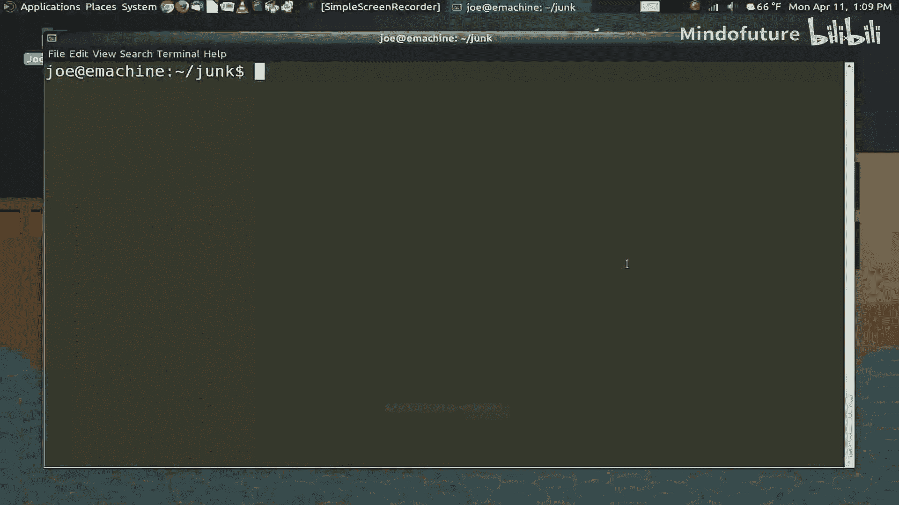

Greetings and salutations， and thank you for clicking on the video。

 Welcome to the second in our series of videos where we talk about bash basics。 This time around。

 we're going to talk about。😊，Reading and editing text files。

 And this is a very important thing that you need to learn how to do if you're going to be working in the bash terminal。

 Everything on a Linux or a Uni system is saved in some way or another as a text file。

 configuration files for the system， configuration files for programs。

 If you are going to write bash scripts， which are many programs that string a bunch of commands together。

And you can use them just like other applications on your system。

 You're going to have to do that inside of a text editor。 You will have to create text files。

 You will have to add lines to files。 So I'm going to show you how to use nanono a little bit later on in the video。

 But before we do that， I'm going to show you some pretty nifty things that we can do without opening any sort of editor at all。

 Okay。So I have recreated my folder here called junk。 And if we do an L S。

 I have created a file in here called junk doc text。 If I want to read that file。

 and I don't want to open up an editor， I've got several options。

 The first of which is a program called cat。 and cat is short for concatenate。

 And what it will do is， if you give it a bunch of text files。 after the command itself。

 it's going to go through those files， and it will put all of the output from those files on the screen。

 Okay， And right up front， that might not seem like。Something that's entirely useful。

 But if you have a lot of short little files and you need to know what's going on。

 then you can use the cat command to put them all together。 In this case。

 we're just going to get it to concatenate the junk dot text file。I have to put a dot there。

And it prints what's in that。Particular file out on the screen。 And it says nano is cool。

And it says nanono is awesome。And if I wanted to。Look at a file that was bigger。

Then let's say a few lines。 Then I really couldn't use cat because what would happen is if I accessed that really。

 really long file that way。Then what would happen is it would just roll right off the screen。

 And yeah， I could use the scroll wheel in a terminal emulator to go up and look at it。

 But if I need to manage it page by page， then I could do one of two things。

 The first thing that I could do is use a program called less。And less is actually more。

So let's go ahead and put junk dot text。Into the less program。And in this case。

 we only have two or three lines of text in there。So。Guess what， if this isn't really super useful。

Another thing that we can do is we can use the concatenate command， along with the less command。

And that way， we could take a whole string of files。

 and then you could use the less to page through them。 So the way we would do that is this。 Oh， well。

 before we do that， I'll show you that in just a second， let's create another file。

 So when we concatenate， we're actually going to be doing two files at a time。So to create my file。

 I'm not going to open up an editor or anything， I'm going to issue a command。

 and then I'm going to direct the output into a file。So I'm going to use a command called Echo。

 And all the echo command does is tight text on a screen that I put in quotations。

 So we've already got the nano theme going。So I put cat is great too。Okay， within my quotations。

And then I'm going to read。 I'm going to direct this into a file。And in this case。We'll call it junk。

2 dot。Txt。Okay。I got no output， so it did it。And now you see， we have two files there。

 So I'm going to use the cat command。To concatenate these two files。All right。So we're going to cat。

 junk dot。Txt。And。Junk。2 dot。TXT。So now you can see that it put all of that stuff together from those different files。

If the files that I put together are going to be so long that they're going to run off the page。

 this is what I started to show you before we created our second file。

 then I can use cat and the less command together。So I'm going to use cat。

And then I'm going to tell it what files to go to。Actually。

 I don't need need to retype them to show you another thing。 Use your up arrow。

 and it will show you the history of all the commands that you've typed in bash。

 So if I need to reissue that command， which is what I want to do there。 I'm just going to add to it。

 I'm going to use the pipe。 And what the pipe does is it takes the output of one command and puts it into the input of another command。

 And in this case， we're going to put it into less。So in this one line of text here。

 I've got a lot of things going on。 Firsts of all， I'm going to look at all the stuff that's in two files。

 and then I'm going to pipe it into the less program so that if this was a particularly long lot of text there that。

You see， there you go。So a real world example of using cat。Okay， so。Let's do cat。And like I said。

 this is good for short files。 We could use less or cat If you don't know how long the file is。

 anyre only looking at one， let's use less instead。Alright， so we're going to do less。

 and I'm going to tell the system where the file is， ETC。And then we're going to do FS tab。

And we're going to spell that correctly。 so it knows what to find。Sorry， guys。

 dyslexia is a terrible disease。

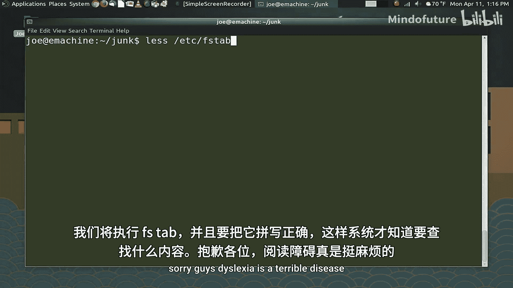

And this should open up this file and show it to us in less。

 And now we can just check out and see what's going on。 And when we're done。

 queue to exit and we're out。

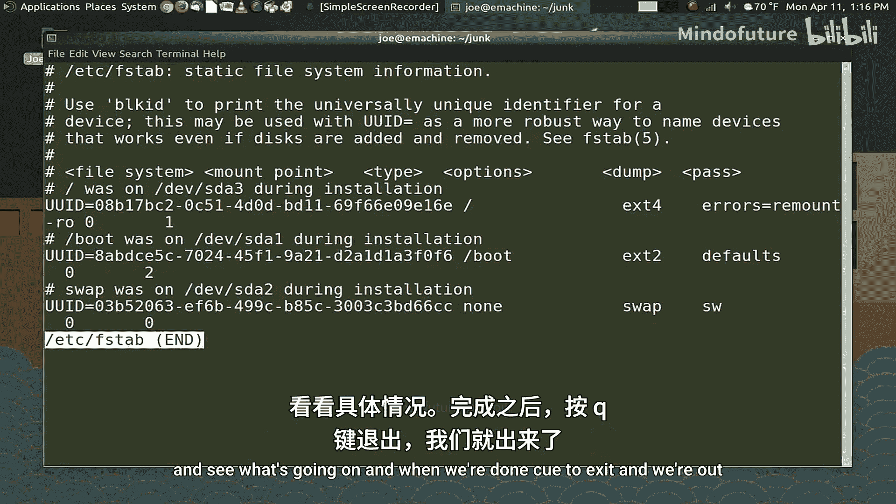

So it's very useful。 just to check configuration files on the system。

 You want to see what's going on。 That's how you would do it。So how would we actually？Eit a file。

 well。Let me show you another trick before I open up nano。 Okay。

 let's talk about adding a line to a bottom of a file。

 A lot of times when you are working with text files in Linux， really。

 all you want to do is add a line to it。You do not want to。Create。You know， have to open up the file。

 Sc down to the bottom。 You just want to put another line at the bottom of the file。

 So I'm going to show you how to do that。 So let me L S here。

And let's say that we wanted to add a line to the bottom of junk2 dot text。Here's how we would do it。

Echo。Remember， that creates text。Okay， and what I want to do。Is I want to append it。To the file。

 and if you put two little brackets there。Then that tells it to aend。 Okay。

 so let's do junk 2 dot text junk。2 dot T， X， T。 Watch what happens。I get no output。 So obviously。

 it worked。So， let's cat。Junk to dot T， X， T。Yep， type it incorrect correctly。See。

 and now it shows that I've added the line。So that's a basic primer on how you can manipulate text files without even opening up a program at all。

But。😡，It's a little bit more convenient to use an editor for most of us。 Now。

 depending on your desktop， you may have a nice gooey editor that you can use。

 but if you're working at a terminal anyway， you're going to probably want to use a command lined editor。

 And's a lot to choose from。 And they go from something that's completely unintuitive。

 like the V I or Vi editor or Vim， as it's called these days。

 or you can use something really nifty called Nano， which is my go to。 And I like Nano。

 because it comes installed by default on abuntu and Debian and archlin。

 which are the ones that I use all the time。 And I found it on fedora as well。

 becoming pretty universal。 So let's take a look at Nano。 to get Nano。 You just type Nano。😊。

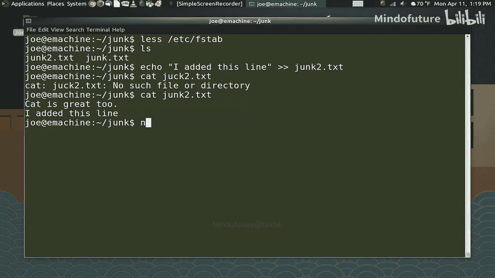

And now we can start creating a file。Okay， so I'm written a line in nano。

And if I want to save this file。Then I can use the control key and the O this will write out。

 and I'll give it a file name。And we'll call this。Anannott dot text。I don't want the extra dot there。

Although it wouldn't matter， I could leave that in there if I wanted to and enter to write out the file。

 And it tells me that we've written out one line。 So I have saved my work there to get out of nanono。

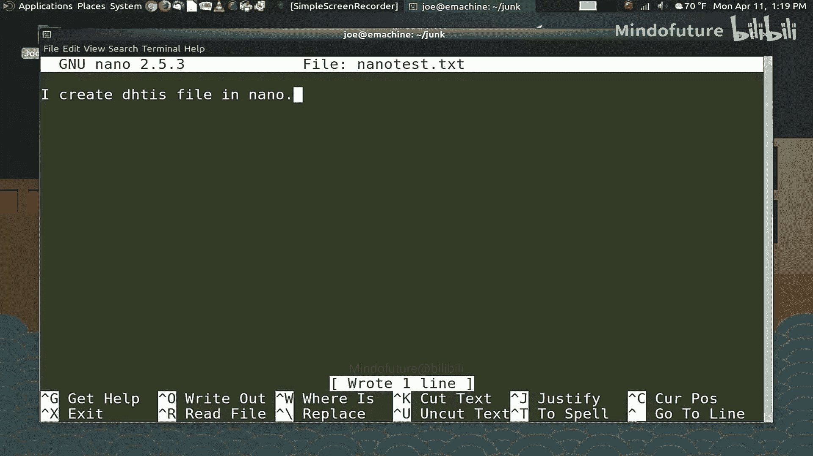

I use control and X， and I'm gone。So now you see that our file is created。So nanot dot text is there。

So to use nano to work on files in the system to actually be able to edit a system file。

 for instance， or a configuration file that wasn't in your home folder。

 you would have to do that with accelerated or rather elevated privileges。

If you are working on a system where you do not have administrative privileges。

 you can use nano to redef file， but you can't actually。You can， you can use it to redef file。

 but you can't change it。 So in that case， whether let's do nano。

And then we're going to go to ETC again。And we're going to look at F S tab。

 which is a configuration file。 And if I open this up， there it is。

 But I can't actually modify anything。 So if I come down here and， so you know， put in。

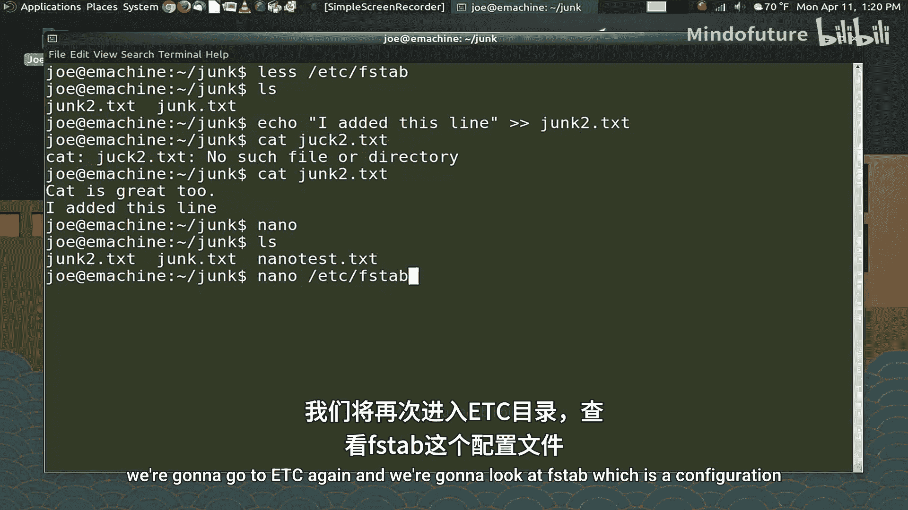

Okay。And if I try and actually modify this， it's not going to let me。Right。Says nope。

 you don't have the privileges to do that。 I can't change that file。

 And that's just to make sure that people don't go poking around and modifying things that they shouldn't。

 So let's exit out of that。 But what if we really did want to do this， okay。

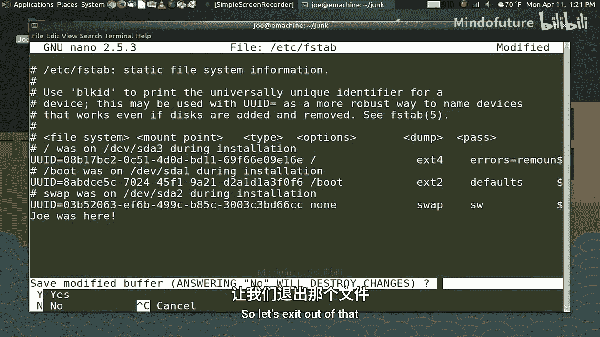

Then we could do it this way。 if you have administrative privileges。

 which most people watching this video will pseudo。Nanno。And then ETC。F， S 1。Okay。

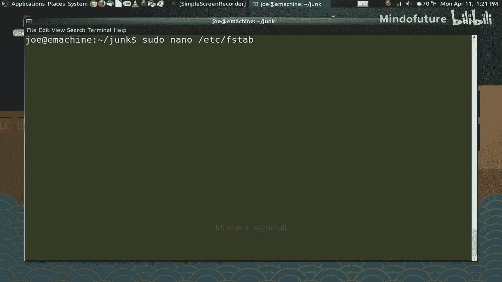

And it opens up the file。 And now if I make any changes and save them， they will actually save。

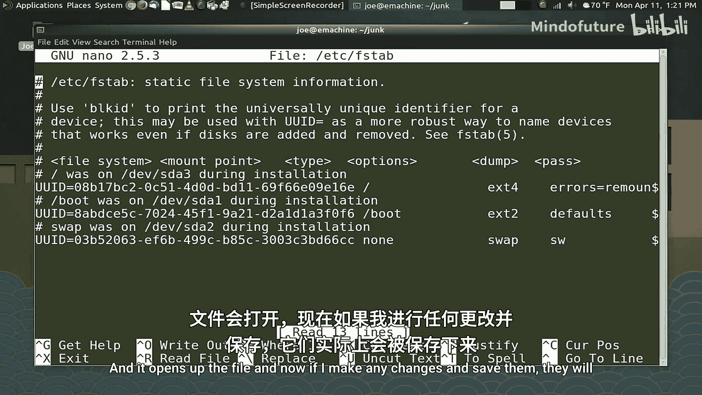

So that is the basics on how to use nano。And。Nanno is really a flexible tool。

 Those little shortcuts down there at the bottom。

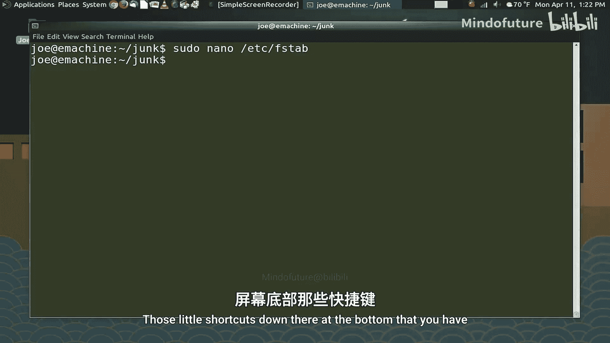

That you have those little shortcuts down there at the bottom。 They are quite useful。

 and you can move text around。 You can cut and paste。

 You can do pretty much anything that you want to do in a graphical editor。

 But you don't have to be in a graphical editor。 you are on the terminal。 And there you go。

 So that is the basics of manipulating text files and changing things in text files and a few tips and tricks on how you can do that。

 Now this is a skill that we will be using over and over and over again as we advanced through working on the terminal。

 In the next video。 We're going to talk about privileges。

 And we're going to talk about file permissions and how you work with them in bash。

 So stick around for that one coming up。 Thank you for watching。😊。

Be sure to check out Freedompenguin dot com， check out Ey Linux on the Web and check out E Linux on Facebook。

 And if you would， when you're there， give it a like。

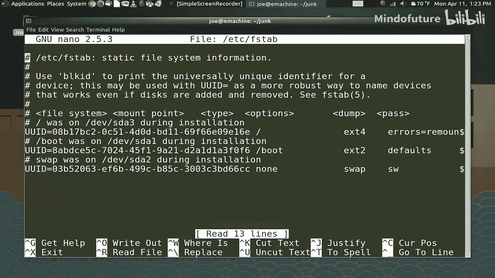