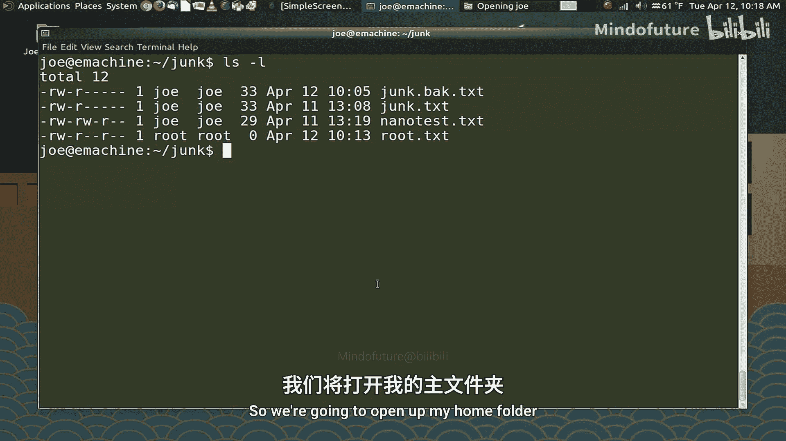
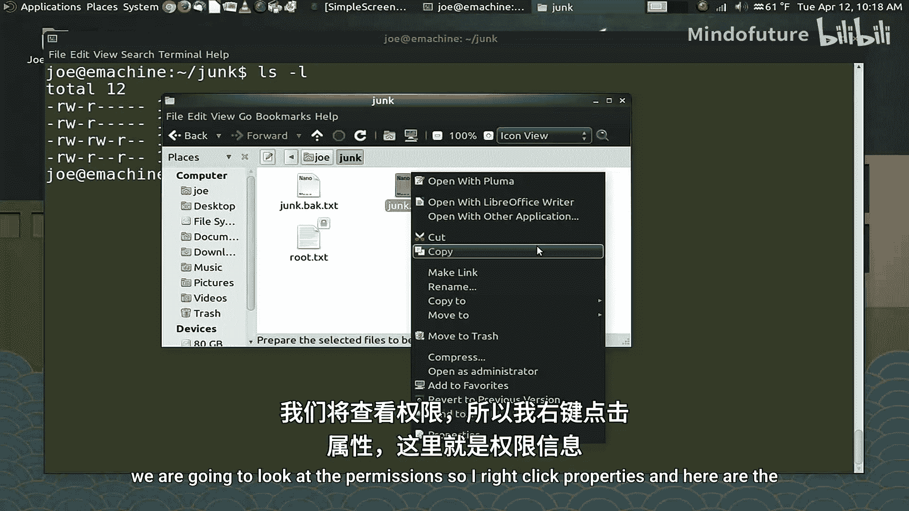
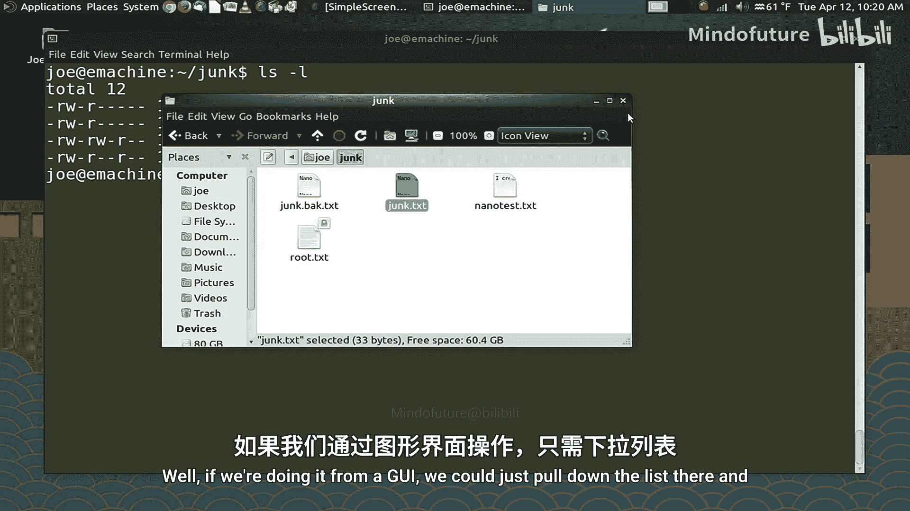
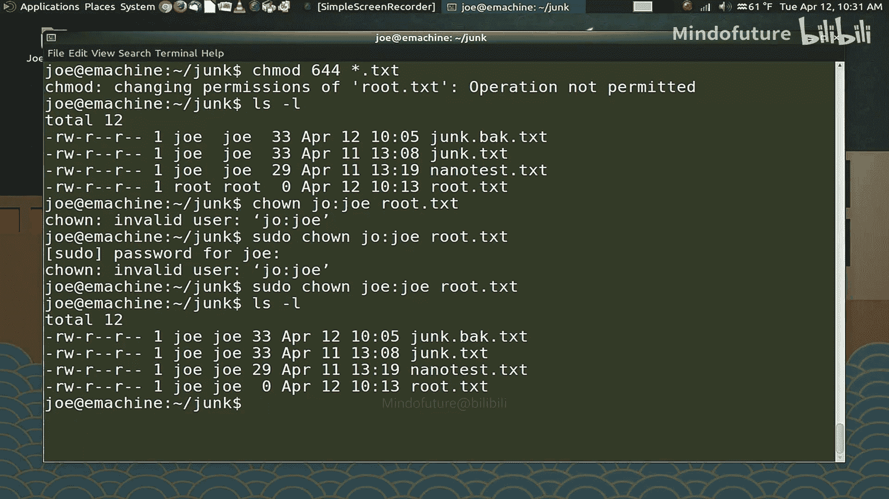

# Bash基础-｜-Bash-Basics-p03-P03_Bash_基础_第3部分_共8部分-权限与许可--BV1Tj6VBnEz3_p3-

Greetings and salutations。 Thank you for clicking on the video。

 and welcome to the third video in our series about bash basics。 In this video。

 I'm going to talk about using elevated privileges as the super user and we'll talk about file permissions。

 But before we jump into that， I've got to correct an error I made in the first video。

 I forgot to show you a rather important command。 I was trying to cram so much into that first video。

 I guess I just skipped right over it。 That's the copy command。

 And the copy command is used to create copies of files and folders or directories。

 And I'm going to show you the really super basics of how it works here。

 And it's very useful to have， of course， to create a copy of a file。

 especially if youre working on a configuration file， let's say。

 And you are not really super sure if you are。😊，Going to be able to get whatever you're trying to change to work。

 You want to make a copy of the file so that you can get back to the original file if you have to。

 you can just rename it， restore it or whatever to do that。 So I'm going to show you how to do it。

So the command is C， and we're going to copy junk dot T X T， and we're going to。

Copy it into a file that we'll call junk dot back dot TXT， okay？And if we run L S again。

 you'll see that now we have that extra file there。 And if we have to， if we mess up junk dot text。

 we can always delete that and then move our backup file to the original file name。

 and we're back in business。 It's just that simple。

 You can also use the Cp command to move files to another。

Location in the file system and another directory。 So in this case， we are going to copy。Junk dot T。

 X， T。 We're going to put it in our home directory， which is represented by Atilde。

 And I'm going to add that slash just so the system knows for sure that I'm not trying to copy a file into a directory which you can't do。

 I mean， like， actually physically change a file to a directory。 No。

 I want to put the file in the directory。And if I go up one level now， and I type L S。

You'll see that it now shows up。You can also use a wild card to move a whole group of files or copy a whole group of files or remove a whole group of files or whatever you want to do。

 so in this case I am going to issue that same command that we used before。

But instead of putting junk dot text。I am going to add the star。嗯。There it is。

 and we are going to do this。So let's go up one level to our home directory， LS。

And now you'll see that it moved everything with dot text at the end。

 And that is how you can do these things in batches using wild cards。

 also known as regular expressions。Be careful with those， though， because if you're not careful。

 you can wipe out half your file system or blow out your entire music collection just by putting in。

 you know， R M star dot MP3， It all goes away。 regularular expressions can be as precise as a surgeons scalpel。

 or they can just。Blow a whole bunch of stuff out。 So I encourage you to learn more about that elsewhere。

The one that I use all the time is the star， which basically means you can take a file name and whatever the star represents whatever comes before or after something。

 So， for instance， if I wanted to remove。Star dot， B， A K。Dot T， X， T。Well。

 the only file that has that in here is that one。 So will L S。

And if I wanted to just remove everything。That was a text file。Then I could use this this way。但。

And file S， you'll see that we don't have any more text files in the home folder。

 So that's an introduction to using the copy command。 And you can play with that All you'd like to。

 The next thing we want to talk about is using elevated privileges。To execute commands。

 We need to talk a little bit about the root user in abotu， especially in abountu。

 when you install the system， a root account is not created。 It does not ask you for a root password。

 What it does is it creates the first person， when you install it， it asks to create a user account。

 And it assumes that that person is going to be the administrator。

 and the administrator can act as a superus。 You can also set other accounts on the machine to be administrator。

 So you can have more than one， but it's not usually a good idea。

 you really want to have one person that has total control over the system。 Now。

 in more traditional Linux distributions and Uniix distributions。When you install the system。

 it asks you to set a root password， which means that the root account is activated and you can log in that root account and act as the root user。

 The reason why in Uuntu and anything that's based on Uuntu like Linux Mint， Linux light， so forth。

 that this is not done is it's an extra security feature。

 If the root account is disabled on the system， It makes it difficult for somebody to hack into the account and become the root user and。

 of course， the root user has absolute control， they can read， write， delete ad programs， whatever。

 So that is why it's done that way。 You can also set up Manjeero。

 when you're installing it if you use the。Installler option not to create a root account。

 and it will set it up the same way。 But more traditional versions of Linux actually have a root user。

 So in aununtu， if we want to do something as the root user， we use the Sudo or Sudo command。

 and it stands for superus do。 And so if I wanted to execute something that required elevated privileges。

 I would put Sudo before that command and then I would be able to do it as root。

 So let's try and execute a command without giving it root privileges that needs re privileges。

 And I'm going to use apt。Auto remove for this example。

 which is a command that goes through and sees if there's any programs that are installed on your system that you don't need anymore more。

 In other words， we're talking about like orphaned packages that another program depends on。

 but it's not needed because that programs gone。 So if I issue this command without any elevated privileges。

 it just says， I ain't going to do it because I'm not the route。 As a matter of fact。

 it asks me at the end， Are you root， No， I'm not。But if I issue that command with the Suu。So。

 we'll do at。To。Remove。Okay。And it's going to ask for a password。This is my administrator password。

And I。Oh， misspelled something somewhere。All right， now it works。

Can't type and talk at the same time。 But you guys already know this。 Okay。

 so you'll see that the command worked properly and we didn't have anything to remove from the system。

So that's how that works。 If I issue that command again。Very quickly here。 It'll just run。

 It's not going to ask for my password because when you put your administrator password in to activate Sudo。

 it actually starts a timer。 So if you execute one command and then execute the next command with the Suu prefix。

 it's going to assume that it's still you。 And that just makes it more convenient。

 So you don't have to type in your password again and again and again。

 But if you walk away from it for about 30 seconds。

 it's going to assume that you're not using administrator privileges anymore and it's going to time out。

 So that's how that works。You can if you are going to be doing a lot of stuff as the root user kind of。

Go you can become the root user， but you're not really the root user。 Okay。

 you're just emulating the root user。 and the accepted way to do that in abuuntu is to。Issue。Su S。

All right。 And you'll notice some things changed here。 Firstst of all。

 I am now listed as being root at E machine。 and that little dollar sign turned into a hashtag。

 That's because I'm doing everything with elevated privileges。 So now。

I can issue our example command without typing Sudo first， and it just does it。All right。

One of the things that'll throw you off a little bit here is that the root user and your account have different bash histories。

 So if you're used to just going up and finding a command that you just issued that way。

 If you switch over to root， guess what it， it may not show up。 Now， while I'm here as root。

 I want to set ourselves up for something we're going to talk about in the next video and or the next part of this video。

 And so what I'm going to do is I'm going to navigate to junk。And I'm going to create a file。

And we're going to call it root dot TXT。So I have created that file。

 and we can list storage to see that it's there。 Now。

 once you get through playing around as the route user。

 you want to get back to being your normal self。 Just type in exit。

And it dumps me right back at my home folder and。Now I'm just me and you can see that because the little dollar sign is there now and that changed。

That's where I am。Okay， couple of things to talk about before we move on。

 talking about user doing things with elevated privileges。

 The super user or root account on a system。 They have absolute control。 The root user can。

Do things to the system that will actually trash it。 You can remove system files。

 You can install malicious software is route。 You can do all kinds of things because you have absolute control。

This is the reason why you have to be very careful。 You get one command slightly off。

 you forget something， and you could easily trash the system。

 So be very careful when you're running its route。 Second of all。

 it's a good idea not to have a whole bunch of people on the computer be an administrator。

 You really want one person to be in control of that。 you know。

 so when you're setting up your account and you're going to be adding other users。

 make sure that they are not administrators that they are regular desktop users。

 And if they want to add programs， take things away or whatever the deal is。

 then they need to come to you first that way， you know what's going on。 in certain situations。

 I can see giving somebody else administrator privileges。

 let's say that it's an enterprise system and you have two cis admins。

 So you know you have privileges and the other guy does and you two work together to make sure the system is working。

 but don't just give every person on the computer administrator privileges because that can really be。

A nightmare。Okay， the next thing that we want to talk about。

 and we just set ourselves up for this is file permissions。In Linux。

 file permissions are strictly enforced， oops。There we go。 I't know why I did that。

Let's list what's in here。 They are strictly enforced， whereas in windows。They。

 you can set file permissions， but they're usually not very strictly enforced。

 So when people come to Linux from the Windows environment。

 they can get rather befuddled by the fact that all of a sudden。

 they can't do something with a file or they can't read it or copy it or whatever。

 And they don't know what's going on。 So we're going talk about that。

And I'm going to show you how you can modify file permissions from。The command line。

So the first thing that we want to do is go ahead and L S everything in here。

 And to see the permissions on a file。 we use the long form。

 and there are our files in the junk folder。 And all of this gobbledyg over here shows you the permissions that are on a file。

 Okay， and what you're looking at is。3 groups of three。

 The first dash there is a bit that is set that tells the system whether this is going to be a directory or whether it's going to be a file。

 So if you look at this list and it's a directory， you'll see a D there。

 And then the next three after that are the files owners。Permissions。

 So the person that actually owns the file， this is what they can do with it。

 And then the next group here is going to be what the group can do with the file。

 And the last group is going to be what everybody else who can see the file can do other or also that's called world permissions。

 Okay， so anybody who can see that file can do。 whatevers in the world permissions。

And you need to be able to change these。 This is actually a little bit easier to explain if I cheat and open up a goi here。

 So we're going to open up my home folder。

And then we are going to open junk。All right， now you see these files in here。

 and I'm going to pick this file， and we are going to look at the permissions。

So I right click properties。And here are the permissions。 And as you can see， the owner of the file。

 which is me。Can read and write People in the group can read only。 It belongs to the group， Joe。And。

The folks who are accessing the file from anywhere can do nothing with it。So， first of all。

 let's talk about groups because that is a concept that is。

Something that people who are new to Linux and Uni can sometimes have problems with as well。

The way that works is you can take a file and you can assign it to a group。

 Everybody who is a user on the system is a member of several different groups that allow them to have access to files and actions on the system。

When your account is created in Ubuuntu。You automatically are put in your own group。

 So there is the user， Joe， and then there is the group， Joe。

 So if I add another user on the system to my group， they're going to be able to read these files。

 if that is the way the permissions are set。 Now， for a small desktop using groups to。

Block or allow access to certain people on the system doesn't really make a whole lot of sense。

 because you probably only have maybe at most two or three users。

 But if you are in an enterprise system， a really big computer with lots of terminals and lots of people working on it。

 Then you can create groups like Project X， for instance。

 And everybody who is concerned with Project X will have access to files that belong to the group called Project X。

 So that's how that works。 And it's a bit complex。 and like I said。

 it really doesn't make a whole lot of sense for a really small computer system。

But it's something that you need to be aware of anyway and。So there it is。 Now。

 how do we change these permissions。 Well， if we' doing it from a GuI。

 we could just pull down the list there and we could change them to read， read and write。

 and you'll also have noticed there that there's a little tick for execute。

 which means that we can make the file executable in Linux。

 there's no distinction between file extensions and whether a file is executable。

 So it's not like in Windows where if a file has dot EX or dot com on the end。

 the system automatically knows， hey this is a program。

 you can set the executable on your wedding picture if you want to。

 and you can try and run it as a program in Linux， it's not going to work。 Of course。

 And if you do have a program that is set as an executable。 And then you remove that excutable bit。

 it won't run okay。

And that only becomes useful a little bit later on when we're talking about scripting。

 So if we want to change permissions on a file and we want to do it from a command line。

 how do we do it？We use a command called change mod。Or C， H mod and。The easiest way to do this is。

 numerically。It's the hardest way to understand how what it's doing。

 but it's the easiest way to create a group of file permissions with change mod。

 So let's take our file， for instance， that we were looking at junk dot text。

 And I want to change the permissions in that to where。The owner of the file， which is me。

Can do everything to it。 I can。 I'm going to set this as actually being an executable for this example。

 So I type in the number 7。 And what we're doing is we're setting bits。All right， so。

Each one of those groups represents a byte， and we're going to set bits in the byte。

 So the read attribute。It represents， it's represented by 4 Bs。 Okay， it's worth 4 Bs。

 And then the right attribute is represented by 2 Bs。

 and the execute attribute is represented by 1 B。 All right， so if I put 7 in there。

 that means that that first group， the owner， which is me， will be able to read， write and execute。

 And let's say that I want the group that it belongs to， I want。Those people， in this case， it's Joe。

 I want them to be able to。Read and write the file， but not execute it and everybody else。

I don't want them to be able to do anything to it， okay？So then we put the file name in。Okay。And。

Turn it loose。Oh， I need to L S L to see that。 Now you'll see we've got exactly what we wanted there。

 That file can be read， read， written and executed by the owner， read and written by the group。

And nobody else can do anything with it。Okay。So that is how you just the quickest down and dirty way to change it。

 There's another way to do this。 And I actually find this to be a little bit more confusing。

 And in an earlier take of this video， I screwed this up royally。

 So I hope I get it right because I never do it this way because it's just not as easy to do。 Okay。

 so we can use change mod again。And we are going to say that the user now on that file。

Will not be able to execute。 So we're going to remove the execute bit。Okay。

And then we're going to say that the group。Can no longer。

We don't want them to be able to write to the file。

And we're going to leave the world group alone there where there were the world permissions alone。

 So let's see if this works。Junk do TXT。Okay。And see， I didn't even get that right。 This， for me。

 is much harder to do。This is much harder for me to do。

 So let's try and execute something a little bit simpler here。Oh， I did get it right。

I did get it right。 I just。Did change mind wrong。Okay， let's try that one more time， gang。All right。

 so we want the group to no longer to be able to。Right， and we're gonna do junk dot T X， T。嗯。Now。

 try it。 See， I can't。Make this work。And I'm not even going to try。But okay。

 let's just try a simpler one。All right。Which is， let's do C， H mod。Okay。

And I want to minus x for me。Now it worked， okay。So。

That's why I don't do it that way because I always get it wrong。

But if that's something that's easier for you to do， then that's fine。

 But I do use that format sometimes when I'm working on scripts。And so， for instance。I can。

Change that to a plus。If I just want to make that executable， I'm only adding one attribute， right。

There you go。 That's the reason why I don't do that。 I always get very confused。

And you can look at the manual page for that particular command and figure out how that works because。

 like I said， I never do it that way。So that is how you change file permissions on files。 Well。

 one of the nice things is， is that I can do that to a whole group of files。

 So let's clear the screen。And now I'm going to change the permissions on all of the files that are in there。

 Okay， so we'll do C， H mod。Spell it right this time。 Please get yourself all mess up that way。

 And we're going to say that we want all of these to be。嗯。Let's see。 we want 6，4，4。

 which means that I'll be able to read and write。And then everybody else will be able to just read the file only。

 So we're going to use 6，4，4。And then I am going to use an regular expression or wild card。

And start out TX T。Okay。😊，Now can't do root dot text， but let's see if it did it on the other ones。

 because that's the next thing I'm going to show you is I'm going to show you how to change owners on a file。

Yes， it did it。 It did exactly what I wanted it to do， except for the file called root dot text。

 So it returned it pretty much to the the standard there， which is what I wanted to do now。

Sometimes it becomes necessary to change a file's ownership。

 Let's say that you want to give a file to somebody else。

 The only person that can change the ownership of a file is the root user。

 it has to be done with elevated privileges， or it won't work。

 but you can change permissions on your own files， but you cannot change permissions on anybody else's file。

 So if you wanted to do that， you would have to make a copy of it into your folder， you can do that。

 You can copy from somebody else's stuff。 and you bring it into yours。

 and now it automatically becomes yours that works as long as long as the。You know， the。

 the read permission is set on the other file that works。 Okay。

 but you might want to actually change the owner entirely of a file。 So in this case。

 I created that root file， and you'll see that it is owned by the root owner。

 and it's in the root group。 So we want to change that。 So let me make that file。 mine。

 I'm going to give it to myself。And the。Command to do that。Is。Change， own。

 And I want to give this file to myself。And I want it to be in the group called Joe， too。

 So we put Joe and a colon and Joe， which means that I'm going to give it to myself。Okay。

And the file， of course， needs to know。Okay。AhW didn't that work？It didn't work。

Because I didn't do it with elevated privileges。你 fix that。2。There we go。 I finally got it to work。

 Okay， so L S。😊，然。There you go。 All right。 So now everything here is owned by me and everything has all the same permissions。

 And that's how you do that。 And I realize that this did not go perfectly。

 but I'm not going to do it again。Cause I've already done this video about three or four times。

 But you know what the truth of the matter is， is that when you're working at a console。

 if you don't do this every day and you're learning your way around。

 you're going make these kinds of mistakes， which is perfectly okay。

 So I'm actually showing you the way it is in reality， folks。 It's not always。

 I'm supercomputer nerd and I know every command and you just type it in。

 This is kind of a different way of working on things。 And like I said。

 I've found a way to use change mod。 I just put the numbers in。

 and I can do that over and over again。 If I use the other way to do it。😊，I always get messed up。

 which I did in this video。 So it's a very real world example。

 Maybe for you doing the math and trying to figure out all the numbers is not the best way to go。

 You may want to learn the other way of doing that where you assign the permissions 1 B at a time that way with the。

Different kind of syntax。 So anyway， that's enough for now。 man。 thank you for watching the video。

 And we're going to do another in this series next time around when we look at bash。

 we're going to talk about finding the information that you need and how to do things。

 We'll also take a look at finding files and programs on the system。

 So I hope you'll check me for that one coming up soon。

 Do check out Freedompenguin dot com for more about Linux。😊。

Check out easylin dot com on the Web and easy Linux on Facebook。 And if you would， when you do that。

 give it a like。 Thanks for watching。

