# Bash基础-｜-Bash-Basics-p04-P04_Bash_基础_第4部分_共8部分-查找文档与文件--BV1Tj6VBnEz3_p4-

Greetings and salutations， and thank you for clicking on the video。

 This is the fourth video in our series on Bsh Bas In this video。

 we're going to talk about finding information about commands and programs that are installed on your system at the command line we'll also talk about finding programs that are installed and how to find files and things in those files。

 using some pretty simple command line tools。😊，So far。

 we've talked about navigating the file system in the earlier videos here。

 we've talked about creating and modifying and removing and moving and copying files。

 and we've even talked about using elevated super user privileges to issue commands and we've talked about the file permissions and how you can modify them。

At this point， it's a really good idea for me to tell you about how you can find information about the commands that you'll actually be using in the programs that you'll be running in bash。

 because a good system administrator is not necessarily one that knows everything off the top of his head。

He needs to know where to get the information。 So he knows how to use the tools that are available to it。

 So if you're in a situation where you know， a command will do something that you need it to do。

 but you're not quite sure how to make it do that。 You can ask the man。Use the man system。

 The command is man， man， which is short for manuals。

 And we are opening up the manual page for the manual command here。

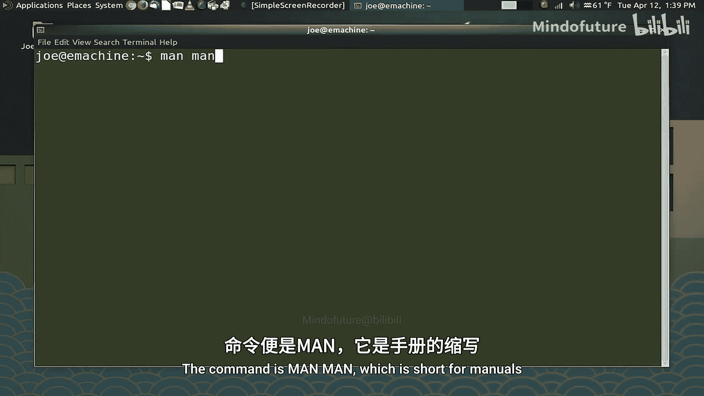

Which is a very nice place to start。The manual pages on your system are very useful for quick reference。

 If you want to know more inep things about programs that are installed on your system。

 I would suggest that you get to a box that has the Internet。

 and then you can look that documentation up online。 But for quick reference。

 the man pages are often a big help。 So let's look at some man pages。

 We have a man page for the move command here。 We have a man page for H top。

 which is a program that I have installed on the computer that runs at the command line。

 We even have a man page in here for Firefox。 pretty much all of the programs that you have installed on your system。

 will'll have a man page If they have something to do with running at a terminal or you can。

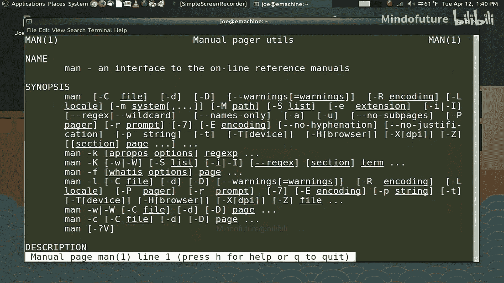

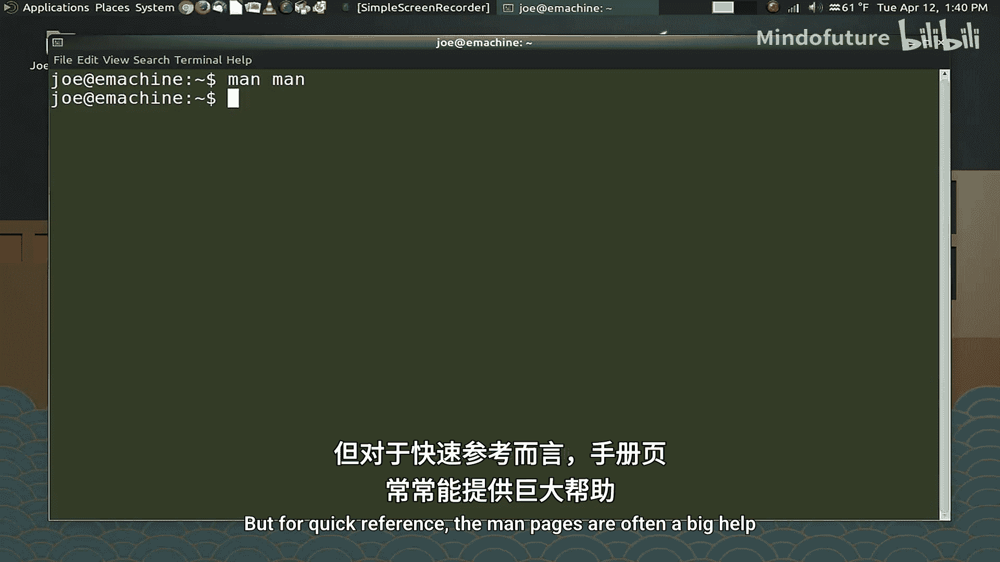

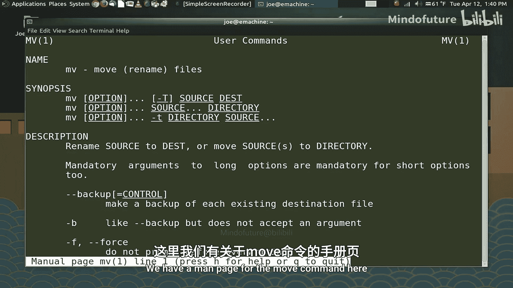

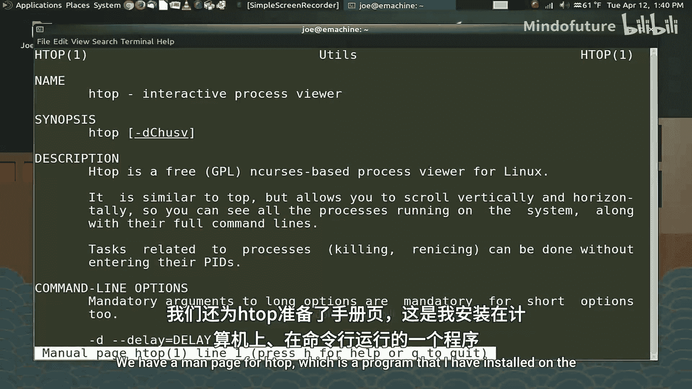

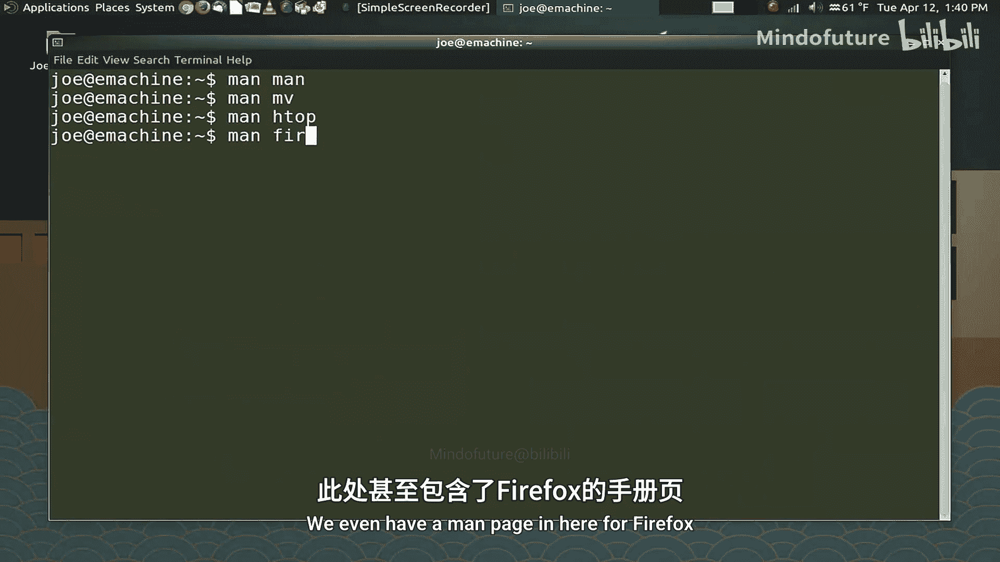

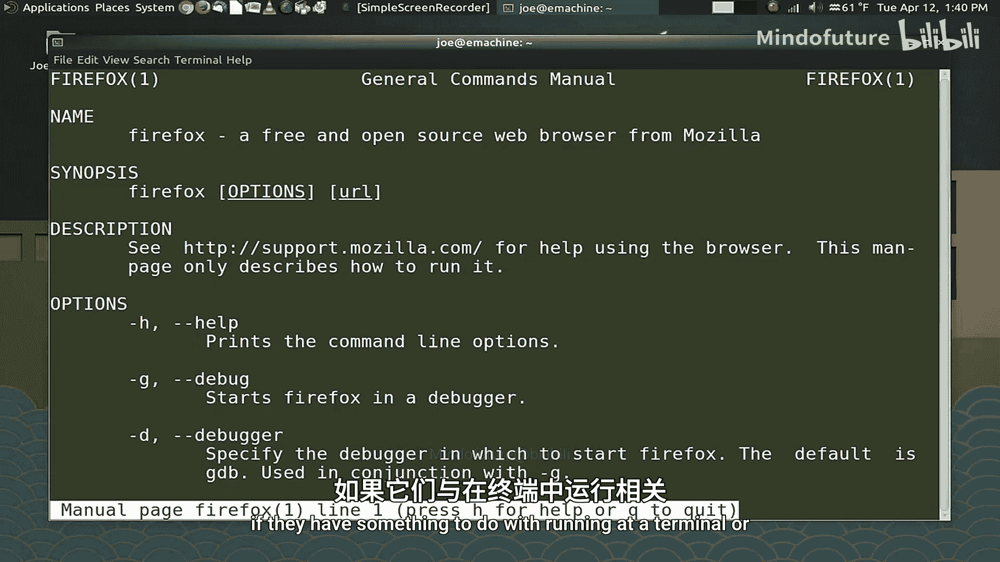

Fire them off from a terminal by typing in a command。Some programs， like Bach bit here。

They run in a goi interface， or you can use them from the command line as well。

 So they have a man page。

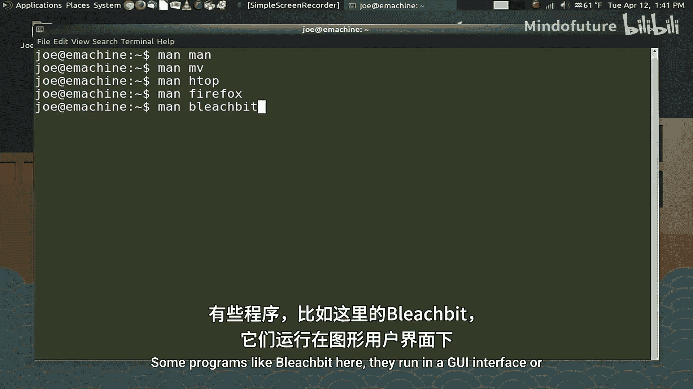

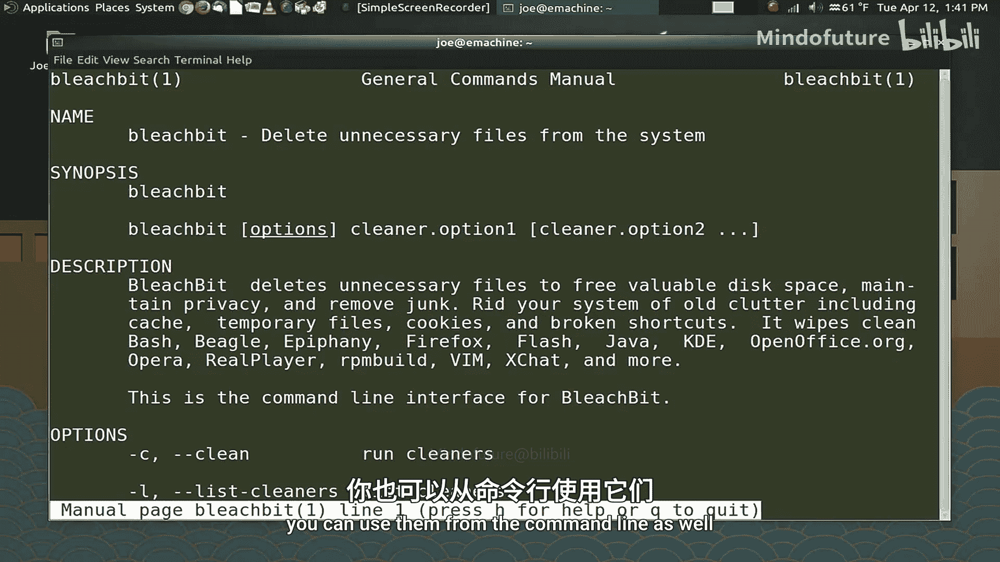

Not every program or every command on your system may have a man page。

 Some of them don't really simple stuff like the change directory command C， D。 No man page for that。

 okay。The man pages are not the only place that you can look for information。

You can also look in the info system， and it works pretty much the same way。 So you type in info。

 And in this case， we're going to look for information on the move command。

 We get a very similar page we saw of in the manual system。

 But there might be more information there or it might be worded a little bit differently。

 So if you're not finding what you're looking for in Man， go ahead and try info as well。

 These are two systems that keep up with documentation for your programs on Linux。

Very nice thing to know about。The next thing that you may want to know about is how to find a program that is installed on your system。

Maybe you think a program is installed and you type the command in and it throws out an error and says it can't find it that there's no command。

 but you know it's there。And maybe you're thinking to yourself， well， did I accidentally remove it。

 Did it not get installed。 Is it somewhere where it shouldn't be， Here's how you can find out。

 typey in which。And in this case， we'll look for H top。

And now it prints out the path where the H top binary lives。 In this case。

 it is slash US R slash bin slash H top。 very good information to know。

 especially if you're writing scripts and you want to put absolute paths to the commands that you're using in the script to make sure that there's no confusion。

 Let's talk a little bit about paths and why that's important when your terminal boots up， it。

Opens up a variable path statement that tells bash where to look for commands when you type them in。

To see what your're。Variable is All you do is type in dollar sign and path in all caps。

 and it will print that variable on the screen。 And in our case here。

 it is looking in many different folders or directories for programs。

 We have USR slash local slash Spen。 We've got local s bin。 We've got USR slash Spen。

 So these are all of the places where a program that is installed on your system might live。😊。

You'll notice here that your own home directory is not listed。

 And that's done mainly for security reasons。 Just in case somebody slips some nefarious code into your home folder。

 and then you type in the command。 I mean， they could write a virus program。

 and then they could rename it M V。 Okay， and the system is going to automatically look in your home folder for anything before it looks anywhere else。

 So it will override。The actual move command that's living in one of these directories listed。

Now you can add other places in your path statement for to look for commands。

 But that is way beyond the scope of this tutorial。 That's a very advanced thing to do。

 And it involves editing the bash or C file， so。Not going to talk about that。 But essentially。

 that's how that works。 And sometimes when you know a program is installed and you type it in。

 it just might be in the wrong place。So to get it to run。

 you have to type in an absolute path or reinstall it and put it where it belongs。

 something like that。 Okay， so that is how we figure out what programs are installed on our system and where。

The next thing we're going to talk about is finding files on your system and this is pretty important because。

 you know in your goUI interface there， you can scroll through the list you can there's fine tools in your manager maybe on the menu you you know your file manager has a tool there that's got a search tool there might be one on your。

Actual menu for your。Desktop environment。 But when you're at a command line。

 you have to use the find tool to be able to find files。

 You can find using all kinds of parameters you can find by the size。 you can find by the name。

 you can find by the date。 All that kind of stuff。 We're going to keep this real simple。

 So I'm going to go to C， D junk。Okay。And let's pretend that instead of having just four little files here。

 we've actually got thousands of files in here。And we could scroll through a big long list of files that we got from the output of the list storage command。

 or we can just。Run a search to see whether it's here。 So to do that， pretty simple。 just find。

 tell it。 We want to find it by name。 And now we're going to give it the name of the file。Okay。Bam。

 it tells us that it's here， and it's also telling it， that it's in the current directory。

 That's why we have the dot， dot and the slash。 So pretty cool there。

 That showed us that the file actually exists。 We can look in other directories for files。

 So let's go to find。 Then I'm going to tell it in this case， we're going to look in E T C。😊。

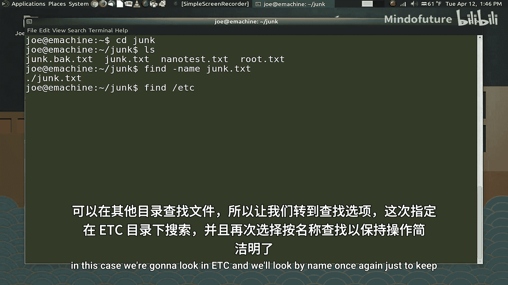

Emma look by name once again just to keep things nice and simple。

And we are going to look for the file called FS tab。F S tab is a configuration file。

 we've used it as an example before。 So it's going to go out， and it actually finds it。 In this case。

 it throws up some errors， though。 there were some folders in there。 It couldn't look at。

 And that is because we do not have permission to look in those folders because we're not running as an administrator。

 We're not the super user。 So if I would do the same search。

 which I'm actually not going to do because it would probably take it forever to find it on this older computer。

 if I would tell it， I want to look through the entire file system for a file named F S tab。

 I would turn it loose， and then it would probably kick out a whole bunch of errors。 okay。

As a matter of fact， it's looking right now。I can hear it going。

 kchug Ka chug as it looks through the file system。 So let's go ahead and stop that。

And we use control C to cancel that because we really don't want it to look through the entire file system。

So that's the very basics on how to use find， you can also use find with regular expressions。

 so in other words， if you want to look for every text file that's in a director， you can do that。

 but you have to kind of change how you the syntax on that and I urge you to look that up if you want to use it that way。

So let us now talk about finding things within files， especially text files。

 And this is really important。 Sometimes you find yourself in a situation where you have a really big。

 long text file and you're wondering whether there is a piece of information in there。 Okay。

 you need， In other words， you need to just find a line。 You need to just confirm that this is there。

 or you just need a certain information out of the file。 And for that。

 we're going to use the Grep command。

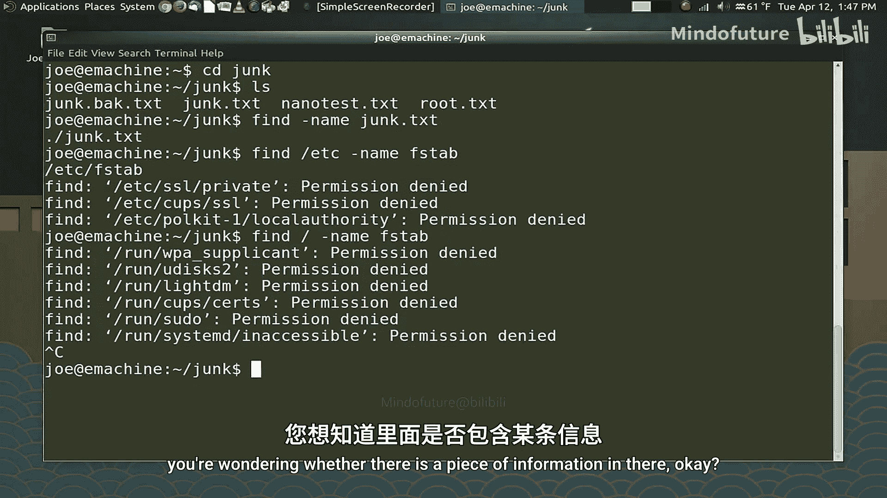

And Grp， in its very simplest form， is Grep。 And then we're going to tell it what we want to look for。

 Okay， so in this case， I'm going to have it look for the word nano。

And then I'm going to have it look in the file， called junk。Dot T， X， T。

And what it's going to do here is it's going to return all of the lines that are in that file。

 And you see now it says Nano is cool。 Nano is awesome。 So let's cat that file。😊。

Now we see that those are the only two lines in there。So in this particular example。

 Grep is not terribly useful， but if you're trying to find some information that is in a really。

 really long file， then Grep is a nice tool。 if you want to learn more advanced ways to use Grp。

 I suggest you look at the manual page for Grp and you can look at all the different options because there are tons of options on Grep。

 you can also use Grp to go through a file and find everything that refers to particular， you know。

 like you could take a really long database file， And if you want all of the information about Bob Smith。

 it can look for every line that contains Bob Smith。

 and then you can have it dump it into another file and then you have generated all the results out of that database in a nice convenient file。

 and you do that by piping the output of Grp into the input of something like or just。

Put it into a file。 So let's do that just for an example here。Alright。

 So let's say that I want to go through a really long database file。

 and I want to generate a file that has all of the entries that have to do with something。

 And we're gonna do this here， even though it's kind of silly to do it on such a short， small file。

 So let's go back up and we'll grab this command again。It's going to look for everything that's nano。

 I'm going to pipe this。 Actually， I'm not even going to pipe it。

I'm just going to redirect the output into a file， and we'll call this file Gr。Dot TXT。Okay。那。

I didn't get any output on the screen because I put it in the file， L S。 and there is Grep dot T X T。

 So what I can do now is I can open GrP。Just open it nano。

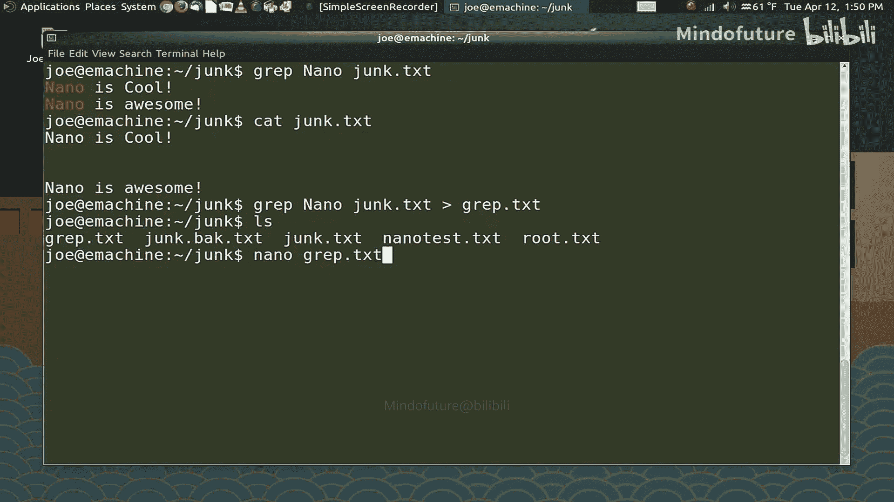

And there is all of the information that has the word nano in it using that command。 So。

 it's a very basic way to use the Grt command。And that is going to be about it for this video。

 In the next video， I'm going to take a look at managing user permissions。

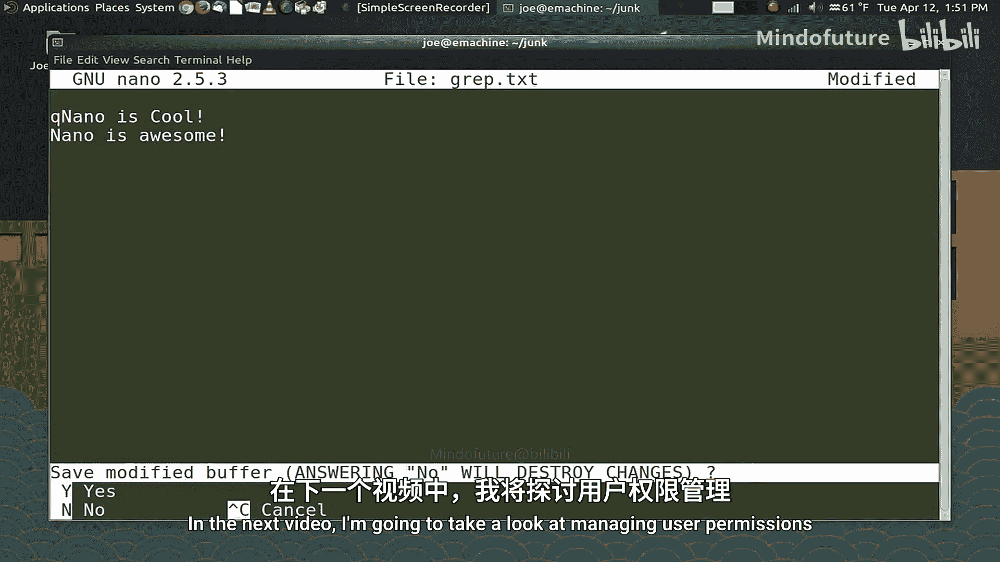

Our I'm actually talking about creating users。 and I'm going to talk about removing users。

 and I'm going to talk about。Changing passwords for users and also setting groups for users。

 We're going to take care of that in the next segment as we go on to part 5。

 Thank you for watching the video， gangang。I've gotten a lot of really good comments about this series。

 It seems people are really enjoying this。 So we're definitely going to keep it going。

 Be sure to check out easy Linux on the Web， check out easy Linux on Facebook。 And if you would。

 please give it a like。 Also， check out Freedompenguin dot com for all kinds of interesting articles about Linux。

😊。

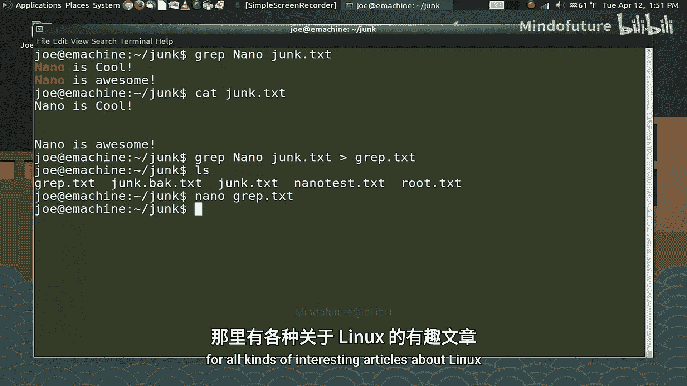