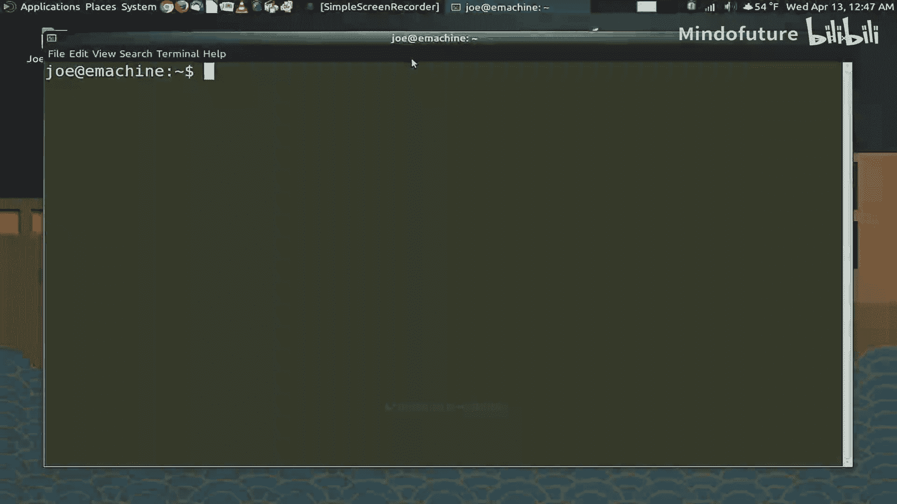
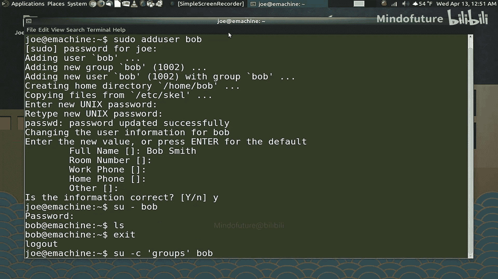
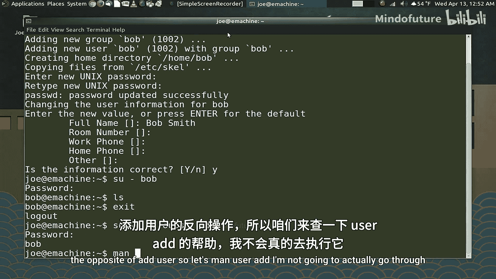
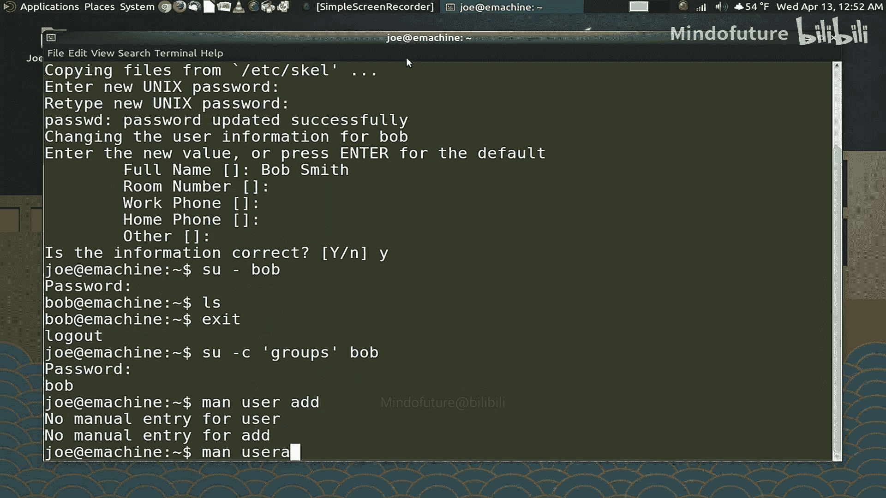
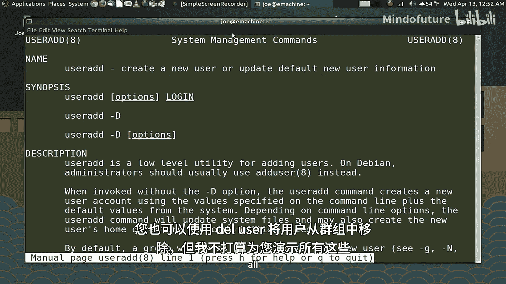
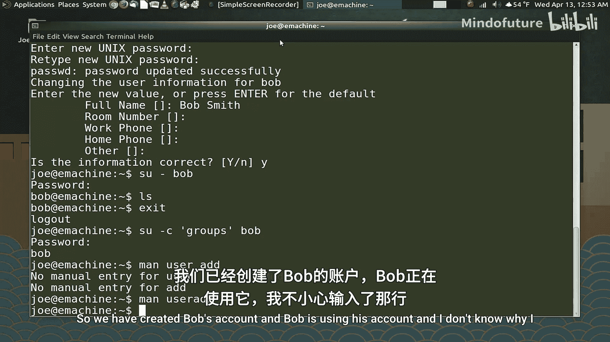
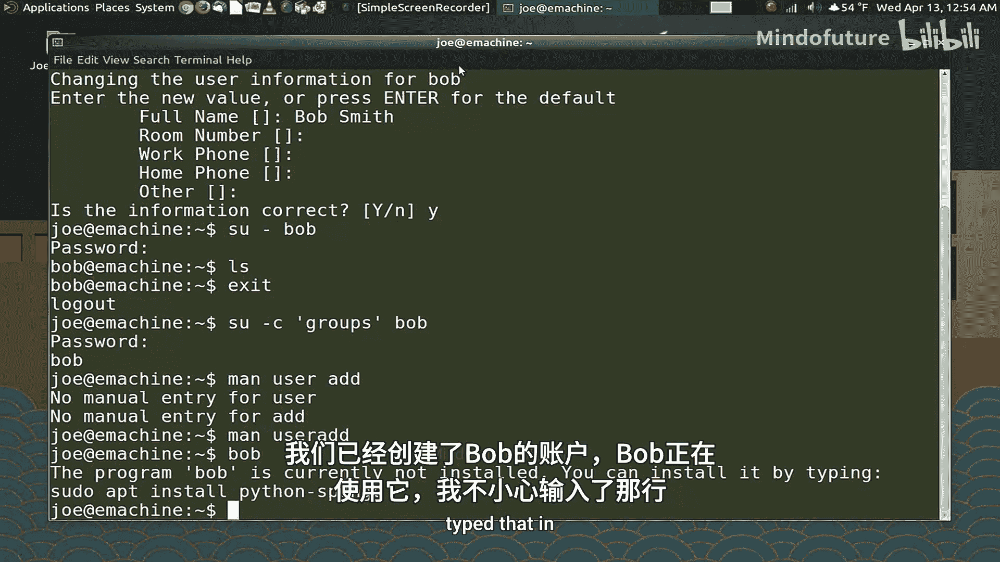
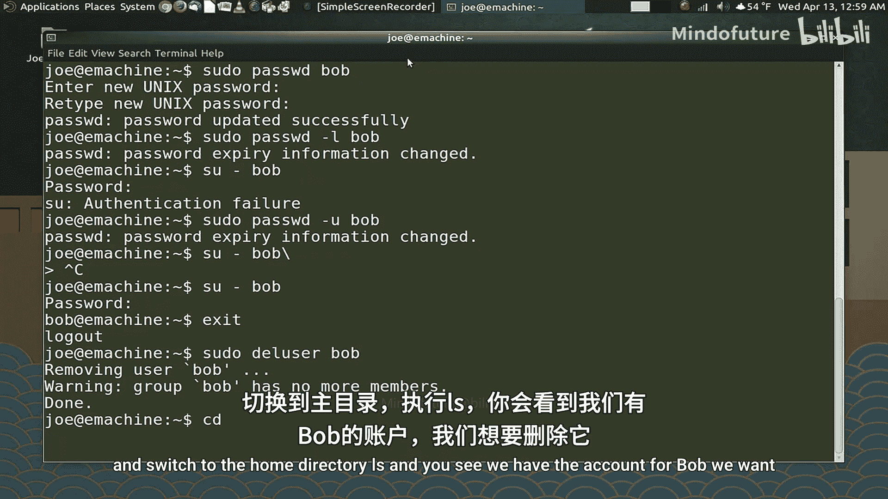
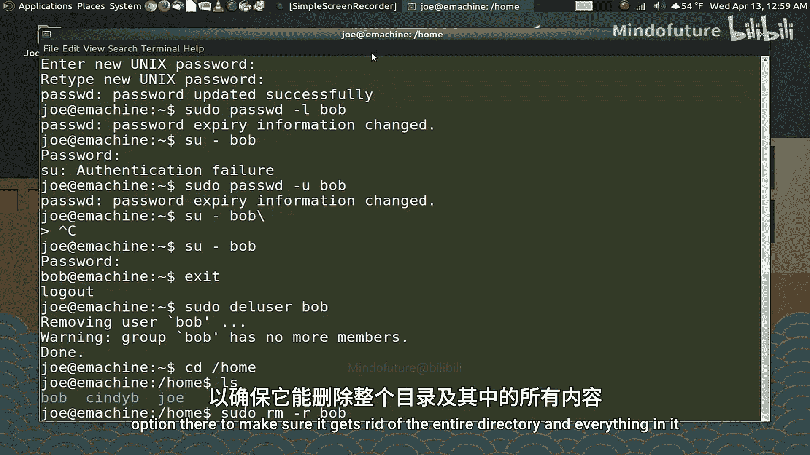
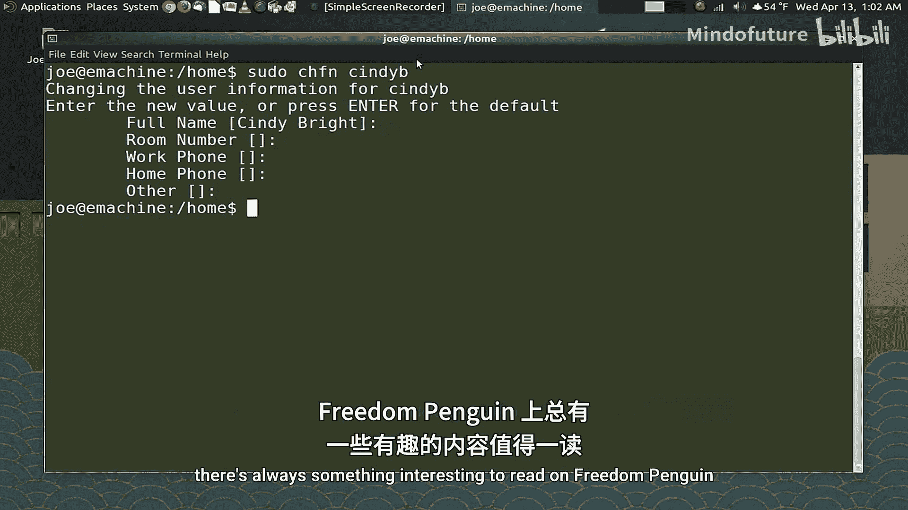

# Bash基础-｜-Bash-Basics-p05-P05_Bash_基础_第5部分_共8部分-用户账户与密码--BV1Tj6VBnEz3_p5-

Greetings and salutations。 And thank you for clicking on the video。

 This is the fifth video in our series called Bsh Bas。 And in this video。

 we're going to talk about managing user accounts and passwords。

 And this is an important skill for you to know if you intend to be a system administrator。😊。

Even if you are the only person that is using a computer and there's only one account on it。

 it's still nice to know how to do this stuff。But assistss admin has to deal with potentially hundreds of user accounts。

 if it's a large system that's in a school or a corporate setting。

 and those guys spend a lot of time dealing with the stuff I'm going to show you today。Now。

 most desktop environments come with nice gooey tools， Use and groups。

 something like what they're called that allow you to do most of what I'm going to show you or all of it。

 And abuntu matete 1604 comes with a tool that's both simple and pretty comprehensive。

 But most of the tools that I have come across。 I don't like。

 they either make things a little bit more complicated than they need to be。

 or they just don't do everything I need them to do。

 So a lot of times when I'm dealing with user accounts。 I just open up a terminal and do it this way。

So let's jump into it because we've got a lot to talk about。

The first thing that we need to do is add a new user to our system。So we are going to do Sudo add。

User。And we're going to create a mythical user account for a mythical person named Bob。

It's going to ask for my password， first。And now it is creating Bob's account。

 It has created the user Bob。 It has created a group called Bob for the new user to be in。

 and it has also created a home directory for him， which is home Bob。 pretty simple stuff there。And。

Now， it is asking for us to assign a password to Bob's account。

 I'm going to make it a super secure password， Bob 1，2，3。

And now it's going to ask for finger information。And really。

 the only thing you need to put in here is。A name Id like to go ahead and put the full name of the user in。

Ask for a room number， work phone， home phone， Then you can put other information in here if you want to。

 That goes back to Linux being a system that is capable of running really big systems with many。

 many users。 If you were in a corporation or a school， that sort of information would be useful。 So。

 yes， So now we have created Bob's account。And we're going to log into Bob's account to make sure that it did get created properly。

 So the next thing I'm going to show you is how to use the S U command。 So it's S U space。

And then a hyphen and then a space。 And then Bob， if you do not include the hyphen and you just put a space between S U and the user that you're trying to log in as what's going to happen is。

 is that you're going to log in as that user， but you'll stay in your own home directory。

 which can be a little bit awkward。 If you add that hyphen there。

 You are actually going to switch to their home directory makes things a lot easier。

 So we're logged in as Bob。And if we run this story here。

 you'll see that Bob has absolutely nothing in his home folder。

 We have not logged in with a desktop environment， Usually when you log in with a desktop environment for the first time。

 It creates all those lovely folders we're used to seeing like downloads and music and documents and things like that。

 But they're not here and won't be here until we log in with a gooey desktop environment。

 So Bob's account is here。 This is awesome。 we can run commands now， as Bob on the system。😊。

And to get out， once we're done。Exit， and it puts us back into our own account。

 There's another way to do that， by the way。And that is。

 you can run S U and then see and then put a command in quotes。 And in this case。

 we just want to see what groups Bob belongs to。So I'm going to use the groupss command。

 which will list those and then the user is Bob。

It's going to ask for Bob's password。And I give it the password。

 And it shows me that the only group that Bob is a member of is Bob。 Now。

 as far as groups are concerned， it's actually pretty easy to add users to groups。

 You would use the command。 user a， which is the opposite of add user。 So let's man user add。

 I'm not going to actually go through。

Oop do that without a space。Obviously。

You can use the user add command to add folks to groups。And you can also create groups on the system。

With another command called group add。 And then there's group Dell， which removes groups。

 and you can also use。Dell user to remove folks from groups。

 But I'm not going to show you all that in this video because it does get a little bit complicated and it's time consuming。

 And most desktop users probably will either use the Gooei tool to add groups or just won't mess with it at all。

 So that's something you can look into if you come across that you actually need it。

 because on a home system with two or three users， you really don't have to fool around with groups too much。

 That's something for larger systems that are incors or schools where you can create a group。

 for instance， called Project X。 and everybody who is working on Project X can be a part of that group and have access to all of the files that belong to Project X and that sort of thing。

 So yeah， on a regular home environment。 That's not absolutely necessary。

 There is some software that you can install on Linux that will require users that are going to use that software to be a member。

Of a group， but usually in the installation instructions， it explains how to do that。

 So if that's something you need to deal with， just remember that you use user add to add folks to groups。

Okay， so we have created Bob's account。

And Bob。Is using his account。And I don't know why I type that in and hit enter。

Let's just clear the screen。Let's say that we need to change Bob's password。

 or you might want to change your own password。How are we going to do that？

So you gave Bob his password， and he promptly forgot the password。 Okay。

 so you have to assign Bob another password。 And as the administrator。

You're the one who has to do that。And so let's go ahead and do that， pseudo。Password。

And when you issue this command， make sure that you put a user name behind it。

 If you issue it without a username。Then what's going to happen is it's going to think that you're trying to activate the root account。

 And we don't want to do that。So just watch out and be cautious that you always put a username after password。

So we're going to enter a new password for Bob。 And in this case。

 we're just going to say idiot because Bob's an idiot and forgot his password。

So now Bob has a new password， and he'll be able to log in to his account。 So Bob's rolling along。

 and he's using his account。 And then you find out that Bob is doing things with the computer that you do not like。

 so。What you might want to do is lock Bob out of his account for a little while until you get a chance to talk to Bob and make sure that he doesn't do the things you don't want him to。

 So to do that。We're going to go back here and issue the command。Password。 But before the user name。

 we're going to give it the option， L。And that is going to lock the account for Bob。

So I get extra space out of there。 So now。Bob's not going to be able to log in。

 So let's try and log in Bob's account。And we go back up here。And get this。Nope， authentication。

 error， failure， it's not going to work。And it won't work for Bob when he tries to log in either。

 But you corner Bob。 And you do get to talk to him。

 And you explain to him that you don't want Bob going to those special sights any more。

 And he agrees that he's not going to。 And he says he's going to be a good boy。

 So you want to restore Bob's account。 And the way to do that is to issue the same command as we did before。

 But this time with a you。This will unlock Bob's account。

 There are also commands that you can use to put expiration dates on passwords。

 You can set a minimum time that the password has to be used and you can set a maximum time that it can be used。

 So that is something that you can look at if you want to make sure that your users are super secure and are changing their passwords often for most home users。

 that's not a big deal。 So I'm not going to jump into that。 But those commands do exist。

 So let's see if we can log in as Bob now， and it would help if I wouldn't add。

Stuffed to the thing there。All right。Yep， we're in this， Bob。So Bob's account is working just fine。

Now， let's say that a little more time goes by。 and you and Bob have a major falling out。

And you decide that you do not want Bob to have。Any information， any access at all to your computer。

And you just want to get rid of Bob's account。 Or maybe Bob moves away。 Maybe it's not so nasty。

 It's an amicable separation。 And you just wave by bye。 So now it's time to remove Bob's account。

To do that， we do Su do Dell user。Okay。And one D， please。Bob。And Bob's account is removed。

But we have not removed Bob's files in his home directory。 Usually， when you do this with a goy tool。

 it will ask you， do you want to remove Bob's files or do you want to keep Bob's files。

 When you use the Dell user command， it simply removes the user account。

 but leaves Bob's files behind。 Sometimes in businesses。

 you're required to hang on to their stuff for a little while， So this doesn't cause a problem。

 You actually want to keep the files。 But in this case。

 we want all of Bob's stuff gone off of our computer。And so we are going to。

Let's go ahead and switch to the home directory。

L S， and you see， we have the account for Bob。 We want to make that go away， so we will use pseudo。

RM。With the recursive。Option there to make sure it gets rid of the entire directory and everything in it。

 Good bye， Bob。

It's gone now。So， Bob no longer has。An account on your computer， which is pretty awesome。

 One more thing to show you here。 And that is the change finger command。

 And this is more useful than you might think it is， because。😊。

Sometimes when you're setting up your account and you're not paying attention。

 you may put some goofy username in that you'd like to change。

 or maybe you'd like to actually add some of the finger information。 So we're going to do that。

 So in this case， we're going to pseudo。Change finger。 And we are going to do this。

 Let's do it for Cindy。I'm not actually going to do it。 I'm going to show you how you do it。

 So we could do her username on this machine is Cindy B。All right。

 and see now we're getting a thing here where we can change this information。 if we want to keep it。

 just press enter。Alright， and now her finger information would be updated。

So those are the basics of controlling user accounts on your Linux system。

 And you can also use this to manage passwords。 One of the things about passwords。

You are the administrator， and you're always in charge of the other accounts。

A user does have the privilege to change their own password。

 and they can do that as often as they like。But since you are the root user。

 if at any time you need to get into their account， you can always reset their password。 All right。

 And you can do that using the password command and。

You may have to do that if you have a problem with the system and for some reason。

 you need to get into somebody's account。 And just keep in mind in those sorts of situations。

 it's your computer。 And if they don't like it， they can lump it。So thank you for watching the video。

 That's a very。Simple little primer there on dealing with user accounts。 Like I said。

 when you start dealing with assigning people groups and things like that。

 it can get a little bit tricky， but this should get you started in the next video in this series we are going to look at。

Managing software。From the bash command line。 And that is going to be a video that's going to concern itself mainly with a boontu based distros。

 But we'll talk a little bit about other software management tools when we do that video。

Be sure and check out Easy Linux online。Check out Ey Linux on Facebook。And if you do。

 give it a like and check out Freedompenguin dot com。 If you haven't already。

 lots of really cool articles there about Linux from contributors like myself。

 And there's always something interesting to read on Freedom Penguin。 Thanks for watching。😊。

