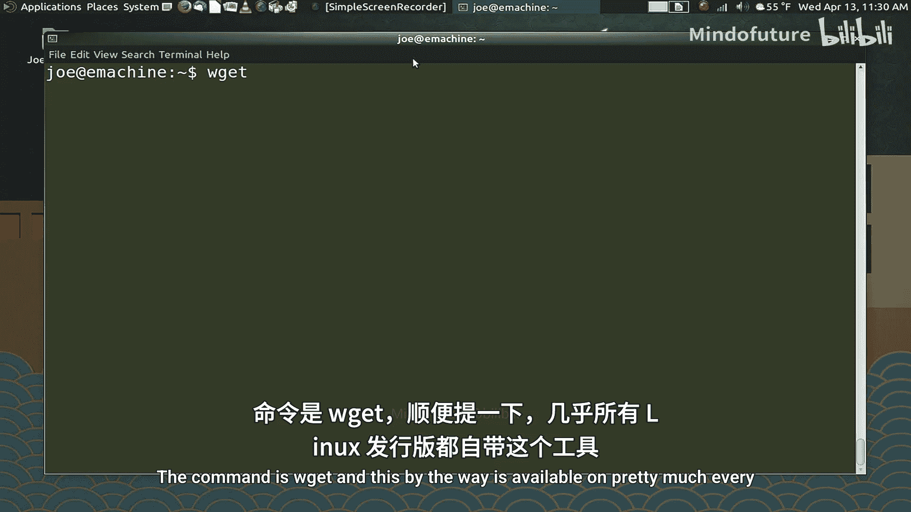
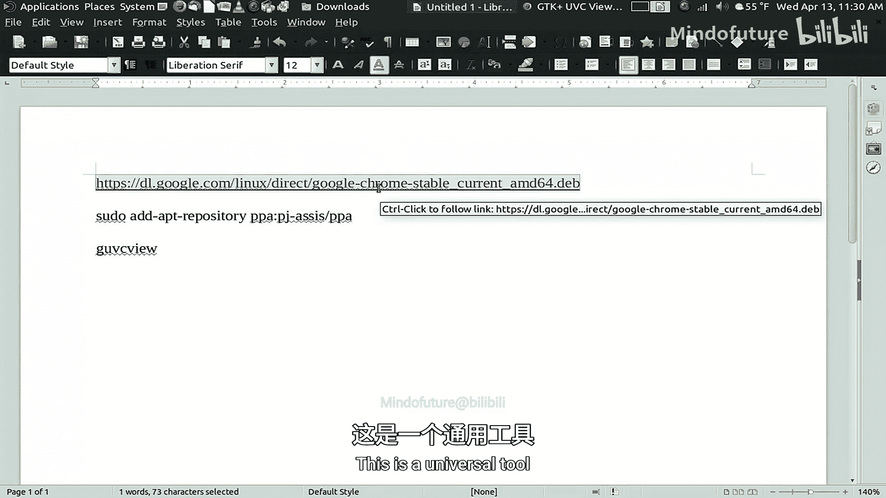
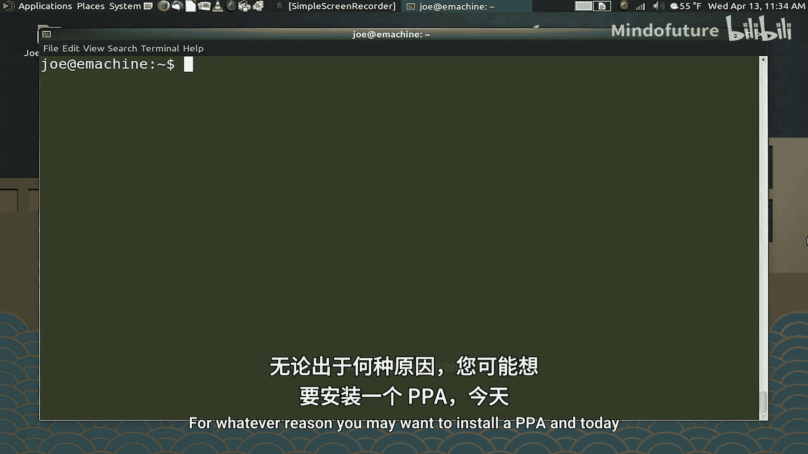
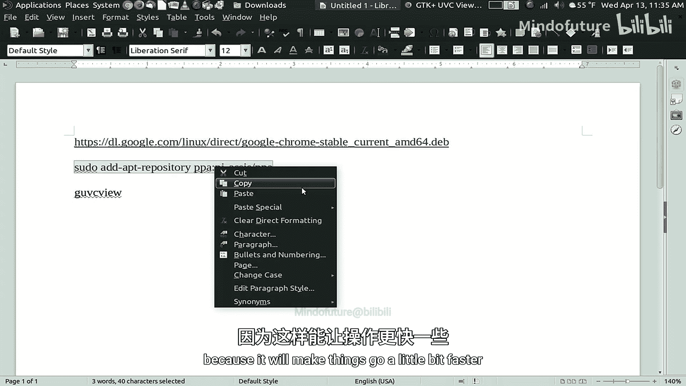
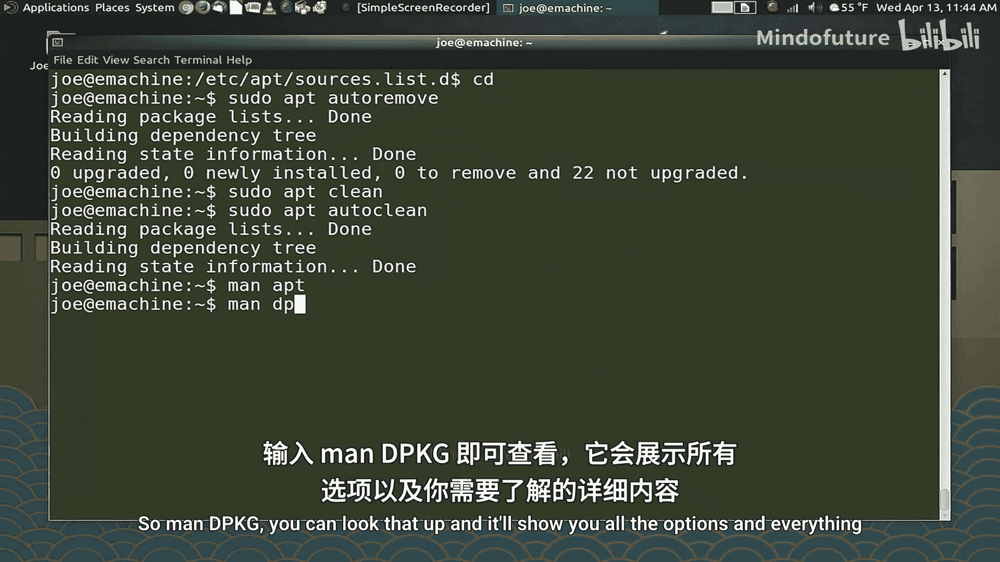

# Bash基础-｜-Bash-Basics-p06-P06_Bash_基础_第6部分_共8部分-管理软件--BV1Tj6VBnEz3_p6-

Greetings and salutations。 and thank you for clicking on this video。

 This is video number 6 in our series about bash basics。

 And we're going to talk about software management， and we're going to talk aboutbuuntu today。

 People ask me all the time。 What are the major differences between the different distributions of Linux and the answer is software management。

 Every one does it a little bit different。😊，Today， we're talking about a bountu。

 But if you want to run arch or Manjero， you're going to have to learn how to do things with tools like Packman and Yawurt。

 And if you're running Opensusa， then you will use zipper at the command line and yast in a Gui。

 if you're running red hat or fedora or scent O S， you may use yum or you may use DNF at the command line。

 So there are all kinds of different tools。 But the basic concepts are pretty much the same。

So if you are going to be using other distributions besides Abuuntu。

 I strongly urge you to go read all the documentation about the tools that you've use to manage software in that distribution。

Just to make that perfectly clear。Lots to cover in this video。 So let's jump right into it。

 The tools that we're going to use to manage software in abuuntu at a command line are going to be apt and another tool called apt get。

 Apt get is an older command line tool for。Managing software， and。Not too long ago。

 Maybe a couple of years ago， The tool apppt was introduced just apt。 And they're pretty similar。

 apt is a little bit more simplified， though， and a little easier to use。

 But app get still does some things that apt doesn't。

 So we're going switch back and forth between those。

 And a lot of times if you find documentation of how to do things in a boontu。

 you're going to see people say to use app get， which is perfectly fine。

 So I just wanted to clear that up right up front。 Okay。

 the first thing that you would need to do before you do anything with the software on your Linux system is to update the local cache and to do that。

We are going to issue the command pseudo aft update。

 And what this will do as it's going to go out to all of the repositories that are hooked up to the machine。

 and it's going to look and see if there are any new packages。

 if any packages have been removed or more importantly。

 whether there are upgrades available for the packages in those repositories。

 And depending on your Internet connection， this can take anywhere from a couple of minutes to just a few seconds。

So we're going to let it go ahead and get itself updated。

And you do have the ability to use a GuI tool for this。

 All distributions of Linux come with a or rather most Gui。Based distributions of Linux。

 those with the desktop have some sort of graphical update tool。 In Abutu。

 we have the software updater in Linux Minth， which is based on abuuntu。

 They use their own software management tools。 And so does Linux light， Zorin， elementementary。

 that sort of thing and may use something slightly different。

 But once you learn how to do this at a command line。

You probably will not want to open up those tools anymore because this is so much easier to do and you have more control and you see exactly what's going on。

So our。Repositories have all been updated。 Our local package cash is updated。

 and it's telling us that we have 22 packages that can be upgraded。 And to do that。

 we have a choice of commands。 Let me clear it here。 We can use pseudo apt up grade。

 And what this command will do and fix it。呃。Great and。

What this command basically does is it goes out and it looks for all of the packages that can be upgraded。

 and it will go do that。 However， this particular version of this command。

 will not upgrade system packages。 So things like the Linux kernel， the Linux headers。

 U de certain very sensitive system tools will not be upgraded here， and this is nice。

 if for some reason you are afraid of a kernel update breaking something， you can just use this。

 this is the safest way to update your system。However。

If you want to do a full distribution upgrade and you want to make sure that you are getting the latest version of the kernel and everything。

 then you would issue the same command。 but we would change this option to dis。Upgrade。

And what this does is now it will upgrade things like the kernel and it will just upgrade everything on the system that needs to be taken care of。

So I use this one more than I use update。Or rather， the upgrade option。

 And I'm not actually going to do that right now because that would take a considerable amount of time。

So you now know how to update the cash and you know how to upgrade the packages。

 What about installing software。Well， that is super easy。 Actually， I'm going to do this in reverse。

And the reason why I'm going to do that is I'm going to uninstall a piece of software。

 And then I'm going to install it so you can see how the process works。 So we can pseudo， apt。

 remove。H top， for instance， which is a nice little monitoring program。 I like an awful lot。

 If I would do this， it would remove H top， but it would leave the configuration files behind。

If you want to completely purge the system of a program。

 then use the purge option here if I can get it spelled right。H top。Now。

 we're gonna turn this loose and it will go out and。To the system and remove H top。 So yeah。

 let's go ahead and remove it because I'm going to reinstall it。

Takes it just a few moments to take this off the system。

On a really fast computer with a solid state drive， This goes by very quickly。

 But I'm doing this video on my 10 year old E machine today day。

 So does take it a little bit of time。 But it's kind of nice because you guys can see what it's actually doing if I slow the process down by using doing it on this old machine。

 Okay， to install a piece of software super easy。😊，Sudo app， install。Name of package。

 So in this case， we're going to put H top right back on the system。

 and you can continue to put packages in this list here。

 Just separate them with a space so I can install bleach bit。 It's already here。

 But you know what I mean， I could just start。If you know the name of all the packages。

 I could make a list here and the same thing for removing packages。 You can do it in batches。

 And it's quite easy to do。 So let's go ahead and install that。So we have it back on the system。

And now， H top is installed。So pretty easy stuff there， not really hard to do at all。Now。

 we're going to move into a few more advanced concepts of installing software from the command line。

 What I just showed you is probably what you're going to use all the time。

 Because once you learn how to do that。Opening up a GuUI tool。

 it seems kind of silly when you can just type in a couple of things to install a package。

First thing I need to show you is how to discover packages。

How do you know what's in the repositories that are hooked up to the machine。

 Let's say that you're working on a machine that doesn't have a Gui。 And so therefore。

 you can't use a web browser to look up all of the nifty packages available in the abuuntu repositories。

 Well， you can look them up very easy by using a command called apt cash。Search。

And then just give it a package name。 This case will give it H top。 We know it's installed。

 but this actually goes out and looks to see whether it's in the repositories。

 and it'll return anything that has to do with H top or mentions H top in the description。

 It's a very flexible search。 you can put all of a package name in there。

 part of a package name or something in the package description。 and it will find it for you。

 If you run that particular command。 And let's say we do a bigger program like Fire Foxox。

You're going to get a lot of output on the screen because there are a lot of packages that are。

Associated with Firefox。So in this case， we're going to use that pipe to redirect this into less。

And now we will be able to scroll through line by line and page by page and look at all the different packages that are associated with Firefox。

You can also do the trick that I showed you in earlier videos where you can direct the output into a file if for some reason you want to hang on it。

You can do it that way。 So that's how you search to find packages in the repositories that you want to install。

Some packages don't come to us from the repositories。

 We have to install them from Deb files in aboontu。

 And these are things that you can download off the Web。

 A lot of proprietary software for Linux will come to you in a Deb package。

And so you have to go get that。 So what we're going to do。Is I am going to remove from the system。

 Google Chrome。So a。And we'll just remove it。 I'm not going to purge it。Ggle。Chrome。Sttable。Alright。

 That's the name of the package。And we're going to go ahead and take this off the system。

And we're going to install it from a command line from the downloaded Deb package。 Yes。

 please uninstall Google Chrome。Now， the nice thing aboutbuuntu Mattay is that Google Chrome is available in the software boutique and you can install it with one click。

 but。You will need to go download the Deb package from the Google Chrome page。That Google puts up。

 if you're going to install it， let's say， on Linux Mint and some other distributions of abuuntu has to be done manually。

So now we have an uninstalled Google Chrome。 How are we going to get it on the system again， Well。

 we need to know the download link。 and I have that over here on my cheat sheet。

So I can just copy and paste instead of trying to type that out and making mistakes and making the video go very。

 very long。 And the tool that we're going to use to download it is W get。

And this is a really neat tool， because you。It doesn't have to be a De file to download。

 You can download anything off the Internet as long as you know， the URL R to get to it。

 And W get is very nice because it's tenacious in making sure that it gets the entire package。

 So if you have a slower unreliable connection， This may do better than a web browser for downloading a package。

 So let's go ahead and turn it loose。 the command is W get。And this， by the way。

 is available on pretty much every distribution of Linux。 This is a universal tool。

So we're going to copy that link。And then we're going to paste it in。Allright。

And I'm going to turn it loose。And it's going out， and it is now downloading the package from Google。

AndIt says it's only going to take it a few seconds so we can stick with it。

 I was going pause the video， if it took longer。Google servers must be running very fast today。

It will put the package in the current directory。 So this should be in my home folder。

 So one of the things that you can do is if you want to keep packages that you download。

 you might want to use the change directory command to get to it。

And be in that directory before you start downloading packages。 There's the package。 We see it there。

 And now we need to install it from a command line。 Well。

 if you are using the Gui to install the package， you could just click on it。

 And choose a tool like you could use the software center in a boone 2，1404。 Aboone 2。

1604 comes with a new application from Nome called software that handles that。

 Or if you're in Linux Mint， that would be handled by the G W package installer。

 which happens to be my favorite graphical tool for installing Deb packages， whichever one。

 But we're at a terminal， We don't have any graphic tools。

 So how are we going to install this package。 Well， we're going to do it quite easily。

And the command to use pseudo。DPKG。We'll pass I along to it。 Not one。 Thank you。

And then I'm just going to copy and paste the name of this package to make it go a little bit faster。

And I get everything there。 think so。Nope， do that again。Make sure I get all of the file name copied。

There we go。So we're going to copy that。And we'll paste it here。With that extra space in there。

 we need to get rid of that。And turn it loose。And D P K G is going to install Google Chrome stable。

 If you download a devb package that requires dependencies。

 it will make sure that it tries to find those dependencies in the repositories。

 And if it cannot match all the dependencies， it will throw out an error message and let you know。

 hey， I didn't get everything。 Sometimes it will actually install the package。

 without the dependencies。 and then that way， you can go off and search for the dependencies manually if you want to。

But we shouldn't have any problem with Google Chrome。

And now Google Chrome is reinstalled on the computer。 You can see my little icon reappeared up here。

 So that is how you install a package from a dev file at the command line。

So let's clear the screen and move on to the next task， which is installing a package from a PPPAA。

 and you'll be doing this a lot。In Bountu， PPpas or private package archives provide。

More up to date packages sometimes than are in the repositories。

 or they allow you to install packages that for some reason。

 didn't make it into the main repositories for whatever reason， you may want to install a Ppa A。

 And today， we're going to look at installing G U V C view from a P P A， which is a webcam program。

 And the version of this software that is in the repositories is a little bit older than the one that you get from the updated PPA A。

 So that's why we're doing it。

So we need to attach the PPPA。And I'm going to copy and paste this command simply because it'll make things go a little bit faster。

But if you are working at a command line， you may have this written down。 You could just type it in。

 Most Ppas or developers that run PPpas for auntu have instructions on their website on how to do this。

 And you just pretty much follow the bouncing ball。

 So what we're going to do is we will paste in the PPA command and the command to do that is apt。呃。

It's ad apt repository。So it's going to go out and look for the P A。And it is founded。

 Do I want to add it years。So now my PPPAA is added。

 so what I now have to do is I have to update the package cache so it knows it's there。

So we'll go ahead and run that because we've just attached the repository to the system。

 So therefore， it it doesn't know。What packages are in it， So we need to tell it。

And it'll take it just a couple of seconds to do this。Now。

 in the case of installing upgraded software， we already know that GUVCVi is installed on the system。

And we are using the PPA to get an updated version or a newer version in this case， right？

So to update that， all you have to do at this point is run pseudoApt。

 Dis Upgrade or pseudoA updateate， and it'll go out and get the newer package and automatically update it for you。

If the package does not exist at all on the system， In other words。

 you're attaching a P A to get a program that's not in the repositories。

 then you would use the pseudo app install name of package to install it。 So in this case。

 I'm not actually going to do anything after I connected that PPA because the package is already here。

 And the next time I will run updates if I should leave this P A connected。

 I'll get the newest package。But we're not going to leave it in there because I'm happy with the version of G U VC view that's in the repositories。

 And I want to now remove the PPA。 And ordinarily， if you want to remove a PPA。

 then you would use a graphical tool like software and updates or the。

Software center in abuuntu will link you to that。And Snaptic package manager also does。

 And that's usually graphically where you get rid of it。 But how do you do it from a command line。

Well， there are actually commands that remove PPAs， but they're complex。And。

There is a much simpler way to do this。 If you want to remove a P P A。

 So the first thing you want to do before you remove a P P A is remove the software that you installed from it。

 Just go ahead and find the package and uninstall it from the system。 So it's no longer there。

And now you're going to want to remove the actual PP from the software sources list。

 So the way to do that is to just go look at the software sources list and take it out and we're going to Cd。

ETC。At。And this is the directory we're looking for for， so。

Let me double check that I type this in properly。It's sources。The list。だ the。

So it should take us to that directory。And there we go。And all we have to do is list storage。

 and now you see all of the repositories that are hooked up to the system outside of the main repositories。

And to remove the repository for。The G UVC。Viewer。Or GU VC view。It's not a viewer。

 it's a webcam software， just copy this line。And you may want to be sure that you actually copy this because you do not want to accidentally remove something that you need here。

 So we're just going to take that file out of the software list。 We'll use pseudo。Rm。Like that。

And then pass the name of the file onto it， which I have copied to make sure that I didn't make any mistakes。

And it's done， it already did it， so if I list the storage。

 now you'll see that that PPA is no longer part of the system。

And that's just a really fast and dirty way to get rid of it。

So we have looked at installing software from the repositories。

 from a dev file and installing software from a P P A and then removing and。

Removing the software and the PPPA itself。 a couple of more things to talk about here。

 need to do a little maintenance， keep things kind of sped up and clean。

 There really not a whole lot you have to do in Linux to manage the software。

 It takes care of itself nicely， but there are a couple of tools that will allow you to。

Kind of keep things clean and organized。 The first 1 I want to talk about。

 Let me just go back to the home folder here。The first one I want to talk about is pseudo apt。

Auto remove。As you add and remove software from your system as software is updated。

 some packages may get installed as dependencies and the package that depended on that particular program gets uninstalled and now you may have a package on your system that you don't need and so if you issue this command。

 it'll go out and look for those kind of packages， things that got installed，That you no longer need。

 So that is what the auto remove command does。 takes it a couple of seconds to go through and find everything。

 I shouldn't have anything on the system。And no， there's nothing to remove。

But you'd be surprised if you haven't done that in a long time。

 you may end up with a lot of stuff on the system that you don't need and could free up a lot of space。

 And this is also how a bountu these days gets rid of outdated Linux kernels。

 So once you upgrade older kernels will be listed as packages that you can auto remove。The next。

Thing to look at is a couple of commands that take care of the cache。

 When you download a package from a repository， the system hangs on to that package in a cache。

 So if you ever need it again， it doesn't have to go out to the web， It's stored locally。

 If that package gets updated， then it updates the package in the cache。 This is nice。

 if you're in a situation where you ever have to reinstall a package for some reason。

 and you're not hooked up to the internet， you might be able to do it because it's stored locally on the machine。

 But over time， those cache packages tend to take up a lot of space。

 And there are two commands that you can use to kind of clean those up a little bit。

And we are going to do apt。And clean。And then。The clean command here， if I would turn it loose。

What this does is it just。Completely erases the entire cache， it's all gone。

But there's another way to do this。 and that is to do pseudo apps。Auto clean。Now。

 what this will do is it will go through the cache and it will see if there are any cached packages for programs that you have uninstalled。

 So instead of hanging on that package， it will go ahead and get rid of it for you。 And then。

 of course， if you want to reinstall it software， it'll have to download it off the web。

 But these days with fast internet connections and endless data supplies you know， no big deal。

 Lots of， we can transfer a lot of data very quickly here。 So if we run this。

 now it's going to go through all of the software lists， and it's going to make sure that。There is a。

s looking to see if there's any packages that it can can removed from the system。 And， of course。

 it's not going to find any because I just cleaned out the cash completely。

 And this is something that you might want to do every now and again， just to make sure that。

You are good to go on that。 And I think that pretty much covers all of the basics of software management in abuuntu。

 although there is a lot more to this， And I strongly suggest that if you want to learn all the intricacies of using the apt tool and the apt Git tool and D P。

 K G， that you take some time looking at it in the man pages。 So man D P， K G。😊。

You can look that up， and it'll show you all the options and everything that you need to know。

 So thank you for watching this video。I've really enjoyed doing this series on working in a terminal。

😊，And working with bash and getting a lot of good response from it， too。 Next time around。

 we're going to take a look at some tools that you can use to see how your system is doing and manage processes that are running on your system and check out things like how much hard drive space you have available。

 And we're also going to talk about tools that will allow you to see how your memory is performing and more in the next installment here of our bash basic series。

 Thanks for watching， be sure and check out easy Linux on the web。 Check out easy Linux on Facebook。

 And if you do， give it a like。 and also check out Freedompenguin dot com for lots of very cool articles from all kinds of contributors about Linux。

 including myself。😊，So we'll do it again soon。 Thanks for watching。

