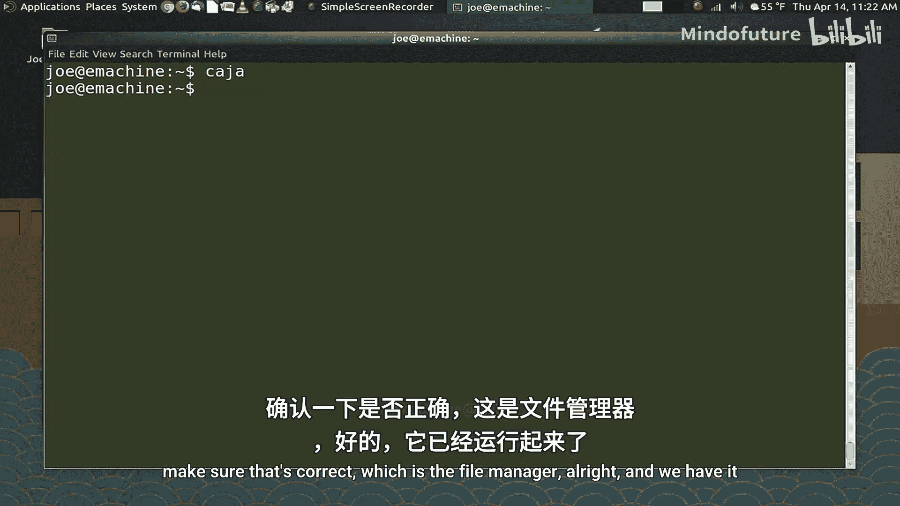
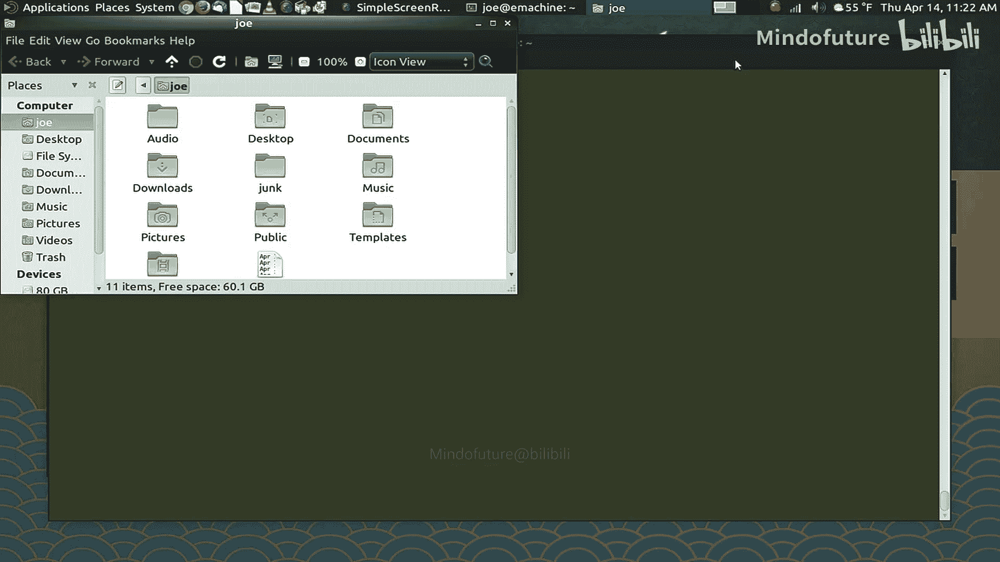
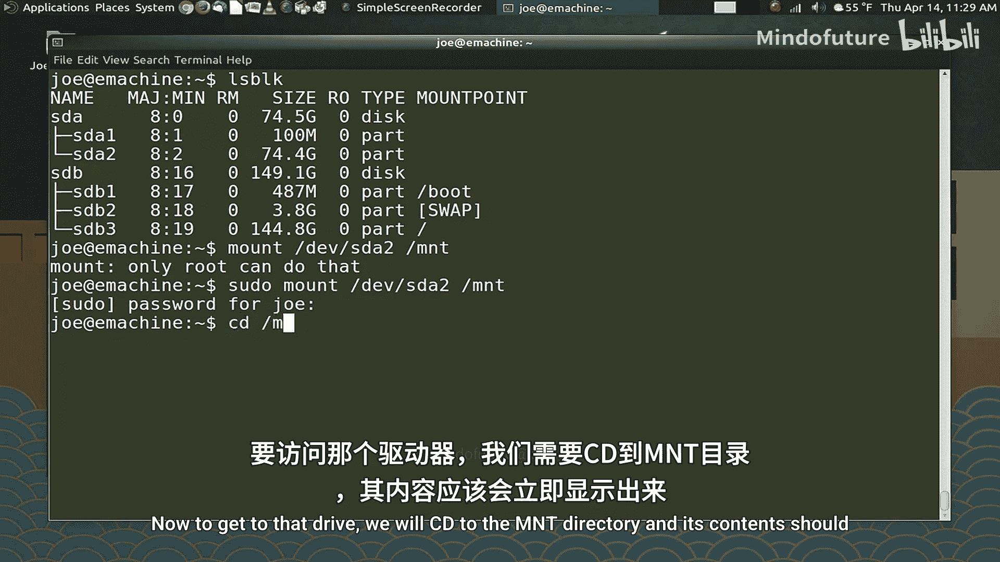
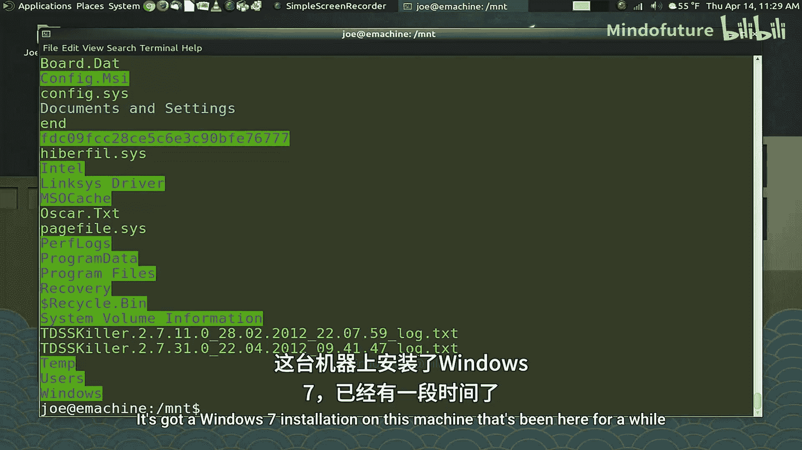
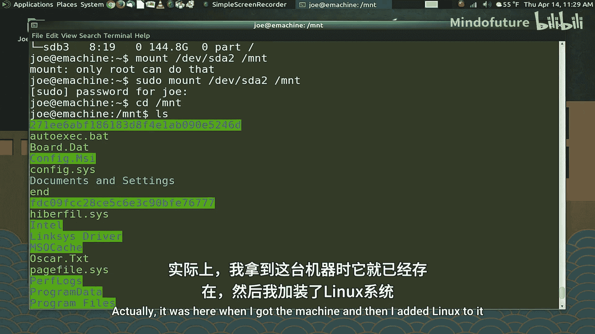
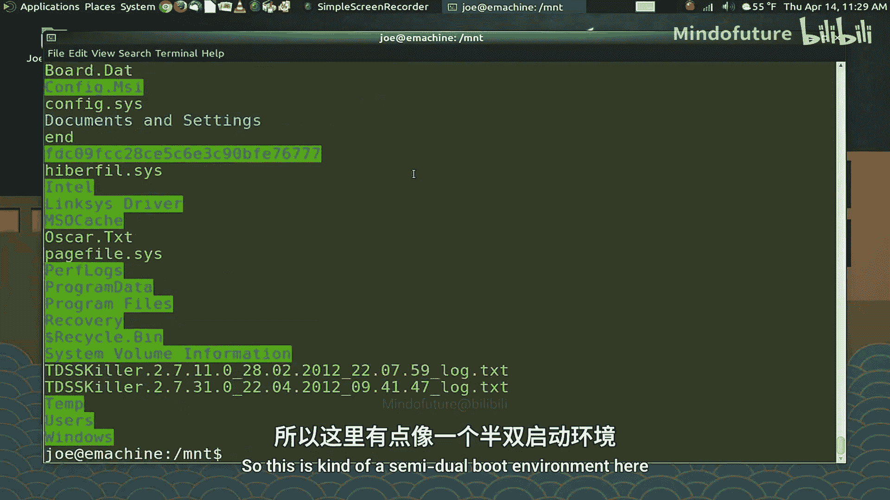
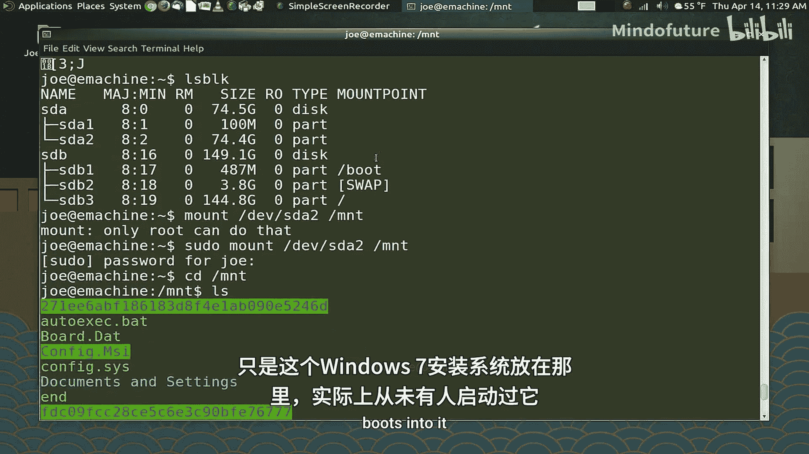
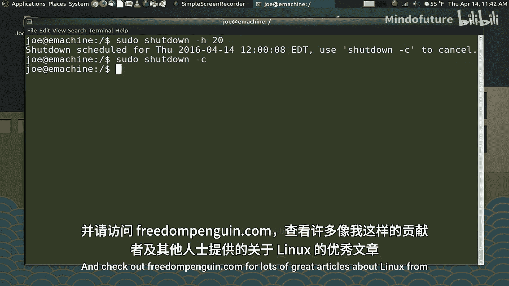

# Bash基础-｜-Bash-Basics-p07-P07_Bash_基础_第7部分_共8部分-系统管理工具--BV1Tj6VBnEz3_p7-

Greetings and salutations。 and thank you for clicking on this video。

 This is video number 7 in our series about bash basics。

 and we have a lot to cover in this video because I'm going to show you some nifty system administration tools that you can use to see what's going on with your computer and take control of things。

😊，Now， before we jump into that， let me say that this is by no means a definitive guide。

 It is not everything that's out there。 There are thousands of programs that are available to run in bash。

 You can do everything from read your email to play music。 and you don't need any kind of a goi。

 These are just some tools that I know about that I use。 And I figured I would share。

 And I'm going to show you some tips and tricks on how to get more use out of them as we roll along。

The Unix philosophy of computing。 And since Linux is。Designed to be much like Unix。

Is that we have a lot of little tools that do simple things and do them very well。

And you can take those tools and put them together to accomplish more complicated tasks。

 So I'm going to。Show you a lot of things here that you might say， boy， I doesn't do much。

 I'll never use that， but you never know how you're going to use them in combination。

 So let's just jump right in to talking about some of these nifty little tools。

The first one I'm going to show you is free。Which is a program that tells you what your memory is doing。

 and it tells you how much memory you've used and how much is available。

 If you issue free with the H。Option， it makes it humanly readable。

Another program that you can use kind of like that is disk free or DF。

And we will also issue that with the humanly readable option。

 And now it tells us what all the mounted file systems on the computer are doing as far as space used and how much space is available。

Very useful information to have。 And so that way， you can keep up with what's going on with your hard drive。

 In this case， we are interested mainly in dev S D B 3 and dev S D B1。

 Those are the partitions on the Linux hard drive in this computer。 And， yes。

 there is not a separate home partition here。 But it's a small drive。

 So I wanted to make maximum use of the space。 And I'm fine with that。 O。

So you can expand on that a little bit。 Let's say that you open this up and now you see。

 oh my goodness， why am I sucking up all of this disk space， Where is all that disk space going。

 you can use a utility called DU and what that will do is it will list all of the directories that are on whatever device you pass to it。

 in this case， we're just looking at everything， and it lists them on the screen。Of course。

 all that information just flew by。 So this is a situation where we would want to use the pipe to redirect the output into less。

 I've showed you this before in past videos。 And now you can scroll through。And you can see。

What is taking up all of that space？It will show each directory and how much space is being used to get out of less。

Just use the Q option， and that will quit。One of the cool things that you can do is you can take some of these little utilities and we can look at them in real time。

So now if we issue the free command。It just takes a snapshot of what's going on。

 But what if we want to watch what's happening。Over time。

 we can do that very easily with the watch command。 So we're going to watch free。

Make it humanly readable， please。And now。We have this going。

 I think it updates about once every two seconds or once every second， something like that。

You can change the parameters on the watch command。

 and you can make it so that it will do things almost in real time to get out， control C。

And so let's do this command here。 Let's do watch。And we're going to do date。Now， wait a minute。

 hold on。 We're going to put the option here。We're going to have it look every 10th of a second。

 and we're going to look at the date command， which is useless。

 but basically what it does is it displays the clock over and over again。

 which it already does here anyway。But you get the idea。

 You can almost look at things happening in real time， with the watch command。Control C to get out。

 clear the screen。 Now， we're going to get into some things that are a little bit more meaty。

And we're going to look at some tools that let us get some idea of what the machine is doing。

So if you're having a problem with your machine or you're just curious about what's going on。

 then the first tool that I'm going to show you is called D message。

And what this does is it gives us a list of all of the actions that the Linux kernel has taken recently。

 Why would this be interesting to you？ Well， the Linux kernel handles things like resources and hard drives。

 and if you plug a USB stick in， you might want to see whether it actually got connected or you plug a USB device in there。

 this will show you what it's done。Of course， it gave us all this information。

 and it scrolled it off the screen。 You saw that。 And we got a whole bunch here。 What we。

 we may be just concerned with what has just happened。 Now。

 we could put this into less and then we could scroll through。

 or we could use a nifty little piece of。Software， called tail。Now， this program。

 what it does is it takes the output that you send it or looks into a file and only displays the last 10 lines。

So if you just want to know what it just did， that's how you can use tail。All right。

 let go ahead and clear the screen。The next thing that we're going to look at is using tail to look at logs in the variable directory on your Linux system。

 that is where your cis log goes and many different logs。

 So if your computer is doing something goofy。And you want to know what it did。 You can use tail。

To look at the last 10 lines in your cis log， so that would be vr。Log。Sisslog。All right。

And it shows us the last 10 things the system did that it found noteworthy enough to add to the log。

All of this information that we've just generated with those two commands is is very nice to have。

 But what if you're working with somebody in the community and they ask you to access a log file or they ask you to look at something like this and you need to share it with them。

 Well， we're going to redirect this into a file。So in this case。

We're going to redirect it into a file and we're going to call it logtail do TXT。

We didn't get any output on the screen， but if we list storage。

 you'll see that we now have logtail dot T X T in our home folder there。

 and we could use this file to send to somebody if they asked for that information。

And what's in the file is exactly what you see on the screen。

The next thing I'm going tell you about is really only useful to those of you who are running more recent versions of Linux。

 Okay so if you're running a boon2 after I think 1410， then this is going to be useful to you。

 if you're running 1404 or any version of Linux meant right now at the recording of this video。

 this isn't going to work for you。 your system has to be using system D。

 system D is an initialization program。 what it does is it gets all of the services and resources together when your machine boots up and sometimes you'll see an error message come up and it just flies by and you have no idea what the system did with system D。

 if you want to see what happened the last time you booted up your system。

 there's a simple command to do that。 and that is journal。CTL。Okay。And now system D。

 it throws it into a program that works and looks a lot like less。

And you can just scroll through here， and you look at everything that happened when your system booted up。

 So if you saw an error fly by and you didn't know what was going on。 Now you can figure it out。

Pretty useful little tool。 By the way， system D has a lot of powerful。

S systemstem administration options to it。 The average desktop user probably not going to use it。

 But if you are really curious about。How this system D can help you to take more control of your machine and figure out what's going on。

 I strongly urge you to check it out it is a new technology， it's a controversial technology。

 some people don't like system D but once you start looking at it and you see what it can do it's really an interesting thing to learn about so there is your introduction in this video to system D。

Allright， the next thing we're going to look at is processes that are running on your system and a process is just a fancy name for an application that's running or a service that's running and some applications have many processes going at once and if an application starts to misbehave。

 you may need to figure out what that is there's several tools that you can use to look at processes。

Top is on just about every machine out there。And you can use top to gain all kinds of information about what's happening with your system。

 It brings it all together in one place up top， and then it shows you all the programs that are running and it ranks them by how much CPU they are using。

 So in this case you see that simple screen recorder is at the top because we're capturing video and right now that is the。

Program that's taking up the most CPU time。So there's a lot of things that you can do with top。

 but I actually prefer to use a tool called HT， and this is available in the repositories for pretty much every Linux distribution and it's a little bit more advanced as you can see get we get a little display up top that tells us what the memory is doing。

 and it gives us things like the load the computers running under and how long the computer has been up and how many users are logged all kinds of stuff。

 and I did an entire video on top and what it will allow you to do is go through the processes that are running if something is misbehaving or if you have a program that locks up。

 you can just find it here and you can kill it， you can stop it from working。

 you can change the priorities of programs， I did an entire video about this。

 and if you want to learn how to use Htop I would suggest that you check it out because it's a really cool program。

So that's looking at processes。 And by the way， I am going through these very quickly。

 So if you see something that's interesting， you want to know more about it， ask the man。

 open up the man page for it， and you can learn more about it。

One command that kind of goes along with top and all that is the killll All command。

 And this is one that you can use if you have a program that is misbehaving on your system， okay。So。

What I'm going to do。Clear the screen。And we'll open up a program here。 I'm going to launch。

And we spell that correctly， Kaja， it's pronounced。Some people pronounce it caha as in the Spanish。

 And I tend to think of it with an H。 But anyway， I'm going to launch this programme。 C， A J。 A。

 make sure that's correct。Which is the file manager。

All right， and we have it running。

And then I want to， let's say that that locks up。 doesn't work。 I can't do anything with it。

 I want to get it off the machine。 I can use。Q O。And it just goes away。When you kill a program。

You are just telling it to stop。 It doesn't get a chance to write any buffers out or and you may lose data。

 but it is very useful with web browsers。 If Firefox locks up。

 you can use kill all just to make it go away off the machine。 It's a last resort sort of thing。

 And if kill all doesn't work to get rid of an application。

 you may have to restart the entire system。 One of the things that you can do with kill all。

Is if your desktop uses Compz for its window manager and Compz is misbehaving。

 then you can kill all Comps and it is set up to restart itself。

 and so if you can get to a terminal or you can get to a TTY。

 you can restart Compz and control of your desktop。Something to definitely keep in mind there。

Next thing we going to look at is a couple of tools that will help you work with the network on your system。

There are a lot of tools for configuring networks， but I'm just going to show you a couple that will help you do a little diagnostics。

 If you need to figure out what's going on with your network and your I P address。

 then you can run I F config。And you need to type it right。For it to work。

 there's how it is IF config still got that wrong。There we go And this tells you everything that's going on with the network adapters on your system and tells you your IP addresses and internet access。

It doesn't generate a great deal of output， but there you go。

This is one of those things that if you're dealing with network problems on your system that somebody may ask for。

 so if you ran IF Config and then you sent it into a file。

We now have a file with all that information that you can share with somebody。

When you install a system。Without a goi。You may want to know what the whether the Internet is working now with。

Goy system， you just open up a web browser and go to Facebook。 And if it connects up， hey， you know。

 it works， right？ But if you're curious about whether。The Internet is working on your system。

 or you want to see if a particular website is up or another computer on your network。

 The tool to use to do that is ping。So we're going to ping。YouTube dot com。

And what this is going to do is it's going to send a little message out to the YouTube dot com server。

 It's going to go， are you there， And then they're going to send a message back here and say， yeah。

 we're here。 And this will do it repeatedly。 In a past video， I made it。

Reference to it doing 64 times。 It's not 64 times。 It'll just keep doing it over and over again。

 I said that in the video as an exaggeration。 and a lot of people took it literally。

 I didn't mean when I said that that it would do it 64 times and stop。 Actually。

 it'll just do it over and over and over again until you kill it。

 There is an option that you can set how many times ping will hit a sight so you could set it like two or three times or something like that。

 But let's say that you've just booted up a new system that you've installed that doesn't have a desktop on it。

You want to make sure that the Internet is working。 There you go。

 and it will also give you a little bit of an idea of how well it's working and to stop ping from working。

 control C cancels out。 And then it tells you a little information down at the bottom there gives you some averages。

 So that is a very useful command to have around。Ping。All right。

 now let's start let's talk a little bit about hard drives。

And storage and USB sticks and things like that。When you plug a USB stick into your computer and you have a desktop running the it just should just pop up。

 or it should be available in your file manager as long as it mounts properly。

 But if you're working at a terminal， It doesn't do that automatically。 you have to do it yourself。

 especially if you have a machine that doesn't have a desktop on it。 Okay。

 it may mount automatically。 And then you can go look for it and find it where it's mounted and get to it。

 And we'll talk a little bit about that as we roll along here。

 So the first thing that I'm going to show you is a nifty little tool。

That will show you all of the drives that are hooked up your computer and where they are。

 So that is called LS B， L K list block。And now it gives us this nice little output。

 and it shows us that we have two hard drives on this machine。 We've got SDA and SD B。

 and SDA has two partitions on it， and SD D B。Has three partitions on it。

 So if we wanted to mount one of these partitions， then we could do it quite easily。

So let's go ahead and mount one of these partitions somewhere on the file system。So。

 we're going to mount。And let's see which partition will we mount， Let's mount SDA2。 So that's dev。

S SD2。And we have to give it some place to put it When you plug a USB stick or an external hard drive into your machine。

 it mounts it into a folder called media。 Anything that shows up in media will show up on your desktop as a mounted device。

But what I want to do because I don't know if anything else is mounted in media right now。

 or if you already have something mounted in media， then this would cause a conflict。

 We're going to go really old school here， and we're going to put this in M and T。

 which is the kind of the holdover mount folder for devices that would be temporarily mounted to the system。

Only root can do that。 That's right。Sorry about that route。All right。

 so it's mounted now to get to that drive。We will C D to the M N T directory。

 and its contents should show right up。

So if we LS， yeah， this is all the stuff that is on that hard drive and this drive that we mounted up is actually a Windows 7 drive。

That got a Windows 7 installation on this machine that's been here for a while。

Actually， it was here when I got the machine and then I added Linux to it。

 So this is kind of a semi dual boot environment here。

 It's just this Windows 7 install that's sitting out there。 Nobody ever actually boots into it。

 But anyway， if I need to get into it， that's how I would do it from a command line。 Now。

 once you're done with your drive。

You will need to unmount that drive。So let me go ahead and clear the screen and the command to do that is。

So， you mount。I will hold on。We have to get out of that directory first， or it'll tell me it's busy。

 and it won't unmount it。Forget that sometimes。 So let's do that again。 So it's pseudo。You mount。

And then just put in the device， which is dev。S。嗯。SD A 2。And it's gone。

 it unmounted that device and it is no longer。Mouned to our file system。

Good information to know about how to work with drives on your system that you may need to mount up。

If you want more detailed information about the hard drives hooked up to your system。

 you can use pseudo F。Yeah， F disc。And we just want it to list。And we only need one F there， gang。

 And a D would help ha ha。And now it gives us all the detailed information about the drives that tell us what the file system。

 where they are and。Gives us the。The dev Is there where it says， you know， S1， S 2。

 that sort of thing。 Now， another thing that is good to know how to do is to figure out the actual universal I D for a hard drive。

 hard drives in Linux use the U U I system， which is the universal， unique identifier That way。

 if something changes hardware wise， the system can find the drive again。

 if you mount drives using dev SD S D B， that sort of thing。

 And then you actually change physically where the drive is plugged in or the order of them can't find them anymore。

 So like for your F S tab file， for instance， that mounts file systems at start。

 you need to give it a U U Id， It's a better way of doing it to figure out the U U I。We use。

 we use BLK ID or block I there。And now it shows us all of the drives in the system。

 and it then gives us the universal I D number。 So that would be。Right here， the UU ID。

So if I was going to modify my file system tab。File system table file to mount that。

 let's say this Windows drive automatically。 I would open this first， and then I would copy。

The U U I D。 And then I could use that to set up the auto mount in F S tab。

 So that's why that is very useful。 B L K， I D。I do have a video up about setting up a hard drive to automatically mount a startup。

 So if that's something that you're interested in learning how to do。

 then you can check that out for sure。Here's a little command that is quite useful。

 it tells you what kernel you're running and whether you have a 64 bit or a 32 bit kernel running on the system。

So that command is you name。哎。Now， this will。Tell you everything about your system。

 It gives you your host name， and it tells you what。Colonel， you're running。

So that is a useful thing to have around。See what else I have on this list？Oh， here's a good one。

All right。 So we've been issuing a lot of commands here at the bash terminal。

 And I have shown you in the past that to get to commands。

 you can just use the up arrow and scroll through the commands that you put up there。

 But what if you need to look at the list Like， you know that you issued a command yesterday。

 and you're like， well， I don't quite remember， Well。

 we can get an entire list of all the commands by just。Typing history。Now it gives us the list。

And once again， this is one of those situations where we can pipe it into less。

And now we see all the commands that are in the history for the。Bash terminal here。Get out。

 And there you go。 Another thing to show you is not necessarily a command。

 but I have been reminded that I should show people this。 And because I don't normally use it。

 but it might help you。 if I type in hiss。And then I press the tab key。

 you'll notice that it auto filled there。And it now I can hit enter， and it gives me the command。

 So if you type， if you find yourself typing in a command a lot， you can just type in。His。History。

There you go。Let's go ahead and clear the screen there。A few more to show you。Oh。

 here's a silly little command I like。 I like to just show people this。

 type in Cal and it prints out a calendar for you。 There are lots of options for the calendar。

 You can get it to show you any month。 So if you need to figure out what day it is and what day it'll be next Tuesday。

 You can just type Cal and get that to show up。 We've already showed you the date command。

 two more to show you here， this is a really useful command that you don't hear a whole lot about。

 and that is E4 Df。😊，It is a myth。That Linux absolutely positively will never need to have its hard drives defragged if you have spinning hard drives on your system。

The EX T4 file system is very good， and I mean very good at making sure that things do not fragment。

 However， there are some situations where you may want to defrag an EXT4 partition on a hard drive。

 I'm going to show you how to use that tool right now。 if you have a lot of large video files。

For instance， or you have a drive that's。Over 80% full。

 you might want to see what the fragmentation looks like on the drive。

 So I'm going to show you how to do that right now。You run this as an administrator。

And we are going to look at。Let's just look at home。The home folder。

And all I wanted to do is just check it。 I'm not actually going to have it def fragmentment the system。

Let me actually put the command in there。Okay， so I'm telling the system that I want to run E4DF on the home partition。

 and I wanted to just check to see if there's any fragmented files。

So this will take it a few seconds to go out and look at that。

You can use this just to def fragmentment files in your home folder or you can do it just in your video folder。

 you don't have to do it， you can do the entire file system if you want to it just takes longer to do and now it has generated a report。

And as you can see， the score is 0， which means nothing is fragmented。

 And then down here at the bottom， it will tell you， you know what the guidelines are for that， so。

You can use E4D f to check out the。Partitions on your hard drive and see how much fragmentation you got。

I would be willing to bet that for most people watching this video， it will say none。

 It'll come up 0 because E X T4 is really good about keeping drives not fragmented。

 And the other thing to keep in mind about that is that if you have a solid state drive。

E4 Dfrg doesn't do anything for you。 You can't defrag a solid state drive。

 This is just for spinning drives and hybrid drives。 So H DDs and。S， H SH Dds。Or yeah。

 that's what that's called， okay， never mind。Last command gang trying to keep up with all this stuff in my head as we roll along here。

 Last command I'm going to show you is is really simple to use and we are going to use the first one I'm going to show you is reboot。

You have to do this as a system administrator。 So it's pseudo。Reboot。And if I would hit enter here。

 the machine would restart。 It's that simple。 That's all it does。 Very useful。

 If you've like just updated a bunch of things on the machine， you know， you put a new kernel on it。

 you might want to restart the system。A little bit more control comes to us from the shutdown command。

 So let clear this。And we're going to take a look at shutdown。

 You have to issue shutdown with super user privileges。It's shut down。

 and if you want the system to actually turn off H here。If you want it to restart， you can use the R。

 which will do exactly the same thing as reboot， and now we can put in a time for the system to shut down。

 So we're doing shut down and we're going to do H to halt the system and I'm going to tell it that I want to do it in 20 minutes。

And I'm going to issue this command。And now you see it saying that。

The system is going to shut itself down in 20 minutes。This is very useful。 It puts a timer on it。

 So let's say that you're using your computer to listen to music or watch videos or something like that。

 You don't want it to go to sleep。 You can set that to like。

90 minutes before you go to bed and it'll play music for an hour and a half。

 and it'll shut itself down。So it's a pretty useful thing to get out of that once you have issued this。

S。Shut down。C。Okay。Now， it's canceled it。 So the shutdown command has been canceled because you can issue this command and then close this terminal。

 It's still running in the background。And very nice to have around。

You can look at the manual page for the options on the shutdown command。 So there you have it。

 It's a whole bunch of commands I just laid on you that you can use to do interesting things with your system。

 And if any one of those commands caught your eye， be sure and read the manual page。 Abutely。

 be sure and do that。 And there's so much more to this。

 once you start researching what these commands do and all the different commands on the system。

It's the sky's the limit。 It's amazing what you can do just by typing in a few things and hitting the enter key。

The next video in our series will be the last video we're going to take a look at basic scripting skills。

 how you can take a bunch of little commands like this。

 we're going to take a lot of the things we've already learned and put them together that we're going actually going to write a little program that's what a script is the baashhe allows you to actually write little programs within it bash programming language you could say and you can write scripts to string commands together to do very complicated things with the system just by entering one little command at the command line and hitting enter so that's what we're going to look at next in our next installment thanks for watching be sure and check out easylin on the web check out easylin on Facebook and if you do give it a like and check out Freedompenguin。

 co for lots of great articles about Linux from contributors like myself and others。

