# Bash基础-｜-Bash-Basics-p08-P08_Bash_基础_第8部分_共8部分-Bash脚本编写--BV1Tj6VBnEz3_p8-

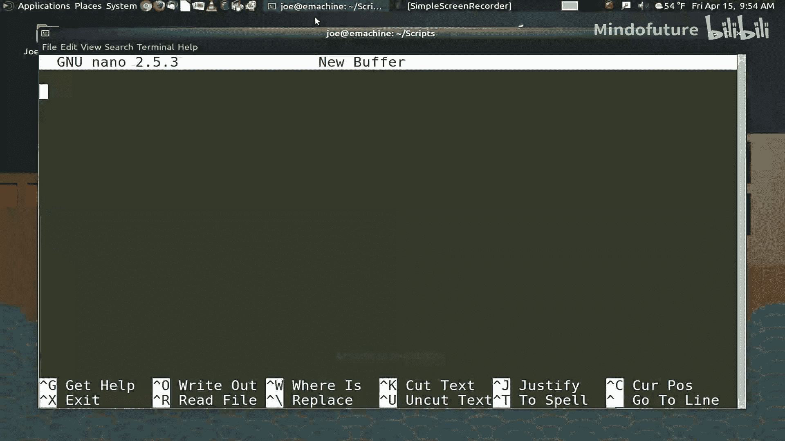

Greetings and salutations， and thank you for clicking on this video。

 This is the eighth video in our series about bash basics。 And I think this is going to wind it up。😊。

In this video， we're going to talk about。Bash scripting。

 we're going to talk about taking commands and putting them all together in one place and running them as a computer program。

 And that is exactly what you're doing when you write a script。

 It is a computer program because baash not only allows you to string commands together。

 but it also has its own programming language， and you can use that language to do some pretty nifty and complex things with a bash script。

Now， I'm not particularly good at this。 I took a class on it， and I just didn't do very well。

 when you start getting into more complex things like variables and if and else statements and loops and things like that。

 I'm just not terribly good at it。 But I can still get things done。 And so can you。

 You don't have to get into all of the deep stuff。 scripts can be quite simple， but very powerful。

 So what we're gonna do is just going do it。 We're going get in here and write a couple of scripts。

 And then I'm going to show you a script that I wrote to get some things done on my system。

 And I'm going to explain how it works。 So the first thing that you need to do is pull up a text editor。

 It can be any text editor。 It does not have to be running in a terminal。

 You could do this with whatever text editor comes with your distribution。

 like thenome terminal or maybe you would。I prefer to use something else。

And the first line in any script has to be what is called the hashbang。And that is。

A statement that tells the system this is a program， and this is where you need to run it。And。

So we put in a path to the bash shell。 So that's our first line。Always have to start with that。

And I'm going to write a goofy little script， I found this online。

 it really doesn't do anything useful， but it's a good introduction and it's only four or five lines。

 so it's pretty easy to do。I like to separate。The hashb there with a blank line。

 It just ignores blank lines in a script。 So if you want to do that or if you want to put things in sections and you put a couple of blank lines between to make it easier for you。

 that's fine。 Also， if you want to put a comment in your script。

 you want to tell somebody else that might be looking at it or remind yourself about something。

All you do is put one of those hashtag pound signs， and then you can type in whatever you want。

 So in this case， I'm going to put in stupid script。没有了。Whatever you can put in there。Alright。

 so let's go ahead and write the first line of actual code that'll do something。

 and we'll make it the clear command。 We just want to clear the screen before we do anything else。

The next command we're going to put in is read。And we're going to give it the P option。

And what that's going to do is it's going to pause the system。

 It's going to make the person who's running the script have to do something to。Move on。In this case。

 we will put in。A quotation because we want to print a message on the screen。Enter to start。Okay。

 I think it can be any key。 Let me fix that。Even though it's just a dumb script。 We want to get it。

 want to make it look nice， you know。Okay， so that's the first line。

 Now we're actually going to get into doing something。And。We're going to use the echocho command。

I'm moving around there， thank you。So， echo。With the option E。And。Please。Enter。有儿。Name。

And we put a colon。In a space。And now。We are going to。

Set the variable for whatever input they put into the system。

So we're going to use the read command and what that's going to tell the system to do is read whatever they put in and then set it as a variable called name。

Okay。Now。The person will type in whatever it is。And。

The system will spit some output back out at them。 So it's going to be echo。Put it in quotes。

And we'll say nice to meat。有。And then。The variable is going to be name。That's it。

So let me just double check that I didn't do anything stupid。 Lets make sure it works。

 And I did do something stupid。 See， I forgot the O there。And this is very important。

 If you are one of those who's been around long enough to remember doing things in basic on a Commodore 64。

 boy， you get one comm wrong and the thing doesn't work。So that looks good。

 So we're going to go ahead and save our script。And to do that in nano， it's control O。

 you need to give it a name。And we'll just call this one。Hello。

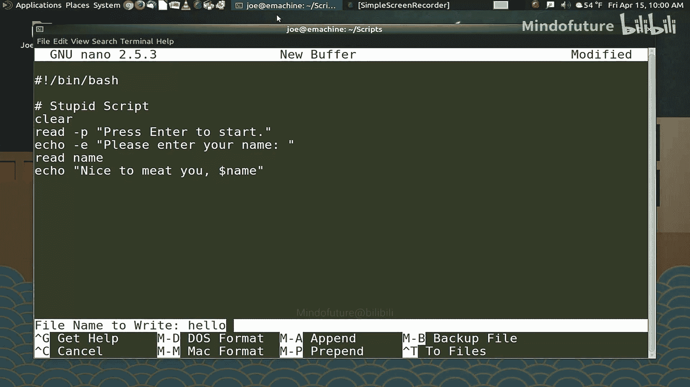

All right。And now we will go ahead and exit。

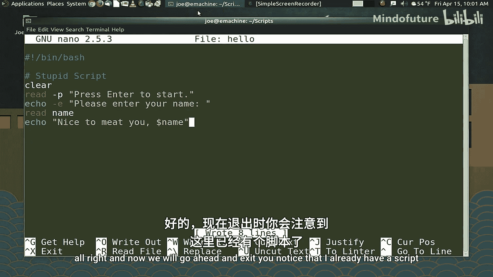

You notice that I already have a script in here， and the colors are different。

 That's because we have not set。Hello， to be an executable program yet。

 As far as the system is concerned， that's just a text file， and it won't do anything。

 So that's the next thing that we need to do。 And we will use the change mod command to do that。

And we want to add the executable attribute to it。Yeah， I did that right。And give it the file name。

 Ho。And if we list storage again， you'll see now that that's changed。 And if we did everything right。

 we should be able to run this as a command， and it should do our biddings。 Let's see what happens。

So I need to tell the system to run the command from within the directory here。

 because it's not in our past statement。 We covered that in past videos。And we run hello。

 Let's see if it works。Well， yeah， it's asking me to press enter to start。

And it asked me to enter my name。 Now， remember， it doesn't matter what you put in there。

 You could put anything you wanted in there。Nice to meet you。 It works。

 That's our first script that we wrote。 The one that they usually use for an example is just you put echocho hellello world into a script and go through all that。

 But I figured I'd do something a little bit more complex。

 And so we just wrote ourselves a basic little script。

 And you are more than welcome to open up your text editor and follow along。😊。

So let's talk about doing something that is useful with this。

I have not shown you this in this video series yet and probably should have a while back。

 But you can take commands at the command prompt here。🤧Excuse me。And you can put them together。

And have the system run them one right after the other。 So for our example today。

 we're going to use the free command。Which we covered in the last video。And then。Two ampers sands。

 And let's do the DF command。And we'll give it H， right。Alright， so I have these two commands。

 and I'm basically telling the system run this and then run this。

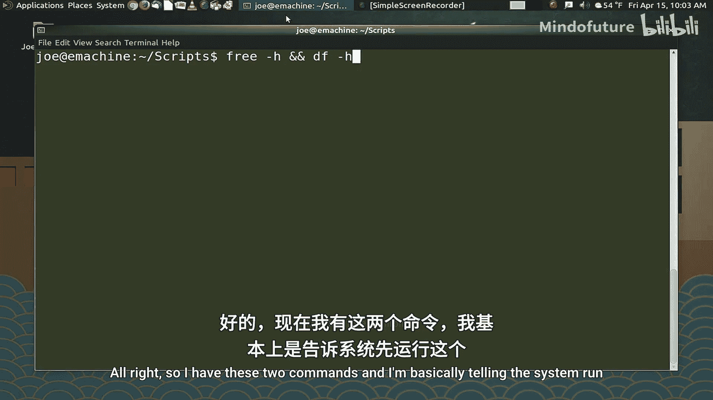

So if I do that， it prints that information out on the screen。Okay。

So if you find yourself in a situation where you're running these little commands all the time to check things out or whatever the deal is。

 we could just write a very simple script and do exactly the same thing。

 But we could make it even more snazzy than this。 So let's go ahead and write a quick script to do the same thing。

 So let's open up nanono。

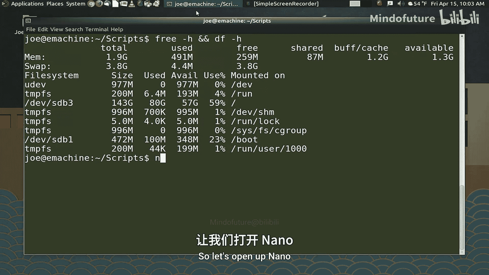

Remember that every script starts with a hashb to tell the system that it's a program and what shell we're going to use。

 And， yes， you can use other shells。 And if you download a script。

 you might see that it's written not for bash， but in S。 H。

 which is an older shell that's pretty universal， Of course， bash is now pretty universal these days。

Oop， that's not going to work。Now that will work。Alright， so the first line of our script。

 we're just going to put in。 well， let's go ahead and clear the screen。 I like to do that。

And then we'll put in。A statement here。Let's see。Echo。Memory usage。嗯。Okay。All right。

Now we'll put in our free command。H。And now we're going to echo。

Really can't type today this usageusage。And now weve got to put in our DF command Df。

And make that humanly readable。So we've taken those two commands。

 and we've put them together in sort of a chanazzi way。

 And you could keep going with this if you wanted to。 You could。Have it where it。

 it does a screen full of stuff。 And then you could use that read with the P to pause it。 So if。

It would it would reload the screens， you could do it screen by screen。

 that sort of thing if you wanted to， but that's enough for now， let's go ahead and。Exit。Or actually。

 we need to save our script。群。And we need to give it a name。

 I didn't pass a name on to nano before when I opened it。 So we'll just call this。

I don't know we want to use something other than。We'll call it resources。If we spell it correctly。

 that would be nice。Alright， so now we have that saved as resources exit。

 we go back through the same process here。 let's LS。 Yes， it's in there。

 So we'll go to resources and I'm just going to come up here and find the change mod command。

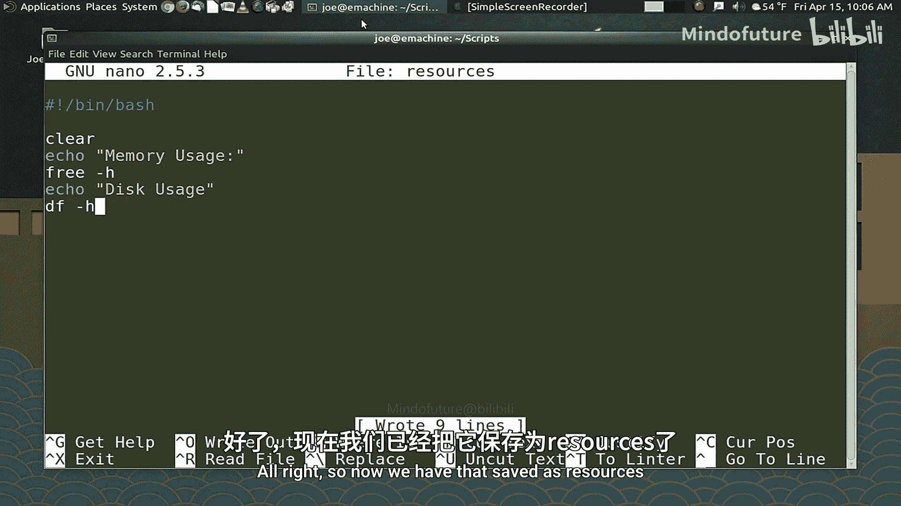

And I'm going to add resources as the。Argument， Ls， it turned it into a。Program。

 and now we'll run it。Make sure I put the period in yeah。

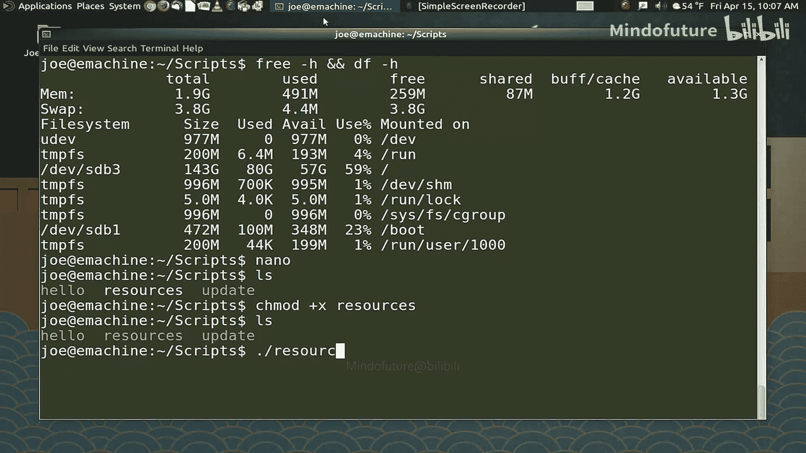

There you go。So now even I， I forgot the colon on disk usage， you could do this。

 you could put all this together and with just a really simple command。

 you could see what was going on with your computer。

 so you see how this becomes useful and it's a whole lot easier than having to type in the a whole string of commands。

Now， let me give you a real world example of something that I wrote a script to do。And。In my case。

 clear the output here。 In my case， I found myself typing in a rather long command a lot of the time。

 So the command that I would be typing in would be pseudo apt。Update。Okay， not too bad so far。

And then I would put in pseudo apt。Upgrade。Or disk upgrade either one。All right。

 so I would get the system to go through and do that。And then I would want。

 once it was done installing the updates to go ahead and shut it， shut itself down。So， pseudo app。

Shut down。Age。Now， okay， that's a lot of stuff to type and I used to， I would。

 I found myself doing that all the time and I thought， hey， you know， that's a lot to have to type。

We can put that in a script。 So I actually wrote a script to take care of this for me。

 I have three physical computers。 And at any given time， I've got maybe two or three。

Virtual machines running。 And they all。Need updating。On a frequent basis。

 especially since I'm running a boontu matete 16004， and that's in beta。

 I'm updating the machines once or twice a day。 So I wrote me a little script to take care of that。

 We're going to take a look at that script right now。

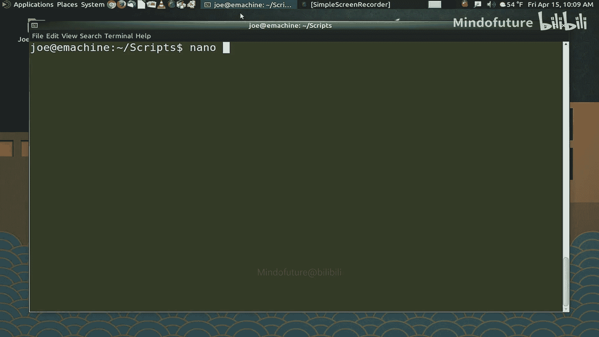

And I'm going to go through and I'm going to explain how that works。So here's my script that I wrote。

 and it's a bit more complex than what we were talking about。

 and I'm going to explain what it does line by line。

 So the first line you guys already know is just to call up the shell at your hashb right there。

And then I have a comment here that says update script。

 And the first thing that I want the thing to do is to。Log to a file。 I want it to create a log file。

 and the first line in the file， I want it to be update started at。 And then I want the current date。

 So that's what the first two lines in this script do。

 The first one simply echoes or types out output that says update started at。

 And then that is directed into a file called dot update log， which lives in my home folder。

 and I'm using one。Bracket there to direct that which means that it will create this file every time so it's going to overrideite it。

 it's not going to append and make this file that's going to grow and grow and grow。

 I really only care about the last time that I did it。

The next thing that we have here is the date command。

 and I have redirected the output of the date command into the log file。

 so you don't see it on the screen， but it goes into the log file。

This command echo checking for updates actually shows on the screen。

 and it's not put in the log file because I don't need it to be there。

Now we get into the meat of the thing， the first command is pseudo Appgit updateate。

 and I chose Appgit because Egit。Does not。Put out any extra output other than what the system is doing。

 whereasas the a command， it puts out a little extra output。

 It will put out the status bar and all that other stuff。 Well。

 I don't want to try and put that into a log file。 So I just use the older command。And this。

 all of this stuff at the end here tells it about the log file and where it should go。

 So the first command here， you'll see that we have two， and then we have two brackets。

 which means that I want to append the error output of this command。 In other words。

 if it runs into an error。I want it to throw it into the log file so I can go back and look at it the next time。

 and programs that run at the terminal。 What they do is they generate two streams of output。

 One of them is standard out which is the output of the program。

 What it tells you or the information that it puts out And the other one is standard error。

 and it can there's more channels than that。 but those are the main two that are used in Linux and Uniix。

 So channel 2 is error output。 And if I wouldn't put this extra little thing here to tell it， hey。

 take the error output and throw it into the file too， it would show up on the screen。

 I don't want any errors on the screen， I don't care。 okay。Now。

 it takes the regular output and throws it in here。

 So any time this program spits out any output that will be printed on the screens。

's not going on the screen。 It's going in a file。And then we have installing updates that's printed on the screen when it moves on to the next thing。

 And then I have this thing set up to Appgit disk upgrade。

 which means that I'm not doing it the safe way。 I'm doing it where I'm going to update everything on the system and。

We'll deal with the fallout later。 As a matter of fact， I have this set up with the。ALi y。

 y option there right here。 And that basically tells that command。 if you ask a question。

 the answer is always yes， doesn't matter what it is， do whatever it is。 That's the default。

 If you want， if you know because that's what it does when you install updates。

 is it lists them for you and it says， do you want to install and you say yes， this takes care of it。

 And if I put two whys there， that means that if any of the updates as they are rolling along。

 ask yes or no， it's going to go ahead and install it。That can be a bit dangerous。

 but I'm comfortable with doing that。 I wouldn't。 I don't know whether you。

 if you're a newbie and you're not sure about how。To fix something or roll something back if it doesn't work。

 whether you'd want to do that， but。I figure what the hey。 I do this all the time。

 This is the risk that I take。And so once again， the error output and the standard output goes into the log file。

 and we do the same thing here with pseudo Appt auto remove that takes the old programs that the old dependencies that are no longer needed off the system。

 and then I just want to clean out the cache。 I want to just make sure that the system is not hanging on to downloaded packages。

 So any output from that is put into the log file as well。

 there's usually not much output from that command or none at all。

 but if there's an error of some sort。 Then I want to make sure that I see that。

 What will happen is if any one of these commands don't work， it'll just exit。It'll just。

 It'll just quit the script altogether and， or it'll move on to the next command。

 But I want to at least put it the error message out。To tell me what the deal is。Allright。

 And the last line here， this is complete。 And that's just an echo command。

 So it just puts it up on the screen。 And I am redirecting that output into a program called T。

 And what T does is it'll take output and it'll send it more than one place。 So you can have T。

 take the output from one command and send it into two others or put it on the screen。

 in this case I am using T to put the output on the screen。 and I want to append it to this log file。

 So this way， if everything worked the way it's supposed to。

 if I look at the tail of my update log file。 Then what I'm going to see is it'll say complete。

 So I know that all the commands executed， we got this far on the script。 Now。

 we still may have an error in there， but I can pretty much be sure that at least it got done。

The next part of the script here is just this is an echo that goes on the screen。

 it just says that the system is going to restart in 30 seconds。

 and then the next thing here we use the sleep command and the sleep command makes the system wait 30 seconds。

 it can't be any simpler than that。And the S command is very useful in scripts because let's say that you wrote a script to automatically mount samba shares into your desktop。

 which I have done because technically you're supposed to be able to mount samba shares using the F S tab or the file system table where you mount up all the file systems at the start up and you can modify that。

 But I've found that it usually doesn't work， because what happens is。

 is that it takes a little while for the samba client to get up and running and recognize the network and everything。

 So a better option for me， at least was to take， and。😊，Put a script into the start for the desktop。

 So when you start up the desktop， it goes out and it mounts these samba shares， well。

I had like three or four shares that I wanted to do。 This was a long time ago。

 And I found that if I executed the commands one after the other， bang， bang， bang， bang， bang。

 the system would not be fast enough to mount all the shares。

 So I separated them with the sleep command by 5 seconds。 So it did one， waited a second。

 Go it established。 Did the next got it established， did the next got it established。

 So if you're doing a script and you have a bunch of commands that are all in a row。

 and things aren't working， it could be just simply because。

The first command's not completed before you did the second command。 Well， you can use sleep here。

 put a little pause in there 5，10 seconds， whatever it takes to make sure that the first command is done doing what it's doing。

 In this case， all it does is just tell me the user， hey， I need to do something。

 I either need to let this machine reboot， which is the next command or use control C to get out of this script。

 If I use control C at that point， then we just exit。

So there is a detailed breakdown line by line of the update script that I wrote。 Now。

 I really wish that I could share this with you in the description， but I cannot。

 because there are characters in here that YouTube does not allow。

 So if you actually want to attempt writing something like this， then I guess maybe you could just。

Scrreeen capture the thing and pick a picture of it and write it or whatever the deal is。

But this is it。

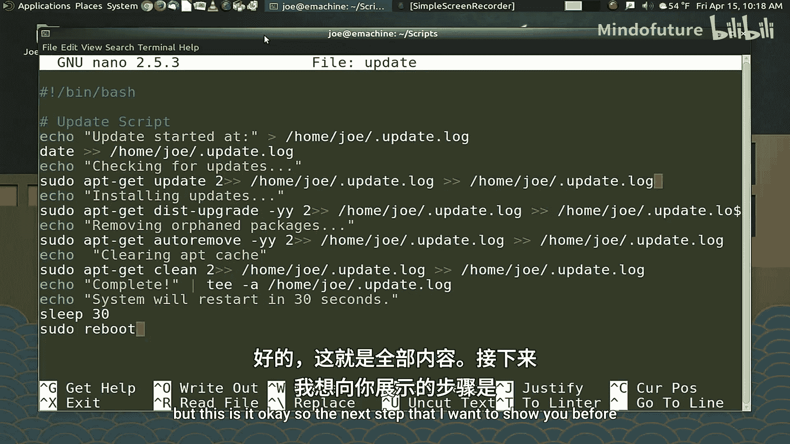

Okay， so the next step that I want to show you before we wrap up our video about scripting is how to make a script a system wide command and。

As I have shown you so far， if we want to run our hello script， then we just。Have to do that。

 But maybe you would like a script to be available to everybody on the system。 For instance。

 you could write a script that would back up people's home directories to a certain place on the network or to a partition on the system。

And to do that， you could place an icon on the desktop that would be instructed to start the command and then run it in。

That would run it in it。Terminal， in other words， you just click on it。 It opens up。 It runs。

 and then they close the terminal when they're done。

 You could do that quite easily if it was a system wide command。

You can take commands and set aliases， if you want to。But that's a little bit complex。

 There's actually a way easier way to make a script be universally available to everybody on the machine。

 And this is when being the system administrator becomes very cool。Okay。

 because you can do this sort of thing。You remember that we talked about path statements。So， we know。

That。When。The bash terminal comes up that there is a path that is set。And so therefore。

 all of these folders or directories here are where the system is going to look for commands。Well。

 one of the ones listed in here is just simply the binary folder。

 And if we look at that on the computer， pretty much。Every Linux distro has this。And we L。 S。

 you'll see there's a bunch of commands in here。

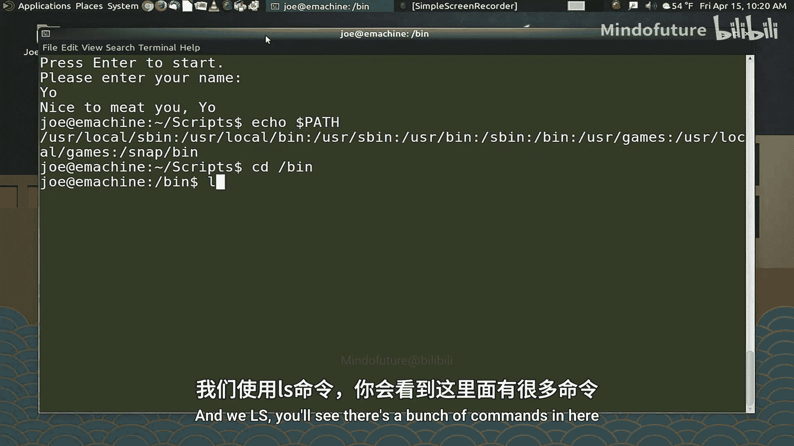

Be very careful when you're goofing around in these system folders。

 You would not want to accidentally delete or corrupt one of these。 And then all of a sudden。

 you go to type a command， and it doesn't work。 So do be cautious because you have to move things in and out of here as a system administrator。

 So if I wanted to make hello。A command， system wide command。Then what I would want to do is。

 is I want to copy it as root。 Let me go ahead and clear this。 So you can see this。

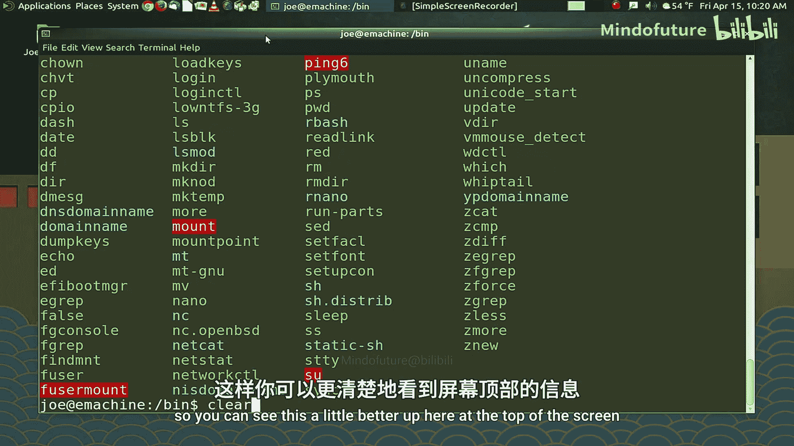

A little better up here at the top of the screen。 So the command to do that would be。Copy。Sudo copy。

 we want to do it as the root。And we're going to copy。Hello。And we are going to place it in bin。Okay。

 and if I would execute that command， it would move it。 I'm not actually going to do it。

 And what that would do is that makes it available system wide。 And to get to it。

 all we'd have to do is just type in a command。 So let's go ahead and run my update script and you can see it in action and what it does on the screen。

And all I have to do is from a terminal type in update。 I could make。 I could set an icon。

 a launcher for this if I wanted to， but。It's not that big a deal。 I's going to ask for my password。

And it's going to go out， and it's going to right now， it's checking for updates。

It's doing that right now。Hopefully， this won't take too long。

 I just did this before I started the video to make sure that it wouldn't actually take time to install anything。

But you know how this is， if you're a longtime babuuntu user。

 sometimes it takes a little wildest to update the cache。While it's doing that。

 a couple of other things to talk about here。One of which is。That。When you are writing a script。

And you come across a command that does not work。Or you come across something that you don't quite know how to do。

Then you can go on。 You can go to a browser and you can type in bash script and。

Pretty much anything you're trying to do。 like， for instance， how to。

 when I was writing the update script， I had to figure out， well。

 how do I put the error output and the。Standard output into the log file。

 I don't want any of it to show on the screen。Well。

 I found that answer just by typing it into a search and。

I somebody out there was kind enough to explain。 So as you roll along here。

 if you run into something， there is a ton of great documentation about scripting and bash。

 It's unbelievable。 If you can think of it， somebody else has tried to do it and probably come up with a solution。

 So it's actually easier than you think it just requires a little bit of time to get used to it。

 And of course， if you you do it over and over again。 you learn more and more about it。

 becomes like a second language to you。 And then you could sit down and bang out a little script like we've been talking about today。

 and just a couple of seconds。 system administrators do it all the time to solve problems on servers and enterprise Linux。

 So thank you for watching this video， This has been a lot of fun gang。

 I have enjoyed doing this series。😊，One of the things that you can do is with a script。

 I forgot to mention this is that you could put it in Chron。

Cron is a program that will run things automatically in the background on your Linux system。

 I got a whole video up on Crron。 So I'm going to put that in the description below。Also。

 in the description， be sure and check out Ey Linux Online， Easy Linux on Facebook。

 give it a like and of course， check out Freedompenguin。 com for lots of great articles about Linux。

And that's it。 Thank you for watching。 And if you watch this entire series。

You are now ready to go crazy using bash。 Have fun with it。

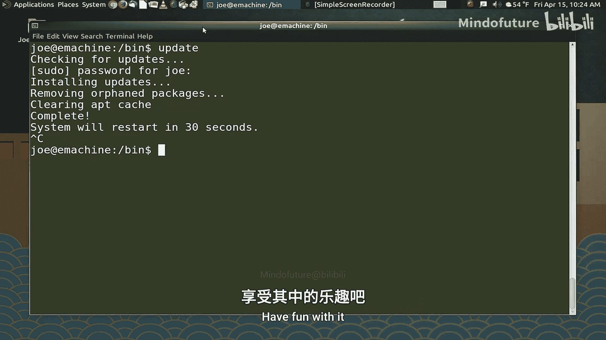