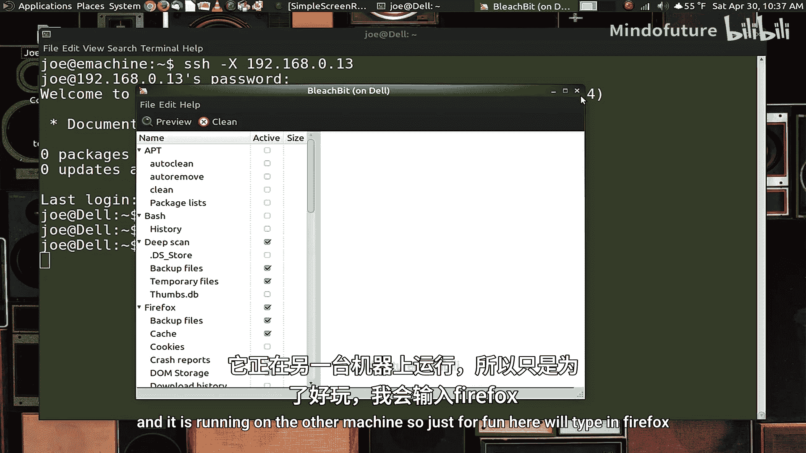
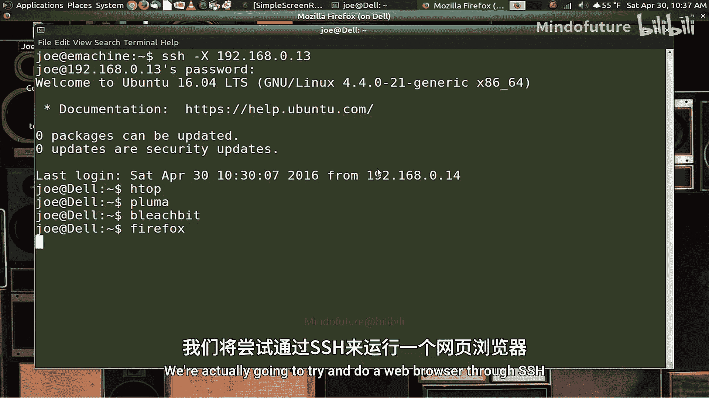
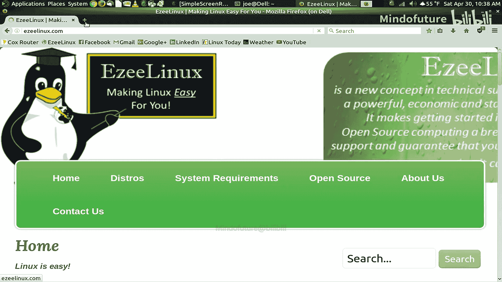
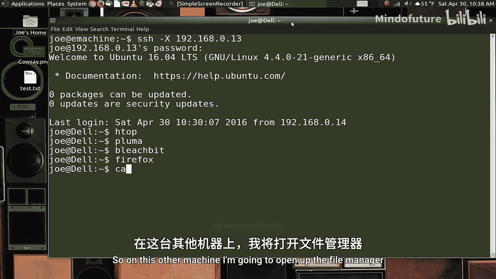
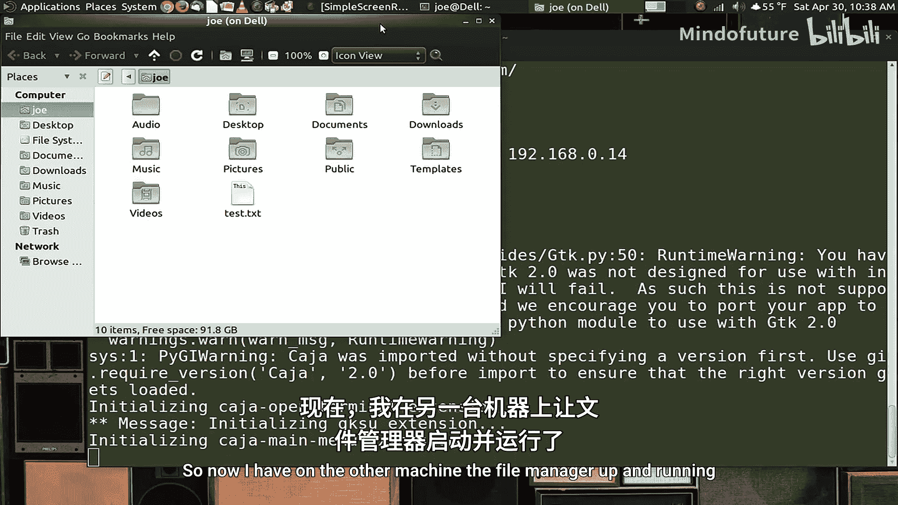
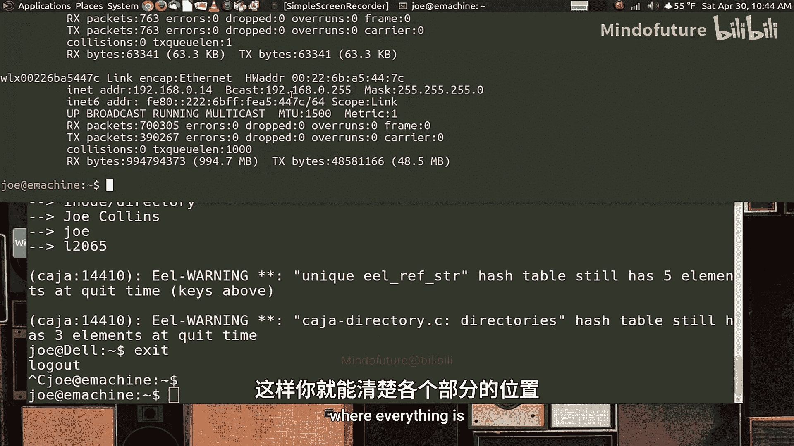

# Bash基础-｜-Bash-Basics-p09-P09_Linux_技巧-如何使用SSH远程登录--BV1Tj6VBnEz3_p9-

Greetings and salutations。 And thank you for clicking on the video today。

 We're going to look at S S H。 The secure shell。 This is a very groovy program to know about。

 and it is not Linux specific。 This works on any platform anywhere in the world。

 And it allows you to remotely log in to a computer on your own network or log into a computer somewhere out there on the internet as long as you have the credentials to do so and。

😊，The IP address of that machine， you can get into it。And SS SH is a very powerful tool。

 It is used by。I T professionals everywhere。 There are folks who have jobs， assists admins。

 They get up in the morning。 They get themselves a cup of coffee。

 They're still wearing their bathrobe。 They sit down in front of their computer。

 and they log in the servers and computers that they maintain。 And this is how they do it。So。

It is truly an awesome thing to use。 and I do apologize for not having done a video on it sooner。

 I just haven't used it in a long time myself。 I am going to actually put this in the playlist for my bash basic series that I completed a little while ago。

 because you can use everything that I taught you in that series to get work done with S S H。

So we'll start talking here about getting it set up on your system。

Pretty much every Linux distribution has the SS SH client installed。

 which means that you can log into computers elsewhere。

But if you want to be able to log into your own computer。

 you are going to have to install and configure the SS S H server。 So to get that in abuuntu。

 it's actually quite easy pseudo apppt install。Did I take that right， your。Open S， S， H server。

 That's the name of a package we're looking for。 I already have it installed on this machine。

 So I'm not going to actually run this command， but wanted to show you what it looked like。

 You can do it from your software center， too。 You don't have to do it from the terminal。

 It don't matter。 It's just a package。 Insall it How y' like。So when you install SSH。

 it's going to take it a little while to get itself together。

 It's going to generate a bunch of secure keys。 It's going to start the service。

 You do not need to restart the machine。 SSH will immediately start broadcasting on port 22。

If for some reason， your firewall or your router。Whatever is hardware you have running on your network there blocks port 22 by default。

 and some do because leaving port 22 open can be a security risk。

Then you will have to configure the SS SH server to use another port。

You will have to configure your firewall to allow port 22， or you will have to。Configure your router。

 which usually has a hardware firewall in it to do that as well。

That is beyond the scope of this video for me to explain how to do that。

If you run into a situation where SS S H doesn't work and you don't have access to port 22。

 there are a lot of great tutorials which are available online。

 and they will take you through the process of verifying whether port 22 is available to you And how you can change the port in S S。

 H。 So once it's all installed， let's just assume that it's all working the way it ought to。

 And you don't have to change nothing。 You don't really have to configure anything。 It's available。

 It's ready to go。 So to log into a computer that is running an SS S H server。

Then you would just type in SSH。And if you have an account on that machine and you're logging in from that account on the machine that you're logging in from。

 if that makes sense。Then you don't have to specifically tell it the account。

 can just give it an IP address。 So in this case， we're going to give it 1，9，2 do 16，8。Dot 0， dot 13。

And it asked for a password。I have logged into this machine before。

 so it did not stop and prompt me and ask me whether I really wanted to do this。

 The first time that you log into a machine， it will throw up a message。

 and it'll say that it has to exchange the。Certificates and all that other stuff， the。

The keys that make it a secure connection。And so therefore。

 it's going to verify that you want to do that。 type in。 yes， and then it will ask for your password。

 So I'm logged into this machine。And I'm good to go here。

I can do anything on my Dell machine from the E machine that I'm sitting at that I could do if I was sitting at the Dell machine and working in a terminal so we can list the storage in there。

 I can even get files off of here， through the。S， S H protocol。 I can copy a file off that machine。

 So let me show you how to do that real quick。We're going to use the secure copy command to do that。

And the file that I want is test dot T X T， and I had that already put together。Before。

Started the video to just make it easy。 So I'm going to secure copy， test。Dot TxT。

And I'm going to put it on the machine that I'm currently running on。 So to do that。

 I'm going to have to put in its I P address。 So we're going to put it in to。1，9，2 dot。1，6，8。Dot 0。

 dot 13。Oh， no， I need to be on the machine that I'm copying， too。 This one is 14 on my network。

And then colon， and I need to tell it where to put it in the file system。

So I'm going to tell it to put it in my home folder。And we'll just stick it on the desktop。

And give it a file name for it to copy2。 and in this case， just use the same file name， dot T X T。

 and if I have done that correctly。Then this should copy this over the network。Yes。

 I want to continue。 I haven't logged into that other machine。Oh， I have to type in the full， yes。

And it asks for my password， because now I got to log into the machine that I'm actually on。

And it did it。Okay， I was not。 I had to log in the other direction。

 So I'm glad that it did that so that you could see how that worked。 So if that popped up。

 you wouldn't get freaked out。 So if I come to this machine and we just make our terminal。😊。

Minimized， you see that I now have that file there。Pretty cool， huh？

So I can actually move data back and forth between machines using SSH。 It's not like a samba server。

It just moves it back and forth。 As long as I have access to that account， I can do that。

 So once I'm done on this machine， whatever I'm doing with it。Then I can log out。Okay。

 I am now off that machine， the connection is closed and we're done。

So if I want to log in to another machine as another user。

 I can do that as long as the SS S H server has what users are available to log in listed。 So。

 for instance， if I wanted to allow Cindy to log in her account。

 then what I would have to do is I would have to add her to the list。At the end there。

 And then she would be able to log in。So that is the basics of how that works。

 But there is more to this， way more to this。That's nice that we can log in and work at a terminal。

 I mean， we can go in。 We can update the system。 We can check all the administrative tools。

 We can find out what's going on with it， see how many people are logged in。

 how long it's been up and all that stuff。 But what if you want to run an application that requires。

😊，Agui。You can。And the way we do that is we're going to go back to our same command here。没有。Oh。

 let me go ahead and clear the screen。 So we can do it up top here。 Allright。

 so we go back to our same command。And I am going to add an argument to it， which is capital X。

Make sure I get that typed in correctly。Now the space， Thank you。And it has to be a capital X。

 And I'm going to log it back into that machine。Now I am logged into that computer。And。Yeah。

 I can use terminal applications。 H top。 for instance， see what the machine is doing。

But I can also use applications that require X， which is the display server and client that actually draws pictures on your screen。

So let's just open up a text editor on the other machine here。

And it takes it a second to get that set up。 Now， you see that I have running on my screen， Pluma。

 which is the text editor， but。It is running on the other machine。 How does this work。

The X Windows system。Is divided up into two separate。Applications。

 there is the X server and the X client。And on your local machine， the X server。

If you have an X application， which is what a graphical application is， it tells the X server。

What needs to be drawn。The X server sends that data to the X client。

 and then the X client actually draws the picture you see on the screen。So we can divide that up。

 It doesn't have to be on the same local machine。 So in this case。

 the X server on the Dell machine is telling the X client on this local machine。

 the E machine what to draw through the network and。So you can actually use X applications。 Now。

 the applications that you do use have to be relatively simple。 Okay。

 you can't use really sophisticated graphic intensive applications。

 It will be very slow and dragging。 It might not even actually render at all， so。You know。

 if you open up an application and you find that it's not rendering properly or getting errors。

 that's why， because it can't do like multi threads and things like that。

 But for simple applications， like， for instance， on the other machine。

 I may want to log in and I want to use bleach bit。All right。 I w to M。

 might want to clear out my folder of stuff remotely。 Now I can use bleach bit。And it is running。

On the other machine。 So just for fun here， we'll type in Firefox。

And this is going to really be slow because it's a very big application。

 We're actually going to try and do a web browser through S S H。 It works。

 but it's really draggy and Google Chrome， at least on my setup。 Boy， it doesn't work at all。

 but I can open up Firef。 So it's taken quite some time to actually display the page and all that stuff。

 You can see what I'm talking about here。 about it being a bit draggy。 But you can do it。

 You can actually log into。

So if I tell it to log into easy Linux， you'll see how long it's going to take it actually draw。

Easy Linux on the screen， because we're using the。X server split up here。So it is taking its time。

 but it works。

So there you go。 Firefox running on the other machine， but displaying on my terminal。Now。

 I showed you how to copy files， and you had to put that in there。

 But here's something really groovy that you can do。 So on this other machine， I'm going to open up。

The file manager。So， now， I have。On the other machine， the file manager up and running。

And。For the moment， let's hide the terminal because we don't really need to see that。And。

Let's go in here， and。I'm just going to grab a picture。And now I'm going to drag that。

From here to this desktop。There it is。So we have copied files from the machine that we're working on。

And let's see if we can put a file back。So， I'm gonna。Go back here。

 I'm going to go to the desktop on my Dell machine。And I'm going to drag。

This test document over here。And it might not be working that direction。

 let's try that one more time here。No， it's not going to let me do that。

 but I can get files off of that machine。So that's pretty cool。

 If you need to log into a machine and grab some files off of it， there you go。

 You can probably configure it to be bi directionional。

 That's the first time that I've actually tried doing that right here on this video。😊。

But that seems to work right out of the box。 And I didn't even configure that to do that。

So once we are done with our SSH session。Close up all our X applications。

And now we can just get out of here。 So exit。I've noticed that when I use X applications that it seems to kind of hang up the screen a little bit。

 you notice that it's not returning me to my local prompt。 That's no big deal， just。Control C。

 And that breaks out of it。 and gets me back to where I need to be on my local machine。

 There's a lot more to this gang。 This is just the tip of the iceberg， so。Pretty awesome。Okay。

 one more thing I want to cover before I wrap up the video because I'm pretty sure that some of you guys out there are going how do you know what machine to log into and how do you get those IP addresses because the way a lot of us do it these days is we use DHCP in our little router and it just arbitrarily assigns an IP address to whatever device happens to come on the network and what you can do if you're going to be doing this a lot is you can go around and you can。

Set up all your machines to use static IP addresses。

 so that way the IP address doesn't change on your local network， it'll be there all the time。

But if you're lazy like me and you don't want to go around and do that。

 then there is a way that you can find out what the machines are doing。 So in this top terminal here。

 I'm going to run a command called Arc A。And I'm going to type it correctly。R。Dash A。

 and this is going to give me a list of all the machines that I have already logged into on the network by IP address。

And unfortunately， for whatever reason it does not display host names。

 probably something I'd have to reconfigure， but。I only have three machines on this network so I can pretty much figure out which one it is。

 or I can just try and log in and see which machine it is。 It'll tell me once I get logged in。

 they're all set up for me to log into anyway。 If you've just turned on the system and now you don't you don't have anything in the arc cache there。

Then you can install a little program called Ap scan。

 And what this will do is it'll go out and see what machines are actually available on the network。

 So I'm going to call this local。Net。So I'm basically telling this， hey。

 go out and see what machines are available to me now。Oh， I have to do it as root。

And now it lists everything that's on the network。And。So there you go。

 This will tell me the machines that are currently up and running。 Now， my DHCP。

Seems to be assigning pretty much the same I P address to the same machine。

 So it's been pretty reliable like this machine is 13。 The laptop is 12 and the Dell machine。

 or this machine is 14。 The Dell machine is 13， and the laptop is 12， whatever。

So as long as you don't restart the entire system， it may change the order in that， of course。

 like I said， if I want to， then I could stop being lazy about this and I could actually set static IP addresses on all these machines。

 but I've only got three machines gang， I can pretty much figure out if I log into one and it's not it。

 then I can log into the。So I don't know， maybe I'll set up static Ipiece somewhere down the road when I get the time。

So that's how you would real quick way to figure out you know。

 what machines are on the network and for your own machine。

You can just look and see what the IP address is， I'm going to run IF config。

 and I'm going to type it correctly。And now this is the local address for this machine right here。

Right there。So this is machine number 14。So you can figure that out。 And then you could， of course。

 you can't do that remotely。 You'd have to have somebody log into the machine。 So yeah。

 probably a really good idea to go through the process of setting up static eyepiece。

 you know where everything is。 All right， gang， that is our video about。

SSH， and I hope that you found it quite useful。We will be talking more about more useful Linux things as we roll along。

 Please be sure and check out easy Linux on the Web。 Check out Freeeddompenguin dot com。

 Check out easy Linux on Facebook。 And if you do， give it a like。 Thanks for watching。

