# 美国贝鲁特大学《GPU计算｜CMPS 297S396AA - GPU Computing - Spring 2021》（豆包翻译 - P12：-12-Lecture 12 - Scan (Brent-Kung).zh_en - GPT中英字幕课程资源 - BV1bw4m1k7a1

Hello everyone and welcome to lecture 12 of GPU computing Today we're going to talk about a different parallel scan algorithm than we we talk about last time in particular。

 we'll be talking about the Bent con parallel algorithm for scan。

 So last time we spoke about about the scanned pattern and in particular we looked at the coji stone method for doing parallel scan。

 and we also looked at an optimization that was applied in this context or it also applicable in many other context and that is double buffering So we said that scan is basically a pattern where given an array。

 the output array is going to every element output array is going to be the combination of the preceding element elements as well as if it's an inclusive scan。

 the corresponding element， if it's an exclusive scan it's just the preceding without the corresponding element。

 and we were using addition as an example throughout the lecture， but we said that in general。😊。

can it be applicable to other asciative operators like product， minimum maximum， et cetera？

We said that to do scan， we segment it like we did with a reduction and that's because doing scan and parallel requires synchronization。

 which we cannot do across different thread blockss so what happens is that we take the input。

 we divide it into segments， each thread block does a scanned of its own segment and then they store the partial sum sums in sub array and then we scan the partial sums array and then we take the scanned partial sums and then we go back and each block adds the scanned partial sum of of the blocks the precede it to to's the elements inside of the thread block to get finally the fully scanned global array。

And the algorithm we looked at for doing a scan at within a single block was the cookiestone panel algorithm。

 which looked like this。 What we did is we had each thread add the element that is once tried away and then add the elements that's stride 2 away。

 then add the elements thats dried 4 away until we have we have reached the whole the whole array that the thread block is responsible for。

 And we said that we because we have this situation， which we did not have a reduction by the way。

 But here we had a situation where on the same iteration。😊。

One thread was reading a value that was reading from a location that another thread was writing to what happened is we had to synchronize between the read and the right。

 so we would read for this array， synchronize right to the array and then synchronize again。

We also saw that these memory locations are being reused so what we did is we we loaded the data initially to shared memory and then performed our scan operation inside of shared memory and then we also saw that well the reason the reason that we had to do a synchronization between reads and writes is because we were using the same array for each iteration so to avoid having to do two synchronizations every iteration instead of one we instead used an approach called double buffering where the threads don't read and write to the same buffer every iteration instead we have an input buffer and an output buffer and we read from the input buffer and write to the output buffer and we swap input buffers and output buffers every iteration that way we only need to have two buffers we don't need to have a buffer for every single iteration and this optimization was called double buffering then we looked at cool scan and we said that for the codeji。

Stone approach， we can simply do an exclusive scan using the inclusive scan but shifting the elements of the array by one element and we finally analyzed the work efficiency of the algorithm and we observed that although the sequential approach to doing scan performs n additions the code stone approach to log n steps every step and did n minus student power step operations so that came out to n times log n minus n minus1 operations which is O of n log n operations and with this observation we saw we said that this algorithm is not work efficient because the parallel algorithm does more work than the sequential algorithm it does more additions that a sequential algorithm which means that there is some redundant work that this algorithm is doing that the sequential algorithm does not do Now if the work is being done in parallel that's a great idea and that's fine it's a price that we pay but if。

😊，If the thread blocks end up getting serialized because of limited resources。

 then we can expect this low work efficiency to hurt us。Okay， and with ending at that note。

 we said that today。What we want to do is we want to talk about a difference can algorithm。

 which is which is the Brent con method for doing scan。

 And then also we didn't look at core setting last time。

 and we will look at core setting today in the context of scan to see how how core setting would be useful for scan。

 So this is what we will talk about today。 But before I continue today's material。

 Any have any questions about last night's material。😊，Is everything clear to everyone？Okay。

 so then today we'll be talking about the Brenthk method for parallel scan。

So the bread tongue method for a parallel inclusive scan。

 We Ill start with inclusive skin is as follows。 We have an array。

And what we do is this method has two steps。The first step resembles a reduction tree。 So here。

 what we will do in the first step is we will add the elements that are next to each other。

 So you'll notice here that these two elements now are ready。Okay， and the next step。

 we're gonna to add the elements。 So here we have， Oh yeah。

 And one thing to point out is that we're gonna have one element for every other。

 one thread for every other element。Okay， so in coaches stone we need to have one thread for every element here we have one thread for every two elements at the beginning because the additions that we're doing in each step are fewer okay。

So here we have a thread that adds every two adjacent elements and then we continue the next we have a thread adds you know these two elements that are two strides apart and these elements that are two strides apart and and over here。

 you'll notice that we have a complete reduction tree for this subsegment over here from zero to three。

 So now we have the this value is ready。 and then we're going to add the elements that are stride4 apart Okay。

 and you'll notice that now we have a complete reduction tree for the entire array So now we have this value ready as well。

 So we essentially have done a reduction tree。😊，Okay。

 and in the the intermediate results of the reduction tree。

 we have some of the scan values are ready， but some values are not。Okay。

 and because this looks like a reduction tree， we call this the reduction step。Okay。

 we call this the reduction step。Now， after doing this。

 we still have these other values that are not ready yet。

 So what we're gonna do is we're gonna do a second phase。

 a second phase where we complete these other values that are not ready。 So， for example。

 we observe here that x 4 x 5 is not ready。 It's missing x 0 to x 3。

 Well we have x 0 to x 3 over here。 So in in this stage， we're going So we had stride 1。

 stride2 stride 4。 Now we're gonna go back stride 2。

 And we're gonna add x 0 to x 3 with x4 to x5 in order for us to get x 0 to x 5。

 And now this value is ready。😊，But what we noticed is that we still have x2， x4 and x6 are not ready。

 but here x2 can be added to x0 and x1 so that we get x0 to x2。

 x4 can be added to x0 to x3 so that we get x0 to x4 and then x6 can be added to x0 and x5 so that we get x0 to x6 so essentially what we do is we simply add the values that are1 to the left1 strip to the left in order for us to complete the canner rate。

😊，Okay， and this step following the reduction step that we use to complete the remaining values is called the post reduction step。

ok。😊，Is it cleared everyone everyone how this works？Okay。

 so then now let's compare these two methods so here on the left we have the Koji still method that we saw before and here on the right we have the brand method that we looked at now and what do you notice about the similarities and differences between these two methods Well differences what' what's different what are the differences between these two methods。

😊，We have fewer additions， total， right。For which one。

 which one has fewer editions for the Brent con？Right。

 so the brand Kung approach has fewer additions in total。Okay， somebody is saying de。

 what do you mean by de？The brand con goes deeper into the three。

I think like it means there are more steps， Right， exactly。 So the brand K has more steps。

So the brandcom approach performs more steps。However。

 it performs fewer operations per step and fewer operations in total。Okay， and let's。

 let's kind of do an analysis of these two approaches。 So if you remember。

When we talked about work efficiency， we concluded that the Koji Stone approach has log and steps。

 however， it does all of N log and operations。Now， let's let's do an analysis of Bt Kung。

 So Bt Kung does how many steps。Well， let's， let's take a look。 There's two different。

 There's two different stages。 There is the。There's that， well， let me go back。

 There's the reduction step， and there's the post reduction step。 and the reduction step。

 How many steps do we， How many steps do we do。Well， here I have8 elements。 I did 1，2，3 steps。

 So in general， if I have n elements， I do log n steps。 Okay， and then in the post reduction step。

 you know， here I went 1，2，4， and then I go back， I do go back and do two and then one。

 So how many steps do I do in the post reduction step。Log n， -1 or roughlyee log N。

 exactlyact exactly log n-1。 So so in total， we're going to have two log n -1 steps。

 So that's more steps than Coji Stone， which finished in log N。However。

 how many operations do we do in each step here when we have8 elements。

 we did 4 and then  two and then  one。 So that's 7。 So that's around log and operations。

 And then we go back and we do one and then3。 Okay， if we have a， if you have another iteration。

 we're going do more than that。 So let's go and and do the full analysis。

 So with Brent K said the reduction step does log n steps。 And， and it does it does。

1 plus2 plus 4 up until n minus-2， which is equal to n minus-1 operations。Okay。

 maybe I should have written this as n over two plus n over4 plus nu plus one。

 because the first step is n over2 that the second step does n over4。

 And then the the very last step does one operation in the reduction step。 Okay。

 for the post reduction step we said that we have log n minus1 steps。Okay。

 and then in the first step， we did one11 operation。 That's 2-1。 In the second step。

 we did we did three operations。 That's 4-1。 And in general。

 we're gonna keep going until we get to n over 2-1。 So'll do 2 -1，4-1，8-1。

60-1 until we get to n over 2 -1。 So if you add this up， this comes out to n -2 log n -1。 right。

 because we have2 plus 4 until we get to n over 2。 that adds up to n -2。 Okay。

 and then you have 1 plus 1 plus 1 log n-1 times。 So that's log n -1。Okay。

 so if you add the steps and the operations for the reduction step and the post reduction step in total。

 we find that the Bt kg approach takes two log n minus1 steps。

 so that's more steps than the Koojistone approach。ok。However， it does， if we add， you know。

 n -1 and n-2 log n -1， it comes out to two times n log n-2， which is O of N operation。ok。😊。

So that the bread kung approach does fewer operations。Okay， so Brent Kung takes more steps。

But it is more work efficient。Is that clear Abbu。Okay。

 so then let's go and implement the Brent cong approach。 but before that。

 in the past lectures we've been kind of implementing something and then gradually optimizing it what I'm going do is I'm just going to implement the optimized version in one step just to save time today because theement doing the optimizations incrementally is something weve we already did it in the last lecture for Cojistone So what optimizations are we going to apply to the brandt cong approach。

 the optimizations we applied last time where that we use shareded memory we did double buffering and what we did have a problem with divergence。

 but what we're going to do today is we're also going to use shared memory。

 So similar to Cojistone Okay and be this should be obvious however。

 there's one thing to note when we compared use shared memory for Cojistone versus Bt con so in both cases we're reusing the same memory。

😊，So using shared memory is useful。However， withji with the Kojistone approach。

 when we used global memory， the memory aes were actually coalesced。😊，Okay。

 now when we use shared memory， it wasn't a problem。 Coesing was not a problem。

 but in the brand kung approach， if we use global memory， the aes are actually not coalesced。

So using shared memory has two advantages with the brand Kg approach the first advantage is that we get data reused so we don't have to go to global array every time。

 but then the others the second advantage is the fact that we get better behavior because we can load the whole array in a coalesced way。

 and then we continue with these non coalesed aes。Okay， so those are the two advantages。

So using shared memory is similar to Co Stone， we get better data reuse。

 but it also enables coalescing of global memory loads in Co Stone that global memory loads were already coalesced before we applied shared memory time。

😊，Do we need to do， Do we need to do double buffering in in tongue。 So in Co stone。

 we we had to do double buffering。 Do we need double buffering in the brandrent kung approach。No。

 why not it？Because we don't access the same areas we are writing to。Right， exactly。

 So the reason we needed a double buffering with Koji stone is that on the same iteration。X1。

 for example， was being read by one thread and it was being written by another thread。

 so we needed to make sure that the thread that is writing' doesn't interfere with the thread that is reading。

 and that's why we wanted to read from a buffer and write to a different buffer。In Bkung。

 it is never the case that the same value is being written by one thread and read by another thread on the same iteration。

 so we don't need to worry about double buffering， we can use a single buffer for all our steps。Okay。

So then we no need for double buffering because unlike Kojistone。

 no data element is read and written by different threads on the same iteration。

 the one thing though that we need to be careful about with the Kojistone approach is sorry the breadkk approach is control divergence。

So with Co Stone。The control divergence was not a problem right because in the first step， you know。

 all the threads were active， except maybe the first one， right， but that's okay。

 The threads that were active were all next to each other。

 So threads threads  one to7 were active And the second step， threads2 to7 were active。

 and the third step， threads 4 to 7 were active。 But the point is that the threads that were active in each step were all next to each other。

Whereas in the brand code approach， if we assign a thread to every input value input value。

 if a thread owns an input value， then we have a problem with control divergence。

 and that is that you know because we don't process all the input values at every step。

 these input values drop out。So if I'm going to assign a threat to every input value。

 then at the first iteration， I'm going to have one，2，3，4， all busy。 the second iteration。

 every other thread drops out and the third iteration， every every other thread drops out， etc。ok。So。

 to avoid。So we need to minimize control divergence。 And to avoid this control divergence。

 What we're going to do is that we are not going to assign threats to specific data elements like we did with the Kojistone approach。

Instead， what we will。 So we're not going do what we've been doing so far with these tree reductions and scans where every thread owes a particular element in them。

Instead， what we're going to do is we're going to use a different approach and that approach is to reinex the threads every iteration to different data elements。

 Okay， in other words， and every iteration。Right， the thread and the thread is going to be responsible for a different data element so that I can always have threads that are next to each other active and threads that are that are kind of the threads that are farther away inactive。

 So， for example， what I would like to do over here is on the first iteration。Okay。

 I looked to have thread  zero， do this this edition， thread one， do this edition， thread2。

 do this edition， thread3， do this edition， et cetera。On the second iteration， I'm going have。

 I'm not gonna have thread rather so first I had 0，1，2，3， etc cetera。

 I'm not gonna have thread 0 inactive。 and then thread 1 do this。

 then thread2 inactive and3 do this and then threadactive thread 5 do this etc ce。

 I'm not gonna do that。 instead I'm going to rein my threads to be responsible for different data elements in each generation。

 So what I will do is I I will have thread 0 process this element， threadread1 process this element。

 thread2 perform this edition and thread 3 perform this edition。 And then on the third step。

 I will have thread 0， perform this edition and thread1 perform this edition。

 And then on the final step， I will have thread0 perform this edition。

 And then the same thing as they go back back out。 I'm going to have thread0 perform this edition。

 thread 1， thread 0，1 and2 perform these and then thread 0，1，2，3，4，5，6 perform these。

 So we always want to assign the leftmost addition to the left。😊，The first thread and so on。

 regardless of what element that is， and what that means is that each thread will be responsible for a different input element in each of these iterations。

Okay， is that clear。Do why do we need the threads to be contiguous， like sort of opposite。

 Because to maximize the like the war percentageage。 you know。

 if we have more than one more than one war and we want them to be， no， as packed as possible， Right。

 exactly。 So what I want to do is I wanna， I w to fill up the first war。

Before I fill up the second warp， etc cea。 I don't want to have every other thread in the block active or inactive。

 because then I'm going to have a lot of control divergence。

I guess what I'm trying to do is to minimize control divergence by always assigning the work to the thread starting from the left。

So I fill up the you here here。 Maybe it's not August because I just have 16 elements。

 but this could be1024 elements。 So this was 10 or it could be 2048 elements。

 And it could have 1024 threads。 Okay， so I want to fill up the initial works before I fill up the later works。

Okay， is that clear。Yes，Thank you。Okay， so then to do this， we need to be able to。

Play some tricks with the thread indexing and to to figure out how how we're going to index the threads。

 So every iteration， the thread， the element that the thread is going to be responsible for is now not the same for all iterations。

 It's going to be a combination of the thread index， as well as the iteration。

 And the iteration was represented with the stride。

 We use the stride somehow as our loop index that was doing the iterations。

So what we will do is we want to express the index。

 the element that the thread is responsible for in terms of the thread index。

 which I will denote as T and the stride， which I will denote as S。

 So if you notice in the first iteration， if we look at the index of the right source opera source element and the destination element of the thread Okay。

 these are the indices。Okay， so in the first when the stride is one。

Thread 0 needs to be responsible for element 1， thread 1 for element 3， thread 2 for element 5。

 thread 3 for element 7， et cetera。 So here I have 1，3，5，7。

When the stride is two my my threads are responsible for element 3 element 7。

 element 11 and element 15 so I have 3，7，1115。 so here this is a thread  zero is responsible for element 3。

 thread one should be responsible for element 7， thread2 is responsible for element 11 etc ce when my stride is4 then here the first thread so thread0 should be responsible for element 7 and thread one should be responsible for element 15。

 So here when my stride is 4 thread zero is responsible for element 7 and is one responsible for element 15 and then when my stride is8 then over here only thread zero is going to be active and thread  zero is going to be responsible for element 15。

 so here I'm gonna to have 15。ok。😊，So this is for the reduction step and the post reduction step now let's figure out the indexing in the post reduction step and here I'm going to look at in the reduction step I was looking at the right element that the thread is responsible for and the post reduction step I'm going to look at the left element that the thread is responsible for so here in the post reduction step or the stride is four thread where I'm going to have thread zero responsible for element7。

😊，Okay， when the stride is2， I'm going to have thread0 responsible for element 3。

 thread one responsible for element 7 and thread2 responsible for element 11。 Okay， and et cetera。

 here I'm going to have 7 here I'm going to have3，7，11， notice how these resembles these up here。

 So when stride is2 in both cases it's the same And then when the stride is  one， I'm going to have1。

3，7 sorry 13，5 and 7。Okay， the reason I'm doing this is I'm just trying to figure out some closed form representation of the element that the thread is responsible for in terms of the thread index and the stride。

Okay， so this is for each， this is for each value of the stride and for each thread。

 what element they are responsible for in each for each stride value。Okay， so now the question is。

 how can I represent the index of the element that a threat is responsible for in terms of the stride value。

And the thread index。O。Well， what we observe here is that over here the thread elements are two apart right so plus2 plus2 plus2 here they're four apart here they're the eight apart here I just have 15 when here when I come back here they're4 apart again here they're two apart So in general they are two times s apart but they're an odd number not an even number so what I will do is I will I will represent them as something-1 So here1 I will represent it as2-1 I will represent3 as 4 minus-1 so I will just represent everything as something minus-1 and now it becomes more apparent that these are all a multiple of2 times the stride right so here when the stride is124。

6 to8 are all multiples of2 when the stride of 2 is2 then 4，8。

12 and 16 are all multiples of4 when the stride is 4 than 8 and 16 or multiples of8 So in general the thread into C is。

AMip of two times the stride so I can represent them that way I'm going to represent the indices as multiples of two times the stride Okay so here now each index is here it's one times two times the stride minus1 two times two of the stride minus1 etc ceter here it's one times times the stride minus1。

 two times two times the stride minus1 etc ce and what you'll notice is that these remaining numbers in black these are just the thread index plus one。

Okay， so when and fors the thread zero is always going to be responsible for one times the element at index1 times2 times S minus1。

 thread one is always going to be responsible for the element at index 2 times 2 times S minus1 and etcter。

So this is simply going to be So the indexes are the t plus one multiple of two times S。

 and then of course， -1。 So we just replace this with 2 -1。 And this this over here。

 T plus1 times  two times S -1 gives me the index of the element that each thread is responsible for for each stride value。

 Okay， iss it clear。So figuring out this indexing， remember when I told you guys that parallel computing is all about indexing and boundary checks。

 Well figuring out this indexing is the hardest part of writing this kernel。 Okay。

 once we have this expression for the index， everything else is fairly easy， as you will see。😊。

All so every thread is going to process the T plus1 times two times S minus one element。Of course。

 if the destination is in bound， right， so over here。

 we will need to check if the values are in bound So in this situation。

 this equation will take thread0 here， but it'll take thread one somewhere all the way out here。

 which is out of bounds， So I simply don't process。

 that's how I know that and this for this Str value， thread one is not going do anything。😊，Okay。😊。

Professor is this clear any questions。Yeah， professor。

 I was just confused in the post reduction step。 Why was there。

I thought it was supposed to be 11 when the stride was 4， but there was another value。

 I think there was7。Okay， yeah。 So what I wanted to do is I wanted to。

I wanted to have the same index for Strtripe 4 here and here。

And that is why what we did is for Strtri4， the first thread was the index that we used was the index of the right upper end and the destination。

Where is the reduction step， but in the post reduction step。

 the index that we use is the index of the left operator。

And what this allowed us to do is allowed us force stride 4 that thread zero had the same index in both reduction and post reduction。

Oh， I see。 Okay， okay， Thank you。 Are you noticed here。 The left。 It was tried this too。

The the right opera are 3，7，11 and 15。Okay， and then when strike is2 down here， the left opera are3。

7，11。 and， of course， for 15， it will be out of bound。 So there's no 15。Okay。

 so using the right opera as the index the reduction step and the left opera as the index in the post reduction step allows us to have the same index both in both cases。

I see。Yeah， you're welcome。Okay so so this is this is an example of how we can reinex the threads so rather than assigning threads to fix data。

 we reinex the threads every time in order for us to make sure that we do not have control divergence and this idea of reinexing threads is a general approach to to avoiding control divergence that we apply every time here we are applying it in this context。

 but in other workloads， we might apply it in a different context Does someone have a question。

So best district that we use， you know， the right indexing versus left indexing。 you know。

 it's something we have to try already。 And if， say， if I have a new algorithm that I don't know。

 I don't know the pattern， I don't know it's parallel pattern， I have to try different things， right。

 You know， there is no like fixed way to right right left Yes， you're right。 So different algorithms。

 Yes， So this is， this here and something that's specific to what we're working on today。

 You're absolutely right。What I'm saying is the general idea of reindexing threads as opposed to fixing the threads to specific data and letting them diverge is what we're trying to showcase here。

O， thank。

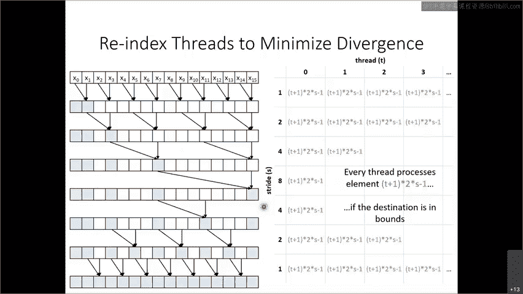

别别什么。All right， well， having explained this， let's go and implement this brandk approach for Para scale。

Okay， so this here I've set up the code already。 This code is quite similar to the code that we wrote last time。

 We have this the host code that's calling a scan kernel。😊。

And then we have this recursive step that scans the partial sums and then there's an ad kernel that adds the final result。

 Okay， and the addd kernel is already implemented， we just need to implement the scan kernel based on what we saw today So let's begin to implement the scanned kernels。

 The first step is I want to find the segment and the input that the thread block is responsible for Now one distinction between Kojistone and brandt K is that in Cooji stone。

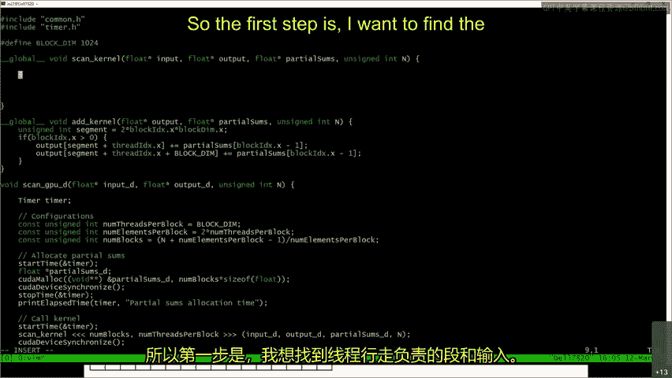

So let me go back。And code you stone， I had as many threads as I had input elements and the reason was that I needed that many threads because I was doing an operation for for you know every input element in the first step。

 whereas in Bren Kung， I need half as many threads as I have input elements。😊，ok。

So the size of my input is going to be twice my block dimension。 All right。

 that's that's one thing to to keep in mind。 Okay， so here the size of my input the number of threads that I need is half the size of my input。

 So every thread block is going to take a segment that is twice the block size Okay。

 so in other words， I'm going to start。

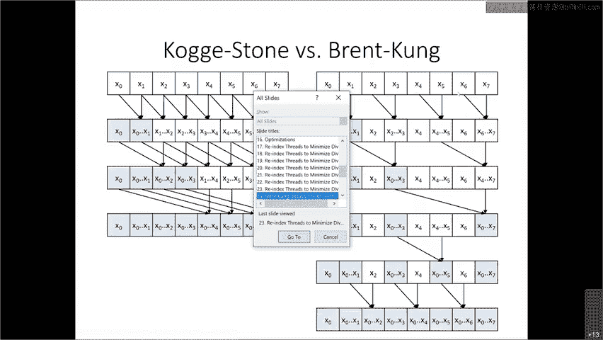

By finding the segment of the thread block and the segment of this third block is basically going tobblockinex。

x。Times， lock them dot X times 2， because I have twice as many input elements as I have threats。ok。😊。

Now， the next thing to do。 remember， we said we're just going to do all the optimizations together。

 So what we want to do is we're going to load this input array from low memory to shared memory。

 So I'm going to create a shared memory array。😊，I'm just going to call it buffer。A just for S。Okay。

 and what's the size of the sugar array going to be？If this is my block then。

 then what's the size of the chain we are able to be？Buck them。Is it going to be blocked in only。

 It's block them times2， Right， It's going to be blocked in times 2， because again。

 I have twice as many as many elements as I have threads。 Okay。

 now since the size is blocked in times2。 I'm gonna need I'm gonna need every thread to load two elements。

 And to do this in a coalesc way。 I'm gonna have all my threads load the first half of the segment。

 and then all the threads load the second half of the segment。 Okay， so I will do。

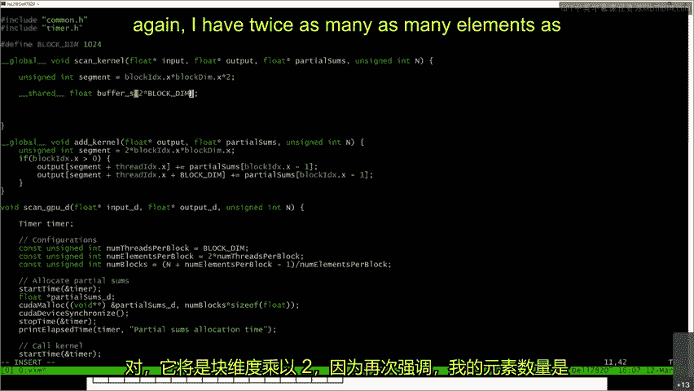

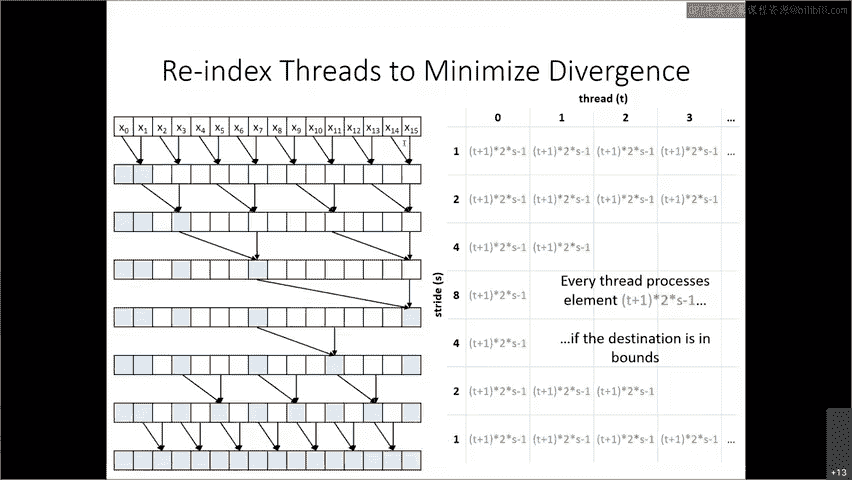

Bathffer underscore S of。Tread index dot x is equal to input of segment plus。Thread index not x。

 So here segment is the index of the very first element and the segment of the block owns。

 and then each thread is going to load one element starting from the beginning of the segment。 Okay。

 and then in the next step， each thread is going to load a second element。

 which is going to be the top half of the segment that the block is supposed to compute with。

 So here is going to be thread index x not x pluss plus segment。 thread index not x plus block in。

And'll turn the next on X plus block do over you Okay， and then of course。

 I need to sync threads to make sure that I've read all the values from Google memory before I start doing my tree。

Okay。😊，Mired everyone。Okay， now that I have my data。And shared memory。

 So now this is this array is a shared memory。 The next step is for me to do this tree。

And what I will do is I will first start with the reduction。Okay。

 and first we'll start with the reduction。So let's write the loop that iterates through the reduction step。

 initially my stride is one and then it's two and then it's four， and then it's eight。

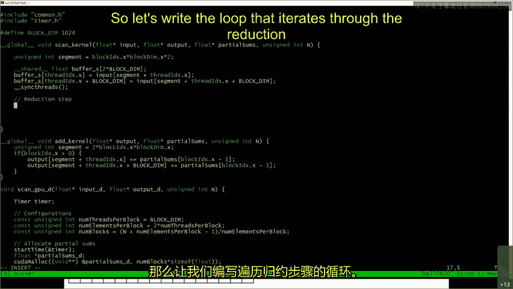

Okay， it's top at eight。 what is eight？8 S the。8 is half the size of the input。

 The input is two times the block dimension。 So two times the block dimension over two is simply the block dimension。

 Okay， so my my loop is going to。

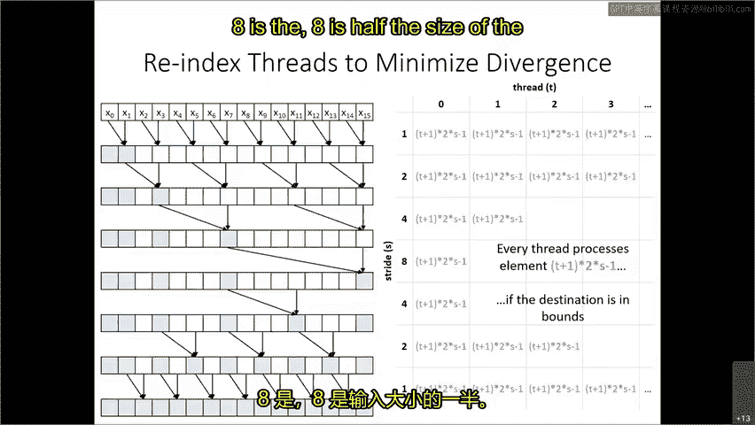

Soect。S stride equals one， and it's going to keep going until stride is equal to。Block in。

 so stride less than or equal to B in。Okay，Where did I get blocked in again。

 the size of my input array is two times block in， and the largest stride is going to be half the size of the array。

 So half of two times block in is blocked in。Your stride equals one。

 stride is less than or equal to block them， and then every iteration I'm going to multiized stride by two。

Okay， and then on each step， what am I going to do， but I'm going to add。

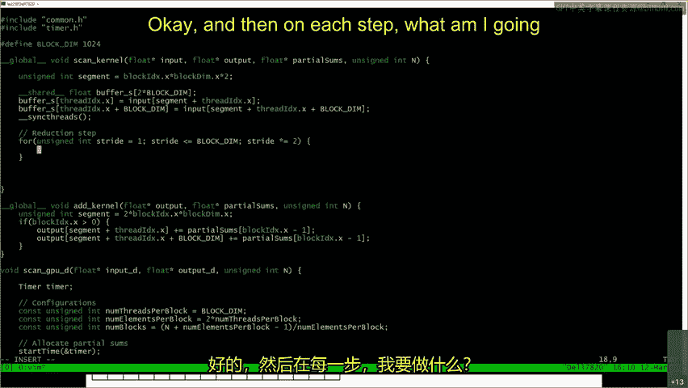

I going to first I want to figure out， so this is where the indexing comes in。

 I want to figure out what element my thread is responsible for。Okay。

 and the way I figured out is using this equation。 And this is this equation。

 T plus one times two times S -1。 Okay， un sign and I is equal to。

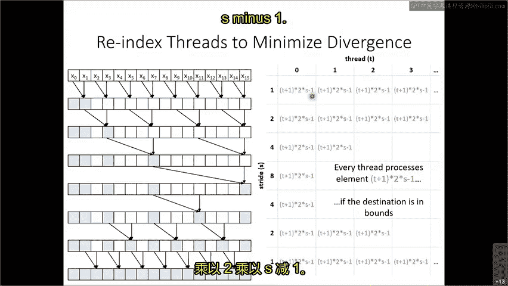

对。Plusus  one times two times。Sriide，-1。ok。😊，So now every thread knows it's responsible for now each thread is going to add the elements it's responsible for to the element that is stride to the left。

Okay， so I'm going to write。Buffffer underscore S of I。Plus equals。

 so each thread will add the element it's responsible for to the element that is strike to the left。

 so it's going to add it to buffer others for s of I minus strip。ok。😊，And of course。

 I need to make sure that the element that I'm responsible for is actually within bounds right so I don't want the threat anderation I want some threads are going to be all the way out here。

 I don't want I only want threads0 and1 operating over here。

 Thrhread2 is going to be somewhere all the way out here and I don't want and that's going to be out of bound so I don't want thread2 to do anything So to do that I'm going to make sure that I。

 the element I'm responsible for is actually within bounds What is the bound here。

 What is the size of this array。

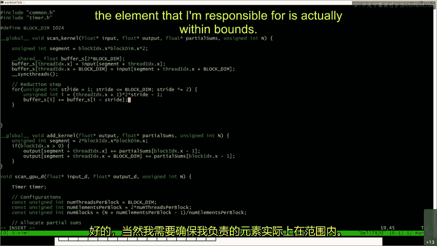

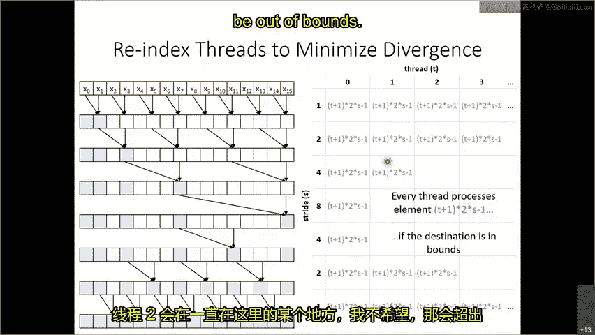

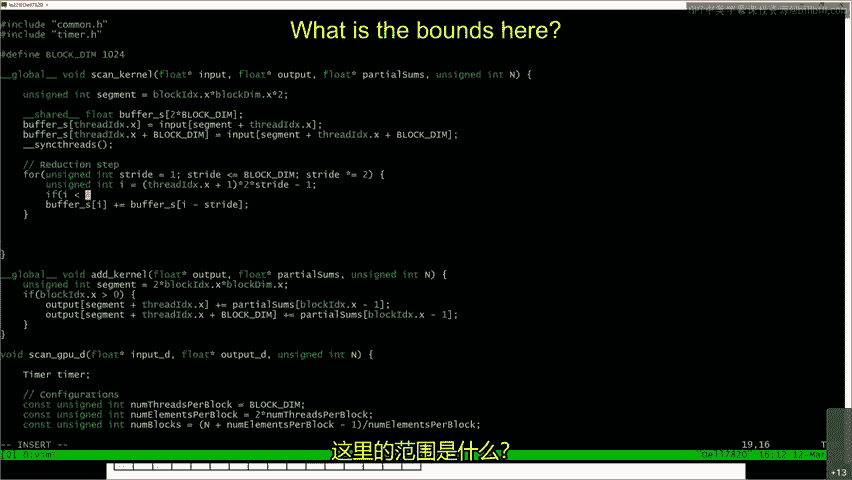

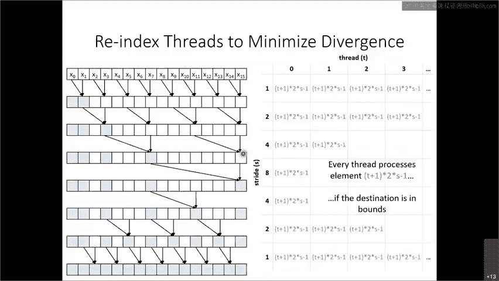

It's two times。Lockeddown。Okay， it's two times。Led him。Right。

 and you can you can easily see how how this works， right， because here buffer underscore S。

 the size of buffer underscore S is two times blocked in。 So obviously。

 when I access buffer underscore S of I， I want I to be less than two times blocked in。

 So this is kind of another example of how these boundary checks always correspond to some memory location that I'm accessing。

 and I want to make sure my access is within bound。 okay。😊，All right， so after I do， I do this。

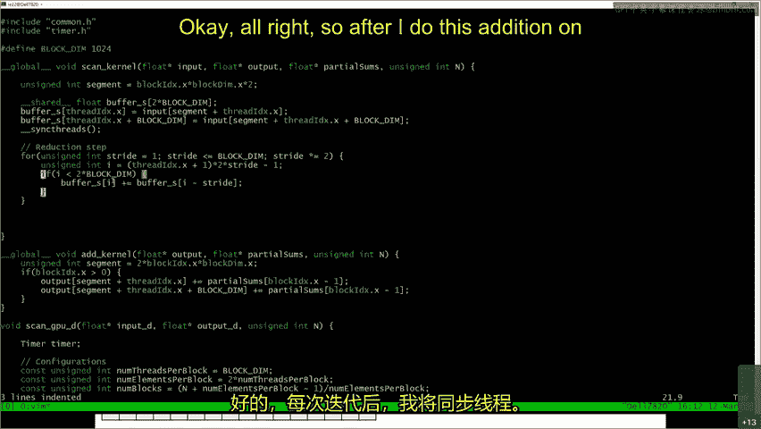

On each iteration， I'm going to sync threads。

Okay， and then when this loop is over， I'm done with my reduction step。

 so next what I need to do is I need to do my post reduction step。ok。So its my post reduction。

I'mMy stride is going to start at， in this case， four。Okay， so in general。Okay。

 if I want to write I write the loop balance for the post reduction step， I'm going to start。

 I'm going to unsigned。If prime is equal to what is the first value up stride in the post reduction step？

Where did I get four from？Well， it is half of the stride at the end of the reduction step。

That is blocked in。Okay， so then the stride at the beginning of the post reduction step is going to be locked in over to。

Okay， is that clear to everyone where I got blocked him over to from。Okay。

 and then I'm going to keep going on。So 4，2，1， I'm going to keep going until the sky is1。

 So why so 4 stride equals locked in over 2， stride as greater than or equal to one。Okay。

 and then I go to divide stride by two every iteration。 Okay， so in this stride。Divide by。ok。Now。

 what do I do Well again， figure out what element the thread is responsible for and fortunately。

 we were able able to cleverly use the same index for the reduction step and the post reduction step。

 So I'm simply just going to copy next on the used up here so thread index that x plus one times two times straight minus1。

Okay， however， this time what's going to happen is every thread is going to remember this index is x for the left element。

 So every thread is going to add this element to the element that is stride to the right。

 and store the result in the element that is stride to the right。 Okay， so。

 so I'm going to increment the element that is stride to the right by the element that I'm responsible for。

 Okay， so I'm going to do。😊，Buffffer underscore S of I plus。Stripe。😊，Plus， equals。

Bffer underscore S of I， Okay， so I take the element on the right and I acrement it by the element that I'm responsible for。

 can the I take if I'm responsible for this element， then I take the element that strike to my right。

 and I add to it the element that I'm responsible for。Okay， and of course。

 I need to have a boundary check over here。 Okay， so basically。

 I need to check that not only should my element be in bounds。

 but the element to my right should also be within bounds。 Okay， Okay。

 so if I need to make sure that I plus stride is less than what is the bound。

What is the bounds of the theater name？

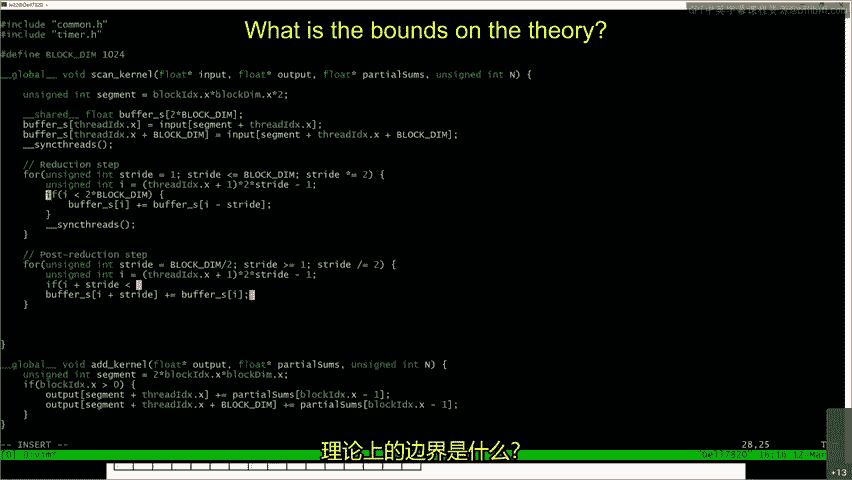

Buckling。😔。

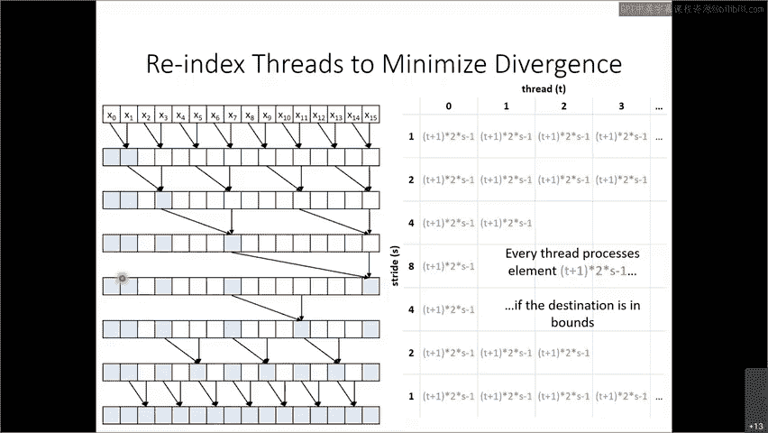

tonons lump in， okay it's two tons locked in。So， two times。Okay。It's two times。Lgged it。ok。😊。

So the previous tree， I had to make sure that I was less than two times blocked in and this tree I have to make sure that I plus stride is less than two times blocked in okay。

 and then I will synchronize。And by that I'm done with the post reduction step Now once I finished the post reduction step what what are the final things I need to do well I need to update my partial sum so the partial sum is going to be the value of the and the very last element of the buffer so I'm going to I would have one thread be responsible for updating the partial sum it can be any thread okay I'm just going to use thread0 so if nexted x equals zero。

Then the partial sum。Of the block。 So partial sums of block index dot x。

 the partial sum of the block is going to be equal to the value at the very end of the buffer。

 So buffer underscore S of how big is the buffer。 It's two times locked in。

 So what is the index of the last element in the buffer。 It's two times locked in，-1。Okay。

 so this way Ive updated the partial sum， and this will be used later on to scan the partial sums and then go back and do the addition。

Okay， and then finally， what I need to do is I need to store my output value。

 And just like each thread responsible for loading two input values。

 each thread is going to be responsible for storing to output values。 Okay。

 so I I will index the output the beginning of my the segment tells me the beginning of my input segment。

 and therefore it also tells me the beginning of my output segment。

 So here I'm going to have output of segment plus thread index that x。

Is equal to buffer this for s of red index dot x。Okay， and of course。

 I also want to add the element that that so what this does is still。

Store to the output the first half of the result array。

 I also want to store the second half of the result array。 So to do that。

 I'm going to also have this。 but then I'm also going to add at the end here， locked in。

Again the second plus is the x+ blocked in， and will add to I will store there buffer Al3 index x plus blocked in。

Okay， now of course， here when I access the input and when I access the output。

 I need to make sure that these indices are within bounds Okay so I will need to use n to make sure that these indices are within bounds and I'm not doing that on intentionally in the lectures I'm not worrying about boundary check and'm assuming that N is evenly divisible by two times blocked in but in practice this might not be the case so in the assignment when you saw the similar when you write similar code you're going to have to make sure that that you handle the case where n is not evenly divisal by two times blocked in and make sure that when you access the input here and that when you access the output here that you perform the right boundary check。

Okay， so this is the code for the Brent Kg scan， any questions about it before I run it？Yes。

 can repeat Western in last two lines。 What we what we did。 Okay。

 so what we did is we loaded at the beginning up here。

 we loaded the income segments to shared memory。 And then we did our scan and shared memory。

 And then we have our result in shared memory。 So we want we wantna store our scanned result to global memory。

 Okay， so here but when we're done with the reduction step of the post reduction step。

 my result is still in shared memory。 and I will store that to the output， which is global memory。

 So here， that's what I did。 Okay。😊。

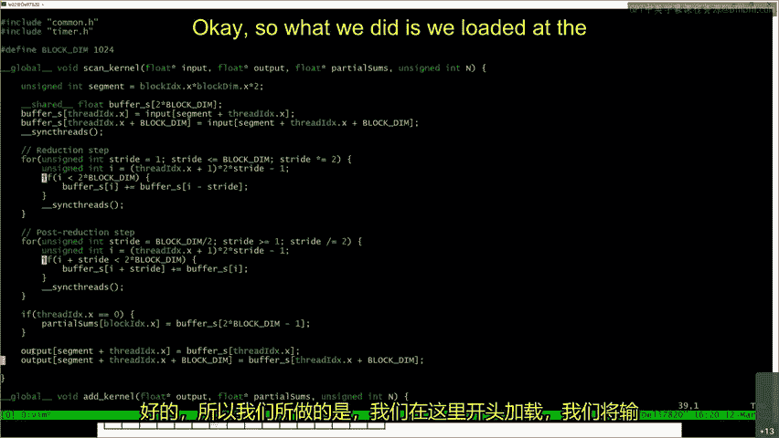

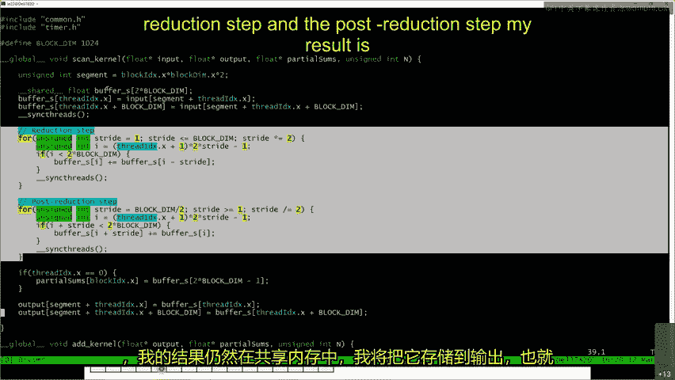

Fer。😊，Yeah， okay。 Yeah， but we did it。 we did twice because we have to two blockss。No we did that。

 sorry。We did it twice and once for segment plus that。

 so the reason we did it twice is because the thread block is responsible for twice as many elements as the number of threads that it has。

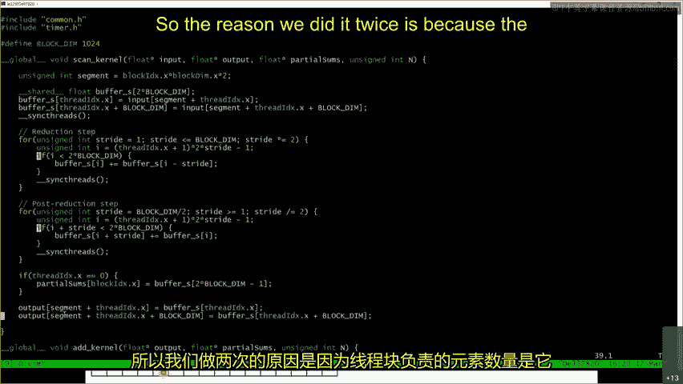

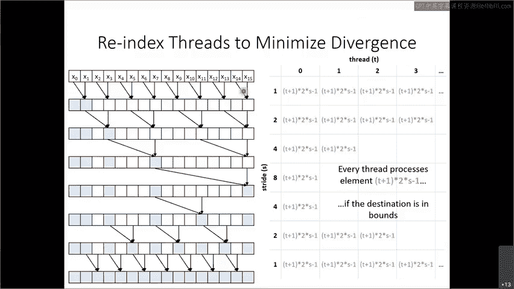

So that is why when we loaded the input out。Each thread had to load two input values and when we stored the output elements。

 each thread has to store two output values。Okay， otherwise we would we would need to have threads that were only active when we are loading the input over here and then storing the input output over here。

 which is a waste。ok。😊，And let's compile it。Let's hope runs correctly for the first time and we don't have to do any debugging。

Okay there we go， so the result is correct and as you can see the baseline code took 50 milliseconds whereas in the CPU code。

 whereas on the GPU it took around six milliseconds to perform the scan。Okay， now of course。

 the total time is high because there's high overhead from doing the copy2 and the copy back。

 however， in practice if your data is already on the GPU。

 it's definitely worthwhile doing this scan on the GPU and not bringing the data to the CPU。

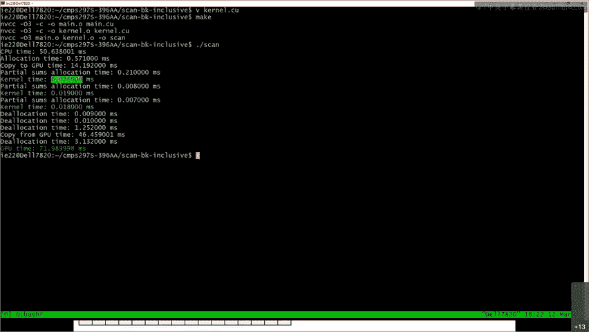

ok。😊，So this is the code that。Sat， and if we want to do it in an exclusive scan。Okay。

 there's two approaches to do the exclusive skill。We can do what we did with a coji zone approach where we just formulate the exclusive scan as an inclusive scan by shifting the elements one to the left。

Okay， but there's also kind of another way to do the exclusive scan。

 and that is by using a different post reduction step。 Okay， let me show you what that looks like。

So if we want so theres so there's there's a kind of another way in the redk approach to do the exclusive scan。

 the the reduction step remains the same。 So we do a reduction step。

 just like with the inclusive scan。However， what changes is the post reduction step。

So what I want to do the exclusive scan， I can change the post reduction step in order for me to achieve an exclusive scan。

 okay？And this is what I would。The first thing I do is that I'm going to set aside this x0 to x7。

 this is going to be the sum of all the elements in my array。

 so I will need that because this is going to be the partial sum of the block。

 but it's not going to be a part of the result in the actual array because this is an exclusive scale。

Okay， so I will set aside x 0 to x 7。 I will save it as the block's partial sum。Okay。

 but I will replace it with zero。😡，And now， now， since this is exclusive skin， this0 is misplaced。

 I'm supposed to have0 in the very beginning。Right， this x 0 is misplaced。

 X 0 is supposed to be here。 This x 0 to x 1 is misplaced， supposed to be here。

 This x 0 to x 3 is misplaced。 It's supposed to be here。

So somehow I want to take the zero back all the way here to where to its place。

 I want to take x0 to its place， Im going to take an exit x1 to its place。

 and also I want to complete these other values。Okay， and the way I will do it is as follows。

In the first step。My stride is4， and what I will do is I will move the zero here。

And I will add the0 to x0 to x3 and put the result over here。Okay。

 now I know this looks a little bit weird， but it'll make sense in a minute。Okay。

 what I'm doing is I wantanna， I want to move x 0 to x 3 over here eventually。 But intermediately。

 what I will do is I'm gonna move it all the way here。 And then later on， I'm gonna move it back。

 And I'm gonna to move this 0 all the way here eventually。

 But what I'm going to do is I'm actually gonna move it only this， this far。 And later on。

 I'm gonna move it back。😊，诶。😊，So I moved the zero here and I moved at to 0 to x through over here while adding it to zero。

And the next step what I want to do is I want to move this0 closer to where it's supposed to be。

 which is here。 and I want to move x0 to x3 closer to where it's supposed to be。 Okay。

 so in the next step， I will move the0 over here。 and I will move x0 to x3 over here。

 but I will also add0 to x0 to x1 and put the result here。 Okay。

 remember x0 to x1 needs to come here， but I will temporarily move it here。Okay。

 and here x4 to x5 still needs x0 to x3 so that I can get x0 to x5。

 and then I need to move it here eventually， but what I will do is I will add it to x0 to x3 and bring it here Okay。

 and then later on I'm going to bring it back to where it's supposed to be which。Okay。

 you can probably now see more clearly where this is going。Okay so here I have a stride of four。

 and what I do is I move one of the elements and then I add another one of the elements Okay and the next step I have a stride2。

 and again， I move one of the elements。 and then I add another one of the elements and then the final step。

 I will do the same thing with stride equals 1 and voila everything now works I move0 over here。

 I move x0 over here by adding it to x1 here x2 was missing x0 to x1 So I add it to x0 to x1 to get x0 to x2 over here。

 and I move x0 to x1 down here Okay same thing with over here and safety with over here。

 and this post reduction step is indeed a clever way of achieving an xs scan without formulating it as an inclusive。

😊，Okay。😊，Is this clear to everyone， so here this post reduction step is exclusively for the exclusive scan。

Any questions？NowProsor， I'm struggling to see why we just don't do it the same way and then。

I keep the zero at the end， and then just。Send whatever， like。

 send it all with like a delayed index of one， like I-1。 We can it We can't do it that way。

 We can' do it that way。So two ways to do it。ok。One way is to formulate it as an inclusive scan by shifting all the input elements。

Okay， and another way is to use a different post reduction。

Right and both of these are valid ways of doing it right I just wanted to show you this way because it's a clever way of doing it and it's kind of nice to observe how it works。

Okay， and there's actually a second reason why I want to show you this approach。

 the reason I would like to show you this approach is because we're not going to implement this approach in class that you will have to implement this approach for your assignment。

😊，Okay so another reason I'm showing you this is you'll implement this approach for your assignment。

 it is true that we can also use the inclusive formulation。

 however this hopefully you will find this as an enjoyable exercise to practice reasoning about thread indices and how to pick the right indices and reindex the threads when you are implementing something like this。

😊，ok。😊，We， we have to worry about the。The array not being multi like multiple of the number like of the size of the block So having edge。

 so in the homework assignment， you will have two things to worry about that we didn't do in class。

 One of them is you will need to worry about the boundary checks when you read the input from global memory and store the output to global memory and the other thing that you will have to do in the assignment is you'll have to implement this post reduction step for the exclusive scan as opposed to the post reduction step for the inclusive scan that we did in class。

Okay， thank you， okay。Okay， so so what did guys think。

 do you guys like this Brent Kung approach for doing parallel scan。What do you guys like more。

 this approach or the Kojistone approach？This is more convoluted， but。It's nice。RightSo this is yeah。

 this is I think the coaches you stood was maybe a little simpler。But remember。

 this is more work efficient， right， remember， the Cojistone approach was less work efficient。

 This approach is more work efficient。😊，But it takes more steps。That times better performance。

 the coaches don't approach or this approach。The Covid Stone approach。

Why do you think the country that approach does better？I mean。

 my point of view is just if we're running it on a GPU might as well ferilize it as like as much as possible and not have many steps。

 like this is more sequential than the other one in some regard。 So this one。

 this would takes more steps， but it does do less work， right。Yeah of work。

 Cojistone does all of N log N work。

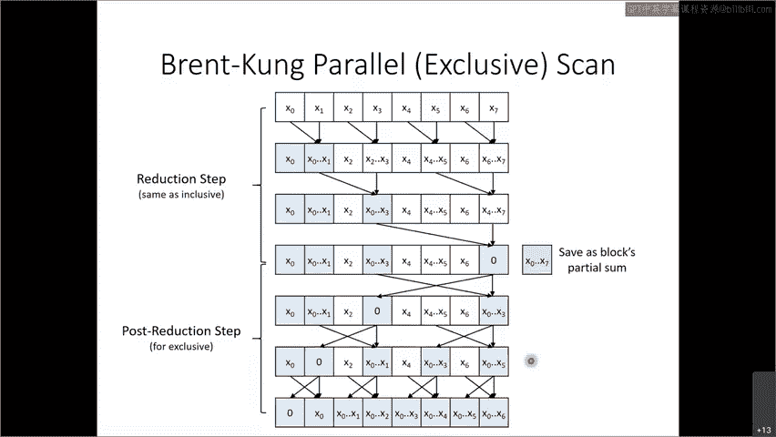

So let's come back remember the performance of our coachji Stone approach。So here remember。

 we got six milliseconds for the Brent kung inclusive scan。Let's go back。4， I think。

Let's go back and this is our code for a Kooji stone， so let's run it。

Let's see what the performance we had and it was around four points something。ok。

So the lesson here is as much you know work efficiency is very important。

 but we always have to sometimes there's a tradeoff that we have to make Okay。

 let's see what's going on so work efficiency and the reality。

 while the Rekung approach has higher theoretical work efficiency than the cojistone approach。😊。

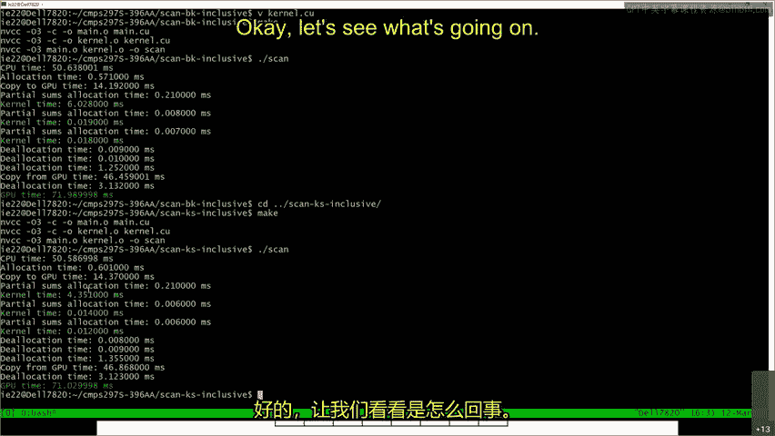

In practice， its actual resource consumption on the GPU after accounting for the inactive threads is O of N logM。

 and what do I mean by that？If we go to a。We go back to the comparison。Okay。

 it is true that the costone approach does more work than the bread cook approach。

 the bread K approach does less work。However， of many of the iterations that the bread con approach is doing less work。

The work that I'm saving。ItBe done by threads that are bound to these threads by Sdi anyways。Okay。

 so once I get to the point where I'm using a single warp right when I'm using multiple wars fine。

 right， I'm saving up， I'm saving a lot of work。😡，But once I get to a point where I'm I'm inside of a single war。

Right using fewer threads， using 16 threads in the warp， instead of using 32 threads in the warp。

 so having the warp， having 16 threads do an addition in the warp。

 instead of having 32 threads do an addition in the warp doesn't really benefit me。

Because even if I've saved those threads from doing any work。

 they are still occupying resources because of the way that CMD works。😡，ok。😊，So in practice。

 it's actual resource consumption on GPUs after accounting for inactive threads。

 So if I consider the inactive threads that are occupying cores because they're bound by Cindy。

 it actually is more similar to N log N than it is similar to log N。 So it is log N。

 perhaps in in the amount of real work that it does， but it is N log n closer to N log n。

 if you consider the inactive threads， the threads that are not doing work。

 but they are they are occupying cores because of Cdy， if you consider those to be doing work。

 then it would be closer to O of N log N。Okay， and that is why the performance of Brent Kong on GPs in particular。

 or in general， if we have C is similar or sometimes maybe even worse than Koji Stone as we saw。Okay。

 so it is still an interesting case study。 We still showed you this bread cook approach because we think it was an important case to study in order for us to learn about work efficiency and see the trade off。

Between work efficiency and parallelism， so sometimes it might be worth paying to do it might be worth performing more redundant work in order for us to be able to get more perism。

ok。😊，Any questions？Somebody saying if we're bound by Cindy。

 the inactive threads are actually performing the same computation as the active threads。

 but we're disregarding their result， what I mean is that。

If those the inactive threads that are bound to the active threads by Cdy。

 if they performed computation or they didn't， it will not impact the performance。Okay。

 so had they been active and doing and performing actual computations。

 we would not have seen a performance difference because that work was completely hidden because they were bound by somebody。

说。Yes， the power consumption or dynamic power will the As are still running and they're still performing computation。

 but we're just not taking the result and because they're bound by CM you know it's not they're still performing the instructions right right。

 I mean， it just depends how you want to think about CM you can think about them as performing the instructions is not taking the result as you want。

Okay， so so so having seen this， a final topic I'd like to talk about。

 since we've spoken about oric efficiency， a final talk about and talk about is threat coening。Okay。

 so remember， we said that thread coursening is an optimization that is useful whenever we have a certain price that we pay to paralyze something。

Okay， and what is the price that we pay to paras skin？Well， similar to reduction。

 we have the synchronization overhead and we have the control divergence。 Okay， well。

 there's another price that we paid the paralyzed pan， Part with coji stone。 What is it。

Sure mentioned on the previous slide。Shared memory。Well， that's not what I had in mind。

What's the overhead？Paralyzing skin。The work， so you're doing more work I guess right。

 exactly work efficiency， So paralyzing can incur the overhead of lowering the work efficiency of our algorithm。

Okay， now if all my thread locks are going run in parallel， then that's great。 Okay。

 I'm paying that price of low work efficiency in order for me to get parallelism。😊。

But if the resources are insufficient and the hardware will serialize these threadlocks。

 then this this work， this lowering of the work efficiency that I'm paying is unnecessary。

 So what can we do in this case in order for us to to reduce the loss in work efficiency that we're getting from over paralyzing the workload。

Only we can apply thread course。Okay。And the way to apply thread cosing in the context of a scan。

 one way to apply thread co settinging in the context of scan is using a segmented scan。

 and the way we do that is that every thread is going to scan one is going to have its own segment。

 it's going to scan that segment sequentially。Okay， and remember。

 sequentialential scan is more at work efficient than parallel scan。

And then we're going to only have a parallel scan on the partial sums of each thread。😡，Okay。

 so if you remember， before what we did is we took the input， we segmented it。

 each block got a segment， each block did a scan of its segment and it produced partial sums。Okay。

 we scan the partial sums and then each block added the corresponding partial sum to its elements。

Well， what we can do is within each block。We can also do a se method scan。

 so if we zoom in one of these blocks。We can also do a segmented schedule。

 So if this is the segment that the thread block is responsible for。

What we can do is we can have each fruit and in the block take a subegment of this segment。

The thread scans its subsegment。Okay， each thread places its value in another array。

The thread block does a scan of this array of these thread partial sum in parallel。

 We've already seen how the thread block can do a scan in parallel。Okay。

 and then each thread is going to take the partial sum that corresponds to it and it's going to add it to its elements。

And then we produce the final scanned result for the entire thread block。ok。😊。

So just like we use segmented scan to segment the input and divide across many blocks。

 we can use segmented scan to divide the block segment across many threads and have the threads do a sequential partial scan in order for us to improve the work efficiency of the algorithm。

 I this clear to everyone。What do you guys like to implement this？Alright， let's give it a try。

And see what this will look like。Let's go back to our code。

 I'm going to implement it in the context of the Coji Stone。

 but it's the same thing whether we use Coji Stone or brandcom okay。

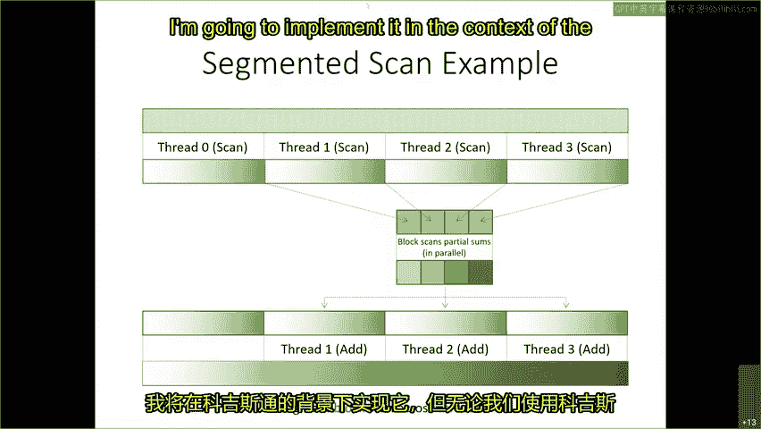

So， here。😊，Remember our time must for millise secondscond and let's see how much improvement we can get if we apply courseing to improve the work efficiency of ourcoa so the first thing I'm going to do is I'm going to define a coing factor。

 so I'm going to call it course。😊，Factor and let's set it to8s for example。

 so every thread is going to take eight elements， scan them sequentially produce a partial sum for those eight elements and then we're going to scan those partial sums in parallel okay。

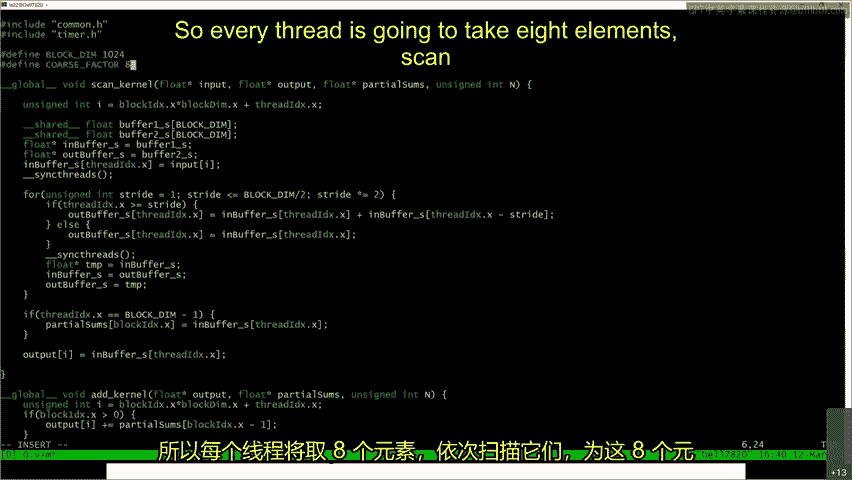

So let's get started。

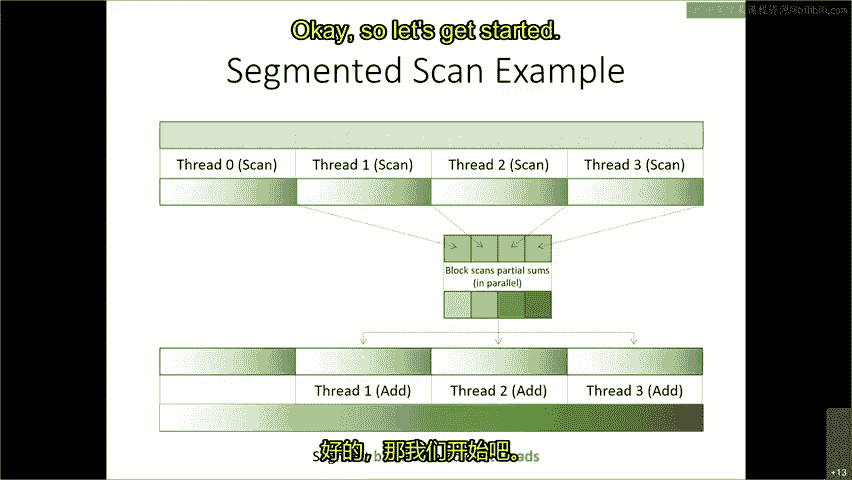

The first thing we need to do is we need to identify the segment that the thread block is responsible for so this time and there's going to be two doses of segment there's going to be a block segment and there's going to be the thread segment so I'm going。

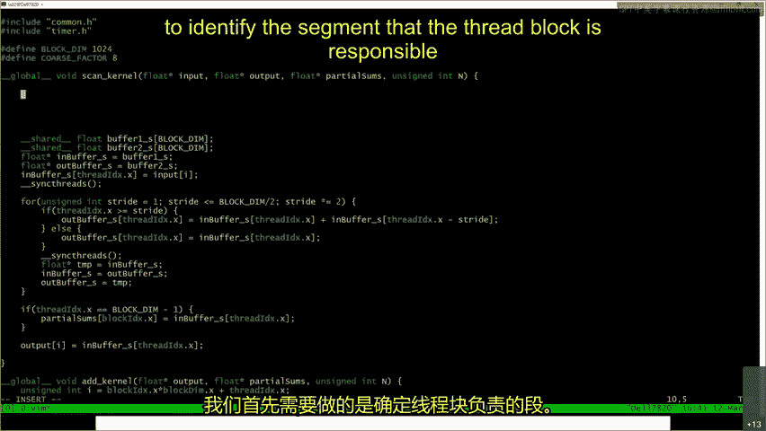

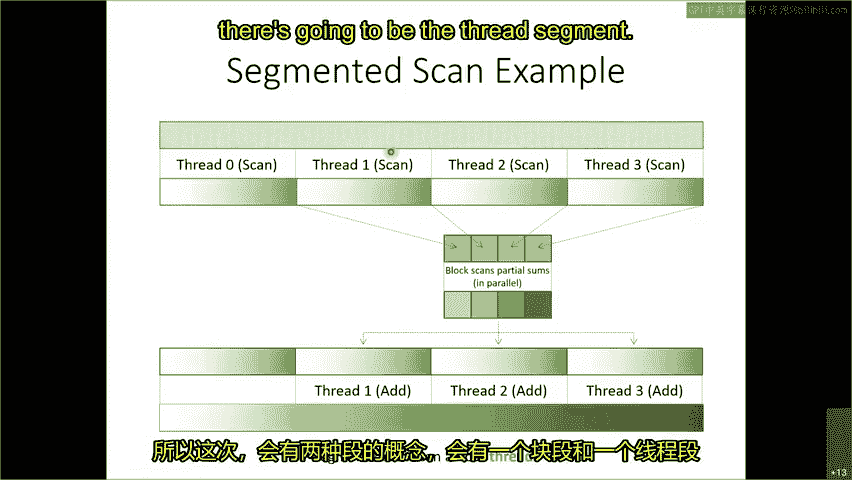

Bb segment。Okay， so the thread lock is going to be responsible for remember this is Koji stone so if I have block dim threads then without coing I'm going to have block dim elements in the in the block so web coaring how how many elements am I going to have per block。

😊，So when each thread took one element， I had blocked in elements。

 when each thread is going to take eight elements， I'm going to have block dim times eight elements。

 or in general， I'm going to have block dim。Times。C the factor elements for blood。Okay。

 so to find out where the blocks segment starts， I'm going to multiply block them times corresponding factor by the block。

ok。😊，So now every thread block has 1024 elements and every thread block is going to take 1024 times8 sorry every thread block has 1024 threads。

 so every thread block is going to take 1024 times 8 elements Okay。

 so block  zero is going to start at0 block one is going to start at8 times 1024 block two is going to start as6 times 2024 etcter。

All right， now that I know where the block segment starts。

 the next thing I want to do is I want to load。

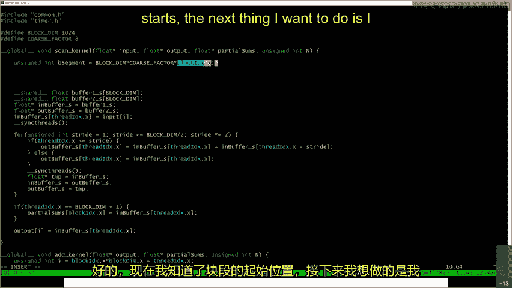

The entire block segment into shared memory。

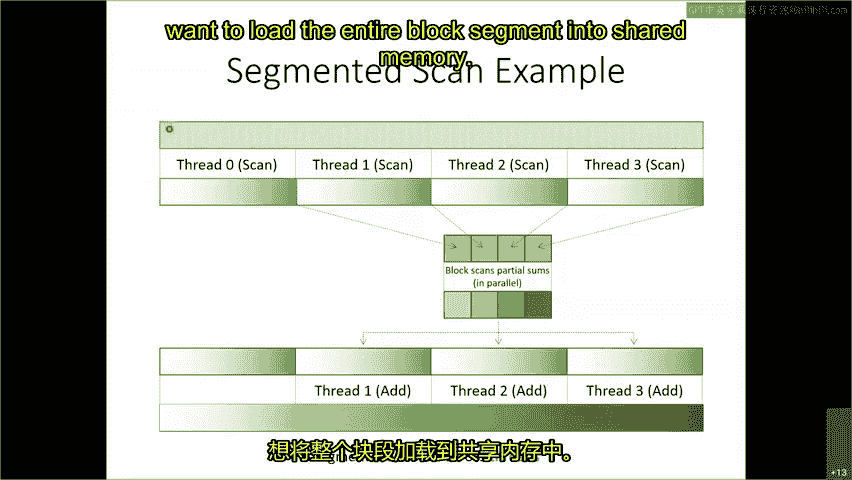

ok。😊，So that I'm going to have to create。A shared memory buffer。

I'm going to call buffer underscore for S。Okay， and I'm gonna need to load the whole block segment。

 So how big is the shared memory buffer going to be。 Well。

 every thread block we said is going to be responsible for block dim times coarning factor elements。

 So the size of the shared memory buffer is going to be block dim times coarening factor。Okay。

 now that Ive declare this buffer， what I want to do is I want to load this entire buffer into shared memory。

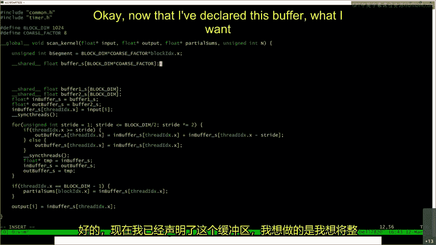

Okay， now what's the best way to do this， Should I have thread 0， load these elements and thread one。

 load these elements and thread to load these elements， Is this the best way to do it。No。

 there better way。The thread 0 loads element at position 0 and then 0 plus block name time times 1 plus name times 2。

 right， right， exactly。 So I want threads 0 to all the threads to load the first part that all the threads load the second part。

 all the thread load the third part， et cetera， because I don't understand what each threads to load the elements it's responsible for。

 because that won't have good coalescing behavior， okay。

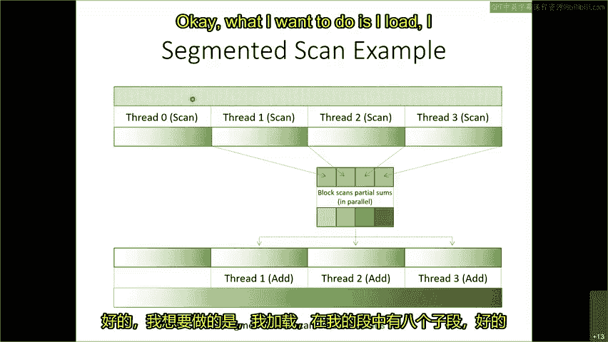

What I do is I want to load， I have eight subsegs in my segment， okay。

 and I'm going to load them one at a time， so I will have a loop。four。Unsstein and C equals0。

 C is less than the coarening factor。Plus plus C。ok and then。Wer underscore as of。And again。

 every thread is going to load when C is 0， every thread is just going to load the element corresponding to its index。

 When C is one， every thread will is going to load at block dim plus its index。 when C is two。

 every thread is going load at two times lock and plus index， Its index in general。

 And if were gonna have C times block them。Plus。😊，That index。ex。

And the value that it loads from the input is going to start at the block segment in the input and then plus c times blockdown plus thread index side。

Okay， so here what we have done is weve loaded the eight segments in the block in a coalesced manner。

 Okay， next， we're going to sync threads。To make sure that we've loaded the entire block segment before we proceed to processing it。

Okay， now that we've done this。 the next step is。

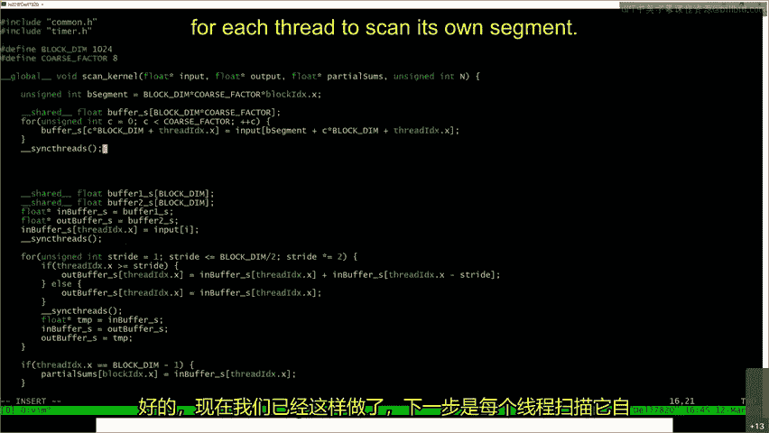

Keep threat to scan its own segment。Alright。😊。

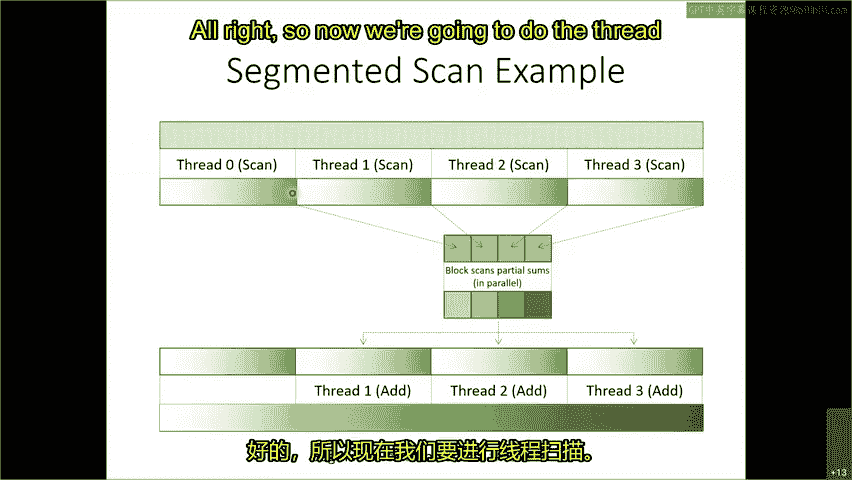

So now we're gonna do the thread。诶 scan。Okay， and to do that。

 I'm first going to find each thread segment， so I'm going to call that each thread segment within buffer underscore S Okay。

 so I'm going to call that。T segment。So unsign MT T segment。

 a T segment is going to point to the segment of the thread within buffer underscore S。Okay。

 so what's that going to be， what's going to be the every thread is going to have how many elements。

 every thread has eight elements。Right so then it's going to be the coarening factor times。对。

Index dot X。Okay。After finding out the beginning of the thread segment。

 we're going to loop through the element that the thread is responsible for and perform as CA okay。

 so we're going loop over the elements we have course factor elements we're going to unsign and C equals and we're going to start at one you'll see y C is less than the coing factor。

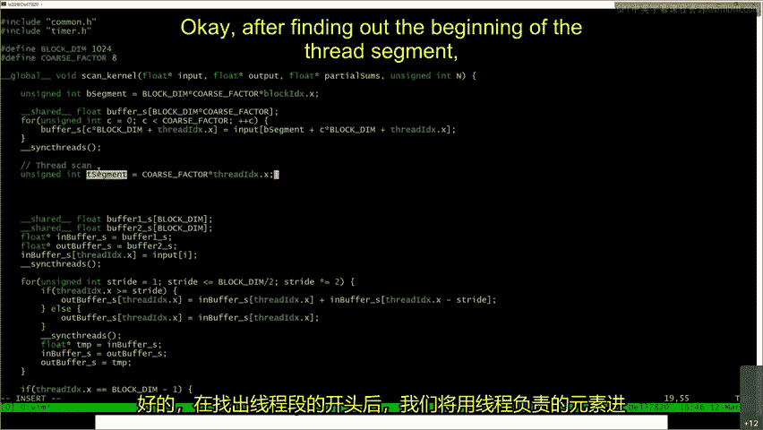

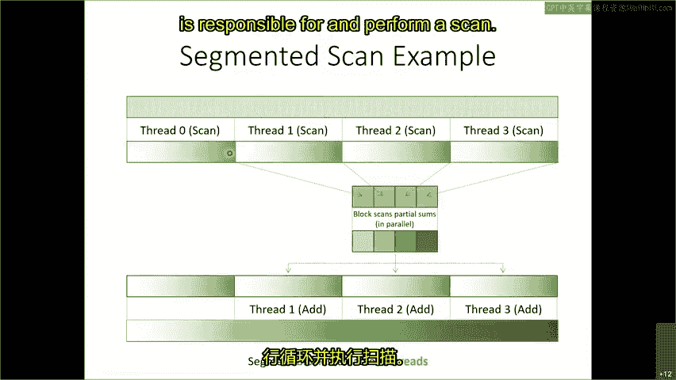

And plus plus D。Okay， and then we're going to do the scan。 How do we do this can。

 Well buffer underscore S of we go to the thread segment。Okay， and we add C， Okay， is equal to。

Bffer underscore score S。Of the thread segment plus c minus-1 Okay。

 the reason we start at one is because the first element in the in the inclusive scan array is just the element itself。

 Okay， so we don't need to do anything。 But when we do the sequential scan。

 the second element we add to it the first element。

 now the second element becomes the sum of the first two elements and the third element we add to it the second element。

 which was some of the first two element。 and now the third element becomes the sum of the three etcter。

 Okay， so this is basically a sequential scan And remember sequential scan is work efficient。

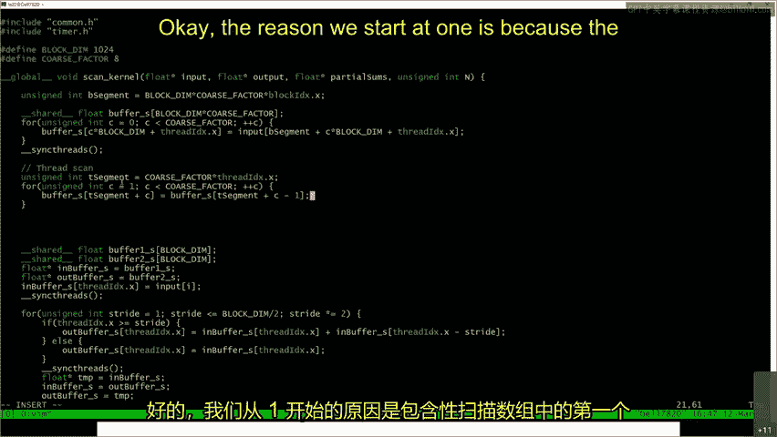

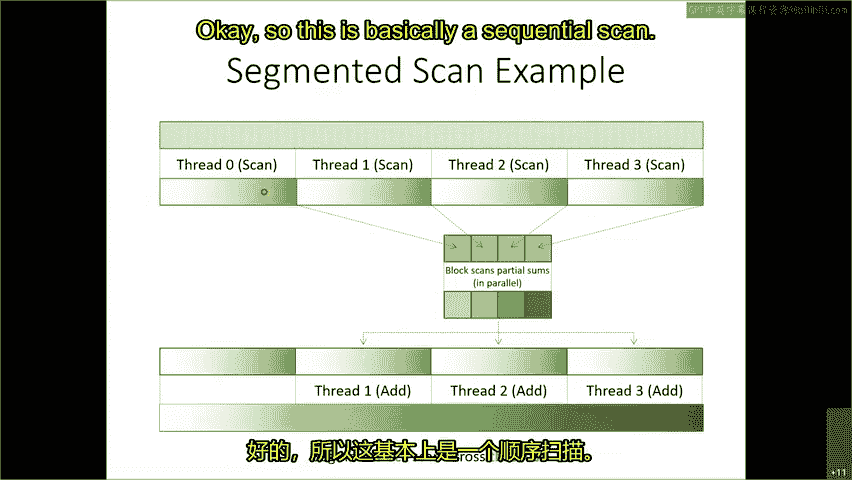

Okay， so for c equals one C is less than corresponding factor plus plus c buffer of T segment plus c is equal to buffer of t segment plus c minus1 so now when we're done with this every thread is done scanning its own。

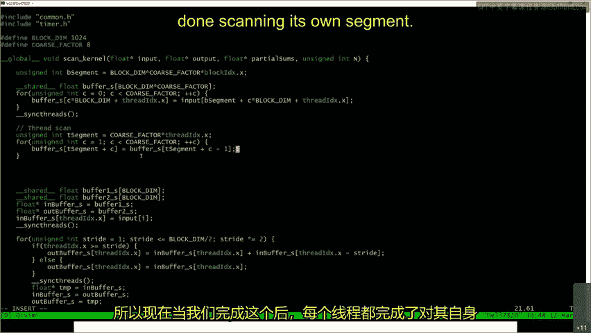

segmentegment。O。😊，The next part is for each thread to put the sum of all the elements inside of its segment and some array where the thread block will do the scan of the partial sums in parallel。

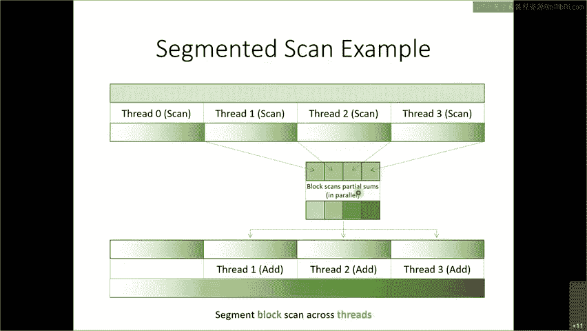

Well， we've already written the code to do a thread block wide partial sum parallel。

 That's the code down here。 Okay， so then all that we have to do。

Is over here in this in buffer over here remember this is the Co stone approach that was doing double buffering so the first thing we were doing is we were initializing the buffer rather than loading from global memory we already loaded from global memory so what we're going to do is we're simply going put in this buffer that we're scanning in parallel we're going put the partial sum of the thread of the thread okay so the partial sum of the thread is going to be the last element in the thread segment。

 so it's going to be at buffer underscore S of the thread segment okay but we're going to look for the last element in the thread segment so that's going to be plus the size of the segment which is scores factor minus1。

ok。Cleared everyone。Okay， so then after we placed the threads inside of the this array。

 the thread block is going to do the partial sum in parallel。

 So so now H the block is going to do its own scan and。

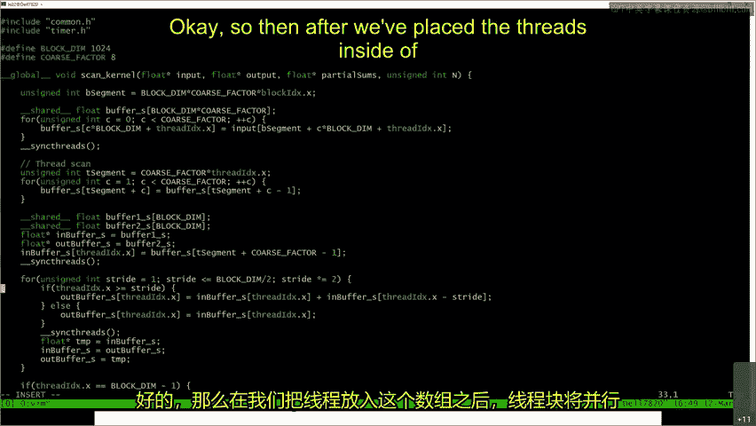

AndAnd then it's going to give us the scanned buffer underscore S。

 So here this in buffer is going to get scanned by the thread block in parallel using this code that we wrote before。

 And at the very end over here， we're going to have in buffer underscore S is going to have the scanned partial sums of the threads segments。

 So after we've finished this partial sum。 Now， each thread is going to take the corresponding partial sum and add it to its own threads。

 Well， it's going to take the partial sum for the previous blocks for the previous previous threads and add it to all of its own elements。

 Okay， now obviously， the first thread doesn't have do any addition because these results are already complete。

 Okay， so what do we need do。😊。

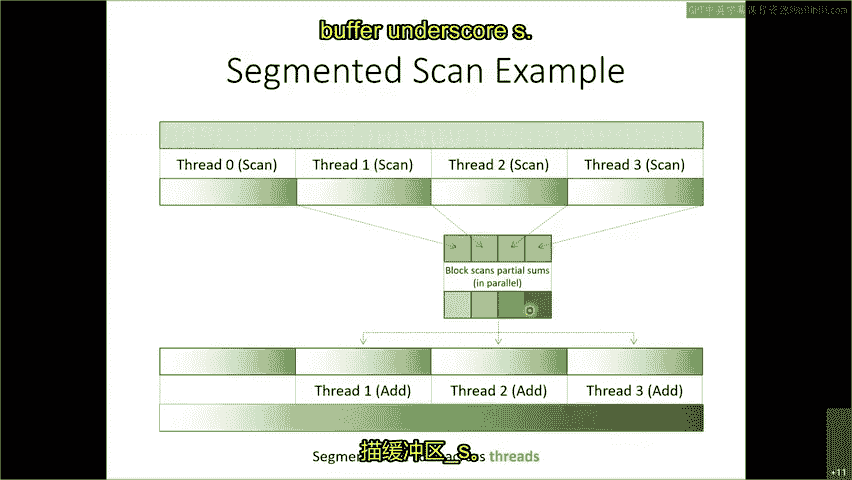

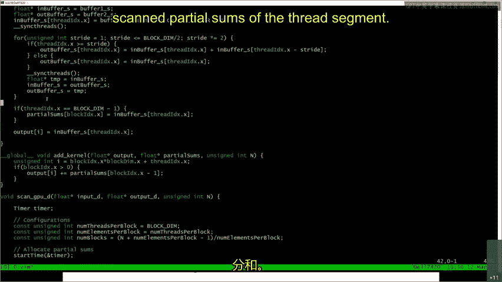

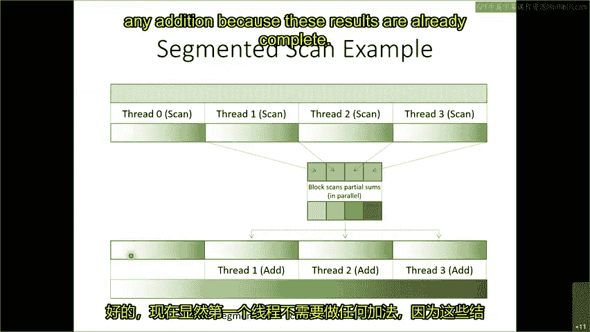

We're going to write F。To index dot x is greater than0。 So the first not going to do a scan。

Is not going to do any addition， okay， each thread is going to loop over its elements。

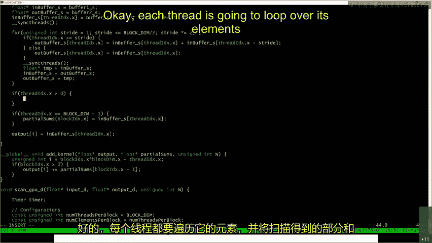

And add to them the the result of these stand partial sum。Okay。

 so how do I loop over this the elements of of a thread segment。

 Well we just loop over the loop over。 we have a core setting loop。 So we're going to unsign。

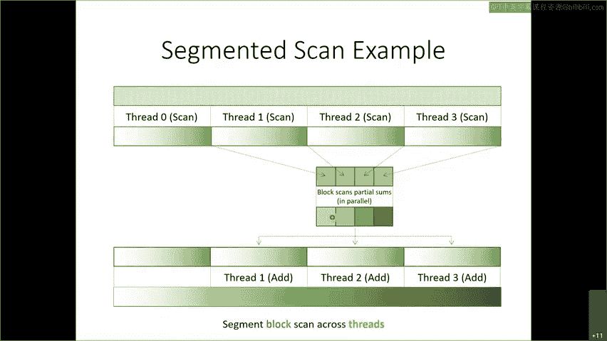

And C equals0。 C is less than the coening factor。拉滑斯。Okay， and then each thread。

So B riders score S of T segment。Plus C， so for each thread for each element that the thread is responsible for。

 it's going to add the partial sum。啊。The previous。Ths。

 you can say add the partial sum of the previous threads。 Where are the partial sums of the threads。

Sorry， this is not supposed to be oh no sorry this is buffer describeds the partial sum of the threads are inside of N buffer okay because this is where we because N buffer was produced by the block parallel scan。

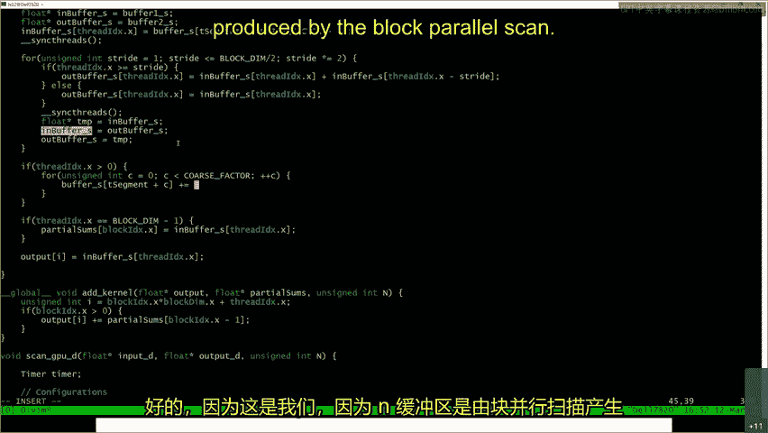

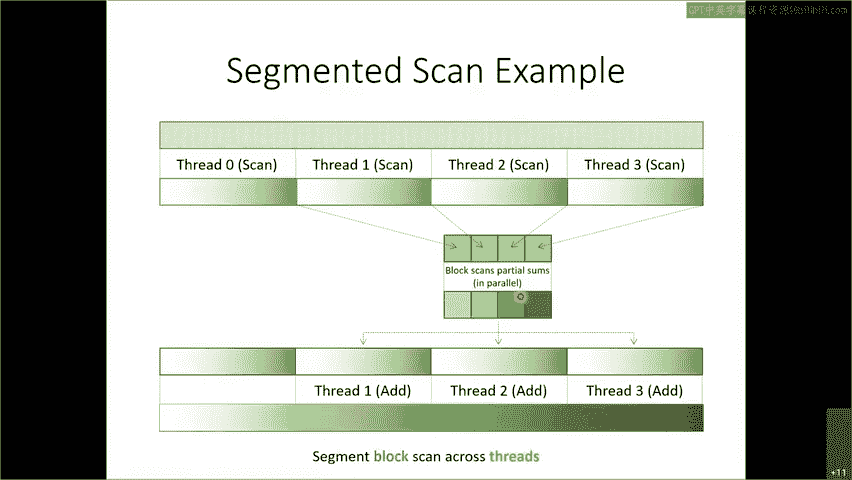

Okay， so here we're going to do。In buffer underscore S of。Bread index dot X。Min-1， right， because。

Thread 1 is going to add the sum of threadread 0。 the elements and thread0。

 threadread 2 is going to add the sum of the elements and thread 0 and threadread1。

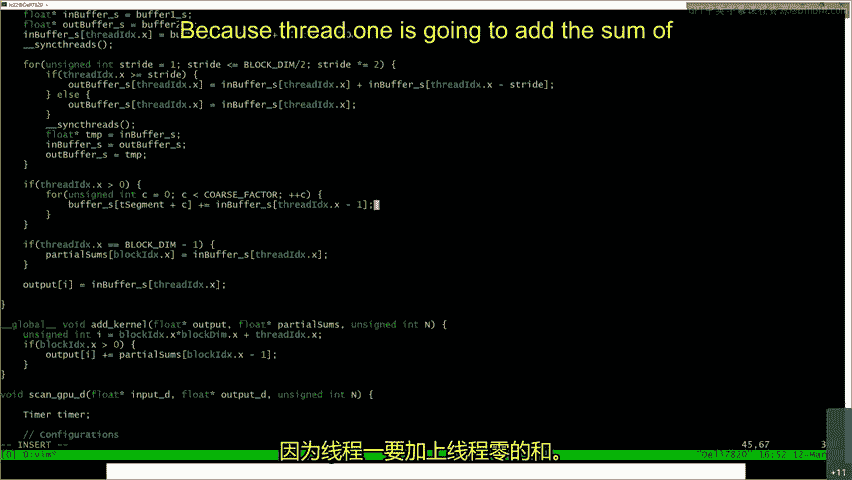

Okay， which are going to be in the scanned array， it's going to be this value here。

 thread 3 is going to add the elements once to add the elements and threads 0，1 and 2。

 which in the scanned array， it's going to be the result at index 2。Okay。😊。

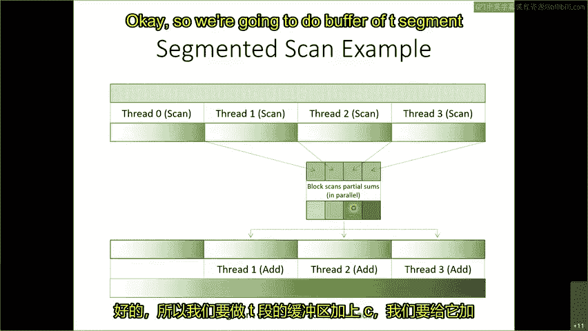

So we're going to do buffer of T segment plus C， we're going to add to it in buffer of x that x minus1。

Okay， of course we're going to put the partial sum of the entire thread block so that that gets scanned separately and then finally when we store the result of the output just like at the very beginning over here every thread。

Loaded multiple input elements。 Okay， now every is going to have to store multiple output elements。

 So here we're going need to have four。Of course， we need sync threads over here， by the way。

 because we need to make sure that all the threads have updated their buffer underscore score S。

We we going to think。Breds。😊，Okay， and then we're going to。

Loop over the outputposts for un in speed equals 0。 speed is less than the。

For sittingtting factor plus plus C。And then the output of the block。Segment。不。Deed， timess deep。

Locked in。Plus。To red indexd do x right so this is the same index that we use when we were loading the inputs right so the block segment plus c times log in plus red index do x。

Okay， is equal to。And in this case， I'm going to use。

The shared memory buffer for the entire for the entire block segment。

 which is buffer underscore square S now， and I'm going to index it with C times locked in once start an index products。

Okay。😊，So with that， what we've done is we've implemented the Sened version of S。Okay， professor。

 yes question at some point maybe there's a mistake I'm not sure when you do the when you place back the part in the partial sum。

 you're using in buffer， but shouldn't you be using buffer。This is fine。 You can do either。

 The reason is that these the sum of。

The result of adding。This value to the last value here。 Well， the last value here is this value here。

 right， last value in thread 3 is this value over here。

 So the result of adding this value to the last value here。It's the same as this value here。Alright。

 Okay， okay。 sorry。 So the last element in in buffer， which is this array。

 is the same as the last element in buffer underscore S， which is this whole array。I see。 Okay。

 Thank you。 So yes， I could have reviewed phone numbers request over here， either is like。

Okay， so so then two more things to take care of in my ad kernelel， I'm going to co on that as well。

 just so that I have the same correspondence between blocks。

 So here I'm going to I'm going to define again， a block segment。 So I'm going to have。😊，Andside and。

B segment is equal to block them times。Cour factor。

 which is the number of elements that are're responsible for time， lockindex。X。

 and then similarly I'm going to have a loop， let me just copy it for the sake of time。Okay。

 I'm going to have a loop over here and then in every iteration。

 the thread is going to take the elements responsible before， which is B segment plus。

Same thing as locked in for x X and it's going to add to it the partial sums from the previous thread block Okay。

 and then finally I applied core settings I need to launch fewer blocks。Right。

 so then I'm going to go all the way down here I'm defending the number of elements per block。

 And rather than the number of elements per block being none threats per block。

 it's going to be non threats per block times the。Forth the ink。Fact， okay。So with that。

 thank you for being patient and waiting for the the whole implementation of courseing to complete。

 So having said that， let's compile and now let's。Run it。

And remember before we had formally seconds and now， oh， we have a mismatch。ok。

So there must be a bug somewhere。One second， let me figure out what the bug is。Okay。

 so here we're back in the code。And basically the problem was that over here when we were doing the thread scan rather than doing buffer of t segment plus c plus equals a buffer of t segment plus c minus1。

 I just did equals over here， so this was the problem this is supposed to be a plus equals。

The screen is frozen， rec canian。Okay sorry about that。It's fine。

Okay so I'm back in the code over here and the main problem the reason behind the bug was that over here rather than having plus equals I just had an equal sign。

 so this is the part that was doing the thread scan where the thread was doing a sequential scan of its own segment so this was supposed to be plus equals so every thread is going to add the previous the previous accumulation to the current value so let's compile this。

And now let's run it and see the time and as you can tell we're down before we were at around four and a half milliseconds and now were at around one and a half milliseconds from applying thread course living sorry our code is almost three and a half almost three times faster than it was without course okay。

So this over here is the code that we just wrote and you can read what we talked about today and chapter 8 of the textbook and that is all for today。

 does anybody have any final questions before I finish？Okay， if not， then that's all for today。

 and I will see you next time， Bye everyone。Thank you， professoror。

