# 美国贝鲁特大学《GPU计算｜CMPS 297S396AA - GPU Computing - Spring 2021》（豆包翻译 - P13：-13-Lecture 13 - Histogram.zh_en - GPT中英字幕课程资源 - BV1bw4m1k7a1

Hello everyone and welcome to lecture 13 of GPU computing Today we're going to be talking about nu about a new parallel pattern which is histogram So last time we spoke about scan in particular we spoke about the B cut con method for doing parallel scan and we also looked at a thread coing for applied to scan and how that helps。

嗯嗯，对。We saw the pattern for doing the Btkung parallel inclusive scan。

 we said that the first part of that involves doing a reduction step and then the second part involves doing a post reduction step that goes back and updates the values that are not the right values so that we have a fully scanned the rate and comparing Cojistone to Bt Kung。

 We saw that Koji Stone takes fewer finishes in fewer steps whereas Bt Kung takes more steps。

 However the Bt Kung approach uses does fewer operations first step and fewer operations in total。

 which makes it more work efficient。So we saw that in general。

 the Kojistone approach finishes in log n steps and requires O of n log n operations。

 whereas the brandcom approach needs two log n minus one steps， so take more steps， However。

 it only performs O of n operations So it's more work efficient than Cojistone and by work efficient what we mean is work efficiency relates to how many operations。

 the parallel algorithm performs with respect to these sequential the sequential implementation We also apply various optimizations to scan。

 including using shared memory， and then another advantage of shared memory here besides data reuse is that it enabled coalescing because our access and scan was not coalescce so by loaded shared memory and then in a coalescce manner and then working in shared memory that allowed us to not have a problem with memory coalescing we said we didn't need double buffering because in the way that the。

Scan tree works you don't have any elements that are read and written by different threads on the same iteration。

 and we also looked at how to minimize control divergence by rather than assigning a thread to a fixed element throughout the entire execution reindexating the threads on every iteration so that they own a different element of the input every time。

 we also looked at how to do exclusive scan using the brand complemented the first approach is to simply formulate it like as an exclusive scan like we did with the cojistone approach。

 but then the second approach was to use a different post reduction step which looked like this and essentially what we do is we have the same reduction step。

 but then after reduction we save sum of all the elements and we replaced that with a zero and then we have this other3 structure where we eventually propagate the zero to the beginning and。

Proliggate the values and update them so that we have the exclusively scannedmed array。

We didn't do a code for this one because you were supposed to implement this in your homework assignment that's related。

finally。Work efficiencyff。 And we said that even though the Btkung method has higher theoretical work efficiency in practice。

 it's actual resource consumption when you account for the inactive threads is actually closer to all of and log N。

 and in practice， it turns out that Brent Kung， although being more work efficient performs similar or maybe even worse than Cojistone in our in our particular implementation。

 it actually performed worse。 Finally。😊，Thread coing for scan and we said that since scan when we parallellyze scan。

 we lose on work efficiency if the work is actually run in parallel that's great。

 it's a worthy price to pay。 However， if the hardware is going to end up serializing our thread blocks then the work efficiency that we the work inefficiency that we in order for us to parallel is not really worth it。

 So what we can do is we can we can apply thread coing to do a sequential scan and some of the threads So here each thread would do it a sequential scan of its own segment and then we do a parallel scan of the partial sums and then redistribute them across the segments that each thread don and by doing this we improve the work efficiency of our algorithm because the sequential scan done by each thread is more work efficient than parallel scan in general。

 So this was a quick overview what we covered last time Any questions or is everything clear。Okay。

 so then today we're going to talk about a new parallel pattern。

 which is histogram and using histogram， we're going to introduce a new feature that the hardware provides us with。

 which is atomic operations and we're also going to look at a new category of optimizations and that is privatization。

Okay， so let's get started。 What is a histogram， A histogram basically approximates a the distribution of a dataset。

 and the way it does that is that it divides the range of values that that values in an input dataset set can have into bins。

 Sometimes they're also called buckets， and it counts the number of values in the data set that fall inside of each bin and an example of this where example where histograms are commonly used。

 but of course not the only place， is color histogram。 So for example。

 if I have an image and image can consists of pixels and these pixels can have you know a range of values maybe I'm using an8 bit integer to represent each pixel values so pixel can be from 0 to 255。

What a color histogram of an image can do is that count the number of pixels that fall in each range of values。

 and then the color histogram will give us some kind of summary of how the colors in a picture are distributed。

 how bright or how dark or you know how much variance between bright and dark a picture is。诶。

So an example of how to implement histogram sequentially is as follows we can simply have a loop and then the loop goes from you know from zero to with times height the number of pixels and images with times height so we can simply have a loop that goes from zero to the number of pixels in the image and then we have we read from the image。

 the pixel values。 So here let's say the image is stored as the one dimensional array so here the array image its dimensions is its size is with times height So for each pixel in the image we read the。

😊，The value of that pixel。 And then we're gonna have， let's say these this image。

 the pixels and image represented as unsigned cars， which are 8 bit integers。

 So let's I can have an array here， I'm gonna call it bins and what I do is I simply increment the bins array。

 increment the bin that corresponds to B， which is the color of the pixel。

 So here if the pixel value was 0， I increment bins 0， the pixel value was 10， I increment bin 10。

 if the pixel value was 128， I increment bin 128 if the pixel value was 255。

 which is the maximum for8 bit integers， then I would increment the bin 255。

 And by the end of this what I would have in my bins array is basically the number of pixels for each value inside of the bins array。

😊，Okay。😊，So this is how we can perform a histogram sequential。

 okay we simply loop through the pixels and for each pixel we increment the corresponding。Now。

 how can we perform a histogram in parallel？What's one possible way to paralyze performing a histogram operation。

 Any ideas？Divvoid the image among the threads， and each thread takes care of finding his own bins。

 And then we adopt the bins。So divide the image across the threads and then each thread is responsible for updating its own its own bin yes。

 and that's a very good approach so all we can do is we can in the spirit of transparent scalability what we can do is we can we can start off by going as fine grain as possible and assigning every thread to one input pixel in the image and then every thread we find the corresponding bin and update it。

Okay， so let's go and implement this。

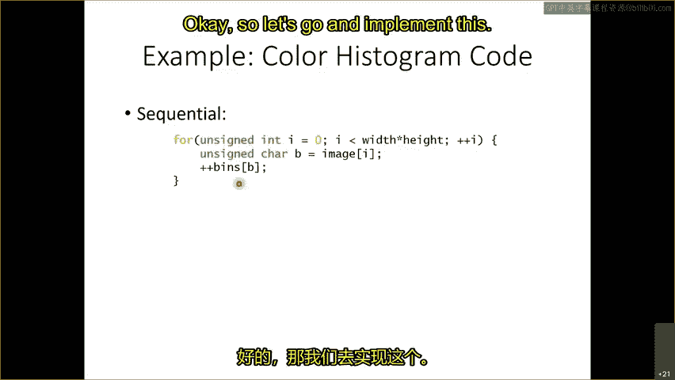

So over here， I've set up the code for performing histogram on the GPU， as you can see。

 and the CPU code over here， I've allocated a copy of the image on the device and I've also allocated a bins array that whose size is nu bins and over here。

The number of bins is 256， okay because we're using unsigned car or eight bit integers to represent the image。

 so we're going to have 256 bins because we can have 256 possible values for8 bit integers。Okay。

 so what we do is we copyied over here I'm copying the image to the GPU。 I'm also using Kuda Met。

 Kuda Met basically sets all the initializes all the values to sum my number。

 So here I initializing all the bins to0 because they're all going to start at0。

 and then I'm going to start incrementing them。And then over here I'm calling the histogram kernel I'm giving it 1024 threads per block and then the number of blocks is basically going to be the total number of pixels in the image and then a ceiling division on the number of threads per block and then finally I copy back the bins which is what I'm interested in and I free the memory Okay so now let's go and implement our histogram kernel and like we said what we will do。

As we're going to assign a thread to every pixel in the image。Okay， so and just one thing to note。

 I've I've created a 1 D grid over here， not a 2 D grid。 And the size of the 1 D grid is width。

and the reason is that the distinction between 1D and 2D is not really important here。

 whether the image is 1D or 2D is not very important because I'm not really doing anything with the rows or the columns。

 I'm simply just treating h pixel as a value that I use to increment the hetogram okay so I'm going to start off by finding the element of the thread is responsible for I'm going to unsigned and I as equal to log index。

😊，Dot x times log then dot X plus。Thread index or x， you should be familiar with this by now。 Okay。

 and then what we're going to do is， of course， we need to check if I is within bounds。 So the image。

 the size of the image is with times height。 So then what I'm going I need to check is that I need to check if I is within bounds。

 I'm going do if。I is less than width times height。Okay， and then inside of this if statement。

 if I am within bounds， what I'm going to do is what's sequentially what I did is I loaded the input image the pixel value and then used it to incrementalement bin so I can do something very simple for here I can write。

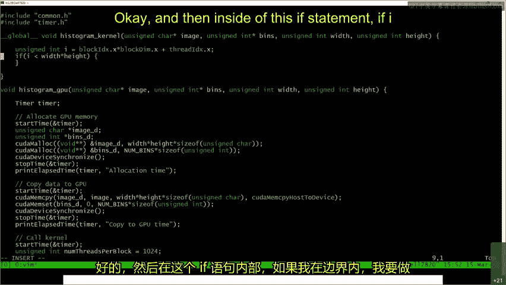

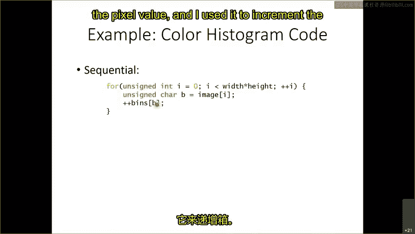

Unsigned。Unssteined， and B is equal to M。Of I， Okay， oops I'm not supposed to use n。

 I'm supposed to use。R because it's an ad integer。 Okay。

 and then I'm going to do plus plus bins of the。ok。😊，Well， let's compile this and see if it works。

Re close。I'm going to compile。Okay， Anne I am going to run。And oh， oh， we have a mismatch at then 0。

 and it doesn't work。And as I can tell in the chat。

 you guys are expecting of this not to work and what is the reason why it doesn't work？

Everyone is accessing bin。The aes to the bins are not synchronized。Right， exactly。

 So I have many different threads are accessing the same output to value in bins。Okay。

 and when many different threads start trying to read andr from the same memory location without coordinating with each other。

 bad things start to happen。Okay and the reason is that this plus plus bins of B is not kind of one operation that happens kind of on its own。

 It consists of multiple instruction。Okay， and the way these instructions are interleaved affect whether this behaves correctly or not。

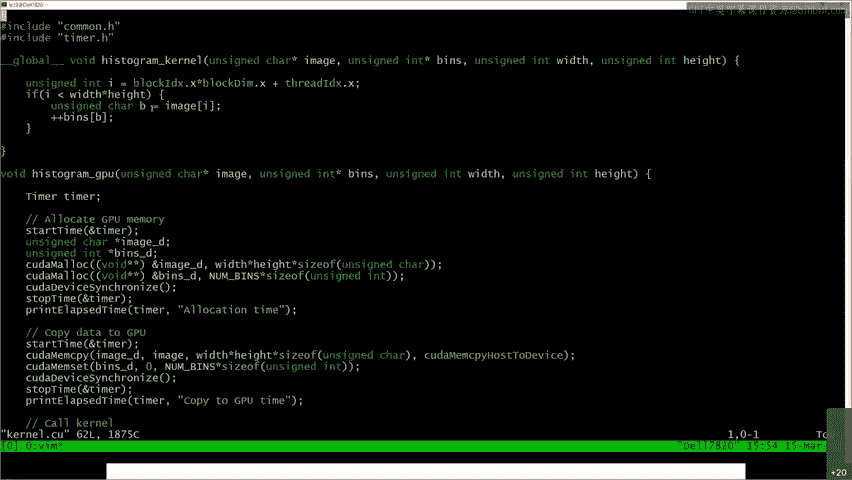

Okay， so to take a better so this is the code that we just wrote and like we said we saw there's something wrong with this implementation and what's wrong with with this implementation is you know。

 as as you guys have written the chat， we have something called a race condition Okay。

 so let's take a look at race condition so a data race。Occurs when multiple threads。

Acs the same memory location concurrently without ordering。 And at least one of these aes is a right。

Okay， so when multiple threads are trying to access the same memory location and at least one of these a is are right。

 we have something called a data race and a data race may result in unpredictable program。

Let let's see why this is the case。If we go back to our bins example over here。

 when we write plus plus bins of B， there's multiple things going on here。

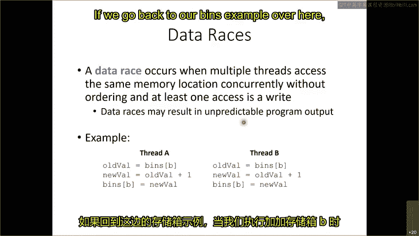

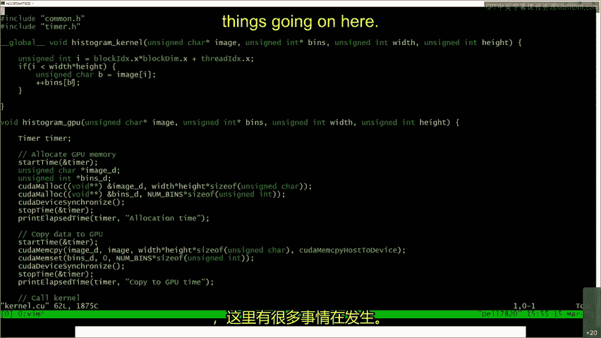

We have a load instruction that loads the old value of B。

And then we have an ad instruction that adds that one to that value so that we have a new value。

 and then we have a store instruction that stores the new value of。诶。😊，Now。

 when I have multiple threads， thread A and threadread1。

 both executing this sequence B sequence of instructions in parallel。ok。😊，It's both of these threads。

Have the same value of B。Then both of these threads will be loading an old value of bins of B from the stable location。

 both of them will be incrementing it， and both of them will be storing a new value of B。

And depending on the order in which these instructions are executed in parallel， okay。

 we can actually have if the if bins of B is initially zero。

 the outcome of this could be that bins of B will become two。

 which is what we would want or it could actually become one and let's see why this would be the。

So for example， and if I look at the instructions or the kind of the instructions。

 but they're like kind of pseudo statements。In the previous code or pseudo instructions over here。

 if these operations are interleaved in this way， so thread A。

If here I have time is going vertically if thread A runs completely before thread B。

 so thread A loads ads and then stores before thread B does。

 but then later on thread B comes and loads ads and stores。

 then over here I don't have a problem I'm going to load0， add to it， store one。

 and then here I will load one， add to it and then store two。Okay。

 same thing if the instructions or the operations done by thread B run completely before the ones by thread A。

 then again I don't have a problem， thread B will load zero， add one and then store one。

 and then thread A will load one， add one so that you have two and then store two。Okay。

 so in these two scenarios， the final value of density B will be2， which is what we would like。

However， there is no guarantee that this is actually how these instructions or operations will be interleaved by the hardware。

 So， for example， another possible interleaving is that the hardware may execute these instructions or operations like this it may thread A may load bins of B。

 so it loads zero and incremented to a new Val is one and then before thread A gets the chance to store new Val in bins of B。

 What happens is the hardware scheduler removes thread A and then comes and schedules thread B that's if they're running on the same S。

 they're running on completely different SMs or in completely different places。

 they may actually be executing in parallel， but somehow because you know the way it timing works when when things are running in parallel。

 somehow threads thread B manages to load bins of B。

 which is still zero before thread A is able to store one inside of bins。😊，So in this case。

 thread A is going to loads 0， it's going to add one to it so now new Val is1。

 but before it stores new Val， thread B will load bins of B。

 which iss still0 and now old Val here is0， and then thread A will come and store a1 but then thread B had already loaded a0 so it will increment the0 to1 and then thread B will also store a1。

And in this case， we have a data race because both of these threads are trying to write to the same location and what will happen is rather than bins of B getting implementedcr twice。

 it's only going to be implemented once and the result will be a one and a similar thing could happen if thread B know if thread B went first loaded but then before thread B got to store thread A was able to load okay so in these two scenarios。

 know and many other possible interleavings the final result of bins of B is going to be one okay。

 this cleared everyone。Any questions about data races？So how do we solve this problem？😡。

How do we avoid deter？On CTU is how to resolve this problem。We use monitors and。Semmaphos。Right。

 well there's all kinds of ways to synchronize across threads， okay， semaphores are one way。

 you know， and of the bottom line is that what you want to do is you want to have these threads execute the sequence of operations。

 load， add and store in a mutually exclusive way。Okay， so the。

 the way to avoid this kind of behavior is through mutual exclusion。 Okay， so to avoid data races。

 concurrent read， modify right operations in the same memory location need to be made mutually exclusive in order to enforce ordering。

All right， so for example， in CPUU， what is one way to enforce mutual exclusion， what do we use？A没ed。

Right a mutex or a lock Okay， so one way to do this on the CPU is using lock。

 sometimes you also call this mutes。 So for example， if I have this plus plus binn of B。

 what I can do is I can put a lock before it I do mutex lock for some lock。

 and then I increment it and then I do mutex unlock lock and release the lock。ok。Now， if I do this。

 what happens is if a thread comes and on a CPU， if a thread comes and does mut text log and acquires a lock。

 then no other thread can acquire this lock until this thread releases the lock， so a thread comes。

 executes mut text log， increments bins of B， this can have as many instructions as you want inside of here。

 and then it releases the lock， and once it releases the lock。

 another thread can come and acquire the log to increment bins with B。ok。So for example。

 if we use mut text lockes in our example over here。

 if I put a mutex log before and after incrementing binson B。

 then what happens is thread A comes it does mut text lock and now that thread A does mutex lock。

 thread B cannot acquire the lock until thread A has released it so because thread B cannot acquire the lock until thread A has released it。

 thread B will not be able to load the old value of binIs until thread A has written。ok。😊。

So here we do mutex log， we read the old value of bins incremented right to it。

 and then we do mutex unlock， and then thread B will come along and we willll do a log and then we will read and modify and write and then it' will unlock。

Okay。😊，So here， thread B cannot acquire the lock before thread A releases it or vice versa。 Now。

 somebody is asking， won't this make the execution essentially sequential， And yes。

 that's absolutely true， And that is what we want， right。

 whenever we have multiple threads updating the same memory location， Okay。

 we want them to execute sequentially because we don't want us we don't want to have a raised condition。

However。Keep in mind that different threads might be updating different values at the same time Okay so one thing that can be done is we can have a different lock for each one of these bins or each set of bins that way if threads are updating different bins。

 they can do that in parallel， however， if threads are updating the same bin。

 then those updates will be serialized。Okay。😊，Clear professorfess。

 is it not possible for two threads to acquire the lock at the same time。Well， on CPUs。

 the way logs work is that no， only one thread can acquire a log at the same。

If two threats can acquire luck at the same time， then that meets the whole purpose of having lock。

So the idea of a lock is that only one thread can acquire it and no other thread can acquire it until that thread has released。

So it' it's a built in function right it's not likem not I'm not talking about GPus Okay so again。

 I've potentially been saying that on CPUs， if you want to do this。

 the way you would do it is using something like Mue text box。

 So this here is these are like pseudo instructions or pseudo operations， Okay。

 I'm not talking about GPUus yet。Okay。This is actually a very bad idea on GPU。

 can anybody tell me why？We're killing perism。What。

We're killing the parallelism we also heard the parallel on CPUs。Right， when we use the logs。

It's it's inevitable to hurt parallelism when you have contention on the same how。 Okay。

 there's all kinds of optimizations we can do。 but at some point。

 you will need some kind of stization when you're trying to have multiple threads update the same book。

 So that's inevitable Would't this this is not a very good idea on GP。

 Would't this be like have the similar kind of effect as synchronizations。I mean。

 I don't know about your text， but maybe。 So locking as a way of doing synchronization before we saw barrier synchronization。

 And now we're seeing locking as a form of doing synchronization。 when you do parallel。

As overhead to the computation。ization has an overhead， it hurts our performance。 But again。

 you know， that's this is inevitable， right， If you want to have。

 it's inevitable for you to have to pay some performance penalty in order for you to allow threats to update the same output concurren。

But it's still better than going completely sequential。

 right it's still better than being sequential， at least you have some parallelism and wherever you have the possibility of two threads colliding with each other。

 you sterize them， but in general， you still have。😊，So yes。

 the drawback is that way it hurts our performance。

 but there's there's something worse that can happen if we try to do something like this on diverging。

Yeah， yes。Is it the divergence that is caused by the different logs and unlocks like the different mute textes or whatever the period is being locked and unlock So you're closer。

 It does have to do with divergence。Does anybody see a potential problem that's related to divergence here。

Oh， maybe。I think。Every every， basically， this should be like super divergent， you can say。

 because like every thread will stop and work like a different。Times。WellI mean， yes， you will have。

 youll have some divergence， Okay， if。诶诶。Okay， let me not give it only。

 let me and explain why this is a problem in the context of divergence。

I wasn't thinking about divergence as being a source of inefficiency。

 I was thinking about something even worse than that， so let's take a look at what happens。

So locks and SD execution。Let's assume that threads 0 and1 are in the same war。

And both thread 0 and1 try to acquire the same block。Okay。😊，So thread0 and1 are both in the same bar。

 and both thread 0 and thread 1， try to acquire the same law。ok。So we have this code over here。

 Mutex log， and then we have al equals bins of B， and then et cetera right because we had multiple the plus plus bins of B had multiple multiple operations。

 and then we have muttex un log okay。So threads0 and1 won't try to acquire a lot。ok。😊，However。

 only one thread can acquire the log， obviously， so thread 0 acquires the log。几。😊，Now。

 the way locks work is that when a thread tries to acquire a lock and is not successful。

It stays there on that same kind of operation until it succeeds at acquiring the。

So when thread zero successfully acquires the law and thread 1， which is in the same war。

Triice to acquire the lock and does not succeed。 What does Tread 1 do。It spins。Right。

 so thread 1 is going to sit here and wait for thread 0 to release the lock。Alright。😊。

So now thread0 acquires the log， thread one sit here in width for thread 0 to release the log。

 but thread 0 and thread1。Are in the same warp， right。What does that mean？

That means that whenever they make progress。Whenever the when they want to go to execute the next instruction or the next operation。

 they need to do it together， correct。So can thread zero go and execute the next instruction？Without。

Thread one coming along with it。Can it be like an if condition where you can you keep going And then you go back to thread one later on when its condition kind of resolve。

 So there there are ways around this， you can use something called log free algorithms。

 So what you're proposing deviateates away from what we what we commonly call logs Okay Okay。

 so there are log free algorithms where you can work around this somehow。

 but but if we if we just look at the this idea of new text loging right。

 what happens is thread  zero cannot make progress。

 thread0 cannot come and execute the next instruction because it's bound to thread one by S。

So thread zero is waiting for thread one to complete the previous instruction before it can continue。

 and thread one is waiting for thread zero to release the lock so that it can continue to the next instruction。

So what happens in this case？Right， we have a double。

So using locks within the execution may cause deadlock。Okay。

 because here thread one is going to be spinning， waiting for the lock to be released by thread0 and thread0 is going to be bound to thread one by C。

 waiting for it to finish what it needs to do so that they can proceed together to the next in。Okay。

 so this idea of using blocks on GPUs， the drawback is actually even worse than performance a performance hit。

 We can actually run a situation where we get that block。 Okay， so what's the way around this。

 panel we Yes， just question， Yes， why don't they then why don't they do mut textes around blocks instead of threads。

Can you explain what you mean by that？And instead of blocking instead of blocking accesses to all other threads。

 block access to all threads that are not that are not inside the current block accessing it。

 But what if what if the two threads that are updating bins of B are in the same block。Okay， O。

 I see。 hello， you， you could， you could have a way around that， la。Well， right， I mean right。

 but you know then then you start getting into a complicated solution and there's actually something better than this that we can do and that is atomic operation。

几。😊，So what are atomic operations， Atomic operations are operations on the GPU that perform， read。

 modify and write。Operations with a single ISA instruction。 Okay。

 so a single instruction reads a memory location， updates it and writes the result。Okay。

 and and what happens is that if the hardware guarantees that no other thread can access the memory location until this operation complete。

Okay， so rather than guaranteeing the mutual exclusion and the software。

 these atomic operations guarantee the mutual exclusion in the hardware。Okay。

 and then if if it happens that we have concurrent atomic operations to the same memory location。

 these will be sterized by the hardware rather than be stized by the software， So for example。

 if two threads in the same warp perform an atomic operation on the same memory location。😊。

Then what happens is that the hardware will take these two operations， serialize them。

 and then go back to the threads when both operations are complete。

There are different kinds of atomic operations in Kuda。

 the one that's relevant to what we are looking at today is atomic a。

 so Atomic add it's an it translates to instruction on the GP and on the GPU。

 but it's basically a call inside of Kuda where you give it an address and you give it a value and what it does is that it adds that value to to the value stored at this address and returns the old value so here T atomic atomic ad takes a pointer to a T and a value T and returns a value T and in this case T can be an integer。

 it can be an unsigned integer， it can be a floatat， it can be a double etc。😊，Alright。😊。

What the atomic instruction does， like I said， is that it reads the value stored at address。

 it adds value to the value stored address， and it stores the new value at address。

 which is the result of adding the old value to Val and it returns the old value that was originally stored at that address because sometimes when we do an atomic add。

 we would like to observe what the old value that was stored in this location was。😊，For example。

 we might be doing an atomic ad to maybe you reserve some space and some cu so when we do the atomic ad we want to know what the old value was so that we can figure out what was the location in the queue that we received Okay so maybe we're doing atomic add on counter that that point to the end of sum but that's not what we're doing today today we're just looking at history。

So this function call inside of Hua translates to a single ISA instruction， okay。

 and we actually have a name for these kinds of instructions they're called intrinsics。Okay。

 so usually when we have these function calls in food that translate down to a single IA instruction。

 we usually call these intrinsic， these kinds of functions intrinsic。

And we will look at other kinds of intrinsicnsics later on， actually。 But for now。

 we're interested in atomic operation。Okay， and there are other options available for there are other kinds of atomic operations available we have subtract。

 Min Max， incrment， decrement， and or Exor atomic exchange， Atomic Comp swap。

 you know and's all kinds of atomic operations that are available in Cuba。

 the one that we care about today is atomic fat。Somebody is asking a very good question。

 somebody asking， can we do these atomic operations on shared memory And the answer is yes。

 so you can do atomic operations on global memory and you can also do atomic operations on shared memory。

 Here's a very good question。😊，So now let's go back to our code。

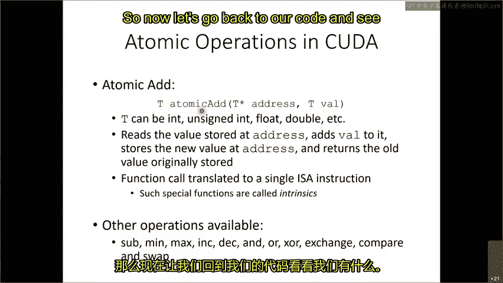

And see what we have。 So what we were doing previously is we were incrementing bins of B。

 So we're basically reading the value add bins of B。

 adding one to it and then storing the result while to do this correctly。

 what we should do is we should replace this operation over here。

 which which which has race condition with an atomic ad that will make sure that the addition happens atically and how do we do that Well just as a reminder。

 atomic ad takes the address of the memory location we would like to add to the value that we would like to add add and does the addition。

 So here I'm going to write。😊。

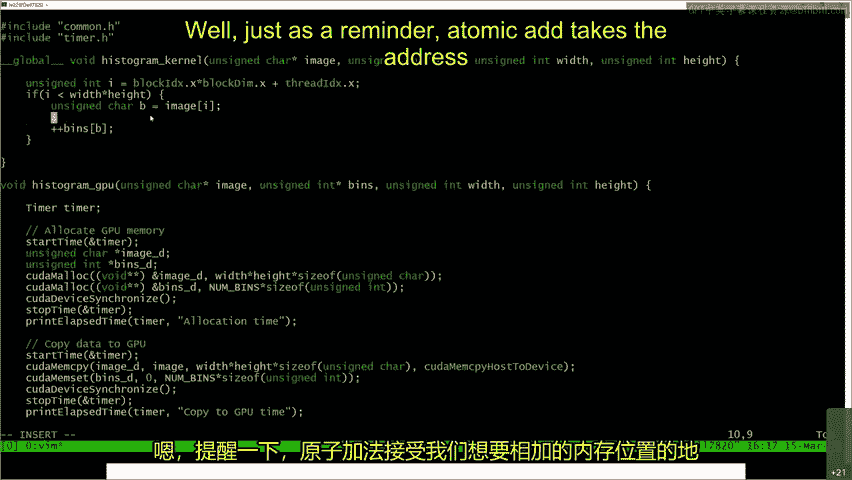

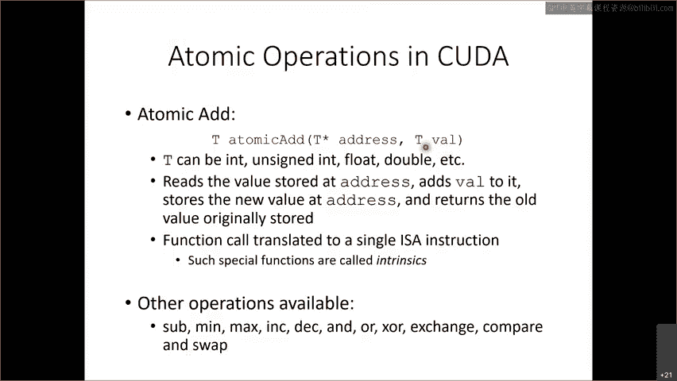

Atomic a， I'm going to give it the address that I want to update in this case that will be the address of bin of B。

ok。😊，And I want to give it the value that I would like to add in this case， I'm just adding。😊。

Right and now that I have this atomic ad instead of this plus plus bin of B。

 let's now compile and run this and see if it works， I'm going to compile。Professor。

I don't understand know why why would an atomic ad or a single an instruction that executes the read write and everything together how does it solve our problems if it's not about the deadlock it's about the you know you will have maybe a wrong value if if you're trying to it solves our problem because as we said。

 warps we follow the CD model So warps use the single instruction multiple data model。

 which means that all threads in the warp execute the same instruction。

And then they move on together to execute the next instruction。 So our problem。

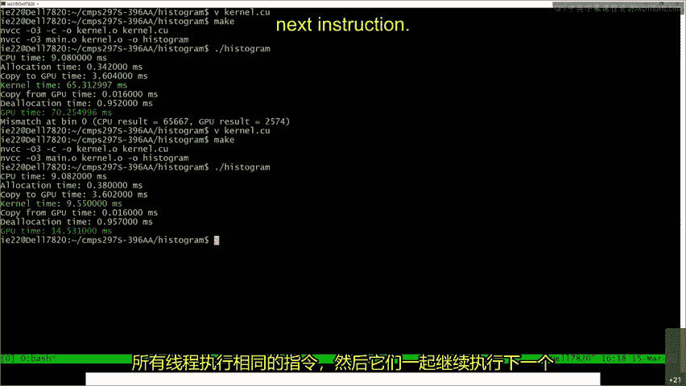

电话。These threads in the warp， they come and they execute if hypothetically。

 if we were we had some kind of locks on the GPU that we're trying to use。

 these threads in the warp will come to acquire the lock。

 so presumably that's going to be an instruction or a set of instructions。Okay。

 but then they can't move on to execute the next instruction before the other thread finishes executing the previous one。

And that is why we have the deadlinelock。But if this whole thing the read modify right is just a single instruction。

 then all these threads are going to execute that atomic ad instruction and these atomic ad operations the read modify write operations will happen in the hardware we're not having all the threads try to try to acquire a log before they read modify right。

But across， across blocks， you will still have problems no。

Why why do you think we would have problems across the blog。Oh no because if for example。

 if you're accessing and you modified it in one block。

 maybe that the other block that is accessing it will access the new value or something like that。

But that's what you want， right， If you have different threads and different threadlocks updating the bins array。

Okay， if you're different termss update the Vis array， you want。

To be able to have threads and the threads in the other block。

 see the updated value of the threads in the block that you're in。

If I have different threads in different blocks， one of them updates the value。

 I do want the other thread to see that updated value。Okay， it depends on your application， yeah。

Right， but in in our particular application here， histogram。

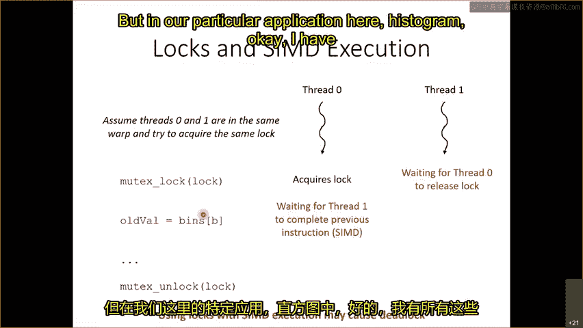

Okay， I have all the threads are all the threads in the different blocks are reading the same image。

 and they're updating the events to do a histogram。So here。

 if I have different threads and different blocks responsible for different pixels。

 I do want and they happen to find the same pixel value， I do want them to see each other's update。

Okay， I see。 I see。 Thank you。Yeah，Profesor。Yes。😊，Couldn't we just assign instead of one element per thread。

 sign some number of elements。 Let's say， I don't know。16 or something。 then run the threads on like。

 generate different histograms。For each thread and then merge them together。Yes。

 we can actually do that and I'm about to get to that optimization。Okay， so yes。

 that's a good observation。Okay so before we get there actually let's go back and observe the performance improvement so here in the GPU it was taking nine milliseconds on the CPU taking nine milliseconds on the GPU if we ignore the copy time it's also taking about the same time。

Okay， so actually we haven't really seen much performance improvement on the GPU compared to the CPUU。

 but there are actually various performance optimizations that we can apply to significantly improve the performance of histogram and let's talk about those。

Okay， so first let me go back to where we left off this here is the code that we just wrote。

 we changed plus less Pinson B to Atomic a， we take the address of Finip B and we add one to it and what this does is that it solve our race condition and our code now has correct。

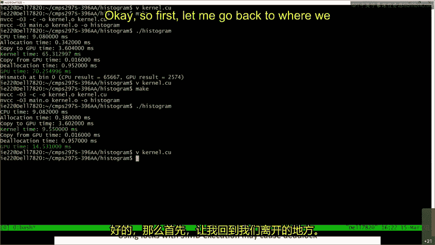

Okay， now let's now talk about optimization。So if we look at what's going on。

 we have these this input over here。Yeah， and we have these different thread blockss。

 Each thread block is responsible for part of the input。

 Each thread is responsible for one pixel in the input。

And if multiple threads all have the same pixel value。

 all of these threads are going to be updating the same bin。Okay， so this here represents our bin。

Okay， so our atomic operations and global memory have high latency。Okay， and the reason is that one。

 we need to wait for both read， modify and write to complete。Okay。

 so the atomic operation is not just a read。And it's not just a write it's to read。

 modify and write Okay， and that's why this atomic operation takes a very long time to complete。

 so it really slows down my thread。😡，And even worse。

 when I have all these different threads they're all trying to update the same global memory location。

 we need to wait if there are other threads accessing the same location and specifically if there's a high probability of convention。

😊，So here， when this thread tries to update this memory location。

 it already takes long enough for me to read this value from global memory， modify it。

 and then wait for it to get written back to global memory that already takes a very long time。

 imagine that I also need to wait for not only for me to read， modify and write。

 but if there are three or four or 10 or 15 or thousands of other threads before me that are reading。

 modify and writing， I need to wait for all these other threads to read。

 modify and write before I get to the chance to read modify and write。

So obviously these atomic operations take a very long time to complete and what we would like to do is we would like to optimize this so that we can do better than and a half than you know comparably or even worse to what the CPUU is doing and the first optimization that we talk about in order to do this is called privatization。

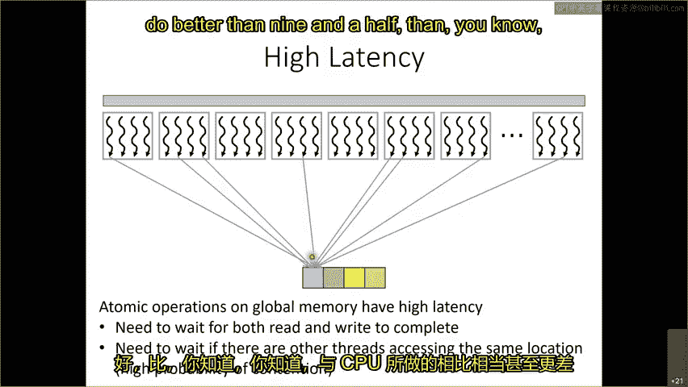

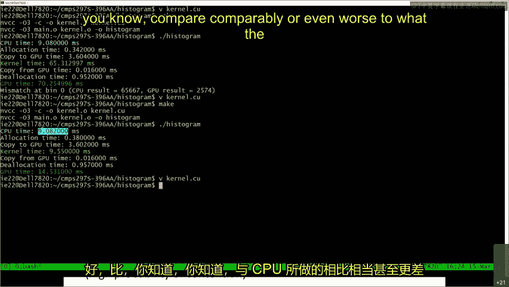

Okay， so from the name， what do you guys think we will do in order for us to improve the performance and reduce the contention？

Make synchronization only for the thread， for the bin， I mean， for one bin。

 So make I don't really know how to explain it。 but you know for every bin。

 make its access different。So the the way atomic ad works is that if I have atomic ads to different bins。

 they will they will already run in parallel Okay so they're not really going to be serialized so it's almost like having a lock for each bin。

Okay， if if that is what you what you what you were referring to。Oh，O， O。

So what one thing we can do is we can and this is called privatization。

 and this is a common category of optimizations that we apply whenever we have different threads that are contending on a shared output。

 what we can do is we can instead of this universal copy of the histogram that all the threads are updating at the same time。

 we can privatize the histogram。And what that means is that I can create a private copy of the histogram for each thread block。

ok。And that each thread block will update its private copy of the historyage map。And what the is。

 if threads in the same thread block。Are updating the same bin。They will。

 They will contend only in of their own private copy of the histogram。

They're not going to contend with all the threads in the other threadbs that want to update that then。

So we absorb some of the contention in the private copies of the histogram。

 So each block updates a private copy of the histogram。

 And then when the thread block is done executing what the threads in the third block can do is they can go back。

And commit and use the values that they've accumulated in their private copy of the histogram and commit those to the global copy atically。

So now if the threads in this thread block update the blue bin 10 times。

 rather than contending 10 times in the global copy with these other threads in the other blocks。

 they will content 10 kinds with each other only in this local copy and then they will only perform one update to the global copy。

 and what this does is that it reduces the amount of competition or contention between threads in different thread blockss in order to reduce the amount of serialization that occurs。

ok。😊，Is this clear to everyone？And of course， when you update the global copy。

 we don't have to go and update all the bins all the bins in my private copy to the global copy。

 only the non zero ones。 So if I haven't updated any bins over here。

 it's not necessary for me to do an atomic operation to add a zero to the global copy。professorfesor。

Yes， question。 Can we actually add them kind of like a reduction tree， Like have a thread。

 Add the different portion histograms of yes， you can possibly do that。

 you can add if you can perform a reduction across the different values using a reduction tree。

 usually a reduction tree is worth it when you have a lot of values that we would like to add together。

 If I don't have too many private copies， maybe it's maybe an atomic ad is worthwhile。

 But if I have many， many private copies， then perhaps looking at a reduction tree approach might be worth it。

 Whether or not a reduction as worth it or just doing an atomic ad is。Is you know。

 is completely depends on the situation and programmers could try either approach。

 but speaking of reduction， by the way， if you remember what we did in reduction is we had each thread block do its own local reduction to find the partial sum for all the elements that the thread block is responsible for。

Excuse me， and then they stored these partial sums in an array and we performed a reduction on that array another thing that we could have done is we could have used atomic operations。

So we could have that just had a global thumb。And then when the thread block performs a reduction to find the sum of all the elements responsible for could have just performed an atomic operation to commit its sum to the global sum。

 and this would have saved us the hassle of having to load a second kernel to do the reduction of the partialel。

So thank you for reminding me about reduction。O。😊，So in general。

 privatization is an optimization where multiple private copies of an output are maintained。

 then a global copy of is updated on completion okay。Now for privatization to work。

 the operations on the output must be associative and commutative because the order of the updates has changed。

Okay， so for example， the reason privatization works for histogram is because the addition operation is associative and commative。

 So if I change the order， it's okay All right， but depending on the operation。

 privatization may or may not work。The advantages of privatization are as we saw。

 it reduce its contention on the global copy。But there's another advantage。

 which is that if the output is small enough。The private copy can actually be placed in shared memory。

 which reduces the access laency。 So here in our example。

If these private copies of the histogram are small enough。

Okay then we can actually put them in shared memory， do the atomic updates on shared memory。

 which is even faster， and then commit the local copy from shared memory to global memory and this would be like applying shared memory tiling to the privatized copies of the histogram okay but even if these private copies aren't too large tofi and shared memory。

 privatization is still applicable because we can create private copies in global memory。

 we wouldn't get the benefit of reducing the global memory latency。

 but we still get the benefit of reducing the contention。Okay， so privatization。

 a lot of times privatization is combined。We shared memory where we put the。

Up the end shared memory logically these are two different optimizations。

 the idea of privatizing an output to reduce the contention and putting the privatized output and shared memory in order to reduce the access latency。

 these are logically two different optimizations， but a lot of time these two optimizations are applied together。

And here in histogram， this is an example of where we would apply it。

 and we will look later on in the course where we will combine privatization and sharedman retiling in a different scenario where many threads are trying to add to some shared view。

ok。😊，Any questions about privatization？So if I wanted to implement privatization。

 it's not too difficult what I would do is I would declare a shared memory array over here that has as many elements as the number of bins and then I would initialize that array to zero and then I would do this atomic ad on the shared memory version of the bins and then when I'm done I will use the threads to in parallel。

 commit any non-zero bins from the shared copy of the bins that I declared to the global cup I'm now going to implement it with you in class because you guys will be responsible for implementing privatization and shared memory tiling of histogram for your assignment。

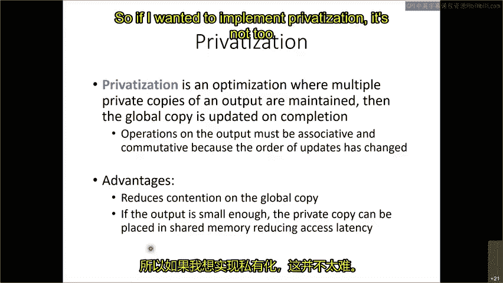

Okay。😊，But this is the strategy for they should follow to do it。

 you declare an shared memory array of the bins， you initialize them to zero。

 you do the atomic ad on the shared memory bins and then you commit the shared memory bins to the global the global bin when you are done。

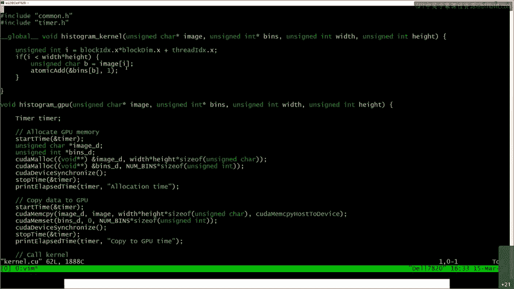

Okay， so have you this。哎，sorry对。Yeah， my question was。

 is it better to do that later with another like dispatching another kernel or having one thread of each block in the kernel do well you won't be able to do it later because if you put the shared memory bins inside of shared memory you're not going be there when you launch another kernel the scope the visibility of the the scope of the shared memory is at a thread block or the lifetime is a thread block once the thread block is gone。

 whatever ist the shared memory is also gone。Right， thank you。Yeah。Okay， so having said this。

 another optimization that we can apply is thread cosing。Okay， so remember。

 we said that whenever there is some kind of price that we pay for parallellyization。

 then we can apply threat coing to reduce the price when we know if the hardware is going to sterilize it because we have too much parallel。

So how will T course study benefit us when the histogram and privatization？

What is the price we are paying for paralyzization？

So by having more and more threadlocks running in parallel。

 we have more and more private copies that need to be committed to the global cup。

Now if these thread blocks are actually going to run in parallel， that's worth it。

 but if these thread blocks are going to getized， it's better for me to have fewer thread blocks so that I have more updates on the same private copies and fewer updates and fewer private copies that I need to commit to a global cup。

Okay， so using fewer threadlocks results in fewer private copies。

 hence fewer global memory atomics to update the global copy。

So if we apply thread coing to reduce the number of blocks and have each thread count multiple inputs。

 we can reduce the number of private copies that we need to them in。Okay， and of course。

 when we do this， we should make sure to load our input in a coales way。 So for example。

In our original example， we had each block， each thread block responsible for one input element。

 and each threadb had its own private copy that committed to the global copy when it was done。

And that's reflected in the code over here， well not but here in our code。

 each thread was responsible for one input element Okay， so if we apply privatization here。

 each thread will still for one input element。

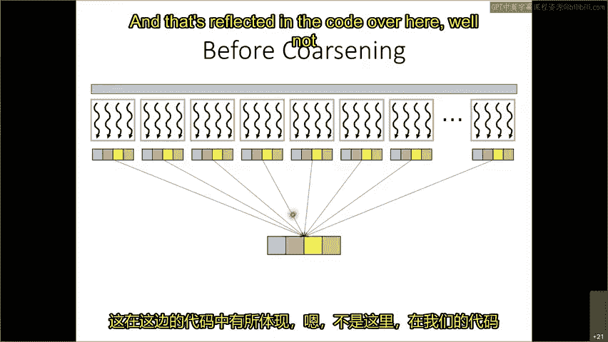

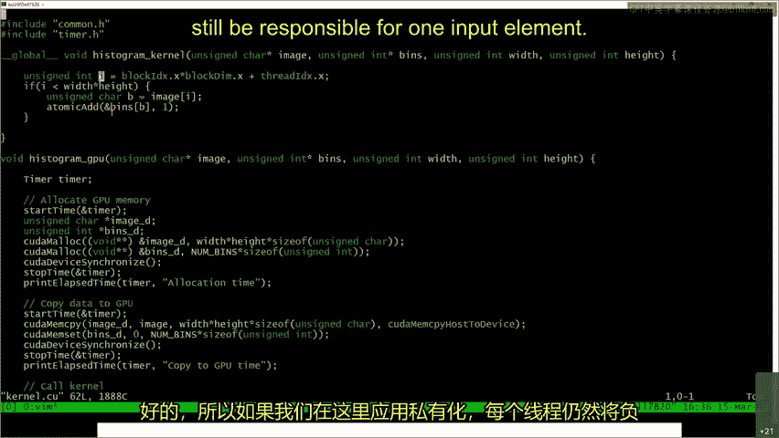

Well， one thing we can do is we can have fewer thread blockss and have every thread block responsible for a larger segment of the input and if we do that。

 then these threads now each thread will need to process multiple inputs。

So each block is going to take a larger input segment。

Each one of these threads will be responsible for multiple inputs and of course when we do this we need to make sure that these threads load the input in coalesc way。

 so I shouldn't make this thread load1，2 inputs and this thread loads 34 and then this thread loads 56 etc Instead I should have all these threads load this part of the segment and then all these threads come together and they load this part of the segment so that I make sure I'm loading the input in a coalesced way but once I do that each thread will be responsible for reading multiple inputs and updating the private copy and then at the end I have fewer private copies that I need to commit to the global copy so fewer private copies to commit to the global copy what this does is that it further improves performance by further reducing the number of global atomic operations that I need to perform。

Okay， so I do more operations than my private copy。

 if my private copy is a histogram is a shared memory that's even better。

 and then I would finally do fewer commits to the global copy so that I have this few global memory atomic operations as possible。

Is that clear to everyone？Okay， and the way to do that is by， you know。

 simply after you apply privatization， you can simply have a loop。

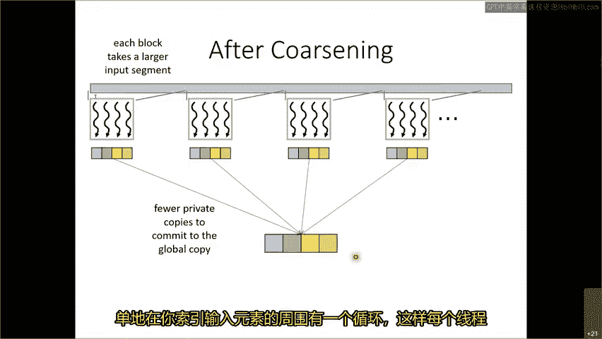

Aro you loop around where you index the input elements so that each thread will have multiple values of I within some input segment that the block is responsive。

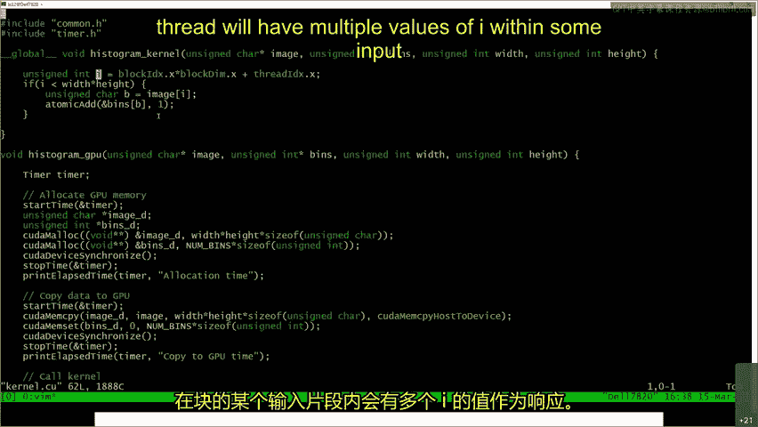

Again， I will not implement this with you in class because I will leave it for you。

 I will leave this for you as an exercise to do。In the assignment， since by now。

 you guys should be experts at using shared memory and applying credit course。Right。Okay。

 so you can read more about what we covered today in chapter9 of the textbook and that is all I have for today。

 any final questions before we end？Yes， I want to ask。

 how is the how are the atomic operations implemented in hardware， Like。

 is it the same instruction sent to the warp itself or since they are bound by Sdi since threads in in a warp are bound by Sdi。

 So how， how， how should we schedule the instruction。

So when multiple threads in the same warp perform atomic operations。

 the hardware will receive these atomic operations and make sure that they are all done。

 they are all completed before control is returned to the warps that it continues execution。

I don't know if that answers your question， how exactly is the atomic operation being done。

 where exactly in the hardware and in the hierarchty it's taking place。

 I think that is something that is not public information and is usually hardware specific。Okay。

 thank you。A professor。About the can you， can you maybe provide us with something that know。

 some exercises so that we know how it will come and everything。ok。Yeah。

 feel free to ask me questions about the midterm after we're done with the lecture。Okay， okay。

 doctor。Can you use atomic operations with Lakuji stone instead of double buffers？

So the the double buffering and atomic operations were intended for different things。

 The problem with with when we did double buffering in the cojistone algorithm。

 we wanted to make sure to read the old value in one thread before the other thread writes the new value here when we're using atomic operations we don't care which thread reads the old value and which thread you know。

 we don't care。When two threads are trying to read modify right the same location。

 we don't care which one goes first。Okay， as long as they both do the work that they need to do in a mutually exclusive way。

And in the case where we were we applied double buffering to the Co Stone approach here we did care we wanted one thread to be able to read。

Before the other thread got the chance to write。 so it wasn't mutual exclusion that we cared about。

 It was that we wanted to make sure somebody read before somebody else wrote。 and in that situation。

 that is why we needed to either have a synchronization or use double buffering。ok。Okay。

 so that verifies the distinction between having multiple readers and writers in these two situations。

Thank you。Yeah， everyone professor。I mean I'm not exactly seeing why thread coing helps because you may be reducing the number of atomic operations at the end like when you're copying the private copies but when you're I mean making the block I mean each thread take care of more than one input pixel then you might have more atomic operations within one block and I mean especially in the case of pictures and stuff like that。

 like it's likely that that pixels that are like near each other will have the same color right so you will actually need atomic operations and so it might be worse snow well you're absolutely right that when we apply coarsing we're going to have more atomic operations on the private copy and then fewer on the global copy but that's okay because the private copy is usually in shared memory so what you can do is you can。

know more on shared memory and fewer less than global memory is actually we don't have more shared memory have the same amount。

 but we have the same amount but rather than theming on different shared copies on shared memory they're on the same copy and shared memory so there is more contention on our shared memory copy over here while having less contention on the global copy but that's okay because contention on shared memory is much cheaper the atomic operations and shared memory are much cheaper than the ones on global memory。

ok。😊，Right， yeah。 thank you。 Now you're， you， you are absolutely right that。Threads that are。

Processing the same nearby elements tend to find the same bins because the way images work is that you have you have pixels that are nearby to each other are very likely to have similar color now one thing to know is that histogram is not only used on pictures it's used all kinds of things so not all data has this property but yes。

 in images if pixels are nearby pixels tend to have the same color and in this case threads that are in the same block will tend to discover similar bins and content with each other on the same bins and shared memory one optimization that is sometimes performed。

Is you can have a thread have an。 So when a thread picks up a color。

It remembers that color and it has a local accumulator in the register for that color and then when it goes and looks at other elements that it's responsible for if these other elements。

Are the same color It updates the localccumulator that has in the register and if they're different color。

 then it will up it will commit to the globe to the to the private histogram。 So in this case。

 if a thread is responsible for like 10 pixels and six of them end up being the same color then it would you would have stayed on six atomic operations because you would just update that local。

You would update that local counter in your register and then commit it once to the private copy and then later on you can go and commit to the global copy so yes。

 there are all kinds of optimizations that you can do if you know something about the distribution of of the data in particular if you if you in an image if you know that nearby pixels are going to have the same color you can do an optimization like this and this is something that is done in practice。

So thank you for that question。Okay， any other questions？All right， if not。

 then that's all for today。 and I'll see you next time。By。

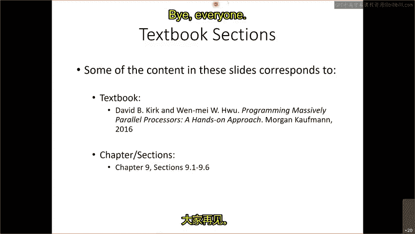