# 美国贝鲁特大学《GPU计算｜CMPS 297S396AA - GPU Computing - Spring 2021》（豆包翻译 - P14：-14-Lecture 14 - Merge.zh_en - GPT中英字幕课程资源 - BV1bw4m1k7a1

Hello everyone and welcome to Le 14 of GPU Computing。

 Today we're going to be talking about a new pattern， which has merged。

So before we start last time we looked at the histogram pattern and when looking at histogram we introduced a new future。

 which is atomic operations and we also looked at a new kind of optimization which is privatization we said that a histogram basically approximates the distribution of a data by finding the range of values in this data set that falls into each one of a set of bins and an example of that that we looked at during class was a color histogram where an image is essentially a set of eight bit pixels so each pixel can have 256 different values so we basically have 256 different bins and we count in each bin the number of pixels that have the corresponding value。

Now having said that， we observed that if we want to implement something like this where different threads are processing different input pixels and they're incrementing the same the same bin we have the problem of data races and data races occur whenever there are multiple threads that are concurrently trying to update the the same location or more precisely when we have the same memory location is currently accessed to that ordering and at least one of these aes are right and we saw that you know if I have a thread that's doing load add and store and another thread that's doing load add in store depending on how the instructions of these threads are interleaved in time。

 we may have this outcome could be two or it could be one so and for example。

Here I could have thread A load an ad， and then before thread A stores。

 thread B will load a stale value and then it will add and then it will store。

 so even though two threads are incrementing bins of B in this example。

 only one of them will succeed to do the increment and the final value will be one。

And to solve this problem， what we typically do on a CPUU is we use mutual exclusion where we guard our increment using a log so we do mutex log to acquire a log do the increment and then release the log。

 but we said that the problem with doing locking on the GPU is that whenever we mixed logs with TID we can cause that log so for example。

 if I have thread0 and thread one are in the same warp and they both try to access the acquire the same log one thread acquires the log and threadread1 cannot acquire the log so threadread ones this they're waiting on this mutex log operation for thread to get the log but then threadread0 cant proceed because threadread zero is in the same morp but it's waiting for thread1 to acquire the log so that they can both proceed together。

So to avoid this kind of situation， what Pa provides is something called atomic operations where we perform readmodifier right with a single ISA instruction and that instruction。

Is atomic ad and there are also atomic operations for all kinds of other operations like subtract Min Max。

 etc so having said that we saw how to implement histogram but we saw that one of the problems with having all the threads each have one input and they all update the same histogram is we have a lot of threads that could be updating the same value and they will all be executing atomic operations and these atomic operations will take time for two reasons one that they're being done on global memory and two because there's a high probability that different threads will be accessing the same value so theyll lead to wait for each other so the way we solve this is we use privatization where every thread block had its own private copy of the histogram and they would they would do the updates on the histogram that with threads in different blocks that are no longer competing with each other and then we do a final commit of the local histogram to the global histogram for each bin that is a nonzero and。

Histogram is small enough we can even put the private copy of the histogram and shared memory so that we have a lower latency atomic operation and then finally what we saw is we can all apply thread coining where each thread block takes a larger input segment and what that results what that does is that it results in us having fewer threat blocks and therefore fewer local copies that need to be submitted to the global copy and therefore we have fewer global atomic operations overall so this is what we covered last time and today we're going to talk about a new pattern which is merge before I start talking about merge anybody have any any questions about last time's material。

Okay， so if not， then let's talk about mergerch。So merge。

 an ordered merge is an operation that takes two ordered lists and combines them into a single ordered list。

So for example， if I have these two lists over here they can have different sizes。

 but they're both ordered so here I have one，2，46 six eight nine here have 23579 what emerge does is that it takes these two lists and combines them into a single ordered list and the way to do and that list will look like list and the way we do that is we bring in the one and then we have bring in the two we bring in a two bring in then next there's three so we bring in the three。

 then we have the four and then we have the five comes in from here， the six is coming in from here。

 the seven from here， eight from here， nine from here and nine from here。ok。😊。

So this is what a merge operation does。 And before we talk about how to paralyze merge。

 I first would like to implement with you a sequential a sequential merge。 Okay。

 so let's go to the code in order for us to implement a sequential merge。

 So this is the code we're going to be used using to implement merge throughout this lecture。

 And first I'm going I have this method this function merge sequential that does a sequential merge。

 So this function is going to take two arrays A and B。

 and it's going to merge these two arrays into an arrays C。 And here I also have M。

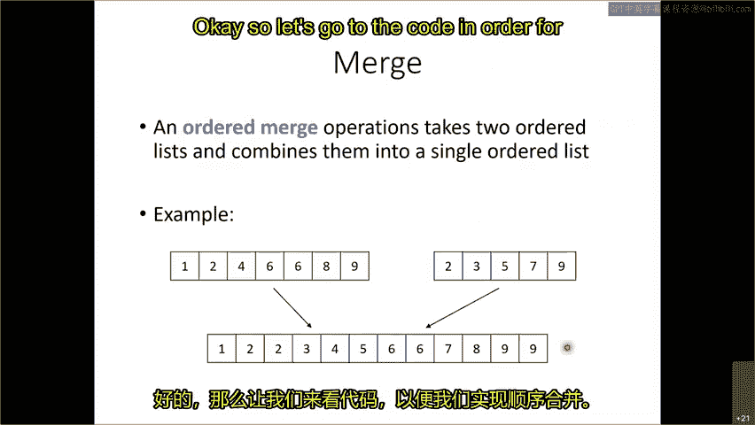

And N， and N is going to be the size of the array A， and N is going to be the size of the array B。

Okay， so how do we implement how do we merge these sequentially Well what we're going to do is we're going to loop through these two arrays and at each point in time we're going to compare we're going to have a counter that goes to the first array。

 a counter that goes to the second array and each time we're going to compare the corresponding elements and whichever element is less we're going to add it to the destination array and we're going to increment the counter for the destination array。

 This is how we're going to do it。 So let's let's that。

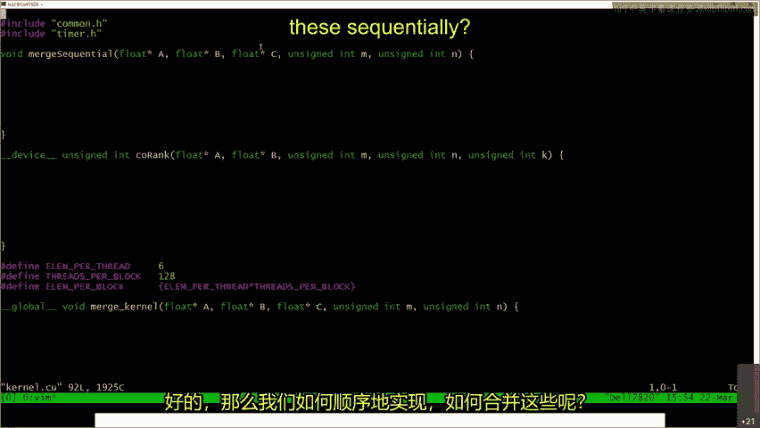

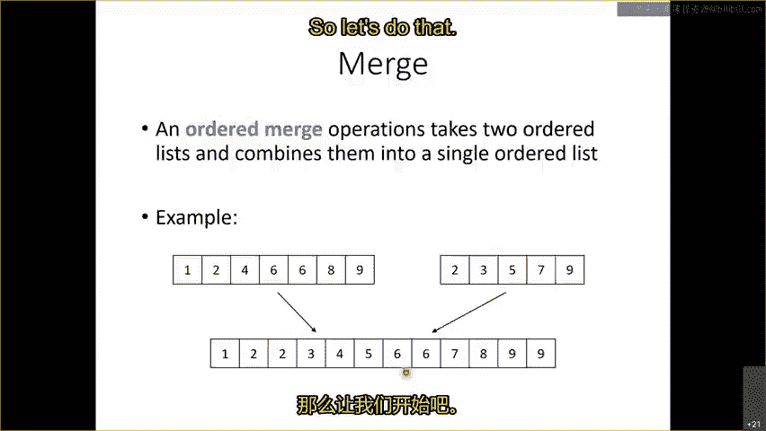

So I'm going to start by declaring three counters， I'm going to declare。Unsigned and I equals0。

 So we're going to use I to go through the array A。 I'm going to have an unsigned。And J。

 and I'm going to use I'm going to slice that to 0。 and I'm going to use J to index the B array。

 and I'm going to have an unsigned。I always mess up when I write unsigned。

 when I write unsigned and K equals 0， and I'm going to use K to index the C array。Okay。

 and now what we're going to do is we're going to loop。

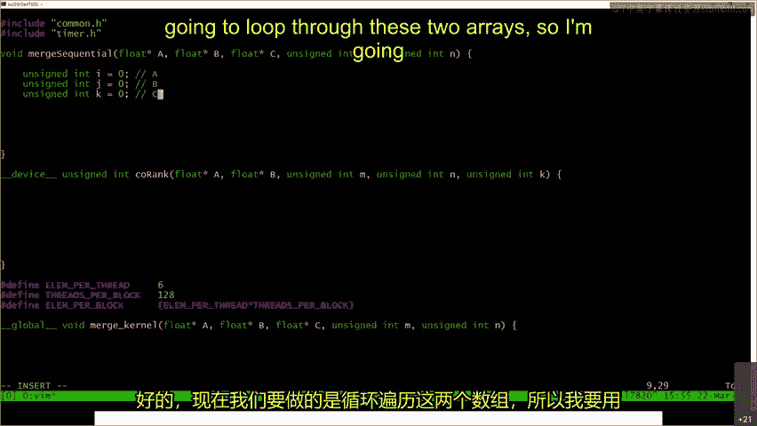

Through these two arrays。 so I'm going to use I and J to go through these two arrays。 Okay。

 and I'm going to be merging。 I'm going to adding the smaller value。

 and I will basically loop until one of these arrays is depleted。

 and then I will just store the rest of the values in the remaining array。 Okay， loop。

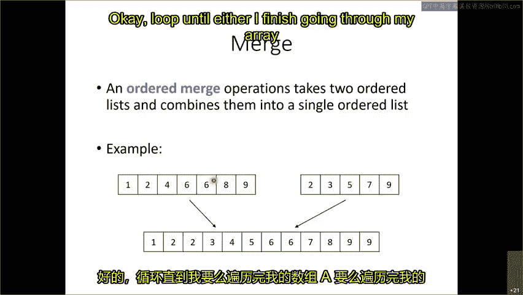

Until either I finished going going through my array A or I finished going through my array B Okay。

 so I will look。

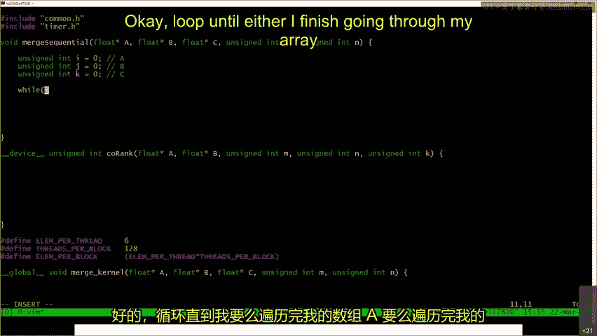

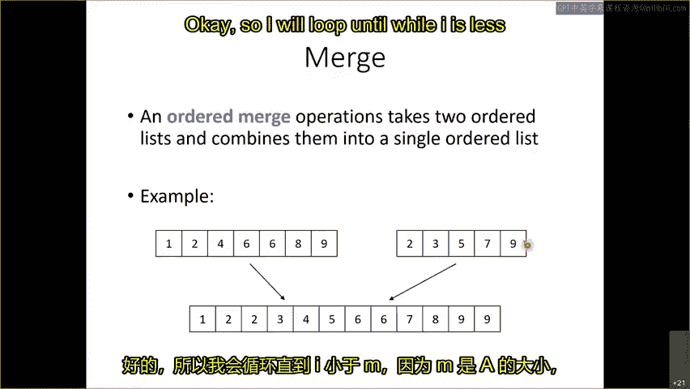

And while I is less than M because n is the size of a。Okay， N J is less than n。

 so I'm going to loop until I reach the end of the A array or I reach the end of the B array。Okay。

 and over here， what I'm going to do is I'm going to check if the element in a is smaller。

 I'm going to put the element in a of A and C。 If the element of B is smaller。

 I will put the element of B inside of C。 Okay， so I'm going to write to check if A of I is less than B of I。

Okay， but in this case， what I will do is I will put。I will， I will put the A of I in K。

 I will write， C of K is equal to A of I。

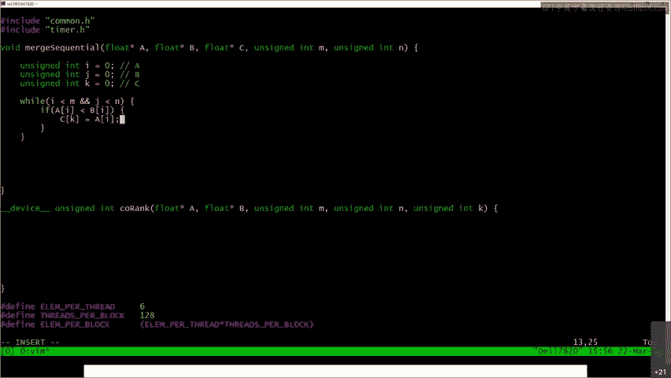

Okay， so here if my I is over here and my J is over here and I find that A of I。

 which is1 is less than b of I， which is two， I will put one over here。

 and then what I want to do is I will increment the counter that points inside of RAA。

 I will increment the counter that points inside of RAD array。

 I won't increment this one because I will need it on the next iteration。Okay。

 so after doing c of k equals a of I I need to increment k and increment I there's actually a neat way of doing this in C plus plus。

 which is where writing K plus plus and I plus plus so here when I write K plus plus it means I use the old value of k and then I increment K here when I write I plus+ it means I use the old value of I and then I increment I。

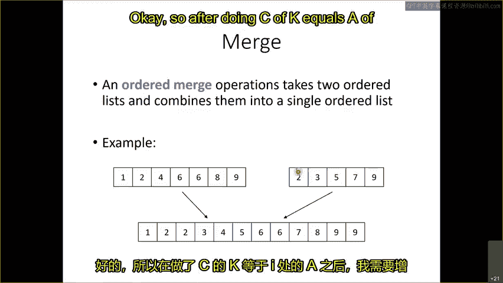

Okay， now if A of I is not less than B of I， then what do I do， then I we need to put B of sorry。

 if A of I， I made a mistake here， this should have been B of J。Okay。

 so if a of I is not less than B of j， then that means b of j is a smaller value。

 then means I need to put B of J inside of C。 So in this case， what I will do is I will write L。

B of K is going to equal B of J。 Okay， and then I want to increment this。

 I want to increment K and J， not K and I。 And I can do that in the same way。 I do a post increment。

 So K plus plus and J plus plus。So what this loop does is that it'll merge， it'll keep merging。

 taking the smaller element from each array until we reach the end of one of the arrays Now。

 once we reach the end。

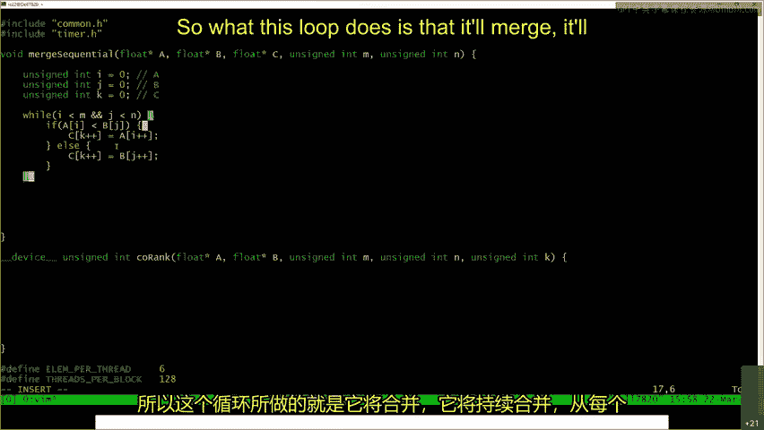

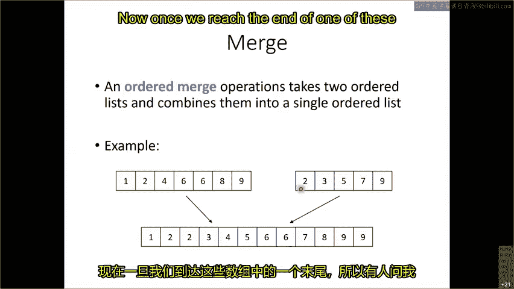

Of one of these rays。So somebody is asking me why is it C ofK plus plus not C ofK。

 the reason it's well CK++ is the same as C ofK， except that CK++ will increment K after using K。

Okay， so it is C ofK C ofK is the element that are we are going to be assigning。

 but after we assign the C ofK， we're going to increment K。So this is what what this does。Okay。

 so after we're done， this loop is going to end once we're done with one of the arrays。

 but we're still going to have the rest of the elements in the second array to store to see so the way we do that is as follows。

Will if A as the if we're done with B， but there's still some elements in A。

 what we'll do is we'll do while I is less than M。And then we' all the elements of other main elements of a inside of C。

 so we're going to do C of K plus plus。Is equal to a of i plus plus？

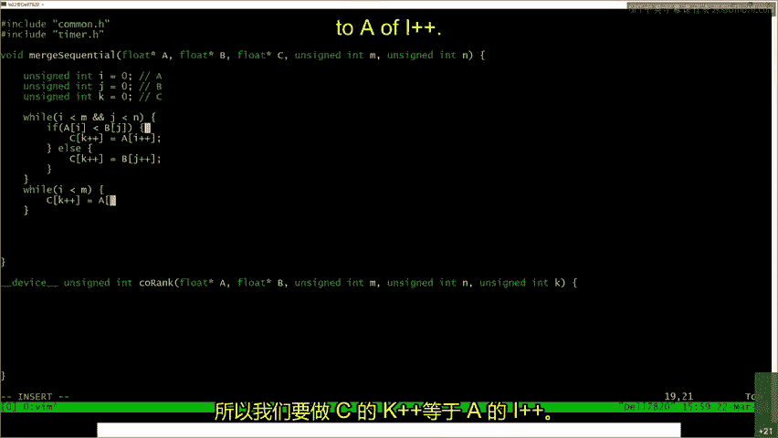

Okay， and then if， if if， if it's the array B， that's the one that that if we're done with A。

 but it was the array B， that's the one that wasn't finished。

 then were gonna do the same thing for the array B。 So we'll do while J is less than n。

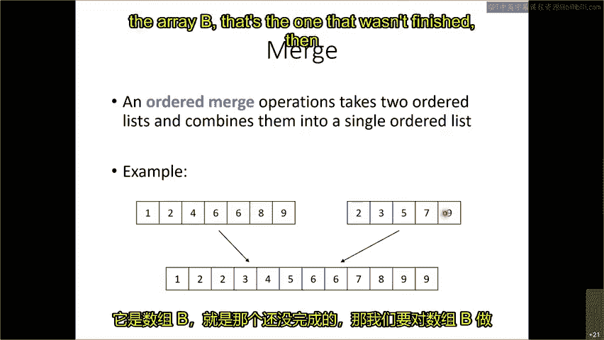

Okay， we'll do。B of K plus plus is equal to B of J plus plus。Okay。

 so this is how we do emerge sequentially。All right。

 is this clear to everyone any questions about this？Okay， someone's asking， is this efficient log。

 And this is a sequential code right now。 So this is our kind of our baseline code。

 This is sequential code。 It's not parallel code。 So we're gonna we talk about how to parallelze index。

 but everybody understands the sequential implementation。Okay， Doctor Doctor yes。

 the second the wild oillist M Y Jlist and is it is it when must Ma smart M when you use it is it when the one of the arrays is done right。

 so when we' merging these two arrays， we're gonna reach the end of one of the arrays before we reach the end of the second array。

 right， so here。

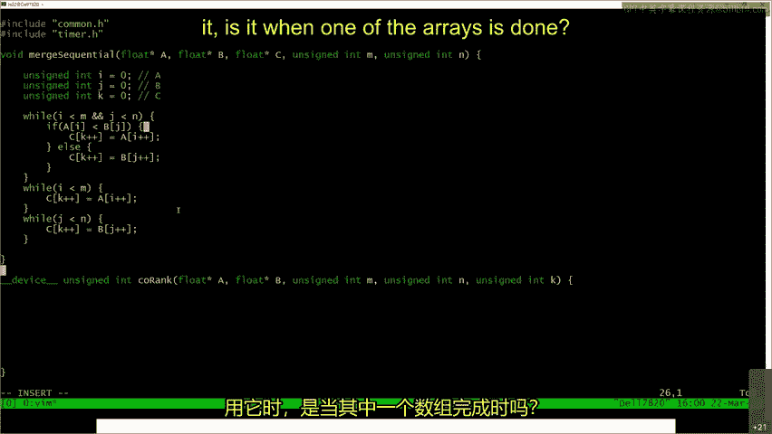

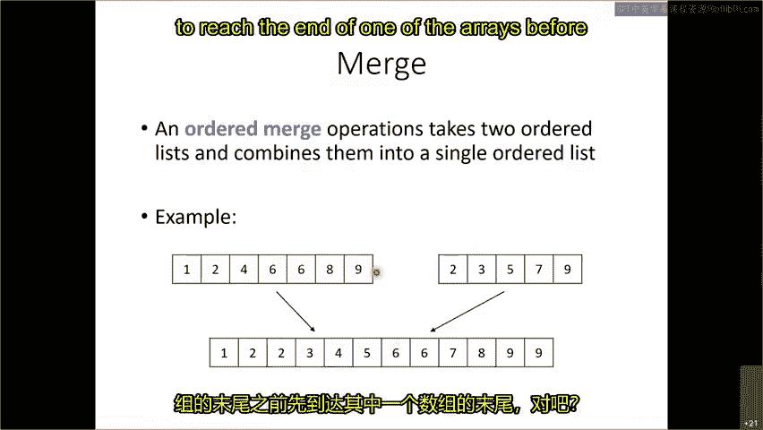

Condition is going to the loop is going to exit either when we reach the end of a or when we reach the end of B。

 so if we reach the end of a， we still want to fill in the rest of elements and B if we exit because we reach the end of B。

 we still want to fill in the rest of the elements in A so that's why we have now two table loops over here。

Okay， thank you。 Yeah， you welcome。Okay， so having implemented this parallel merge。

 the next question is， how do we parallelize this。Anybody having ideas how we can parallellyze this。

 this seems to be a very sequential thing。So how do we paralyze something like this， Any ideas？

Maybe we can do it and We can do some parcel。They do it in batches。

 What do you mean by do it in batches。Send one thread per four elements。

 And each thread sorts those for。And then do you mean every four elements of a or we're not sorting we're just merging two sorted arrays so do you mean sorted assign to four elements of a or four elements of B or four elements of C what four elements I mean like maybe two by two like two of a and two of B and then okay I I'm not sure but if we if we put it in two of a and two of B how do we know two of a even correspond to the two and B maybe the first 10 elements of a should go first before any of the elements of B go first。

right， I know that's why I said batches like maybe we can do it incrementally and eventually all the like the elements drift in the correct locations if we do like something that converges。

 but。Okay， but then how would we do the parallel。way to do it is probably to you know the execution of the code looks maybe a kind of what or what we're doing looks kind of like a three so if we break up the array in multiple in multiple parts will have kind of segments that we can parallelize for each one。

The which radio will break up into multiple parts。No not so have so you have one array。

 you start with one array， you break it up in half， then you do this kind of like recursively。

 but not at the GPU level on the CPU level you recall the kernel every time you。

You break the array in2。Which array do you want to break and do。 Remember， we have two arrays。

 We have an array A， and we have an array B， and we want to merge them。So。Which。

 which array radio want a break in half A or B。Or see。呃，A and B。So if I break A and H。

 that does not necessarily mean I have a kind of an even split and B that corresponds to the hazard。

Right maybe the entire array A comes before the entire array B。Professor。

 I would say keep like keep the shortest array like a whole。

 like don't divide it and take like one thread per element of the other array and then try to compare it with all elements of the array that you kept intact。

I don't know if that's efficient this。Okay， no that way you're guaranteed like see I see where you're headed I see where you're headed can we can we assign a thread to each element of a and then in the thread use it to find where it should appear in B then we have like indices。

Okay， now if we're actually putting them there， I'm not exactly sure。

 but we can find their positions。Yes， so you're definitely headed in the right direction。

 so what you're hinting at is somehow we need to maybe partition。

 you have a partitioning where we find an element in a and somehow we need to find the corresponding part of B so that we can do different different smaller merges in parallel。

Okay。😊，So I think a lot of you are kind of hinting towards that direction and this is we will do something along these。

But however， we're going to do something different so far the whole time we've been but by the way this is the sequential merge we wrote and now we're going to we're going to think about parallel merge so so far we've been we've been。

😊。

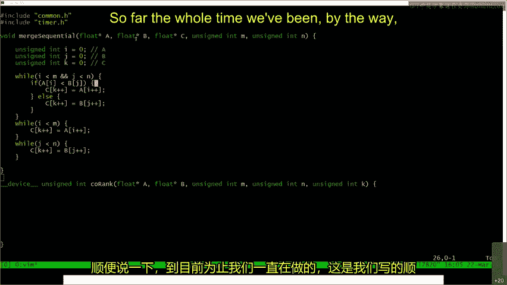

Whenever we've been paralyzing things we've been thinking about you know partitioning the input but this time it actually makes more sense to partition the outputs let let's take a look about well a lot of times the input and the output directly correspond to each other but for this particular application it's actually it actually makes more sense and gives you a better load balance if you partition the output so here is how we can parallelze mergech let's say again I have my array A that has size M and I have my array B that has size N and I have my destination array C that has the size M plus M。

Okay， now one way to paralyze this。Is you know a lot of you have been saying why don't we partition A evenly across threads and then each thread in a goes and find the corresponding part in B and then somehow merges those。

 we can do that， but if I partition A evenly and a small segment in A could correspond to a very large segment in B or it could correspond to a tiny segment in B so that work will not be distributed evenly across the thread。

If I want to have a better distribution of work。Ultimately what I want is all the threads to merge the same number of elements and the number of elements a thread merge actually corresponds to the number of elements the thread is going to write to be。

So in this case it really makes more sense to partition C so the way we will paralyze merge today is we're going to take our C array and we're going to partition it into segments and each thread will be responsible for one of these segments okay so each thread will take a segment and well be responsible for sequentially merging the elements then A and the elements of B that are supposed to come to this segment。

ok。😊，Now， if we partition the into segments and divide it across threads， the key challenge becomes。

 how does each thread？Find the corresponding elements in A and B that it needs sub merge。

 so the key challenge is how does each thread find the input segments corresponding to its output segments。

 So this thread that's responsible for this blue segment of C。

 how does it find the corresponding elements in a， It could be that and the corresponding elements in B。

 it could be that it needs two elements from A or and three elements from B or this other thread is using four elements from A and one elements from B and a thread doesn't really know。

 you know how this second thread cannot wait for the first thread to finish its own merge for it to start its merge。

 otherwise， you know， there's no point in paralyzization。

challenge is given if I assign a threat to a certain segment。

 how do we how does this thread find the corresponding segments in A and somebody had somebody wants say something？

Now I was going to say， you know， maybe if we privatize it， but it doesn't make sense in this case。

Yeah， so privatization is an optimization we discussed so here yeah。

 you're right here privatization is not very well。😊，Okay。

 so let's lets let's take a look in more detail about what we're trying to do here。

 So each thread has the the start index and the end index of a segment that it needs to merge and it needs to find the corresponding index in A and in B given an index K into this array C。

 the output array C， What I want to do is I want to find the index I。😊。

Into the array A and the index J into the array B that correspond to the the values that need to be merged into the the segment starting at。

 This is what I need to find。Okay， so given a K， we need to find I and J on this diagram and we refer to I and J as the co ranks of K。

Okay， so when I say what is the co rank of k and array A， that's I。

 what's the co rank of K and array B， that's J。Okay， so the question is。

 how can we find I and J given K？Well， first， we observe that K is equal to I plus J， right。

 the number of elements before K and the array C is going to be the number of elements before I and the array A plus the number of elements before J and the array B。

So therefore， we know that k is equal to i plus J。And since we know that k is equal to i plus J。

 then it's enough for us to find I and then since we know K， we can find J okay。

 so it is sufficient for us given K， it is sufficient for us to find I。

 and then we can just find J by doing J equals k minus I。All right。

 so then our objective now is given K。😊，How do we find I。Okay。

 and then we can find J by simply doing J equals k minus1。Okay， so given K， how do we find I？Well。

 let's first start by setting a bound on eye。😡，Okay， let's start by settingging a bounds on I。

 what do we know about I？😡，Well， first of all， we know that I is going to be an index into the array A。

Okay， so what are the bounds on I。Yes， let's start by thank you。Sorry，0 to m minus1。0 to M minus-1。

 right。 So I is going to be go from 0。 Oh is going to be greater than or equal to 0 or less than or equal to M。

 Notice it can be equal to M。 Why can Why can I be equal to M。If the value is not my。

 it doesn't not because we're doing I++ Well no so on this diagram。

 I could have a k where I is equal to M meaning I so if I was m minus1。

 then I is going to point over here to this element。When I is equal to M， where does I point。

It means the the end of the So right it doesn't belong to the first time。Right。

 exactly so I could be equal to M if in my last or in one of these segments。

 I've reached the end of the RAM and the end of the RA A and all the elements are coming from the array B。

Okay， so we know that I is going to be greater than or equal to0 and less than or equal to M。

So this is one bound we have on I。 We can put another bound on I。

 and the other band is based on the observation of based on what we know about J。

 What do we know about J， What are the bounds on J。Well， similarly。

 J has to be greater than or equal to0 and less than or equal to n。Okay。

 and we also know that J is equal to k minus I。So then k minus I is greater than equal to0 and less than or equal to n。

Okay， and if we move， if we subtract K from all these locations。

 then we know that minus I is greater than equal to minus k and less than equal to minus k plus n。

And if we invert everything， then we know that I should be greater than or equal to k minus n and less than or equal to k。

So we have these two bounds on k， we know that I is greater than equal to0。

 and also I should be greater than equal to k minus n。

So then the lower bound on I is the maximum of 0 F K minus n。

And we also know that I should be less than or equal to M， and I should be less than or equal to K。

And therefore， the upper bound on I is going to be the minimum of M and K。Okay。

 so the bound of I is the maximum of0 and k minus n and the minimum of M and K。Is this clear so far。

 any questions？Okay， any questions about how we about this bound on K， I this clear to everyone。

Alright， great。 So having placed a bound on on eye。Okay， so now we have a bound on I。

 we know that it's between this value and this value。 The next step is to find is to find I。 Okay。

 so we have a bound on I now we need to find I inside of this bound And what we can do is when we have a bound on something Okay。

 and we have some kind of ordering inside of our array， you know。

 what is this sound like and we want to search for some value。

 You know what what does this what does the starting sound like。Binary search or search。 Right。

 exactly。 If I have a sorted array and I want to search for a value。 Okay。

 then what we can do is we can do a binary search。 Okay。

 so all we can do having established a bound and I， what we can do is we can。😊。

Perform a binary search for I inside of this array。So sorry inside of this be。Now， now。

 the question is， how do we know that we have found I。I， if I。

 if I start this bound and and I do a binary search， how do I know when I have found I。

I'm not looking for a specific value here。 Well， what， what do we know about I， What is I here， Well。

 I is the core rank of K and what that means is that all the elements。😡，Before I。

Should be less than all the elements after I， obviously。

 but they also should be less than all the elements after J。

And we also know that all the elements after I。Should be greater than all the elements before I。

 obviously right we don't need to check this。 this is given by the fact that A istorrted。

 but they also all the elements after I also need to be greater than all the elements before J。

So how do we know that we have found I Well we know that we have found I when a of I minus1 is less than or equal to b of j。

 so a of I minus1， this element is less than or equal to B of J， which is this element Okay。

 so the element here。Should be less than or equal to the element here， Why。

 because the element here is going to be over here in this segment and the element here is going to be part of this segment over here。

 So necessarily the orange elements should be less than less than or equal to the green element。

 so the the A of I minus1 should be less than or equal to B of J。And similarly。

 we know that B of J -1， though this element here should be less than or equal to a of I。

 So this element over。So these are the things we know about I so we can use these things to determine when we have found I once we find the element that meets both of these conditions。

 it means we have found I。Okay， note that one of these conditions is not enough。

 it's not enough for a of I minus1 to be less than or equal to B of J。Okay。

 we also need B of J minus1 to be less than or equal to A of I。Okay， otherwise。

 this element way over here right is going to be less than the element way out here， okay。

 but that doesn't mean we found I because the next element is also less than the previous element。

Okay， so we can perform a binary search within this bound to find the element。

 the defined I that meets this criteria over here。Okay， now when we do a binary research。

 it's not enough for us to find to know whether our we have found our element， what do we also need？

We need a way of knowing whether our guest is。We need a way to know that our guest is correct。

 but we also need to know if our guest is what。We want would know if we overestd or underestimated California。

Exactly， so we need a way of knowing not just if our guess is correct。

 but if our guest is too high or too low。Okay， so we're going to perform a binary search within the bound。

 we know our guess is correct based on this condition if A of y minus1 is less than equal to b of J and b of j minus1 is less than or equal to A of I。

Okay， what if our guest is too high。 So and our guess is too high。

 So this I prime over here is an example of a guess that is too high。Okay。

 so I and if our guess if I prime， the guess for I prime is too high。

 that means the guess4 J prime is going to be too low。Okay， and in this case。

 which one of these conditions is going to fail？How do we know that I is too high。

Because A of I Brian is second that it should be。Actually， the first condition。

 so the second condition is is the first condition is the one that's going to fail because A of I minus1。

 which is this value， is not going to be less than v of J， which is this value。Okay。

 the second condition actually succeeds because b of j minus1， which is this value。

 is going to be less than a of I， which is this value。Okay。😊。

So we know that our guess is too high if a of y minus1， which is this value here。

 is not less than B of J， which is this value over here。Okay， or it's greater than it。Okay。

 or sorry if it's not less than or equal so if it's greater than so our guess is too high。

 if if AI prime minus1 is greater than bj prime， so if I prime is our guess。

 we know it's too high because we can check that AI prime minus1 is not going is greater than B of J prime。

How do we know if our guess is too low So if our guess is too low。

 it's going to look something like this here at my I double prime as a guess that is too low。😡，Okay。

 and in this case， my J prime is going to be too high。

 So how can I detect that my guess I double prime is too low。

Well basically the second condition is not going to be met Okay， so I know that here in this case。

 AI minus1 is going to be less than b of J， but the way I know that this suggests is wrong is that A of I is going to be less than b of J minus1。

Okay， so in other words， my guess it's too low if B of J double prime -1 is greater than a of I double prime。

 Is this clear to everyone。Any questions？Okay， so then really。

 the only difficult thing about merge is finding the co rank。Okay。

 I divide what I need to do is I divide my array C into equal parts and give them to different threads。

 each thread has an index K， and then each thread needs to perform a binary search to find the corresponding I and then naturally you would find the corresponding J。

 and then each thread will just do a sequential merge。

And we already know how to do a sequential merge。It's obvious to how to divide an array into equal parts and assign a part to each spread。

 Okay， so really， the， the most difficult thing about。

MerG is doing this binary research to find the co rank of K inside of the array。All right。

 so to do that， what we will do is we're going to implement a co rank function。All right， that takes。

That takes a K， an array A and array B， their sizes。

 and a value K and finds the I and the J that correspond to this。

Somebodys asking what if both of these conditions fail， well， if both of these conditions fail。

It means that our re guess is correct。If this is false and this is false， that means this is true。

Okay divergence through the roof like the Oh， yes， yes， you're absolutely right。

absolutelyutely right so we will we will have we will have divergence here because different threads are doing binary search and they may take longer to to find to find their the result so yes you're right this is。

This is this is going to suffer quite a bit from diversion Yeah。

 but it's something that we have to live with if we want to paralyze something like。Okay。

 so let's go and write this the Co rank function that where given K finds I and J and switch back to my code。

 I already have the signature for the Co rank function specified here it takes an array A and array B the sizes of A and B which are M and N and it also takes at the index K okay notice we don't need C over here because we're not using anything D has not been generated yet Okay。

 so we just need the index K into C and we need to return the index I into a Okay let's do that。

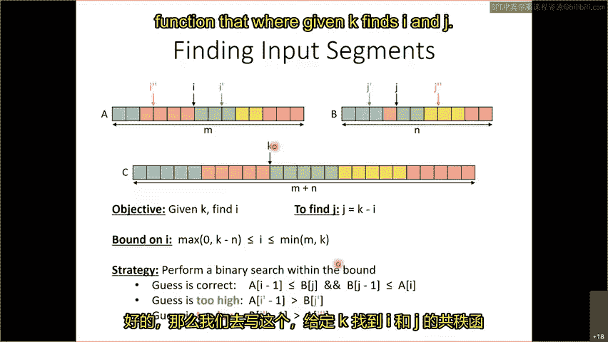

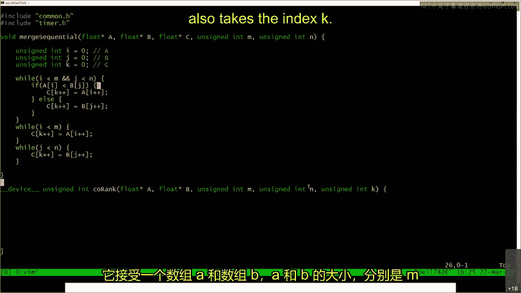

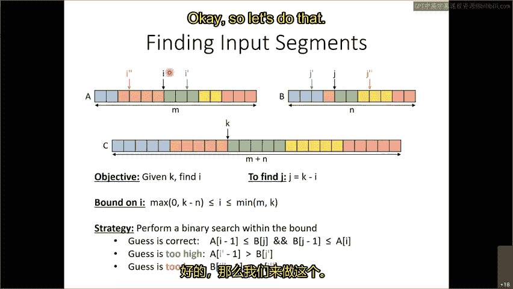

So what we will do is we need to first set a bound， we're going to do a binary search。

 so we want to set the bounds。Okay， and then initialize our guests to the middle of the bound to halfway between the bounds and then start doing a binary search so let's first find the bounds on I Okay。

 so i'm going to write。Unsigned in， I'm going to define I low to be the lower bound on I and we said that。

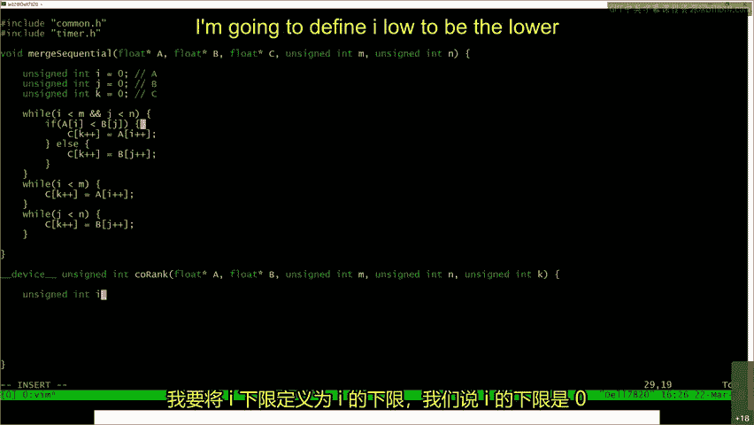

B than I is the maximum of 0 n K minus n。 Okay， so in other words， if K minus n。

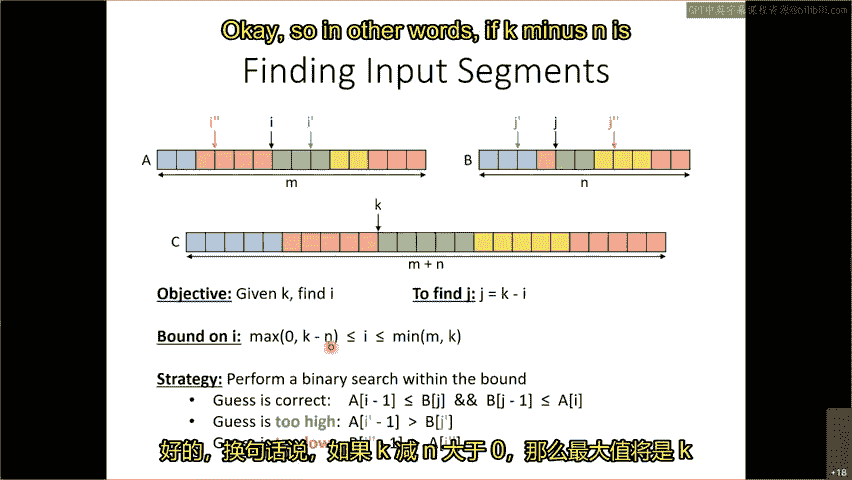

Is greater than 0。Then the maximum is going to be k minus n。 otherwise the maximum is going to be0。

Now， one thing to keep in mind here is that K is an unsigned n， and n is an unsigned end。

 So if I do an unsigned int minus an unsigned n。If n was actually greater than k。

 then k minus times is going to wrap around is going to be a very large number so for safety。

It's better to rather than already k minus n greater than0， we should drive k is greater than。ok。😊。

Okay， so now we have a lower bound on I。 Let's also set our upper bound on I。 So our upper bound。

 we're going to write unsed in。 we're going to call it I high and I high is going to be equal to what。

 Well， let's go back and take a look。

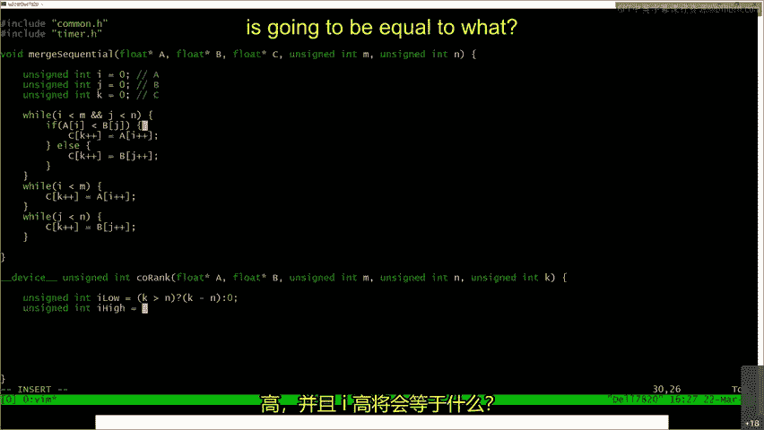

So here the upper bound is the minimum of M and K。Allright， it's the minimum of M and K。

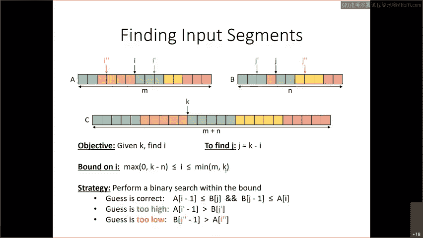

So lower bound is going to be if M is less than k。Then it's going to be M else is going to be K。Okay。

 so now we have a lower bound on I， and we also have an upper bound on I。

Now what do we do Well we're going to do a binary search。 Okay。

 so here we're going to start our binary。3。We're gonna loop。

We going to keep looping until we find our results， once we find our results， we will return it。

 so that's why we're just looping doing well through。Okay。

 and we are gonna initialize first our guest。 What's our guest going to be。Well， our guests。

I is going to be in the middle of the bound。 So it's going to be I low plus I high。Over2。Okay。

 and constantly， what's our J going to be？What's our J guess going to be？

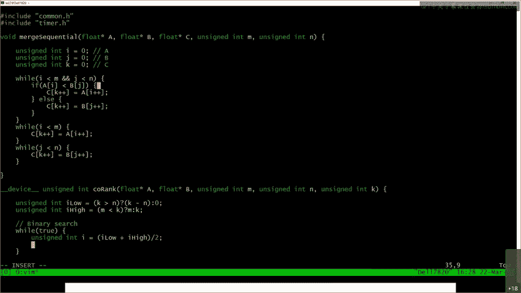

Or remember， we know J exactly so then our J。

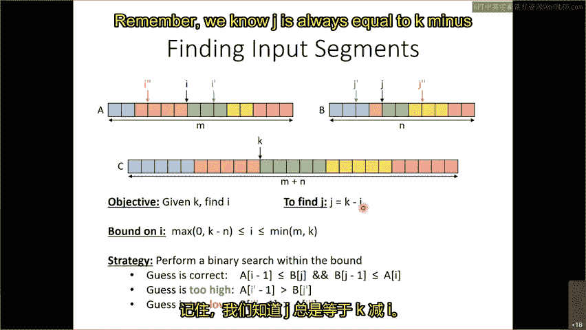

It's going to be equal to k minus I。Alright， so now that we've we've made a guess on I and J。

 now what we need to do is we want to check， is our guess correct。

 is it too high or is it too low Okay， so first， let's check if our gas is too high。

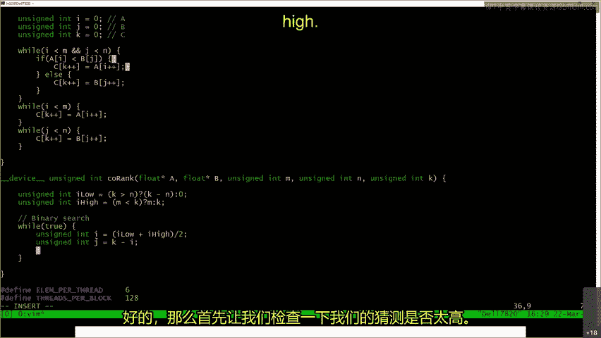

If our guess is too high， it means that a of I minus1 is going to be greater than B of J。

 So we're going to check if。

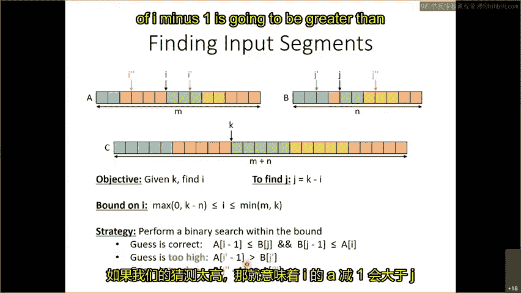

A of I-1 is greater than B of J。Okay， so if a of I minus1 is greater than B of J。

 means my guess is too high。 What do I do in this case。 So here， if my， if my guess is over here。

 it's I prime， right， It's too high。 What do I do And binary search， if we guess too high。

 What do we do， We're gonna narrow。

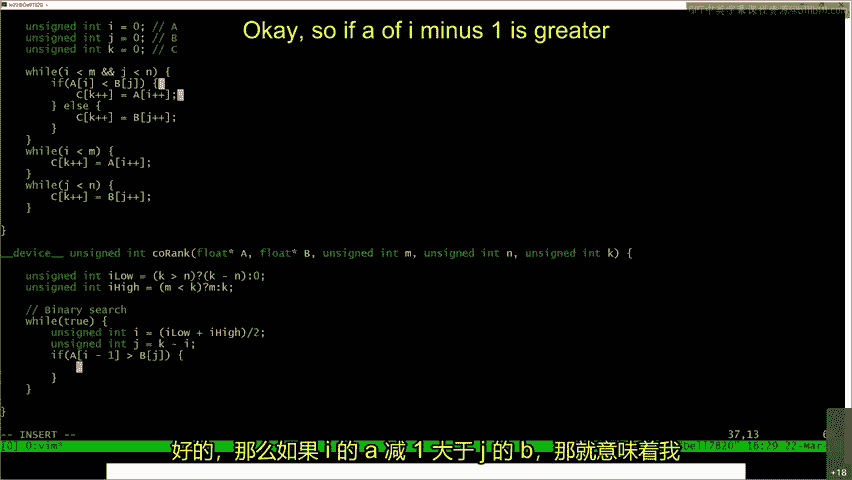

The bound and then we're going to we're going to guess again， Okay， so my guess is。

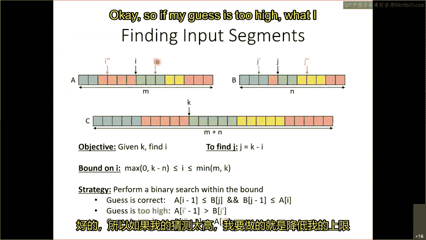

What I will do is I will lower my upper bounds。 I found a new upper bound on I。

 so I'm going to write I high is equal to I。Okay， now one thing to note is that I need to actually make sure that these axis these are legal okay I need to make sure that I minus1 is going to be within bounds。

 I need to make sure that B of j is going to be within bounds because here the way I got J is by doing j equals k minus I。

Okay， if I was very as if I was kind of a low guess， okay。

 J could have been could have gone out of bounds over here。

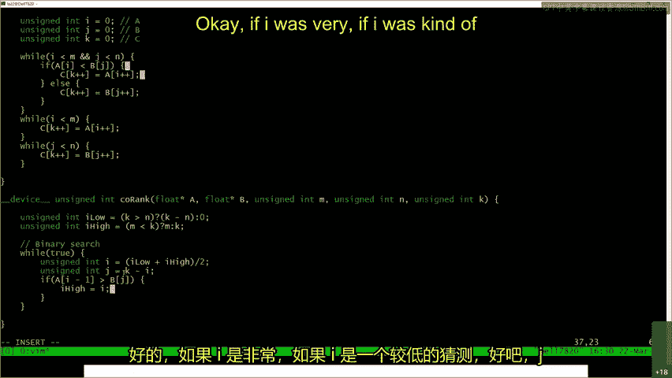

I need to make sure that J is within bound。

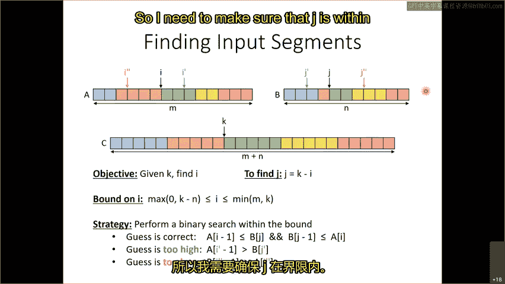

Okay， and I also， since I'm doing A of I -1， if I over here was。

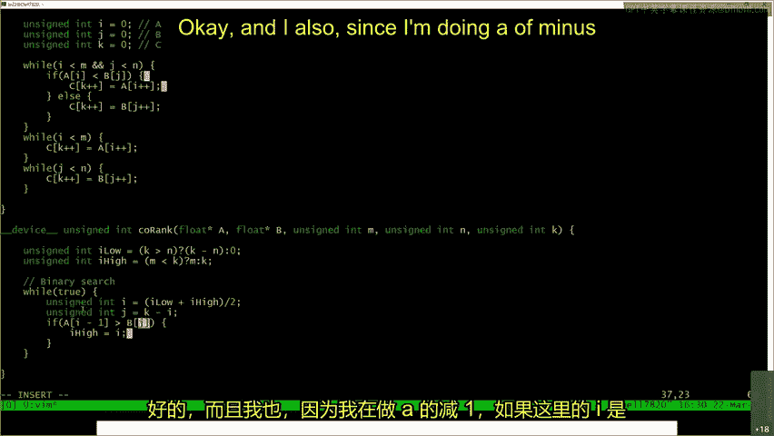

I need to make sure not to access i minus1。

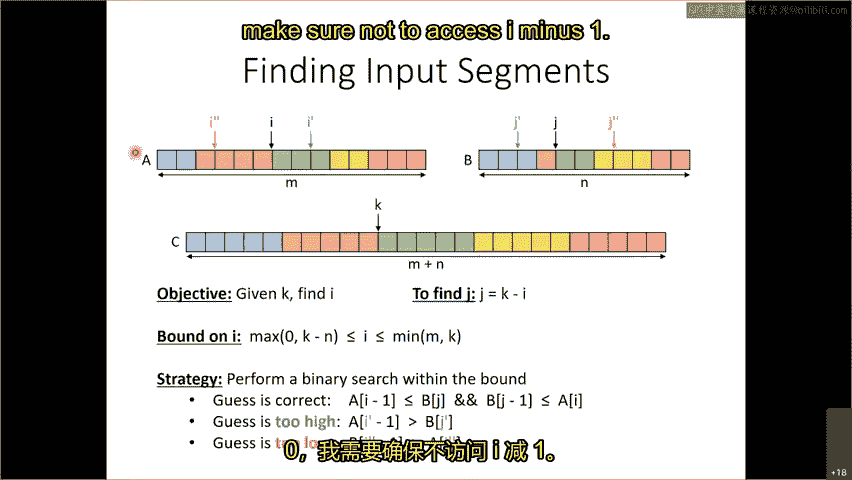

Okay， so before I do this， I actually need some few other checks。

 I need to make sure that I is greater than zero。Okay， obviously， if I was zero。

 then my guess cannot be too high， right？

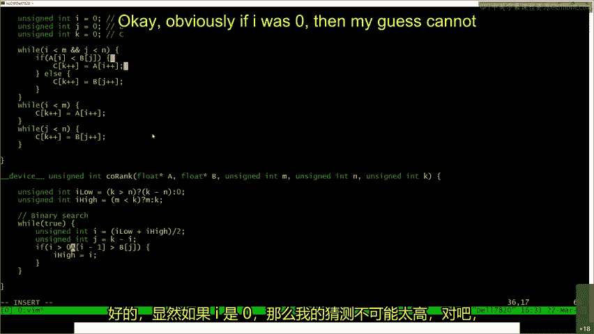

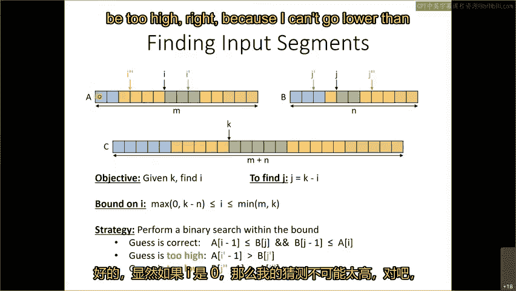

Because I can't go lower than that so I need to make sure that I is greater than zero to make sure that when I access a of I minus1。

 that's within bounds， and I also need to make sure that j is less than n in order to make sure that when I access B of J。

 I'm also within bound and again， j is less than n because if if I is too low。

 then j will could be too high， it could be out of bounds over here， then if j was out of bounds。

 then obviously my I is not going to be too high because if I make it lower。

 that means I need to make J go even farther out， which is not possible。

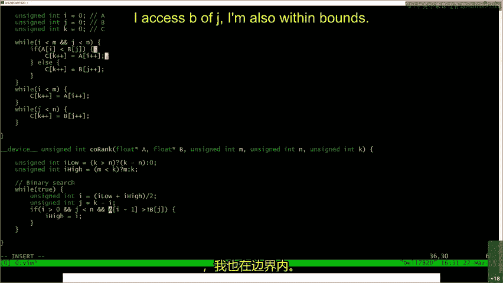

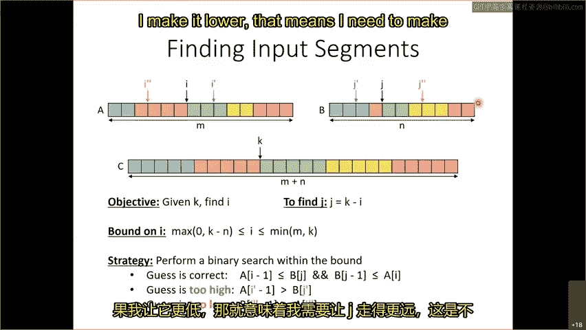

All right， so next this is what happens if my guess is too high， my guess is too high。

 I set a new upper bound Okay， and then my then the next iteration I will find that you guess that is within that bound。

If what if if my guess is not high， now I need to check if my guest is true。

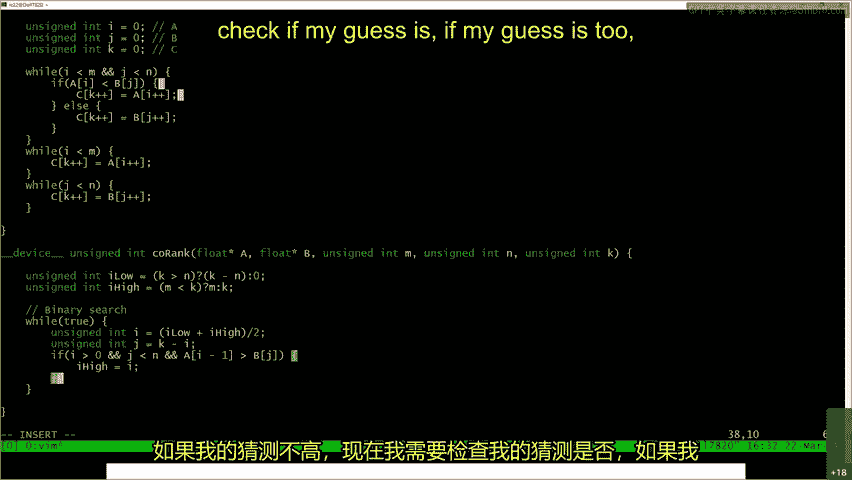

My guess is to the way I check my guess to， I check if b of J minus-1 is greater than I。

 so here I'm going to check L。

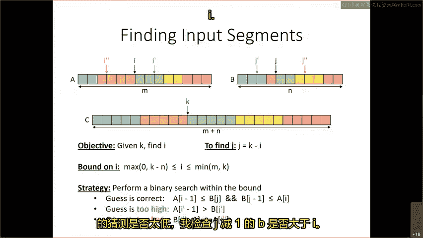

If。B of J -1。

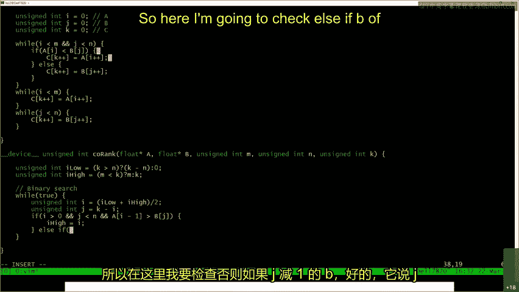

Okay， it says B of is greater than I。 So if b of J minus-1 is greater than a of I。

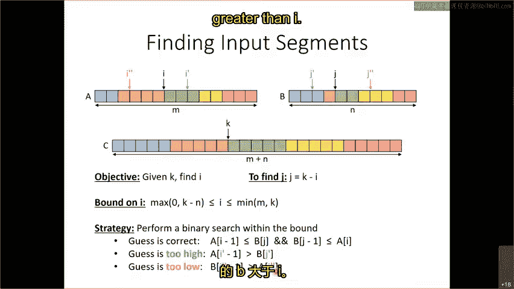

Okay， in this case。What what does that mean It means my guess is too low。 So in this case。

 I found a new lower bound。 So I will say I load is equal to I and similarly。

 when I perform these aes， I need to make sure that I am within bound。 Okay so if J was0。Okay。

 then I need to make sure I'm not accessing not accessing a value that is that is that is out of bounds。

 So here I should check that J is greater than0 to make sure that my access to B of J minus-1 is valid。

 and I also need to check that I is within bounds of a。 so I need to make sure that I is less than M。

So I had I less than M。Okay， so in this case， in this case， this means my guess is too low。Allright。

Clear so far。And then finally， if neither of these succeed。

 if my guess is not too low and my guess is not too high， that means my guess is correct。

 So in this case， my guess is I， so I simply return I。Okay， so this is the colorang function。

 it takes A and B， and their sizes， it takes k， and it finds I that corresponds to this k over here。

Okay， and we simply return Ie。Okay， so having implemented this color rank function。

ops what we still need to do is we need to implement the merge operation itself。 Okay。

 we need to implement the merge operation itself。 Well， the merge operation is not easy。

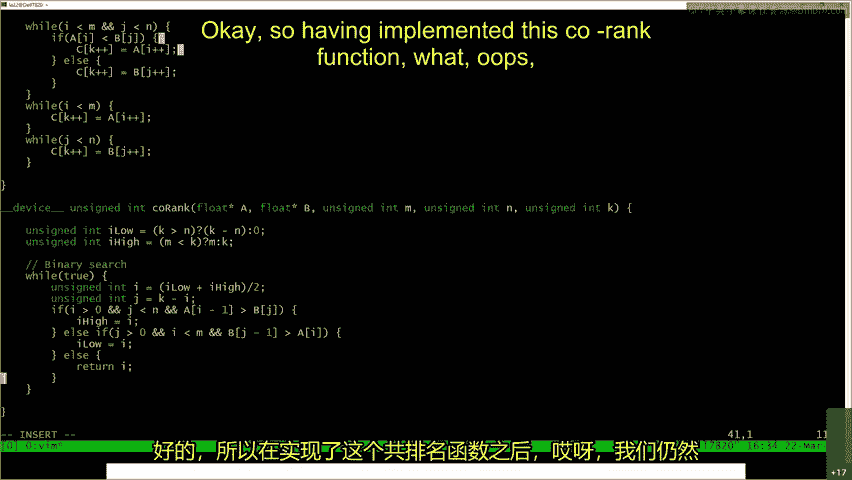

Right， I simply divide my array C。Okay， I find k for each thread。

 I call the colorang function to find I okay， and then I I just do a sequential merge。

 so let's implement so I'm going to come down here。

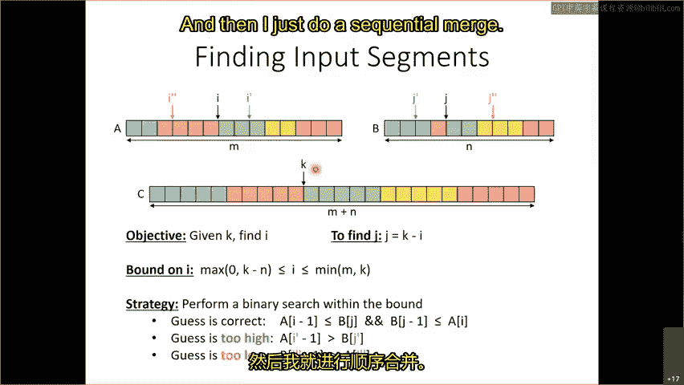

Okay， so here I've already defined I want this many elements per thread。

 I just have six elements per thread for example， Okay。

 I have going have 128 threads per block so the number of elements per block is going to be the number of elements per thread times the number of threads per block obviously and then down here I've done that does the allocation and calls the kernel with the appropriate number of threads per block and then also you know divides the total total size by the number of elements per block noticeice that the number of elements per block is different from the number of threads per block over here okay。

好走。So here in the merge kernel， all we want to do is first we want to identify the K for each script。

How do we do that， Well， we find the threat index。

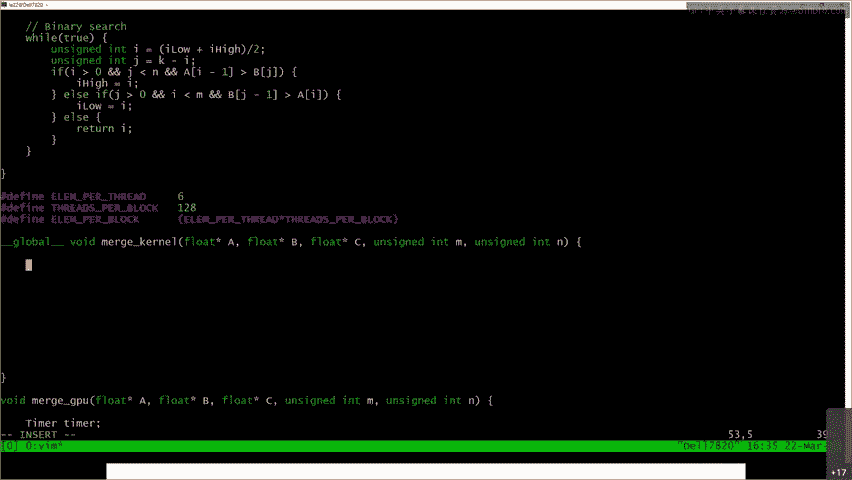

Okay， thread 0 is going be responsible。 if， if K， if the elements for thread to stick， for example。

 then thread 0 is going to be responsible for element 0。

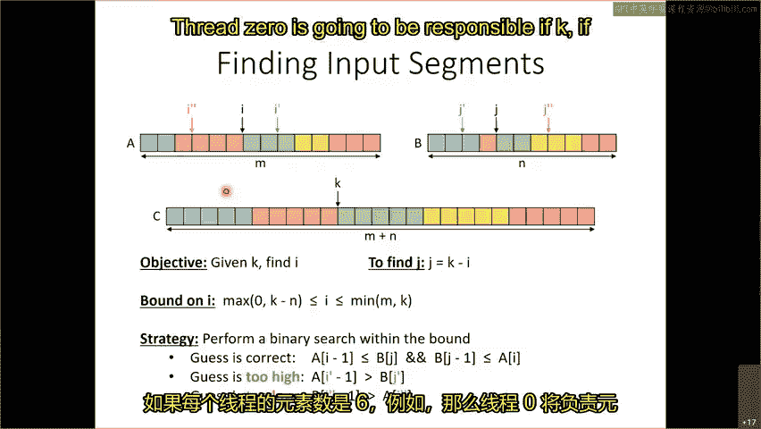

Thread1 is going to be responsible for element6， which is one times 6 threadh2 is going to ir responsible for element12 onwards right so the segment starting element 12。

 thread3 is going to be responsible for the segment starting at element 18 in general。

 thread I is going to be responsible for the element starting at I times 6 or I times the number of elements per。

So， my K。

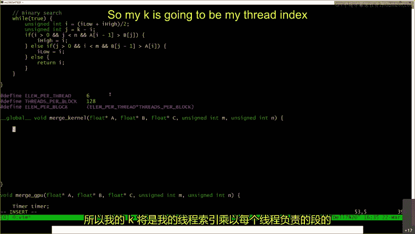

Going to be my thread index times the size of the segment that each thread is responsible for。

 Okay so。

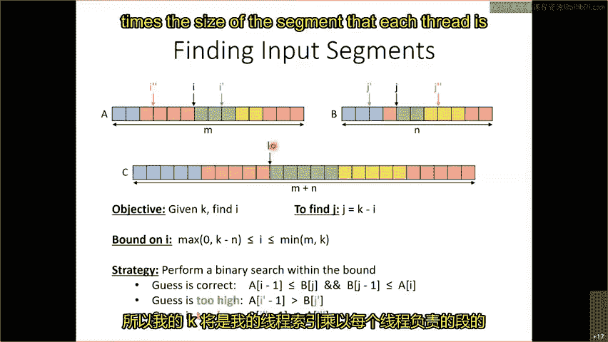

My K is going to be equal to my global threat index， so that's block x。

 x times blockmm do x plus thread index by x。Times。

The number of elements of each thread is responsible。ok。😊，So now we have the case for each thread。

 now we've partitioned our output array such that each thread takes element per thread element。Okay。

 of course we need to make sure that our k is within bounds as usual。

 so here the bounds on C is M plus n， so I need to make sure that。

 you know if I'm in the last thread block， I need to make sure not to do anything that's out of bound。

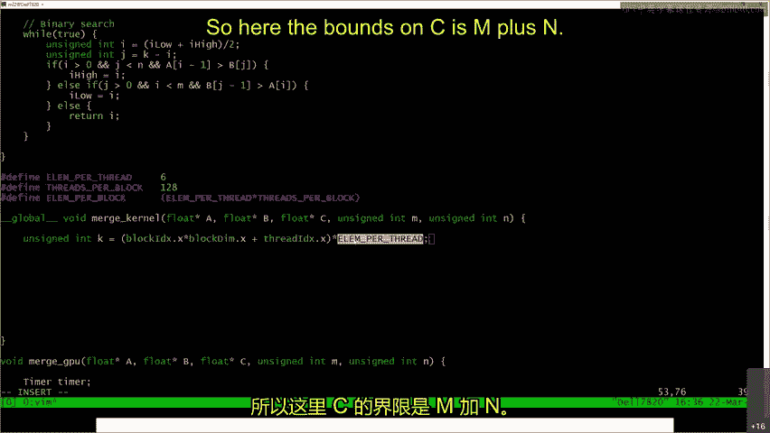

Okay， so I'm gonna have a balance check。

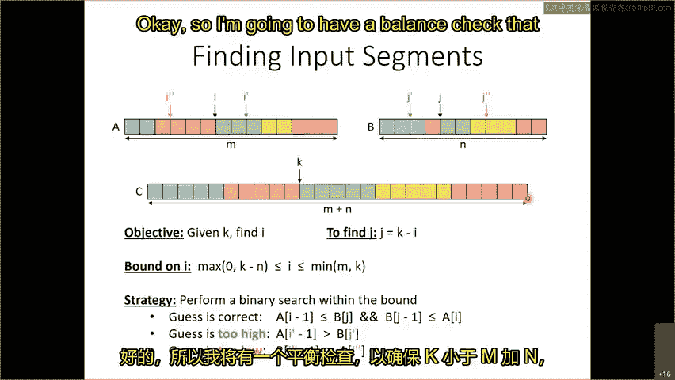

That makes sure that K is less than M plus N。Allright。And then inside of this dance check。

 what do I need to do， what I need to find。

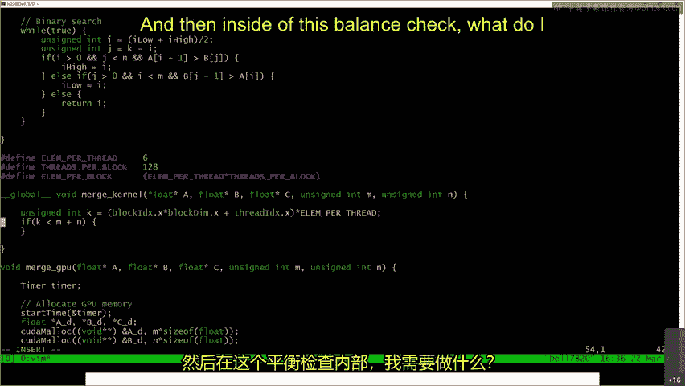

系。And J， and then I'm going to call the co rank。 sorry sorry， then I'm going to call the sequential。

 Okay， so how do I find I and J， Well， I wrote this co rank function up here that finds I and J for me。

 So I'm simply going to call the co rank function。 Let's go back and see。

 So the core rank function is going to take my array A， my array B going to take M and N and K。

 So what I will do is I first want to find the co rank of。

Of K， so I'm going to write I is equal to。Co rank。 Okay， this is a device function。

 So I can call it from inside the kernel。 I when go to the co rank of I'm going to give it a。

And V and N and N and K。 And it's going to do this binary search and give me back I。

 And then how do I find my J， Well simply my J is going to be equal to。诶诶。Minus I。Okay。

 so I'm going to write。Unsigned n J is equal to K minus。ok。Now before I call the sequential merge。

 the sequential merge is also the sequential merge that we implemented expects also one the size of these two input segments。

I need to know what is the size of the I segment， what is the size of the J segment？Okay。

 so how do I find the size of the I segment and the size of the J segment？

I saw to find the beginning， how do I find their sizes？We can't find their sizes。

Let's think about it， the size of I right， is basically is where where the segment for this thread ends。

 which is where the segment for the next thread begins。Similar here， J。

 the end of J is where the segment4 the next thread begins。

So basically the size of where this ends is going to be the co rank。Of where this segment and C N。

 and I know where this segment and C ends because I know K and I know how large the segment is。

So to find the size of each of the input segments， I simply find the co rank。

 as one of you did observe in the chat， we simply find the co rank for the next rep。Okay。

 and we do that like the。

We can， of course， we can do fancy things like check if the next thread has， you know。

 try to talk to the next thread and tell to us our core rank。 Well。

 let's keep the core rank that it found。 But let's keep things simple。

 So what we're gonna do is we're going to first find the K for the next thread。😊。

Okay， so we're going to write unsigned and we're going to call that K next。

 So the K of the next thread is going to be our K。

Plus， the number of elements per threads， okay， plus the number of elements per thread。

However， it could be the case that I at the very end， and this last segment is it is not complete。

 So I need to make sure that K plus number of elements per thread is not as actually not out of bounds。

 It's not greater than m plus N。 Okay， so if K plus the number of elements per thread is within bounds。

 if K plus the number of elements per thread is less than。

N plus N， then。My answer is going to be k plus the number of elements per thread。Okay， otherwise。

 it's going to be M plus。

Okay。😊，So now having found KX， how do I find I next and JX？

simply， I can call， I can find Iex by calling to rank on Kex。 So I'm going to write unsigned and Iex。

Is equal to。The co rank。I give it A。 I give it B。 I give it M。 I give it N。Okay。

 and I give it K next。Alright。😊，How do I find JX having known if I know inX and K next。

 do I simply use the。J is equal to k minus I。So， here I write。Uns and。J next is equal2。A next minus。

Iax。Allright， so now I have the beginning。

And the end of each of the input segments。

And now I can just do a sequential merge。Now， let's go back and look at our sequential merge we implemented。

 So we've already implemented a sequential merge。 It takes two arrays。Well。

 two source arrays and a destination array。And it takes the sizes of the two source arrays。

 and it does a sequential merge Can we reuse this？How can you reuse the sequential ver that I wrote for the CPUU？

You just take M to the。Sorry。We take M to be I next minus I and M to be J next minus J。 right。

 So that's that's that's what we're going to pass to it。

 what I was referring to is I can make this a device function that I can call it from the device。ok。

So I'm going to convert this sequential merge that we originally wrote for the CPU to a device function Okay and you're right。

 we have to use host device if we want to use it on the CPU as well。

 but I'm actually not using this on the CPU I'm just using it on the GP so we can just write device and that should be fine。

😊，Okay， and now I can pass to the merge function to pass the the two input arrays。

 the output array and the sizes of my two input array。

Let's call merge sequential from my thread oops。Sorry about that。

So we're going to come down here our thread and the thread is going to call the sequential merge。

 it needs to give it the beginning of a。Right， so where does what is what is the beginning of the input segment was the it's the address of a。

 it's a plus I， right， So it's the address of a of I。 So give it the address of a of I。

What's the beginning of the B segment Well it's going to be v plus J。

 so it's going to be the beginning of the element v of J， so I'm going to give it the ad of v of J。

ok。😊，What is the beginning of the destination segment， Well it's going to be。

The address of CK is going to be here。 So I'm going to give it the address of。

DF。Okay， now I need to give it the size of my input segment well the size of my input segment is basically I next minus I right so I'm going to give it I next minus I and I need to give it the size of my second segment well that's going to be J next minus J I'm going to give it J。

Next， J。ok。😊，So really， the most difficult part of paralyzing merge was writing the color rank function。

That finds the corresponding corresponding change， the rest of that is simply calling the sequential merge that we already wrote for the C。

Is this clear any questions？Okay， well， then let's compile and run this code and verify that it works。

 I'm going to compile this。Okay， and we will run it。And indeed the code works and as you can see。

 we got quite a bit of speed up compared to the CPU time or you have 13 milliseconds on the CPU 2。

7 milliseconds on the GP。Obviously， this is a， this is a very memory balanced kernel。😊，Okay。

 because all we're doing is loading data from memory and comparing it and storing it to memory。

 we're not doing any floating point operations here。So obviously。

 we don't expect the GPU to be kind of hugely have a huge amount of performance improvement compared to the CPU。

 but this is still a decent amount of performance improvement for some and we haven't even optimized this yet。

Okay now of course， if you include all the copy time， right， the GPU is slower。

 so obviously you're not going to send two elements to the GPU just so that you can merge them。

 but if something is already on the GPU and you want to merge it。

 it's definitely worthwhile doing it on the GPU because the GPU is faster than the CPUU if you don't include the copy time。

All right， is this clear to everyone？Okay， speaking of performance and optimizations。

 let's take a look at how we can optimize this， so this is a parallel merge code that we wrote。

So one thing that I guys have observed is that we have divergence， there's another big problem here。

 which is when we do all this binary search on these arrays。

 so here when I'm doing all this binary search on my global memory arrays and here I'm doing all this binary search and access these arrays。

 why is that bad for performing。😊，Imagine each thread each thread here has a different value and each thread in the block。

 you know one thread is going to have a guess， another thread is going to have a completely different guess somewhere else and they're all going to bounce around inside of our global memory arrays。

Why is that bad。It's not coales。Right， exactly。 our coalescing here is very bad。

So what can we do to improve our memory coalesescence？If I have uncoesced accesses to global memory。

One of the optimizations I can do is I can load the data to shared memory in a coalesced way and then do all the unproloesced access these inside of shared memory。

Okay， and this is what we can do。So here one observations that the memory accesses are not coalesced because during the Co rank function。

 each thread performs a binary search which has random access。

 so binary search has random access and then each thread is accessing a completely different location during that random access so that makes things even worse。

During a sequential merge， each thread looks through its own segment of consecutive element。Okay。

 so when I actually finished the core rank function。

When I finish the coreing function， let me go back here。

 when I finish the coreang function and I'm doing a sequential merge。

 one thread is looping through these， another thread is looping through these。

 another thread is looping through these。😊。

Okay so even after I finish my binary research， which has random access。

 my aes are not coalesced because the threads are looping through different places in my end so what optimization that we can do。

Is load we can find the segment for the entire thread block。

We load the entire block segment to shared memory。And then we load our loads。 And this way。

 the loads from women are coalesced。 So we load the entire block that the thread。

 the thread block owns the shared memory。 and that way the the loads are coalesced。Okay。

 and also if we are only finding the segment for the entire block。

 that means only one of the threads in the block needs to do the co rank function。

 I don't need to do co rank for for all the threads in the block in the global memory。

So I do one core act to find the whole block segment。Okay。

 I load that only one side of the block does the core rank to find the blog's input segment。

 and then I load it from global memorym in a coalest way。

And then each thread will do a co rank inside of shared memory in order for it to find its sub segment that it owns。

 and then it will do the merge in shared memory to provide a result array in shared memory。

 and then we can take this result array and then store it back to global memory in a coal list way。

So here the non coalescque eses will be performed and shared them。

 Let me show you an illustration of what I mean by that。So here。

 if I have many thread blocks rather than each one of these threads finding its segment inside of C and doing to get a binary search in the global memory arrays for A and B。

 what we will do is we will we will only find the co rank for each block。

 so each block is going to have a cave blocks here the first block owns this entire blue segment。

 the second block is going to own this entire yellow segment。

 the third block is going to own this entire green segment。😊。

One of the threads in each block is going to find the core rank for that block segment。😡，Okay。

 and then so here for this middle block， we have this K block over here where we find the I for the block and the J for the block。

 and then what we can do is that the threads inside of the thread block can collaboratively load all of this segment。

And all of this segment， it a shared memory。Okay， so each thread block。

 the threads in each thread block will load the segments for that thread block from global memory to shared memory in a coalesced way。

Okay， and then now that all these threads have collaborated to load a and the a segment and the B segment into shared memory。

 now what can happen is that these threads can each identify what segment within AA and BS they're responsible for and merge those segments。

So here I have an array C of S。So I am going to also put in shared memory。

Each thread is going to have its own be responsible for its own output segment inside of CS。

And then what the thread will do is that it will find the co rank， so here for example I have one。

 two， three， four segments， so this thread over here is responsible for this segment here inside of shared memory so that this has a so what it'll do is it'll find the co rank which is I and then each thread will merge its segment into shared memory so this thread will merge this element and these two elements over here into shared memory to find this segment and then once we are done we will take this entire segment of P ofs and store it in a coalesced way to global memory。

Okay， so to summarize we load the segments of A and B in a coalesed way to shared memory。

 we do all our binary search to find the code rank for each thread inside of shared memory。

 we do the merge which is uncoesced also in shared memory and then we store from shared memory to global memory in a coalesced way Okay is this clear to everyone。

Any questions about this？Professor， we just need to do corean for the next block to to know where the block ends。

 right， Yes， of course， so each block will have to do core rank for itself and for the next block in order for it to to find the the total size of its segment and the sizes of the other segments。

Okay，Okay， so I was actually hoping to implement this code with you in class and run it to show you how much performance benefit it gets。

 it actually does have quite a bit of performance benefit。

 but unfortunately because we lost time at the beginning of class。

 we don't have time to implement this optimization together what I will do is I will simply walk you through the code before we end。

So here this is the parallel merge with using timingling to improve the coalescing here each thread block is going to find we're going to find the K for each thread block。

 this is K block in the previous diagram okay， and we'll do that by multiplying the block index by the number of elements per block。

We also find the for the next block。And then what we want to do is we want to find the co rank for K block and KNe block。

 however， we don't want all the threads to do this， we only want one thread in the block。

So we want one thread in the block to find the Co rank on behalf of all the other threads。

So what we will do is we will declare eye block and inX block inside of shared memory。

 and we will have one thread in this case of thread  zero。

 we'll find the co rank for i blocklock and IX block。Alright， and then after we do that。

 we will sync threads。Yeah of course know there's a whole bunch of optimizations you can make maybe you can have two different threads。

 one of them finds the Co rank for I block， one of them finds the Co rank for inX block right and we' getting into all these other optimizations for the sake of time but we basically find the co rank for iB and inX block and we sync threads this way all the threads wait for threads zero to find the Co rank i blocklock and inX block and puts them in shared memory okay and then after we sync threads each thread is going to also find J block and JX block by simply subtracting I from K。

Now， all the threads have J block， all the threads have the know where the block segment starts。

 So now the threads can collaborate with each other to load the A segment。ok。😊。

So here every thread here I equals3 by x， and we skip by block LinuxX every time。

 so the threads collaborate with each other to load the A segment。Inter shared memory。Okay。

 and then we're going to use the same array rather than declaring two elements。

 two arrays and shared memory， right， We're going to use the same the same array wherever。

Because we know that the total number of elements in both A and B is going to be the number of elements per block。

 so rather than creating two arrays with that upper bound。

 we can create one and wherever a of s ends we're going to have B of S begin so here the number of element M block is going to be the number of elements in the A segment and then the B segment is going to start after the segment and then we're going to continue by loading the segment of B in a coalesced manner and putting that in shared memory。

OkaySo now we have the A segment and the B input input segment inside of shared memory。

Of course we sync threads to make sure that all threads are downloading a segment to shared memory before we end and of course notice how here these Xs are coalesed because here you know thread and I varies with thread and X do X and that's over wereusing biB is constant for all the threads in the block same thing over here。

Okay， after we do that， what we do is we declare another array shared memory that's for C， okay。

 every thread is going to determine its segment within this array。

And then every thread is going to find the core rank of its segment within the array and it's going to do a sequential merge。

And then after we're done， now we have our merge arrays at C of S。

 what we will do is we will write out the result from shared memory to global memory DNA aCO estimate。

Okay， so this is the code， again， I apologize that we don't have enough time to implement it together and test it out because of the time that we lost at the beginning of the lecture。

Any questions？Okay， well， if there are no questions。

 then you can read more about what we covered today in Cha 11 of the textbook and that is all for today and I'll see you next time。

Bye， everyone。

