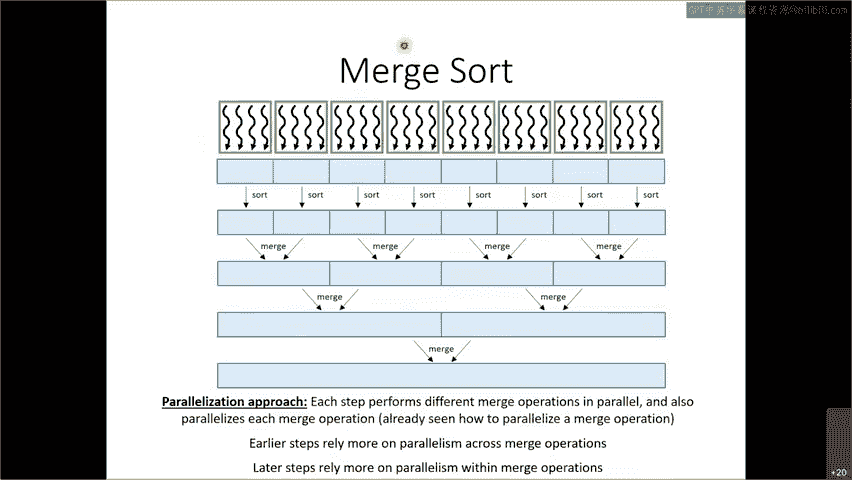

# 美国贝鲁特大学《GPU计算｜CMPS 297S396AA - GPU Computing - Spring 2021》（豆包翻译 - P15：-15-Lecture 15 - Sort.zh_en - GPT中英字幕课程资源 - BV1bw4m1k7a1

Hello everyone and welcome to Le 15 of GPU computinguting today we're going to be talking about sorting。

Last time we spoke about a one parallel pattern， which was merge。

 and we said that an ordered merge is an operation where we take two ordered lifts。

And we combine them into a single ordered list， and we said that in order for us to paralyze this operation。

 one way to do it is to divide the output list that we are about to generate into equal segments and give each thread one of these segments。

And then each of these thread needs to find the corresponding input segments in the two input matrices A and input arrays A and B and and and emerge those two input segments sequentially and we think that the key challenge in doing this parallel emerge is basically how does each thread find the。

The corresponding input segments in A And B。 Now to to do that， what we said is， you know。

 given an index K that points to an element in C or the beginning of a segment in C， the key。

 the key challenge is， how do we find I and J that points to the corresponding elements in A and。

The corn segments in A and B and we call these the co ranks So we said that I here is the core rank of k and same thing J is the core rank of K in the array B and we observed that j is simply K minus I so the real trans was just finding I and what we did is we set a bound on I and then we all and then we said that given this bound。

 we do a binary search in this bound and we determined the condition。For when our guess is correct。

 when our guess is too high and when our guess is too low and these conditions were based on the observation that the element before I and A should be less than the element after J in B。

 and similarly the element before J and B should be less than the element after I inside of a。😊。

And then so basically each thread that takes a segment will do a binary search to figure out I and then correspondingly find J and then just does a sequential merge of the two input segments into the output segment。

The memory aes for this operation were not coalesced because when we do a binary search。

 we're doing a random access into our array so we're not gonna to have coalescing but also after we do the binary search and identify the co rank when we come to do the sequential merge each thread is merging a different input segment in the input array so the aes during this merge are also not coalesced so to do that the optimization that we did is to figure out the blocks the segment for the entire block by one of the threads in the block and then the threads in the block will collaborate to load that segment into shared memory in a coalesed way and then we do the binary searches of all the different threads inside of shared memory and then we do the merge of each thread inside of shared memory and then we store the merged array from shared memory to global memory also in a coalesed way and that look like this So here one of the threads in the center block will determine I block and J block。

It corresponds to the K block segment and then the threads will collaborate to load the i block and the J block segments to shared memory here A and BS。

 and then each thread will find its own each thread will determine its own output segment and figure out the the corex in the input segments inside of shared memory So here one thread will find the I J to correspond to its K using a binary search and then this thread will do the sequential merge inside of shared memory and then when all the threads are done merging inside of shared memory we go back and we store we store from C to see at K block in a coalesced manner So this is the optimization that we did in order for us to have coalesced memory aes we loaded in a coalesccent manner to shared memory did the uncoesced aes inside of shared memory and then stored in a coalesced manner back to global memory final thing I forgot talk about last time is thread coing So what is the price that we pay。

To paralyze merge in this case。 Well， the price that we pay to paralyze merge is that every thread。

Needs to do its own binary search。 So the more threads we have， right。

 the more binary search operations we're doing。 So the advantage of coing is we have fewer binary searches。

 And in fact， we already applied thread coing by assigning multiple output elements to each thread。

 So in our in our previous merge。 we were already assigning multiple output elements to each thread。

 We could have paralyzed it in a way where every output array received once every thread every output element was assigned to one thread。

 and then every we do a binary search for every single output element。

 But what we did instead is we we actually assigned every thread to a segment of the output。

 and so we've already applied thread coing by assigning multiple output elements to each thread。

 Now we could have assigned a single output element to each per thread like I said， in this case。

 the output segment would have had length one。 The reason we didn't do that is this would have been slightly less intuitive to。

😊，It was easier it's easier to explain merging you know multiple segments than than merging two segments where the output has size one so this is far the reason why we explained it with coalescing already applied and another reason is that we did have a shortage of time in the last lecture。

So again， the price of parallellyization here is the cost of performing binary search so by not assigning each thread to a single output element。

 but assigning each thread to multiple output elements per then what we do is we amortize the cost of binary search over larger input segment Okay so this was a kind of a quick overview what we covered last time and today we're going to start talking about we're going to talk about sorting and we're going to look at two sort algorithms we'll spend most of the time talking about Radix sort and then we'll talk a little bit about merge sort before I begin talking about sort Does anybody have any questions about what we covered last time before I move on talking about sort。

😊，Okay， well， if there are no questions， then let's begin talking about sorting。

So we'll start with Radix sort and like I said， we're going to spend most of the time looking at Radix sort and it'll look a little bit at merge sort towards the end。

 So what is Radix sort。Radix sort is a sorting algorithm where the way it works is we distribute the keys that we're sorting into buckets based on a radix or a base。

 So if the input is represented the input keys are represented in some base in a positional numer system。

 then we use that base and we iterate over the digits and every iteration。

 we distribute the keys into buckets based on the radix。😊。

Disttributing the keys into the buckets is repeated for each digit in the key and one important thing is that for every iteration。

 we should preserve the order from the previous iteration within each bucket。

 So this is important and I'll show you why this is important and usually when we do our radix sort in computers we like to use a radix that is a power of two because that simplifies processing binary numbers right because we're iterating over the digits in the key So it's easy to slice the key into multiple digits where the digits are are our slices of a binary number and that's why we like to use powers of two So each iteration is going to handle a fixed slice of bits from the key。

 Now to keep things simple and for the ease of illustration。

 we're going to start by looking at a radix of two。😊，Okay， in other words。

 we're going to start looking looking at the case where our radix is one bit and then we're going to extend this later on in the lecture。

 Okay， so we'll start by demonstrating rad sort using one bit1 bit raix and then we'll extend it。😊。

Okay， so let's get started。 So if I have this array over here。

And what I would like to do is I would like to sort this array。

Then what we would need to do is we would need to divide this array into bits and iterate over the bits one bit at a time because we're using a one bit radix okay and every iteration what we will do is we will divide our inputs into buckets based our based on our radix so somebody is asking isn't Radix sort a noncompison- based algorithm。

 yes， so Radix sort is a noncompison based algorithm as we will see and that's why we're going to cover merge sort and radix sort。

 merge sort is comparison based and a radix sort is non-compison based。😊。

Somebody is also asking if these elements need to have a fixed size so yes usually if we're sorting。

 we're going to assume that our key needs to have a fixed size so that we can divide it into digits so if we're sorting 32 bit integers then that size of our integers is obviously going to be 32 bits in general if our keys don't fall into this category then we would need a comparison based sort and that's why we're going to look at comparison based sorts we're going to look at merge sort towards the end so yes we will look at comparison based sorts but we're starting by looking at radix sort which is an non-comp based sort so thank you for that question。

😊，Okay， so what we said is the way Ra sort works is we're going to start by looking at one of the bits。

 we're going to look at the least significant bit Okay， and the least significant bit of each number。

 you know some of them are going to be zero and some of them are going to be one。😊。

So what we're going do is we are going to separate our keys。

 so these are our keys and we're going separate our keys into two buckets based on the first bit or the least significant fit so we're going to put all the zeros together and all the ones together Okay so we're going to do this we're going to put all the zeros here at the beginning and then we're going to put all the ones after all of the zeros and after we do this now what we have is we have the array is sorted by only the least significant fit。

😊，Okay， and now what we're going to do is we're going to repeat this process。

 but every time we're going to look at a different bit and we're going to go from the least significant bit to the most significant bit。

 So on the next iteration we're going to look at the second bit and next what we're going to do is we're going separate the keys based on the second bit。

 So now second bit we have some of them are zeros and some of them are ones So we will do is we're going to put all the elements whose second bit is zero together and then we're going to put all the elements whose second bit is one together。

😊，Okay， and one important thing over here is that when we are separating when we are separating the elements whose second bit is0 from the elements whose second bit is one。

 we are maintaining the the original order within each bucket。

 So the order of the elements inside of this bucket is the same as the order of the element in the original array。

 meaning that this first element that had a second digit as0 came first here。

 the second element who had the second digit bit being0 came second。

 the third element with the second bit being0 came third right we can't take this element and put it here and then take this element and put it before it。

 And the reason is that if we did that we would mess up the order that we got from the previous iteration So the previous iteration sorted the array by the first bit。

 now the second iteration sorts the array by the second bit while preserving the order from the first iteration and what that does。

😊，So preserving the order from the pre iteration within each bucket。

 what that does is that it ensures that the keys are now sorted by the lower two bits。Okay。

 so now if you look， our keys are sorted by lower two bits。 So we have 00，0，0，0，0，00。

 And then when we're done with the00s， we're gonna have0，1，0，1，0，1，0，1。 when we're done with the 01。

 we're gonna have 10，1，0，1，0，1，0。 and then when we're done with the 10s， we have 1，1，1，1，1，1，1，1。

 So by preserving the order now we have an array that is sorted by the lower2 bits。 Okay。

 and then we do the same thing on the next step。 So on the next step。

 we're gonna look at the third digit now， So the third digit。

 we have some of them are ones and some of them are0s。

 So we're gonna do is we're gonna separate the keys based on the third bit。

 So we're gonna put the elements whose third bit is0 here and we're gonna put the elements。

 the third bit is one over here。 And again， we're gonna preserve the order。

 So now if you look our elements are sorted by the lower 3 bits。 So here we have 0，0，0，0，0，0。

 then we have 0，0，1。😊，0，0，1。 then we have the0，10s together， then the0，1 ones together， then the1，0。

0s together。 the101s together， et ceter。 Okay， so the keys are now sorted by the lower three bits。

 And the last step is to sort them by the last bit。 So now we look at the most significant bit。

 the fourth bit。 And what we do is we separate the elements based on the fourth bit。

 So we put all the elements。 we separate the keys based on the last bit。

 So we put all the elements whose last bit is0 together and then all the elements whose last bit is one together。

 and now we have a sort and array。 So this is how raix sort works。 Okay。

 I assume that a lot of you have covered rad sort in a previous course on algorithms。

 But this was just to refresh your memory on how raix sort works。 next。

 we're gonna talk about how to do it in parallel。 But before I get into that。

 does anybody have any questions about radix sort。😊。

So somebodys saying how do you preserve the order without comparing So right now I'm not talking about how we do this。

 I'm I'm about to talk about this， but the key， the point is that what we would like to do is on every iteration we would like to separate the elements based on the bit that we're interested in such that we have all the zeros together followed by all the ones while preserving the order。

 This is what we need to do how we will do that is something that I will discuss next Okay。

 but is what we need to do clear to everyone。😊，Okay， so then the question is。

 which you guys have already asked in the chat， how do we separate the keys based on one of the bits？

And， of course， while preserving the order。 Okay， how， you know。

 I can do this in multiple iterations。 So really， the most important question is。

 how do I take this input array and separate all the elements whose bit I'm interested in is 0 put them to the left and then put all the bits all the elements whose bits are one to the right。

 Okay， I'm gonna zoom in on this。 And what I want to do is my problem now。

 I've reduced it to taking an array and separating the elements whose bits are0 to the left and and the elements whose bits are one。

 putting them also together on the right。 And again， while preserving the order。 Okay。

 now how to do it， the key question here， how to separate the key is is how do I find the destination index of each element。

 Okay， for each element， I want to take it from the original array。😊。

put it somewhere in the new array， thesorted array， right， I want to take this element at position 0。

 I want to put it in position 0。 I want to take the element of position 2， put it in position 1。

 I want to take the element at position 1 and put put it in this position。

 I think this is position 8。 Okay， so for each one of these elements。

 what I need to do is I need to find where what its destination index is in the sorted array。 Okay。

 so the real question is， how do I find the destination index of each element in my input array。😊，ok。

Well， let's， let's think about this。 Let's， let's take a look at how we can do this。

So the destination， let's first look at our zeroes， the destination of our zeroes。😡。

Is going to be the number of zeros to my left right so here the first zero。

 the destination of this first zero is going to be zero because there are no zeros to its left。😡。

The destination of the second0 is going to be one because there is only one0 to its left。

The destination of this third zero， well， this one is going to go to the third position in the destination array because there are two zeros to the left right。

 so this is going to go on position zero， this goes in position one。

 this goes in position two because we have two zeros before it。

 this goes in position  three because we have three zeros before it， etc。😊，Okay。😊，It's a scan。

Well we'll get to that， yes， so as you observe you can see where we're heading。

 we're heading towards scan exactly。Okay， but let's formulate it a little bit first and then we'll see how we can use scan to accomplish this。

So the destination of a zero is the number of zeros to the left of the zero。Now。

 the number of zeros to the left of the0。Is also the number of elements to the left of the0 minus the number of ones to the left of the0。

Right。Because the elements I get to my left are either going to be zeros or ones。😡。

So the number of zeros to my left is the total number of elements to my left。

 minus the number of ones to my left。Okay， so， for example， this0 over here is in position， you know。

0，1，2，3，4，5。 So this 0 is in position 5。 So this0 has five elements to its left。Okay。

 I can say that the position of this zero is2 because it has two zeros to its left。

 or another way to figure out that this element has two zeros to its left is to count the number of ones to its left。

 which is one，2，3 and since I know that this element is in position5 I know there's five elements to its left so I do five elements minus three ones that gives me20。

ok。😊，So the number of zeros to the left is the number of elements to the left。

 minus the number of ones to the left。And the number of elements to the left is just the element of the index of the element。

 right， This element that is at index 0 and it has zero elements to Islam。

 This element is at index 1。 It has one element to Islam。 This element at index 2。

 It has two elements to Islam。 Okay， so the number of elements to the left is basically the index of the element。

😊，So basically， the destination of a zero is going to be the index of the element。

Mineus the number of ones to the left of the element。That's going to be the destination of the zero。

Okay， clear。Questions。Okay， now let's look at the destination of the ones。

 So the destination of a one is going to be the number of zeros in total。Plus。

 the number of ones to the left。 So， for example， if look at this one over here。

 where is this one going to go， Well this one is going to go after all of the zeroes。

What about this one， This one is going to go after all of the zeros and this one over here。

 So the destination of this one is the total number of zeros because we're going to put all the zeros first and then we're going to put this one and then we're going to put this one。

 So this one is going to be the position of this one is going to be the total number of zeros in the whole array okay plus the number of ones to the left which in this case is one where this elements is going to be the total number of zeros plus the number of ones to the left which in this case is two So I'm going to put all the zeros and I'm going to put these two ones and then I'm going to put this element。

😊，Okay， so by doing this， by finding the total number of zeros in total plus the number of ones to the left。

 this is what helps me preserve the order。😡，Same thing here by the way。

 when I do I count the number of zeros to my left， this helps me make sure that I stay in the right order and I don't interfere with the zeros to my left and know go behind them。

Okay， so the destination number one is the number of zeros in total plus the number of ones to the left。

Now， the number of zeros in total in the whole array is going to be the number of elements in the whole array minus the number of ones in the whole array。

 Okay， so the number of zeros in total is going to be the number of elements in total。

Minus the number of ones in total。ok。😊，And then the number of elements in total is basically the size of the input array。

 which I should have。And the number of ones in total is basically the number of ones to the left of the ask element。

Okay， the number of ones to the left of the last element。Okay， well。

 not necessarily say if last element was zero， it's going to be the kind of the total number of ones。

 So， sos so but but the point is that by figuring out the total number of ones to the left of each element。

 I can figure out the number of ones in total。Okay。

 so then the destination of a one is the input size minus the number of ones in total plus the number of ones to the left。

So here what I've done is I've。define the destination of a0 in terms of the index of the destination of a zero element in terms of the index of the element。

 which I trivially have and the number of ones to the left of an element。

 and I've defined the destination index of one in terms of the input size。

 which I trivially have and the number of ones to the left of an element and the number of ones in total。

 which I automatically get when I find the number of ones to the left of each element Okay so really the remaining problem here is to just find the number of ones to the left of each of the element inside of this array。

 If I can find the number of ones to the left of each element inside of this array。

 I can then easily the destination of each zero element in the array and the destination of the one element in the array。

😊，ok。😊，So if I want to find the number of ones to the left of each element in the array。

 what pattern have we seen before that allows us to do that， Some has already said it。

An inexclusive scam。Right， an exclusive scan。 exactly。 So if I want to find。

 if I want just count how many ones are to my left。

 I can simply do an exclusive scan that does this count for me。 So I will use an exclusive scan。Okay。

 and by the way， we're not going to write code in today's lecture just because most of what we're going to be doing is based on patterns that we've already seen before and that we've already implemented before now implementing sort is basically putting together a bunch of the previous patterns that we've seen so that is why I'm not going to be implementing any code just for the sake of time for today's lecture。

 but we're going to be basing it on patterns that we already saw and we already know how to implement。

Okay， professor。Yes。😊，Since since were putting things in a bin two bins isn't it a bit similar to the histogram so we can paralyze it maybe this no it's different in histogram we're not putting things in bins we're counting things so in histogram each bin just is counting how many elements fall into that bin over here we're not we're not counting we're actually moving things around and placing them physically inside of a location。

So we need to calculate the location that we need to place on。Okay， thank you。 Yeah， you're welcome。

 So we're not， we're not just counting elements。 We're actually placing elements physically inside of different buckets。

Okay， so then now we， so now basically what we need to do is we have to figure out the number of ones to the left。

 Once we have the number of ones to the left of each element。

 we we can find the destination of our zeros and the destination of our ones。let's do this。

So here I have my， my array。 Okay， I have the bit that I'm interested in in each here。 in this case。

 it's the first bit， but this could be the second bit。 It could be the third bit。

 It could be the first bit， et cetera。 The first step is basically to extract the bit that I'm interested in。

😊，Okay， so for this zero， I'm just going to have a zero for the ones and I'm just going to have a one to just to have an array of zeros and ones。

Now， this array is going to tell me if something is a one or not。Now。

 if I want to calculate that for each element， the number of ones to the left， what do I do？Well。

 simply， I'm going to do an exclusive scan on this array。 If I do an exclusive scan on this array。

 what now I what now I have is the number of ones to the left of each element in this array right over here for this element。

 This one has one to its left。 How do I do that。 How do I figure that out。 Why I simply add 0 and 1。

😊，Okay， and that tells me that this element has a total number of has1，1 to its left。

This element has one，2，3 ones to its left。 How do I know that， Well。

 if I simply add all the all the zeros and ones before it， I have one plus one plus one that's 3。

 Okay， so I figure out that this element has three ones to its left。Okay， et。Okay。

 so I extract a bit， I do an exclusive scan and this exclusive scan tells me the number of ones to the left of each element。

And then once I've done that， what do I do Well I simply apply the I use the expressions I derived earlier to find the destination of each zero element and the destination of each one element。

 the destination of each0 is going to be the element index minus the ones to the left。

 So for example， this zero element is going to be that the index of this element， which is 5 right，0。

1，2，3，4，5 minus the number of ones to the left， which is3。

 So that's how I find out that the destination of this element is2。Okay。

 thing same thing for all the other zero elements。As for the ones。

 the destination of the one is going to be the input size minus the total number of ones plus the number of ones to the left。

So for example， this element over here。Okay， we know that this element has two ones to the left，1，2。

 And we also got that from the exclusive scan。Well。

 my total input size is 16 in this case and the total number ones I have in the whole array is 8 right。

 I got that from the end result of the exclusive scan。 Okay， so 16 minus-8 is 8。

 that means I have 8 zeros， and then I simply add two to8 to figure out that this element should go at position 10。

😊，Why 10， because I have 8 zeros that need to go before this element。

 and then I have two ones that need to go before this element。 So 8 plus 2 is 10。All right。

 Is it clear how I found the destination of each element using exclusive scan。

 Any questions about this？Doctor， the partial sum of， know， the number of one， total number of ones。

 it can be 9 here。 you know， And if the last element was one said I since it's the exclusive scan。

 I would need the partial sum， right， Not the last。 What you saying is I what you saying is。

 I will also need the total sum。After I do an exclusive scan， right So if this was a one over here。

 then I would have a9。 So if you remember when we did the exclusive scan。

 we actually had the total sum。 We found it。 we put it aside because because we we were not we were not going to use it immediately。

😊，Okay， so yes， we do need the total sum。 and when we do the exclusive scan。

 we are going to find the total sum and we're going to remember it so that we can use it。

 You're absolutely right。😊，Okay， so the only point that I'm making is that I don't need to do a separate operation to find the total number of ones by simply doing the exclusive scan。

 I can find the total number of ones on my way。Okay。😊，Clear。Right， great。

 so then once I find the destination of each input if each input element。

 then simply what I do is I take each of these input elements and store it。😊。

In the a array at its corresponding destination。 So this element， I found that its destination is 0。

 so I take it。 I store it at point position 0 For this element。 I found the destination is 8。

 So I take it and I store it at position 8。 For this element， I found the position destination is 12。

 So I take it I put it at position 12 For this element。 I found that the destination is 5。

 So I take it and I store it at position 5。😊，Professor， can you repeat how we got the destination at。

Yes， can I repeat how okay， do you mean can I repeat how I how I derive these expressions or do you want to repeat how should I repeat how I didn't be extracted with an exclusive scan No。

 just just that step， I understand how we got number of ones to the left。

I just I didn't make the connection between those do you understand how we got so these are these are the two expressions that we used to get this array right we checked understand。

We apply the first expression if this is a one， we apply the second expression。

 so as your question how do I arrive at these expressions？No how we got the destinationary。

Is we just apply the expressions Yeah， we just apply the expression so if something I have if I know if something' is a zero or a one。

 if it's a zero， I apply this expression， if it's a one， I apply this expression。Proor。

 can we repeat how we derive the second expression， the the destination of the one。Yes。

 let's let's so you want me to repeat how we how we arrived at this expression for the destination of a one。

 let me repeat that。Once second， let me go to the slide that I want。Okay。

 so we said that the destination of a one is the number of zeros in total。Plus。

 the number of ones to the left is this part clear。Yes its okay。

The number of zeros in total is the number of elements in total minus the number of ones in total。

 is that quite clear。要。Okay， and then the number of elements in total is basically the size of my input。

Okay， and then then that's。The sizes of my input， minus the number of ones in total。

 plus the number of ones in the。어 그。And we just A so we can get the destination。Yeah。ok。😊，Thank。

 thank you。So that's how we arrive at the second expression and you know once we have the destination。

 we can simply store the element at the destination that we care about。Okay， by the way。

 this may not necessarily be the best thing the best approach at doing it sequentially。 So Im。

 but I'm explaining an approach to doing Raic sort。 And then we will talk about how to paralyze this。

Okay， so yeah， so somebody's asking about about shared memory and global memory all these things。

 So let's let's hold on， you know I'm not talking about paralyzing andm just talking about a logical approach to doing this。

 and actually next step I'm going to talk about paralyzing so so that brings me to my next step So how do we paralyze this。

😊，Well， extracting the bit is quite so simple， right， we know how to do parallellyze scan。 here。

 we're just applying an expression to each element in an array。

 So we know how to paralyze each of these individual steps。 Okay， so to paralyze this。

 what we can do is we can simply assign one thread to each element in our input array。Okay。

 and we already know how to paralyze scan and the rest is just as trivial。

So we assign a thread to each element in our input array。

 each of these threads will extract 0 or1 for the element that it is responsible for the threads will collaborate to perform an exclusive scan we've seen how to do that and then each thread will find you know the destination index of its element based on whether its element is a zero or a1 and then once each thread finds the destination of the element that it is responsible for the thread takes that element and stores it in the destination array。

Okay。😊，Is it clear how we paralyzeize it？Pple enough。Yes， but professor， I had a question。 Yes。

 on on on this， since we're using only one bit of。Like with the comparators。

 are we using 32 bit comparators to compare one bit。So we're not doing any comparison here， right？

No but I to add， I mean， not yeah， we're not doing comparisons。

 but like to add zero and one to do the exclusive scan。We will be using like。

I seeSo you can use a bit wise and operation to extract the one bit that we care about。Okay。

 then based on that bitwise n， if you're get a 0 or a1。

 you would stores0 or1 as an integer here so that when you do the scan。

 you actually you're going to need to sum these。No， I see。 Okay， and the end is just for one bit。

Yeah， so you can extract if you have a 32 bit number， for example。

 and you want to extract one bit in that 32 bit number， you can do that using a bitwise M。Right。

 but that will， that won't that be a 32 B gate where like we use a 0，0，0，1 as in like I mean， how。

 how the hardware does it is is kind of a is a different issue， right？ But， yes。

 there will be an AO U in the hardware that's going to do a bit wise a bit wise and operation。Right。

I see。 But it's not like the number is trimmed to be 1 bit it's still 32 B。

 but we're just extracting by using and by doing an end， right， Yes， yes。

 So the number is 32 B integer or it could be a 64 bit integer。

 It could be a 16 bit inger and 8 bit integer， right， maybe we're sorting characters。 Okay。

 so this could be any any number of bits。Okay， but we're going through it one bit at a time， Okay。

 so in each it we going to use a bitwise n to extract the specific bit that we care about。I see。

 Okay， thank you。 Yeah， yeah， youre welcome。Okay， so now we've we know how to paralyze red sort。

 Okay， so as we've been doing all previous lectures， once we learn how to paralyze something。

 the next step is to observe what is not efficient about what we're doing here and how can we optimize it。

So what's not efficient about what we've done so far？So extracting the bit。

 that's embarrassingly parallel， right， Every thread is doing its own operation without。

 without affecting any other thread is a local operation。

Scan we already looked at how how to optimize scan and then given a number。

 you're just calculating what it's a0， whether it's a one， so that's straightforward。

 but then you have to take these values and you have to store them into the destination array。Okay。

 so I guess my input here is is in global memory right and my output is also going to be some global memory array right so what is what is going to be inefficient in this entire procedure。

The stories are not coalesced。Right， exactly。 the stores are not coalescce。

 So after all these threads finished doing all this stuff。

 we're going to have this stage where all the store。

 all the threads now are trying to store to arbitrary locations in the destination array。

 And just to emphasize that， if we look at this first thread block over here。 Again， obviously。

 thread blocks are larger than four threads。 We're going to have maybe 1024 threads。 And， you know。

 a warp is 32 threads， but we're just have know， four threads for simplicity here。 Okay。

 you'll notice that this first thread is storing to this location here。😊，But then the second thread。

 which is most likely going to be in the same warp， is storing all the way over here。

And then this third thread comes back and stores over here。

 and then this fourth thread comes and stores all the way over here。 Okay。

 so our our accesses are our stores are not coalesced。 You know。

 each the adjacent threads are going to very distant locations in global memory。Allright。

So the challenge here is that the stores are not coalesced because nearby threads rise to distant locations and global memory。

So having observed this， what can we do to optimize coalesccing？

Make threads responsible for output elements instead of input。

So we're going to make threads responsible for output elements。

 but that's a little bit difficult right because if you make a thread responsible for an output element。

 how is the thread going to go and find the input element that it's responsible for？

That's quite challenging。Yes， I'm just getting idea。No， it's， it's a， it's a。

That's a worthy idea Thank you for suggesting if in birthday。

 but that will require an uncoesed access anyway。Right。

 so somebody is saying what we can do is we can。Sot locally in shared memory and then write each bucket to global memory in a coalesced manner。

 So if look at over here， these threads that are in this block。

 even though their aes are not coalesced， they're all over the place。

 If you look at the total amount of global memory locations that this entire thread block is writing to。

 youll notice that we have， we have two kind of distinct location。

 we have the zeros that are being written to the zero bucket。

 and we have the ones that are being written to the one bucket。Okay， so as one of you suggested。

 what we can do is rather than writing out these zeros and ones in an uncoesesly global memory。

 we can separate the zeros and ones locally in shared memory。

 and then we can write the zeros altogether together from shared memory to global memory and the ones altogether from shared memory to global memory。

😊，Okay， so this is what we can do to improve the coalescent。Okay。

 so let's see what this would look like。 So what we will do is we're going to start by sorting locally。

 So the threads in this block， right， they will take their elements and they will split them inside of shared memory。

😊，Okay， and all the other thread locks will do the same。

 each thread log will have its own shared memory array that it will use to split the threads。

Sometimes just split the elements。And now that I' have done this with within each thread block。

 within the shared memory of that each block is accessing my my zeros are not together and my ones are now together here。

 my zeros are together， my ones are together here， my zeros are together， my ones are together。

 my zeros are together， my ones are together。So now that we've done this。

 the next question is now each thread lock wants to come and take its zeros and put them in global memory and take its ones and put them in global memory。

Okay， by the way， there's another benefit of doing this because well yeah。

 the main benefit is that we are separating the zeros and ones or we're doing our uncoesed ases to shared memory。

 Also here， we're just doing a scan locally now and in order for us to do the separation right remember。

 because if we us to do the separation， we need to do a scan So now the scan right is being done locally within the thread block Okay。

 but we will need another scan to be done globally， but it's going to have fewer elements。😊，Okay。

 so now each thread block is going to do a scan to do the separation locally。Now。

 each thread block needs to know where it needs to write each bucket。

 So each the question now remains， where should each block write each bucket。 Well。

 let's take a look。 This first block over here。 It has two zeros and it has two ones。

The second block also has two zeros and two ones。 The third block has1，0 and  three ones。

 This one has three zeros and one one。 So every block is going to have a different number of zeros and ones。

Now， this first block needs to put its two zeros in the beginning at position 0。And。

Blog needs to put its zeros square at position2 because there are two zeros before。

This block needs to put its zero at position 4 because it has two blocks over here。

 two zeros here and two zeros in this block。This block needs to put its zeros at position5 because it has two zeros here。

 two zeros here and one zero here， so it needs to put its result after that。

So what do I do to figure out where each thread block needs to put at zeros， same thing for its one。

So how did I know that this thread block needs to put its zeros at position4。

 I counted the number of zeros in the previous two block。

Can we create a global variable to count at which position we are right now。

 I know how many positions after a certain block we need to put it at。Is one global variable enough。

 How will one global variable help you help you do that or or two， I'm not sure。

So we will have to put scan again what is the operation， we'll talk about how we can do it。

 what's the operation that we need to do。Can we just do scan again。

 but with these numbers instead of。0 and one。Right so what we will do is now we need to do us another scan。

But this time the scan is over these numbers over here。For this block。

 we need to count the number of four zeros in the previous two blocks。 For this block。

 we need to count the number of zeros in the previous three blocks。 Okay， for the ones。

 like for this one over here， I need to count the total number of zeros。

 So this and this and this and this。So in order for me to know where I put these ones。For these ones。

 I need to find the total number of zeros so this and this and this and this。

 and I need to find the total number of ones in the previous。Okay， et cetera。

 So what we can do is we can take these numbers， We can store them in global memory。😊。

So here I have an array in global memory where I have for each bb。

I'm going to have the number of zeros in that block and the number of ones in that block。Okay。

 and then for the zeros， I basically want to find the number of zeros in the previous blocks。

For the ones， I want to find the total number of zeros and the number of ones in the previous。

What do I do on on this array。I just do a prefix some for an exclusive。Okay。

 so I can think of this array like this as a 1 d array for the zeros。

I need to kind of find the number of zeros in the previous block。For the ones。

 I need to know that all the number， all the zeros and all the blocks。

 plus the number of ones and the previous。So I do an exclusive scan on this array and with this exclusive scan。

 now what I have is if I go back and I look at this array again as as a table like this。

 now I have for each block， the destination of the zeros in that block and the destination of the one。

Okay， so then all of these blocks are are going to put these values in somewhere and then they're going to do a scan on these values and then we're going to bring back these numbers and now each blow block knows for each of its buckets where it needs to put the zeros or the ones in that bucket。

So this block knows that needs to put these two zeros at position  zero， starting at position  zero。

 This block knows that needs to put these two zeros starting at position 2。

 This block knows that needs to put this zero starting at position 4。诶。😊，And same thing for the one。

Okay， so once I know that， now each block can come and it can take its zeros or its ones and store them to global memory Okay so now each block comes and it will take its zeros and ones and it will store them to global memory and as you can tell now our accesses are coalesced。

Why if we zoom in on what this first redb is doing。

This thread block has separated all its zeros and its ones。

And then all the zeroes are going go to share it to to this position in global memory and all the ones are going go to this position in global memory。

 And because all the zeros are next to each other followed by all the ones。

 the threads that are next to each other are all are all going to be writing to nearby locations in global memory。

 remember before before we did this， this thread was writing a zero。

 And this thread was writing a one。 And then this thread was writing a0。

 and then this thread was writing a one。 Now we don't have that。

 Now the first half of the threads in my block are all writing zeros and then second half not necessarily half they could be because the number of zeros and ones is not necessarily equal right But the first part of you know。

 the first partition of threads in my block is going to be writing all writing zeros to the same global memory locations。

 and the remaining partitions of threads in my block are all going to be writing ones to global memory locations。

 So by doing this， we have。Better memory coalcing。Okay， is this clear to everyone， any questions？

Now stores are coalesced because nearby threads right to nearby locations and globalness。Okay， sir。

 just this is this extra step actually worth it because it seems like you lose a lot of time doing discaning over again。

I mean， so two things， you have the local scan and you have the global scan。

Right you're going to do a global scan anyways， so when you did it when you were doing it without this local approach。

 when you did a scan across all of the elements， you were doing a local scan inside of each block and then you had to do a global scan。

So we haven't really increased the number of steps。 We're still doing a local scan。

 but this time we do a local scan and we partition， and then we get the total numbers。

 and then we do a global scan。So question question we haven't increased the number of steps in terms of the amount of work we do to do the scan However。

 yes， we did， we have increased the overall amount of work that we're doing， However。

 we've we've saved a lot on the memory coalescing we've significantly reduced the number of memory requests that we need to make。

So yes， it turns out that yes， this approach is definitely worth it。Okay。

 just imagine what happens to my memory system when all my threads and all my blogs are all of a sudden writing at the same time to all these different random locations。

You can imagine it' is going put a lot of stress on my memory system So what I end up doing is I end up you know。

 just sitting there spending a whole amount of time just waiting for these memory I request to complete Instead。

 it is actually rather than just sitting there waiting for the memory。

 it is actually worth doing a little bit more work in order for you to be able to make sure that your rights to the memory are are nice and well behaved。

Okay， and by the way。We were just talking about a radix of one here。

 so now we're only seeing the case where we have two buckets inside of the block。😡，Okay， but next。

 and we're about to talk about that next， if I have multiple buckets or more than two buckets。

 if my radix is greater than one bit or it's greater than two， I'm I can have four buckets。

 I can have eight buckets。Okay， the more buckets I have， the more of these， you know。

 the more of these unclecoes aes I can get。 So if I go back。So。I have。

 you know this thread writing to this place， this thread writing to this other place Okay。

 but then you know all the threads they're either going to write here or here。

 So within a single war I'm probably going to have two different requests one to the zero bucket one to the one bucket。

 but if I use a radix that is larger than two。😡，You know。

 if I use a radix where I have made four buckets or eight buckets。

Then I could have one warp writing to。At you know， four or eight different memory locations。

Which means that every warp is going to have to be served using eight different memory requests。

 so that's where applying this optimization is actually certainly worth it。Okay， is that clear？Yes。

 thank you。Yeah， you're welcome。Profesor sorry， when you mean two buckets， you know。

 it's a binary when it's。If markets， for example， that's  Oal。Yeah。

 actually let me I'm to I'm going to look at this case next。

Hold your questions about having multiple buckets because we're about to cover that example。

 but does anybody have questions on this before I move on。Somebody's asking about course knit， yes。

 we're going to look at course the， but let's a little bit。Professor， I was wondering。

 how do you make the threads weight。While the global scan is happening。

So there's two ways one way is to actually terminate the kernel and then launch it again and if you were to do that you would actually have to write out your shared memory to global memory and then read it back from global memory but those rights and those reads will be coalesced okay so so that's one way another way is they're actually you know fancy tricks that you can play in order for you to to do a global scan and have all the thread box communicate with each other if you know that you're doing you can actually have different thread box communicate with each other but that's an advanced technique that we haven't looked at yet okay。

SoSo don't worry about that， it's a very good observation that you made。

 but don't worry about that and this is another reason why I didn't want to write code for this lecture just because some of these things start getting a little bit complicated。

Okay， thank you。Okay， so now let's talk about the choice of radix value。 So so far。

 we use the 1 B radix or we use the radix of 2。 And what that means is that if I have a 32 B key。

My keys are 32 bit。 then I'm going to need 32 iterations to do the rate extor In general。

 I will need n iterations if my keys are n bits long。

 So what can we do to reduce the number of iterations Well what we can do is we can use a larger radix。

Okay， so a larger radix can also be used， and the advantage of a larger radix is that I have a fewer a smaller number of iterations。

 so I might finish more quickly， but what is the disadvantage of using a larger radix？

I kind of mentioned it already。There's a higher chance that the stores are not going be caresed。

Right， exactly。 So at the disadvantage of a largererdix is I have more buckets。

So there's more buckets that I need to write from shared memory to global memory。

 So there's more distinct locations I need to write to。 So this results in poor coalescing。

 as I'm about to show。So then when we choose the rax。Okay， when we choose the redx。

The choice of the rax value must balance between two things。

 we must balance between the number of iterations and the coalescent behavior。😡，We want to have。

The large enough forx value so that we have a reasonable number of iterations。

Well we don't want to make it too large such that the coes zinc starts to her outer performance。

How do we do the scan with a higher raix let's let's that。

 So let's now look at the example of a2bit raix。So let's say I have a this input array over here and instead of using a one bit radx。

 I'm going to use a two bit radx Okay， so the way I do is I start I'm going to look at the lower two bits。

😊，Okay， so they're either going to be 0，0 or 0，1 or 1，0 or 1，1， Okay。

 and now I am going to take these elements and I'm going to divide them into four buckets。Okay。

 so'm going to put all the zero zeros together， all the zero ones together。

 all the ones zeros together and all the one ones together。

And then what I will do is I will now in the next iteration。

 I will look at the next two bits so the upper two bits， okay。

 and again I am going to separate them into four buckets。

 I'm going to put all the zero zeros together， the zero ones together。

 the one zeros together and then the one ones together Okay。

 so here as you can see we need few iterations for a two bit radix。

 we need n over two iterations for n bit key。😊，Alright， so we need fewer iterations。

 So this is the advantage of using a larger radix。 But now let's look at the disadvantage。

 Let's look at how the larger radix affects coales。

 So let's zoom in and focus on just one of these iterations。Okay。

 and let's say I do the same thing that I wanted to do before I'm going to as assign a thread block to each what I'm going to assign a thread to each one of these input elements so and then inside of each thread block I'm going to take these elements and I'm going to separate them I'm going to sort them locally I'm going to separate them into buckets locally and then I'm going to do a global then I'm going to do a global separation so here when I sort locally。

So one of you asked， how can I。Divide these elements into four buckets as opposed to， just two。

 we saw how to calculate the index of each of these elements when there was just zeros or ones。

How can we can we do the separation when when I have aix of multiple elements， Well。

 it turns out the best way to do this is actually to just use multiple one bit steps。

So if you remember when we did the different iterations of Raic sortt。

After first when we did the one bit version， after the first iteration。

 the elements were sorted by the first bit。After the second iteration。

 the elements were sortsorted by both the first and the second bit， then after the third iteration。

 they were sortsorted by the lower three bits and it kept on going。So。If we want to do this locally。

What we can do is we can use two one bit steps in order for me to do a two bit separation of my sorting element。

But the nice thing here is that I'm not doing these two， one bit steps globally。😡。

I'm only doing the two1 bit steps locally。And that's much cheaper because that means the each one that step is going to be its own scan。

 Okay， but I can， though these two consecutive scans are both going to be local with within the thread block。

 So I don't have to synchronize across all the other blocks。Is that clear。

Is it clear how two1 bit scans give me a2 bit scan sorry sorry a two1 bit ra sort gives me a or two1 bit separations give me a2 bit separation。

Okay， can you repeat and sorry， go ahead。I'm asking you to。Okay。

 let me go back and show you something。When we did the separation by the first bit。Okay。

 and what we did is we separated keys by the second bit。So because we preserved the order here。

 what happened？You'll notice that over here these elements are sorted in both the lower tubits。

These elements are sort we have all those zero， zeros together。And then all the zero ones together。

 and then all the ones zeros together， and then all the one ones together。So when we do two， one day。

So。😊，That that the equivalent to doing one tube ofth。If if I want to sell。

my the elements in my array into four buckets for 0，0，0，1，1，0， and 1，1。

 I can do that by doing two consecutive one bit separation Is that clear。Yes， yes， yes yes。Yeah。

 so this is exactly what we do。That's not the fight I want to go to。

So here what we do is in order for us to separate our elements into these four buckets。

 so what we can do is we can do two consecutive one bit steps to give us the effect of a single two bit step。

So then each thread block is going to locally apply two scans right to do these two1 bit steps in order for us to sort into four buckets。

 so each thread block is going to do the same。And now each thread block needs to find out which bucket it needs to write to。

So how do we do that？Same as before no， right， same as before。

 but this but we have four rows instead of two right， exactly same as before。

 but this time we have more buckets to now。For each grid， we have the number of 0，0， for each block。

 we have the number of0 zeros， the number of0 ones， the number of one zeros， the number of one1s。

 The 0 zeros to know， to know where I'm gonna to put my 0 zeros。

 I need to find the number of0 zeros before me。😊，To know where I want to put my zero ones， okay。

 I need to find the number the total number of zero zeros and the number of zero ones before me。😡。

To know where I want to put my1 zeros， I need to find out the total number of zero zeros and the total number of zero ones and the total number of1 zeros before me。

 etcter。So each thread block is going to store。😡，It's number of zeros。

 the number of zero zeros it has， the number of zero ones has the number of ones it has the number of one ones it has。

And then we take this array， we look at it as if it's a flattened array。

 we do an exclusive scan on this array。 So now for each element for this element。

 these elements here， they're going to have the number of zero zeros in the previous blocks for these elements here we're going to get the number of zero zeros in the previous in all the blocks and the number of zero ones in the previous blocks for these elements。

 we have the number of zero zeros in all the blocks。

 plus the number of zero ones in all the blocks plus the number of one zeros in the previous blocks for these elements。

 we're going to have the number of zero zeros and zero ones and one zeros in all the blocks and the number of one ones in the previous block Okay so then this array over here。

 we go back， look at it like this this is going to give us the destinations of the zero zeros。

 the zero ones the one zeros and the one ones for each thread block。😊。

So we send these back to the blocks and now each block knows where it needs to write out each of its buckets。

So having done that， what we do is each thread block will take its buckets and itll write them out to global memory and as you can tell。

 these threads will be coalesced so if we look at this thread block， for example。

 the zero ones that nearby thread block， nearby threads will be writing out nearby elements to nearby locations in global memory。

ok。But wasnt。Yeses， go ahead。Sorry， I just wanted to say there is it that if we go too far there will be a decrease in coalescing if we increase the rate。

Absolutely， absolutely。And absolutely， and that's exactly the point。 the more we increase the raix。

 the fewer iterations we have， however， the worse our coalescing becomes because now。

 instead of only having to write out two buckets， now I need to write out three or four buckets。Okay。

 so obviously， if you if a thread box needs to write out to four different global memory locations。

 I'm going to have more places where I don't I don't have good cocing than if I just have to write out to two display memory locations。

😊，Okay。😊，But if we do， for example， something like a thread coing。

 we will improve actually a lot more than if we had only two buckets， right， Well we will do both。

 actually。 So that's， that's actually my next my next topic is thread couring。So as you can see。

 we said that by improving by increasing the ras， we make we reduce the number of iterations。

 but we make coalescing work coalescing worse。 So one way that so August we're going need to find the sweet spot。

 you know， what is the best ratex value that that has gives a good number of iterations。

 but at the same time doesn't hurt coalescing too much。

 But another way that we can optimize coalescing is， as you said through threat co。😊。

So here for Raixtor， the price of parallellyzization across more blocks is that the more blocks I have。

The fewer elements I have per block， and therefore。

 the fewer elements I'm going to have per bucket per block， and therefore。

 the fewer opportunities I have for coalescing。So if if again。

 if these all these blocks are running in parallel grape， if these blocks are going to be sterized。

 I might as well give each block more work so that each block has larger buckets so that each block has better coalescing opportunities so if I process more elements per block this will result in larger buckets per block and hence better coalescing so let's take a look at what that looks like here if rather than giving each thread one element so if this block of four threads has four elements。

 I'm going to give the block twice as many elements as it has threads。

So each block is going to be responsible for more Ts here I'm doing this is the threat core setting step。

And now what this block will do is it's going to again。

 you know it's going do it's going to do the scan and figure out the destinations。

 and then it's going to separate the buckets in shared memory right this other block will also do the same thing in parallel。

 So each block separated into its buckets and shared memory。 And then finally。

 each thread block will go and we write out the buckets to global memory And now what you can see this time is that we have better coalescing because now our buckets are larger。

 So now when we write out the buckets from shared memory to global memory。

 our aes are more coalesced here we can have the thread block first write out these two buckets and then write out these two buckets。

 But each time the aes will have more better coalescing okay。😊，Clear。😊，Is it clear to everyone。

 any questions？Okay， so this was Radex sort， the next sort is merge sort。

 and I know that I only have a few minutes left in the lecture。

 but will not be that this will not take that long because we've already covered merge last time。

So Ra sort is not applicable to all kinds of keys as you guys observed， sorry。

 somebody has a question。Concerning but it。So each kernel will handle one ampatrax operation to the fullest and will need the like。

I don't know。 It's a number divided by the divide by and kernels。 Yes， of course， if we're gonna。

 if we're going have， if we're gonna have， for example，32 bit ingers and 2 bit radix。

 then we're going to need to have 16 iterations。 So we'll need to have 16 separate kernel calls  one for each iteration。

Okay， and depending how we implement it， we might need multiple kernel costs for each it。Okay， okay。

Okay。Yeah， so this is a more complex pattern than the ones that we've seen before and that's again part of the reason why I didn't want to spend time in the lecture writing code because the lecture there's already enough material to discuss without presenting the code to you。

😊，So Radic sort like we said is not applicable to all keys as you guys observed earlier in the lecture okay so we still need to have some kind of comparison based sort that is also amenable to parallellyization and one popular one is merge sort so the way merge sort works is that it divides a list into two sublist and then sorts the sublist and then merges them okay so divide and conquer algorithm。

😊，Let's take a look at how merge sort works， The way merge St works is I take my array。

 I divide it into many， many small pieces。You know， small sub arrays。 Okay。

 I sort each of these subars。 You know how I sort them doesn't matter。

 I might sort them using merge sort or I might sort them using some other sort。 Okay。

 and then once I have all these sorted arrays。I merge the nearby array。

 So I'm gonna merge these two at two sorted arrays。 I'm gonna merge them into one sorted array。

 I have these two sorted arrays。 I'm going merge them into one sorted one。 I have these two。

 I'm gonna merge them into one sorted one。 I have these two sorted arrays。

 I'll merge them into one sorted one。 Okay， now I have these four sorted arrays。

 Now I'm gonna to do merge again。 So I'm gonna take these two arrays。

 and I'm gonna merge them into one sorted array， and I'm going to take these two。

 and I'm gonna merge them into one sorted array。😊，Okay。

 and then finally I do a final merge where I take my two sorted arrays and I merge them into one final sortded array。

Okay， so this is how merge sort works， how can we paralyze this？How can we paralyze merge sort？

you guys already know how to paralyze mergech， so right？It's the same thing。Right。Exactly。

So what we can do is we can paralyze each of these steps。Okay。

 so each step performs a different merge operation in parallel and also parallellyzes each merge operation。

 We've already seen how to parallellyze a merge operation。 So for example。

 we'll assign we can assign a thread block， for example， to each one of these segments。

The thread block will sort this segment locally， somehow。Okay， using some kind of sort algorithm。

 And then once we have these sorted segments。On the next iteration we can assign two blocks to this output array to merge these two input segments。

 we can assign these two blocks to this output segment to merge these two input segments。

 we can assign these two blocks to this output segment to merge these two input segments and we can assign these two blocks to each this output segment to merge these two input segment。

 and like we saw in the merge lecture， these two blocks will have to find their co rank and of each of these input segments in order for them to do the merge。

In the next iteration we'll assign four blocks to this input segment and then each of these blocks will find its co rank and this sorry we'll assign these four blocks to this output segment and each of these blocks will find its co rank and each of the input segment and do emerge similar we'll assign these four blocks to this output segment and each block will find its co rank and do emerge and then in the last iteration we will assign all these blocks to this entire input output segment and each block will find its core rank in the input segments to do emerge。

So in the earlier steps， we have more parallelism across merge operations。

 we have different blocks working on different merge operations。

 but then also within a merge operation we have multiple blocks working and as as we proceed。

 we're going to have fewer merge operations being done in parallel so we have less parallelism across the merge operations where we're going to have more parallelism within the merge operation so for the later steps we're going to have more parallelism within merge operation okay。

😊，Is this clear？Any questions？All right， well then what we covered today is we covered Dx sort and we covered merge sort and that is all that I have for today。

 Does anybody have any final questions before we end。😊，Yes， professorssor。

 can you go back to the last slide for erratic sort？Yes。

Is it it possible in this case to get even better memory coalescing so instead of arranging the the bucket in this way。

 why why don't we write everything to global memory from from the block for each block to its corresponding location in global memory。

And then we do some kind of operation with a stride or something like that and that way we would be able to coalesce the memory and update it after each stride jump I'm not sure I'm not sure what you mean by that。

 but if can if I can guess or speculate what you're driving at。

 if you want to put this all in global memory and put this all in global memory and then somehow shuffle the elements around。

Well， that's going to require uncoesced access， right？

So what we're doing here is exactly that we're shuffling these elements around so that they're sorted in the final destination array。

Okay， because if I to I going to take these and store them to global memory in a coalesced way。

 I'm going to take these and I store them all to global memory in coalesced way。😡。

But when I want to come and shuffle them around， I'm going to have to read them back and then store them in an uncoold e way。

W if I might as well just do it directly。Okay， so basically it what I said only delays the coalescing right the yes。

 we're going pay the uncoesed aes anyways， but here， fortunately。

 these aes are actually quite coalesed。Okay， I see。 Thank you。 Okay。

 so if I have four or 8 buckets and I have， you know。

 I'm gonna have more than4 or 8 works inside of my thread block。

 If each warp takes a bucket and stores it to global memory。

 my coalescing behavior is actually gonna be pretty good。Okay， thank you。Okay。

 you're welcome questions。Okay， if not， then that's all for today and I'll see you next time。

Bye everyone。

