# 美国贝鲁特大学《GPU计算｜CMPS 297S396AA - GPU Computing - Spring 2021》（豆包翻译 - P17：-17-Lecture 17 - Sparse Matrix Computation (ELL and JDS).zh_en - GPT中英字幕课程资源 - BV1bw4m1k7a1

Hello everyone and welcome to Le 17 of GPU computingut Today we're going to be talking about sparse matrix computation。

 we started this topic last time and today we' we're going to be continuing to talk about it and we're going to focus on new storage formats。

 particularly the ELL and the JDS format。😊，So last time we started talking about sparse matrix computation and there are many different kinds of sparse matrix computations we were focusing on sparse matrix vector multiplication and one of the important considerations that go into optimizing sparse matrix computations is the choice of the storage format a lot of times the storage format that we use to store the matrix。

 the sparse matrix to some extent dictates the kinds of the kinds of approaches that we can take to perform the sparse matrix computation so we have been looking at we last time we looked at the COO and the CSR storage format and we looked at them particularly in the context of SPMV because different storage formats may be good for different computation so we saw the COO and the CSR storage formats and we looked at their advantages and disadvantages and today we'll be talking about two new formats so let we recap on what we did last time last time we looked at sparse matrix。

😊，we said dense matrix has all non-zero elements or the majority of elements or nonzero whereas the sparse matrix has the majority of elements are zeros and we can take advantage of the fact that their' zeros by not storing them which saves memory and also not loading and computing with them which saves memory bandwidth and computation time and we said that we're going to look at several different storage formats。

 we looked at CO and CSR last time we're going to look at ELL and JDS today and we said that one of the design considerations that go into these storage formats is their space efficiency。

 how much they save space， the flexibility， how easy is it to modify the matrix by adding or reordering elements。

 their accessibility， whether they make easy to find what information is easy to access using this format what information is not easy to access and then the memory access patterns so do they enable coalescing and this usually relates to a particular。

So we're looking at SPMV so we've been looking at which formats enable coalescing specifically for SPMV and the other is load balance do they help with load balance or in the context of GPPUs do they minimize control divergence and again this has to be looked at in the context of a particular computation and we're looking at it in the context of SPMV。

😊，SPMV is where we take a sparse matrix and multiply by a dense vector to obtain another dense vector。

 And this is the computation that has been guiding our study of the different sparse storage formats in last lecture and also today's lecture。

 So we started with a CO format。 And we said that the CO format is a format where simply store all the values and the core in one array。

 and we also store the row index and the column index at the corresponding location and two other arrays。

 we have an array for the ownd array for the column inds array for the values。

 And we said that if we want to perform SNV using the CO format。😊。

The typical way of doing it is assigning a thread for every nonzero in the sparse matrix which corresponds to assigning a thread for every location in these arrays and that thread will be responsible for reading the value reading the input of the column index and then updating the output at the row index and so this is how we paralyzed how we paralyzed spMV with the CRO format another format was the spa format and the CSR format is basically where we do have the values in the columns。

 but they're grouped according to rows and rather than having a row index we just have rather having the row indices。

 we actually have a row pointer which is basically an index into these column and value arrays that tell us where the elements of a particular row start so the advantage of CSR is that it allows us given a row finding all the non-zes in the row which we couldn't really do with the CS。

😊，So with COO， however， the disadvantage is that it becomes harder here to modify the matrix by adding new non zeros as opposed to COO where where adding new non zeros is easy。

 you just depend them at the end of the hearing。Also for SPMV， we saw how with CS on。

 we don't need to have the atomic operations because every thread owns an output element。

 We don't have multiple threads writing to the same output element。

 So we save on the we save on the atomic operations。 However。

 we do incur the cost of we do incur the cost of。😊。

Of having our uncoesced aes because each thread is going through one of the one of the rows。

 So the thread is not going to access the data in a coalesced way。 And also。

 we have control divergence because each thread is going different rows of different numbers of nonzes。

 So each thread might be going through a different number of nonzes for the row that that it is responsible for。

 So this was an overview what we covered last time。 And today。

 what we're going to do is we're going to look at sparse matrix vector multiplication still。

 but we're going look at different storage format today， in particular。

 we're going to look at the LPAac format， which is abbreviated as EL and the jagged diagonal storage format。

 which is abbreviated as JDS。 before I begin any questions about what we covered last time。

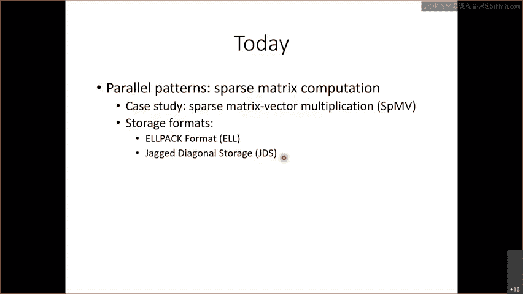

What I would like to do before we begin actually is I would like to remind you of the performance that we got last time。

 so this was the COO implementation we had last time and this was the kernel time we got and then we also had the CSR implementation and this is the kernel time that we got for the CSR implementation so it turned out actually that it was worth doing the atomic operations to get we saw that with CSR gave us more control divergence poor coalescingO gave us better coalescing however。

 and better control divergence but the price was the atomic operations we had to do and for this particular matrix。

 COO happened to be better for other matrices it might be the case that CSR is better。Okay。

 so just keep these numbers in mind because we'll refer to them later on when we go to implement another another SMV kernel based on a different format so we'll start with todays we'll start talking about the LPAC format So the LPAC format is as follows if I have a matrix。

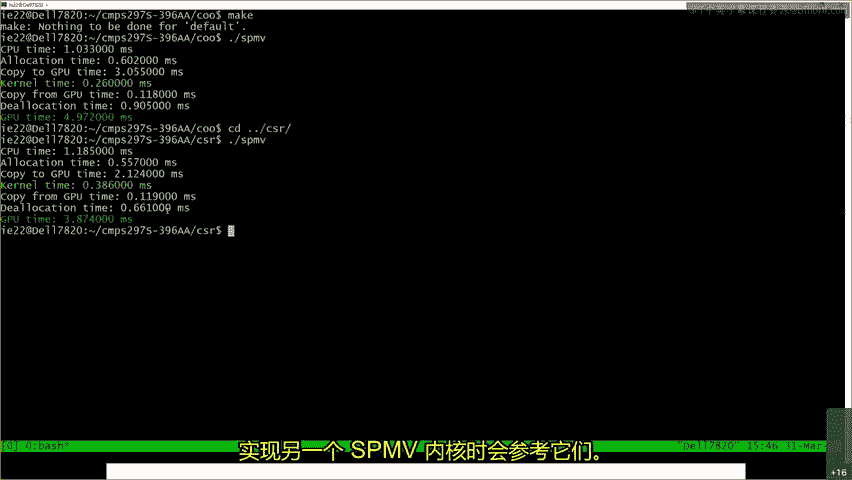

Okay， this matrix over here， what we are going to do is similar to CSR。

 we are going to group the non zeros of each row together Okay。

 so here we're going to have the column indices and the values of the non zeros and we're going to group them together like this。

 so we're going to have the nonzes of the first row followed by the non zero to the second row fold but the non zeros of the third row followed with the non zeros of four row。

Okay， however， we're not just going to put them all in in an array like this。

 What we will do is we're going to pad each row。We're going to pad each row。 So so that the rows。

All have the same sizes and what I mean by pad is that we're going to put these kind of elements that don't really that we're going to have in memory。

 we're going to have these elements that are not really useful。

 so they're going to take up some space， but they're not going to be useful however what they do is they help me make this array that's storing these non zeros a little bit more regular。

Okay， because now each row is going to have a fixed amount of memory dedicated for it Okay so as you can see。

 this is probably going to help us with coalescing later on。Now after we do this。

 what we're going to do， so after we add these padded elements for each row such that all the rows have the same number of elements。

 even though some of these elements are not useful elements， okay。

 we're going to do is we're going to store the padded array of non zeros in column major order。Okay。

 so instead of storing these， these non zeros， you know， one。

 then7 then then this then this padded element， then  five then 3 then 9 then two then 8 Then the pad element。

 rather than going in room major order。 We're actually gonna store these in column major order。

 So we're gonna store the one and then the five and the two and the6。

Then the seventh and the three and the8 and the pad element， then the pad element the nine。

 the pad element pad element。 So what's happening here is we're actually taking the first element of each row and we're putting them next to each other in memory。

 then we're taking the second element of each row and we're putting them next the second element of each row and we're putting them next to each other in memory then the third element of each row。

 etc。 So if we look at if we flatten this array， if we look at what this looks like when we flatten it。

 it's going to look like this。😊，Okay， so here I'm going to have the first element of each row and then the second element of each row and then the third element of each row。

 etctera。Okay， is that clear。Professor if we have an empty row。

 then we add we pad zeros on the whole row。Right， exactly if you have an empty row。

 then then so if we go back， if you have an empty row， then just all of these will be padding。Okay。

 thank you okay。Okay， so so now let's say we want to implement SPM Z using this E L L format。Okay。

 let's say you want to take this matrix multiply by a vector to an intro vectoror to get a corresponding outputor。

 How can we paralyze this， Well， we're going to use the same approach that we used with CSR。Okay。

 we're going to assign a thread to every row and its corresponding output element。

And that thread is going to go through the non zeros of that row， Okay。

 and compute the output element。 So we're going to assign one thread to loop over each input row sequentially and update the corresponding output element。

Okay， so here every thread is responsible for the row。

And every thread starts with the first nonzero element in that row。

 if we look at what that looks like in terms of accessing the value and the column arrays。

 every thread is going to start with the first element in the row。And what you notice here。

 you notice that the memory accesses are co。And then the threads together move on to the next element in the row so each thread goes to the second element in the row。

 you know what this thread is done so it's going to hit a padded element a padding element and it's basically so there's two ways of dealing with padding element。

 either we don't do anything or we put a zero here so that we do actually compute something but the value is going to be zero so we're going multiply and add to  zero so it's just not going to have any effect。

Okay， and then we move on to the next。The next， the third element of each row。

 So now we have this one more thread still has the work to do。

 but the other threads are just going to hit the padded elements and then we're done。ok。😊。

Is it clear。 Any questions。Okay， well， then let's go and implement this and see the performance that we get。

 So I'm going to switch the code over here。 I'm going to go to my ELL implementation。😊。

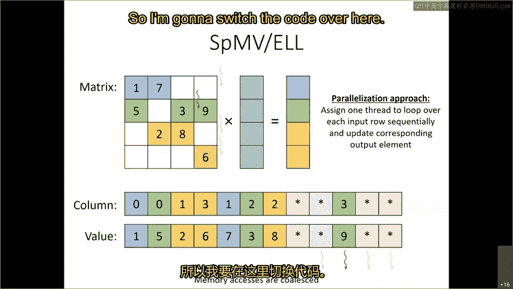

Okay， and here， as you can see， I've already written the code for allocating the matrix and copying it and calling the kernel eta。

 let me just give you a glimpse at what what the ELL data structure looks like looks like。

Here in the ALL data structure， we're going to have the number of rows。

 the number of columns naturally， we're going to have the maximum number of non zeros per row。

 the maximum number of non zeros per row is basically going to tell us how many times we need to iterate through this array。

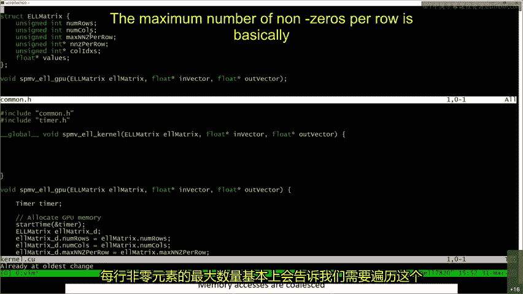

A professor。Yes。😊，Just one more question， getting the array into this format isnn't it very expensive？

So yes， that's a good observation。 so if you want to convert the array to use this format。

 there's some conversion costs。Okay， however， usually a lot of times when you use sparse matrixrices in actual computation。

 you might use a sparse matrix many times right so I may might not just be multiplying the matrix by one vector。

 maybe I'm iterativeably mightplying it by vector over and over again So if I'm going to use the matrix  a thousand times if I'm going to do  a thousand matrix vector multiplications。

 you know or maybe even more， it becomes worth to convert the matrix into a useful format so that you can save performance of each one of those SPMV operation。

 but if you're going to do the SPMV only once， then yes。

 maybe it's not worth incurring the conversion cost to optimize only one SPMV operation。Okay。

 that's a very good observation。好 thank you。

So the maximum of rezalance perreau tells us basically the maximum reance perreau。

 and that helps us know if we go back。

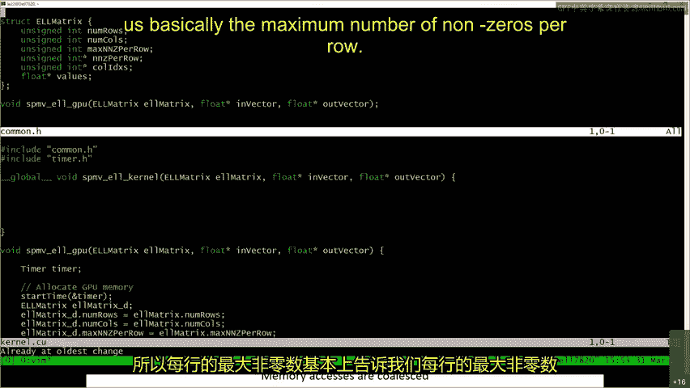

This helps us know the dimension of this 2D array that we're flattening。

 the maximum per is going to be the widths of this over here。ok。😊。

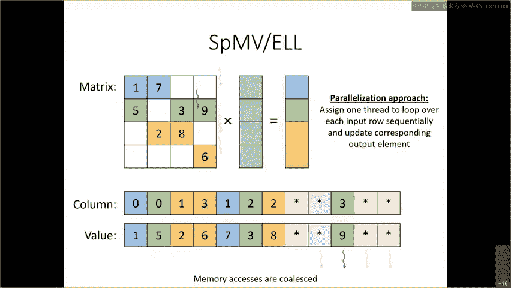

Okay， and then we're also going to have the number of non zeros in each row So the number of non zeros in each row allows me to know when to stop So here how do I know that this thread is not supposed to do anything for this element because I'm going to track the number of non zeros and the actual number of non zeros in each of the rows right so even though I have a paing element。

 maybe I don't want to load and and compute with the zero Okay， and then finally I'm of course。

 I need to have the column in and the values which are these two array。

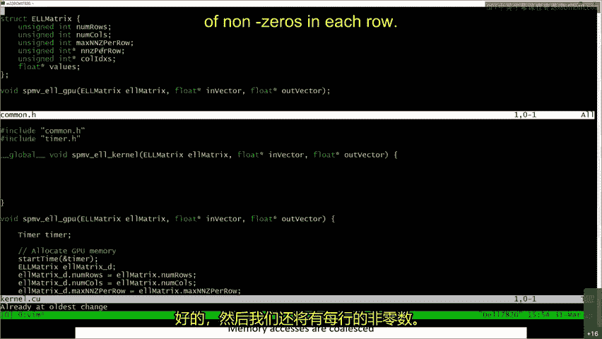

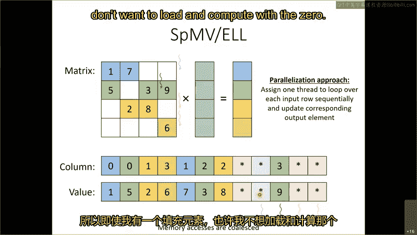

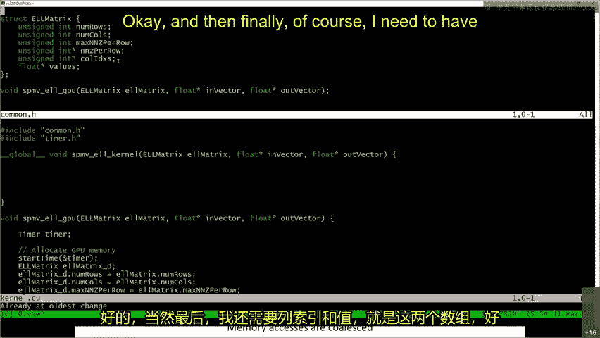

Okay。😊。

So given this information， how do I implement the yellow kernelel， Well，s let's start first of all。

 by assigning each thread to what it is responsible for。

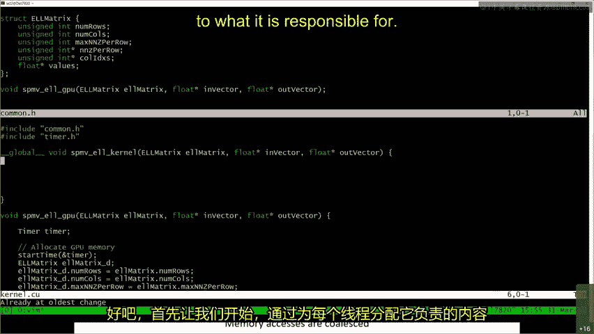

Okay。😊，if each thread is going to be responsible for a row， okay。

 so basically I'm going to use the thread index in order for me to determine what row the thread is responsible for。

 I will write。

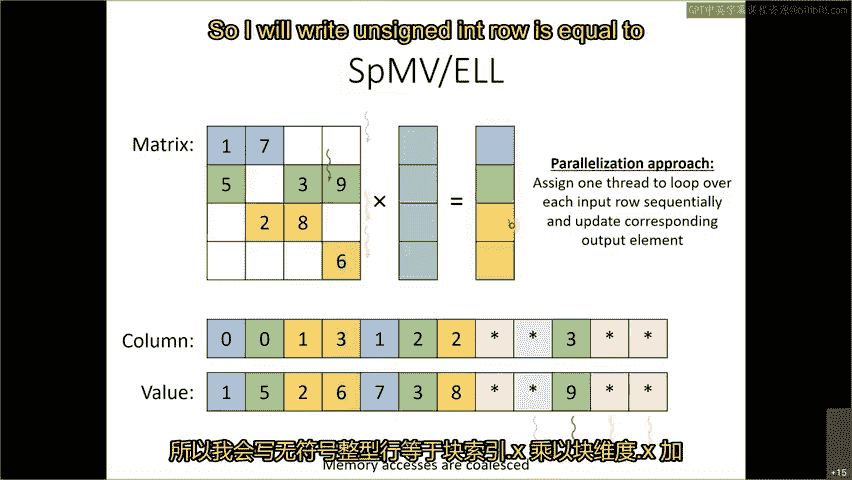

Unsigned n row is equal to block index dot x times block dim dot x plus。Tread index products。ok。😊。

Then I have to do a boundary check to make sure that that the threads in the last thread block are not doing anything out of bounds。

 so I'm going to check if my row is less than the number rows over here okay。

 so I'm going to do AL matrix dot number row。Okay， now after I do the boundary check。

 next what I would like to do is I would like to have the threads loop over their non zeros。

 Okay I want to have the threads loop over there non zeros How do I have the threads loop over their non zeros。

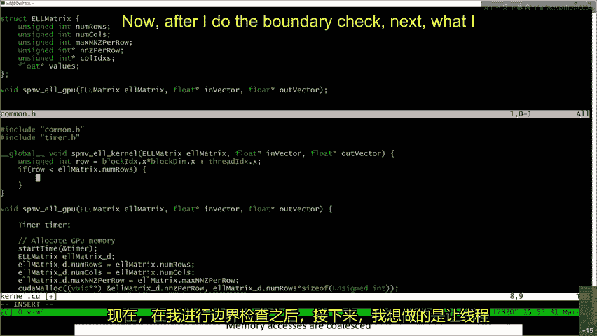

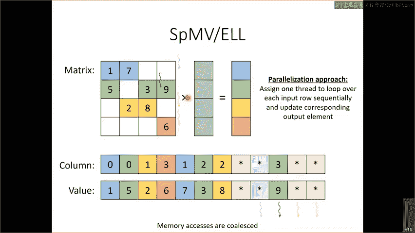

Well， I'm going to have a loop。ok企。Unsigned end。I'm going to name the loop bound， maybe。

The iteration， right， because all the threats。

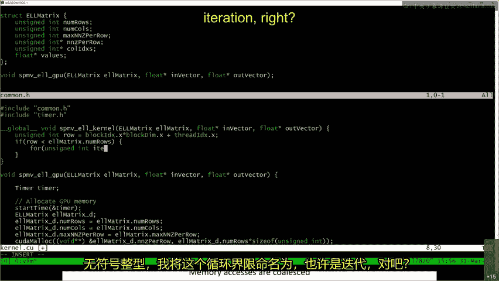

Gerate through their non bureas， but they。

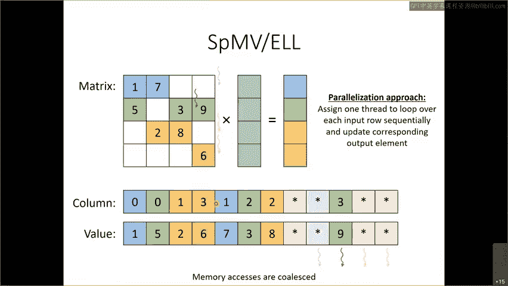

嗯。嗯。Equals0， the iteration is less than。 and then I have two approaches that I can take here。

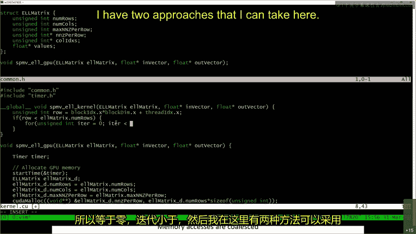

The first approach is to have all the threads iterate through all the nonzero elements。

 including the padding load the padded element， which would be a zero and then multiply and store okay it's not going to affect the computation。

 but I would waste a load in this case I would waste the time loading so I could do go until iteration is less a maximum number of non-zes per row and load and compute with the padding elements and it will have an effect of my computation but that tends to be wasteful So another approach is to have every thread stop when each thread when each thread has has reached the number of non-zes in the row that I don't And this is where it's useful to track with n andz per row So this N andz per row is not necessary。

 but it's an optimization for me to avoid having to compute the padding element So here rather than having this blue thread compute this padding element so multiply and add as zero。

 I can simply。

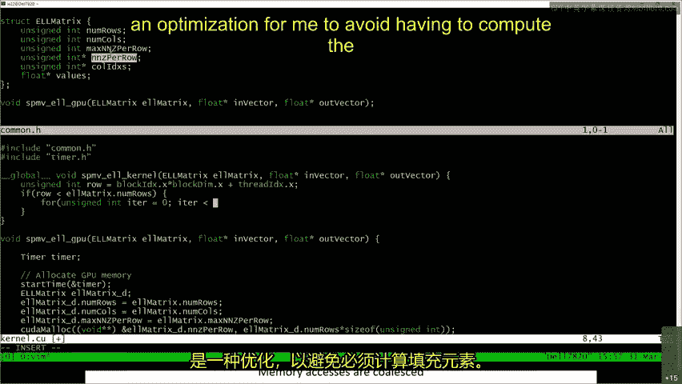

Remember the number of non zero is in the second row that it's two to completely deactivate the thread when they reach this deeration。

Okay so either approach is fine， the approach that I'm going to use is to track the number of non zeros pers so that I don't have to load and compute with the padding elements on this。

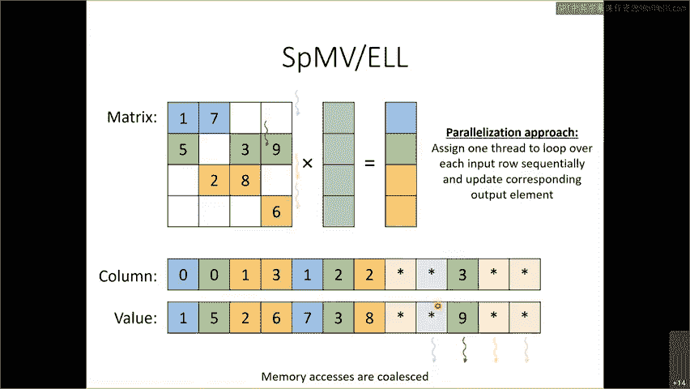

Okay， somebodybody saying this is causing control divergence well yes。

 it causes control divergence right， but if you're going to pad if you're if you're going to pad okay and you're multiplied by zero you're not going to have control divergence。

 but the work that you're going to do is going to be useless okay。

 so it's as good as having control divergence okay。

So what I will do is I'm going to check that iteration is less than AL matrix dot。😊。

The number of non zeros per row of the row。Okay， and I'm going to increment the iteration。Okay。

 so now in this loop， what I would like to do is I would like to now find。

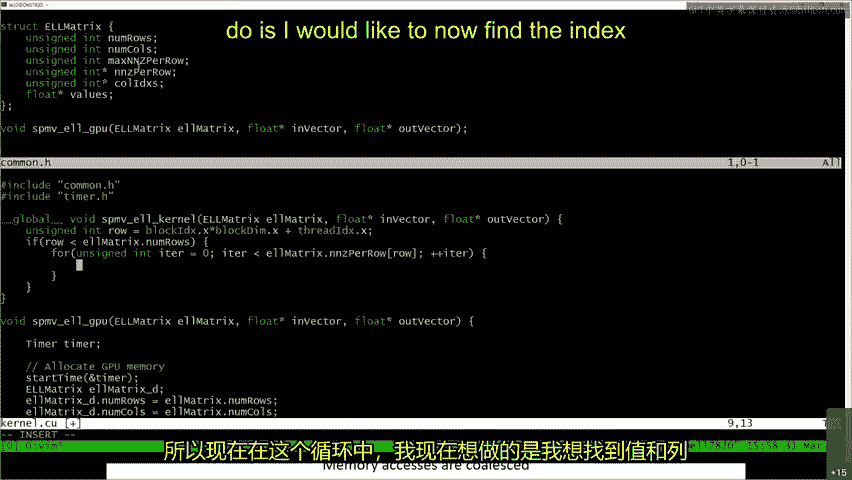

The the index。Of the non0 in the value and the column array。Okay， so whats the index going to be。

 Well， let's go back and and take a look at the。Let see that I can take a look at this。

So if the iteration is going to be the horizontal index for this array。Okay。

 and the row is going to be the vertical index for this array。

 And this array is stored in column major order。Okay， so basically。

 the index into this array of my non0 element is going to be the iteration。Times the number。Those。

Plus，0 index。He is that clear？It's the iteration。Times the number of rows plus the row ended depth。

And if you want to go back and see it on the。On in this actual array。

 well what we're doing is we're saying the iteration。

 so if I'm the first iteration I will be I'm going to be processing these elements second iteration I'm going to be processing these elements。

 Third iteration I'm going be processing these elements。

 So when I take the iteration and I multiply by the number of rows。

 it takes me to the chunk of elements that I'm processing on this iteration。😊，ok。So iteration 0。

 I'm here and iteration one， I'm going to go to one times the number of rows， which brings me here。

 iteration two， I'm going to go two times the number of rows。

 which brings me here and then plus I'm going to add the row index Okay。

 so if I'm want iteration one， I'm going to do one times the number of rows。

 which brings me here and then I'm going to do plus the row index， So if I'm row 0。

 I'll be here if I'm row1， I'm going to add one， I'll be here， if I'm row two。

 I'm going add two and I'll be here。😊，Okay， so the index into this array， I'm going call。

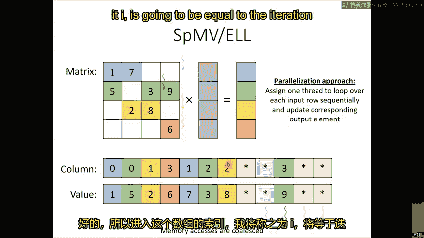

Is going to be equal to the iteration。Times。Numb of rows， okay， we already have we already。

 we can get that from the matrix。Okay， cloth， the index of the O itself itself。Okay。

 now now that I this I have the index into this array for the nonze element that I care about。

 I'm going to load its value and I'm going to load its column index， okay。

 so I'm going to write Einstein and column as equal to E matrix。

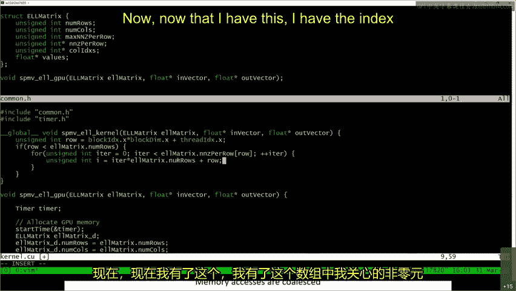

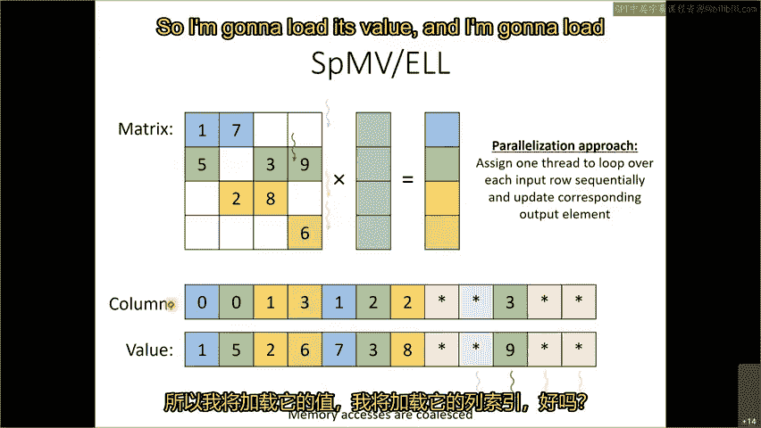

Dot， call him and deceive。Of I and float value is equal to yellow matrix。But。Vals。诶系。Clear。😊。

Is it clear how I found where the non zeros are in disorder？

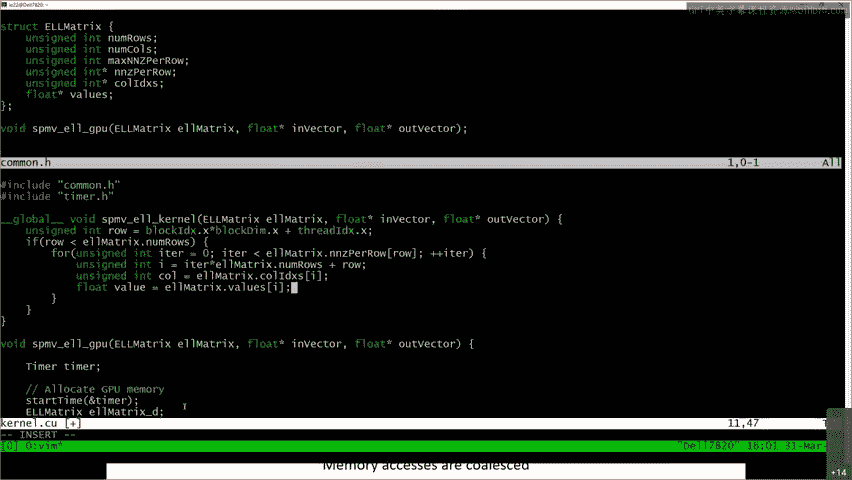

And as you can tell， it's clear here why there's coalescing because I。Ies expressed in terms of role。

And row is expressed in terms of thread index， dotex。So threads。

index that x values are going to have consecutive row values and threads with consecutive row values are going to have consecutive i values and therefore threads when the threads load from the column index array。

 consecutive threads are going to have consecutive I values so they will load consecutive elements from the column index array and from the values array。

😊，Okay， now that they have。The column index and value the rest is easy， we've done it before。Out。

Fector of row。Whats equals。And vector。Of column times。The value。

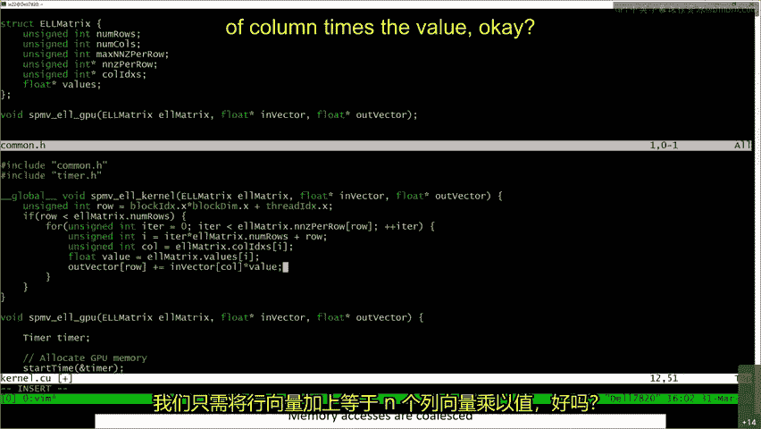

Okay so we obtain for each thread， we obtain the nonzero that it needs and then the column index that it is。

 and then based on its column index we load the corresponding element from the input vector。

 we multiply that element with the nonzero and we store that result。

 we accumulate that result to the output vector。诶。😊。

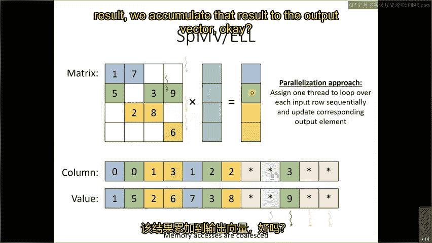

And of course， since to avoid having to go to global memory every time。

 what we can do is we can simply create an accumulator at the beginning。

 so float thumb is equal to zero and then here we can。Acccuumulate to the sum。variariable。Down here。

 we can write out。Fctor of row。As equal。Right。😊，Is this clear to everyone。

 any questions about this implementation？Professor the padding is not so much for the like padding control divergence is just to have the fixed array size to be able to know for sure。

 like the the dimensions， the padding， Yes， So the the objective of the padding。

 the padding is what allows us to do this。Yeah， okay。 I see。 So to have the modular。 Yeah。

 if this one。

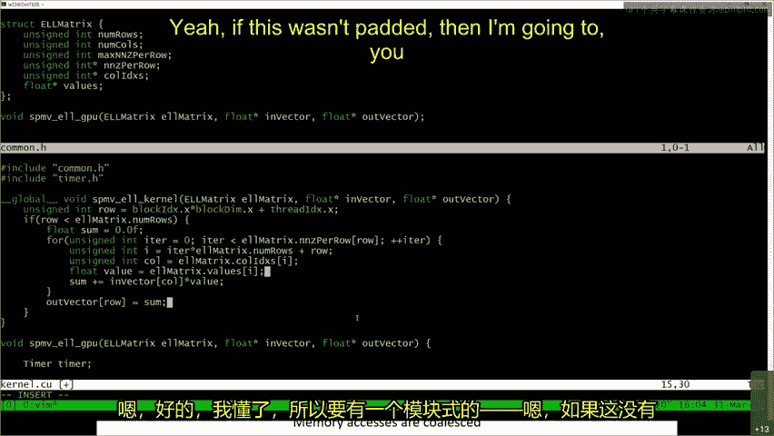

Added， then I'm going to， you know， then my I cant I can't just calculate the I based on the iteration and the number of rows and the row。

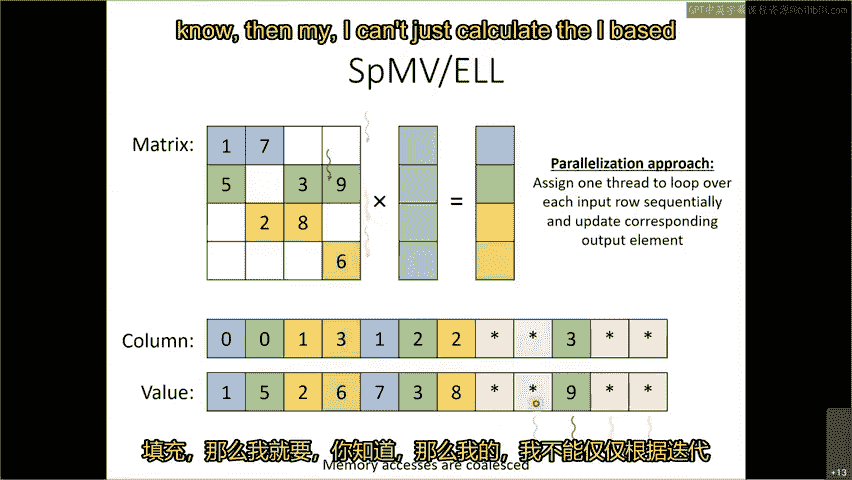

Okay， I would have to load， you know， just like we did with CSR， you know， with CSR， we had。

Had to load a source pointer that told us where the row starts and then everything was next to each other。

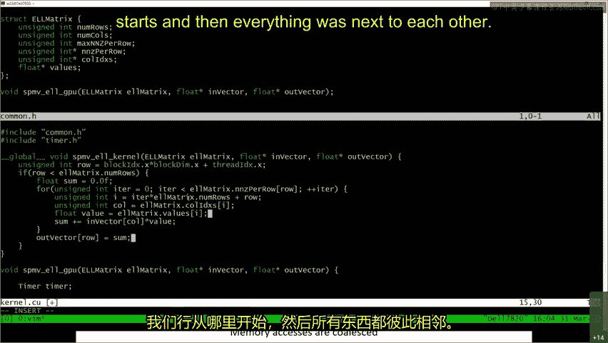

The reason I。Every thread， keep a constant number of elements every time to get my next value。 Okay。

 is because I have this patterndding。Okay， thank you。If I didn't have this spatting。

 then I'm going to have to do all kinds of things to figure out what El of the thread is responsible for。

Okay， well let's compile this and run it。It's my compile。And I'm going to run。Okay。

 and as you can see， we indeed do get better performance than this CSR version why。

 because compared to the CSR version， we have better coalescing and we have well。

 not necessarily less control divergence， but we do have better memory。Okay， but the couple。

 the reduce numerical， yes。Sorry for interrupting I said that the copy time is huge。

 is it because of the padding？Right， so very good observation。

 So the copy time is much larger compared to CSR。 Why is the copy time much larger。

 you're absolutely right。 It's because of pa。 So copy time is related to space efficiency。Right。

 and since the ELL format has all spadding， it's going to have much it's going to take up much more space and that is why the copy time is much larger。

 So that's a very good observation。Okay， so let's go back to our different performance different factors that we talked about they go into the designing storage format okay。

 we said that we have several considerations， one of them is space efficiency。

 how does ELL compare to CSL in terms of space efficiency。😊。

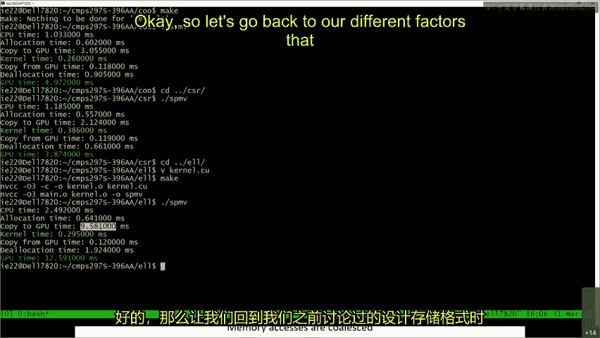

Well we just observed that the copy time is much larger and it's going to be less space efficient because of all the pad。

Right。😊，So ELL is less space efficient than CSR。What about the flexibility of adding and removing value。

 How does theL compare to CSR in terms of that flexibility。

You need to add padding or stuff like that to add a new value。Well， let's let's let's。

 let's take a look。 if I go back。呃。Yeah， I could just do it here。

 Let's say I wanted to add a new non zero to to the blue row， the first row。

Is that easy or hard to do。As long as you're not on the maximum row。

 you can just add it where there's padding right， exactly。

 So here because because the the this first row。Does not use all of its its values。

 There's the spadding value that we're not using。 We can actually use the spaded element if we want to add a row in the future。

 added a non zero in the future。So in this example。

 the only row we cannot add in on 02 is the second row because it's already uses all the elements。

But for all the other rows， because they have padding， we can if we want to add it on zero。

 we can replace them non zero with the padding。And because the wave were on our kernel kind of takes into consideration the fact that there might be padding。

 if we want to remove an element， we can remove it and replace it with padding。But professors。

 shouldn't the second row have four elements， three are normal and one padding element。No。

 because remember， this is a we want。 we， if we， if we want to have four elements。

 what that means is that we're going to allocate as much memory as this matrix needs。

 So that meets the whole point of of using a sparse representation。Okay。

 so the amount of number we're going to allocate for the ELL is going to be just enough for us to be able to store the maximum the row of the maximum number of non zeros Now this illustration is three out of four。

 but in practice the row of the maximum number of non zeros is going to have much fewer known zeros than the widths of the matrix。

ok。😊，Okay， so then in terms of space efficiency， ELL is worse than CSR， in terms of flexibility。

 ELL is better than CSR， it's easier for us to add elements and remove elements。

 except for the last the large the row of the largest number of non zeros for that row。

 and we're going to we're going to have it's going to be more we can't add non zeros to that row。

Okay without， of course， making major changes to the whole data structure。

So so what about accessibility， What does ELL make it easy to access and hard to access？

Rememberever was c o o。Given a non zero， it was easy to find the row index on the column index with CSR。

 given a row， it was easy to find the non zeros for that row。What about yellow。So let's so with EL。

 given a row， can we find them on zeros of that row， Well， yes， we can， right。

 because we can just stride。Over the a number of rows every time to find the maximum zero for the row。

几。😊，And this is obvious this would be obvious in the code because you know we just had the number of nonzes and the index of non zero that we want and we're able to find where that nonzero is。

 So given a row easy to find the number the nonzes in that row in EL。

 what about the other the other thing that we want to do given a non zeroro。

 is it easy to find the row and the column for that non0ro。Yes， yes。

Well it's given it's easy to find the column right。

 what about the row it how can we easily find the row？Using the stride。We take modular Right exactly。

 you just do modo the number of rows。Okay， if we do modular the number of rows， we can find the row。

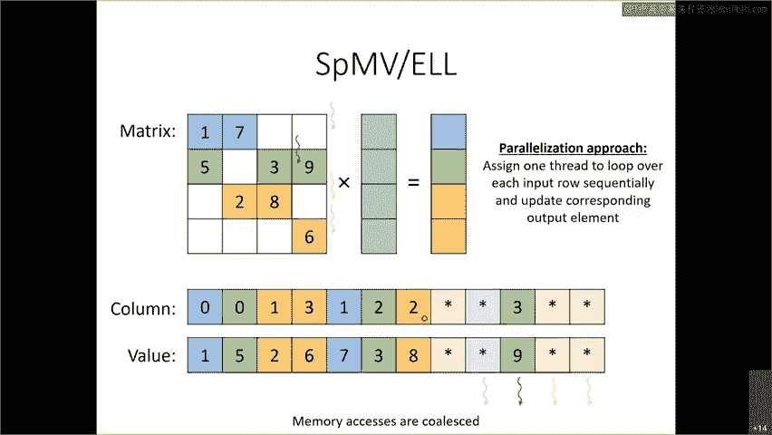

And this is clear if you go back and look at the code。我。Culated。

The non zero and the index of the non zero， the way we did it is we did iteration times number of rows plus row。

So if we have the index of the non0 and we want to find the row。

 we can simply do mod the number of rows， and we can find our row。

So ELL actually gives us in terms of accessibility， ELL gives what both CSR and。

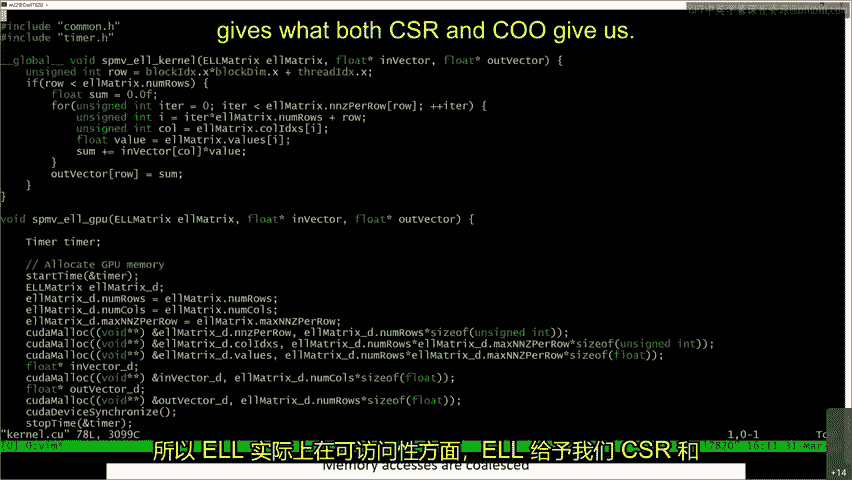

As t O give us。 given a non0， we can find the row in the column index and give it or given a row index。

 we can find the non zeros in that row。And in fact， if we wanted。

 we could have done a non zero based parallellyzization for EL。

 We could have assigned a threat to every nonze Okay。

 and then had the threat atomically update the output。 I'm not going to implement that。

 but hypothetically， we could do that。Okay。😊，So in terms of accessibility。

 EL is gives us more accessibility than COO and CR。 What ELL doesn't allow us to do is。

 given a column index， find the correspond， find the non zeros in that column。

 We cannot do that with ELL。 However， there， just like there's CSR and there are CSC。

Remember how we had CSR compressed partsse row and we had compressed partsse column。

 which was like CSR， but made it easy to access the columns。We can do the same thing for ELL。

 we can have the kind of the transpose of ELL where you would put the you would make it easy to access the elements of the same column。

 but then you cannot access the elements of the same row。

 so we can we can have kind of a different version of ELL for traversing doing a column Y traversal just like we have the CST alternative to CSR for doing a column Y traversal。

Okay， what， so what about memory coalescing。Well， that was the whole point， right。

 The whole point of designing ELL is so that we can improve on the memory co listing。

 So E L L is better than。The SR in that it gives us memory coalescing， and in contrast。

 it's better than COO because it allows us to access the output as well in a coalesced way as opposed to doing all these atomic operations to update the output。

Okay。And then， finally。And then finally， we have control divergence。

 so how does ELL compare to CSR in terms of control divergence？It has less。And how so。

Is't CSR the one where we had a lot of control divergence？Well。

 the reason we have control divergence in CSR is because every thread processes a different role。

So each thread is because different rows have different numbers of non zeros。

 each thread will have a different number of loop iterations。

 and that's where the control dirgence comes from。 Have we changed anything about that when we move to EL。

Haven't we introduced zeros into the， the the numbers， the the padded numbers。

 I guess how do we call them。So we added these padding padding elements， right？Okay。

 but if we go back and look at the code。ok。You're still iterating for each row we're still iterating according to the number of non zeros in that row。

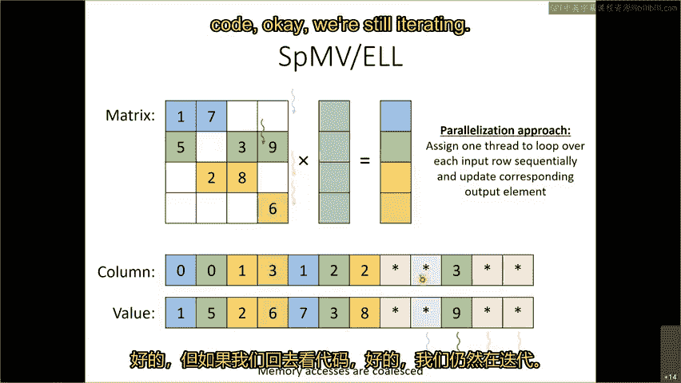

Okay， so in CSR， every thread loop over the non zeros in the robots row。And EL。

 also every threat is looping over the non zeros in its throat。Now， again， if rather than doing this。

 we actually every thread loop over the max and and we we process the padding elements。

 even though the threads are not going to diverge， they're going to be doing useless work。

 So practically it's it's it's as good as having control divergence。 In fact。

 it might be even worse because you could have a warp where all the threads are。Are done。

 and all the threads would go and process padty elements。

 So this is actually a better approach in terms of control damage。Okay。

 so EL doesn't really help solve the controlled emergence problem， but compared to DSR。

 but what it does solve is the memory coalescing problem in CSR and at the same time it solves the problem with the atomic operations in CO。

Professor。Yes。😊，Since we are like taking every row and putting the elements。

 all of them at the left first。And then like taking the column major order。

 So isn't it like more likely that we have more。More actual elements than padding on the left and more padding than actual elements on the right。

But then maybe a controlled divergence is。A little bit better because we're more likely to have warbs of the same。

Like doing the same thing， either completely active or completely inactive。

ButBut that's the same thing with CSR right so we haven't really changed the amount of work that each thread is doing when we go from ELL to CSR right it's true that the non zeros are going to be to the left and the padding is going to be to the right but in CSR for the initial iterations。

 the threats are more likely to have nonzes and for the last iterations。

 the threats are more likely to have completed going through the non zeros in their list。Okay。

 so we haven't really changed anything about that， right。

 Every thread is still doing the same amount of work that it was doing when we were using CSR。

 which is it was its looping through all the non zeros and the row that it owned。Is that clear？ Yes。

 thank you。AProfessor。Yes， is yeah。 so is the the worst case of V IL is， for example。

 when one of the roles has kind of a lot more elements than all the others。 Yes， great question。

 I'm about to talk about that。 So great question。Hold on to that and I will talk about that very shortly。

So this is the code that we wrote and summarize these are the tradeoffs that we talked about。

 we said the advantages are that it gives us flexibility。

 we can add new elements as long as the row is not full and in terms of accessibility。

 it's better than both CSR and COO because we can given it the row find the non zeros。

 but also given it the non zeroro find the row in the column。

 which is what CSR and COO both allow me to do。😊，And then for memory coalescing。

 implementing SPNV using ELL enables coales memory access。On the other hand。

 the disadvantages are space efficiency。 So we have a lot of overhead due to the padding and we saw how much the copy time took compared to the others。

 Also accessibility。 So given a column we cannot find all the nonzes。

 but CO and ELL also did not allow me to do this。 Only see S allowed me to do this and then finally controlled divergence。

 So S and VLL has control div Now one of you said that an ELL one of the problems is we can get into the situation where we have one row that has a very large number of nonzes and what that row will do is we will kind of hold all the other rows hostage because we have a lot of padding just accommodate with that row。

 So let me show you an example of that。😊，Actually， the slide title kind of gives the way what we're going to do we're going to do a hybrid ELL and CO let me let me motivate y So if we have a matrix like this where you know each row has like one or two non zeros。

 but I have a very small number of rows that have many nonzes， Okay。

 when I convert it to ELL it's going to look like this。😊。

What you'll notice here is that most of these rows have a lot of padding。There's only two rows。

 the second row over here， and then the second to last row down here。

 these rows use most of their elements， but the remaining rows have a lot of non zero。

 And what that means is I'm going to have a lot of padding that gets wasted。

Now what we can do to overcome this problem is rather than use the ELL。

 we can use a hybrid between ELL and COO What we can do is we can find kind of some some number where most of these rows below that number and use that as the width of our ELL representation and for the rows that exceed that number we can put the remaining non-zes in COO so for example here I can I observe that most of my rows have less than two elements so what I will do is I will have an ELL representation of the first two elements of each row。

😊，诶。😊，And this helps me capture all the rows in ELL except for two of the rows。

 so for these two remaining rows that I will do is I will represent their non zeros using CO0。Okay。

 and then in this case， I can do an ELL implementation for most of the rows。

 and then I would have a COO SDMB implementation to update the remaining to update the rows that have an excessive number available and this allows me to have kind of the benefit from ELL。

 but at the same time mitigate the problem of PET。😊，几。😊，Similar， so E L L plus CO。

 O is similar to E L L。 Okay， but with the following benefits from using CO。

 we have better space efficiency because we have less padding。 And also now we have more flexibility。

 because if we go back。Before with ELL， if we want to add we can add an element to these other rows。

 but if we want to add an element to the second row， we cannot because we've reached the maximum。

 there are no padding elements that we replace， but with hybrid ELL COO。

 if we want to add an element to a row， no problem。

 we can add an element to any row by simply adding it by checking if there's a padding padding and if there's no padding element for us to replace with a nonzero。

 we can simply go and add it to the COO part of the representation okay。

E yellow plus the hybrid EL CO gives us all the benefits of ELL。

 but add to that the fact that we have less padding and we also have the flexibility of adding element to any row as opposed to just the rows that havet maxt。

😊，Is that clear any questions？Professor can we have cut the the long rows and added them as a new row。

 like cutting it in two and adding a new row， because we like we can just expect and we can combine them later on when like we have the kind of like partial sums in the output vector and then we。

 we combine them。But remember， create if you make them a new row。

 but these two partial rows need to update the same output element。Yeah， but no， I mean。

 we have them update two different elements that we combine only at the late at a later stage。 Okay。

 but then， but then what you're gonna have to do is you're gonna have to do some operation where you start figuring out what elements need to be combined and what elements do not need to be combined and combining them and then moving the data。

 reshuffling the data so that you combine the elements and remove the excess elements。

 And that that might be even more expensive than just the。Then just you know， doing it。

 doing it this way。 But there is， you know， the approach of taking a row and breaking it down and doing different parts of it in parallel and then directly updating the output element。

 that that approach is possible。 and there are approaches like that。

 they try to optimize control divergence like that where they。

 they break a single row into multiple rows。 So hybrid E L LT is one way to deal with the long rows。

 Another way is， like you said， to partition long rows and have multiple threads work on them。

But typically we wouldn't do it by making them you know logically two different rows。

 it would say one row， it would still update the same output output element output vector element。

 you but you'd have to have some kind of additional bookkeeping in your storage format to keep track of the fact that these different partitions of the row possibly by different threads belong to the same row。

Actually， professor professor， what' it lead you to doing something very similar to E LL plus C O。

 You would have another another matrix not， not， not really。 So here with EL plus CO。

 we're gonna have one thread that's gonna go through these elements that are in the ELL part。

 and then we're gonna have different threads process each of the elements in the CO part。Okay。

 whereas whereas if I take this row and I break it in two。

 I would just have two threads one thread does have the first half。

 the other thread does the other half okay， so slightly different than so partitioning a row is slightly different from having a partial ELL row and then the rest of the elements in。

Because COO doesn't have the concept of elements of the same row anymore。

 these elements could be in any order here in this area。Okay， I see。 Thank you。Yeah， you welcome。

Yeah all these are good questions and you know， all these ideas that you guys are kind of proposing are definitely things that people always。

 you know， try to， you know， people， you know， come up with and they try to apply these ideas to further and further improve these storage formats and again。

Different storage formats are good for different computations。

 so sometimes data some storage formats might be good for some computation。

 but not another computation。O。😊，Okay， so what is our problem still， So we。

 with with with the ELL format， we solved the coalescing problem， but we still had one problem。

 which was what。 So both CSR and E L still have had this problem。It's not easy to。

So so E L L was better than CSR in that it， it reduced It improved the coalescing behavior， right。

 But E， L L and CS SR both still have。A problem， which is what？That's makes them inefficient。

 control divergence right， so somebody wrote control divergence。

So to address the problem of control divergence， there's another storage format that optimizes for control dirgence。

 and that's called the jagged diagonal storage format or the JDS format。

And the JDS format works like this。If I have this matrix over here。

What I'm going to do is similar to what I did with CSR。 I'm going to group non zeros together。

 So the the non zeros of the are all， are all kind of grouped together。 By the way。

 here what I say grouped together。 I don't mean， I don't mean physically group together。 I mean。

 logically， I'm gonna think of them as， as kind of one，1 thing， okay。Now， if you remember。

 the problem with CSR and with ELL is that different threads were processing different rows and threads that were next to each other could be assigned to rows that have a significantly different number of nonzes。

So your thread zero， the row that thread zero is responsible for has one non zero。

 the row that thread one is responsible for has four non zeros。

 they have a significantly different number of non zeros。So what can I do。

 So the main problem with control diverges is when threads there are。😡，Next to each other。

 are processing grows that have a significantly different number of non zeros。 So what can we do。

To avoid this， what can we do to have threads that are next to each other。

 processed rows that are of similar size so that we have less control dirg。Sort by row size reorder。

 Right， exactly。 So what the JDS format does to reduce control divergence is that it sorts the rows by the size of the row。

 So the green row will go first。 and then this these two rows with three elements。

 then the rows with two elements and then the rows with one element。

So we're going to circle the rows。Okay， but of course。

we still need to know what element to write to right we still need to know what is the original row index。

 So we will have another array that keeps track of the original row index。

 So this array tells me that the row that is now in position 0。

 but is actually row number one The row that is now in position one is actually row number3。

 the row that is now in position2 is actually row number5。

 position the row that is now in position6 is actually row number 0。Okay。😊。

So we will sort the rows like this。And then next what we will do is so sorting help me solve the problem of control divergence。

 but I also want to have good memory coalescing。So what can I do to have good memory coalescing。

 well， I want when my threads come to access the first element of their row。

 I want the a to be coalesced。Okay， so one thread0 comes to access this non zero element and one comes to access this non zero element and thread two comes to access this non zero element。

 et ceter。 I want my aes to be coalesced。So what can I do？The maps access is called this。

At store time， the threads become responsible of the unsorted version。有。

I'm going to sort these physically， Okay， I'm not talking I'm not talking about story for the Appleelman I'm talking about when they want to read to the actual non zeros in the matrix。

Oh， they can read the unsorted version and place it in the sorted oh， that doesnt make sense。

So if I want the thread zero when turns0 axis this element and turle access this element and turns to access this element。

 I want the axis to be coes。What what that means is I want these elements to be stored next to you。

Okay， so rather than what we did in CS SR where we store the non zeros of a row next to each other and then the stored the non zeros of this row。

 what we can do is we can store the non zeros across the column in this array。Okay。

 so we're going to store that on zeros in this order。ok。😊，And kind of column wide。

And what that results in is an array looks like this。Okay。

 I have all the first non zeros of the first row。That what taking into consideration sorting and all the second non zeros of the second row and all the third non zeros sorry all the third non non zero of all the rows and then all the fourth non zero of all the rows。

几。😊，This is similar to ELO， but without the padding and would the roses be exported。Now。

 the problem here is that。When the thread now wants to loop over the non zeros that it it owns。

How does it find them。So here's the thread 0。At 0 is going to be responsible for the largest row。

 which is this green row over here。 So I's going to start at this element here。

And then to get to the next element in its row， it needs to jump。vice stride of six。

But then the next iteration is going to jump five elements。

the next iteration is going to jump through implements。Okay。

 so how does the threat know how many elements it need to jump。

But what we are going to need to do is we're going to have to have some kind of array to tell us。

Where the beginning。Of the。The non zeros for each。And I'm going to call this the iteration pointer it has many different names。

 they're called the iteration pointer。So0 tells us that the first non0。Of each row。

Or the non zeros that are the first in their row are going to start at index zero in these two arrays。

 the non zero that second the non zeros that are second in their rows are going to start at index6。

 the non zeros that are third in their rows are going to start at index 11， etc。Is this clear so far？

Okay， now， okay， so now let's see what happens。Now。

 what we will do is we're going to assign a thread to every row。 So now that we we want to do STMD。

 we're going to assign a thread to every zero row。Okay。

 and in terms of the access pattern that looks like this。

So here I'm going to have a thread responsible for every row。

 So thread  zero is responsible for the first element。This this is zero this row over here。

 and I know that this is row1， because by looking up looking at this this permutation vector here。

So threat  zero is going to be responsible for row 1， threadh 1 is going to be responsible for row 3。

 Th2 is going to be responsible for row 5， right， etcter。

And now each thread is going to load the first nu zero of the row that it's responsible for。

 And as you can see， these memory axises are coales。Now on the second iteration。

 what happens on the second iteration， the threads are going to start from index 6。

 so they're all going to come here。Okay， and all of them are going to load。

 except the threads that are done。 So here， this blue thread here is done because it has no more non zeros in its row。

 And because this is the smallest row， this blue thread that drops out is going to be the last row in the sort of array。

 So it's going to be the last thread。Okay， so the the thread that drops out and drop drops out from the end。

 the thread that drops out is the last thread。And because the thread that drops up is the last thread。

 not， you know， I don't have arbitrary threads in the middle dropping up。

 They're dropping up from the end。 This is what minimizes control div。ok。

And I can do the same thing when I move on to the next iteration， the threads will go。

 they'll by the way， the way for me to know which thread drops out is but I can simply look at the next iteration point。

Okay， so the threads that the threads that should compute are the ones starting at 6。

 and then anything that's above 11 should should not be computeut。 So here。

 this blue thread should not compute because this element is not a blue element。

 The blue elements are done。 This element is actually for the next consideration。Okay。

 on the next iteration。We have more threads are complete。

 so these two threads that correspond to the rows with two elements are done。Okay， so but but again。

 you know， these threads are going to drop pad from the end because these two rows that have two elements。

 these are the last two rows after we do this sort it。

OkaySo now the last three threads are dropped out， the first three threads are still active。

 and each thread loads the non zeros that it is responsible for in a coalesced way。

And then on the last iteration， most of my threads are done。

 I only have one thread left that is still computing for the largest row。

 and that thread does the computation when all the other threads have dropped out。Again， in practice。

 you know， these tasks could spend many， many more。Okay， so if if you know。

 every two threads at here are a warp and then on this iteration。

 I already have two warps that are gone and only one warp is that in practice warps are 32 threads。

 not two threads， but I'm just giving kind of an exam。Okay， is this clear？Any questions about this？

Okay， so let's， let's talk about， let's talk about the different， the different， you know。

Advantages and disadvantages of the GD format first， in terms of space efficiency。

How does the JDS format compare to ELL， for example？It啊对。

Right exactly so JDS is more space efficient because there isn't any padding it's not as space efficient as CSR because we have additional things we have to keep track of right we have the column。

 we have the value， but we also have the iteration pointer we have this permutation vector that we need to remember so we have more bookkeeping data that we need to keep around so it's not going to be as space efficient as CSR but it's going to be more space efficient than EL because there's no padding。

What about flexibility， so ease of adding and removing elements from the format？😡，terriblerible。

Right exactly， it's very hard to add and remove things here。Okay， maybe even harder than CSR。

 because when you add， you might change what what row is larger and what row is smaller and that you know that you know makes things really different。

😡，Okay， or even when you remove and you remove， you've changed what  rows are larger and small。Okay。

 so JDS does not give us flexibility when it comes to adding and removing or modifying the matrix in general。

 what about accessibility？So like CS SR with JDS， given a row。

 it's easy to find all the non zeros in that row。Okay， well， not necessarily given a row。

 but given kind of an index， right， But if I want to find row 1。

 I would have to actually search this array to find row row1 corresponds to where and the new sorted order in order for me to actually find row1。

 So it's actually more difficult than CSR to just give a row find the nonzes。

 what you could do is you could have an inverse of the vector。 So where here this vector。

 given given kind of the new row index and gives you the old index。

 you could have another vector where given the old index， it gives you the new index。Okay。

 so given the original order， it gives you the sorted order this one， given the sorted order。

 it gives you the original order。Okay， so JDS， in terms of accessibility。

 it's slightly worse than CSR， but you know， with a little bit of work， given a row index。

 we can find the the non zeros of that row， what about given a non zero。

 is it easy to find the row index of the column index。It's easy to find the column index。

 but it's quite difficult to find the row index。ok。😊，And then given the column index。

 you almost cannot find anything with JDS。Of course。

 I mean I mean when I say you can't find anything I mean， you know。

 you can't find anything easily right if you want to do some some you know expensive searching you can you can eventually find what you want。

 but you can't do it easily。Okay， so that's that's flex space efficiency。

 flexibility and accessibility。 What about coalescing。It's very coalesced， right。

 The coalescing is good because we we have the， the erased are。The aes are sorted。

Sorry the rows are sorted， it's actually even better than ELL。

Right because if we go back and if you remember with ELL， when we are doing the coalesced aes。

 at some point we reach a point where we have these padding elements inside of our aes so even though our aes are coalesced。

 some of the values that are in that coalesced access are actually not used whereas with JDS we're we're going to have coalesced aes。

 but we're also going to fully utilize the coalesced memory request。Okay。

 so it's even better than ELL when it comes to coalescing at least it's the same when it comes to coalescing。

 but we have fewer memory requests because we're fully utilizing memory requests and what about control divergence？

It's good。Right， the control divergence is also very good because， you know， because the。

The control average is also very good， and that was the whole point of doing JDS because we store the rows。

 the control divergence is quite good。Okay， so these are the trade times of JDS。

 The advantages are space efficiency。 We have no padding accessibility， given a row。

 we can find all the non zeros。 memory as are coalesced， and it minimizes control divergence。

 But the disadvantages are that it's hard to add new elements to the matrix and given it non zero。

 It's hard to find a row and given a column。 It's hard to find all the non0。😊，Okay。

 I'm not going to implement JDS with you because I want to keep that for you as an exercise do on your own。

 but what I will do is I will run it for you so that you can compare its performance to the other implementation so here I'm going to compile the JDS journal and I'm going to run it。

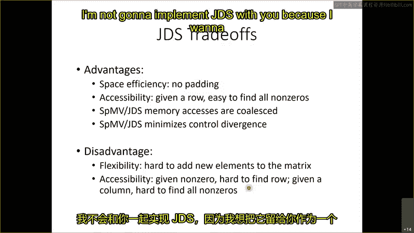

Okay， and as you can tell， the JDS kernel performs better than the ELL kernel。

And it also performs better than the CSR kernel。 And let me zoom that a little。

 It also performs better than the COO kernel。 So the JDS kernel actually has the best performance between all the kernels that we implement。

 alright。Also one thing to note here， although COO is doing pretty well because it reduces the coalescing。

 it has better coalescing。Control divergence than CSR and better control divergence than ELL Okay in practice as COO not it may not be as good if we go for other matrices。

 especially when these matrices get much larger because then we start having a lot of atomic operation and they start to hurt our performance but but for the for the for the matrix that I'm using。

 it turns out that CO actually does pretty well when you compare it with CSR and with ELL but of course JDS remains to be the best performing。

😊，ok。Any questions？ Is this only in the case of S BMV or。

Does it change with other problems depending on like the requirements？Excellent question。 So， so yes。

 everything we're talking about when talk about the trade dos of the different storage formats is specific to SPMV。

 When we go to different computations， how we access the matrix for a different computation might be different。

😊，Okay， and in this case， JDS may or may not be the best format。All right。It's about how we access。

 it's also about how we parallelize。😡，Okay， so the all kinds of things again go into consideration when we when we。

 when we change。What the computation we're doing is。So for another computation。

 it may not be the case that this is how they will perform。Youre relative。Doctor。Yes。😊。

Can you repeat how a reason about the ex accessibility for GDS。

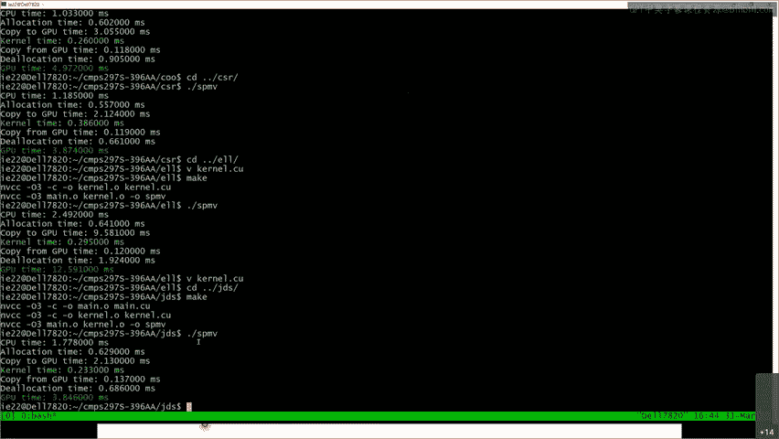

Yes， so where for JDS is that。So for JBS。We can go through the non zeros of a row quite easily。 Okay。

 if I want the of the new row。The row after we sort if I have if I want to go through row zero。

Of the the sorting order， which is row1 in the unsorted order。

 I would just iterate through my iteration pointers and go from the iteration and offset of zero。

If I want to go through a row one in the sorted order， which is row 3 and the unsorted order。

 I would just go to the iteration pointer and add one and I find the。The corresponding， non zero。

So in JS， I can easily loop through the non zeros of a particular row。Is that clear。

I this part clear。Okay， did I answer your question？Yeah， but I wanted to know the co if。

 given the column， why can't we find the。The nonze element。So given given if I tell you。

 go and find me all the non zeros and column two。How would you do it？Yeah。

 I can't really think a way。 Yeah， right， So you don't really have， have a way。

 have a way to to do a column column my travers in the same way that in CSR， you can't do it， right。

 given a column 2， you know， you wouldn't be able to just go and find all the non zeros and column 2 easily。

Okay，Yeah， you're welcome。So then these are the trade offs of the JDS format and this concludes our two lectures on sparse computation and sparse matrix Ex multiplication and you can read more about what we talked about today in the remaining sections of chapterpt 10 right does anybody have any final questions about sparse computations before we conclude？

Okay， if not， then that's all for today and I'll see you next time。八月份。

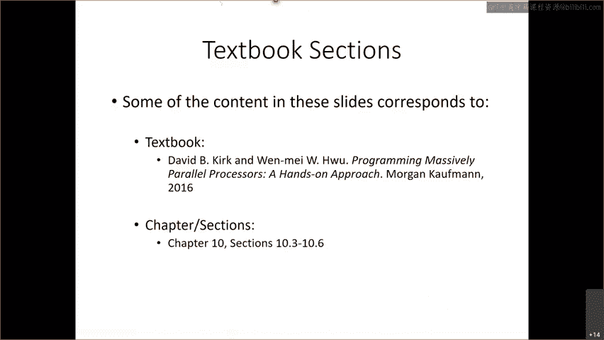