# 美国贝鲁特大学《GPU计算｜CMPS 297S396AA - GPU Computing - Spring 2021》（豆包翻译 - P19：-19-Lecture 19 - Graph Processing (Part 2).zh_en - GPT中英字幕课程资源 - BV1bw4m1k7a1

Hello， everyone and welcome to lecture 19 of GPU computing。

 Today we want continue talking about graph processing。

 So last time we started and today's lectures is a continuation of last time's lecture。

 So last time we started talking about graph processing， we said that。😊。

We represent graphs are presented usually as adjacency matrices which are sparse matrices so we can represent graphs using the same formats that we use to represent sparse matrices so this was an example of a CO representation of the graph we basically have list of edges and for each edge we have the source vertex in the dis vertex of the edge and then we also saw a CSR or CSC representation of the graph where we have for each we have kind of for each vertex the source pointer is the list is a pointer to the list of outgoing edges for which that vertex is a source and that points into this array that has the disination vertices of the edge and we said that we're focusing on unweighted graphs and that's why we just have a bunch of one so we don't store the values with this representation like we do do the sparse matrices。

 but if we add an unweighted graph then we would have had a third array in each of these representation with the weights and we also said that we're focusing on cement。

Gra， so CSR and CSD are equivalent。 And this was useful when we did the direction optimized version where we。

Where we were able to use the same representation of the graph for both directions。

We said that different approaches to paralyzing graph processing vertex centric where we assign a thread for re vertex to do something for a vertex or edgecentric where we assign a thread to do something for each edge and then obviously each one of these comes with its own preferred preferred format so for vertex centric we want to access the edges of a vertex so CSR is useful whereas for edgecentric we want to access the endpoint of an edge so COO is useful the example that we at was breadth first search and and the formulation of breadth first search we looked at was where we wanted to go through all the vertic Cs in the graph and labeled then based on their frontier number which is basically their distance from some source vertex that we selected and we looked at different implementations of BFS we saw a top-down implementation or on each iteration the thread is assigned to a vertex it checks if that vertexes in the current level and if it is it puts its neighbor in the next level if its neighbors are unvisited。

We looked at the bottom of vertex centric approach。Where threads were assigned also to vertices。

 but this time the thread would check if its own vertex was not visited。

 it would check if any of its neighbors are in the previous level and if it is if any of them are it would put the vertex in the current level and we saw how each of these was good at in a different situation but we looked at the direction optimized version that did top down initially and then bottom up later on and we also saw an edge centric approach where every thread essentially owned an edge so the thread was only responsible for checking if one source of vertex is if the source of vertex of the edge was in a previous level and if it is add the destination vertex to the next。

We also saw the step implications of the data set implications on performance and we saw how the vertex centric bottom up and the edge centric approaches are better on high degree graphs because they're better at dealing with low imbalance。

 whereas the vertex centric top down approach was actually better for low degree graphs。

And we ended by observing that there's actually a similarity between BFS and SPMV and here the way that we kind of SPV before with CSR was similar to how we did the vertexcentric quantum of BFS and in fact the other variation of the BFS that we looked at also correspond to other ways of performing SPNV and we said that in general。

 a lot of graph problems can be formulated as linear algebra problems using using the adjacency matrix of the graph and with a few tweaks we can actually formulate BFS exactly like SPMV and the advantage of that is that we can leverage libraries for sportsse linear algebra to also implement graph algorithm the disadvantage however。

 is that formulating a graph problem used as a linear algebra problem is not always the most efficient way to solve that graph problem。

😊，And we ended with talking about redundant work。 We said that the approaches so far were checking every vertex or edge on every iteration to see whether they're relevant for that iteration。

 and that meant that a lot of threads sometimes would just would just get launched but then they would figure out that their vertex or edge werere not relevant So they simply wouldn't do anything so that would have been a waste up threads。

 So the strengths of this approach is that it's easy to implement highly parallel and we don't synchronize across threads。

 However， the weakness is what we said that a lot of unnecessarycessister work。

 So what we said we're going to cover today is another approach where we avoid launching threads for vertices or edges。

 we just launch threads for the vertices that are relevant to the computation but this requires more synchronization as we will see today。

 So today we're going continue talking about graph processing before I begin。

 does anybody have any questions about last time's material。

 It's important that you understood what we covered last time because we will build on it today。

 So anybody have any questions about what we covered。😊，Yes， doctor。

 what would change if the graph was not symmetric？So I said I would talk about that。

 I think maybe I didn't forget now， so what would change with the graph was not symmetric is when we did the top down approach。

Every thread was looping over every thread was going over its neighbors with that original through the outgoing edge。

Whereas when we do the bottom up approach， we are looking at our neighbors through our incoming edge。

Okay， so when with with the when the graph is not symmetric， so when the graph is symmetric。

 the incoming edges and the outgoing edges are the same。Okay。

 so our CSR representation is the same as our CSD representation。When the graph is not symmetric。

 then the incoming edges and the alkating edges are different。So in this case。

 the top down approach wants to look at the neighbors that it can reach。

So it looks at the outgoing edges， so in this case it would need all the edges that go from itself to its neighbors and would that would correspond to the T star representation of the graph。

Whereas。In the the the bottom up approach， we're looking at all the neighbors that can reach us。

 not all the neighbors that we can reach， so all the neighbors that we can reach us are the incoming edges。

 so I want to look at all the source all the source sources that can reach me as a destination and that would correspond to theD representation of the graph。

Okay， so the top down approach requires a CS star representation of the graph。

 the bottom up approach requires a CSD representation of the graph。Okay and because of that。

 because the graph was symmetric， we were able to use the same representation for both the bottom up and the top down。

 So when we came the direction optimize approach， it was enough to just use the same graph in both cases。

Okay， is that clear？Yeah， so for the direction optimized。

 we would have to use both the CS SR and CSV， right if。It was not natural。

So for the direction optimized yes， you would have had to keep around both a CSR and a CSD so that when you did the top down approach and wanted to loop over your outgoing edges。

 you would have you would have your CSR and then when you switch to the bottom of approach and you want to go over your incoming edges。

 you would have to use DS。Okay， also， it also depends on how you interpret the matrix。

If you interpret the matrix as the rows being the source vertex and the columns being the destination vertex。

 or if you interpret the matrix in its transpo form， okay。

 the point being is that one of them requires CSR and the other one requires CS。ok。😊，Okay， thank you。

Yeah， you're welcome。I'm saying that because when you when you formulate。

 when you do the linear algebraic formulation where you formulate。

Where you formulate the BFS as SPMV， you actually treat the rows as the destination vertees and the columns as the source of vertees。

Okay so so it would be the opposite of what I said， but what we looked at this time。

 we were treating the rose as the source。Okay。😊，All right。

 so let's any other questions about last time's material？Okay， so then let's proceed。

So today we're going to talk about how we can reduce redundant so if you recall the approaches that we discussed so far。

 they check every vertex or as and every iteration and that results in unnecessary work so the alternative for doing that for reducing redundancy is to do the following our objective is to only check the vertices that are part of the previous level we don't want to check all vertices of reiteration so the approach that we're going to follow is that on each level what we will do is we will place the vertices that were visited on that level in a queue。

😊，And then on the next level， what's going to happen is we're going to only process the ver these that are in that view。

Okay。So the vertices will be ind on each level and these vertices form the levels frontier。

 we call this a frontier based approach because what happens is on every level we're going to construct a frontier and on the next level we're going to visit the veres we're going to only going to process the vertices that are in that frontier。

Okay， now the advantage of this is that we reduce redundancy。

 but what's the disadvantage of doing this？Like we have to use atomic operation or contention on the same queuee。

Right， so we need we have a shared queue right all the threads are trying to add to a queue。

 so we have synchronization across threads to add to a shared queue。

 So this is gonna be the this is the overhead， but the benefit is that we are avoiding redundancy。

 So you can imagine that in some cases， this might be better in other cases it may not be。

 but hopefully today we're going to cover we're going to look at an example where this will hopefully improve our performance。

Okay。😊，So let me just illustrate what I mean by this approach before we go to implement it what we have before is we are going to start at level zero and left from when we go from level  zero to level1。

 we initialize our we're going to have this Q that's going to represent our frontier and here this Q which is our previous frontier is going to be initialized to the source node。

😊，Now， when we when we call the first kernel， the first kernel is going to look process all the vertices in level 0 to generate the vertices in level 1。

 So now here， since I only have one vertex in level 0。

 I only need one thread to process this vertex right。

 So as opposed to launching a thread for every vertex and then all these threads figuring out that they're not relevant for this iteration。

 I'm only going to launch one thread for this vertex and in this thread。😊。

Is going to construct the next frontier。 Okay， by by visiting all of its neighbors。 Okay。

 so this is the vertex centric top down frontier base。Now， on the next。

frontier now comes the previous frontier and what we want to do is we want to construct the frontier for level2 so we're going to launch a thread for every vertex in the previous frontier so this time we're going to have four threads for these four vertices Each of these vertices are going to go through their neighbors figure out which neighbors are not visited and they're going to together and queuee their neighbors in the next frontier so we're going to have these vertices that are neighbors of the level1 vertices in the next frontier。

😊，And then same thing happens in the next iteration。

 this one becomes the previous frontier and we have a thread for each one of the vertices in the previous frontier and these threads will visit their their neighbors and they will in any unvisited neighbors in the next frontier and thenre on the next iteration this one becomes the previous frontier and we're going to have a thread for each one of these vertices that are in the previous frontier。

 but none of them are going to find any visited neighbors or next frontier is going to be empty and this is how we know that we are and everything else that we do not reach is going to be unreaachsonable right clear how this works。

😊，Okay， well let's go and implement， that's going to switch to the code terminal。

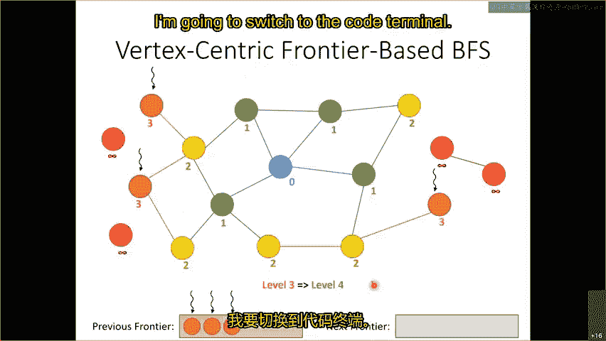

First， let me remind you how the vertex centric top down approach performed as I'm going to or it's already compiled。

 So I'm going to run BFS on remember the top down is best in road graphs。

 We're going to focus on the road graphs for this lecture。

 So here when we did the top down approach on the road graph we got around next milliseconds。

 But now let's go and take a look at how。We would perform。

When if we use the frontier based approach I'm going to open the over here so I've already set up the host code the DSR graph is the same you know so we have these we allocate memory for the graph and we copy it but we also initialize a previous frontier and a current frontier and by the way we're only going to initialize two buffers and then we're going to use double buffer so on one iteration the previous frontier is we have previous current frontier on the next it we're going swap them so the current frontier so you know one buffer becomes the current frontier and then we use the other buffer for the previous。

Sorry one buffer the previous the one that was in the current frontier becomes the previous frontier and then we'll use the other buffer for the current front so here we loop over this and notice how we're going to call it the BFS kernel and then every iteration we swap the buffers this is how the double buffer ring is happening we swap the previous and the current buffer every time。

Okay， so now let's go back up and implement the kernel， the kernel takes the graph。

 it takes the level and then， but it also takes。It takes the graph。 It takes the level。

 but it also takes the number of。forposed so you guys can see what。So we have the graph。

 we have the level。 this is the level of each vertex in the graph。

 We have an array that represents the pre that's going to contain the vertices in the previous frontier。

 This is going to be initialized to just the source vertex。

 We're going to have an array that's going to be where we're going to put the vertices of of the current frontier。

 we're going to have the number of vertices in the previous frontier。

 So when we access this previous frontier array， this one tells us how many vertices there are there。

😊，We have the number of vertices in the current frontier。 This one is going to be initialized to 0。

 And when we add stuff to the current frontier， we're gonna use this counter to figure out where we're gonna add。

 And， of course， we're gonna have the current level， which tells us the level that we are currently。

 Okay， so let's get started。 So what we want to do initially is we want assign a。😊。

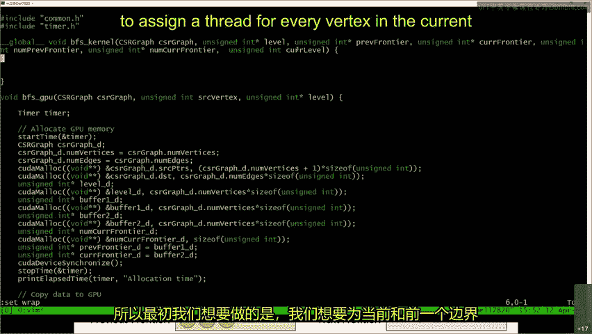

For every vertex in the current in the previous frontier。

 So the thread index is going to be the index into the previous frontier that we're going to use。

 So we're going to start off by figuring out our global threat index。

 we're going to have unsigned and I is equal to block index dot x time block dim dot x plus thread index dot x。

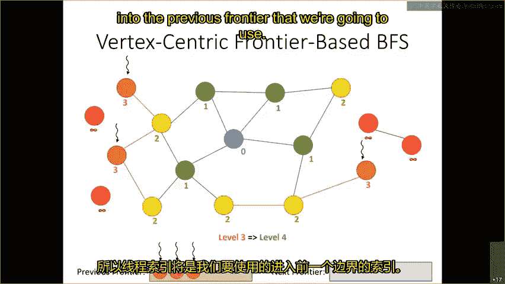

Okay， and then need to do a boundary check because we need to make sure remember we're going to use this to index the previous frontier。

 so we're going to need to make sure that it's within bound， so what do we compare it to。

We're going to compare it to the number of vertices in the previous frontier。

 which says now the previous frontier over。Soello。This is our boundaryreach。Okay。

 now what we want to do is we want to we have the indexes the previous frontier。

 We want to obtain the index of the vertex itself， so we're going to load the index of the vertex from the previous frontier。

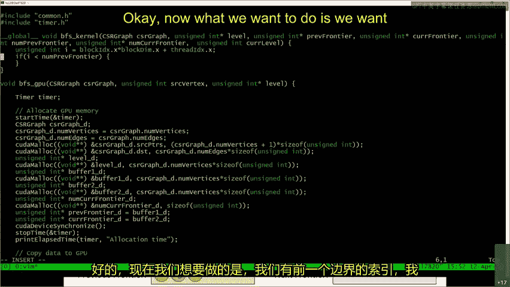

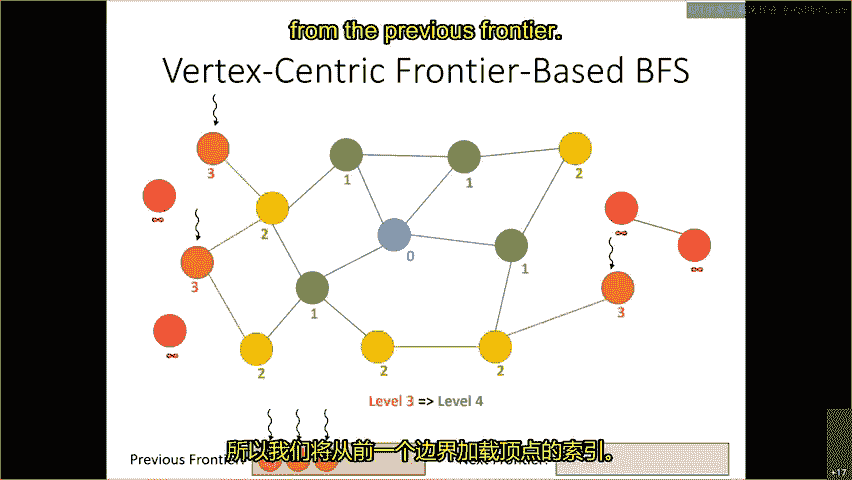

F。Vertex is equal to。Previous frontier of right， so now the thread has the vertex that it's responsible。

Once the thread has the vertex that is responsible for， what it wants to do is it wants to loop。

Over its outgoing edges。 How does it know where its outgoing edges start。 Well， remember。

 this is a TR graph。 So it's going to be just like what we did before。

 We're gonna loop over from the source pointers of vertex。 The source pointers of vertex plus。

 So we're gonna write four unsigned and edge is equal to。😊，Yes photographgraph that。

Sos pointers of vertax。Edge is less than PSR graph。That source pointers of vertex plus1。

And then plus plus edge。Okay， and now what we're going to do is we're going to find the neighbor at that index of the neighbor at the destination of this edge。

 so we're going to write unsigned。

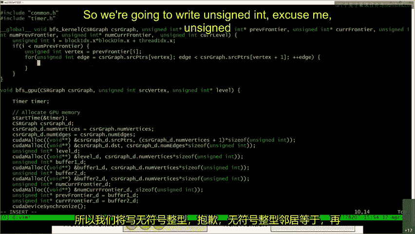

And。Excuse me。On site and。Neighbor。Is equal to again。

 we're going to look at the destination of the edge。

 So we're going to write CS star graph that destination of。Okay。😊，Alright。

 now when we have the neighbor， what are we trying to do what we want to do what we want to do is we want to check if our neighbor is visited。

 if it's visited， we're not going to do anything。 if the neighbor is not visited。

 then what we want to do is we want to add the neighbor to the next frontier Okay。

 or what I'm calling is the。Okay， so what I will do is I want to check if。

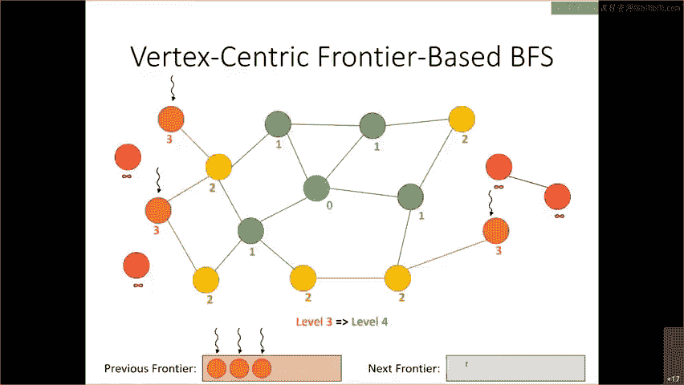

Be level。Of the neighbor。Is equal to Eid Max， which means the neighbor is not a visited because it hasn't been assigned a level yet。

Okay， the neighbor is not visited。Then what we want to do is we want to visit the neighbor。

 so we're going to assign the level up to the neighbor to be Uid Max。Okay。

 and then what we want to do is we want to add。The neighbor， right， so we found an uned neighbor。

 so we want to add the neighbor to the the next frontier or the code and calling it the current front。

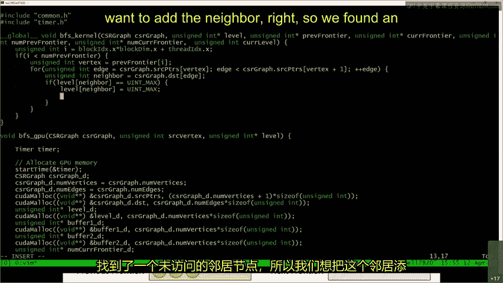

Okay， so how do I add well， numb frontier tells me how many veres currently are currently in the current frontier。

 so I want to increment this。

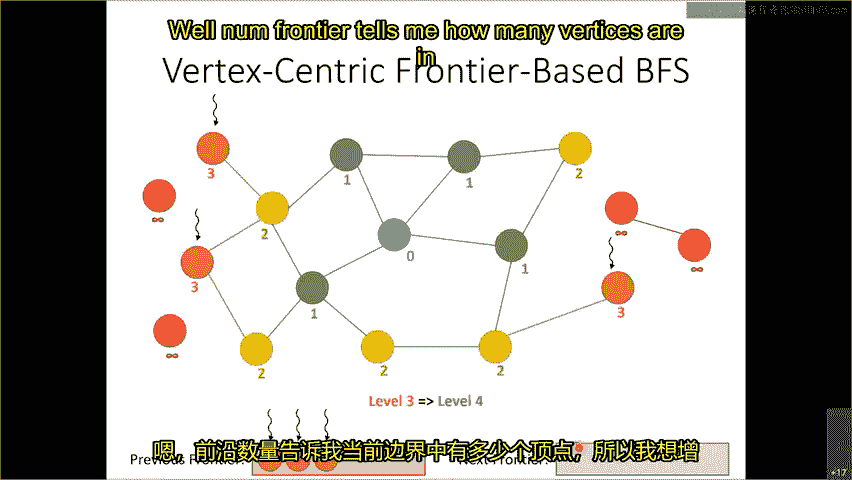

Okay， so I'm going to I'm going to get the I'm going to acrement this so to first of all。

 this is going to be the number of vertices in the current frontier。

 so I'm going to write unsign and。呃。So when I load from the current frontier。Okay。

 in this tells me how many vertices are in the current frontier。

 so if I going to add something to it， this is going to be the also the index of the new element that I'm going to add and then I'm going to increment。

ok。The。Number of vers in the current frontier。Okay。

 so I get the old value of the number which is the current frontier， I increment it。

 and then what I will do is I will add the neighbor to the current frontier at this I'm going write the current frontier。

呃。Current frontier index is equal to name。Okay。😊，I look for my neighbors。

I figure out the index of my neighbor， I check if my neighbor is not visited， if it's not visited。

 I visited O Oops， I made a mistake here。This should have been current level。几。😊，Okay。

 I check if my neighbor is not visited， I visit it by marking it as being part of the current level。

 and then I increment the index of the current frontier。Okay， and I add my neighbor。

 I add my neighbor to the current frontier at the index that I got。 Okay。

 so this is logically what we do， But we have some problems here。 What's the problem。

I think we have a race condition。Right， where we do have race condition。

 Where do we have a race condition？In pushing to the。To the current frontier。Right， so here when I。

 if I have multiple threads that read from the current frontier at the same time and they go incremented。

 I will have a raised condition when adding to the current frontier。Okay， so how do I。

Let me kind of write this in a better way。 So what I want to do is I want to get the old value of the current frontier。

 And then I want to。I want to do a post increment so post increment gets the old value and then increments the value。

 so I want to get the old value of the current frontier and then I want to increment it after I get it So how can I do this。

Right， in a way where I don't have race condition。Atomic a。Right， that not look at exactly。

 So instead of doing it this way， what I'm going to do is I'm going to write。Atomic a。

None current frontier，1。Okay， so I'm going to atically add one to non current frontier and remember when I do Atomic add it's going to atomically add one to this and it's going to give me the old value so the old value is where I want to put my neighbor and so I take the old value and I put that in current frontier index。

Okay， so now I've solved the race condition when adding to the current frontier， is this clear？

Any questions about this？Beearered everyone。 Okay， I have another race condition。 Where is it。

What happens if multiple threads。In the previous front， here half the same neighbor。

They're going to add it twice to the， to the queue if they read it for unlucky， right。

 if we're unlucky。Both of these threads will compare and find the neighbors unvisited。

 So both of them will market as visit in the current level。 You know， if we're lucky。

 one thread will market and the other thread will will will read the up value， but for unlucky。

Both of them will find it unvisited， both of them will market。

 and then both of them will add it to the current frontier。

 so I'm going to have the neighbor added to the current frontier multiple times。

That's a problem because that means of the next iteration。

 I move to process that neighbor multiple times。You can imagine how this can explode exponentially。

So how can we avoid having the thread， How can we ensure that only one thread。

See the neighbors unvisited and all the others see it as visited。

We're going to need another atomic operation。 But this time， it's not an atomic ad。

 What does this operation have to do。It like a mutic s。But we don't want to do a new text。

 so we want to just have an atomic operation， but what what does well see we'll see the atomic operation that we're going to use about what does it need to do this atomic operation。

😡，MAs。T theさ。It has to do assignment， but it has to do assignment。

 it has to do a conditional assignment， right？Yes， I know。 what is it， Is it quite swap。Right。

 compare swap。 Why is compare swap。So we want to make sure that only one thread sees that it's U max。

And it， it will compare to and max。 if it is， then it will swap it with the current level and no other threads will。

Willll enter the statement right exactly So the atomic operation we're going to use is called compare and swapb and what compare and swapwab does is that it compares some value to another value and if that value is is equivalent to another value。

 it replaces it with another value not the so if that if if that value is equivalent to some other value it's going to replace it with。

Not the other value of compared because obviously I wouldn't be doing anything。

 but it's going to compare it with yet another value。Okay。

 so what we want to do here is we want to compare level neighbor to U max if level neighbor is U max。

 we want to replace it with current level。Okay， but we only want one thread to do that。

 So if one thread succeeds to。To find C U and maxax and replace it with current level。

 we want any other thread to see current level， not to see U andm。

And that's why it's an atomic operation because we atomically compare and swap here。 The idea is。

 we're comparing。And then， we're swapping。But the problem is that I could have multiple threads compared。

And then multiple threads swap， but I don't。 I want to prevent that。

 I wantna have each thread compare and then swap without there being a。

 Another thread comparing before this thread。So what we will do is we're going to use。

At toomic compare and swap。 It's going to get rid of all of this。Okay， so I'm going to do。

Atomic comparison swapwab。The address the address of what I'm comparing to and swapping is level of neighbor。

 I want to compare it to you at Max。Okay， and if the level of neighbor is equal to you at Max。

 I want to swap it with。Current。Level。Okay， and then when do I enter this loop？I enter this loop。

 If the old value of level of neighbor was， you and met。Right， so remember。

 an atomic ad returns the old value。 similar， atomic compare swap is going return the old value。

 So when I try to compare and swap with level of neighbor， if level of neighbor was U into max。

 I'm going to swap it with current level。 Okay， and I'm going to return the old value。

 which is U and max。If level of neighbor was not current max， I'm not going to do any swap。

 but I will return whatever that its old value of。So the only case I want to enter here is if I succeed to do the compare swap。

 And that means the only that means the only case I will enter is if the old value of level of neighbor was indeed you went back。

 So here I will have equals。You N math， this clear。Any questions about the Sc current swap？So again。

 what this will do。Pair level of neighbor to U maxs basically see of the neighbor is visited if it is if it is UN max。

 that means it's not visited， it will set it to current level and then only only one of these threads will succeed to do this and that thread that will succeed will read the old value of level of neighbor as being U max so it will so it will it will pass this if and it will go into this go inside here and and add to the Q。

😊，Okay， so now we've solved our race conditions， let's go and see how this code performed so compile。

And I'm going to run the code and remember our old version。

 which was the one that didn't use the frontier that had the redundancy it took 66 milliseconds。

So now I'm going to run this and we actually get 14。8 milliseconds。

 so we've made a substantial improvement because we reduced the redundant。Alright。😊，We to everyone。

 any questions？Okay， so that。

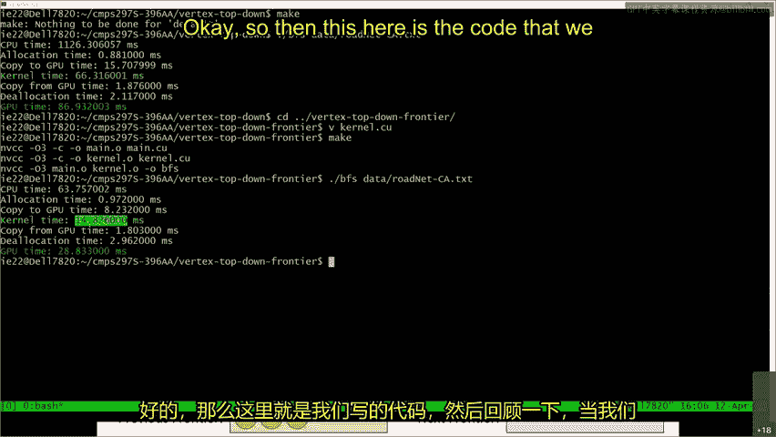

Here is the code that we wrote and then just as a review when we were inqueuing to the frontier。

 all these threads were trying to update a counter that pointed to the head of the queue so if you had a race condition on the head of the queue。

 what would end up happening is that multiple threads will write to the same location in the queue so to solve the race condition what we did is we had use atomic operations so that only one thread can increment this counter at a time and that way we don't have any race conditions when adding to。

Okay， so great， we implemented this optimization， got some good performance。

 any any optimizations that we can we can。😊，Think about what's going on here。

Any optimizations we can form？I have all these threads that are contending on this counter and doing an atomic operation。

 So if all these threads are at are atically currently this， these operations will get serialized。

 right， These threads are contending。On this atomic operation。

 So how did we deal with contention of atomic operations before。Privatization。Privatization， yes。

 so can we apply privatization here somehow。You would have to merge the queues somehow。

 The queues like the private queues。そ。Right， but the idea is that we would need to have。

Private queuees， each one with its own counter， right。And then we can have each。

Bread block maybe add to its own private queue。And then what we can do is we can merge all these pes。

Absolutely right。But how do we go about avoiding duplicates kind of like what we had now。

So the avoiding duplicates did not did not have to do with the part where we were inqueuing。

 Avoing duplicates had to do with the part where we were visiting。

So we would still use Comp swap when we visit right。

 we're not privatizing whatever a Comp swap is hitting or Comp swap is hitting the levels。😡，Okay。

 we're not going to privatize the levels because then then that， you know。

 that meets the whole purpose of using compare swap to avoid duplication。

 What we want to privatize is the atomic the target of the atomic operation that's doing being。Okay。

😊，So Q privatization as we thought， all threads are atomically incrementing the same global counter to insert elements into the queue and what this means is that we have high latency because of the global memory access and have sterilization due to high contention so the optimization that we can apply is privatization where we have each thread block maintain a private queue and then it can commit entries to a global view upon completion so here we're going have each thread block have its own private queue the threads in the thread block and we can put the queue and shared memory by the way。

 to reduce the latency we can even put the counter for this queue and shared memory so that the atomics that so that the threads in each thread block are going to content on this counter but it's going to be a shared memory then when each thread block finishes。

😊，啊。Up creating its or filling up its own queuee， all we will do after that is we will have these thread blocks。

😊，Each thread block can do one atomic operation on the global one to allocate space for its values。

 and then it can write its values out to the global queue。By the way。

 only gives us this privatization not only allows us to save on the atomic operation contention。

 but also now when we're writing this local queue to the global queue。

 what you can see is we've actually our rights will actually be coalesced because we can have each thread。

 write one of the elements in the global queue to the global Q。Okay， any questions about this。

Professor， I I didn't understand why there are no duplicates。 I mean。

 what if some node is the neighbor of several nodes。 and like they share， I mean。

 they don't the they don't have the same private queue。

Then that note that the common neighbour will be in two different local queues。

 and then it will be twice in the global queue。No， because I never the way I present。

I never add things redundantly to the global Q， right？So I wouldn't add them to the local。

The way I' am preventing redundancy in adding to the queue is when I， when I visit。

 I'm using it a compare swap to visit so that only one thread will succeed to visit visit in an unvisited neighbor。

Alright， I see。 Thank you。 Yeah， It's not that you that takes care of removing the redundancy。

 It's the visit operation。Yeah， clear。Professor thank you。Yes， you're welcome。 Yes question。Yes。

 sorry。' for the to know where each block should write its own code， is there a scan in between？啊。

 so so。That's a good question。 We don't need to have a scan。

And the reason we don't need to have a scan， it's different from Raic sorts。 So with Radix sortt。

 when we were having all the different threads write their buckets to a global to the global location。

 we needed a scan because because we needed to preserve the order。

But here we actually don't need this scan and the reason is that it's okay if these threads write if I write this segment here and then this segment later。

It doesn't change my correctness。So because I don' need to preserve the order I don't care about the order in which these segments will be written。

 these local cues will be written to the global queue， I actually don't need a scan。

 it defined if each thread log， whenever it's done just doest atomic operation allocate based on the queue and adds to the。

So maybe this image is a little bit misleading because I'm having the local cues being written in order to the global cues。

 but they don't have to be， I could have written this one at the beginning。

 I could have written this one at the end， etcter。Clear。Iy， thank you。Good question。Okay。

 so then let's go and implement this optimization。😡，Okay， you to go back to my code。

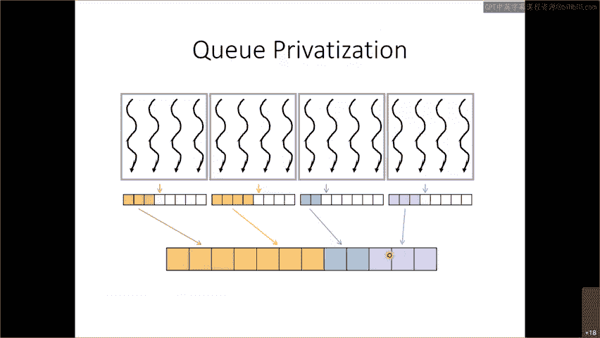

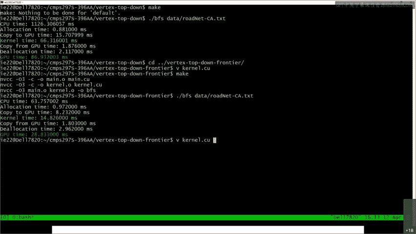

So now what I want to do is I want to create local cues for each block and I'm going to create these local cues and shared memory。

 and I also need a counter that tracks where I am in these locals。Okay， going start。

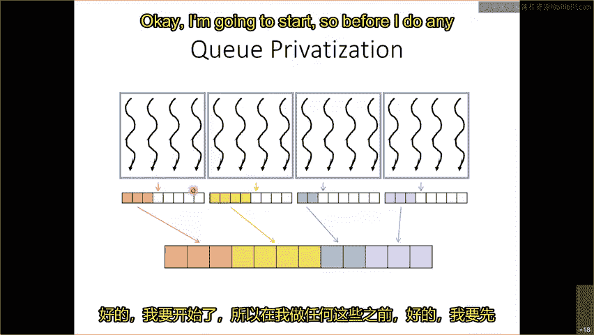

SoBefore I do any of this。Okay， I'm going to start by creating。Let's start by creating a logo。

Shared memory。 Okay， so'm going write shared。I'm signed。And。😊，I'm going to call it current。

Frontier underscore S。A shared memory， private version of the of the of the current frontier。Okay。

 I'm gonna give it a size。 Okay， I can， I can let me see what'， what's what would be a good size。

 So if I'm using 25 threads per block。So， I want。I want to have eight blocks on the S。

And if I have around 96 kilobytes of shared memory。

 then if I want have 96 kilobytes of shared memory， and I want to have eight blocks。

 so each block is going to be able to get 12 kilobytes and over here an uns site end is 4 bytes。

 so I'm going to have three 3000 percent most so let's let's create a let's say our local queue size of 2040。

 I'm going to red define。Lo few sides is 2048。诶。😊，And here。My local queue size will be 2040。Okay。

 and what I also what I also want to do is I need a counter。

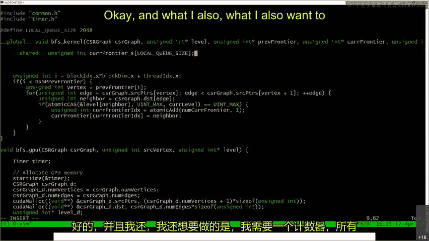

All these threads that are in the same block。 They need to content on the same count。

 They need to implementcr the same counter to add to this use。

 I'm also going to need a counter to be in shared memory。 So I'm going to have shared。

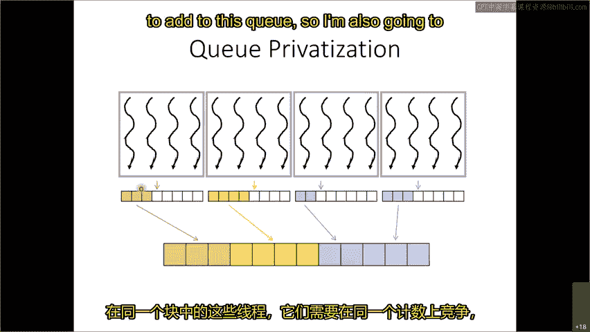

I fine bent。 I'm going to call it no。So here I had the current frontier， non current frontier。

 I'm going to call it none。Currentent。Frontier underscore S。Okay， and now before I start。

 I need to initialize this to zero， right， so how do I initialize this to zero？Can I just do this。

If thread I D is 0， then this。Right， I don't I don't want all the threads to be initializing it to zero。

 It's completely unnecessary。 It's fine if just one thread does the initialization。Okay。

 I can write F。That index dot x is equal to 0。 Then I can initialize this to 0。 Okay， and， of course。

 what do I need to do after that。You have to think。Right。

 I need to sync threads because I need to make sure that none of the threads start executing the code at the bottom before I'm done initializing this zero。

 So I'm going to。你。Right。诶。Great， so now what I've done is I've created this local queue and share free and this local queue is I have is book to be I have this counter that tells me the beginning of local queue and I'm finish this counter to0。

 Now what I'm going do is I'm going go ahead and start executing my code here。

 So every thread picked up a vertex in the current frontier goes through the ver outgoing edges finds the neighbor and now what I want to do is I want to I want to add I want to check the neighbor is visited So I'm still going do this over here。

 but now rather than adding to the global current frontier I want to add to the local okay so this is the part of the code that' going。

😊，Take get rid of this。Okay， and now what I want to do is I'm going to add to the local。

 How do I do that。Well， I want the phone。 I'm going to atically increment this number。Okay。

 get the old value and use that to add to the current。Okay， so I'm going to write。Einstein and。All。

Frontier index， I'm going to put underscore for S here。

 This is going to be the index into the currentier at which I want to put the neighbor is equal to。

 I want to atomically implement against the value the right atomic at。

Not the current frontier on this square S and one。也就权利的。This is an integer。

 it's not a pointer to an integer it's not like this one， but I actually do need to have。And1%。ok。😊。

So now I have the index into the current frontier。Where I need to insert now what I can do is I will just insert to the current frontiers I'm going current frontier of S。

underscores S of current frontier underscore index underscore S is equal to neighbor。Right。😊。

Is this good。Any potential issues？What could go wrong here。

So when I allocate this array for the current frontier。The size of this array。

 I'm going to set it through kind of the maximum possible number of vertices that might be in the frontier。

 which could be the maximum possible vertices that could be in my graph。

So I have I can put an up for bound on I can allocate you know。

 turn frontier to contain possibly over season in the graph that you don't have to worry about overflowing。

The current front。But with the shared memory， the private queue。

 the global queue I can get as much as they want， with the private queue。

 I'm limited in shared memory。So it's possible that what happened？I limit occupants。

It's possible that I overflow。😡，Right。Did I see that。

Right now this local queue is built to in order to support 2048 integer it is possible for me to have more than 2048 veres that I want to en queuee in this thread block so in this case I could overflow my local queuee so how how can I deal with that how can I deal with overflow。

Maybe when when you reach the maximum occupancy， I mean。

 you write back to the global queue what you already have and then you go on。Right。

 the one possible thing I could do is once I hit the max。

I can go and write everything to the global queue and then continue。

 But that's going to require me to synchronize across threads。

 because I'm going need all threads to participate。To do that。

 So I'm going to have to synchronize across thread in the middle of this loop。 and if statement。

 that's not really something I want to do。It's going to be complicated。

So what I can simply do since it's probably not a common case for me to overflow。Okay。

 what I can simply do is I can simply just just whenever I hit the maximum Q size。

 I just start sending the rest of the vertices to the global。ok。😊，So basically。

 when I do an atomic ad。All right。 What I will do。Is I will check if I overflow or not。

 so I'm going to check if the current frontier index is less than the local Q size。

If I don't overflow， okay， then I add to the local few， if I do overflow。

Then in this case now what I will do is I will restore the local Q size。

 so I will restore numb current from tier to be equal to。Local cute thighs。Okay。

 and then I will go and add to the global Q。 So how do I add to a global Q was the same way I did it before。

 I'm going increment the global counter。And then then add to the global cu， so I will I will do。

Unsigned and。Current。Frontier index。Is equal to。Atomic a of。The global counter。

And then I will use this index to add to a global here right， current frontier of。Td Fier index。

Is equal to。Neighbor。Okay。😊，And then， of course。Now all the Flocks are going to go。

 they're going to add to the local queue when the local queue fills up and now you're going to go to the global Cl any questions about this。

Professor maybe I missed something。 I't the maximum shared memory size 1024。Nope。

The maximum amount of shared memory you can have per thread block。I depends on the architecture。

Oh okay， I my yeah true。Now depending on the architecture。

 what you would choose for this value is you want to be careful to maximize your occupants。

So here the way I picked 2048 is I observed that I was using 256。Threads per block。

 so if I want to have 2048 threads in total or you know8 blocks。

 then I want to have and I can have 96 kilobytes of shared memory。

 then I want each third block not to use more than 12 kilobyte。Okay。

 so here I picking 2048 and each value is an unsigned end， I'm using  eight kilobytes for the load。

Okay I can increase this more if I want to， and that might improve our performance。

 but I just prefer to speak to an even power of two but I don't have to do that。

 I can increase this as long as I don't exceed start hurting my o。Okay， so now that we're done。

 what we want to do is we want to take whatever is in the local queue and send it to the global queue。

Okay want take whatever is the local you and send it to the global queue so first I need to wait for all the threads to finish I'm going to have to have a sink。

Threads over here。嗯。And now that I'm done now each thread block is going to go and it wants to increment the global counter to allocate space for itself in the global queue so here number the number the number the number of elements that the thread blocklock wants to add to the global queue is basically number current for kidss on scorex。

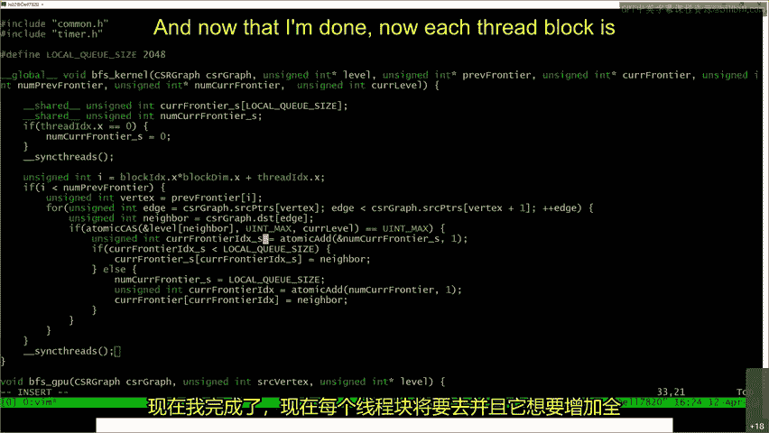

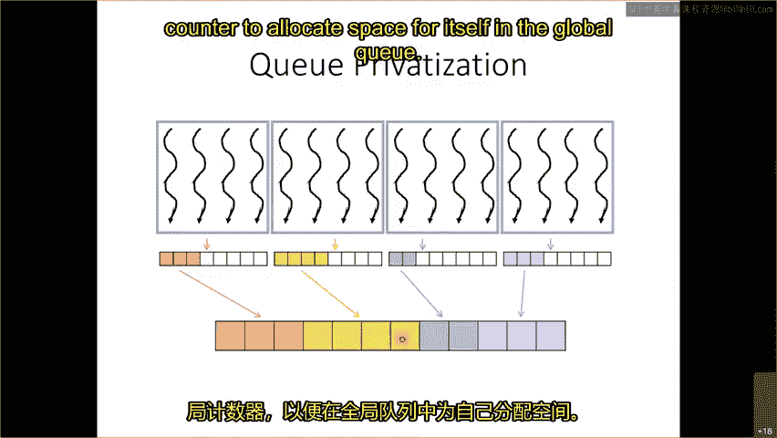

Okay， so how will we do that， Well， we're gonna。We're going to need to have。

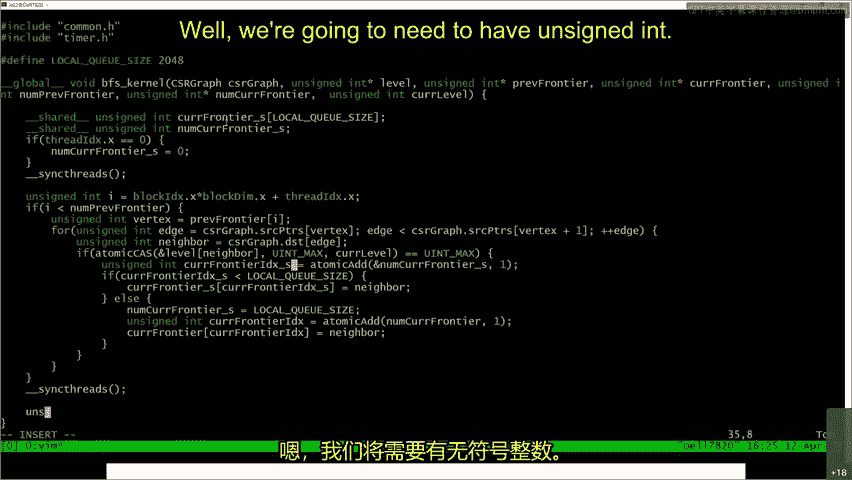

We have unsigned。 and I want to find where my thread block needs to go and store in the global global the global queue。

 So I need to increment。

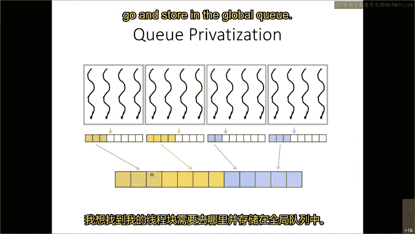

I need to increment my global Q counter by the number of the number of local elements that I have。

 So I'm going to do Im I'm going to name this， the location， the start index。

 So I'm going to write current。Frontier。Starge index。Okay。

 and that's going to be equal to atomic add of the nu currentren frontier underscore S。Okay。

 so the nu current frontier is the global counter and how much how much I want to increment the global counter。

 I want to increment it by the。

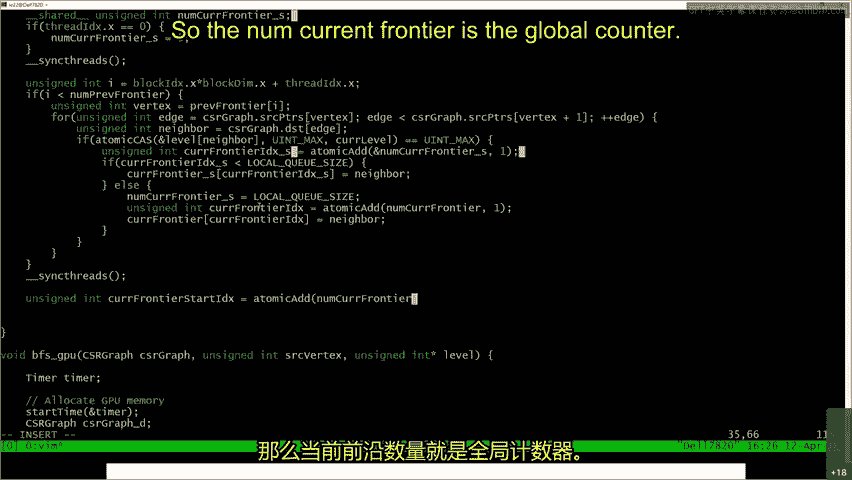

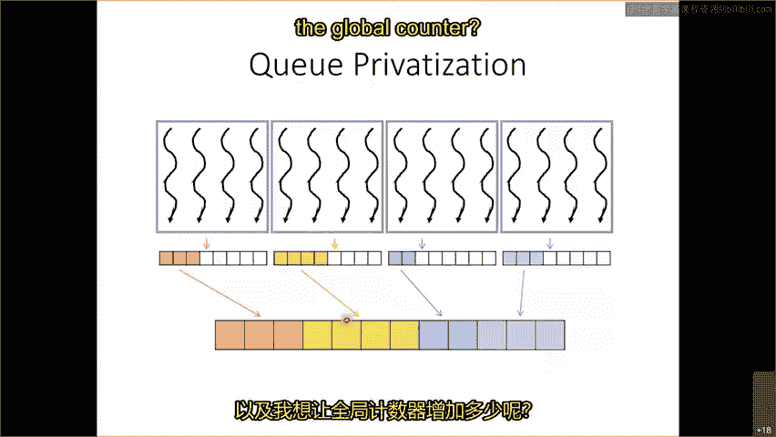

Value of the local counters， but I'm going to implement it by current frontier underscore。ok。

So atomic increment non print frontier by non print frontier on just for S so I'm incrementing the global counter by the size of the local Q okay。

 but there's a problem here， what is it？

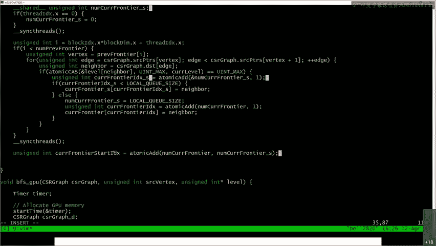

So only one thread within the block should do this right the way I wrote it right now。

 all the threads are going to do the increment Okay， but I can't have that。

 I only want one thread just like here with numbcr frontier equals 0 right。

 I only want one thread to do it。 same thing here。 I only want one thread to increment the global counter。

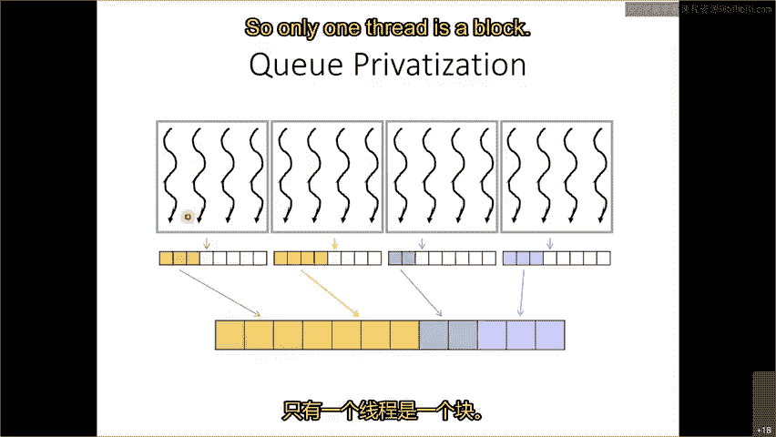

ok。😊，So the way I'm going to do that is as follows， I'm going to write unssteined inier start index。

 and then I'm going to have an if statement。That check。Yes。F index that x is equal to0。And then。

 in this case。I'm going to。Set the current frontier start index to this value。ok。😊，Clear so far。

 Any questions？Okay， so now that I have obtained now that I have obtained。

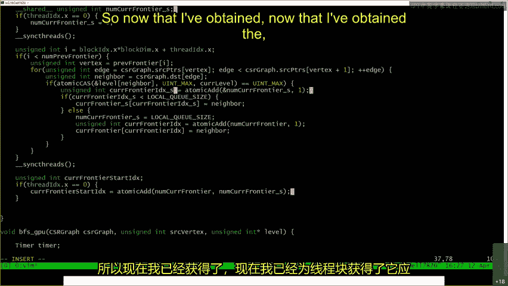

The the for the thread block， where it should store its local queue in the global queue。

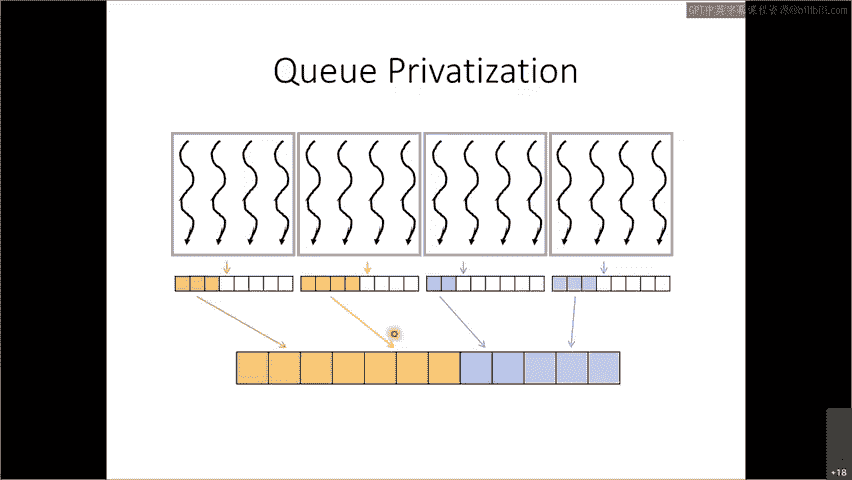

Okay。Part is for thread zero only thread zero has this information。

 So the next part is for thread zero to inform all the other threads about the location that it obtained Okay。

 and the way we can do that is by simply declaring this and shared memory So here what I will do。

I I will declare this as a shared memory variable。Okay， so that way。

 went the thread index dot x increments the global。

Counter type enough space for the for the number of elements in the local queue。

 It's going to store this in a shared memory variable that all these other threads can access later on。

 Okay， well what does that mean， What do I have to do down here in order for me to make sure that all the other threads can access the right value。

Synchronized。Right， I'm going I have to do a sync threads。

So that all the threads wait for thread zero to allocate space in the global Q。Okay。

 so now thread zero has allocated space in the global queue enough for our for all the elements of my local queue。

 so now what I want to do is I want to go and store all the elements in my local queue starting at this index position over here。

Okay， now how do I do that， What would I。

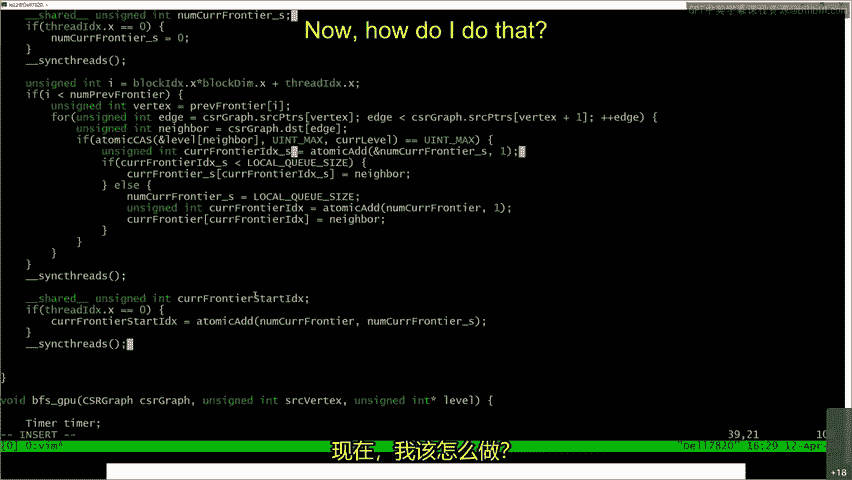

Because I'm going to have thread zero， store elements zero at position current current frontier start index。

' going to have thread one store element one at the position。

 current frontier start index plus one I'm going to have the thread two store element two at the position current thread index current frontronier start index plus two so I will have each thread store the corresponding position so what I will do is I will write a。

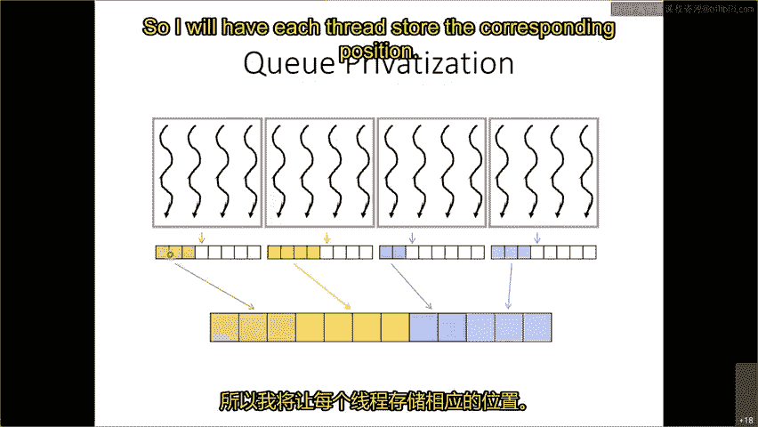

Fred index dot x is less than。No current frontier underscore S。

Then what I can do is I can I will write current frontier。Of。The current frontier start index， plus。

Breadindex。ex。Okay， is equal to。The local current frontier。

 which is current frontier underscore S of。B and index X， is this clear to everyone？

But I still have a problem here， what's the problem？Problems here。How many threads do I have？

So I created， I launched this with 256 threads， but I actually have。2048 possible value。ok。😊。

So here this goes up to 2048， but this goes up to 255。

 so it's possible that I have more values in my current frontier。

Then the number of threads that I have。Okay， so it's actually not enough for me to use an if fit。

 but what should I do here？For loop。Right， I need to have a loop。So I'm going to have thread 0。

 take element0， thread one， take element 1 until thread 255 takes element 255。

And then if I have more than 255 elements that I want to increment by 256。

 and I'm going to have thread0， take element 56， thread one take element 257。

 thread2 take element 58， etc。😊，So I will have。Oops， sorry， I lost night Chrisor。

Here it is by Laurate 4。Unstein and。I'm going to call the index that I'm going to store at current。

Frontier index。Under S actually， so this is going to be the index into the current frontier that I'm going to load from okay。

 and that's going to start at threat an indexdex dot x。And that may go up to。

Noome current frontiers underscore S， and every iteration I incremented by how much。

I am committed by and John。Okay， so on the first iteration threads 0 to 55 will store the elements at index0 to 255 on the second iteration threads the  zero to 255 will store the ones at 256 to 2023 the third generation we're going to go from 1024 to oh sorry from 25 from 56 to 511 and then on third generation will go from 512 until 512 plus 255。

Okay， and now I will use。Itcept right next at x over here。I will use the current frontier。That far。

Alright。😊，Is it clear to everyone what we just did， so just to summarize we created a local frontier。

 we initialized an counter for it， we initialized the counter to zero as we were visiting the edges we were adding the vertices to the current frontier once we overflow the current frontier we added we start outing the elements to the global frontier and then when we were done。

😊，We had one of the threads in the block reserve space in the global frontier with as many elements as we collected in the local frontier。

 and then we had the threads collaboratively loop over the elements in the local frontier and store them to the global frontier。

Any questions about this？有极咗。Yes， question。 Yeah， the code is clear。

 but I have a question related to the exam exam it it was an exam question。

 And the divergence for if thread index dot x equals 0。 I it how many threads divergge for it。

 Is it one or 41 or 32。 So the So the when you reason about divergence。

 you should reason about it at the warp level。Okay， so when I I can't ask how many threads。

 I should ask how many threads diverge from so how many threads in a warp。

Right so I can ask how many wars diverge and within a warp。

 you know how many threads take each branch， diverge to each branch。Okay， okay。

 so here I'm going to have one of the warps， which contains thread index dot x equals0。

 one of these warps thread 0 will take one one branch and the other threads will take the other branch and the other branch。

 All the other warps are not going to have any divergence。Okay， thank you。Yeah。Okay， so let's。Oops。

 do I have a bug？Expression has not which expression。Oh， there we go。Here I wrote。Current frontier。

 I should have written plus equals， but looks like my hands。 So I just wrote plus。 Okay。

 so current frontier plus equals block des。I'm glad the compiler detected that。

So we're going to compile and so remember our performance before was 14。

8 milliseconds so now let's see what performance we get。嗯。So 14。

67 millisecond okay so we've got a few a fraction fraction of a millisecond performance improvement so maybe the performance improvement wasn't as impressive as you guys were expecting and usually this depends on many things and depends on the graph it depends it also depends on the hardware because some architectures or have know the later architectures have excellent atomic operation support whereas the earlier ones didn't so on previous architectures this was a kind of stronger optimization。

 but here for this particular graph on this particular architecture the performance improvement we got from privatization was small but you may expect it to be larger on other graphs or in other architecture。

😊，Okay。😊，Yes the privatization。 yes， just about the the algorithm。

 is there a way to write an algorithm that no， that syncs with the， with the CPU。And you know。

 you follow the path of the graph。So there are ways to synchronize with the CPU during using atomic operations。

 but that's an advanced topic that's not very relevant to today's material。ok。Allright。

 so having seen this， let's go back。 So here this is the code that we wrote。

 This is the continuation of it。 So， so minimizing launch overhead。

 So the one thing that we've been doing so far is we've been launching， we've been calling a kernel。

😊。

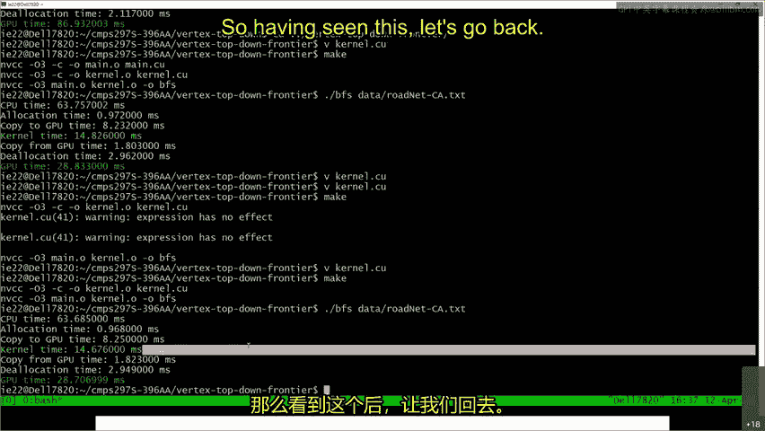

For every level， right， And the reason we're doing that is because we need to synchronize across all the threads on each iteration。

Now， when we go， when we went through when we went to this frontier based approach。

And the approach we had before， we were launching a thread for every vertex on every level。

 and usually we have many many vertices， so we have many thread blocks。

Whereas when we went to this frontier based approach， we're only launching a thread。

For every vertex an hour front here。And what that means is that the number of vertices in my frontier may be small enough to require only one threadb process。

Okay and this presents an opportunity for optimization。

 so we've seen that we need to synchronize between levels because we need to wait for all threads to incu all the vertices in the current level before proceeding to the next level。

😊，And so far， what we've been doing to synchronize at between levels is we've launched a new grid for each。

Level。And the overhead of launching a new grid is because we have the overhead of doing the actual launch。

 And then we also have remember how we were copying this counter in order for us to figure out whether we are done or not。

Now， if it happens to be the case that consecutive levels have few enough vertices so that these vertices can be executed by one thread block。

Then what we could do is we can execute multiple levels in a single thread block and synchronize between them using big threads and what this does is that it reduces the total number of grid launches that we need to make。

ok。😊，So if I show you a picture if over here at levels 0， I just have one trend block。 usually。

 by the way， this is at the beginning and at the end。 Okay。

 so usually the levels that are at the beginning are usually small because it takes a while for me to to kind of to kind of have big enough front here so that I start touching many vertices every iteration。

 And usually the levels at the end are also small because that's just the notes that are very。

 you know， very far away from the from the source vertex。

 So it takes a while for me to kind of catch all these these very distant notes。

 So usually the levels at the beginning and levels at the end have a few vertices。😊。

Okay so what I can do is between if in between two levels。

 the number of verticies that I have in the frontier is small enough such that it can be processed by a single thread block。

 what I can do is rather than launching a grid for level zero and a grid for level1 over here or down here rather than launching a grid for level5 and then a separate grid for level6。

 what I can do is I can just have one thread block processed both level0 and level1 and use a sync threads to synchronize between them and similarly I can have one thread block process level5 and level6 and do a sync threads between them。

😊，So consecutive levels that have a small enough number of vertees。

We can synchronize between these levels using stin threads rather than having to call a current library。

Okay， is this optimization clear to everyone？Okay， so let's see the impact of this optimization。

 So I'm going to。

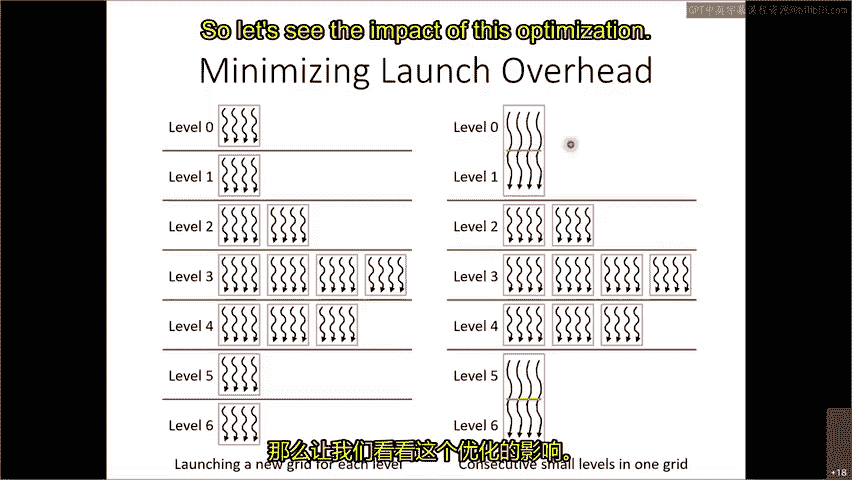

I've already implemented it。They call level C。And I' going to compile it。Okay， not。

 I'm not going to show you the code。 I'm to leave that for you as an exercise。

 but I'm going compile it just to kind of show you what we can get the amount of approval we can get by doing an optimization like this。

 We're gonna run。 And as you can see， we have also have a reduction in the execution time because we've saved on some of the kernel launch。

 Okay， let me run again。 if I get something anything better。😊，Okay。So as you can see。

 we also get some improvement in the performance。Okay。😊，sorAny questions about this？Yeah。

 a professor。

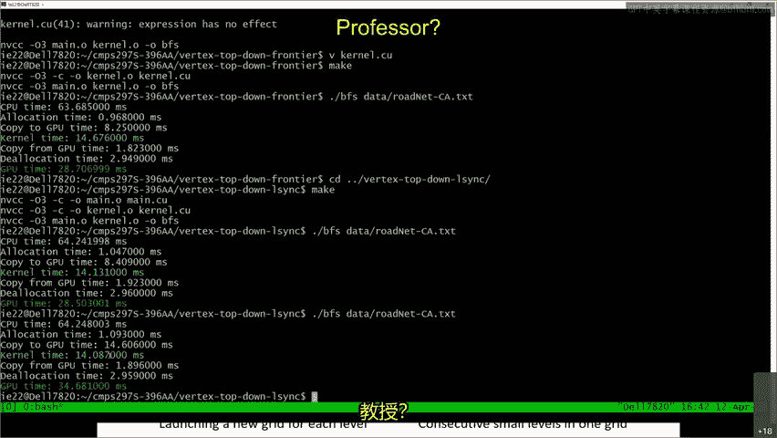

Yes。😊，I was wondering， how do you go about knowing when to launch like a single block grid or when to not launch it。

 Like， is it a heuristic。So what you will need to do is you will need to check。

The number of vertices in your current level。Okay， and if the number of verticies at your current level is less than the number of verticies that you can process by in a single thread block。

Then what you can do is you， you can have that trend block。 do， you know， do everything。

 So and generate the next Q。 If you find that the next queue also has。

If you have it next you also has enough word excuse that can be processed in a single trend block。

 then in that case you can just do a sync threads and go ahead and process that next one。Okay。

 so the way you point out is if if your current level。

 if your previous frontier has fewer fewer vertices than what can be done in a block and your next frontier also has fewer vertices than what can be done in a single block。

Have they answered your question。Yes， certainly。 Thank you。Yeah， you're welcome。Any other questions？

Okay， so end of today's lecture， you can read more about what we covered today in chapter 12 of the textbook。

 does anyone have any final questions before we conclude？Yes。

 can we add multiple levels like not just one level。What you need here？也。Yes， of course。

 I mean you as long as the your your next frontier。

 your previous frontier and your next frontier are fit within a block。

 you can go on for multiple levels。 Okay， thank you。也有。Professor would the in this case。

 the first example you gave for level 0， for example， it's kind of like thread coing。

 If you apply it to different to all the levels at the same time。 Does it help or no。

It's a little bit different from thread cosing here I'm I'm notm reus I'm reusing a thread for something else。

 but I'm not reusing it for something else that was meant to execute in parallel with it。Okay。

 I'm reusing it for something else。That was going to execute after it。 Okay。

 so it's a little bit different from threat poisoning， but can you repeat your question。If you do。

 for example， kind of this， this execution pattern for all levels at the same time。

 would it would it help or not really。What do you mean doing for all levels at the same time？

So for example， to execute the next one。No， I mean， for example， in level 3。

 there are some blocks where you could merge them together。Oh love between yes。

 I tell you that' that's excellent， excellent observation。

 So I think what you're saying is so maybe here I have 256 threads and I have 256 vertices in level and maybe here in the next level I have I have maybe 20 and270 vertices。

 So maybe it's better for me to do thread coing to use the 256 threads to do the to process the 270 vertices as opposed to having to create two blocks and pay the price of having to have a new grid launch。

 I that what you mean。😊，So maybe it's better for me to in level between level one and level two。

 maybe it's better for me to use one thread block to do the work of these two thread blocks。

Rather than using two threadread block。And if I use one thread log to do the work of the two thread logs。

 then I can sync threads between the rather than launching a new grid。Kin of， that's what I imagine。

 Yeah， as possible。It it's possible， it's worth a try again， you're losing parallelism。

 but you're saving on the sink on the grid launch overhead and it just has to do with how expensive is the grid launch compared to to you know the workload of these two blocks。

Okay， so that's something that you， one would have to experiment with and see which one has higher overhead。

Okay， so thank you for that question， it's a good observation。Any final questions。Okay。

 if there are no final questions， then the all for today and I'll see you next time， bye everyone。

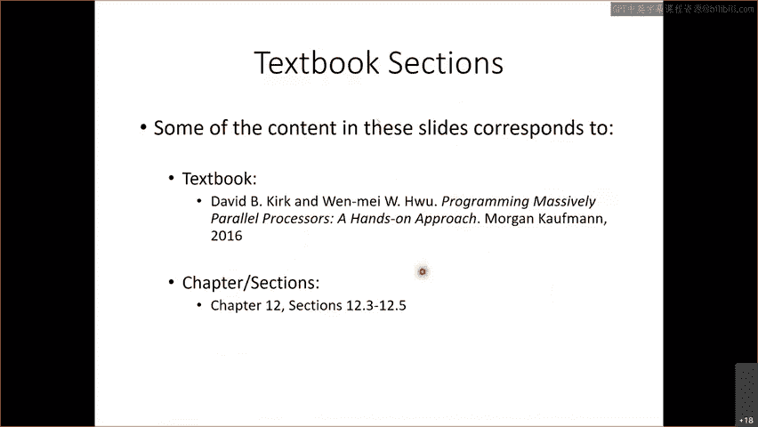