# 美国贝鲁特大学《GPU计算｜CMPS 297S396AA - GPU Computing - Spring 2021》（豆包翻译 - P21：-21-Lecture 21 - Pinned Memory and Streams.zh_en - GPT中英字幕课程资源 - BV1bw4m1k7a1

Hello， everyone and welcome to Leture 21 of GPU computing。 Today。

 we're going to be talking about pin memory and stream。

Last time we spoke about intratro warp synchronization we said that we can take advantage of the special relationship between threads that are in the same warp to synchronize between them quickly and Itu has built in functions for that in particular there's two major categories of warp synchronization primitives。

 there's shuffle instructions that allow us to share data across threads that are in the same warp so they can just share each other's registered values with each other without having to go through shared memory and there's voting instructions where we can where threads can vote on something or this is useful for checking which of these threads evaluate true sort of predcateates or checking which threads in the warp are active on some branch。

We started by looking at shuffle instructions and we said there's different kinds of shuffle instructions。

 shuffle， just shuffle links you can get from a direct lane sort a direct thread another thread in the warp。

 or you can shuffle up or down or there's an also a shuffle X or kind of shuffle that。

It's also useful in certain circumstances， and we applied shuffle instructions to reduction。

 So we looked at how when we had reduction， every iteration half of threats drop out。

 And when we've got to one warp， we in the previous implementation for this warp。

 we were actually going through shared memory and doing st threads every time。

 But we realized that we actually don't need to do that。

 what we can do is we can simply use shuffle instructions to do a reduction tree within the warp without having to to go through without having to go through shared memory and without having to do any same threads。

We then looked at warp vote instructions and we saw how we have different variants we have different ways we can vote we can check if all the threads satisfies some predates or if one of them satisfies some predicate。

 there's a ballot where we can check which threads evaluate a pre to true and which one is evaluate false and we get a mass that tells us that and there's the active mass which tells us which threads are active on a certain branch and one thing that we saw that we can use warp vote functions for is whenever we want to the threads in the warp to communicate to have one thread do something on behalf of the others so an example of that was if we were adding some elements to a queue and we wanted to increment and counter rather than having each thread increment the counter we can have one thread in the warp increment the counter on behalf of all the others and then each thread can figure out which slot in the queue it should take from among the。

That the leader thread allocated and we saw the different steps we're doing this。

 we assign a leader thread， then we figure out how many threads we need to add to the queue。

 then the leader thread does the atomic operation and then it broadcast the results to the other threads and then each thread。

Each active thread figures that where it stores its result and we saw how to do each of these we saw how we used active mask to figure out which threads are active and find first set intrinsic to figure out find the first set bit and active mask in order to figure out which thread we want to assigned as the leader we saw how to use population count on the active mask to figure out how many how many bits are set so that we figure out how much space we need allocating the queue。

 by the way， find first set and pop count are not in work synchronization primitives they're just intrinsics that each thread can call on its own。

 but they're useful when we are looking at what we are using inver intrinsics because we can apply them to active mask to do all kinds of interesting。

NowSo after we figure out the number of elements we want to in the queue。

 we had the leader thread through the atomic operation and then we use shuffle sync so that each thread get in the or gets the value from the leader thread to figure out where it lower its result and then we saw how we can do some bitwise magic in order to figure out the position of each thread so that each thread can add its result so the position in the queue for each active thread each thread can add its results。

So this is what we talked about last time， any questions about interorm intrinsics before we talk about today's material？

Is everything clear？Okay， so then today we're going to move on to a new topic。

 which is pinned memory。 We're going talk about pinned memory。

 and we're also going talk about streams。 So these are two related topics。

 So we'll start by talking about pinned memory， and then we'll we'll talk about stream。 So first。

 let's talk about pinned memory。 what is pinned memory。

 So if you remember we previously had vector edition code and let me go。

 So this is a vector edition code that we previously had。 we basically had a vector addd kernel。

 and what we did is we allocated memory for vectors。 we copied the source vectors。

 we called the ad kernel and then we copied back the just the result vector and then we couldda free to free the result。

Okay， and I'm going to compile this and run it so that we get an idea， we kind of remember you know。

 how the time of executing this was divided。So here I'm going to write the Vadd and I'm going to run it。

Okay and as you can see here I'm highlighting the copy time as well as the kernel time just because we're going to be interested in focusing on copy time today so as you can see the CPUU time took 76 milliseconds to do is the GPU took much more it took 169 milliseconds。

 but what you can see is that the kernel time for the GPU actually just took 3。2 millisecond。

The time the total GPU time is dominated by what？As you can see， it's dominated by the copy time。

 It took 58 milliseconds to copy the vector to the vector to the GPU。

 It took 94 milliseconds to copy them back。Okay， so when when the vector is already on the GPU。

 obviously it's much better to do it on the GP than do it on the CPU but the vector is on the CPU。

 the speedup that we get from doing it on the GPU doesn't really pay for the cost of doing the copying And the question that we want to ask today is can we optimize this copying。

 Can we reduce this copy time that we are incurring every time we copy things to and from the GPU。诶。

😊，So let's see how we can do that。

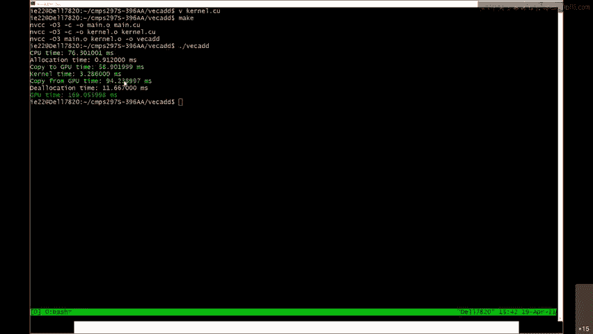

So this is the code that we wrote and like I said， were trying to see what we can do to reduce this putM copy time that we're spending before we do the vector tradition and then after we do the vector tradition edition to copy back。

And to talk about how we can optimize the copypiing。

 let's first talk about what happens when we call k。

So what happens when they call a copy is something called direct memory access or DMA。What is DMA。

 so direct memory access or DMA， it allows hardware some hardware unit in my hardware to access memory without involving the species。

SoWhen we say that something in the hardware has DNA access， It means that it can access。

The name memory of the of the CPU or to access some memory without involving the CPU。

And copying between CPU and GP actually uses DMmaA。

 What that means is that when I copy data from main memory to the GP。

The CPU is not involved in this copy。 The CPU doesn't load from main memory and then to the GPU memory。

 It doesn't， you know， doesn't loop over these eras in main memory and unload them and then go and store them to the GPU memory。

 What happens is there's something called a DMA engine。Where。

 when the CPU does it calls kud and copy。It just calls it and it can go and do other things。

 and this DMA engine is responsible for reading from the main memory of the CPUU and putting the result in the GPU memory。

Professor。Yes。😊，The DMA engine is it in the main memory or inside the GPU。The DMA engine is part。

 I mean， it depends so there's all kinds of different DMA engines for different things DMA in general is this idea is this idea of allowing some hardware to be able to access some memory without involving the。

This DMA engine that does the transfer from the main memory of the CPU to the GPU memory。

 I believe is on the CPU， but obviously you have to involve the GPU driver when you do this。

 but that also runs on this。Okay， this hardware unit， I believe， is on。Okay。

 so then so what's the advantage of using DMA over， over having the CPU somehow。

 if the CPU somehow had access to GP memory to involve the CPU in the copy。

 What's the advantage of using D MA instead of using the CPU。

You can make specializedize the hardware that that acts very fast。 maybe。 Okay。

 so the DMA is specialized， It can probably copy much faster than having to involve the CPU in the copy。

 What else。The CPU can do other useful work instead of waiting for memory。 Right， exactly。

 So I don't want， I don't want to waste my CPU time just， you know， reading and writing。

 reading and writing。 Okay， so what we can do is we can have the CPU can be utilized for other things while the memory copy is taking。

Okay， so while the cuum copy is happening， I can have the CPU do other things。Okay。

 so this is the advantage of using DMA。 What's their disadvantage of using DMA？我生。What's kind of a。

What is something that we have to pay when the means doing？Maybe when， when， when you specify。

 give it an order， you cannot stop it， maybe easily。Maybe。I mean， sure， that depends on how you know。

 that depends on the kind of access that DMA gives you。

 the DMA hardware whether it gives you the ability to do that or not。

 I was looking more about what's the difference between accessing something from the CPU versus accessing it from a DMA engine。

A CPU is faster。That' now what I'm looking for， what does the CPU do when it access this main memory？

It issues a load instruction right issues a load instruction that load instruction is an address right the address is what kind of address it catchs it right that's the thing I sure it's going to cache it what kind of address is the CPU you use to access main memory。

A virtualirtual address and a virtual address and what about a DMA， what's DMA going to use？

The physical memory。这里用是 physical啊。Right to use the physical。

So the CPU uses a virtual address and the CPU does address translation。

 right when we do address translation。The the software and the hardware that together do the address translation。

 run on the sea view。The DMMA engine does not have the capability of doing address translation。 Okay。

 it doesn't have， you know， it doesn't have the instructions to read from a page table and all these things。

Okay， so the DMA engine is going to use a physical address when it reads from the main memory to write to the GPU memory。

 now what's the drawback with the DMA engine using a physical address？

It doesn't It cannot reference the whole， the whole domain of the memory that's available。No， it can。

It can。You can't me around if you send something to the DMA。

So what you're saying is if the DMA is reading from something， you can move that thing around， right。

 yes。Right， exactly that， that's exactly the problem。

So the DMA is using a physical address if if if the memory that the DMA is reading gets swapped out。

The DMA has no way of detecting that。Okay， a CPU can detect that because if something gets swapped out when you come and translate it。

 you're going to you're going to have the page fall and then you're going to swap it back in。

Whereas with DMA， when it's reading from the physical location， a physical page。

 and then that physical page gets swapped by the operating system。

 the DMA agent has no way of knowing that， so itll end up just continuing to read the same physical page。

 which now has new data。😊，ok。😊，So we don't want that。

 obviously we don't want the DMA to read the wrong data。

 so when we give the DMA a physical address to read， to start copying。

 what do we have to do with that the memory of that physical address？Lock it， lock it。Right。

 we have to lock it。 We have to make sure that that memory does not get moved by the OS。

 doesn't get swapped by the OS。Okay， and that is what pinned memory is。So as a recap。

 DNA uses a physical address to access memory。And because it uses a physical address。

 it cannot detect if the operating system blockss a virtual page with another virtual page at the same physical address。

So the operating system comes and puts different page of the sameus status the DNA has no way to detect that。

 so to avoid data corruption。What the O S must do is that any page， the O S or sorry。

 the O S should not be allowed to swap pages that are being accessed by DNA。

 So we need to do to prevent the O S from accessing pages that are being accessed by DMA is that we need to lock these pages。

 So any pages accessed by DNA needs to be page locked or in other words， it needs to be pinned。 Okay。

 so we have to allocated as pinned memory so it doesn't get swapped away。Okay。

 so anything that's out here the pin memory， these pages are going to be markeded。

 there's a special way of telling the OS hey do not swap these pages。Okay。

 now this brings us to Km and copy。So having now known that Kumum copy uses DMA and that the DMA requires pages to be 10。

How do you think Kut uncopy works， what does Ka un copypy do？It first locks the。

 the memory it access， the whole memory it accesses， and then reads。

So you're saying it unlock the memory and that is going to do the DMA。

 It actually does something different than that but the idea that the memory that we're copying from needs to be locked is correct。

 So when we allocate data。That data is allocate using Ma。Okay。

 so we haven't really done anything special to to to lock it。

 So the So we have to assume that this the data can be swapped out。

 So if could on copy that is actually the following。When we copy from host to device。

 what the CPU is going to do is the coudDa runtime is going to have this pinned memory buffer that is going to use and what the CPU will do is is the CPU is going to copy the data from the buffer that we want to copy to pin a pinned memory buffer。

And then the DMA is going to copy the data from the pinimp memory buffer to the Duke。

And when we copy back， it's going to be the same， right， because you know， when we read from DNA。

 we don't want the patient to be swap up， but also when we're writing to DNA and we don't want the patient to be swap up。

Sorry， sorry， writing into the name memory using DNAA。 we don't want the page to be swap up。

 So when we copy from device to host， the DNA is going to copy from the device to a pin memory buffer。

 and then the CPU will copy from the pin memory from from the pin memory buffer to the CPU buffer that was allocated by map。

So as you can see， whenever we call PM copy， we're not doing just one copy we're actually doing two copies。

 One copy is between the the kind of the regular CPU buffer and the pin memory buffer and the other copy is between the pin memory buffer and the device memory and this obviously doing two copies instead of one incurRS overhead。

ok。😊，So what can we do to optimize the copies， what can we do to make the copies faster？

Now that you know this。If I don't want to do two copies， I just want to do one copy。

 what can I do with my buffer？I can pin them， right。We have a buffer immediately on the device。

 and just the。Like copy to it and read from it immediately。So the pinned memory buffer is on the CPU。

 It's not on the GP。 So what we can do is we can have a pinned memory buffer on the CPU that has my original data。

 and then we just copy from that buffer as opposed to having a nonpinned buffer and copying from that to the pinned memory buffer and then having the DMA copy from the pinned memory buffer。

诶。Profe sir， there is one thing I don't understand。 You said at the beginning that the C P。

 the CPU doesn't do anything。 It just calls goodam M copy， and then it's done。So what I said。

 so I don't know if I said it that way， what I said at the beginning was that that when you call foodimp copy right。

 you initiate a copy and then that copy kind of happens but what actually happens is is what I'm telling you right now Okay maybe what I meant by that is that there's a DNA engine that's taking care of the copy so I told you that part。

 but I didn't tell you the part about the pinned memory just because perhaps it was too early to introduce these things。

Okay， okay。 Thank you。a professor。 I cant see what's the advantage of the DMA if the CPU is copying anyway so like it's like we're doing more than we we need to be。

有个。Okay， good point。 So in this case， another role of the DNA is to access the GPU memory。Okay。

 because near the CPU does not have direct access to the GPU memory。

Okay so there's kind of a PCIE bus or maybe some other kind of interconnect and we need to copy over that interconnect and that's much slower right copying to the pinned memory is much slower than copying over the interconnect to the GPU。

Okay， so CPUU doesn't have direct access to the GPU's memory。

 and that's why you have a specialized hardware that takes care of copying things over the interconnect between the main memory and the GPU。

Okay， thank you。Yeah， you're good observation。Okay。

 so what we would like to do is whether we like to make our copies faster and to make our copies faster。

 what we can do as we can just。Our host arrays allocate them directly in pin memory right。

 So pin our host arrays， allocate them in pin memory， rather than allocate them in a regular room。

 Okay， so we can make the copies faster by allocating host arrays directly in pinned memory and Kuda gives us an API to do that So what we can do to allocate or delocate host data and pin memory directly is we can use Puda Ma host So this is just like Kuda analog。

 but you add the word host And what this tells Kuda is to allocate the data inside of。😊，你听。Okay。

And then we can use Kuda free hostst to free the data that was previously allocated inside of pinned memory。

诶。😊，So it's just like put them out and put it free。

 but instead we're going to use we have the word host at the end。诶。😊，Now。

 since since Google meocco is so much makes my copy so much faster than doing Malo use regular allocation。

 Can I just go and allocate everything in pin memory。Is that a good idea。

Why don't I just go and I'll get all my data and pin memory that I want to copy to the G。

How much space do we have in pen memory？I mean， if I have my main memory， you know， I can， I can。

 I just it's the same pages， right， the same pages in my main memory。

 I can pin them or I can choose not to pin them。 So there isn't really kind of a separate pin memory capacity from the regular。

You lose the flexibility of virtual memory。Right exactly， so when I pin a page。

 I'm telling the OS that you cannot swap this page down。If I gone allocate everything in pin memory。

Right， I'm telling the O is that I want all my memory pages not to be swapped out。

 So what that means is that the O S is going to have less flexibility and swaping things back and forth。

So that's going to degrade system performance because when the OSS now only has fewer choices it when it wants to affect patients off them。

 and then obviously it cannot allocate more pin memory than the image memory that they actually have in this。

Okay， so you have to use pinI memory with a lot of caution。

 it should only be used for data that we are frequently poping。

Back and forth between the CPU and the GP。If we allocate too much pin memory。

 this would degrade overall performance because of reducing the virtual pages available for S。

Alright。Now， in modern systems。That have a lot of memory。

 know if you have 128 gigabyte of main memory， but your GPU only has four gigytes， for example。

 of device memory， the newer ones have more than that， new has a pin to 32。

 but I'm just kind of giving an example， if you have know if your GP has a small amount of memory。

 then maybe it's fine to use a lot of pin memory because even if you use a lot of pinned memory you're not going be the amount of GPU memory that you have。

 you have to pin corresponding memory for on the CPU is not that much compared to the amount of memory you have on。

Okay， but in general， you have to be careful。 Don't allocate everything in pen memory。

 Just you should allocate the things where the copy overhead is really important。ok。😊。

Let's go and use these Calco and couldfr hosts in order for us to see what performance we get by allocating in pin memory right I'm going to switch over here and I'm allocating in the main file so I'm going to open the main file and here this is where I'm doing Camal for the host arrays。

 I have the X array， the Y array， I have two arrays。

 there's that I'm using for the the CPU code and there's the Z array that I'm using for the GPU。

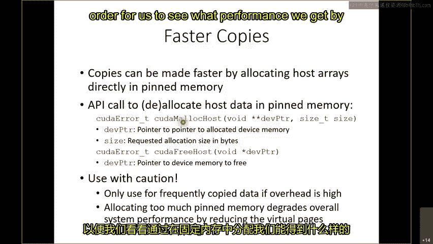

Okay， so what I'm actually going to do is and I'm going to allocate pinned memory for both of them right even though the GPU one is the one I care about because that's the one I'm going to copy back into。

 but I'm also going to allocate in the CPU because I want to show you what happens when we do that as well。

So here， rather than allocating and using malloc， what I want to do is I'm going to replace the allocation malloc to use Ka malloc cost。

 but I'm going to。Get rid of all of this。俾。😊，And I'm going to write Kuda。helello。Those。And of course。

 I need to provided a pointer to the pointer that I'm storing the result that result the pointer to the resulting allocation so I will have a。

Boy double star cast。 and I give it and。Okay， so this I'm going I' given a pointer to x that knows where to allocate x。

Okay， and I want to do the same thing for the rest。

 so here it's going to be y here it's going to be Z underscore CPUU and here it's going to be Z underscore G。

Okay， so what this does is that it allocates the X， Y， Z CPUP and Z GPP raise in pinned memory。

 And but I need to be careful because when I allocated pinned memory。

 I need to make sure I also deloated it properly because because I pinned it。

 So I'm going to come down here where I was doing free and it said I'm going to do。Good的。3e post。

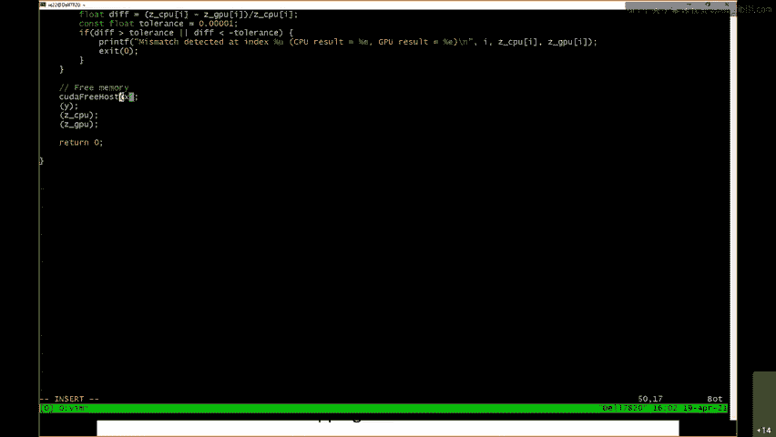

ok。😊，So again， we use Kuda malllog host to allocate and it has the same syn as scuda malllog。

 and we use kooter free host to the。

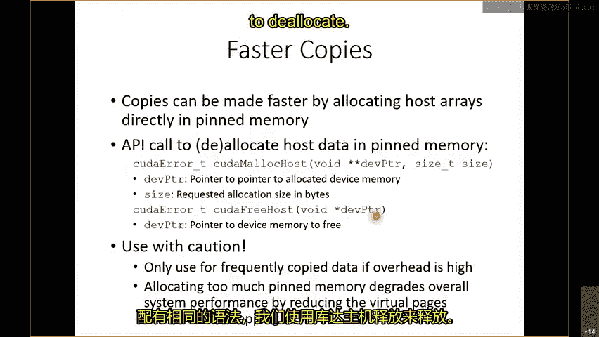

I'm going to save this， I'm going to compile it。And now I am going to run it。Okay。

 and as you can see， the GPU time has improved substantially。

I went from 1 169 milliseconds to 80 milliseconds。and the reason is that the copy time is much less here the 58 milliseconds became 43 milliseconds and 94 milliseconds for copying back became 20 milliseconds。

诶。😊，Why did the CPU time also improve Excel observations。 I was going to ask you that too。

 so why did the CPU time improve when I used pin memory for the CPU buffer。Oh。

 because we're not using page we we are the pages pinned now。

 So the O is not playing with it anymore。 Right， exactly。

 So now our CPU pages are pinned and what that means is that when I'm doing the the calculation on the CPU。

 I'm also benefiting from the pinning because I'm not going to have any page faults while I'm doing my edition。

All my pages are going to be in era。Okay， so we improved the the GP time。

 but we also improved the GPU time。Okay。Okay， so any questions about pinned memory。

 everything is clear。

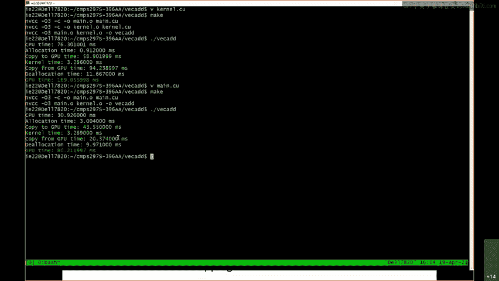

Okay， so having spoken about pin memory， this here is the code that we just wrote。

 The next thing I want to talk about is stream and talk about that。

 I want to talk about parallelism at the system architecture level。

 So we've spoken a lot about parallelism we've been prop lot about data parallelism doing having different threads causes different data in parallel。

 today， I want to talk about a parallelism， but the system architecture level。

 this is more related to task parallelism。 it's actually a form of pipeline parallelism。

 So let's so when we have a typical system。 you know， we have a CPU， a GP CPU has main memory。

 the GP has GP memory right， and usually what we do is we copy over we compute on the GP and then we copy back But the system is actually capable of simultaneously executing a grid on the GP and copying from the host in the device and copying from the device to the host。

😊，Okay， so the hardware that computes on the GPU is different from the hardware that copies from from main memory to the GPU memory。

 and it's different from the hardware used to copy from the GPU memory back to the mainmen。

It says these are three different pieces of hardware。K， or three different resources。

 Let me be or general， send these are three different hardware resources。Okay。😊。

We can actually use these three things simultaneously。But so far。

 what we've been doing is we have been copying to the GPU， running on the GPU and copying back。

 So each time we're only using one of these resources。 we're not leveraging all three of them。

And what we're going to try and do is we're going to try and leverage all three of them to fully utilize our hardware as much as we can。

 And let me show you what I mean by that。 So when we are doing a X edition previously。

 what we've been doing is we've been copying A to the device and then copying B to the device and then we've been executing a grid to compute A plus B and store the result in C。

 and then we've been copying C from the device。Okay， so here the horizontal represents time。

Well as you take a look， when I'm copying A and D to the device and actually not using the part of my system。

That runs on the GPUs。 I'm not using the GPU itself。

 and I'm not using the resource that allows me to copy from the device to the host。

And when I execute， so here during this time， my GPU is idle and my resource that I use to copy back from the GPU to the host is idle。

When I execute on the GPU， my hardware that does the copying to and from the GPU is idle。Okay。

 and then when I copy from the CPU from the GP back to the CPU。

 the GP itself is idle and the part that can copy from the host to the device of the CPU of the GPU is idle。

Okay， so what can we do to be able to utilize these hardware resources better？We can start executing。

 we can send it bit by bit and start computing as we receive and then output as we output to main memory as we finish computing。

Right， exactly。 so rather than copying all of A And B and then computing and then copy all of C back。

 we can copy part of A And B。 And then while we're computing on that part。

 we can copy another part of A And B。 And then while we're computing on the other part。

 we're copy a third part of A And B。 And all that time。

 we're also copying back the parts that we were're done computer。Okay， so in other words。

 what we can apply is pipeline。So we can pipeline vector addition like this。

 we can divide my A and B and C into segments。I can copy the first segment of A Bs of the device。

And then when the first segment of A and V are on the device。

 I can execute a grid to compute the first segments， A1 and B1， and then in the meantime。

 I can also be copying the second segment A2 and B2 from the host of the device。Okay。

 and then when I'm done computing and I'm done copying。

 I can then go and copy the result of A1 plus B1 from the device back to C1。

 and in the meantime here the copy of A2 and B2 is ready so I can execute a grid to compute A2 plus B2 and in the meantime。

 I can also be copying the next segment A3 and B3 from the host to the device。诶。As you can see。

 I can divide my array into segments and every step I'd be copying one segment I'd be paralyzing the copying of a segment with the computing of another segment with the copying back of the other segment。

 So actually this is where the parallelism is happening I'd be copying one segment while computing another segment while copying back another segment that is right。

Here， we're going to overlap copy and computation of different。Okay， and this goes on。

 So here when I'm done， I can copy back C2 while I'm executing while I'm adding A3 and B3 while I'm copying a 4 and before to the device and I keep。

ok。😊，Any questions about this， I it clear？How many grids can we execute at the same time on the GPU。

It depends depends on the compute capability， so it depends on the architecture。So for example。

 can I start， for example， if it's small enough， can I starting copying my data and executing many grids？

So in this case， what's really going to dominate the critical path of the pipeline is actually the copy。

Okay， so paralyzing different grids is not is not really beneficial， but yeah， yes， I mean。

 you hypothetically， you can run different grids in parallel on the GP。This particular example。

 that's not very useful， but in general， yes， you can run multiple grids on the GPU in parallel。

But if you were going to run these in parallel， you might as well put them in the same print， right？

O。So that in order for us to be able to apply this pipelining to do this kind of pipelining。

 what we need to do。Is we will actually need to make these copies asynchronous。

 so we're going to need to be able to kind of start off a copy and then you know let it go。

 not wait for it and be able to do a grid execution and copy back all kind of in parallel without having to wait for any of them。

Okay， and listen to news in the topic of street。Okay， so the parallelism。

Between grids and memory copies can be achieved using stream， Okay。

 and we're also going to use asynchronous copies。 So the ways what streams are。In Budha。

 you have these streams that contain different tasks that need to be executed sequentially。

 whereas if I put tasks in different stream they're executed。

The tasks in different streams the streams are executed in parallel and tasks in the same stream are serialized。

Now， by default， if I don't specify a stream， what's going to happen is everything is going to go into the default screen。

Okay， so if I specify multiple put copies by default。

 all these pseudo copies will go into the same stream and they will be serialized。Okays。

 same thing with kernels。 If I rubber call multiple copies and multiple kernels。

 all these will go in the same stream and they will be serialized。

 If I want different copies and different。Different kernels to execute and parallel right。

 So for example， I'm three this slide， If I want this pseudo and copy back to execute and parallel with this grid to execute and parallel with the scoo and copy to the device。

 these need to be put in different street。By default。

 if I just call them without specifying a stream， they all go into the same stream so they will be sterized。

Okay。😊，And so to put them in different streams， what we will we also we're also going to need asynchronous land copies。

 so to be able to overlap non copies with the host execution。

 we're going to need to have use asynchronous land copies because by default。

 the the co copy is not a。诶。😊，So having as kind student on copies， it allows the host to go and。

Wait for a copy to finish， so that it can。Sorry， it allows the host to proceed without waiting for a copy to finish so that it can perform other things Okay。

 so when the host calls a coum copy， it doesn't need to wait for it。

 it goes and it can go and call other kernels， call other coum copies。

 less is the benefit of using asynchronous memoryco。Okay let's see how we can do that。

 how can we create streams and how we can call asynchronous memory copies。

 the way to do that is using the following API calls to create a stream。

 we can call Ka create stream and provide it with a pointer to an object of type couda stream under4 T and this is where the create stream will put the information the handles for the stream so the identifier for the stream that we just。

ok。😊，To create to create an asynchronous copy inside of a stream。

 we can use the same coa and copy API， but with an async at the end of it。

 So it looks the same as the coum and copy API， but it has an async at the end of it。 Okay。

 so it's called kum and copy Async And what the k and copy async takes the fifth argument is a coa stream。

 by default， if we don't specify the stream， it's going to go into stream0。

 which is the default stream。Okay， however， if we want if we want to put the kup and copy to the specific stream。

 we can specify what stream we want by providing kind of some a stream handle that we created using the Kudak stream。

Okay， and then finally， if we want to launch a grid inside of a specific stream。

 we call the kernel like this， we the kernel configurations we we've seen two。

 we actually saw a third as well， but we've mostly been using these two so far。

 the grid dimension in the block dimension include when the grid configurations actually take other optional configurations and these include share the amount of dynamically allocated shared memory that we want to have per block。

 this is by default zero， and then the fourth optional argument or the fourth argument which is optional sorry the fourth configuration which is optional is the stream that we want to put the kernel end and again by default。

 if we don't specify a stream it goes into the default。ok。😊。

So what we would like to do is we would like to divide our input into pieces into segments and then have a separate put copy to the device。

 a grid launch and equivalent copy from device for each segment that goes into a different stream and let's see how to do that so I'm going to switch。

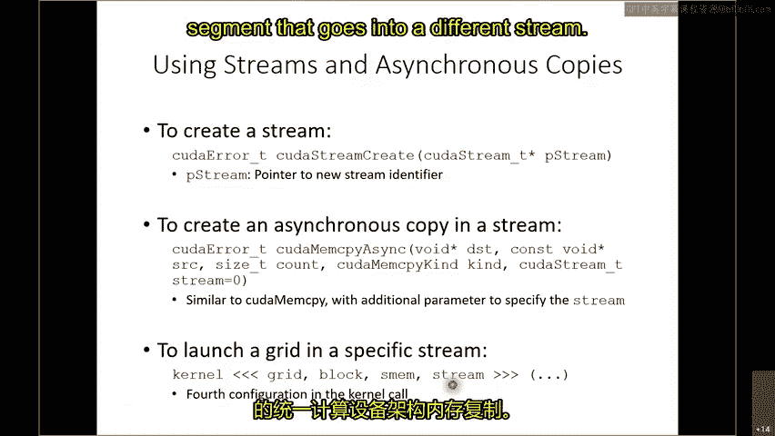

Back to my code this time I'm going to open my kernel code and here in my kernel code I have my vector edition kernel。

 which I'm not going to change this time I'm going to be working on the host code。

 So in the host code I do kuda Maloc。Okay， and then over here。

 which is the interesting part I'm doing Km copy to the GPU。

And then I'm doing I'm calling the kernel and what I'm copying back and what I like to do is I would like to divide my input into segments based on how many streams I have and do a separate quantumum copy vector vector add kernel and quantumum copy back for each segment Okay。

 so let me start by creating the different streams that I would like to use in order to process these segments in parallel。

So I'm going to first set up my streams。To set up my streams， first。

 let me pick a number of streams that I want， I'm going to create an integer。Unsside it numb streams。

Okay， and I can I can define node a different number of streams。 I'm going to use 32 streams。

 for example， I'm going to have 32 different streams and I'm going to divide my input into 32 different segments and have a segment be done in each。

Okay， so Im going I want to create 32 different streams。

 I'm going to first declare 32 different streams， so I'm going to do that like this。

So QUa stream underscore T is this type of a stream。

 if I want to declare one stream I can do it like this。

 if I want to declare 32 I can simply provide 32 or non streams over here as so this will be an array of a 32 different stream。

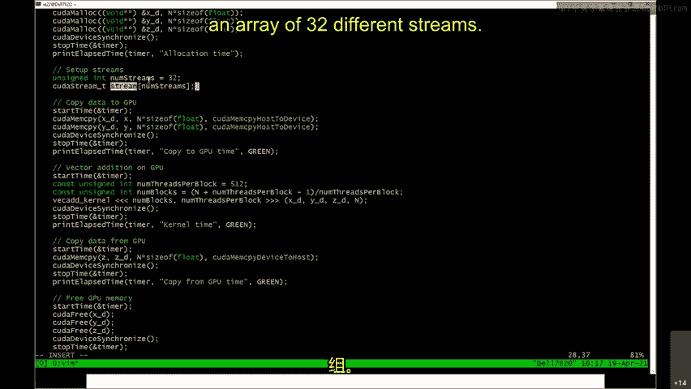

诶。😊，Now， to create a stream， I need to use the Ka stream create API call。

 So I'm going to loop over over my stream， but I'm going to create them。 Let me write for。

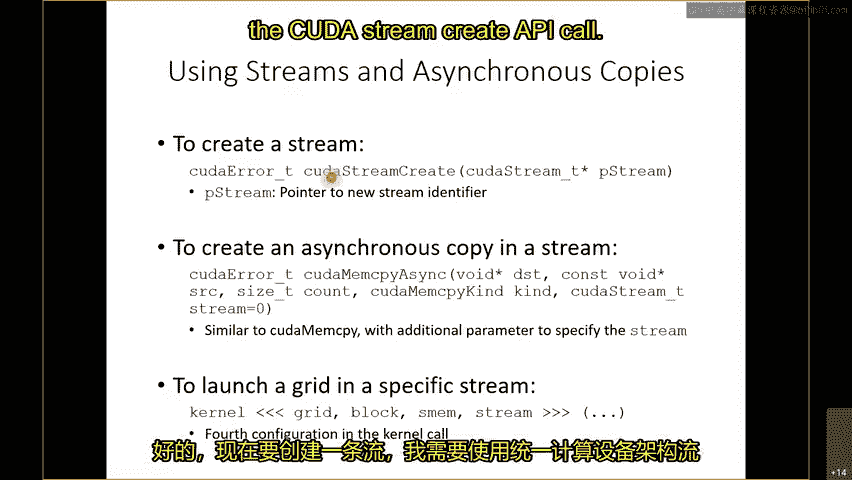

Rstein and F equals zero to here S is going to be the index of the stream I'm creating。

Ask is breath time。A number of dreams。Plus， plus f。And then for each of these， I'm going to call。

Good的。arere you。

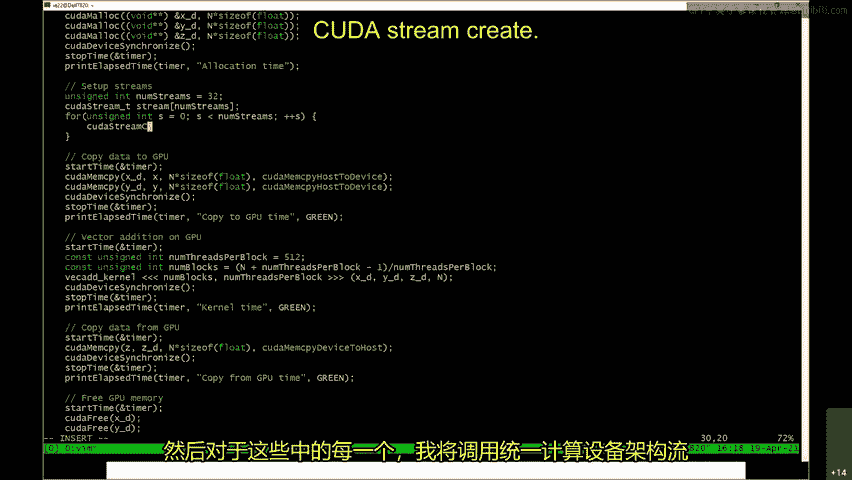

Create and here put a stream create just takes one argument。

 which is a pointer to the stream that I want that I want to create。

 So here I am going to provide it with a pointer。 So I'm going to take the address of the stream。

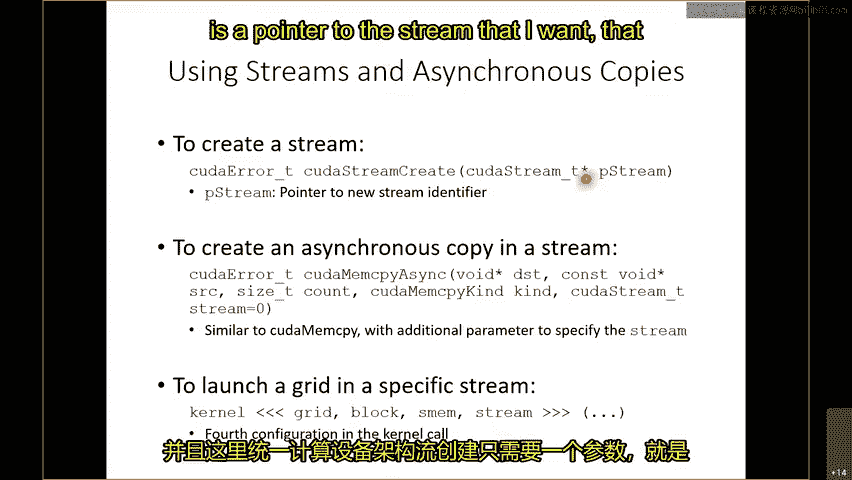

Yes。诶。😊，So now what I've done is I've created 32 different streams。Clear so far。Any questions？

What is the true 32th3。I just picked it arbitrarily it's you know I decided it was a good number。

 you can use eight streams， you can use 16 streams， you can use as many streams as you want。

OkaySo I like making folks。Like doing multiple processes asynchronously。I mean， the idea。

This when you fork your， you're creating different CPU threads。

 So here we're not really creating different CPU threads。

 We're creating different cues in which we're going to put our the the operations that we tell the GPU to do。

And we're going to create these different cues and we're going to put each thing we told the GPU to do in a stream。

Okay， so if I want the GPU to be able to run different grids in parallel， Okay。

 so I have multi different because I want them to run in parallel or multi different minimum copies I want them to run in parallel。

 by default they will be serialized because they will in the same stream if I want them to be paralyzed。

 I need to put them in different。Okay， have answered your question。Yes， yes。

 I thought I thought we were multi multi threading on the CPU。 no no know， we're not multi threading。

 We're using one CPU thread， but we're putting， were putting commands the GPU in different streams so that to tell the GP that hey。

 these things can be done in parallel。Now another way to do it。

 another way to do it is to have multiple threads on the CPU and have each thread create its own stream and send its own commands to a G。

So in that case， we would be multi friendly， so that would be another way to do it typically and typically you know if things can if different threads are running on the CPU and each one of them is using the GP for its own computation。

 we would typically want to create different streams。

 one for each thread so that the threads can use the GPU independent。Okay。😊。

That' I'm glad you asked that。Okay， so next thing what we're going to do is we want to break up the input into different segments。

And we want to loop over these segments and have aum copy back kernel and the equium copy back for each one of these segments。

Okay。😊，Next want。Okay， so here next we're going to stream the segmentss。Alright。

 so my number of segments is going to be same as the number of streams。

 I'm gonna just create a variable。Nom segments for convenience。

As well it can be the same as the number of streams。Okay。

 and and the size of my segment is going to be the size of the input divided by the number of strings。

合避。Segment size is going to be equal to n over。The number of segments。And of course。

 n may not be divisible here。 N is the size of the whole array that I'm that I'm adding。

 but n may not be divisible by the the number of segments。 So in this case。

 what I want to do is I want to do a ceiling。 So I'm going to do that by doing n plus。Now magnetant。

-1 over noing。喂。😊，Now I can loop over my segments。 I'm going to write four。Unsed and f equals0。

 S is less than the number of segments。Plus plus S。 And now for each one of these segments。

 I would like to do。 I would like to copy it to the GPU。

Call the grid and copy it back and by putting them in different streams。

 we will get the pipelining that we are interested in getting。Okay。

 let me first part figure out what part of the input each segment is going to process， Okay。

 so I'm going to start by finding the segment bound。Okay， so the segment， I have the segment size。

 Okay， so every segment is going to start at the segment index times the segment size， right。

 segment 0 is going to start at0 segment one is going to start at one time segment size。

 segment two is going to start at two time segment size， etc ceter。So the start of the segment。

Is going to be at S times。Stegment size。The end of the segment。

Is going to be at the start of the segment， right plus the segment size。However。

 the end of the segment could be out of bounds。Right， so for the very last segment。

 maybe n is not divisible by the number of segments。So I need to make sure that for the last segment。

 I handle it properly， so I'm going to do a minimum between Star plus segment and。And so here。

 if the end of the segment is less than n， then I just so it's the start will signal size is less than n then I take that as the end of the segment。

Okay， otherwise， I'm in the last segment， so I will just use n as the end of the segment。Okay。

 and what that means is actually different segments are going to have different size in particular。

 all the segments are going to have segment size as their size except for the very last segment it's going to have it's going to have a different a smaller size Okay so so I'm going to have another variable and segment that tells me the number of elements in the segment and that's going to be n minus。

You came to it for the all segments， n minus start is going to be start plus segment size minus start。

 so n segment is just going to be segment size， but for the last segment n segment n minus start is going to be the size of the last segment。

 which I could have also computed as n modulo the segment size。ok。😊。

So now for each segment I know where it starts， I know where it ends and I know the size of that segment。

 now I can go and modify my copy， my copies and my vector edition kernel and my copy back in order for me to take care of copying that segment to the GPU computing on it and copying it back。

Now， before I do that， I to I want to get rid of the synchronization before I was synchronizing after every co and copy after every vector edition kernel after every copy back。

 I don't want to do that because I want to be doing all these things in parallel。

 So I'm going to move the Ka device synchronize outside and I'm going to time the whole thing I can no longer time individual copies because all the stuff is happening in parallel So I'm going to move the timer outside。

Okay， and I'm going to copy how much the whole thing takes with the copies and the kernel combined because now the copies and the kernels are happening in parallel。

Okay， so now here， I'm going to synchronize at the end and this time is going to be the copy to and from the GPU as well as the kernel times。

 it's the copy2 flash from GPU and kernel time Okay。

 and I'm going to get rid of these other timing things。Okay。

 so now what I want to do is I want to modify a kum copy the vector edition kernel and a coum copy back in order to use asynchronous k memory copies and use a different segment stream for each segment。

 Okay， let's start with a coum copies So for the kudM copy。

 I'm going to use kum copy async and I'm going to provide the stream at the end。 Okay。

 so here with the coum copies。

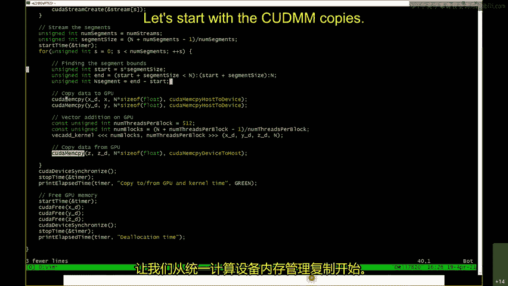

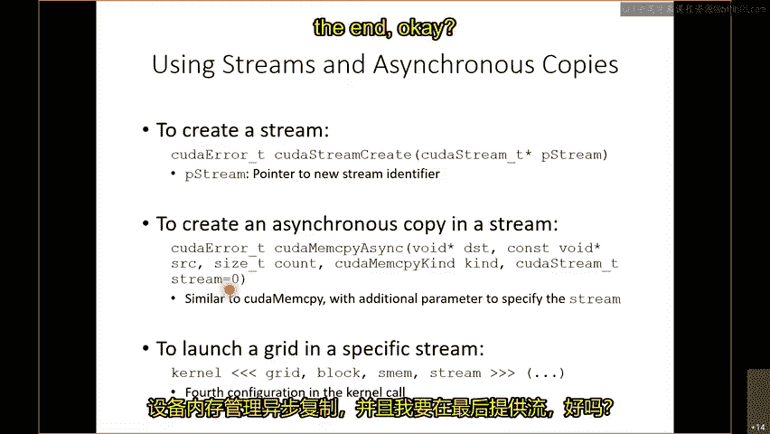

I want to use Cu and copy asy。Okay， and we're want to provide the stream at the end。

 so that's going to be stream of S。Stream of S。 Okay， and of course。

 I'm no longer going to be copying the entire input on each generation。

 I just want to copy the segment that I'm interested in。Okay。

 so here the segment starts at this is going to be X。

X underscore D plus start and y underscore D plus start。Okay， actually。

 there's there' there's a kind of a neat or way of writing this that I personally prefer。

 which is I want to return the the address of。Why is the dark。

That just makes it clear what's going on。 These are two different ways of writing the same thing。

Okay， same thing here。 I'm copying this what this is saying is that my X of the。

 I am copying at an offset of start。 That's that's where I'm that's where I'm going to start copying。

 And where I'm copying from is also going to be the same thing。 I want to copy from X plus start。

 reminder start is where the segment starts in the global in the entire array。

 So here I'm going to copy from x of starting an x of start。

 and and here I'm going to copy starting at y of start。Okay， and in Vietnam。

 that I'm going to copy is no longer N。 It's going to be the size of the segment itself。

 which is an segment。 And N segments is going to be equal to segment size for all of the segments。

 except for the last segment。 So here， this is going to be N segment。 and this is going to be。

And second。ok。Same thing for the copy back， I'm going to use an asynchronous copyback。Okay。

 I'm going to provide it with the stream to put the copy back in。Okay。

 and I'm going to provide it with where to start copying from sorry where to start copying to and from。

 so here it's going to be the address of Z of start and the address of z underscore D of start。

And the amount I'm going to copy is going to be end segment， as opposed to the entire end。Right。

 clear。Dr。 Bas question。Yes， so for the copy aync， the way it works is that it starts the operation。

 but doesn't wait for it to finish and it starts it but continuous execution of the remaining code right exactly So it good copy async and then it comes down here and doesn't wait for the co copy async to finish It just comes down here and cause the vector addition kernel and it doesn' vector edition kernel by the vector the kernel cause by definition asynchronous So it doesn't wait for the vector kernel to finish It just comes down here it does could copy a sync and it's going to go back and start with start calling copy and vector edition for the next segment without waiting for the previous segment to finish。

Okay， and what did for some reason， the QM copy didn't like one data element didn't finish for the addition for the vector edition current store。

SoM copy， so these for the same segment， thesekuM copies and this back ad kernel are going to go into the same stream。

Okay， okay， so they will be serialized by that stream。

 this vac ad kernel is not going to start before the the kum copy complete。Okay， however。

 it's going to be ended because it's going to be in the same stream， however。

 it's going to be independent of the coum copies that are going to be called in other iterations of this loop and that are going to be put in different stream。

Okay， good。 good question。 So you'll see。 So， so that that brings me to the V ad kernel。

 So the V ad kernel， I will also want to put it in the same stream as the put copies that correspond to it。

 Okay， so here。I did not give identify panel any shared memory。

 and I'm going to provide the stream that's going to be stream with us。So now， for the same stream。

 thekuum copies。Okay， and the kernel and the K copy back are all going to go into that screen。

So everything that' zip called in iteration one is going to be serialized with respect to each other。

 but they're going to be completely independent from everything that's being called in the other iteration。

He可。And of course now for the yes question。Yeah， there's a typo for the on site and and should be a question mark。

 the first one， I think。Oh right here。Yes， this is a big question。明。Okay， and then here now again。

 I want to give each V ad kernel its own segment， so I'm going to give it rather than giving x of D I'm going to give it the address of x of D。

Start。The address of Y of G start。And the address of Z ofD。Start。

And I'm going to give it as well and。几。😊，s clear everyone while we just did any questions about this code that we wrote。

So we're basically looping over the segment。And for each segment。

 we are inqueing a co copy to the device， a V as kernel and am copyback in the same stream so that will be done sequentially。

However， we're not going to wait for any of these to finish。

 we're going to move on to the next segment and also ae its copies and kernel call and we're going to do that for all the segments。

 So now I have all my streams loaded with premium copies and kernel calls and then I'm going to stitch here I'm going to wait for all of them to finish before I move on。

That's what could it device by synchronize。Weer any questions？Yes。

 if you want to measure the kernel time only， how can we do that。

So if you want to measure the kernel time only without interfering with the performance。

 you can use something called KudD event。Where you can actually add the event into a stream and what the event does is it basically takes a constant of when something in the stream started or it Okay。

 so you can add you can add a co of copy to a stream you can add that。Ca internal into a stream。

 you can also add an event to a stream and by taking the time different events。

 you can tell how long something in a particular stream。

Okay but we're not looking at okay we're not going to look at the events。

 but you can look at those can look those up in the documentation and read about how but that's a great question so if I want to I want to look at how long a particular operation in a particular stream took I can use to the events to do that。

Okay？ImProfesor。Yeah， sorry， I was wondering this will only shave off time from the kernel time right since in most cases。

 the memory is the bottle leg。嗯。Like the the the gain time will only come from a reduction in the kernel time。

So what we're going to be doing is we're going to be overlapping the copy fine with kernel time。

So the copy two time with final time with the copy back time。

So whichever takes the most time is going to hide the， this is how pipeline works， right。

 the state that dominates that has the highest license in the pipeline is going to be what dictates how long something takes on your pipeline。

So yeah， whatever takes long in this case is the copy too。

 that's what's going to dictate how long this whole thing is going to take and we're actually going to run the profiler to visualize all of it。

holdold on， you have to be very visual answer to your。Okay， thank you。Professor just yes。

 a quick question。 So when we in queue some task， let's say Kuda me copy aI does it like if we have the resources available does it just start。

Yes， it goes into the queue and it will start。F are available。

Okay and then the rest of the waiting will be just waiting for the resources to become available right exactly but I can I can look through and add my tasks to my screen faster than my screen can complete。

That's why when I have this loop I loop over all the segments and I put everything in the streams and then now I just wait for all of them to finish。

In the meantime， I could because I can have the CPU go and do other things if I want。

 maybe I can have the CPU ad add its own part and maybe I can assign one of segments the CPU itself and have the CPU ad part of the segment rather than sit here and wait and do not。

诶。😊，Okay， thank you。 Yeah you welcome。Alright， so let's run this and see what kind of performance we get。

 So I'm going to compile。And I'm going to run。So as a reminder。

 the GPU time previously took 80 milliseconds now when we run。It takes 60 millisecond。

Okay and and here what you can tell is that the copy2 from and kernel time。

 So remember we're tying them all together because we can't separate them Now this is taking 49 milliseconds。

 which is a little bit more than the copy2 time。 So here the total copy two time was 43 milliseconds。

 The total kernel time was3 milliseconds。 The total copy back time was 20 milliseconds。Okay。

 so this whole thing than was more than 60 milliseconds， now it's taking 49 milliseconds。

 we can tell that this is quite close to the copy two time。

 so we hide the latency of these other phases with respect to this。ok。

And let me let me kind of show you that visually， what I'm going to do is I'm going to profile this code in order to kind of show you what's happening in the timeline of the code。

 So I'm going to call enV Prof。When output a timeline。

Okay so I'm going to call back add and this time I'm going to call it with NV Pro。Okay。😊。

And I'm going to do the same thing， I kind of saved a version that does not use the original version that doesn't use extremes。

 I'm going to compile that。And I'm also going to call it with enV Prof。Okay。

 so now we have a timeline for the one without streams and for the one with streams。

 so now let's go to the visual profiler and open these timelines and see what they look like。

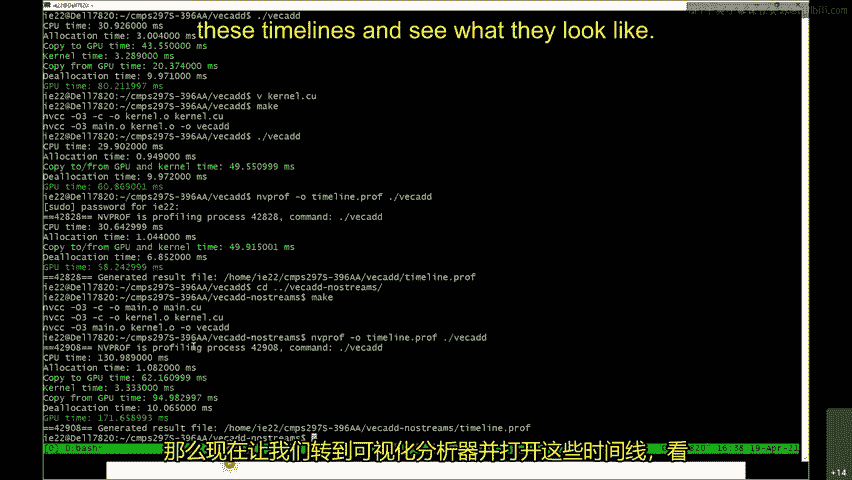

So we switch to the profiler and now what I'm going to do is I'm going to import the timelines that we just generated using N Pro。

 I'm going to import。Next。Thanks。We're going to get the timeline data。Hey， first。

 we're going to get the timeline data。For the one without streams。Hey， finish。Okay。

 so now here this is the beginning where we were doing the Kuda device synchronous at the beginning and the Kuda malocco and these kinds of things。

 So we're going to go to the end over here。 Let me zoom in a little bit。Okay。

 so here where this is where everything's happening。 So as you can see， this is again。

 this is the version without streams I have a kumm copy。😊，Host a device。

 and then I couldm copy host the device。 And then I have my kernel call that's executing。

 and then I have couldm copy device to host。 And notice how here， now you know what this means here。

 it tells you the stream in which everything is being is being executed。

 So here it organizes things by the kind of operation that's happening down here。

 it tells you the the stream that everythings being executed。 as as you can see。

 it says that all this stuff is happening in the default stream。 So here the host the device。😊。

The host the device and then the grid execution and then the device to host all of this is happening in the default stream。

诶。😊，Now let's go and import the version that we used with streams in it with multiple streams in import。

对。Yeah。And to browse this time we'm going to go to the version we implemented the users streams and to get the timeline for this。

几。😊，Finish。Okay， I'm going to zoom in again。Okay， and as you can see。

 let me zoom in a little bit more。So does little of delay。There we go。So as you can see。

 our men copy hosted device。 Now it's all these little pieces。诶。😊。

And our long copy device to host is all these little pieces。Okay。

 and our our compute our grid cause is all these little pieces。

And you can tell that the copying from host to device。And the copying from device to post。

And the compute is all being done in parallel with each other。Okay。

 so we've effectively hidden the copy from device to host and the compute behind the copy from host to device。

 which is what dominatemins perform。And if you want to see in this as a in the streams。

Thank you let me expand this a little bit。Now you can see what's happening inside of each stream。

 so in each stream I have am copy。😡，And then a grit。's I have two put in copies。

And then I have a grid call， and then I have a could of them copy back。But as you can see here。

 these copies are and on the grid call， this grid call is overlapped with the co copies of this other street。

And then this red color is overlap in the put copies of this screen。Okay。

 and this grid cause overlap with the co copy of this stream and and it goes on Okay。

 and let me come back here and you'll see how our recruit copies are all overlapped with other grid calls and put copy back So here you can see how this co copy back is overlapped with the grid call of this stream and it's overlapped with the copy2 of this stream。

Okay again， all the coudum copies are overlapped with the coudum copy back and the red。

We've effectively pipelined our operation so that we hide the latency of the grid or most of the latency of the grid execution and the copyback behind the copy to the device。

Okay， is it clear？Any questions about this diagram？Profesor。Yes。😊，The。

 the interconnect that gets data to the GPU is different And the one that brings data back from the GPU。

 No， it's， it's the same interconnect， but it has different lane。

And these lanes don't over like there' is no lane that can do both。Yes。

 you have lens the copy from the CPU to the GPU and lenss the copy back。Oh， I see。

 because So that explains why we can save on the。On the device to host， right。

 Because had they been the same， Then we couldn't have pipelined both in the same time frame， right。

 right， If the copy2 and the copy back are using the same hardware resource。

 then you wouldn't be able to paralyze the copy to in the copy back。

 But because they use different hardware resources， That is why you can paralyze。ok。

 nice see thank you。 Yeah you are。Do to。Yes。😊，I think PCRE has a lot of flames。

 And for the GPU here for everyday GP Us， they use we use N V link， right。So it depends。

 it depends on the kind of CPU you have， some CPU support andvy link and some don't。

So if your a CPU supports NVlink， then you use NVing。

 but the older CPUs and also even some current CPUs， they don't all support NVing。

So if they don't support end the link that kind of be the more wider standard is PCIE。

 but if you do have a CPU that supports end link， endbu link is usually passed。Okay。

 and the one more thing， we have multiple lanes， right。

 Like not only one for copy to and one come from copy for copy from so we can have multiple even multiple streams running at the same time。

 right， you mean， there's multiple lanes the PCIe bus has multiple lanes for copy right So multiple of these lane will be used to copy to and multiple of these lane will used to copy from but you shouldn't confuse the PCIE lanes with the stream because one stream could be using multiple lanes while doing the copy。

Okay， okay， Profe， one question about memory in the GPU。So instead of copying to and from。

 can't we take the GPU memory and make it act as a cache？

So there's something calledified unified memory and we will talk about this in a later lecture where you can allocate something in the CPU and then access it from the GP。

And this gives us the convenience of not having to do any of these pm copies。 And that's widely used。

 We don't show it to you just because we want you to understand what's going on under the hood。

 But now that you understand this later on， I'm gonna show you how to use。

 or I'm I'm gonna talk to you about unified virtual memory where you can just allocate things on the CPU and run them on the GP and access them on the GPU。

 But underneath the hood， depending on the architecture you have。

 what might be happening is what we what we have over here。

 Something will get copied from the CPU to the GP memory on demand or backwards。

 There are other architectures where they integrate the CPU and the GP on the same chip。

 So they actually access the same memory。 But for the for the for the GPs that are kind of large and and have very high performance。

 these are usually discrete and they have their own independent memory from the。The CPUU。

 but we can can we can kind of simulate the feeling of them having the same exact memory using unified memory。

Okay， thank you yes yes。Okay， so so having now that we've seen things in the profiler。

 let's switch back to the slides。So these are the API calls again that we use to create a stream and then do the asynchronous memory copies and this is the code that we wrote to do streaming and then this is an illustration of the profiling results that we got I know they're a little bit different from what we saw in the profiler because I generated on a different machine than the one we were using during the lecture。

Okay， and with that， you can read more about what we covered today in chapter 18 of the textbook。

 Does anybody have any final questions before we end？Okay， if not。

 then the solve for today and I'll see you next time。个。

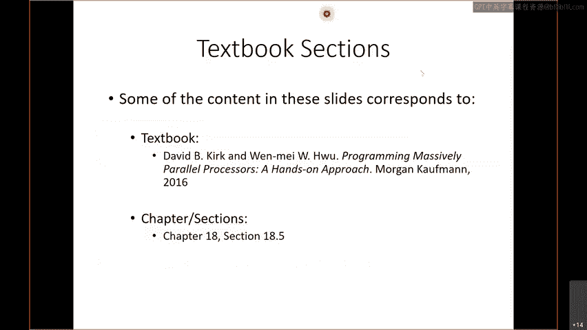