# 美国贝鲁特大学《GPU计算｜CMPS 297S396AA - GPU Computing - Spring 2021》（豆包翻译 - P22：-22-Lecture 22 - Dynamic Parallelism.zh_en - GPT中英字幕课程资源 - BV1bw4m1k7a1

Hello everyone and welcome Le 22 of GPU computinging Today we're going to be talking about dynamic a。

So last time we spoke about pin memory and we spoke about streams， we said that。

When we do coM copy there's something called DMmaA or direct memory access involved and that's essentially when some hardware can access the memory without involving the CPU it can access the main memory directly and only copy between CPU and GP we actually use DMA there's a hardware that is from the main memory of the CPU to the GP without involving the CPU and the advantage is that this frees up the CPU to do other things but the disadvantage is that the DMA doesn't have the capability of doing virtual address translation because that's CPU does that so the DMA actually uses a physical address which means that cannot detect if the page gets swapped out so because of that to use DMA we need to have a guarantee that the page that we are copying from or copying to and the main memory doesn't get swapped out and what that means is that we have pin it or lock in that's why we use pinned memory so usually what happens on a coM copy is that when we copy from hosted。

The CPU will copy to pinned memory and then the DMA will copy from pinned memory to the GPU and when're going copy from device to host。

 the DMA will copy to pinned memory and then the CPU will copy from the pinned memory to our actual buffer and the disadvantage of that is that we every could of them copy actually ends up doing two copies so to get faster copies。

What we can do is we can allocate our memory buffers directly using Kuda Malochost and then we have to free them using Kudto freehost so that we can unpin those pages。

 but of course we have to use this with caution because if we pin all the pages now in our memory we don't leave the operating system with pages in order for it to do the swapping so this would degrade system performance。

😊，Another thing we talked about is the fact that the hardware that does copying from the main memory to the GPU and the hardware that does the hardware that does the GPU computing computing on the GPU and the hardware that does the copy back these are different hardwares and they can all operate at the same time so in the past what happened is that when we were copying to the GPU。

 this is vector edition， when we're copying to the GPU。

 the part of the hardware that computes on the GPU and the copies back is idle when we compute on the GPU the parts of the hardware we copies to and from the GPU are idle and when were copying back the GPU and the part that copies to the GPU are all idle so we can do is we can pipeline the vector edition so that we copy part of the input and then we start computing while we copy the next part of the input。

 and then by the time we're done computing we start copying back while we are computing on the next part。

In and one we are copying yet another part of the input and by doing this what we've done is we've essentially overlapped the computation and the copyback with the copy to the device so that whichever one of these is dominating performance copy to computer copyback that will kind of hide the latency of all the other operations and indeed we did some profiling and we saw how over here we're able to overlap the copy to the device copy back from the device and the kernel execution and in this case copying to device is what was the dominating the performance so we hid copying from the device and the grid execution behind just copying to the device okay。

So these are the two things we looked at last time， pinned memory and using extremes。

 any questions about last time's material before we move on to today's material？Alright。

 so then today we're going to look at dynamic parallelism。

 So what is dynamic parallelism Ka dynamic parallelism that is refers to the ability of threads that are executing on the GPU to launch new grids to run on the GPU。

 So if I have a grid of threads。Okay， and these threads are running on the GPU。

 Any one of these threads could itself go and launch another grid of threads。Okay。

 now why would I want to do that， Why would I want to have a thread that's running on the GPU be able to launch another grid。

Maybe， maybe it would be interesting from we won't have to synchronize with the GP with the CPU anymore。

Okay， so that's one one possibility is if we're running out from the GPU。

 we can just have one thread running on the GPU and start launching all these multiple kernels if we our computational system multiple kernels。

 but what if I have many threads running on the GPU and I want each one of them to launch its own grid。

 why would I ever want to do something like that？If there's whatever you get no in advance。 And。

 and so we can know it at during run time and launch a variable grid。Right， exactly。

 So if I have some， some， you know， variable grid， a variable size grid that I want to launch。

 But why don't I launch that from the CPU。I come from the CB view， we launch variable grids。

 What's the idea here， though。The idea is I have multiple levels of parallelism in my application。

Okay， I have a bunch of work that can run in parallel。

And each of these units of parallelism embedded inside it is also some work that can run in parallel。

 and thats where it could be variable in size。Okay。😊。

But that work can be also fixed in size so variable in size versus fixed in size that is important okay but the more fundamental idea here is that I have multiple levels of parallelism okay I have I have this parallel work and then each of these units of work within it is also work that can also be parallellyzed there's multiple levels of parallelism and we call that nested parallelism okay so nested parallelism is when I have you know parallelism and then within within each unit of parallelism I have more parallelism。

😊，Okay and maybe within each of those units of parallelism， I have more parallelism。

 So dynamic parallelism is useful when we program applications that have nested parallelism where each thread discovers more work that can be paralyzed as executes and like I said。

 it's particularly useful， when the amount of nested work is unknown okay if the amount of nested work is known。

 we can launch the total number of threads that we need ahead of time and then if there's common work across a bunch of them。

 we can do it reluctantly， but if the nested amount of work is unknown。

 it makes it even harder to prelaunch a fixed the total amount of threads。

 So if the amount nest work is we do not know how many threads we need to launch upfront so launching a bunch of threads in having each one of them discover how much parallelism they have within them and then themselves launching more threads is useful okay。

😊，Now what kinds of applications have have this pattern。

 what kinds of applications have nested parallelism or parallelism within parallelism。

 well there's different kinds of applications that have this and there's two main reasons why the amount of nested parallelism may be unknown so there's the amount of parallelism or nested work may be unknown for one of two reasons or two major reasons。

One of them is where the nested parallel work is irregular In other words。

 it varies across threads Okay so different threads have a different amount of nested parallelism inside of them and an example of this could be a graph algorithm So in a graph algorithm。

 maybe I have a kind of a vertexcentric graph implement a graph algorithm where I have a thread that's doing something for each vertex and maybe these threads want to visit their neighbors and maybe some of the one to visit the neighbors in parallel Okay but each thread might have a different number of neighbors and therefore each thread visiting the neighbors in parallel is a form of nested parallelism。

 but since each thread has a different number of neighbors。

 each thread has a different amount of nested parallelism。

 and that's where we we have this irregular nested work that is within。😊，That is is available Okay。

 so in graph I do threat each vertex has a different number of neighbors。

Another example is Beziier curves， for example， so besier curves is a computation where we draw lines based on points。

 so we have a bunch of points and we draw these lines using these points now to draw these lines right depending on the curvature off the line。

 we may need a different number of points to draw the line。😊，Okay。

 depending on the curvature we mean。Number of points to draw the line。 And so if I， for example。

 launch a thread to draw each one of these lines。 Okay。

 and each of these threads is drawing these lines by drawing a different number of curves。

 each thread is going to need to drawing a different number of points。

 Each thread is going to need to have a different number of points to draw okay。

If draw if I want to draw these points in parallel。

 each thread may need to launch a different number of threads to draw the different number of points that it needs to draw in order to draw these lines。

 so this is another example of an application where the nested parallel work is irregular。Okay。😊，Now。

 another case where the another kind of category of applications where the nested work may be unknown is where the nested parallel work is recursive with unknown depth。

Okay， so maybe， maybe you know， all the threads that launch all have the same the same amount of nested work inside of them。

 but what difference across threads is whether they choose to launch or not Okay。

 so maybe I have some kind of recursion。And each thread may or may not recur depending on some information that it figures out at run time。

 So an example of this is a three traversal algorithms in particular， if I have a space for example。

 and in this space I have a bunch of points that are involved in some kind of stimulation okay and what I want to do is I want to partition my space into boxes where each box maybe has a fixed number of points Okay so here when I partition you know I want to partition this space into boxes and then based on how much activity is happening within one of these boxes。

 I I may choose to partition it further into smaller and smaller boxes or I may choose to just just stop where I am so here what I would do is I would partition the space and then after I partition the space。

 I look at how much activity is happening in each box and you know for this box I figure out oh。

 there's nothing existing happening here so I'm not going to partition further。😊。

But here I figured oh， there are things interesting happening here。 so I partition it further。

 So here I don't recurs， but here I do recur So in this case here I would just stop whereas here the the thread that was responsible for this box would want to launch more more kind of thread to process each one of the smaller boxes inside of it。

 So this this is a common pattern that that。That exists。

 so this is we call these quad trees and ox trees when we divide spaces like this。

 and this is an example of where whether or not we want to recruit whether or not we want to extract more parallelism。

 launch more threads depends on the observation that we make for the particular box。

Another example of this is divide and conquer algorithms where we may take an input divide it。

 and then based on the properties of each each partition of the input we decide if we want to divide it further or not。

 so in each of these steps we're dividing the input into two equal parts okay but then the variability comes from the fact that we don't know whether or not we're going to divide the input further or not。

ok。😊，So there's two major categories， one of them is where the amount of nested work is unknown。

 each thread has different amount of nested work， the other category is where each thread may have the same amount of nested work。

 but what we don't know is whether or not the thread is going to launch or not so if all the threads that do launch will have the same amount of nested work they launch the same amount of threads but different ones may may launch or they may not launch okay。

We are so far。All right， so there's actually examples of these different applications in the coUD SDK the QUD SDK actually has an example for Beziia curves an example for quadries and an example for quicksort I use dynamic parallelism so what I will do in the lecture is instead I'm going to look at the graph algorithms and I'm going to see because we've already seen BFS bread search before so we're going to look at B search and how we can use dynamic parallelism to optimize bread first search。

😊，And so I'm going to use that because we've seen it before。

 I'm going to use it because that example is not available to you in the SDK so it gives kind of yet another example of dynamic parallelism and then also I want to use it because I want to demonstrate some optimizations that we can apply with dynamic parallelism and these optimizations are highly pronounced when we use graph algorithms okay。

😊，So just as a recap in the past， we looked at multiple implementations of B first search。

 the implementation that we're going to look at today is the one that used frontiers so in this implementation what we did is we had a previous frontier on every iteration of the BFS we had a previous frontier that had a bunch of vertices that were in the previous level and what each of these vertices did is they would visit a bunch of their neighbors and decide whether or not to incu their neighbors in the next frontier。

Okay， so here this thread has you know， one two three neighbors。

 so it visits each of these neighbors and decides if these neighbors should go in the next one here or not。

Okay， this thread has four neighbors， so this thread will decide we go through each of these four neighbors and decide whether they should go in the next frontier or not。

 So as you can see， each thread has a different number of neighbors and what these threads were doing in the past is they were going over their neighbors sequentially and for each neighbor they were figuring out whether to incu that neighbor or not Okay。

 so what can these threads do instead。instead of each of these threads looping over their neighbors sequentially。

 what can they do？A thread can launch a warp， and each thread and the warp launched will will check the degree of。

OfOf renewable and push it to the frontier。Right， exactly so each thread can launch a a you said warp。

 I think can mean a grid so each thread can launch a grid off threads to visit all the neighbors in parallel okay and and let me show you the code the code for this so in the past what we had is kernel this kernel assigned a thread to every element in the frontier and it loaded the vertex from the previous frontier okay and then it out it figures out where looks at the source pointers to figure out where the neighbors of this vertex start and the source pointers and then it figures out the number of neighbors that it has by getting you know getting where where the edges of the next vertex start and then subtracting where the edges of this vertex start and then here we're looping over the neighbors so we go over。

I equals zero I equals the number of neighbors and then for each neighbor we find the edge that's just going to be star I and then we load the destination of the edge that gives us the index of the neighbor and then what we did is we would use an atomic compare and swap to visit the neighbor and if we successfully visit the neighbor then we add that neighbor to the current frontier。

Okay。😊，So this is what we did in the past and the key thing I'd like to focus on here is this loop。

Okay， this loop that's looping over the neighbors。Okay，s， it's processing the neighbor sequentially。

 And what we can do instead is we can parallelize this。Okay。

 instead of looping over the neighbor sequentially。

 we can paralyze this loop using dynamic parallelism so that we have a thread。

 do every iteration of this loop。 In other words， we have a thread Visit each one of the neighbors。😊。

ok。😊，Is that clear。Okay， now the question is， how do we do that？

So this is the code that we just saw and the key point here is that this loop that's looping over the neighbors can be paralyzed so how can we do that Well it turns out that the device code for calling a kernel to launch a grid is the same as the host code so we launch a grid from the GPU in the same way that we would launch a grid from the CPU okay。

However， when we are launching a grid from the GPU， we have a very large number of threads。Okay。

 we're going to have a very large number of launches because we have a very large number of launches。

 not all of these launches will be able to run at the same time。

 So what the device will have to do is it will have to save kind of the state for these launches and some kind of buffer until they get they get their turn to run。

Okay， so the information about the launches will be saved in some kind of buffer until they get their chance to run。

 And what this needs is that it needs memory。 So we need memory to buffer the grid launches that have not started executing。

And the limit， there's actually， because this memory that we're going to provide for the number of launches is limited。

 there's going to be a limit on the number of dynamic launches that we can have Okay。

 and this limit on the dynamic number the limit on the number of dynamic launches that we can have is referred to as the pending launch count。

ok。And by default。Run time by default supports 2048 launches。 So by default。

 the runtime lets me launch 2048 grids dynamically from the GPU。 If I exceed this limit。

 I will get an error， or I might just hang。So what we can do is if we know that we need more than 20 we planning use more than 2048 launches。

 okay？Then what we can do is we can tell the runtime to allocate more memory by increasing this limit and the way to do that is using this command that's include a device set limit。

 this actually lets me set all kinds of limits on the GPU the particular limit I'm interested in today is the pending launch count So if we anticipate that we're gonna have more than 2048 launches on the GPU we can increase this limit using this command over here Okay now launching 20 having 2048 launches on the GPU is not particularly a good idea。

 So if we are increasing this limit， we're probably doing something we should be doing anyways but what I will do just for demonstration purposes is I will increase this limit and then later on we'll see how we can go below this limit without having to increase the pending launch。

Okay， but let me first start with the device code for launching a grid。

 And then I'll go back and see how we're going to deal with this limit on the number of launches that we can have。

 Does somebody have a question。Yes， I wanted to ask you， when you say launch。

 you mean a launch per thread or launch per is there a metric that so every thread on the GPU can perform its own grid launch。

Okay， so and and the maximum number of launches overall is 2048 or per that's by default。

 but we can increase it That's just what they know it's it's total。Oh okay， okay， okay， Yes。

 if I have 2048 threads， Each one of them does a launch。 I， I filled it。 I， I filled it up。Okay。

 okay， so what I I can increase it if I need to do more than that。 Okay， or later on in lecture。

 we'll see that we we should probably not do more than that。

 and we should probably reduce the numberes that we're doing if we're doing this many launches。Okay。

 but let's start by just having every thread perform its own launch of child threads in order to process its neighbors。

Okay， so what we want to do is we simply rather than have looping over the grid and over these neighbors sequentially。

 we want to launch a grid to have a thread for each one of these neighbors， okay。😊。

So here's what we're going to do。Rather than having this loop over the number of neighbors。

 we're going to。And。😊，Launch a grid。Okay， that has as many threads as the number of neighbors。

 So I need to configure the grid。 first of all， Okay。

 I need to specify how many blocks and how many threads it has。

 So I'm gonna to start by picking a number of threads per block。

 I an unsign and the number of threads。For block， let me just pick 1024 the maximum that I can have。

And then I also need to pick the number of blocks， so unsstein ends nu blocks。

 that's going to be the number of neighbors。Divided by the number of threats per block。 But。

 of course， the number of neighbors may not be evenly divis by the number of threads for blocks。

 So I you can do a ceiling。 So the way I do a ceiling is like this。 like the number of neighbors。

 And I could， then I can do plus number of threats per block， -1。

OverAnd then I can launch a another kernel。 I can call another kernel to launch a grid to do these neighbors in parallels。

 So I can I can do B FS。 underscore。 Let me call it child kernel。 Okay， I can do B F S child kernel。

 and I give it the number of blocks。😊，And the number of threads per block。Okay。

 and I'm going to give it the parameters that it needs to do the process。 So well we， we will put。

 well add these later。 Okay， so now what I'm gonna have is I need to define my kernel。Okay。

 so here my。I'm going to implement this child kernel。 So BFS child kernel。

It's going to take a bunch of parameters。 So we'll， we we will enter these later。

 And then what what this BF child kernel is going to do is that it's simply going to take this loop and process its iterations in parallel。

 Okay， so what I can do is I can delete this， this loop。😊，From here， and I can come up here。

 and I can paste it over here。Okay， and now， however， instead of looping。

 this I here is going to become the thread index。 Okay， so I'm going have。

Einstein and I is equal to Lo and X dot x。time。Block in dot x。P index dot x。Okay。

 and then here rather than having a loop， I'm just going to have a boundary check。

 So I'm going to check if I is less than the number of neighbors。 Okay， so here， every thread， oops。

 I have a， I have a mistake here。So every thread takes one of the neighbors and it checks if it's within bounds and if it is。

 it does the computation。Okay。😊，Now， of course， for me to do all this， I need I need to have my。

 the parents pass all all these data that we need， the current frontier， the neighbor， the start。

 the CSR graph， all this needs to be passed in as a parameter。

 and that's exactly what we are going to do。Okay， so I'm going to copy all the parameters here。

So I pretty much need everything that the parent kernelel has， so we're going to copy all of these。

The past up here， the one thing that I don't need is the previous frontier because the previous frontier is just read over here and it's not used later on。

 the neighbor doesn't need it， so I'm going to get rid of the previous frontier。

 but I'm going to need the CSR graph the level， the current frontier， the current level。

 I also need another thing which is the I need I need the start Okay and I need the number of neighbors Okay because those were computed inside of the kernel they weren't part of my parameters so I'm also going to pass in the number of neighbors and I'm going to pass in the the start。

ok。😊，And， of course， I need to the， the parent thread needs to pass all of these to the child child grid。

 So what we will do is we are going to pass all of these to the child grids。

 Let me just copy and paste。Okay， and we're going to pass all of these we're going and then we're going to be ready。

Does this clear to everybody any questions about this？

So all we've done is we've taken a sequential loop。And we've paralyzed it。Os。Readally。

Sorry about that， my cursor went out of control for some reason。So， we're going to。

Past in all of these parameterss， anybody have any questions about we just implemented。

Shouldn't we increment current level？Oh we were doing that in the host code so sorry I forgot to introduce the host code so that down here there's a BFS's there's a device。

 there's a function on the host。Okay， and this function on the host is looping over the levels。

 it calls the kernel for each level and then it swaps。

 it does the double buffering for the previous return to confrontier。

 and then it makes true on every iteration to increment the kernel level okay。

So here when we are looking at the kernel， we're just focusing on what's happening at a single level。

ok。SoAs you saw， paralyzing this loop was quite straightforward。

 all we did is replaced the loop with a kernel call and then had the loop body became the body of the child kernelel one thing though that we need to do however。

 is we need to make sure that we have enough our pending launch count is large enough to accommodate what we just did so what we're doing here is every thread performed the launch so we could potentially have as many threads as we have Vies in the graph。

😊，Okay and my graph could have a lot of vertices it could have much more than 2048 vertices so using0 in this way I probably want to have increased my pending launch count to accommodate as many launches as I have vertices in my graph so I'm going to come down here to my host code so this down here is my host code host function and I'm going to increase the pending launch count be to match the number of vertices so the way to do that is this function Ka device test limit and then we pass this limit Ka limit that runtime pending launch count okay so we're going to call kuda。

😊，Device。That limit and we specify the limit that we want to spend。

 which is who the limit the runtime pending launch count。

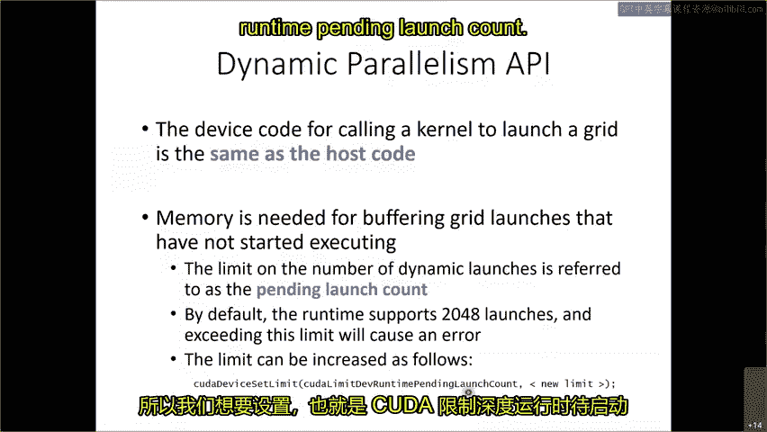

The food that was a number bit mine。Okay， and then we want to provide the limit that we have in this case the limit is going to be the number of vertices in the graph so we're just going to pass in CSR graph。

Dotum。Pectly。Okay， and this says that make sure to allocate as much memory to accommodate as many launches as the number of urgencies in the group。

ok。😊，Does they clear any questions？Okay， so let's compile this and run it。

And see what the performance is like， oops， I actually forgot I forgot to I forgot to compile a previous version。

 let me let me。😊，几。😊，I'm going to compile the old version and run it just so that you can see what the performance is like without dynamic pism。

 so the that dynamic parallelism on this graph that we' were using， it took 14 milliseconds。Okay。

 now I'm going to read to all the。Okay， so now with dynamic parallelism。Okay。

 I'm going to compilely again。And I'm going to run。And this time， it takes 130 movies。Okay。

 so it's 10 times slower。😡，The performance was 10 times slower so。

Why do you think the performance was so slow？Because it waited until it could launch a grid to launch it。

 So it happened at 2048。So， 2048 is the size of my buffer for my lunches。

ItIt doesn't mean I am running。 It doesn't mean that's the the max number I can， I can。诶。

I can run actually the month that I can actually run is actually much less than that。So yes。

 I'm launching all these grids。Okay， but they're all waiting for each other to run， okay。

 I run a a small number of them at any point in time。ok。😊。

What else could be the reasons behind this overhead， though this is slow down？A you link。Sorry。

 the scheduling scheduling of it's related。 yeah， you know， I'm launching all of these grids。

 So theyre they're all going be going into this sw and they're gonna be waiting for each other so that they get launched。

 The idea is I have a large number of grids that I am running。

 But the other thing is that each of these grids is relatively small right So if if a lot of these a lot of these vertices。

 might have one neighbors， two neighbors， five neighbors，10 neighbors。

 So that's these things all hurt my performance。 Okay。

 and some of them might have many neighbors where the launch。

 So let's take a look at how we can further optimize this code get to achieve better performance。

 before I get into this idea of large grids and small grids。

 there's one thing I would like to point out。

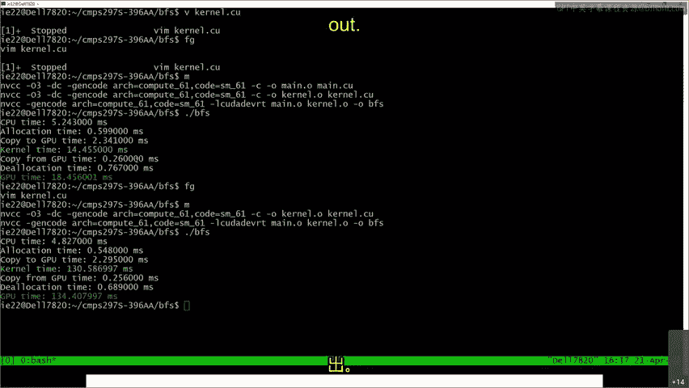

So here this is the code that we just wrote so one the reasons behind the slowdown is related to streams。

😊，Okay， so if you remember。On the CPU， we had streams。Okay。

 and if we wanted different grids to run in parallel， we had to put these grids in different streams。

Okay， now on the GPU now we have all these different threads on the GPU。

 all these threads are launching different grids and the question is whether we want these grids to run in parallel or not now in the way that we' are using dynamic realism。

 we obviously do want these grids to run in parallel。However。

 the part of the issue is that when we don't specify a stream。

What happens is all the grids are launched into a default street。Now， on the CPU。

 all the CPU threads share the same default stream On the GP。

 we actually have a default stream for every thread block。 So on the GP。For device launches。

Threads in the same block all share the same default stream。 So when I when every thread。

Launes a grid。What happens is that the threads that are in the same block actually all launch their grids into the same stream。

 so these threads will be kind of serialized these grids will be serialized with respect to each other right even if even if there is room on the GPU to launch these grids。

 they will not get launched because because they get serialized because they're in the same stream and the way streams work is that you finish what's in the stream before you can move on to what's in the next stream。

Okay。😊，So what can we do about this， well what we can do is rather than having using the default stream in the that's for the thread block。

 we can have a stream for a separate stream for each thread so we can have per thread stream okay。

 so parallels can be improved by creating a different stream for each thread and having each thread performance launch into its own stream。

Now， how do we create a stream for each thread， Well there's two approaches。

We can use the same API we saw last time when we created streams。

 we can have each thread call create stream to create its own streams。

 that's the first approach so we can use an API just like we used it on the host to create a stream for the thread。

However， because this is something that might be common。

 we can actually change the default semantics up streams using a compiler flag。

 so the other approach is to use a compiler flag that specifies that we want the default stream stream to be per thread as opposed to per thread block。

Okay。😊，So we want to have perth thread streams as opposed to Perth thread block stream。

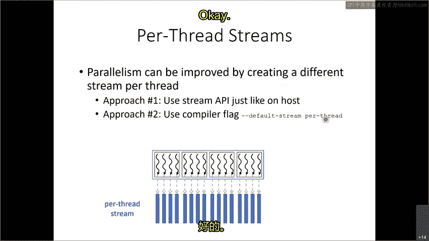

Okay， so let me go and do that。It over here。 and I'm going to。Okay， I'm going to open my make file。

And what I will do is I am going to pass in the flag that says。Default。Stream。

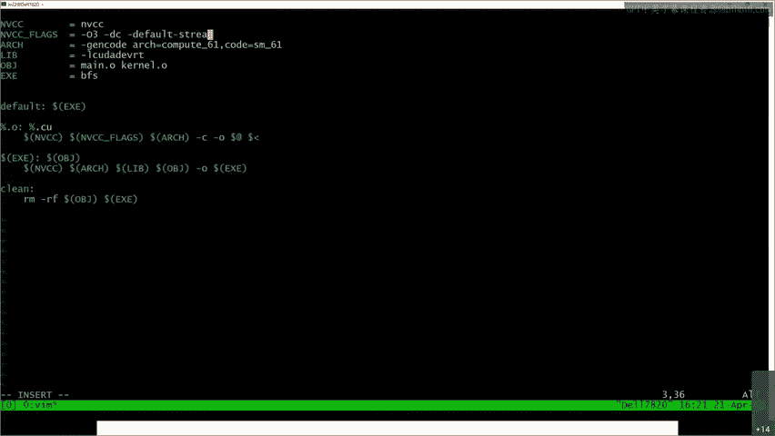

诶。Okay， so here's the fly actually need two to two dashes here， I'll adjust for that。

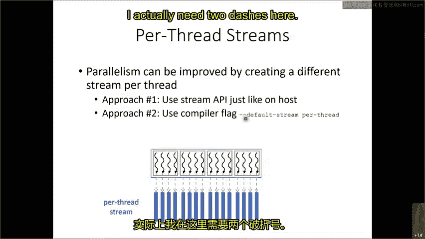

So I have default stream per thread。And now what this will do is well have every thread in the block launch into a different stream instead of launching into the same stream。

 Okay， so let me。😊，Comp filele this。Okay， and now I'm going to run it。ok。😊，And as you can see。

 we do get some performance improvements， not that much。Okay。

 because what's really hurting our performance is something else。

 but we still get a little bit of improvement in performance from using Perth thread default Street。

ok。😊，Cl are any questions？Okay， so then let's。

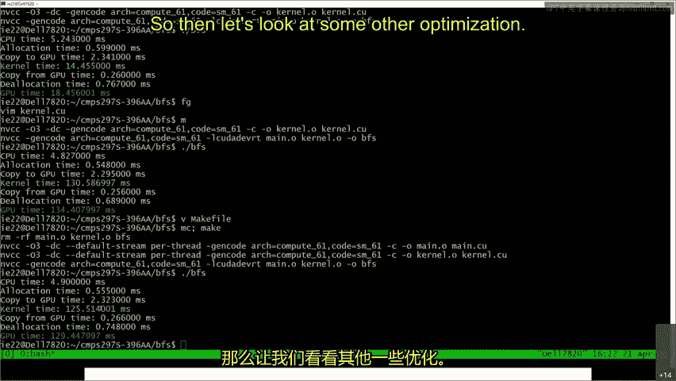

At some other optimization So other optimizations we can do。

 So a common pitfall is if we launch very small grids， that launch may not be worth the overhead。

 So here some of these threads might have a small number of neighbors so it might have two neighbors。

 four neighbors， five neighbors in this case。You know。

 launching a grid and having that grid wait for its turnern to execute on the GPU may not be worth。

You know， the benefit we get from paralyzing over those four or five neighbors。

 maybe it's better to just have the parent thread loop over those neighbors and cost sequential。

We have another problem。 Not only you know， are these grids going to create more congestion and。

 you know， we have they're gonna they're going to cause more delays in the queuees。

 these bids are also might be very small， right， So if I launch a grid with four threads or five threads。

 you know， that means the thread block， that one thread block in the grid is gonna to have a small number of threads and that third block will underutilize the SM。

Okay， so I have this problem of having many grids， but I also have these small grids。

 so the small grids are not going to be worth the overhead， it's more efficient to sterize them。

 also they will under utilizeize the SMs and the other problem is that launching too many grids is going to causequeing delays in myG。

So one optimization that I can do， what can I do to avoid these pitfalls？

I I can launch one grid per warp。Lunch one grid pergore。 Okay， how what would that require me to do。

To have a common queuee for all threads in the warp。Okay。

 so somehow you want all threads in the world to communicate with each other and figure out how how many threads they all need and then one of them launches on behalf of the others。

 is that what you mean？Yes。Okay， yes， so is that is a good optimization that we can apply。

Any other optimization？If I have， if I have a bunch of threads that are on the same war and each of those threads has two or three or five neighbors。

We can check。Each thread， how many how many like grids it would call or how many neighbours it has。

 And if if it has less than some threshold， we can just see as it not called the not called the new grid。

Right， exactly。 so that's another good optimization that we can apply。Okay。

 so two important optimizations that we can use to not have many too many grids being launched and not have these grids be very small is one we can apply a threshold。

To the launch。Okay， so that if I have small grids， I don't launch them。

 I just serialize the work in the parent and I only do launches for the large grids okay。

 so I only launch the large grids that are worth the overhead and I serialize the small ones。

And here， the threshold that we pick is going to depend on our data site。Okay。

 so what threshold we pick will depend on our data set okay because different data sets so different graphs will have you know different distribution of their degrees so what is the best threshold is going to depend on how the degrees of the veres in this graph are are distributed okay so the threshold value is going to be data dependent and this is something that we can do。

And then another optimization which one of you also mentioned is to aggregate the launches。

 so what we can do is we can have one thread collect the work of multiple threads and launch a single grid on their behalf。

 so maybe rather than having each thread do a launch we can have we can do one launch for every workp and the threads in the workp somehow talk to each other and they put their work together and they do a launch or maybe the threads in the block。

 maybe all the threads in the block talk to each other put their together work together and then do one launch or maybe the entire grid。

 maybe have all the threads in the entire grid or multiple thread blocks or the entire grid talk to each other。

 put their work together and then do one launch。😊，Okay。😊。

So the second optimization aggregation is quite involved， it's quite complicated。

 so we're not going to implement it today in class。

 however there are papers that you can read on how to do this and there is kind of also a special compiler that compiles that does this kind of optimization automatically what we will look at today is this idea of applying a threshold to the launch so that's much simpler to implement。

😊，Okay， and let's go and actually try and implement this and see what kind of improvement that we got。

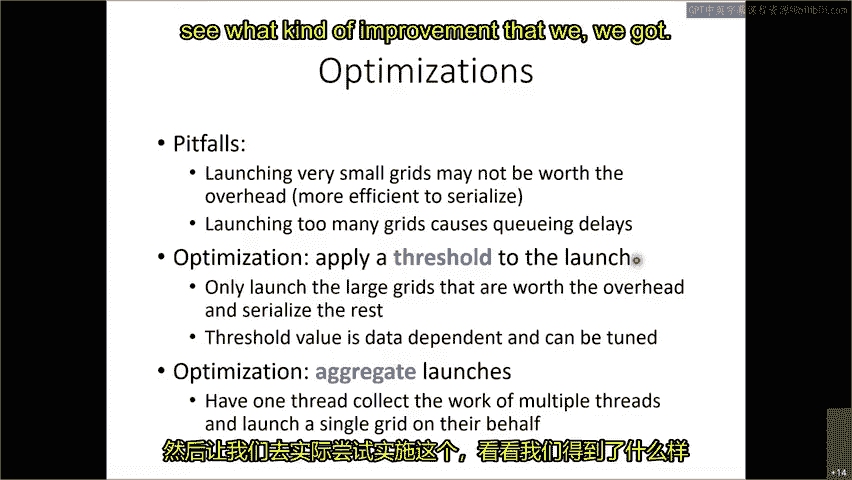

So here I'm going to go back and I'm going to open my kernel file。Okay。

 and here I have this dynamic launch and I'm launching it regardless of the number of neighbors that I have。

Now， it could be the case。That I am。It could be the case that you know I have small number of neighbors and in this case what I would like to do is I would like to sterilize them I only want to launch the grid dynamically if I have a very large number of neighbors so I can do is the following I can compare the number of neighbors to some threshold I can say if。

The number of neighbors is greater than some threshold。 Okay， I'll pick 1200 as my threshold。

 So if I have more than 1200 threads， Im going to launch the grid。Okay。😊，Where I got 1200 from。

 I just happen to know that this is a good number for the graph that I am running on。 Okay。

 but different graphs will have a different number of different threshold that's that's good for that graph。

Okay， so so if the number of neighbors is large enough。

 I'm going to do visit these neighbors in parallel。 Otherwise。

 what I want to do is I'm going to go back and I want to sterilize this neighbor， these neighbors。

 I'm going to come back here。 I'm going to get this code that I pulled up here before。

 I'm bring it back down。Okay， and I'm going to restore my loop。 I'm going to write have four。

Unsstein and I is equal to 0， I is lessops order to have the I less than the number of neighbors。

Plus plus I and in this case I do the neighbor sequential。Okay。

 so if I have a large number of neighbors， more than 1200， I will do them in parallel。

 otherwise I will do them sequentially in the parent。几。😊。

Any questions So somebody's asking what does the threshold depend on It's going to depend on you know different properties in my dataset So if it's my if this is a graph in this case it's the graph。

 maybe it depends on the degree of the distribution of the degrees in the graph I want to pick a threshold to where I have you know enough dynamic launches for the very large divergies with a very large number of neighbors that I do those in parallel but to where I will not have I will I will filter out enough launches so that I don't overwhelm my device with a very large number of brick。

ok。😊，And now by doing this， by the way， now we're going to have much fewer launches than the number of vertices。

 so in this case， the pending launch count no longer needs to be as high。All right。

 let's compile this and see what performance we get by applyingization so if you remember we had 14 milliseconds without dynamic parallelism and then we had 130 milliseconds reduced that a little bit so with this with dynamic parallelism we improved that by using cur thread streams and now we applied this threshold okay and we're going to compile and again we had 14 milliseconds without dynamic parallelism and now with dynamic parallelism we are actually down to 6。

9 milliseconds so we get quite a bit of improvement。Okay。

 and the reason is that these 14 milliseconds we had before。

 a lot of that was just waiting for that small those few threads in the grid that had a very large number of neighbors。

So by using dynamic parallelism， what we do is we take those threads ahead of very large number of neighbors and we process their neighbors in parallel。

 whereas the threads that have a small number of neighbors。

 we just do those in the parent thread because paralyzing those is not worth the overhead of doing the dynamic launch。

ok。😊，Is that clear to everyone， any questions about this？Professor。Yes。😊。

I just have a one question on the number of threads per block you chose for the grid launch。

In this case， since the grid is not if we since we're not making use of the properties of the block。

 aren't we better off lowering the number of threats per block to the minimum value that can fulfill occupancy so like here maybe 128 or 64 Yeah sure I mean you can definitely tune this to be a smaller number in fact in fact a lot of times is when we have when we do something like this we probably do want to have a smaller number。

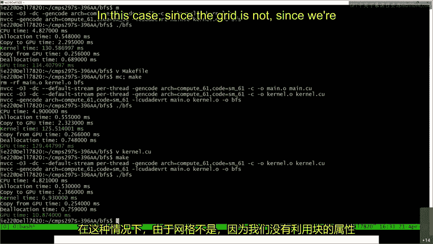

Okay， so this is the code that we just wrote over here we have a threshold where we check and we only do a dynamic launch if our number of neighbors exceeds this threshold。

Another use of dynamic parallelism is offloading the driver code， by driver code here。

 I don't mean the device driver， I mean basically the function that drives the whole computation。

So over here， what we did is we had this function on the host。

That was driving the computation by looping over the levels。 And then for each level。

 if you call this grid， they would call this kernel to launch the grid。

 and it waits for it to finish。 And then when it finishes， it checks if we're done and if we're done。

 if we're not done， it goes over and then it causes the grid to waste square。 So here。

 the CPU is spending most of its time， just waiting。For this grid to complete。

think you said most of the time just waiting for this grid to complete。Okay。

 and what we can do is we can actually free up the CPU by having by calling one thread on the GPU to do this loop。

We have one thread on the GPU will loop over the levels and it will call a grid for each of these levels。

ok。😊，And that way， the CPU does not have be involved in any of it。

 The CPU can simply launch111 thread on the GP and go and then come back when the entire computation is done。

 We don't have to involve the CPU in having to drive the the computation， okay。

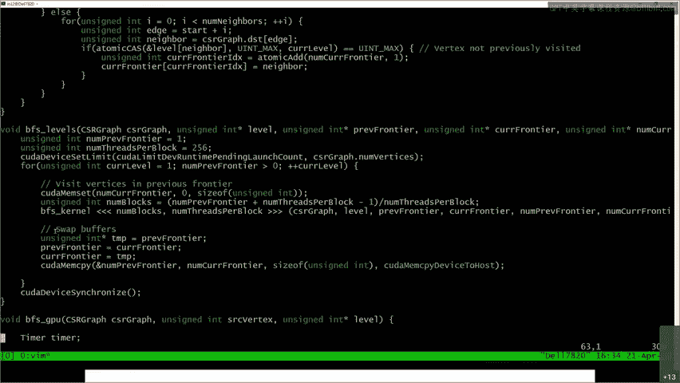

So in certain applications， the host code that drives the computation launches multiple consecutive grids。

And the reason it needs to launch multiple grids is to synchronize threads between launches so here the reason we have multiple grids for BFS is because we need to make sure all the threads finish for the previous level before we move on to the next level Okay。

 so here BFS launches a new grid for each level because we need to synchronize across the different level。

So another application of dynamic parallelism is to offload this driver code and the main advantage of that is that we going to we free up the host to do other things。

Okay， is that clear to everyone？Professor， so in this case。

 uploadloading the driver would mean launching all the levels。

 the different levels on the GPU instead of doing that on the CPU。

So it would mean that this whole code over here would be executed on the GPU instead of the C， okay？

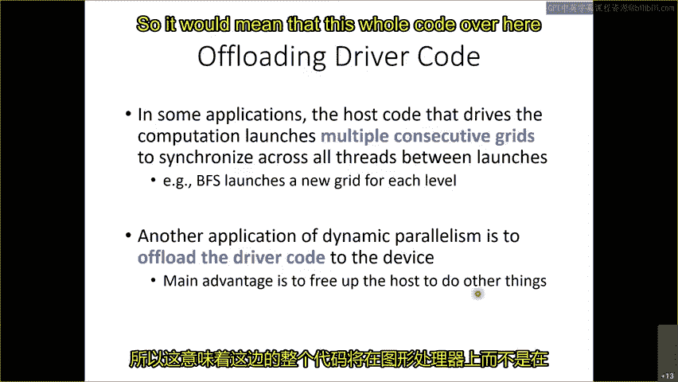

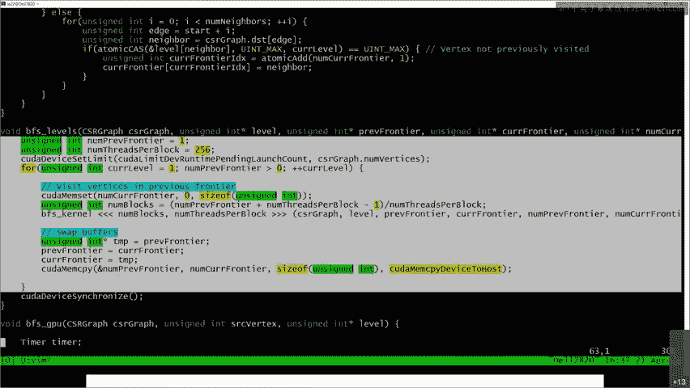

Okay， so let's actually implement this。So here rather than having this BFS levels kernel。Okay， sorry。

 like have this host function for F this levels。 I'm gonna have it as a kernels。

 I'm going write global。Boid and we call it BFS levels。Colonel。Okay。

 and it's going to do the same things as before okay it doesn't we don't change much。

 everything is the same obviously the co device set limit we're not going to have it over here Okay。

 so maybe I'm going to have this down in the in the function that is going to call this kernel okay so let me maybe this DFS levels is just going to call BFS level。

诶。😊，So let me delete all of this stuff。ok。😊，So we're not going to have this good device set limit。

 We're not going to have K to Met。 What can we have instead。

The reason we call KamMet is because we wanted to set number current frontier to zero。

Right and we want to do it from the CPU and this points to the GPU。

So now what we can simply do is we can simply write。Star and on current frontiers。Ass equal to zero。

Okay， so here， because now I'm executing on the GPU。😡，Okay。

 I don't need to use K them and copy every time I want to initialize something or check something on the GP。

 I can simply use Kud stepum Cons to zero。ok。😊，Now I'm going to call the unblock。

 I'm going to launch the grid。Okay， and then down here。Okay。

 I don't need to I'm not before I was copying back。😡。

From the current frontier as the number of elements of the previous front。Okay。

 so now I don't need to do this。😡，Either， okay， because now I am executing on the GPU。

 so rather than copying from the CPUU to the from the GPU to the CPU in order for me to check this in the loop。

 I can simply just。You know I can simply just load it from memory， I don't need to do a copy anymore。

 so here the non previous frontier is equal to non current frontier。

So there's two advantages actually， Ive freed up the GP from the CPU from having to do all this work。

 but also I am avoiding all these copies back and forth between the CPU and the GP and every reiteration。

Okay。😊，Now one important thing to note here however。

 is that kernel calls are asynchronous so before when I had a kernel call followed by a coM copy。

 they both went into the same stream so the coM copy waited for the kernel call to finish before it executed。

 but now that I'm no longer doing coM copy I'm actually doing just as a load。

I don't have the guarantee that this kernel will finish before this load happened。

So what I need to do is I need to make sure that the kernel finishes and the way I do that is by having a kuda。

Device。Synchronized。Over here on the GPN。ok。😊，And I no longer need this good device synchronize at the end because。

 I mean， that was the CPU to8 for the whole thing to finish， but I no longer needed it。All right。

 so as you can see now we have a GPU kernel where we have one thread is looping over it the levels and is calling using dynamic parallelism to call a grid for every level and then this grid that I'm calling recalling kernel for and this kernel that I'm calling is itself using dynamic parallelism to call these other kernels。

 so I have two levels of nesting though okay now what I need to do is I to I need to call this kernel and when I call this kernel how many threads do I need to give it？

Just one， right。 When I called his turnel。Okay。😊，I'm just going to give it one thread。The one block。

One thread。 And I give it everything that its it was expected if I'm going to give it a。

You a path in everything that it。any questions？Everything cleared。Okay， let's do bio lessons。

How well it performeds？We going to compile loops。啊，O。I had。 I had。Two instead of three over here。

my terminal froze a bit， I compile， and now I'm going to run。So before we had 6。9 milliseconds。

And now， by offloading to the GPPU。We actually don't see a significant improvementent performance it actually makes things a little bit worse Okay so here this。

This optimization wasn't really a performance optimization。Okay， if my GP。

If my CPU I can use to do something else in the meantime， then it might be worth doing that。

But if I'm not going to use my CPU for anything else。

 it's not really expected to improve performance use for me to use the GPU to drive the computation。

Okay， so unless I benefit from freeing up the CPU， maybe it's not worth doing it。

 And the reason is if I have just one thread running。

 that one thread is it going to run faster on the CPU or on the GPU。On the CPU。Right。

 if I have because the CPUU is optimized related later。 so if I just have one thread。

 that will probably run faster on the CPU。Okay， so that's one reason why this is actually slower are know there can be other reasons as well。

 but in general this idea of offloading the driver code to the GPU is useful whenever we want to free up the host to do other things if we don't care about free up the host to do other things maybe it's not worth the added complexity to our code and maybe it doesn't give us any performances。

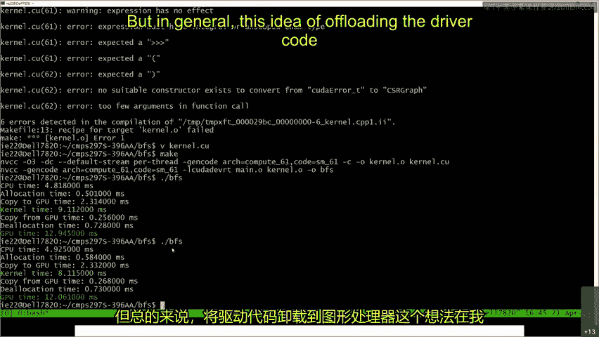

诶。😊，All right， so here this is the code also to uses dynamic parallelism to perform sorry that uses a single thread to offload the driver code to the G。

Another topic， just a few more short topics before we end， one of them is memory visibility。

 so the operations that are made by the parent thread on global memory before the launch are going to are visible to the child so when a parent thread writes the global memory and then it performs a launch。

 the child the child grid， the threads in the child grid are guaranteed to see those changes in global memory and then similarly the operations that are made by the child threads in the grid。

InThrough global memory， these operations will be visible to the parent after the child returns and the parent synchronize。

Okay， so if so and this goes back to what we talk about this goes back back to we。

嗯。What we did over here so here we had equi device by synchronized because we wanted to wait for the BFS kernel to finish so that we can read the number numb currentren frontiers from global memory if we don't have the synchronization I have no guarantee that my parent kernel will see the new value of numb current frontier okay。

 the changes to global memory made by the child are not guaranteed to be visible by the parent until after the parent synchronized。

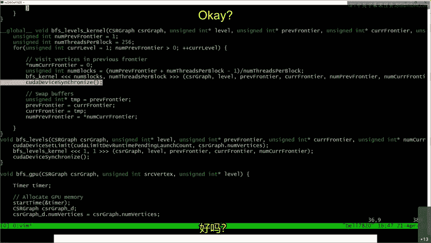

Okay。😊，So it's important to note this because you know sometimes when a parent writes the global memory。

 you might make assumptions about the child being able to see that memory and vice versa。

 so it's important to know what's visible and what's not visible and another thing to note is that a threads local memory and a block's shared memory cannot be accessed by child thread so if a thread block use a shared memory okay a thread that uses dynamic terrorism to call another grid should not pass a pointer to shared memory。

2 it it's child threads。 Why not。They might not run on the same SN。Right， exactly。

 so when a thread running on some S launches a grid of thread blockss。

 these threadlocks may run on a different SM so they will not be able to access thread that threads shared memory。

Or the shape ver of the block that that the thread belongs。

So that is why we should not use a thread we should not pass pointers to shared memory or local memory via dynamic help and the reason is that child threads launched by a parent may run on a different attempt。

Finally， nesting depth， so the nesting refers to how deeply dynamically launched grid grids may launch other grids。

 So here a grid launches a grid and this threads in this grid launch another grid and then a thread in this grid launches another grid and this grid launches another grid So you know how deeply we go is called the nesting depth。

ok。😊，And because of some hardware limitations。We actually connect you know。

 nest these grids indefinite。Okay， the nesting depth is limited by the hardware and the typical value on current hardware for the nesting depth is 24。

 so the deepest we can nest grid launches is 24。 It means if a grid launches another grid and the other grid launches another grid and the other grid launches another grid we can only do that 24 times and then the hardware will not let us do it any。

Okay。😊，Is that clear to everyone？Okay， so you can read more what be covered today in chapter 13 of a textbook and that is all I have for today。

 any final questions before we end。Okay， if there are no final questions。

 then it's all for today and I'll see you next time， bye everyone。

